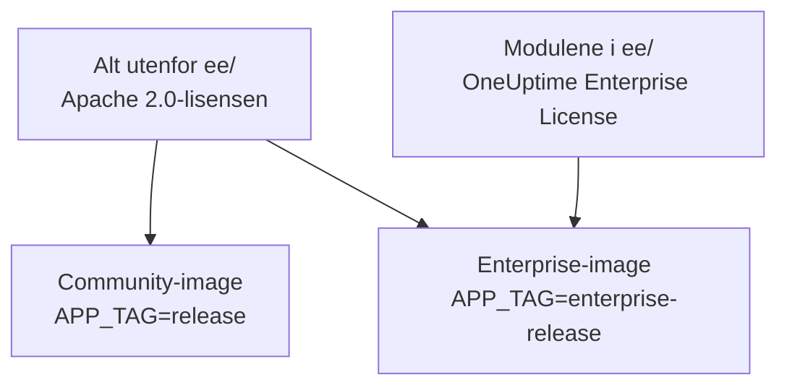
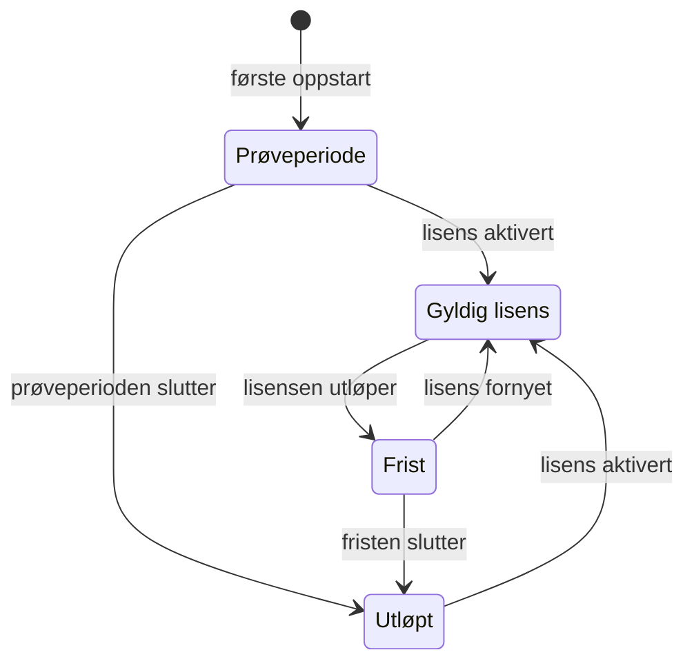

# Enterprise Edition

OneUptime bygges fra ett repository og leveres i to utgaver:

- **Community Edition**: hele plattformen for overvåking, hendelser og observerbarhet, inkludert enkel pålogging med SAML og OpenID Connect, åpen kildekode under Apache 2.0-lisensen og gratis å drifte selv i enhver skala.
- **Enterprise Edition**: Community Edition pluss enterprise-modulene i repositoriets mappe [`ee/`](https://github.com/OneUptime/oneuptime/tree/master/ee). Modulene legger til SCIM-klargjøring og funksjoner for styring og administrasjon av instansen. De er lisensiert under [OneUptime Enterprise License](https://github.com/OneUptime/oneuptime/blob/master/ee/LICENSE), og bruk i produksjon krever en Enterprise-lisens for antallet brukere du har.

De to utgavene er separate container-images. Community-imaget inneholder ingen kode fra `ee/`. OneUptime Cloud kjører Enterprise Edition, og i skyen avgjør abonnementet ditt hvilke av disse funksjonene du får.



> [!NOTE]
> **Enkel pålogging finnes i alle utgaver.** Pålogging med SAML og OIDC for prosjekter og statussider, global SSO og "Require SSO for login" er en del av Community Edition, og ingen lisenstilstand slår dem av.

Denne siden beskriver hva hver utgave inneholder, hvordan du kjører Enterprise Edition, hvordan lisensiering fungerer, og hva som skjer når du bytter utgave.

:::cards
- [Sammenlign utgavene](#hva-hver-utgave-inneholder): Hva Enterprise Edition legger til.
- [Kjør Enterprise-imaget](#kjøre-enterprise-edition): Én innstilling, på Kubernetes eller Docker Compose.
- [Aktiver en lisens](#lisensiering): Nettbasert med en nøkkel, eller frakoblet med et signert token.
- [Når en lisens utløper](#når-en-lisens-utløper-eller-mangler): Hva som stopper, hva som aldri stopper, og hvordan det kommer tilbake.
:::

## Hva hver utgave inneholder

| Funksjon | Community | Enterprise | OneUptime Cloud |
| --- | --- | --- | --- |
| Overvåking, varsler, hendelser, vakt, statussider, logger, metrikker, sporinger, unntak, dashbord, arbeidsflyter, KI-funksjoner, API og Terraform | Ja | Ja | Alle abonnementer |
| Pålogging med passord, tofaktorautentisering, team, roller og API-nøkler | Ja | Ja | Alle abonnementer |
| [SAML-SSO og OpenID Connect](/docs/identity/sso) for pålogging i prosjekter | Ja | Ja | Abonnementet Scale og høyere |
| SAML-SSO og OpenID Connect for pålogging på private statussider | Ja | Ja | Abonnementet Scale og høyere |
| [Global SSO og OIDC (for hele instansen)](/docs/identity/global-sso) | Ja | Ja | Ikke aktuelt |
| [SCIM-klargjøring](/docs/identity/scim) for prosjekter og statussider | Nei | Ja | Abonnementet Scale og høyere |
| Innstillinger for teamsamsvar | Nei | Ja | Abonnementet Scale og høyere |
| Revisjonslogger | Nei | Ja | Abonnementet Enterprise |
| Overstyringer av oppbevaring: oppbevaring etter telemetritype (logger, sporinger, metrikker, profiler, med regler etter loggalvorlighet og sporingsstatus) og oppbevaring per tjeneste og per ressurs | Nei | Ja | Abonnementet Scale og høyere |
| Administrasjonens **Health**-dashbord: oversikt over instansen, bakgrunnskøer, instanslogger, PostgreSQL, Valkey, ClickHouse-klynge, diagnoselogger og telemetriinntak | Nei | Ja | Ikke aktuelt |
| Administrasjonens **Query Console** | Nei | Ja | Ikke tilgjengelig |
| Helsevarsler for PostgreSQL og Valkey (Redis) | Nei | Ja | Ikke aktuelt |
| Kapasitetsvisning for ClickHouse, kapasitetsvarsler og automatisk opprydding av disken | Ja | Ja | Ikke aktuelt |
| Migreringsstatus, støttepakke og globale prober i Admin-dashbordet | Ja | Ja | Ikke aktuelt |
| Administrasjon av Enterprise-lisens, plasser og instanser | Nei | Ja | Ikke aktuelt |

Enkel pålogging omfatter "Require SSO for login" for prosjekter, private statussider og hele instansen, i begge utgavene.

Alle utgaver har prosjektets standardoppbevaring av telemetri under **Prosjektinnstillinger > Telemetri og APM > Dataoppbevaring**. Overstyringer av oppbevaring er det Enterprise Edition legger til i tillegg.

På OneUptime Cloud kan en betalt funksjon alltid slås av, på ethvert abonnement. En overstyring av oppbevaring som en prøveperiode (eller et bytte til et lavere abonnement) lot stå igjen, gjelder fortsatt for ny telemetri, så under abonnementet Scale viser oppbevaringssidene den under oppgraderingskortet med knappen **Fjern overstyring**. Fjerning fungerer på alle abonnementer; å angi en på nytt krever abonnementet Scale. Telemetri som allerede er lagret, beholder oppbevaringen den ble lagret med. På samme måte viser **Prosjektinnstillinger > Sikkerhet > SSO** bryteren **Krev SSO for innlogging** under oppgraderingskortet sitt så lenge prosjektet fortsatt krever SSO, slik at den kan slås av.

Rader med "Ikke aktuelt" er funksjoner for administrasjon av instansen. På OneUptime Cloud drifter OneUptime instansen for deg.

## Kjøre Enterprise Edition

Begge utgavene bruker den samme konfigurasjonen, de samme databasene og de samme dataene. Et bytte av utgave endrer imaget du kjører, og ingenting annet. Ingen migrering er nødvendig i noen retning.

:::tabs
@tab Kubernetes
Angi image-typen i `values.yaml`:

```yaml title="values.yaml"
image:
  type: enterprise-edition
```

Oppgrader deretter som vanlig:

```bash
helm upgrade my-oneuptime oneuptime/oneuptime -f values.yaml
```

Chartet henter da `enterprise-`-varianten av hver image-tag, for eksempel `oneuptime/app:enterprise-release`, eller `enterprise-<version>` når du fester `image.tag`. Angi `image.type: community-edition` (standardverdien) for å kjøre Community Edition.
@tab Docker Compose
Angi `APP_TAG` i `config.env`:

```bash title="config.env"
APP_TAG=enterprise-release
```

Bruk `enterprise-<version>` for å feste en release. Hent deretter imagene og start på nytt:

```bash
npm run update
```

For å gå tilbake til Community Edition angir du `APP_TAG=release` **og** `IS_ENTERPRISE_EDITION=false`. Så lenge `IS_ENTERPRISE_EDITION=true` er angitt, setter `npm run update` `APP_TAG` tilbake til `enterprise-release`, og Community-imaget nekter å starte.
:::

### `IS_ENTERPRISE_EDITION` er foreldet

Imaget du kjører, avgjør utgaven. `IS_ENTERPRISE_EDITION` slår ikke lenger på enterprise-funksjoner og fjernes i en fremtidig release. Du kan la den være uangitt.

Å angi `IS_ENTERPRISE_EDITION=true` på Community-imaget slår **ikke** på enterprise-funksjoner. Appen **nekter i stedet å starte**, slik at en oppgradering som havner på Community-imaget aldri i det stille kan stoppe SCIM-klargjøring (inkludert avregistrering) og revisjonslogging. Feilen forteller deg hva du skal angi: `APP_TAG=enterprise-<version>` for å beholde Enterprise Edition, eller `IS_ENTERPRISE_EDITION=false` for å kjøre Community Edition. Med Helm kan dette ikke skje: chartet utleder variabelen fra `image.type`.

`ONEUPTIME_EDITION=community` får Enterprise-imaget til å kjøre som Community Edition. Det er nyttig for å prøve en nedgradering før du gjennomfører den. Enterprise-imaget angir selv `ONEUPTIME_EDITION=enterprise`; ikke overstyr den med noe annet enn `community`.

## Lisensiering

Filen [`LICENSE`](https://github.com/OneUptime/oneuptime/blob/master/LICENSE) i roten av repositoriet fastsetter hvilken lisens som dekker hva: alt i mappen `ee/` er under [OneUptime Enterprise License](https://github.com/OneUptime/oneuptime/blob/master/ee/LICENSE), tredjepartskomponenter beholder lisensene eierne deres leverer dem under, og alt annet er under Apache 2.0-lisensen.

En ny installasjon av Enterprise Edition kjører som en **prøveperiode på 14 dager**, regnet fra første gang installasjonen starter Enterprise Edition. Prøveperioden er for evaluering: bruk av Enterprise Edition i produksjon krever et abonnement under OneUptime Enterprise License. Aktiver en lisens før prøveperioden slutter: etter den stopper SCIM, revisjonslogging og overstyringer av oppbevaring, og enterprise-konfigurasjonen blir skrivebeskyttet (se [Når en lisens utløper eller mangler](#når-en-lisens-utløper-eller-mangler)). Kontakt [sales@oneuptime.com](mailto:sales@oneuptime.com) for å få en lisens.

Lisensen administreres fra **utgavemerket**, som hovedadministratorer ser i toppfeltet i Admin-dashbordet og i bunnteksten i Dashbordet. Det viser lisensstatusen, bruken av plasser og, for hovedadministratorer, instans-ID-en.

### Nettbasert aktivering (lisensnøkkel)

:::steps
1. Logg på som hovedadministrator og åpne utgavemerket.
2. Skriv inn lisensnøkkelen og valider den.
:::

Installasjonen kontrollerer nøkkelen hos OneUptime og lagrer lisensen den mottar. Deretter holder den lisensen oppdatert med en daglig synkronisering. Bruk **Refresh license** på utgavemerket for å hente endringer, for eksempel ekstra plasser eller en fornyelse, med en gang.

Nettbasert aktivering krever utgående HTTPS fra OneUptime-serveren til `https://oneuptime.com`. Hvis serveren bare når internett gjennom et relé, angir du `ENTERPRISE_LICENSE_SERVER_URL` til reléets `https://`-adresse. Reléet må videresende `/api/enterprise-license/` til oneuptime.com.

### Frakoblet aktivering (installasjoner uten nettverkstilgang)

En installasjon uten rute til internett kan bruke et **signert lisenstoken** i stedet for en nøkkel:

:::steps
1. Logg på som hovedadministrator, åpne utgavemerket og noter **instans-ID-en**.
2. Be OneUptime ([sales@oneuptime.com](mailto:sales@oneuptime.com)) om et frakoblet lisenstoken for den instans-ID-en.
3. Lim inn tokenet i tokenfeltet på utgavemerket og aktiver det.
:::

Installasjonen verifiserer tokenet selv, mot OneUptimes signeringsnøkler som er bygd inn i releasen din. Den kontakter aldri OneUptime. Et token utstedt for én instans-ID avvises av alle andre installasjoner, og et token utstedt uten instans-ID (slik som tokenet en nettbasert aktivert installasjon mottar) avvises også. For å fornye eller legge til plasser aktiverer du et nytt token før det nåværende utløper.

> [!IMPORTANT]
> **Frakoblet aktivering krever en release som stoler på OneUptimes lisenssigneringsnøkkel.** Hvis releasen din ennå ikke inneholder den nøkkelen, mislykkes aktiveringen med "this build does not trust the key that signed this token". Aktiver i så fall nettbasert, eller oppgrader til en release som inneholder nøkkelen.

### Hva den daglige lisenssynkroniseringen sender

En nettbasert aktivert installasjon sender én rapport til OneUptime om dagen. Den inneholder:

- lisensnøkkelen;
- instans-ID-en (en tilfeldig identifikator som installasjonen genererer) og vertsnavnet installasjonen er konfigurert med (`HOST`);
- OneUptime-versjonen installasjonen kjører;
- antallet brukere på installasjonen;
- en **SHA-256-hash** av hver brukers e-postadresse med små bokstaver. OneUptime bruker hashene til å telle en person med kontoer på flere av installasjonene dine som én plass. Vanlige brukeres e-postadresser sendes aldri i klartekst;
- e-postadressene til installasjonens **hovedadministratorer**, slik at OneUptime kan kontakte deg om fornyelser og plassgrenser.

Svaret inneholder lisensen slik OneUptime kjenner den den dagen: firmanavn, utløpsdato, plassgrense, det samlede antallet brukere på tvers av installasjonene dine og installasjonene som er registrert på lisensen. Andre replikaer av installasjonen fanger opp en endring i løpet av omtrent ett minutt.

Når du aktiverer eller oppdaterer lisensen, sender installasjonen bare lisensnøkkelen, instans-ID-en, vertsnavnet og versjonen.

Ingenting annet sendes. Ingen overvåkingsdata, telemetri, logger eller konfigurasjon forlater installasjonen. Community Edition sender ikke noe av dette, og det gjør heller ikke en frakoblet aktivert installasjon.

### Når en lisens utløper eller mangler

Alle enterprise-funksjoner virker i prøveperioden på 14 dager og i 30 dager etter at en lisens har utløpt (fristen). Utgavemerket varsler før en av dem slutter. Etter det **stopper SCIM, revisjonslogging og overstyringer av oppbevaring** til en lisens aktiveres, akkurat som på Community Edition, og enterprise-konfigurasjonen blir skrivebeskyttet. Enkel pålogging er ikke en enterprise-funksjon: pålogging med SAML og OIDC, global SSO og "Require SSO for login" virker likt i alle lisenstilstander.



| Tilstand | Hva som skjer |
| --- | --- |
| **Gyldig lisens** | Alle enterprise-funksjoner virker. Nye brukere kan ikke legges til utover det lisensierte antallet plasser. Eksisterende brukere fjernes aldri. |
| **Prøveperiode eller frist** (de første 14 dagene av en installasjon uten lisens, eller 30 dager etter at en lisens har utløpt), eller en installasjon med en lisens der utløpet aldri ble registrert | Alle enterprise-funksjoner virker, og utgavemerket viser en advarsel. I fristen etter et utløp gjelder plassgrensen fortsatt. En installasjon med en lisens uten registrert utløp kjører den samme prøveperioden på 14 dager som en installasjon uten lisens, og plassgrensen håndheves ikke, fordi lisensoppføringen den har, allerede er ufullstendig. |
| **Etter prøveperioden eller fristen** (utløpt, manglende eller ugyldig lisens, eller en lisens som ikke omfatter funksjonen) | SCIM-klargjøring, revisjonslogging og overstyringer av oppbevaring **stopper** (se nedenfor). Enterprise-konfigurasjonen blir **skrivebeskyttet**: du kan se og slette den, men ikke opprette eller endre den. Én endring virker alltid, slik at du kan reagere på en hendelse: å bytte ut et SCIM-bærertoken. SCIM-innstillingssidene tilbyr den mens alt annet er skrivebeskyttet: **Tilbakestill bærertoken** på en SCIM-konfigurasjon, som viser det nye tokenet én gang. Via API-et sender du `bearerToken` alene (minst 32 tegn). Revisjonslogging kan ikke slås på eller utvides. Enterprise-dashbordene under Health og Query Console er låst. Plassgrensen håndheves ikke lenger. |

Hva som stopper når en lisens utløper:

- **SCIM-klargjøringen stopper.** SCIM-forespørslene fra identitetsleverandøren din avvises, inkludert avregistrering, og SCIM-teamlåser oppheves, slik at team som styres av SCIM-push-grupper, kan redigeres for hånd.
- **Revisjonsloggingen slutter å registrere.** Revisjonslogger som er registrert så langt, beholdes.
- **Overstyringer av oppbevaring slutter å gjelde.** Ny telemetri beholdes i prosjektets standardoppbevaring. Telemetri som allerede er lagret, beholder oppbevaringen den ble skrevet med. Du kan fortsatt fjerne en overstyring via API-et, men ikke angi en.

Hva som **ikke** stopper:

- **Enkel pålogging.** Pålogging med SAML og OIDC for prosjekter, private statussider, hele instansen (global SSO) og mobilappene, og "Require SSO for login", er en del av alle utgaver. En utløpt lisens endrer ingenting av dette, og konfigurasjonen for enkel pålogging kan fortsatt redigeres.
- **Kjerneovervåkingen påvirkes aldri**: monitorer, varsler, hendelser, vakt, statussider og telemetri fortsetter alle å virke.
- **Hovedadministratorer kan alltid logge på med passordet sitt.**
- **Ingenting slettes.** SCIM-konfigurasjon, revisjonslogger og overstyringer av oppbevaring forblir som de er.

**Alt fortsetter igjen så snart en lisens aktiveres**, uten omstart: SCIM-klargjøring, revisjonslogging og overstyringer av oppbevaring kommer tilbake med konfigurasjonen du har. OneUptime slår dem bare av når det vet at lisensen har utløpt. Så lenge det ikke kan lese lisenstilstanden, for eksempel et øyeblikk mens serveren starter, forblir SCIM, revisjonslogging og overstyringer av oppbevaring på.

> [!WARNING]
> **Hvis identitetsleverandøren din avregistrerer brukere via SCIM, må du aktivere en lisens før prøveperioden eller fristen slutter.** Etter det avregistrerer SCIM ikke lenger personene du fjerner hos identitetsleverandøren: OneUptime-kontoene deres blir værende, og med mindre "Require SSO for login" gjelder for dem, kan alle som fortsatt når innboksen til en slik konto, angi et passord og logge på. Hvis du lar lisensen utløpe, må du fjerne disse brukerne i OneUptime selv.

## Bytte fra Enterprise til Community

Konfigurasjonen din blir værende i databasen. Et bytte tilbake til Enterprise-imaget gjenoppretter alt slik det var, så lenge installasjonen har en gyldig lisens eller fortsatt er i prøveperioden eller fristen. Enkel pålogging endres ikke: pålogging med SAML og OIDC, global SSO og "Require SSO for login" virker likt på begge imagene. På Community-imaget:

- **SCIM stopper.** Klargjøringsendepunktene finnes ikke lenger, så SCIM-kall fra IdP-en mislykkes. Det gjelder også SCIM-avregistrering.
- **SCIM-teamlåser oppheves**, slik at team som ble styrt av SCIM-push-grupper, kan redigeres for hånd. Ved oppstart logger serveren hvilke prosjekter som fikk SCIM-teamlåsene opphevet.
- **Revisjonsloggingen stopper.** Revisjonslogger som er registrert så langt, beholdes, men revisjonsloggsidene viser en oppfordring til å oppgradere.
- **Overstyringer av oppbevaring slutter å gjelde.** Ny telemetri beholdes i prosjektets standardoppbevaring, og oppbevaringskortene under **Prosjektinnstillinger > Telemetri og APM > Dataoppbevaring** og på innstillingssiden for hver tjeneste og hver ressurs viser en oppfordring til å oppgradere. Overstyringene blir værende i databasen og gjelder igjen når du bytter tilbake.
- **Enterprise-innstillingssider viser en oppfordring til å oppgradere.** Via API-et kan du fortsatt lese og slette enterprise-konfigurasjon og tilbakestille et SCIM-bærertoken, men ikke opprette eller endre noe annet. Revisjonslogging kan ikke slås på.
- **Enterprise-dashbordene under Health, Query Console og helsevarslene for PostgreSQL og Valkey stopper.** Kapasitetsovervåking og opprydding for ClickHouse, migreringsstatus og støttepakken fortsetter å virke.

> [!CAUTION]
> **Før du bytter en installasjon der identitetsleverandøren avregistrerer brukere via SCIM, over til Community-imaget, bør du gå gjennom hvem som har tilgang.** Uten SCIM beholder personene du fjerner hos identitetsleverandøren, OneUptime-kontoene sine, og med mindre "Require SSO for login" gjelder for dem, kan alle som fortsatt når innboksen til en slik konto, angi et passord og logge på. Fjern disse brukerne først.

## Feilsøking

:::details Appen nekter å starte etter en oppgradering
`IS_ENTERPRISE_EDITION=true` er angitt på Community-imaget. Angi `APP_TAG=enterprise-<version>` for å beholde Enterprise Edition, eller `IS_ENTERPRISE_EDITION=false` for å kjøre Community Edition, og kjør deretter `npm run update` på nytt.
:::

:::details Frakoblet aktivering mislykkes med "this build does not trust the key that signed this token"
Releasen din ble bygd før den stolte på OneUptimes lisenssigneringsnøkkel. Aktiver nettbasert, eller oppgrader til en release som inneholder nøkkelen.
:::

:::details SCIM-forespørslene fra identitetsleverandøren din avvises
På Enterprise-imaget har lisensen utløpt: aktiver en, så fortsetter klargjøringen uten omstart. På Community-imaget finnes ikke SCIM-endepunktene i det hele tatt.
:::

## Neste steg

:::cards
- [Oppgradering](/docs/installation/upgrading): Bytt til en ny release, og mellom utgavenes images.
- [SSO](/docs/identity/sso): Enkel pålogging, i alle utgaver.
- [Global SSO](/docs/identity/global-sso): Én identitetsleverandør for hele instansen.
- [SCIM](/docs/identity/scim): Klargjør brukere og team fra identitetsleverandøren din.
:::
