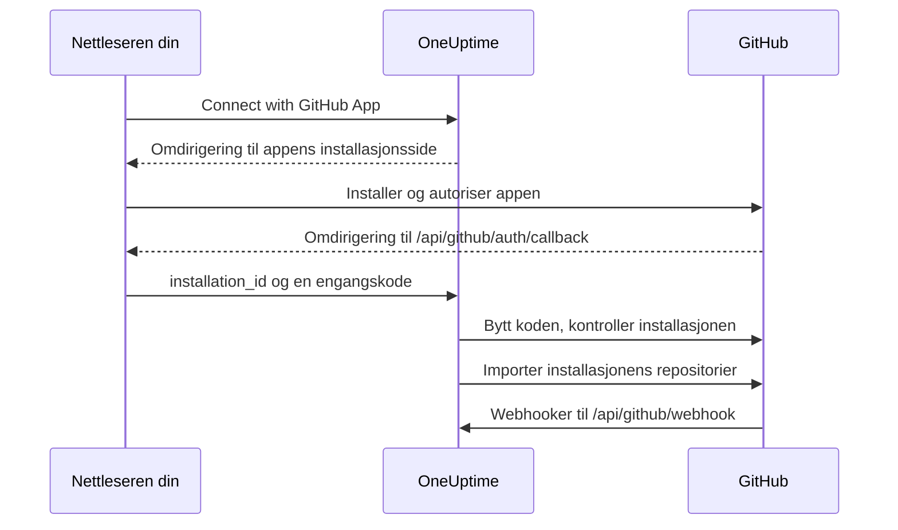

# GitHub-integrasjon

Koble din selvdriftede OneUptime til GitHub med en GitHub App du eier selv. Når appen er installert fra OneUptime, importeres installasjonens repositorier til prosjektet ditt og holdes synkronisert, AI-rettingsoppgaver åpner pull requests, og teamet ditt kan gi appen oppgaver fra GitHub ved å nevne den.

Denne siden er for den som drifter OneUptime-serveren: Du oppretter appen én gang, og deretter kobler hvert prosjekt den til fra **Koderepositorier**.

:::cards
- [Opprett GitHub-appen](#opprett-github-appen): Registrer appen med riktige URL-er, tillatelser og hendelser.
- [Konfigurer OneUptime](#konfigurer-oneuptime): Gi serveren appens seks verdier.
- [Koble til repositorier](#koble-til-repositorier): Installer appen fra OneUptime.
- [Feilsøking](#feilsøking): Hva meldingene under Koderepositorier betyr.
:::

## Slik fungerer det

Installasjonen starter i OneUptime, ikke på GitHub: Lenken OneUptime sender deg til GitHub med, er det som knytter installasjonen til prosjektet ditt.



- Omdirigeringen i nettleseren bærer installasjonen og en OAuth-engangskode. OneUptime bytter koden for å bekrefte at GitHub-kontoen som installerte appen, administrerer installasjonen, og importerer deretter repositoriene.
- Webhooker holder listen over repositorier synkronisert og gir appen oppgaver: omtaler, tildelinger, utløser-etiketter og forespørsler om gjennomgang. GitHub signerer hver av dem med webhook-secret, og OneUptime avviser dem den ikke kan verifisere.

## Før du begynner

- En GitHub-konto som kan opprette GitHub Apps for organisasjonen eller brukeren appen skal installeres på. For å installere den i en organisasjon må du være eier av den, eller få en eier til å godkjenne forespørselen.
- Et offentlig HTTPS-vertsnavn for OneUptime som GitHub kan nå for webhooker. Se [Nettverkstilgang](#nettverkstilgang-for-selvdriftede-installasjoner).
- Tilgang til serverens konfigurasjon: `config.env` for Docker Compose, eller Helm-values for Kubernetes.

## Opprett GitHub-appen

:::steps
### Åpne innstillingene for GitHub Apps

- **For en organisasjon:** `https://github.com/organizations/YOUR_ORG/settings/apps`
- **For en personlig konto:** `https://github.com/settings/apps`

Velg **New GitHub App**.

### Fyll ut registreringsskjemaet

| Felt | Verdi |
| --- | --- |
| **GitHub App name** | Et hvilket som helst unikt navn, for eksempel `OneUptime`. Noter det nøyaktig: Det er `GITHUB_APP_NAME`. |
| **Homepage URL** | `https://your-oneuptime-domain.com` |
| **Callback URL** | `https://your-oneuptime-domain.com/api/github/auth/callback` |
| **Request user authorization (OAuth) during installation** | På. **Den er påkrevd**: se merknaden nedenfor. |
| **Setup URL** | `https://your-oneuptime-domain.com/api/github/auth/callback`, hvis GitHub lar deg skrive inn en (se nedenfor). |
| **Redirect on update** | Valgfritt. Etter at noen har endret en installasjon på GitHub, sender OneUptime dem til **Koderepositorier**. |
| **Webhook URL** | `https://your-oneuptime-domain.com/api/github/webhook`, med webhooken satt til **Active**. |
| **Webhook secret** | En lang tilfeldig streng. Noter den: Den er `GITHUB_APP_WEBHOOK_SECRET`. **Påkrevd**: OneUptime avviser usignerte webhooker, så hvis `GITHUB_APP_WEBHOOK_SECRET` ikke er satt, stopper synkroniseringen av repositorier i stedet for at uverifiserte nyttelaster godtas. |

Ifølge GitHubs dokumentasjon kan du med **Request user authorization (OAuth) during installation** slått på [ikke skrive inn en Setup URL](https://docs.github.com/en/apps/creating-github-apps/registering-a-github-app/about-the-setup-url): Brukere sendes i stedet til Callback URL etter at de har installert appen. Begge peker på samme OneUptime-adresse, så omdirigeringen havner på riktig sted uansett.

> [!IMPORTANT]
> **Hvorfor "Request user authorization (OAuth) during installation" er påkrevd.** Etter en installasjon omdirigerer GitHub tilbake med en `installation_id` i URL-en. Det tallet alene beviser ingenting om hvem som eier installasjonen — hvem som helst kan skrive inn et annet. Med dette alternativet slått på returnerer GitHub også en OAuth-`code` til engangsbruk, knyttet til GitHub-kontoen som utførte installasjonen, som OneUptime bytter for å bekrefte at kontoen virkelig administrerer installasjonen før den kobles til prosjektet ditt.
>
> Uten det nekter OneUptime å koble til installasjonen, og dashbordet viser en feil som ber deg slå på innstillingen. Dette er med vilje: Å godta installasjons-ID-en uten verifisering ville la ett OneUptime-prosjekt gjøre krav på en annen organisasjons repositorier.

### Angi tillatelsene

Angi disse **Repository permissions** under **Permissions & events**:

| Tillatelse | Tilgang | Hva OneUptime bruker den til |
| --- | --- | --- |
| Contents | Read and write | Lese filer i repositoriet og pushe grenene til AI-rettingenes pull requests |
| Pull requests | Read and write | Åpne og oppdatere pull requests, og legge ut gjennomganger |
| Issues | Read and write | Legge ut appens kommentarer — **også på pull requests**, der GitHub sender samtalen gjennom issues-API-et |
| Checks | Read-only | Valgfritt. Lese CI-resultatet for rettingenes pull requests. Uten den forblir CI-statusen deres uverifisert |
| Metadata | Read-only | Grunnleggende metadata for repositoriet (påkrevd av GitHub) |

**Det er Issues: Read and write som gjør appen interaktiv.** Uten den mottas omtaler, men de mislykkes stille når appen prøver å svare — GitHub leverer kommentarer i pull request-samtaler fra issues-API-et, så denne ene tillatelsen avgjør hvert svar appen skriver. Se [Arbeid med OneUptime fra GitHub](/docs/ai/github-app).

OneUptime trenger ingen tillatelser på organisasjons- eller kontonivå.

### Abonner på webhook-hendelser

OneUptime bruker to sett med hendelser, og de gjør ulike jobber.

**Synkronisering av repositorier** — `installation` og `installation_repositories`. GitHub Apps mottar disse automatisk; de holder settet av tilkoblede repositorier i takt med hvor appen er installert.

**Den interaktive appen** — disse må du abonnere på eksplisitt, og hver av dem gjør det mulig å gi appen oppgaver på en bestemt måte:

| Hendelse | Hva den gjør mulig |
| --- | --- |
| **Issue comment** | `@mention`-kommandoer i issues **og** i pull requests |
| **Issues** | å tildele appen en issue, og repositoriets utløser-etikett |
| **Pull request** | å be appen om en gjennomgang |
| **Pull request review** | en omtale skrevet i teksten til en innsendt gjennomgang |
| **Pull request review comment** | en omtale i en innebygd kommentar i diffen |

Hvis du ikke abonnerer på noen av disse, kobler GitHub-appen fortsatt til repositorier og åpner fortsatt rettingenes pull requests fra OneUptime — den svarer bare aldri på noe som skrives i GitHub. Det er den vanligste årsaken til «boten ignorerer meg». Se [Arbeid med OneUptime fra GitHub](/docs/ai/github-app) for hvilke kommandoer som finnes, og hvem som får gi dem.

Andre hendelser (**Push**, **Workflow run**) bekreftes og ignoreres; å abonnere på dem slår ikke på varsler eller CI/CD-automatisering.

### Velg hvor appen kan installeres

Velg under **Where can this GitHub App be installed?**:

- **Only on this account** - For privat/intern bruk
- **Any account** - Hvis du vil at andre skal kunne installere appen din

### Opprett appen og noter ID-ene

Velg **Create GitHub App**. GitHub åpner appens innstillingsside. Noter **App ID** øverst på siden og **Client ID** i delen **About**.

### Generer en client secret

Velg **Generate a new client secret** under **Client secrets**. Kopier den med en gang: GitHub viser den bare én gang.

### Generer en privat nøkkel

Velg **Generate a private key** under **Private keys**. GitHub laster ned en `.pem`-fil. Oppbevar den trygt: Den lar OneUptime autentisere seg som appen.
:::

## Konfigurer OneUptime

:::tabs
@tab Docker Compose
`config.env` har én verdi per linje, så oppgi den private nøkkelen base64-kodet på én linje. OneUptime dekoder den:

```bash
base64 < private-key.pem | tr -d '\n'
```

```bash title="config.env"
GITHUB_APP_ID=YOUR_APP_ID
GITHUB_APP_NAME=YOUR_APP_NAME
GITHUB_APP_CLIENT_ID=YOUR_CLIENT_ID
GITHUB_APP_CLIENT_SECRET=YOUR_CLIENT_SECRET
GITHUB_APP_PRIVATE_KEY=YOUR_BASE64_ENCODED_PRIVATE_KEY
GITHUB_APP_WEBHOOK_SECRET=YOUR_WEBHOOK_SECRET
```

Ta i bruk endringen med `npm run start`, som oppretter containerne på nytt. `docker compose restart` leser ikke `config.env` på nytt.
@tab Kubernetes
```yaml title="values.yaml"
gitHubApp:
  id: "YOUR_APP_ID"
  name: "YOUR_APP_NAME" # The exact name of your GitHub App
  clientId: "YOUR_CLIENT_ID"
  clientSecret: "YOUR_CLIENT_SECRET"
  privateKey: "<BASE64_ENCODED_PRIVATE_KEY_CONTENT>"
  webhookSecret: "YOUR_WEBHOOK_SECRET"
```

`privateKey` tar også selve PEM-en, som en blokk over flere linjer (`privateKey: |`). Ta i bruk endringen med `helm upgrade`.
:::

Når OneUptime er oppe igjen, viser **Koderepositorier** knappen **Connect with GitHub App** i stedet for **GitHub App is not configured on this server**.

### Oversikt over miljøvariabler

| Docker Compose (`config.env`) | Helm (`values.yaml`) | Verdi |
| --- | --- | --- |
| `GITHUB_APP_ID` | `gitHubApp.id` | **App ID**. Brukes til å autentisere som appen. |
| `GITHUB_APP_NAME` | `gitHubApp.name` | Appens nøyaktige navn. Installasjonslenken og appens `@mention`-handle (med små bokstaver, bindestreker i stedet for mellomrom) bygges fra det. Uten det kan ikke **Koderepositorier** koble til. |
| `GITHUB_APP_CLIENT_ID` | `gitHubApp.clientId` | **Client ID**. Trengs for å kontrollere hvem som installerte appen. |
| `GITHUB_APP_CLIENT_SECRET` | `gitHubApp.clientSecret` | Client secret-en du genererte. Trengs sammen med client ID. |
| `GITHUB_APP_PRIVATE_KEY` | `gitHubApp.privateKey` | Den private nøkkelen: PEM-en, eller PEM-en base64-kodet. |
| `GITHUB_APP_WEBHOOK_SECRET` | `gitHubApp.webhookSecret` | Webhook-secret. Hver webhook verifiseres med den, og ingen godtas uten den. |

Alle seks er påkrevd.

## Koble til repositorier

Start tilkoblingen fra OneUptime, ikke fra appens side på GitHub: Lenken OneUptime sender deg til GitHub med, er det som knytter installasjonen til prosjektet ditt.

:::steps
1. Logg på OneUptime-dashbordet ditt
2. Gå til **Produkter** > **Oppgaver** > **Koderepositorier**
3. Klikk på **Connect with GitHub App**. OneUptime sender deg til GitHub
4. Velg organisasjonen eller kontoen appen skal installeres på, og velg hvilke repositorier den får tilgang til: **All repositories** (alle nåværende og fremtidige repositorier) eller **Only select repositories**
5. Klikk på **Install** (eller **Save**, hvis appen allerede er installert der)
6. GitHub sender deg tilbake til **Koderepositorier**, og hvert repositorium i installasjonen importeres. Repositorier som senere legges til i eller fjernes fra installasjonen, holdes automatisk synkronisert.
:::

**Hvem som kan koble til.** Tilkoblingen importerer installasjonens repositorier til prosjektet og krever derfor tillatelse til å legge til koderepositorier: **Project Owner**, **Project Admin**, **Project Member**, **Settings Admin**, **Settings Member**, eller et team med **Create Code Repository**. Et team som blokkerer tillatelsen, fjerner den. På OneUptime Cloud krever koderepositorier Growth-abonnementet eller høyere. For alle andre er kortet låst og sier hva som trengs.

**Fullfør innen 15 minutter, i samme nettleser.** Lenken virker én gang, i 15 minutter, i nettleseren som startet den. Når GitHub sender deg tilbake, kontrollerer OneUptime tillatelsen på nytt før den importerer noe.

## Nettverkstilgang for selvdriftede installasjoner

### Trafikkretning og endepunkter

| Trafikk | Nødvendig tilgang |
| --- | --- |
| OneUptime til GitHub | DNS og utgående HTTPS på TCP 443 til `api.github.com` for tokener til GitHub-appen og API-kall mot repositorier, og til `github.com` for utveksling av OAuth-token og Git-operasjoner over HTTPS |
| GitHub til OneUptime | Offentlig HTTPS på TCP 443 til `POST /api/github/webhook` for synkronisering av installasjoner og repositorietilgang, og for den interaktive appen |
| Brukerens nettleser til OneUptime | Tilgang til dashbordet og `GET /api/github/auth/callback` for omdirigeringer ved installasjon og autorisasjon; disse kan fortsatt nås via brukerens VPN |

Callbacken er en [omdirigering i nettleseren](https://docs.github.com/en/apps/creating-github-apps/registering-a-github-app/about-the-user-authorization-callback-url), mens webhooken er en forespørsel fra GitHubs servere. En brukers VPN-tilkobling gir ikke GitHub tilgang til webhooken. Domenene ovenfor dekker integrasjonens kjerneforespørsler; ekstra verktøy for repositorier, nedlastinger, LFS eller pakker kan kreve andre mål. Disse innstillingene beskriver GitHub.com; å endre brannmuren setter ikke opp støtte for vertsnavnet til en GitHub Enterprise Server.

### Private installasjoner og sikkerhet for callbacker

Eksponer `/api/github/webhook` gjennom en offentlig gateway med offentlig DNS, et offentlig klarert HTTPS-sertifikat med fullstendig kjede og en privat rute til OneUptimes ingress. Tillat innkommende TCP 443 til gatewayen, og begrens den offentlige videresendingen til denne POST-ruten. Behold dashbordet og nettleserens callback på den private ingressen hvis brukerne når dem over VPN; delt DNS kan levere samme vertsnavn internt og eksternt.

Angi `HOST=oneuptime.example.com` og `HTTP_PROTOCOL=https` i `config.env`, eller `host: oneuptime.example.com` og `httpProtocol: https` i Helm. Ta i bruk konfigurasjonen og vent til OneUptime har startet på nytt. Disse verdiene genererer URL-er; de setter ikke opp DNS, TLS eller nettverkstilgang. Hvis vertsnavnet endres, oppdaterer du GitHub-appens webhook-, callback-, setup- og hjemmeside-URL-er.

Bevar metoden, den opprinnelige banen, spørrestrengen, bodyen, `Content-Type`, `X-Hub-Signature-256`, `X-GitHub-Event` og `X-GitHub-Delivery`. Bevar den offentlige verten og HTTPS-skjemaet via klarerte proxy-headere. Unnta webhooken fra nettleser-SSO, CAPTCHA og proxyens påloggingssider. La GitHubs SSL-verifisering være slått på, og konfigurer samme `GITHUB_APP_WEBHOOK_SECRET` i begge systemene: OneUptime avviser usignerte forespørsler og kan ikke validere webhooker uten denne secret-en. Se [GitHubs veiledning om validering av webhooker](https://docs.github.com/en/webhooks/using-webhooks/validating-webhook-deliveries).

Hvis du også begrenser webhookenes kilde-IP-er, bruker du de gjeldende `hooks`-områdene fra GitHubs Meta API og oppdaterer dem jevnlig; ikke erstatt dem med områdene for GitHub Actions-runnere, og ikke dropp signaturverifiseringen. GitHub advarer om at [adressene deres endres og at den publiserte listen ikke er fullstendig](https://docs.github.com/en/authentication/keeping-your-account-and-data-secure/about-githubs-ip-addresses).

### Kontroller tilgangen, og forstå begrensningene

:::steps
1. Koble til en installasjon fra **Koderepositorier**.
2. Åpne **Advanced** i GitHub-appens innstillinger, og se på **Recent Deliveries**. Lever en leveranse på nytt, og bekreft at gatewayen videresender den og at OneUptime godtar den.
3. Legg til eller fjern et testrepositorium i installasjonen, og sjekk at listen over repositorier i OneUptime følger etter.
:::

GitHub dokumenterer [feilsøking av leveranser](https://docs.github.com/en/webhooks/testing-and-troubleshooting-webhooks/viewing-webhook-deliveries) og krever [en 2xx-bekreftelse innen ti sekunder](https://docs.github.com/en/webhooks/using-webhooks/best-practices-for-using-webhooks). En GET fra nettleseren mot webhooken tester ikke en signert POST.

> [!WARNING]
> Uten innkommende tilgang kan autorisasjon i nettleseren og utgående API- og Git-operasjoner fungere, men webhooker kan ikke nå OneUptime: Slettede installasjoner og endringer i repositorietilgang synkroniseres ikke, og appen svarer aldri på omtaler, tildelinger eller forespørsler om gjennomgang.

[Innstillingen for tilgang til private nettverk](/docs/self-hosted/private-network-access) styrer utgående forespørsler til private mål og gjør ikke webhooken tilgjengelig for GitHub.

## Feilsøking

### Tilkoblingen ble ikke fullført

Når GitHub sender deg tilbake og installasjonen ikke ble koblet til, viser **Koderepositorier** meldingen **GitHub ble ikke koblet til**, med én setning på språket ditt som sier hvorfor. Resten av siden lastes som vanlig, så du kan koble til på nytt med en gang. Den viser aldri hva GitHub selv svarte: Det står i OneUptime-serverens logg, sammen med årsaken.

| Siden sier | Hva du gjør |
| --- | --- |
| **"Denne tilkoblingslenken er ugyldig, har utløpt eller er allerede brukt. Start på nytt."** | Lenken virker én gang, i 15 minutter, i nettleseren som startet den. Start på nytt fra **Koderepositorier**, og fullfør på GitHub innen 15 minutter i samme nettleser. Å installere appen fra siden dens på GitHub kobler den ikke til noe prosjekt. |
| **"Du har ikke tillatelse til å legge til kode-repositorier i dette prosjektet."** | Tilkoblingen krever tillatelse til å legge til koderepositorier (se [Koble til repositorier](#koble-til-repositorier)). Be en prosjektadministrator om å gi den. Den kontrolleres på nytt når GitHub sender deg tilbake, så en tillatelse som er fjernet i mellomtiden, avslutter også tilkoblingen her. |
| **"Å koble til GitHub krever ...-abonnementet."** | På OneUptime Cloud krever koderepositorier abonnementet setningen nevner. Oppgrader prosjektets abonnement, og koble til på nytt. |
| **"GitHub bekreftet ikke hvem som installerte appen, så installasjonen kunne ikke kontrolleres."** | Slå på **Request user authorization (OAuth) during installation** i GitHub-appens innstillinger (se [Opprett GitHub-appen](#opprett-github-appen)), og koble til på nytt. |
| **"OneUptime kunne ikke bekrefte at GitHub-kontoen din kan administrere denne installasjonen."** | GitHub-kontoen som fullførte installasjonen, administrerer den ikke. Installer appen med en konto som eier organisasjonen eller brukeren den installeres på, eller be en eier om å gjøre det. |
| **"GitHub sendte ingen installasjon tilbake."** | Når et medlem av organisasjonen ber om appen i stedet for å installere den, må en eier av organisasjonen godkjenne forespørselen først. Koble til på nytt når det er gjort. |
| **"GitHub App er ikke satt opp på denne OneUptime-serveren."** | Angi både `GITHUB_APP_CLIENT_ID` og `GITHUB_APP_CLIENT_SECRET` (se [Konfigurer OneUptime](#konfigurer-oneuptime)), og start OneUptime på nytt. |
| **"OneUptime kunne ikke fullføre tilkoblingen. Prøv igjen."** | GitHub svarte med en feil, eller en forespørsel eller en skriving mislyktes under fullføringen. OneUptime-serverens logg sier hvilken. Prøv igjen; hvis det fortsetter, sjekker du loggen og GitHub-appens innstillinger. |

### Andre problemer

:::details Koderepositorier sier "GitHub App is not configured on this server"
`GITHUB_APP_NAME` er ikke satt. Sett den til appens nøyaktige navn, sammen med de fem andre verdiene, og start OneUptime på nytt.
:::

:::details Jeg blir ikke sendt tilbake til OneUptime etter at jeg har installert appen
Kontroller at appens **Callback URL** er `https://your-oneuptime-domain.com/api/github/auth/callback`, og det samme for **Setup URL** hvis den er satt. Begge må peke på samme endepunkt `/api/github/auth/callback`, på vertsnavnet i `HOST`.
:::

:::details GitHubs Recent Deliveries viser "Invalid webhook signature"
Webhook-secret i GitHub-appen og `GITHUB_APP_WEBHOOK_SECRET` er forskjellige, `GITHUB_APP_WEBHOOK_SECRET` er ikke satt, eller en proxy har endret forespørselens body. Sett samme secret begge steder, start OneUptime på nytt, og sørg for at gatewayen videresender bodyen uendret.
:::

:::details Webhook-hendelser mottas ikke
Kontroller at webhook-URL-en kan nås offentlig over HTTPS, og se deretter på **Advanced > Recent Deliveries** i GitHub-appens innstillinger for hvert forsøk og svaret på det. Webhooker avvises så lenge `GITHUB_APP_WEBHOOK_SECRET` ikke er satt.
:::

:::details Repositorier eller rettingsoppgaver feiler med en autentiseringsfeil
OneUptime autentiserer seg som appen med `GITHUB_APP_ID` og `GITHUB_APP_PRIVATE_KEY`. Kontroller at App ID er riktig og at nøkkelen er den fullstendige PEM-en, inkludert linjene `BEGIN` og `END`, eller den PEM-en base64-kodet. Hvis appen er avinstallert fra GitHub, kobler du den til på nytt fra **Koderepositorier**.
:::

:::details Repositorier mangler etter installasjonen
Sjekk i installasjonens innstillinger på GitHub hvilke repositorier den har tilgang til. Repositorier du legger til der, importeres automatisk, så lenge webhooker når OneUptime.
:::

:::details Appen ignorerer omtaler i GitHub
Gi appen **Issues: Read and write**, og abonner den på de interaktive hendelsene i [Abonner på webhook-hendelser](#abonner-på-webhook-hendelser). Omtaler samsvarer dessuten bare med handlet som bygges fra `GITHUB_APP_NAME`, så sett den til appens virkelige navn.
:::

## Beste praksis for sikkerhet

- **Roter hemmeligheter jevnlig.** Generer nye client secrets og private nøkler med jevne mellomrom.
- **La webhook-secret være satt.** OneUptime avviser webhooker den ikke kan verifisere.
- **Begrens tilgangen til repositorier.** Gi installasjonen bare repositoriene som må kobles til.
- **Følg med på webhook-leveranser.** Sjekk jevnlig etter mislykkede leveranser eller mistenkelig aktivitet.
- **Hold private nøkler utenfor versjonskontroll.**

## Neste steg

:::cards
- [Arbeid med OneUptime fra GitHub](/docs/ai/github-app): Kommandoene man kan gi appen, og hvem som får gi dem.
- [Rettingsoppgaver](/docs/ai/ai-agent): Hvordan AI-agenten åpner rettingenes pull requests.
- [Tilgang til privat nettverk](/docs/self-hosted/private-network-access): La arbeidsflyter og webhooker nå interne verktøy.
:::
