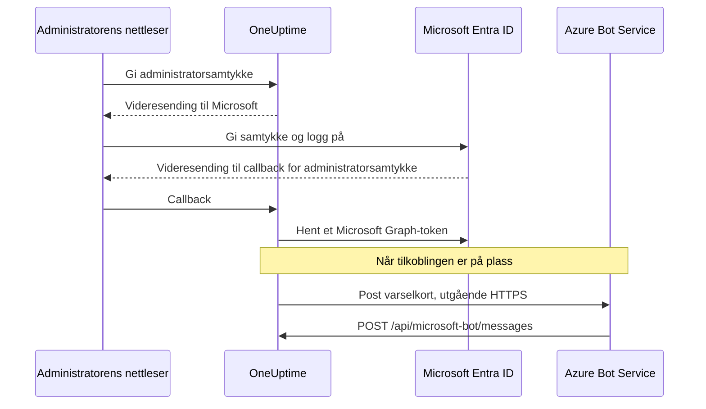
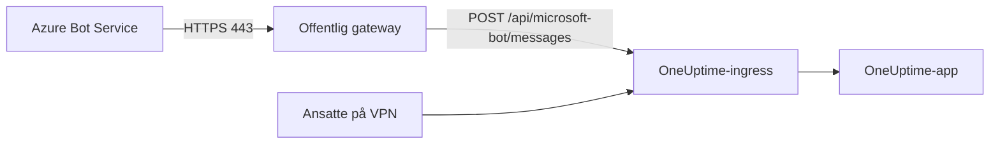

# Microsoft Teams-integrasjon

Koble din selvhostede OneUptime til Microsoft Teams. Du registrerer en app i Microsoft Entra ID, oppretter en Azure Bot for den, gir OneUptime påloggingsinformasjonen til appen og installerer Teams-app-pakken som serveren din genererer. Deretter poster OneUptime varsler og hendelser i kanalene og chattene dine, og teamet ditt handler på dem rett fra Teams.

Denne siden er for den som drifter OneUptime-serveren. Når Teams er koblet til, settes varslingsregler opp per prosjekt: se [Microsoft Teams](/docs/workspace-connections/microsoft-teams).

:::cards
- [Sett opp integrasjonen](#sett-opp-integrasjonen): Ni trinn, fra Azure-portalen til ditt første team.
- [Miljøvariabler](#miljøvariabler): De tre verdiene OneUptime trenger fra app-registreringen.
- [Nettverkstilgang](#nettverkstilgang): Bot-endepunktet som Microsoft må kunne nå.
- [Feilsøking](#feilsøking): Endepunkter som ikke kan nås, manglende installasjoner og tilkoblinger som mislyktes.
:::

## Slik fungerer det

OneUptime bruker en Azure Bot til Teams-integrasjonen. Trafikken går begge veier, og de to retningene er uavhengige: OneUptime kaller Microsoft for å poste meldinger, og Azure Bot Service kaller serveren din når noen trykker på en knapp, skriver til boten eller legger den til i en chat.



En Incoming Webhook eller en Teams-arbeidsflyt-URL erstatter ikke meldingsendepunktet til denne boten.

Videosamtaler (et Teams-møte for en hendelse) bruker ikke denne boten: de trenger sin egen app-registrering, beskrevet i [Videosamtaler](/docs/workspace-connections/video-calls#one-click-connect-on-a-self-hosted-server).

## Før du begynner

- Et Azure-abonnement for Azure Bot-ressursen.
- En konto som kan opprette app-registreringer i Microsoft Entra ID, og en Microsoft 365-administrator som kan gi administratorsamtykke.
- Et offentlig HTTPS-vertsnavn for OneUptime som Azure Bot Service kan nå. Se [Nettverkstilgang](#nettverkstilgang).
- Tilgang til serverkonfigurasjonen: `config.env` med Docker Compose, eller Helm-values på Kubernetes.
- For å koble til et prosjekt: rollen **Project Owner**, **Project Admin** eller **Project Member** i prosjektet.

## Sett opp integrasjonen

:::steps
### Trinn 1: Opprett Azure-app-registreringen

Åpne **App registrations** i [Azure-portalen](https://portal.azure.com), og velg **New registration**. Fyll ut skjemaet:

- **Name:** oneuptime
- **Supported account types:** Accounts in this organizational directory only (Single tenant)
- **Redirect URI:** Web - `https://your-oneuptime-domain.com/api/microsoft-teams/auth`

Velg **Register**, og legg deretter til en ny Web-omdirigerings-URI, `https://your-oneuptime-domain.com/api/microsoft-teams/admin-consent/callback`. Noter **Application (client) ID** og **Directory (tenant) ID**: du trenger begge senere.

> [!NOTE]
> **Hvorfor én leietaker:** en selvhostet OneUptime-installasjon betjener én organisasjon, og boten er registrert for den ene leietakeren du angir i `MICROSOFT_TEAMS_APP_TENANT_ID` (trinn 6). Å registrere appen som flerleietaker utvider ikke dette og innfører en feilmåte: gjeste- / B2B-brukere med en annen Microsoft-hjemmeleietaker enn din når boten med sin egen leietaker-ID, som OneUptime ikke kan knytte til prosjektet ditt. Har du allerede registrert en flerleietaker-app, fortsetter den å virke; bare sørg for at `MICROSOFT_TEAMS_APP_TENANT_ID` er din egen leietaker, og regn med at gjestekontoer trenger en konto i leietakeren din for å bruke boten.

### Trinn 2: Konfigurer apptillatelsene

Åpne **API permissions** i app-registreringen, velg **Add a permission**, og velg **Microsoft Graph**.

**Legg til delegerte tillatelser** (når appen handler på vegne av en pålogget bruker):

- **User.Read** - Kreves for å hente profilinformasjonen til den autentiserte brukeren (visningsnavn, e-post) under OAuth-flyten
- **Team.ReadBasic.All** - Kreves for å liste teamene brukeren er medlem av når brukeren velger hvilket team som skal kobles til
- **Channel.ReadBasic.All** - Kreves for å lese kanalinformasjon og liste kanalene i teamene for levering av varsler
- **ChannelMessage.Send** - Kreves for å sende varsler om hendelser og varsler til Teams-kanaler

**Legg til programtillatelser** (når appen handler som seg selv, uten en pålogget bruker):

- **Team.ReadBasic.All** - Kreves for å liste alle team i organisasjonen etter at administratorsamtykke er gitt
- **Channel.ReadBasic.All** - Kreves for å bekrefte at kanaler finnes og hente detaljene deres
- **TeamsAppInstallation.ReadForTeam.All** - Kreves for diagnostikk. Den lar OneUptime lese hvilken app-pakke som faktisk er installert i et team, og sammenligne den med klient-ID-en til denne installasjonen, slik at en mislykket sending kan fortelle deg *hvilken* av de mulige årsakene det er. Uten den kan ikke OneUptime skille "ikke installert" fra "installert, men det er noen andres pakke", og den melder bare hva Microsoft sa. Det er hovedgrunnen til at feilsøking av denne integrasjonen tar dager i stedet for minutter. Gi den.
- **Chat.ReadBasic.WhereInstalled** - Valgfri. Den lar OneUptime lese navnet på hver chat som OneUptime-appen er med i. Uten den gir hver chat dette gjennom manifesttillatelsen **ChatSettings.Read.Chat** (nedenfor), som en chat som ble lagt til med et eldre manifest, først har når appen er oppdatert i den.

`ChannelMessage.Send` er bare en delegert tillatelse; det finnes ingen variant som programtillatelse i [referansen for Microsoft Graph-tillatelser](https://learn.microsoft.com/en-us/graph/permissions-reference#channelmessagesend). Behold den i listen over delegerte tillatelser ovenfor.

Velg deretter **Grant admin consent** for organisasjonen din.

Selve boten bruker tillatelser for ressursspesifikt samtykke (RSC) som er definert i Teams-appmanifestet. De gis når appen installeres eller oppdateres i et team eller en chat, ikke i Entra ID:

- **ChannelMessage.Send.Group** - Lar boten sende meldinger til teamkanaler
- **ChannelMessage.Read.Group** - Lar boten lese kanalmeldinger for interaktive kommandoer
- **Channel.Create.Group** - Lar boten opprette kanaler ved behov
- **ChatMessage.Read.Chat** - Lar boten lese meldinger i chatter den er lagt til i (for interaktive kommandoer)
- **ChatMember.Read.Chat** - Lar boten lese medlemmene i chatter den er lagt til i (for å gi chatter navn i OneUptime)
- **ChatSettings.Read.Chat** - Lar OneUptime lese navnet på gruppechatter som appen er lagt til i. Teams sender ikke navnet på en gruppechat pålitelig til boten, så uten den vises en gruppechat med navn med medlemmenes navn
- **TeamsAppInstallation.Read.Group** - Lar OneUptime bekrefte at appen er installert i et team den skal poste i

Hvis du lastet opp appmanifestet før disse tillatelsene fantes, laster du det ned på nytt fra **Prosjektinnstillinger > Arbeidsområde > Microsoft Teams** og laster det opp til Teams som en oppdatering av OneUptime-appen. Teams gir team- og chattillatelsene når appen installeres eller oppdateres i det teamet eller den chatten, så godta oppdateringen i hvert team og hver chat som allerede har appen. For chatter, se [En gruppechat vises med medlemmenes navn](#en-gruppechat-vises-med-medlemmenes-navn).

### Trinn 3: Opprett en klienthemmelighet

Åpne **Certificates & secrets** i app-registreringen, og velg **New client secret**. Legg til en beskrivelse, velg en utløpstid (24 måneder er et fornuftig valg), og velg **Add**. Kopier verdien av hemmeligheten med en gang: Azure viser den bare én gang.

> [!IMPORTANT]
> Kopier hemmelighetens **Value**, ikke **Secret ID**. Verdien er den lengste strengen.

### Trinn 4: Opprett en Bot Service

Opprett en **Azure Bot**-ressurs i Azure-portalen:

- **Bot handle:** oneuptime-bot
- **Subscription** og **Resource group:** dine egne
- **Pricing tier:** F0 (Free) holder til testing
- **Type of App:** Single Tenant, med den eksisterende app-registreringen: **Application (client) ID** og **Directory (tenant) ID** fra trinn 1

Velg **Review + create** og deretter **Create**. Når boten er distribuert, åpner du siden **Configuration**, setter **Messaging endpoint** til `https://your-oneuptime-domain.com/api/microsoft-bot/messages` og lagrer.

**Bekreft endepunktet før du går videre.** Azure Bot Service kaller denne URL-en fra det offentlige internettet, så test den fra et sted utenfor nettverket ditt: ikke fra innsiden av klyngen, og ikke over en VPN som ser verten når Azure ikke gjør det:

```bash
curl -sS -i https://your-oneuptime-domain.com/api/microsoft-bot/messages
```

Bruk `-i` i stedet for å se bare på statuskoden: ved en 404 er **brødteksten det eneste som forteller deg hvem som genererte den**, og det skillet er hele diagnosen.

- **405** er riktig og betyr at du er ferdig. Endepunktet godtar bare POST, så en GET får `405 Method Not Allowed`, med `Allow: POST` og en beskrivelse av endepunktet. Det er nettopp det å nå det som testes.
- **En 404 med JSON-brødteksten `{"message":"Page not found - /api/microsoft-bot/messages"}`** kommer fra OneUptime, så forespørselen *kom* frem. Enten er denne installasjonen eldre enn 405-svaret ovenfor (eldre versjoner betjente denne ruten bare for POST, så en GET havnet i den generelle "not found"-behandleren), eller så skriver noe foran OneUptime om stien og fjerner prefikset `/api` før appen ser den (en Kubernetes-ingress med `rewrite-target: /` er den vanlige synderen).
- **En 404 med en HTML-feilside** fra nginx, ingressen din eller en lastbalanserer betyr det motsatte: forespørselen nådde aldri OneUptime, og det som står foran, ruter ikke `/api` til appen.
- **En TLS-feil, et tidsavbrudd eller en avvist tilkobling** betyr at Azure heller ikke kommer frem. Se [feilsøkingen for meldingsendepunktet](#kortknapper-sier-unable-to-reach-app-og-chatter-dukker-aldri-opp) lenger ned.

### Trinn 5: Legg til Microsoft Teams-kanalen på boten

Åpne **Channels** i Azure Bot-ressursen, og legg til **Microsoft Teams**. Behold standardinnstillingene for meldinger med mindre du har spesielle behov, og lagre. Uten denne kanalen blir boten aldri klargjort i Teams-samtaler.

### Trinn 6: Konfigurer miljøvariablene til OneUptime

Gi OneUptime påloggingsinformasjonen til appen:

:::tabs
@tab Docker Compose
```bash title="config.env"
MICROSOFT_TEAMS_APP_CLIENT_ID=YOUR_TEAMS_APP_CLIENT_ID
MICROSOFT_TEAMS_APP_CLIENT_SECRET=YOUR_TEAMS_APP_CLIENT_SECRET
MICROSOFT_TEAMS_APP_TENANT_ID=YOUR_MICROSOFT_TENANT_ID
```

Ta i bruk endringen med `npm run start`, som oppretter containerne på nytt. `docker compose restart` leser ikke `config.env` på nytt.
@tab Kubernetes
```yaml title="values.yaml"
microsoftTeamsApp:
  clientId: YOUR_TEAMS_APP_CLIENT_ID
  clientSecret: YOUR_TEAMS_APP_CLIENT_SECRET
  tenantId: YOUR_MICROSOFT_TENANT_ID
```

Vil du holde verdiene i en Kubernetes-Secret som du administrerer selv, angir du i stedet `microsoftTeamsApp.existingSecret`: `name` og nøklene `clientIdKey`, `clientSecretKey` og `tenantIdKey`. Ta i bruk endringen med `helm upgrade`.
:::

Når OneUptime er oppe igjen, viser **Prosjektinnstillinger > Arbeidsområde > Microsoft Teams** kortet **Gi administratorsamtykke** i stedet for oppsettsveiledningen.

### Trinn 7: Gi administratorsamtykke i OneUptime

Åpne **Prosjektinnstillinger > Arbeidsområde > Microsoft Teams**, og velg **Gi administratorsamtykke**. Logg på Microsoft som Microsoft 365-administrator, og godta tillatelsene. Microsoft sender deg tilbake til samme side, og kortet viser **Admin Consent Completed**: prosjektet er nå koblet til leietakeren din.

Velg deretter **Connect my account with Microsoft Teams** for å koble til din egen konto. Andre prosjektmedlemmer gjør det samme fra **Brukerinnstillinger > Arbeidsområde > Microsoft Teams**.

### Trinn 8: Last opp Teams-appmanifestet

Etter administratorsamtykket viser **Prosjektinnstillinger > Arbeidsområde > Microsoft Teams** kortet **Action Required: Install This Deployment's App on Microsoft Teams**. Velg **Last ned app-manifest-zip**: pakken inneholder bot-ID-en til denne installasjonen.

Åpne **Apps > Manage your apps** i Microsoft Teams, velg **Upload an app**, deretter **Upload a custom app**, og velg zip-filen du lastet ned.

> [!WARNING]
> Ikke installer "OneUptime" fra Microsoft Teams-butikken for en selvhostet installasjon. Butikkappen peker til boten til OneUptime Cloud, så Teams godtar den og avviser deretter hver melding denne installasjonen sender.

### Trinn 9: Legg til OneUptime i hvert team (påkrevd)

Når du laster opp manifestet, installeres appen for **deg**. Det gir **ikke** boten tilgang til kanalene i noe team. Microsoft godtar bare meldinger i et team som appen er lagt til i, så du må gjøre dette i hvert team der du vil ha varsler:

1. Klikk på "..." ved siden av **teamnavnet** i Microsoft Teams (ikke kanalnavnet)
2. Velg **Manage team** > **Apps** > **More apps**
3. Søk etter **OneUptime**, og klikk på **Add**

Merknader:

- Å installere OneUptime for deg selv, eller legge den til i en chat, er en **annen** installasjon. Ingen av dem lar den poste i kanalene til et team.
- **Private kanaler** må ha appen installert i selve kanalen: åpne kanalen > "..." > **Manage channel** > **Apps** > **Add an app**. En installasjon på teamnivå dekker ikke private kanaler.
- **Delte kanaler** kan ikke motta varsler i det hele tatt: Microsoft Teams støtter ikke boter i delte kanaler. OneUptime skjuler dem i kanalvelgeren.
- Hvis **Manage team > Apps > More apps** er tom eller nedtonet, blokkerer Teams-policyen for appoppsett egendefinerte apper. Rett det i Teams-administrasjonssenteret under **Teams apps > Manage apps** og **Setup policies**.
:::

## Miljøvariabler

| Docker Compose (`config.env`) | Helm (`values.yaml`) | Verdi |
| --- | --- | --- |
| `MICROSOFT_TEAMS_APP_CLIENT_ID` | `microsoftTeamsApp.clientId` | **Application (client) ID**. Det er også bot-ID-en i Teams-app-pakken, så den må være en GUID. |
| `MICROSOFT_TEAMS_APP_CLIENT_SECRET` | `microsoftTeamsApp.clientSecret` | Klienthemmelighetens **Value**, ikke ID-en. |
| `MICROSOFT_TEAMS_APP_TENANT_ID` | `microsoftTeamsApp.tenantId` | **Directory (tenant) ID**. Boten autentiserer seg som en enkeltleietaker-app i denne leietakeren. |
| `HOST` | `host` | Det offentlige vertsnavnet ditt. Omdirigerings-URI-ene, meldingsendepunktet og Teams-app-pakken bygges ut fra det. |
| `HTTP_PROTOCOL` | `httpProtocol` | `https`. Azure Bot Service kaller bare HTTPS-endepunkter. |

Alle de tre verdiene `MICROSOFT_TEAMS_APP_*` er påkrevd:

- Uten klient-ID-en viser Microsoft Teams-siden oppsettsveiledningen i stedet for **Gi administratorsamtykke**.
- Uten klient-ID-en eller hemmeligheten ender tilkoblingen med **"Microsoft Teams er ikke satt opp på denne OneUptime-serveren."**
- Uten leietaker-ID-en kan ikke boten autentisere seg, så både posting og bot-endepunktet feiler.

## Nettverkstilgang

Microsoft krever et [offentlig tilgjengelig HTTPS-endepunkt for en selvhostet bot](https://learn.microsoft.com/en-us/azure/bot-service/bot-service-resources-faq-security?view=azure-bot-service-4.0). En privat IP-adresse, et internt DNS-navn eller en ansatts VPN-tilkobling gir ikke Azure Bot Service tilgang til OneUptime.

| Retning | Mål | Formål |
| --- | --- | --- |
| Fra OneUptime til Microsoft | HTTPS over TCP 443 til Microsoft Graph, Microsoft-identitet og Bot Framework-tjenestene | Tokenutveksling, oppslag av team og kanaler og levering av varsler |
| Fra Microsoft til OneUptime | `POST /api/microsoft-bot/messages` | Botmeldinger, installasjonshendelser i samtaler og korthandlinger |
| Fra brukerens nettleser til OneUptime | `/api/microsoft-teams/auth` og `/api/microsoft-teams/admin-consent/callback` | Videresendinger for pålogging og administratorsamtykke |

App-registreringens videresendinger til `/api/microsoft-teams/auth` og `/api/microsoft-teams/admin-consent/callback` går tilbake gjennom brukerens nettleser. Den nettleseren må nå OneUptime, for eksempel gjennom bedriftsnettverket eller VPN-en. Botmeldinger og korthandlinger kommer fra Microsofts servere og trenger sin egen tilgjengelige ingress. Utgående levering av varsler alene bekrefter ikke innkommende tilkobling.

### Publiser bot-endepunktet fra en privat distribusjon



:::steps
1. La offentlig DNS for OneUptime-vertsnavnet peke til en omvendt proxy eller en lastbalanserer som vender mot internett. Tillat innkommende TCP 443, og server et offentlig klarert TLS-sertifikat med hele kjeden.
2. Koble gatewayen til den private ingressen til OneUptime, direkte eller gjennom din egen site-to-site-VPN / private tilkobling, og tillat tjenesteporten til opprinnelsen. En Kubernetes-`ClusterIP`-tjeneste trenger en tilgjengelig ingress eller en annen rute fra gatewayen. Hold databaser og andre interne tjenester private.
3. Publiser `/api/microsoft-bot/messages` gjennom den gatewayen, og sett **Messaging endpoint** for Azure Bot fra trinn 4 til den fullstendige offentlige HTTPS-URL-en. Bevar metoden, prefikset `/api`, spørrestrengen, brødteksten og hodet `Authorization`. Bevar den offentlige `Host`, og sett klarerte videresendingshoder for den offentlige verten og HTTPS-skjemaet. Ikke legg til videresendinger, nettleser-SSO, CAPTCHA eller proxy-pålogging på denne ruten; Bot Framework-adapteren til OneUptime må motta og autentisere forespørselen.
4. Hold andre ruter private ved behov. Med delt DNS kan ansatte slå opp samme vertsnavn til den private ingressen gjennom bedriftsnettverket eller VPN-en. Den ingressen må også servere HTTPS med et sertifikat som er gyldig for vertsnavnet, og tillate nettleservideresendingene fra tabellen ovenfor. Begrens tilgangen til opprinnelsen til gatewayen og godkjente interne klienter.
5. Sett `HOST=oneuptime.example.com` og `HTTP_PROTOCOL=https` i `config.env` for Docker Compose, eller `host: oneuptime.example.com` og `httpProtocol: https` i Helm-values. Erstatt eksempelet med domenet ditt, ta i bruk oppdateringen av distribusjonen, og vent til appen har startet på nytt. Disse verdiene genererer URL-er; de klargjør ikke DNS, TLS eller nettverkstilgang. Hvis vertsnavnet endres, oppdaterer du endepunktet til Azure Bot og videresendingene i app-registreringen, og laster ned og laster opp Teams-manifestet på nytt.
:::

OneUptimes [innstillinger for tilgang til private nettverk](/docs/self-hosted/private-network-access) styrer utgående forespørsler til interne tjenester. Å slå på `ALLOW_PRIVATE_NETWORK_WEBHOOKS` gjør ikke bot-endepunktet tilgjengelig for Microsoft.

### Utgående tilgang og IP-begrensninger

Tillat DNS-oppslag og utgående HTTPS fra OneUptime-appen. Bruk `graph.microsoft.com`, `login.microsoftonline.com`, autentiserings- og kanalendepunktene til Bot Framework, og URL-en til connector-tjenesten som oppgis for en samtale. Reserve-connectoren i den kommersielle skyen er `https://smba.trafficmanager.net/teams/`; tjeneste-URL-ene til samtaler kan være andre. Følg [Microsofts brannmurveiledning](https://learn.microsoft.com/en-us/azure/bot-service/bot-service-resources-faq-security?view=azure-bot-service-4.0), og undersøk blokkert trafikk under testing; dette er ikke en fullstendig liste over vertsnavn.

Microsoft støtter ikke faste IP-tillatelseslister for innkommende Bot Framework-trafikk, fordi kildeadressene endrer seg. IP-områdene for medier fra Teams-klienter beskriver ikke hvor botwebhooks kommer fra. Hold Bot Framework-autentiseringen slått på i stedet for å behandle en kilde-IP som bevis på identitet.

### Testing og distribusjoner uten innkommende tilgang

Bruk trinn 4 til å bekrefte offentlig DNS, TLS og ruting fra utenfor nettverket og VPN-en din. Koble deretter til Teams, send et testvarsel, skriv til boten og trykk på en knapp på et kort. Bekreft handlingen i OneUptime, og sammenhold Microsofts leveringsdiagnostikk med loggene til gatewayen og appen. En tilgjengelig GET-rute eller et levert varsel bekrefter ikke alene en autentisert innkommende bot-POST.

Til utvikling beskriver [Microsofts veiledning for å teste Teams-boter lokalt](https://learn.microsoft.com/en-us/microsoftteams/platform/bots/how-to/authentication/add-authentication#testing-the-bot-locally-in-teams) hvordan du eksponerer en lokal tjeneste med en tunnel. Videresend til en proxy som tillater bot-endepunktet, og bruk `/api/microsoft-bot/messages` i stedet for Microsofts eksempelsti `/api/messages`. Oppdater det konfigurerte vertsnavnet og Azure Bot-endepunktet hver gang den offentlige URL-en til tunnelen endres, stopp tunnelen etter testingen, og bruk en stabil ingress i produksjon. En tunnel åpner også for innkommende tilgang.

> [!WARNING]
> Hvis en policy forbyr innkommende tilkobling, kan ikke den fullstendige Teams-botintegrasjonen fungere: kommandoer, korthandlinger og oppdagelse av samtaler avhenger av at Microsoft når OneUptime. Azure Bot Private Endpoint løser ikke dette kravet. Microsofts [instruksjoner for nettverksisolering](https://learn.microsoft.com/en-us/azure/bot-service/dl-network-isolation-how-to?view=azure-bot-service-4.0) beskriver Direct Line-isolering og sier at det å slå av offentlig nettverkstilgang ødelegger konfigurasjonen av Teams-kanaler. En helt frakoblet installasjon kan ikke bruke Teams.

## Feilsøking

Start med disse kontrollene:

- App-registreringen har tillatelsene ovenfor, og administratorsamtykke er gitt.
- Omdirigerings-URI-ene samsvarer nøyaktig (erstatt `your-oneuptime-domain.com` med det faktiske domenet ditt).
- Miljøvariablene er satt, og OneUptime er startet på nytt etter at du satte dem.
- Meldingsendepunktet til boten kan nås fra internett, og boten har Microsoft Teams-kanalen.
- Teams-app-pakken du lastet opp, er den som ble lastet ned fra denne installasjonen.

### Kortknapper sier "Unable to reach app", og chatter dukker aldri opp

Disse symptomene betyr vanligvis at **Azure Bot Service ikke kan levere autentiserte aktiviteter til meldingsendepunktet ditt**. Kontroller ruting, botautentisering og prosjektkonfigurasjon.

Det forvirrende er at varselkort fortsatt kommer frem i Teams, noe som får integrasjonen til å se nesten frisk ut. Det er den ikke: de to retningene er uavhengige, og bare den ene fungerer:

| Retning | Hvordan den går | Må Azure nå deg? |
| --- | --- | --- |
| OneUptime poster et varselkort i en kanal | OneUptime kaller Microsoft og autentiserer seg med klienthemmeligheten din | **Nei** |
| Du trykker på en knapp på det kortet | Azure Bot Service sender en POST til `/api/microsoft-bot/messages` | **Ja** |
| Du skriver `help` til boten | Azure Bot Service sender en POST til `/api/microsoft-bot/messages` | **Ja** |
| En chat blir registrert i **Microsoft Teams Chats** | Azure Bot Service sender en botaktivitet med POST til `/api/microsoft-bot/messages` | **Ja** |

Et varsel som kommer frem, bekrefter altså den utgående sendingen; det bekrefter ikke hver Graph-tillatelse eller det innkommende bot-endepunktet. Interaktive funksjoner krever at innkommende botaktiviteter behandles riktig.

OneUptime registrerer chatter ut fra botaktiviteter, for eksempel installasjon av appen, at boten legges til i samtalen, eller en melding til boten i den chatten. Alle kommer inn gjennom det samme innkommende endepunktet. En tom **Microsoft Teams Chats**-liste etter at du har lagt til appen og skrevet til den, betyr at ingen chat er registrert for det prosjektet; kontroller innkommende forespørsler, autentiseringsfeil og koblingen mellom leietaker og prosjekt. Et klikk på **Refresh Chats** leser inn igjen chattene OneUptime har lagret, og leser navnet på hver lagrede gruppechat på nytt fra Microsoft.

**Feilsøk i denne rekkefølgen:**

1. **Se etter POST, ikke etter 404-ene.** Det er her de fleste undersøkelser går feil vei:

   ```bash
   grep 'POST /api/microsoft-bot/messages' <your access log>
   ```

   Hvis det ikke finnes noen POST-linjer, bekrefter du at riktig tilgangslogg registrerer forespørsler, og kontrollerer deretter endepunktet som er konfigurert i Azure, og nettverksveien. Hvis POST-er kommer inn, undersøker du svarene og OneUptimes feil i autentisering eller prosjektkobling. `GET`-linjer som returnerer 404, er en egen kontroll; se merknaden nedenfor.

2. **Kall endepunktet fra utenfor nettverket ditt,** som i trinn 4, med `curl -i` for å se brødteksten. En `405` beviser at ruten er aktiv og kan nås fra der du kjørte kommandoen. En TLS-feil, et tidsavbrudd eller en avvist tilkobling er svaret ditt.

3. **Kontroller sertifikatkjeden.** Azure krever HTTPS med et offentlig klarert sertifikat som serveres med hele kjeden. Et selvsignert sertifikat, en intern CA eller et manglende mellomsertifikat får TLS-håndtrykket til å feile før OneUptime ser forespørselen, så tilgangsloggen din forblir tom, og det ser ut som Azure aldri prøvde:

   ```bash
   openssl s_client -connect your-oneuptime-domain.com:443 -servername your-oneuptime-domain.com -verify_return_error </dev/null
   ```

4. **Kontroller at verten kan slås opp offentlig.** Et privat DNS-navn, en split-horizon-post eller en ingress som bare er intern, når deg og VPN-en din, men forblir usynlig for Azure. Slå den opp fra et nettverk uten tilgang til ditt.

5. **Bekreft endepunktet i Azure Bot-ressursen**: det må samsvare nøyaktig med denne installasjonen, inkludert skjema og sti: `https://your-oneuptime-domain.com/api/microsoft-bot/messages`.

**En 404 på `GET /api/microsoft-bot/messages` er ikke feilen, og heller ikke et bevis på at Azure ikke nådde deg.** Endepunktet har alltid bare godtatt POST, så i versjoner før denne havnet en GET fra nettleseren i den generelle "not found"-behandleren til OneUptime og kom tilbake som `{"message":"Page not found - /api/microsoft-bot/messages"}`. Det ligner en manglende rute og har sendt mer enn én administrator på jakt etter en regresjon som ikke fantes; men se hva det faktisk beviser: OneUptime genererte svaret, så forespørselen nådde appen. Det er 58 byte, og derfor står det i en tilgangslogg som `"GET /api/microsoft-bot/messages HTTP/1.1" 404 58`.

Denne versjonen svarer på en GET med `405 Method Not Allowed` og en beskrivelse av seg selv, så skillet trenger ikke lenger forklaring. Hvis du fortsatt kjører en eldre versjon, vurderer du en 404 ut fra brødteksten: JSON fra OneUptime betyr at forespørselen kom frem; en HTML-feilside fra proxyen din betyr at den ikke gjorde det.

### En gruppechat vises med medlemmenes navn

Teams sender ikke navnet på en gruppechat pålitelig til boten, så OneUptime leser det fra Microsoft Graph. Det krever manifesttillatelsen **ChatSettings.Read.Chat**, som hver chat gir når OneUptime-appen installeres eller oppdateres i den. Chatter som appen ble lagt til i med et eldre manifest, har den ikke, og **Refresh Chats** markerer dem. Rett det på én av disse to måtene:

1. Last ned manifestet på nytt fra **Prosjektinnstillinger > Arbeidsområde > Microsoft Teams**, last det opp til Teams som en oppdatering av OneUptime-appen, godta oppdateringen i hver av disse chattene, og klikk deretter på **Refresh Chats**.
   - Teams godtar bare opplastingen som en oppdatering når versjonen er høyere enn den installerte. Release-images setter den ut fra `APP_VERSION`. Et bygg uten `APP_VERSION` bruker en fast reserveverdi som bare endres når OneUptime endrer manifestet; hvis Teams sier at pakken ikke er nyere, øker du `version` i manifestet før du laster det opp.
   - Hvis leietakeren din bare tillater chattillatelser for forhåndsgodkjente apper, legger du først **ChatSettings.Read.Chat** til i forhåndsgodkjenningspolicyen for OneUptime (for eksempel `Update-MgBetaTeamAppPreapproval -TeamsAppId <app id> -ResourceSpecificApplicationPermissionsAllowedForChats @('ChatMember.Read.Chat','ChatMessage.Read.Chat','ChatSettings.Read.Chat')`), ellers kan ikke den oppdaterte appen legges til i chatter.
2. Eller gi app-registreringen programtillatelsen **Chat.ReadBasic.WhereInstalled** (trinn 2) med administratorsamtykke, og klikk deretter på **Refresh Chats**. Det dekker hver chat appen er med i, på én gang, uten oppdatering chat for chat. OneUptime fortsetter å bruke det nåværende Microsoft Graph-tokenet til det utløper, så en nylig gitt tillatelse kan bruke opptil en time på å tre i kraft.

En gruppechat som ikke har navn i Teams, vises med medlemmenes navn, og det er med vilje. En chat som får nytt navn i Teams, får det nye navnet neste gang noen klikker på **Refresh Chats**.

### Kontroller botkonfigurasjonen til denne installasjonen

```bash
curl -sS https://your-oneuptime-domain.com/api/microsoft-bot/test | jq
```

Dette rapporterer hva OneUptime kan se lokalt: om `MICROSOFT_TEAMS_APP_CLIENT_ID` og `MICROSOFT_TEAMS_APP_CLIENT_SECRET` er satt, meldingsendepunktet denne installasjonen forventer og, mest nyttig, **bot-ID-en** som Teams-app-pakken din må inneholde.

Det leser miljøvariabler og ingenting annet. Det kaller ikke Azure, så det kan ikke fortelle deg om Azure Bot-ressursen finnes, om meldingsendepunktet peker hit, om Teams-kanalen er slått på, om hemmeligheten fortsatt er gyldig, eller om Azure kan nå deg. Svaret sier dette selv ved å liste hva det kontrollerte og hva det ikke kontrollerte, slik at det aldri tas for grønt lys.

Den ene avgjørende kontrollen det gjør mulig: sammenlign `botId` som det returnerer, med bot-ID-en til OneUptime-appen som er installert i Teams. Hvis de er forskjellige, kan ikke den pakken motta meldinger fra denne installasjonen; se trinn 8.

### "The OneUptime app is not installed in the Microsoft Teams team ..."

OneUptime har kontrollert dette med Microsoft Graph, og appen mangler virkelig i det teamet (eller, for en privat kanal, i den kanalen). Fullfør **trinn 9** ovenfor. OneUptime kan liste hver kanal i leietakeren din med programtillatelsene til Graph, men kan bare *poste* i team som appen er medlem av.

### "Microsoft Teams refused the message ... because the OneUptime bot is not a member of that conversation"

Microsoft avviste postingen (med egne ord `BotNotInConversationRoster`), og OneUptime kunne **ikke** bekrefte at appen mangler, så ikke gå ut fra det. Gå gjennom årsakene i rekkefølgen nedenfor; de to første ser, sett fra Teams, helt ut som et riktig oppsett.

1. **Appen i teamet er en annen pakke.** Det er ikke nok å se et ikon som heter "OneUptime" under **Manage team > Apps**: det som teller, er om bot-ID-en til den pakken er `MICROSOFT_TEAMS_APP_CLIENT_ID` for *denne* installasjonen. Den offentlige OneUptime-appen i Teams-butikken peker til boten til OneUptime Cloud og godtar aldri postinger fra den selvhostede installasjonen din. Bare manifestet som er lastet ned fra **Prosjektinnstillinger > Arbeidsområde > Microsoft Teams** (trinn 8), er laget for installasjonen din. Er du i tvil, fjerner du appen fra teamet, laster opp ditt eget manifest på nytt og legger til det.
2. **Azure Bot har ingen Microsoft Teams-kanal.** Fullfør **trinn 5**. Uten den blir boten aldri klargjort i Teams-samtaler, så den står ikke på medlemslisten til noen kanal, selv om appen installeres uten problemer og applisten ser riktig ut.
3. **Appen er installert for deg, eller i en chat, men ikke i teamet.** Fullfør **trinn 9**.
4. **Kanalen er privat.** En installasjon på teamnivå dekker ikke private kanaler; se merknadene i trinn 9.

Gi **TeamsAppInstallation.ReadForTeam.All** (trinn 2), slik at OneUptime forteller deg hvilken av disse det er, i stedet for å liste dem.

### Varsler fungerer i ett team, men ikke i et annet

Installasjon skjer per team. Å legge til OneUptime i ett team gjør ingenting for andre team, og det gjør heller ikke det å koble til integrasjonen: det gir *lesetilgang* til Graph i hele leietakeren, og derfor kan kanalvelgeren vise deg kanaler fra team der boten ikke kan poste. Fullfør **trinn 9** i hvert team der du vil ha varsler.

### "Testregel" fungerer, men ekte varsler kommer aldri frem

Kontroller hvilke mål regelen faktisk har slått på. En regel tester bare det den er satt opp for: med **Create Microsoft Teams Channel** slått på oppretter testen en kanal og poster i den, noe som beviser at boten kan poste *i teamet der den kanalen ble opprettet*, og ingenting om andre team. **Prosjektinnstillinger > Varsler > Varsellogger** registrerer hver testsending, inkludert den nøyaktige feilen fra Microsoft når en mislykkes.

### "Sorry, I couldn't find your project configuration"

Microsoft-leietakeren som botaktiviteten kom fra, er ikke leietakeren som er koblet til et OneUptime-prosjekt. Kontroller leietaker-ID-en i serverloggene dine:

```bash
grep "Project auth not found for tenant ID" <your app logs>
```

Sammenlign den med leietakeren som er lagret for prosjektet:

```sql
SELECT "projectId", "workspaceProjectId"
FROM "WorkspaceProjectAuthToken"
WHERE "workspaceType" = 'MicrosoftTeams';
```

Hvis de ikke samsvarer, er brukeren som skriver til boten, logget på en annen Microsoft-leietaker (ofte en gjeste- / B2B-konto med en annen hjemmeleietaker enn din). Be brukeren om å bruke en konto fra den tilkoblede leietakeren, eller om å @-nevne boten i en kanal i det tilkoblede teamet i stedet for i en 1:1-chat.

### "This Microsoft 365 organization is connected to more than one OneUptime project"

To eller flere OneUptime-prosjekter har koblet til den samme Microsoft-leietakeren. En botmelding inneholder bare en leietaker-ID, så OneUptime kan ikke vite hvilket prosjekt du mener, og avviser i stedet for å gjette. Koble Microsoft Teams fra alle prosjektene unntatt ett.

### "Microsoft Teams App Client ID must be a valid GUID"

**Last ned app-manifest-zip** nekter å bygge en pakke når `MICROSOFT_TEAMS_APP_CLIENT_ID` ikke er en GUID, fordi Teams krever en for app- og bot-ID-en. Kopier **Application (client) ID** på nytt fra oversiktssiden til app-registreringen, sett den, og ta i bruk konfigurasjonen.

### Tilkoblingen ble ikke fullført

Når Microsoft sender deg tilbake og tilkoblingen ikke ble opprettet (da du ga administratorsamtykke eller logget på med Microsoft), viser Microsoft Teams-siden du startet fra (**Prosjektinnstillinger > Arbeidsområde > Microsoft Teams**, eller dine egne **Brukerinnstillinger > Arbeidsområde > Microsoft Teams** hvis du koblet til kontoen din) **Microsoft Teams ble ikke koblet til**, med en setning på ditt eget språk som forteller hvorfor. Resten av siden lastes som vanlig, så du kan prøve igjen med en gang. Den viser aldri hva Microsoft selv svarte (for eksempel en `AADSTS`-kode): det står i serverloggen til OneUptime, sammen med årsaken.

| Siden sier | Hva du gjør |
| --- | --- |
| **"Denne tilkoblingslenken er ugyldig, har utløpt eller er allerede brukt. Start på nytt."** | Lenken virker én gang, i 15 minutter, i nettleseren som startet den. Start på nytt fra Microsoft Teams-siden, og fullfør innen 15 minutter i samme nettleser. |
| **"Du har ikke tillatelse til å koble dette prosjektet til Microsoft Teams."** | Å gi administratorsamtykke for prosjektet krever **Project Owner**, **Project Admin** eller **Project Member**. Det kontrolleres på nytt når Microsoft sender deg tilbake. |
| **"Du er ikke lenger medlem av dette prosjektet."** | For å koble til din egen Microsoft-konto må du være medlem av prosjektet når Microsoft sender deg tilbake. |
| **"Du logget på en annen Microsoft 365-organisasjon enn den denne tilkoblingen gjelder."** | Logg på med en konto fra Microsoft 365-organisasjonen som ga administratorsamtykke, eller som prosjektet er koblet til. |
| **"Microsoft 365-organisasjonen din har ingen team ennå."** | Opprett et team i Microsoft Teams, og gi deretter administratorsamtykke på nytt. |
| **"Tilkoblingen ble avbrutt, så ingenting ble endret."** | Det ble ikke gitt samtykke hos Microsoft. Start på nytt, og godta det. |
| **"Microsoft Teams er ikke satt opp på denne OneUptime-serveren."** | Angi klient-ID og hemmelighet for Microsoft Teams-appen (se [trinn 6](#trinn-6-konfigurer-miljøvariablene-til-oneuptime)), og start OneUptime på nytt. |
| **"OneUptime kunne ikke fullføre tilkoblingen. Prøv igjen."** | Microsoft svarte med en feil, eller en forespørsel eller en skriving mislyktes under fullføringen. Serverloggen til OneUptime sier hvilken. Prøv igjen; hvis det fortsetter, kontrollerer du loggen og innstillingene i app-registreringen. |

Vi vil gjerne forbedre denne integrasjonen, så tilbakemeldinger er velkomne på [hello@oneuptime.com](mailto:hello@oneuptime.com).

## Neste trinn

:::cards
- [Microsoft Teams](/docs/workspace-connections/microsoft-teams): Opprett varslingsregler og sammendrag for prosjektet.
- [Slack-integrasjon](/docs/self-hosted/slack-integration): Sett også opp Slack-appen på serveren din.
- [Tilgang til privat nettverk](/docs/self-hosted/private-network-access): La arbeidsflyter og webhooker nå interne verktøy.
:::
