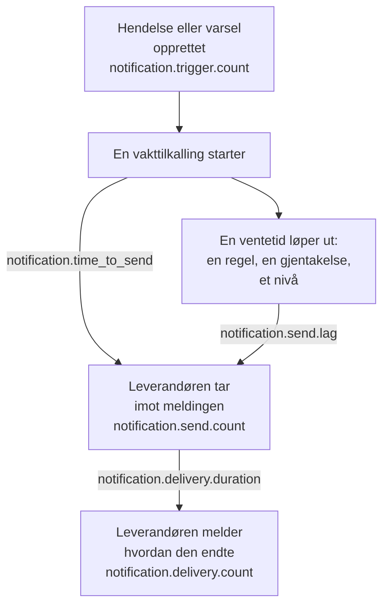

# Metrikker for varslingslevering

OneUptime registrerer hvordan det går med varslene det sender: hvor mange hendelser og varsler som krever dem, om hver melding nådde leverandøren sin, hvor lang tid en vakttilkalling brukte på å gå ut, og om den nådde telefonen. Send OneUptimes egen telemetri til et OneUptime-prosjekt, eller til en hvilken som helst OpenTelemetry-backend, for å sette leveringsmål for menneskene installasjonen din betjener og kontrollere at du holder dem.

:::cards
- [Slå dem på](#slå-dem-på): To innstillinger, og uten dem registreres ingenting.
- [Metrikkene](#metrikkene): Sju metrikker, fra utløseren til telefonen.
- [Slik tas tiden på en tilkalling](#slik-tas-tiden-på-en-tilkalling): Hva tid til sending og sendeforsinkelse regnes fra.
- [SLO-er å begynne med](#slo-er-å-begynne-med): Fire mål, spørring for spørring.
:::

## Slik fungerer det



Hver melding teller i `notification.send.count`, på hver kanal, ikke bare vakttilkallinger. De to tidene, `notification.time_to_send` og `notification.send.lag`, gjelder bare vakttilkallinger.

## Slå dem på

Ingenting registreres før OneUptime har en OpenTelemetry-eksportør: uten en koster metrikkene ingenting og lagres ingen steder. Pek den mot et OneUptime-prosjekt, med en Server-[inntaksnøkkel](/docs/telemetry/ingestion-keys) fra det prosjektet, eller mot en hvilken som helst backend som tar imot OTLP over HTTP.

:::tabs
@tab Kubernetes
```yaml
openTelemetryExporter:
  endpoint: https://oneuptime.example.com/otlp
  headers: x-oneuptime-token=YOUR_INGESTION_KEY
```
Deploymentene `app` og `worker` sender dem: la `app.disableTelemetryCollection` og `worker.disableTelemetryCollection` stå på `false`, standardverdien deres.
@tab Docker Compose
```bash
OPENTELEMETRY_EXPORTER_OTLP_ENDPOINT=https://oneuptime.example.com/otlp
OPENTELEMETRY_EXPORTER_OTLP_HEADERS=x-oneuptime-token=YOUR_INGESTION_KEY
DISABLE_TELEMETRY_FOR_APP=false
```
Angi dem i `config.env`, og kjør deretter `npm start`. `DISABLE_TELEMETRY_FOR_APP` er `true` som standard, og da sendes ingenting.
:::

OneUptime trenger både endepunktet og headerne: uten en header sender det ingenting. Skriv hver header som `name=value`, og skill flere med `;`. En verdi kan inneholde `=`. OneUptime legger selv til `/v1/metrics` på endepunktet, og de samme innstillingene sender også dets egne traces og logger. Hver metrikk dukker opp så snart OneUptime registrerer den første gang: `notification.send.count` med den første sendte meldingen.

### Send deltaer til et OneUptime-prosjekt

OneUptime sender tellere og histogrammer slik OpenTelemetry gjør som standard: hvert punkt inneholder den løpende summen siden den serverprosessen startet. Metrikkutforskeren legger sammen punktene i hvert trinn av et diagram, så den leser antall og persentiler for et tidsrom nøyaktig bare fra deltaer, punkter som inneholder det som har skjedd siden det forrige. Når metrikkene går til et OneUptime-prosjekt, send deltaer:

:::tabs
@tab Kubernetes
```yaml
extraEnv:
  - name: OTEL_EXPORTER_OTLP_METRICS_TEMPORALITY_PREFERENCE
    value: delta
```
En tjenestes egen liste erstatter den for hele chartet: hvis du angir `app.extraEnv` eller `worker.extraEnv`, legg den til der også.
@tab Docker Compose
```yaml title="docker-compose.override.yml"
services:
  app:
    environment:
      OTEL_EXPORTER_OTLP_METRICS_TEMPORALITY_PREFERENCE: delta
```
Opprett den ved siden av `docker-compose.yml`, eller legg dette til i den du har, og kjør deretter `npm start`.
:::

Dette gjelder hver metrikk OneUptime sender om seg selv. En backend som selv leser løpende summer, som Prometheus, trenger ingen endring.

## Metrikkene

| Metrikk | Type | Enhet | Hva den svarer på |
| --- | --- | --- | --- |
| `notification.trigger.count` | Teller | `1` | Hvor mange poster som krevde varsler |
| `notification.send.count` | Teller | `1` | Hvordan det gikk med hver melding som ble gitt til en leverandør |
| `notification.send.duration` | Histogram | `ms` | Hvor lang tid leverandøren brukte på å ta imot den |
| `notification.time_to_send` | Histogram | `ms` | Hvor lenge etter utløseren en tilkalling nådde leverandøren sin |
| `notification.send.lag` | Histogram | `ms` | Hvor lenge etter forfallstidspunktet et senere sendt varsel nådde leverandøren sin |
| `notification.delivery.count` | Teller | `1` | Hvordan meldingene leverandørene tok imot endte |
| `notification.delivery.duration` | Histogram | `ms` | Hvor lenge etter at leverandøren tok imot den en melding endte |

Hver attributt har én av noen få faste verdier, aldri et prosjekt, en person, et telefonnummer eller en post. Det eneste unntaket er ID-en og navnet til en egendefinert kanal: en installasjon har en håndfull, og å skille dem fra hverandre er hele poenget.

### Poster som varsler folk

`notification.trigger.count` teller hver hendelse, hvert varsel, hver hendelsesepisode og hver varselsepisode når den opprettes.

| Attributt | Verdier |
| --- | --- |
| `notification.trigger.type` | `incident`, `alert`, `incident_episode`, `alert_episode` |
| `notification.trigger.source` | `automatic` når OneUptime opprettet den, fra en monitor eller en regel; `manual` når en person eller API-et gjorde det |
| `monitor.type` | Typen til monitoren som opprettet en hendelse eller et varsel, for eksempel `Incoming Request`, `Logs` eller `Metrics`; utelatt når ingen monitor gjorde det |

### Meldinger som gis til en leverandør

`notification.send.count` teller hver melding som gis til en leverandør, og `notification.send.duration` tar tiden på kallet til leverandøren. Begge bærer disse attributtene:

| Attributt | Verdier |
| --- | --- |
| `notification.channel` | `email`, `sms`, `call`, `whatsapp`, `telegram`, `push`, `webhook`, `slack`, `microsoft_teams`, `mattermost`, `custom_channel` |
| `notification.provider` | `twilio`, `sms_and_call_gateway`, `smtp`, `sendgrid`, `amazon_ses`, `mailgun`, `postmark`, `resend`, `microsoft_graph`, `expo`, `push_relay`, `web_push`, `meta_whatsapp`, `telegram_bot_api`, `slack`, `microsoft_teams`, `mattermost`, `webhook`, `custom_channel`, eller `none` når ingenting ble gitt til noen |
| `notification.provider.config` | `global` for installasjonens egen konto og innstillinger; `project` for et prosjekts egen Twilio-konto, SMTP-server, webhook eller arbeidsområdetilkobling, der det er prosjektets sak å rette feilene |
| `notification.on_call_page` | `true` for et varsel fra en vakttilkalling, ellers `false` |
| `outcome` | `success`, `failure` eller `not_sent`, som nedenfor |
| `notification.destination` | Slack, Microsoft Teams og Mattermost: `direct_message` til én person, `channel` for et innlegg i en kanal eller en Teams-gruppechat, `incoming_webhook` for en innkommende webhook, for eksempel en statussideabonnents. Webhooks: `status_page_subscriber` for en statussideabonnents egen webhook. Utelatt for en persons webhook og for alle andre kanaler |
| `notification.custom_channel.id`, `notification.custom_channel.name` | Bare egendefinerte kanaler: kanalens ID, og navnet dens kuttet til 100 tegn |

- `success`: leverandøren tok imot meldingen.
- `failure`: leverandøren avviste den eller kunne ikke nås, eller sendingen mislyktes. En chatkanal som ikke ble funnet, er en feil uten varighet.
- `not_sent`: med vilje ikke sendt. Prosjektet har slått av kanalen, har for lite saldo eller er blokkert, push er slått av på denne serveren, eller en egendefinert kanal er slått av, slettet eller ikke dekket av lisensen. En suksessrate utelater disse: det er innstillinger som virker, ikke plattformen som svikter.

En melding til en statussideabonnents egen webhook telles én gang, uansett hvor mange ganger den ble forsøkt: `success` når endepunktet svarte med en 2xx-status, og `failure` når det svarte med en annen status, ikke kunne nås, eller adressen ikke er tillatt.

### Hva som nådde telefonen

`notification.delivery.count` teller hvordan hver melding en leverandør tok imot endte, slik leverandøren melder det senere, én gang per melding. `notification.delivery.duration` tar tiden på hvor lenge etter at leverandøren tok imot den. Begge bærer `notification.channel`, `notification.provider`, `notification.provider.config`, `notification.on_call_page` og `outcome`, den endelige statusen:

| Kanal | Leverandør | `outcome` | Varighet |
| --- | --- | --- | --- |
| `sms` | `twilio` | `delivered`, `undelivered`, `failed` | Til Twilio melder statusen |
| `call` | `twilio` | `answered`, `not_answered`, `failed` | Til anropet ble besvart, eller ellers endte |
| `push` | `expo`, `push_relay` | `delivered`, `undelivered`, `failed` | Ikke målt: en kvittering sier om Apple eller Google tok imot pushen, ikke når |
| `whatsapp` | `meta_whatsapp` | `delivered`, `failed` | Til Meta melder statusen |

Et anrop som ringte ut, var opptatt eller ble avvist, er `not_answered`. En push til en app som ikke finnes lenger, er `undelivered`, og en lest WhatsApp-melding teller som levert. `notification.provider.config` er bare `project` for SMS og anrop på et prosjekts egen Twilio-konto.

Statuser kommer bare der leverandøren kan melde dem:

- SMS og anrop: gjennom Twilio, når Twilio kan nå serveren din på dens `HOST` (se [Twilio-integrasjon](/docs/self-hosted/twilio-integration#3-konfigurer-nettverkstilgang)). SMS- og anropsgatewayen melder ingen.
- WhatsApp: når Metas webhook er satt opp for installasjonen din.
- Push: fra Expos kvitteringer, som OneUptime leser omtrent 15 minutter etter pushen, også gjennom push-reléet. Installasjonen som sendte pushen, teller den.
- E-post, Telegram, webhooks, chat og egendefinerte kanaler melder ingen endelig status.

## Slik tas tiden på en tilkalling

### Tid til sending

`notification.time_to_send` løper fra en tilkallings utløser til leverandøren tar imot varselet. Den måler bare varslene som forfaller når tilkallingen starter: personene i den første eskaleringsregelen, etter vaktreglene deres som ikke venter på noe, og ethvert nivå tilkallingen går videre til med en gang fordi den ikke nådde noen. Ventetider som vaktkonfigurasjonen ber om, er ikke plattformens forsinkelse, så de er utelatt: de står i [sendeforsinkelse](#sendeforsinkelse). Bare varsler som leverandøren tok imot, måles; en feil vises i `notification.send.count`.

| Attributt | Verdier |
| --- | --- |
| `notification.channel` | Som på `notification.send.count` |
| `notification.page.start` | Hva tiden regnes fra, som nedenfor |
| `notification.trigger.type` | Posten tilkallingen gjelder: `incident`, `alert`, `incident_episode`, `alert_episode` |
| `notification.custom_channel.id`, `notification.custom_channel.name` | Bare egendefinerte kanaler |

| `notification.page.start` | Tiden regnes fra |
| --- | --- |
| `monitor_data_received` | Da OneUptime mottok dataene som utløste monitoren: en innkommende forespørsel, rapporten fra en serveragent, en innkommende e-post, en probes sjekk, en SNMP-trap eller en avspørring av en nettverksenhet. Det inkluderer tiden dataene ventet i køen på å bli vurdert. |
| `record_created` | Da hendelsen, varselet eller episoden ble opprettet: av en telemetrimonitor, en regel eller en person, og ved en sjekk for fravær, for eksempel et heartbeat som stoppet. |
| `page_started` | Da en tilkalling startet senere: en person, en arbeidsflyt eller en regel som nå passer startet den, eller det er en direkte tilkalling. For en tilkalling som vaktregelen dens eller OneUptime AI holdt igjen, da pausen løp ut, eller da den startet hvis det var tidligere. For en ny tilkalling, da tidsavbruddet etter bekreftelse løp ut. Slik vises en worker som kom for sent til en av dem, i tiden. |

For en innkommende forespørsel løper tiden fra den siste forespørselen endepunktet mottok, så den kan bli litt for kort.

### Sendeforsinkelse

`notification.send.lag` løper fra øyeblikket et senere sendt varsel forfalt, til leverandøren tar imot det. To workers sender disse, én gang i minuttet hver, så en worker som er i rute viser opptil omtrent ett minutt, og en som har kommet på etterskudd viser hvor mye.

| `notification.schedule` | Forfaller når |
| --- | --- |
| `rule_wait` | En persons vaktregel som venter, for eksempel "ring meg etter 10 minutter": så lenge etter at personen ble tilkalt. Aldri før workeren sist gikk gjennom reglene deres, så en regel som legges til eller endres senere, forfaller fra da. |
| `repeat` | En push som gjentas til noen bekrefter: hver gang intervallet løper ut. |
| `escalation` | Et senere eskaleringsnivå: når nivået før har fullført ventetiden sin, eller med en gang når en person gir tilkallingen videre. |
| `policy_repeat` | Retningslinjen som starter på nytt fra første nivå: når ventetiden på det siste nivået har løpt ut. |

Den bærer også `notification.channel`, `notification.trigger.type` og, for egendefinerte kanaler, `notification.custom_channel.id` og `notification.custom_channel.name`. Et varsel som forfaller når tilkallingen starter, er aldri med i den, heller ikke når en worker startet tilkallingen for sent, etter en pause eller som en ny tilkalling: det er i tid til sending.

### Histogrammenes buckets

Hvert histogram har egne bucketgrenser, i millisekunder, satt slik at et mål kan leses av ved en grense:

| Histogram | Bucketgrenser, i millisekunder |
| --- | --- |
| `notification.send.duration` | `5, 10, 25, 50, 100, 250, 500, 1000, 2500, 5000, 10000, 30000, 60000, 120000` |
| `notification.time_to_send` | `250, 500, 1000, 2000, 5000, 10000, 15000, 30000, 60000, 120000, 300000, 600000, 1800000, 3600000` |
| `notification.send.lag` | `1000, 5000, 10000, 15000, 30000, 45000, 60000, 75000, 90000, 120000, 180000, 300000, 600000, 1800000, 3600000` |
| `notification.delivery.duration` | `500, 1000, 2000, 5000, 10000, 15000, 30000, 60000, 120000, 300000, 600000, 1800000, 3600000, 14400000, 86400000` |

En persentil beregnes fra bucketene og tegnes som midten av bucketen den faller i. Sammenlign den derfor med en buckets grense: en P95 for `notification.time_to_send` på eller under 30000 betyr at 95 % av tilkallingene tok 30 sekunder eller mindre.

## SLO-er å begynne med

Fire mål de fleste installasjoner kan love, hvert bygd av én eller to spørringer i metrikkutforskeren i prosjektet som mottar metrikkene. De leser et tidsrom nøyaktig når metrikkene kommer som deltaer: se [Send deltaer til et OneUptime-prosjekt](#send-deltaer-til-et-oneuptime-prosjekt).

### Bygg ett i metrikkutforskeren

:::steps
1. Åpne prosjektets [Metrikkutforsker](/docs/telemetry/metrics-explorer), og klikk på målets første metrikk. Spørringen dens er `a`.
2. Velg aggregeringen dens under **Aggregate by**. Åpne deretter **Filters & grouping**, og legg til hver av betingelsene dens under **Filter by attributes**.
3. For en ny spørring klikker du **Legg til metrikk** og setter opp `b` på samme måte.
4. For en formel klikker du **Legg til formel** og skriver den i **Formel**.
5. For å få beskjed når målet ikke nås, klikker du **Handlinger → Opprett monitor fra denne visningen** og varsler når verdien går forbi målet: se [Metrikk-overvåking](/docs/monitor/metrics-monitor).
:::

For å følge et mål over 30 dager med et feilbudsjett, knytt den monitoren til en [SLO](/docs/slo/introduction): den teller tiden målet ikke ble nådd.

### Vakt-SMS-er når Twilio

Høyst 1 % av vakt-SMS-ene som sendes gjennom installasjonens egen Twilio-konto, feiler, så 99 % blir tatt imot.

| Spørring | Metrikk | Aggregering | Betingelser |
| --- | --- | --- | --- |
| `a` | `notification.send.count` | **Sum** | `notification.channel = sms`, `notification.on_call_page = true`, `notification.provider.config = global`, `outcome != not_sent` |
| `b` | `notification.send.count` | **Sum** | De samme, med `outcome = failure` |

Formelen `$b / $a * 100` er andelen som feilet, og målet holder så lenge den holder seg på eller under 1. Et trinn uten feil tegner ikke noe punkt, siden `b` ikke har noe. `outcome != not_sent` utelater det prosjektenes egne innstillinger holdt tilbake, og `global` prosjektenes egne Twilio-kontoer. På en installasjon som sender SMS gjennom sin SMS- og anropsgateway, måler de samme spørringene gatewayen. For en annen kanal endrer du `sms`: `call`, `push` eller `email`.

### Tilkallinger går ut innen 30 sekunder

95 % av vakttilkallingene når leverandøren sin innen 30 sekunder etter utløseren.

| Spørring | Metrikk | Aggregering | Betingelser |
| --- | --- | --- | --- |
| `a` | `notification.time_to_send` | **P95** | `notification.page.start != page_started` |

Målet holder så lenge `a` holder seg på eller under 30000. Tilkallinger som startes senere, måles fra starten eller fra da de forfalt, ikke fra en utløser, så de er utelatt. Grupper etter `notification.page.start` for å se monitorenes kø (`monitor_data_received`) atskilt fra resten, eller etter `notification.channel` for å finne en treg kanal.

### Senere sendte varsler går ut innen 90 sekunder

99 % av varslene som sendes etter en ventetid, når leverandøren sin innen 90 sekunder etter forfallstidspunktet.

| Spørring | Metrikk | Aggregering | Betingelser |
| --- | --- | --- | --- |
| `a` | `notification.send.lag` | **P99** | — |

Målet holder så lenge `a` holder seg på eller under 90000. Grupper etter `notification.schedule` for å se hvilken worker som kom på etterskudd: `rule_wait` og `repeat` hører til den ene workeren, `escalation` og `policy_repeat` til den andre.

### Vakt-SMS-er når telefonen

Høyst 5 % av vakt-SMS-ene som Twilio tok imot for installasjonens egen konto, blir ikke levert.

| Spørring | Metrikk | Aggregering | Betingelser |
| --- | --- | --- | --- |
| `a` | `notification.delivery.count` | **Sum** | `notification.channel = sms`, `notification.on_call_page = true`, `notification.provider.config = global` |
| `b` | `notification.delivery.count` | **Sum** | De samme, med `outcome != delivered` |

Formelen `$b / $a * 100` er andelen som ikke ble levert. Teleoperatører og avslåtte telefoner avgjør en del av den, så sett målet ut fra det du ser over noen uker. For anrop bruker du `call` og `outcome != answered`. Twilio må kunne nå serveren din: se [Hva som nådde telefonen](#hva-som-nådde-telefonen).

## Feilsøking

:::details Ingen varslingsmetrikker kommer inn
Kontroller at `OPENTELEMETRY_EXPORTER_OTLP_ENDPOINT` og `OPENTELEMETRY_EXPORTER_OTLP_HEADERS` begge er angitt, og i Docker Compose at `DISABLE_TELEMETRY_FOR_APP` er `false`, og start deretter OneUptime på nytt. Når OneUptime starter, logger det en advarsel hvis det ikke kan lese en header, eller hvis det ikke sender noe. En metrikk dukker først opp når noe er registrert, så send et varsel først.
:::

:::details Et antall bare vokser, eller en persentil rører seg knapt
Metrikkene kommer som løpende summer. Send deltaer: se [Send deltaer til et OneUptime-prosjekt](#send-deltaer-til-et-oneuptime-prosjekt).
:::

:::details Ingen endelige statuser kommer inn
Endelige statuser kommer fra leverandørene, senere, og bare der de kan melde dem: se [Hva som nådde telefonen](#hva-som-nådde-telefonen). På en installasjon som Twilio ikke kan nå, telles SMS og anrop som sendt, men aldri som levert.
:::

## Neste steg

:::cards
- [Metrikkutforsker](/docs/telemetry/metrics-explorer): Vis, kombiner og sammenlign enhver metrikk.
- [Metrikk-overvåking](/docs/monitor/metrics-monitor): Varsle når et mål ikke nås.
- [Twilio-integrasjon](/docs/self-hosted/twilio-integration): La Twilio melde hva som nådde telefonen.
- [Eskaleringsregler](/docs/on-call/escalation-rules): Ventetidene sendeforsinkelsen regnes fra.
:::
