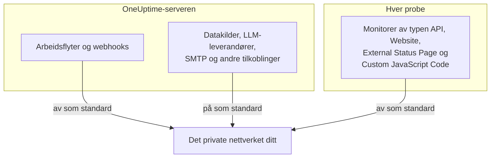

# Tilgang til privat nettverk

OneUptime nekter å sende visse utgående forespørsler til verter som slås opp til et privat område, et loopback-område eller et link-local-område. Hvis du har prøvd å peke en arbeidsflyt mot et internt verktøy, har du sett meldingen:

> Webhook URL resolves to a private, loopback, or link-local address and is not allowed

Den standarden er riktig for det hostede produktet, der hvem som helst kan registrere seg og målet for en webhook er inndata man ikke kan stole på. På en selvhostet instans står den i veien for noe helt vanlig: å sende et varsel til en selvhostet Mattermost, Jira eller et saksbehandlingssystem som bare finnes i ditt eget nettverk.

Denne siden forklarer hvordan du tillater det, bevisst og snevert. Tre brytere avgjør det, hver for sin type tilkobling, og de konfigureres på forskjellige maskiner:

| Hva du vil nå internt | Hvor innstillingen ligger | Standard på en selvhostet installasjon |
| --- | --- | --- |
| Arbeidsflyter, prosjekt-webhooks, bruker-webhooks for vakt | Miljøet til **API-serveren** | Private adresser avvist |
| Datakilder, LLM-leverandører, SMTP-servere, OIDC-discovery og andre tilkoblinger | Miljøet til **API-serveren** | Private adresser tillatt |
| **Monitorer** av typen API, Website, External Status Page og Custom JavaScript Code | **Probens** eget miljø | Private adresser avvist |



Nettverksnære monitortyper som Ping, Port, SSL-sertifikat, DNS, DNSSEC, SNMP / Nettverksenhet, SQL-spørring, Databasehelse, Synthetic og Network Path bruker sine egne transporter. Innstillingen på denne siden styrer HTTP-transportene som returnerer vilkårlig svarinnhold til et prosjekt: monitorer av typen API, Website, External Status Page og Custom JavaScript Code.

:::cards
- [Webhooks og arbeidsflyter](#webhooks-og-arbeidsflyter): La en webhook poste inn i nettverket ditt.
- [Andre utgående tilkoblinger](#andre-utgående-tilkoblinger): Datakilder, LLM-leverandører og e-postservere.
- [Prober og monitorer](#prober-og-monitorer): La en probe sjekke private nettsteder.
- [Kontroller at det virker](#kontroller-at-det-virker): Les hvilken bryter en avvisning nevner.
:::

## Hva som er blokkert, og hva som kan åpnes

Blokkerte mål faller i to nivåer.

| Nivå | Områder | Kan det tillates? |
| --- | --- | --- |
| **Privat** | RFC-1918 (`10.0.0.0/8`, `172.16.0.0/12`, `192.168.0.0/16`), CGNAT (`100.64.0.0/10`), IPv6 unique-local (`fc00::/7`) og site-local (`fec0::/10`) | Ja |
| **Forbudt** | Loopback (`127.0.0.0/8`, `::1`), den uspesifiserte adressen, link-local (`169.254.0.0/16`, `fe80::/10`), multicast, reservert, broadcast, og navnene `localhost` og `metadata.google.internal` | Bare ved å nevne den nøyaktige verten eller CIDR-en i tillatelseslisten for webhooks. Aldri for monitorer. |

Endepunktet for skymetadata `169.254.169.254` ligger i det forbudte nivået av en grunn. På en sky-VM deler det ut instansens IAM-påloggingsdetaljer til alt som kan gjøre en HTTP-forespørsel fra maskinen, så ingen generell innstilling vil noen gang åpne det.

IPv6-skrivemåter som bærer et IPv4-mål inni seg – IPv4-mapped (`::ffff:10.0.0.5`), NAT64, 6to4, Teredo – klassifiseres etter IPv4-adressen de når, så de kan ikke brukes til å smugle en forbudt adresse forbi en tillatelse for det private nivået.

## Webhooks og arbeidsflyter

Disse målene er omfattet, fordi målet er en URL som et autentisert medlem av prosjektet ditt har skrevet:

- **API**-komponenter i arbeidsflyter (GET / POST / PUT / PATCH / DELETE)
- HTTP-forespørsler fra arbeidsflytkomponenten **Custom JavaScript**
- Prosjektets webhook-varsler (hendelser, varsler, monitorer, vakt, planlagt vedlikehold, hendelser på statussider)
- **Bruker-webhooks** for vakt

**Ikke** omfattet, og det blir de aldri: **webhooks for abonnenter på statussider**. Enhver besøkende på en offentlig statusside kan registrere en, så å løsne på det målet ville la hvem som helst på internett få serveren din til å POSTe inn i det private nettverket ditt. Dette kan ikke konfigureres.

Utgående tilkoblinger som ikke er webhooks – eksterne datakilder, LLM-leverandører, SMTP-servere (SMTP-innstillingene til et prosjekt og arbeidsflytkomponenten **Email**), SMTP-OAuth-token-endepunkter, OIDC-discovery og HTTP-trinn i runbooks – styres separat, av `DATA_SOURCE_BLOCK_PRIVATE_ADDRESSES`, og tillater allerede private områder på selvhostede installasjoner. Se [Andre utgående tilkoblinger](#andre-utgående-tilkoblinger).

### Konfigurere API-serveren

Sett den ene eller begge av disse på API-serveren og start den på nytt. De er av som standard, så en instans som ikke setter noen av dem, oppfører seg nøyaktig som før.

| Variabel | Helm-verdi | Hva den tillater |
| --- | --- | --- |
| `ALLOW_PRIVATE_NETWORK_WEBHOOKS` | `webhooks.allowPrivateNetwork` | Hele det private nivået, når den er satt til `true`. |
| `PRIVATE_NETWORK_WEBHOOK_ALLOWLIST` | `webhooks.privateNetworkAllowlist` | Vertene og CIDR-ene den nevner, uansett nivå. |

:::tabs
@tab Docker Compose
```bash title="config.env"
ALLOW_PRIVATE_NETWORK_WEBHOOKS=true
PRIVATE_NETWORK_WEBHOOK_ALLOWLIST=mattermost.internal,*.svc.cluster.local,10.20.0.0/16
```
@tab Kubernetes
```yaml title="values.yaml"
webhooks:
  allowPrivateNetwork: true
  privateNetworkAllowlist: "mattermost.internal,10.20.0.0/16"
```
:::

På Docker Compose har `config.env` en linje `ALLOW_PRIVATE_NETWORK_WEBHOOKS=false`: Endre den i stedet for å legge til en linje til, og kjør deretter `npm run start`. På Kubernetes oppgraderer du releasen.

Oppføringer i tillatelseslisten kan skilles med komma, mellomrom eller linjeskift, og hver kan være:

- et vertsnavn – `mattermost.internal`
- et jokertegn – `*.svc.cluster.local` (samsvarer med underdomener, ikke med selve suffikset)
- en IPv4- eller IPv6-adresse – `10.20.30.40`, `fd00::1`
- en CIDR – `10.20.0.0/16`, `fd12:3456::/32`

Et skjema, en port, en sti eller brukerinformasjon i en oppføring fjernes, så det fungerer å lime inn webhook-URL-en du allerede har.

Et vertsnavn som er nevnt i tillatelseslisten, stoles på **uten DNS-sjekk** – det er nettopp poenget med å nevne det, siden det forventes å slås opp til noe blokkeringslisten ville avvise. En adresseoppføring sammenlignes med den bokstavelige verdien i URL-en og med hver adresse DNS returnerer for den.

> [!CAUTION]
> **Sett aldri `169.254.169.254`, eller et område som inneholder den, i tillatelseslisten.** På en sky-VM gir det hvert prosjektmedlem instansens IAM-påloggingsdetaljer.

## Andre utgående tilkoblinger

En annen beskyttelse dekker utgående tilkoblinger der et prosjektmedlem velger målet, men som ikke er webhooks:

- eksterne datakilder (PostgreSQL-, MySQL-, SQL Server-, ClickHouse-, Elasticsearch- og REST API-tilkoblinger), tilkoblinger for sikkerhetshendelser som Splunk, og threat intel-feeder
- LLM-leverandører, inkludert en selvhostet Ollama eller vLLM
- SMTP-servere – SMTP-innstillingene til et prosjekt og arbeidsflytkomponenten **Email** – og OAuth-token-URL-er for SMTP og arbeidsflyter
- OIDC-discovery for enkel pålogging
- verifisering av egne domener for statussider og dashbord
- HTTP-trinn i runbooks
- URL-en til Grafana OnCall-API-et som en import leser fra (**Prosjektinnstillinger** > **Grunnleggende** > **Importer fra et annet verktøy**)

Denne beskyttelsen virker motsatt av webhook-innstillingene. På en selvhostet installasjon **tillater** den det private nivået som standard, fordi databasen, e-postserveren eller modellserveren disse kobler seg til, som regel ligger i ditt eget nettverk. Det forbudte nivået – loopback, link-local og endepunktet for skymetadata – avvises uansett, og det finnes ingen tillatelsesliste for det.

`DATA_SOURCE_BLOCK_PRIVATE_ADDRESSES` strammer den inn. Sett den til `true` for å avvise det private nivået også for disse tilkoblingene, for eksempel når prosjektene på instansen din tilhører personer som ikke bør nå det interne nettverket ditt:

:::tabs
@tab Docker Compose
```bash title="config.env"
DATA_SOURCE_BLOCK_PRIVATE_ADDRESSES=true
```
@tab Kubernetes
```yaml title="values.yaml"
outboundConnections:
  blockPrivateNetwork: true
```
:::

Denne innstillingen gjelder ikke for en global LLM-leverandør, som en administrator konfigurerer i stedet for et prosjekt (med variablene `GLOBAL_LLM_PROVIDER_*`, verdien `vllm.globalProvider` i Helm-chartet, eller i Admin-dashbord under **Innstillinger** > **Globale LLM-leverandører**): En slik leverandør kan fortsatt nå private adresser, selv om loopback og link-local forblir avvist også for den.

Bare den nøyaktige verdien `true` slår den på. På en instans med `BILLING_ENABLED=true` er den alltid på, uansett hva du setter. Den endrer ikke hvilke mål webhook-innstillingene ovenfor eller probe-innstillingen nedenfor tillater; hver port konfigureres for seg. Den endrer derimot hvordan avvisninger formuleres, også for webhooks og arbeidsflytforespørsler: Når den er på, rapporteres et avvist vertsnavn uten å si hva det ble slått opp til (se [Kontroller at det virker](#kontroller-at-det-virker)).

På Docker Compose har `config.env` en linje `DATA_SOURCE_BLOCK_PRIVATE_ADDRESSES=false` (legg den til hvis `config.env` er eldre). Endre den linjen til `true` i stedet for å legge til en linje til, og kjør deretter `npm run start` slik at containerne gjenopprettes med den nye verdien; `docker compose restart` leser ikke `config.env` på nytt. På Kubernetes setter du den i values-filen og oppgraderer releasen; chartet sender den videre til app- og worker-podene.

Når den er på, rapporteres et avvist vertsnavn uten å si hva det ble slått opp til, for eksempel _"LLM provider host ollama.internal could not be reached."_ Et navn som ikke kan slås opp i det hele tatt, får samme melding, slik at prosjektmedlemmer ikke kan bruke disse feltene til å finne ut hvilke interne navn som finnes. En adresse skrevet som IP nevnes fortsatt sammen med årsaken, for eksempel _"LLM provider host 10.0.4.12 is not allowed: private network address."_ Med `LOG_LEVEL=DEBUG` logger appen adressen hvert avvist navn ble slått opp til.

## Prober og monitorer

Fire monitortyper berøres: **API**, **Nettsted**, **External Status Page** og **Custom JavaScript Code**. På en standardprobe kan de nå offentlige HTTP(S)-mål, men avviser privat adresserom. Monitorer av typen API, Website og External Status Page validerer og fester DNS-resultater for hver tilkobling og validerer hver omdirigering på nytt; Custom JavaScript Code bruker den samme adressepolicyen i broen til sandkassen sin.

Bryteren leses av **probeprosessen fra dens eget miljø**, ikke fra API-serverens, og hver probe leser den: de som følger med Docker Compose, de Helm-chartet ruller ut, og enhver [egen probe](/docs/probe/custom-probe) du kjører selv. Den som ruller ut en probe, styrer miljøet dens og vet hvilket nettverk proben kan se – en egen probe er som regel en annen maskin, ofte drevet av en annen person, og den leser aldri konfigurasjonen til API-serveren.

:::tabs
@tab Docker Compose
`config.env` har allerede en linje `PROBE_ALLOW_PRIVATE_NETWORK_MONITORS=false`: Endre den linjen til `true` i stedet for å legge til en linje til, for når en variabel står to ganger, vinner den siste linjen. Kjør deretter `npm run start`, som gjenoppretter containerne med den nye verdien; `docker compose restart` leser ikke `config.env` på nytt. Hver medfølgende probe leser den ene linjen, så den gjelder for `probe-1` og, der stacken din kjører en probe til, for `probe-2`.

```bash title="config.env"
PROBE_ALLOW_PRIVATE_NETWORK_MONITORS=true
```
@tab Kubernetes
Sett den per probe i values-filen og oppgrader releasen. Hver oppføring under `probes:` er en egen probe, så sett den på hver probe som skal nå private adresser:

```yaml title="values.yaml"
probes:
  one:
    allowPrivateNetworkMonitors: true
```
:::

På en egen probe setter du `PROBE_ALLOW_PRIVATE_NETWORK_MONITORS=true` i probens eget miljø og starter den på nytt. Verdien må være nøyaktig `true`; alt annet, som `TRUE` eller `1`, lar bryteren være av, og proben sier fra i en advarsel ved oppstart, uansett hva `LOG_LEVEL` er satt til.

De medfølgende probene er **globale prober**: De registrerer seg med instansens `REGISTER_PROBE_KEY`, og alle prosjekter på instansen kan velge dem. Å slå på bryteren for en medfølgende probe lar derfor monitorer fra **alle prosjekter på instansen** nå private adresser gjennom den. Det er som regel det en installasjon for ett team ønsker. Der prosjekter ikke skal dele den rekkevidden – separate team eller kunder du hoster –, lar du den være av på de medfølgende probene og ruller i stedet ut en privat (egen) probe i hvert nettverk, slått på bare der.

Det finnes ett unntak. En probe som registrerer seg med `REGISTER_PROBE_KEY` og har `BILLING_ENABLED=true` i sitt eget miljø – en global probe i det hostede produktet med åpen registrering, der hvem som helst kan registrere seg og alle prosjekter deler de globale probene – forblir bare offentlig selv med bryteren på, og logger ved oppstart en advarsel om at den ser bort fra den. Probene som følger med Docker Compose og Helm-chartet, får instansens `BILLING_ENABLED` automatisk; gi den til enhver annen `REGISTER_PROBE_KEY`-probe du kjører for en slik instans. En probe kan ikke på noen annen måte vite at den er global, så en global probe som er opprettet i Admin-dashbord og kjøres med `PROBE_ID` og `PROBE_KEY`, følger bryteren som en privat: Ikke slå den på der hvis prosjekter ikke skal dele nettverket til den proben. En privat probe følger bryteren på enhver instans.

Hver probe logger ved oppstart sin gjeldende policy for private nettverk: om overvåking av private nettverk er på eller av, og hvorfor. En verdi det ses bort fra, og en global probe som bryteren åpner for alle prosjekter, logges som advarsler på ethvert `LOG_LEVEL`. Den vanlige linjen på eller av, og JSON-en «Probe environment» som registrerer den samme beslutningen under `privateNetworkMonitors`, logges ved `LOG_LEVEL=INFO`, standarden i Helm-chartet; Docker Compose leveres med `LOG_LEVEL=ERROR`, så sett `LOG_LEVEL=INFO` for å se dem der. Sjekk den loggen først når en monitor på en probe du nettopp har endret, fortsatt avvises.

Å slå den på åpner **ikke** loopback, link-local eller endepunktet for skymetadata. De forblir avvist på alle prober, noe som betyr mest for prober som kjører i et nettverk monitorens forfatter ikke eier.

> [!WARNING]
> La den være av på prober du drifter på vegne av andre.

## Kontroller at det virker

Kjør arbeidsflyten eller monitoren på nytt. Hvis den fortsatt avvises, nevner feilmeldingen hvilken port som er stengt:

- _"...points to a private network address and is not allowed. Self-hosted instances can allow this by setting `ALLOW_PRIVATE_NETWORK_WEBHOOKS`..."_ – innstillingen på API-serveren mangler.
- _"...private network address... Set PROBE_ALLOW_PRIVATE_NETWORK_MONITORS=true on the probe running this monitor to allow it."_ – en privat (egen) probe kjørte monitoren, og bryteren dens er av. Merk at den settes på proben, ikke på API-serveren.
- _"...private network address... Set PROBE_ALLOW_PRIVATE_NETWORK_MONITORS=true on the probe running this monitor to allow it (probes.<name>.allowPrivateNetworkMonitors in the Helm chart). This is a global probe, so that allows it for every project on this instance; otherwise, select a private probe deployed on that network."_ – en medfølgende (global) probe kjørte monitoren, og bryteren dens er av. Slå den på for den proben som beskrevet ovenfor hvis alle prosjekter på instansen kan nå det nettverket; velg ellers en privat probe på monitoren.
- _"...Global probes cannot monitor private network addresses. Deploy and select a private probe for this target."_ – en global probe med `BILLING_ENABLED=true` i miljøet sitt kjørte monitoren. Automatisk registrerte globale prober forblir bare offentlige der, uansett hva bryteren deres sier; rull ut en privat probe inne i målets nettverk og velg den på monitoren.
- _"Monitor target host ... could not be reached."_ – en monitor av typen API, Website eller External Status Page der målet er et **vertsnavn**, rapporterer dette både når navnet slås opp til en avvist adresse og når DNS feiler, slik at en monitor ikke kan brukes til å kartlegge hvilke interne navn som finnes. Feildetaljene som vises med den, nevner `PROBE_ALLOW_PRIVATE_NETWORK_MONITORS` i begge tilfeller; de sier ikke hvilket tilfelle det gjaldt. Hvis navnet peker på en privat adresse, sjekker du probens policy for private nettverk i oppstartsloggen dens; er den av, er løsningen den samme som for meldingene ovenfor. Med `LOG_LEVEL=DEBUG` logger proben også den nøyaktige årsaken for hvert avvist navn.
- _"Request URL could not be reached."_ – den samme regelen for en monitor av typen **Custom JavaScript Code**: Et skript som ber om et **vertsnavn**, får dette både når navnet slås opp til en avvist adresse og når DNS feiler. Med `LOG_LEVEL=DEBUG` logger proben den nøyaktige årsaken.
- _"Webhook URL could not be reached."_ eller, fra en arbeidsflyt, _"Request URL could not be reached."_ – instansen kjører med `DATA_SOURCE_BLOCK_PRIVATE_ADDRESSES=true` (eller `BILLING_ENABLED=true`), så et avvist **vertsnavn** forklares ikke: Det ble enten slått opp til en avvist adresse eller ikke slått opp i det hele tatt. Med `LOG_LEVEL=DEBUG` logger appen eller workeren hvilket av de to, og adressen.
- _"...points to a private, loopback, or link-local address and is not allowed."_ – målet ligger i det forbudte nivået. For en webhook nevner du den nøyaktige verten eller CIDR-en i `PRIVATE_NETWORK_WEBHOOK_ALLOWLIST` hvis du virkelig trenger det. For en monitor finnes det intet unntak.
- _"...hostname could not be resolved via DNS."_ – containeren kan ikke slå opp navnet. Kontroller at den deler et nettverk med målet.

## Sikkerhetsmerknader

Å åpne for dette endrer virkelig hva OneUptime-instansen din kan bringes til å nå, så det er verdt å gjøre det bevisst:

- **Foretrekk tillatelseslisten fremfor den generelle bryteren.** Å nevne `mattermost.internal` er en mye mindre tillatelse enn å åpne alle RFC-1918-adresser.
- **Alle som kan opprette en arbeidsflyt eller en monitor av typen API, Website, External Status Page eller Custom JavaScript Code, kan nå alt du har tillatt.** Behandle medlemskap i de prosjektene deretter.
- **Svarinnholdet kommer tilbake.** En API-komponent i en arbeidsflyt returnerer status, hoder og body i arbeidsflytloggen, så en tillatt vert kan leses, ikke bare skrives til.
- **Omdirigeringer følges aldri** for webhook-forespørsler, så en tillatt offentlig vert kan ikke sende serveren videre til en intern vert i et nytt hopp.
- **Avgrens per probe i stedet for for hele instansen der du kan.** En probe rullet ut inne i ett nettverk er en smalere tillatelse enn å åpne den utgående trafikken til API-serveren.

## Neste steg

:::cards
- [Egne prober](/docs/probe/custom-probe): Kjør en probe inne i nettverket den skal sjekke.
- [Arbeidsflytkonfigurasjon](/docs/workflows/configuration): Hva arbeidsflyttrinn kan nå og gjøre.
- [LLM-leverandører](/docs/ai/llm-provider): Koble OneUptime AI til en modell i nettverket ditt.
- [Arkitektur](/docs/self-hosted/architecture): Hvilken del av en selvhostet installasjon som lager hvilken tilkobling.
:::
