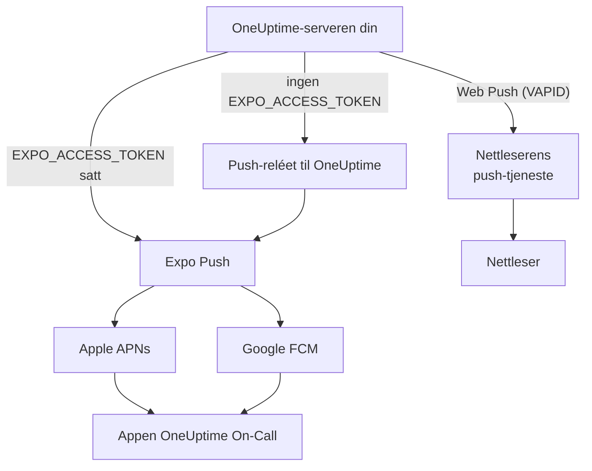
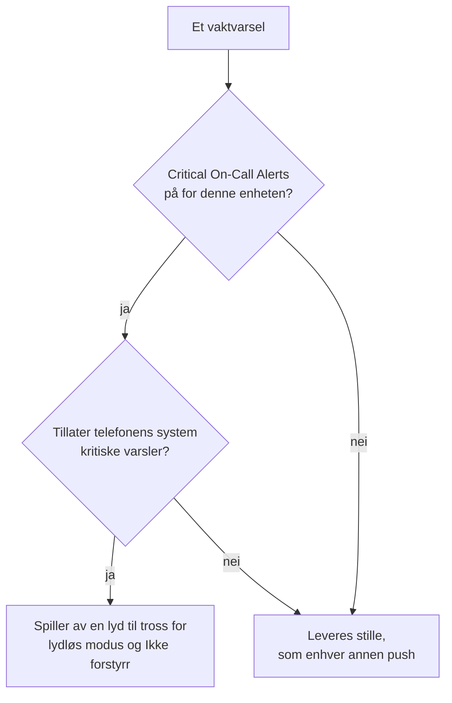

# Push-varsler

OneUptime varsler folk på telefonen via mobilappen **OneUptime On-Call**, og i nettleseren via Web Push. Mobile pusher går gjennom **Expo Push**: En selvhostet instans sender dem som standard gjennom push-reléet til OneUptime, så den trenger utgående nettverkstilgang til reléet og ingen egne påloggingsdetaljer for Expo, Apple eller Google.

:::cards
- [Velg hvordan pusher sendes](#selvhostet-oppsett): Push-reléet, eller ditt eget Expo-tilgangstoken.
- [Åpne brannmuren](#nettverkstilgang): Adressene serveren din og enhetene til folkene dine når.
- [Ring gjennom lydløs modus](#kritiske-vaktvarsler-overstyre-lydløs-modus): La vaktvarsler høres på en telefon som er satt på lydløs.
- [Fiks pusher som aldri kommer frem](#feilsøking): Hva hver av feilene fra Expo betyr.
:::

## Slik fungerer det



Mobilappen til OneUptime registrerer et Expo Push-token hos backend. Backend sender varsler gjennom push-reléet til OneUptime, eller direkte til Expo når `EXPO_ACCESS_TOKEN` er konfigurert. Expo videresender meldingene til Apple APNs eller Google FCM for levering til enheten.

Web Push-varsler bruker fortsatt VAPID-nøkler og Web Push-protokollen.

## Selvhostet oppsett

Med den offisielle mobilappen og standardreléet trenger ikke serveren påloggingsdetaljer for Expo. For direkte levering via Expo konfigurerer du `EXPO_ACCESS_TOKEN` med påloggingsdetaljer som passer til Expo-prosjektet til appen din. Web Push krever `VAPID_PUBLIC_KEY`, `VAPID_PRIVATE_KEY` og `VAPID_SUBJECT`.

| Variabel | Helm-verdi | Standard | Hva den gjør |
| --- | --- | --- | --- |
| `PUSH_NOTIFICATION_RELAY_URL` | `pushNotification.relayUrl` | `https://oneuptime.com/api/notification/push-relay/send` | Hvor mobile pusher går så lenge `EXPO_ACCESS_TOKEN` ikke er satt. |
| `EXPO_ACCESS_TOKEN` | `expo.accessToken` | Tom | Sender mobile pusher direkte til Expo, med tokenet til Expo-prosjektet ditt. |
| `VAPID_PUBLIC_KEY` | `vapid.publicKey` | Tom | Den offentlige halvdelen av nøkkelparet som nettlesere abonnerer med. |
| `VAPID_PRIVATE_KEY` | `vapid.privateKey` | Tom | Den private halvdelen, som signerer hver Web Push. |
| `VAPID_SUBJECT` | `vapid.subject` | `mailto:support@oneuptime.com` | En kontaktadresse som push-tjenestene til nettleserne kan nå deg på. |

Generer et VAPID-nøkkelpar én gang med `npx web-push generate-vapid-keys`, og ta vare på det: Nettlesere som abonnerte med ett nøkkelpar, slutter å motta pusher når det endres.

:::tabs
@tab Docker Compose
```bash title="config.env"
VAPID_PUBLIC_KEY=your-public-key
VAPID_PRIVATE_KEY=your-private-key
VAPID_SUBJECT=mailto:oncall@example.com
# Leave unset to send mobile pushes through the push relay.
EXPO_ACCESS_TOKEN=
```
@tab Kubernetes
```yaml title="values.yaml"
vapid:
  publicKey: your-public-key
  privateKey: your-private-key
  subject: mailto:oncall@example.com
# Leave empty to send mobile pushes through the push relay.
expo:
  accessToken:
```
:::

## Nettverkstilgang

| Retning | Mål | Protokoll / port | Når det kreves |
| --- | --- | --- | --- |
| OneUptime → standard push-relé | `https://oneuptime.com/api/notification/push-relay/send`, `https://oneuptime.com/api/notification/push-relay/receipts` | HTTPS / TCP 443 | Mobil push når `EXPO_ACCESS_TOKEN` ikke er satt. |
| OneUptime → Expo | `https://exp.host/--/api/v2/push/send`, `https://exp.host/--/api/v2/push/getReceipts` | HTTPS / TCP 443 | Direkte mobil push når `EXPO_ACCESS_TOKEN` er satt. |
| OneUptime → nettleserens push-tjeneste | HTTPS-endepunktet som er lagret i nettleserens push-abonnement | HTTPS / vanligvis TCP 443 | Web Push. |
| Mobilapp eller nettleser → OneUptime | Vertsnavnet ditt for OneUptime | HTTPS / TCP 443 | Logge på, registrere enheten og åpne varslingslenker. |

Hvis du endrer `PUSH_NOTIFICATION_RELAY_URL`, tillater du vertsnavnet for målet og den konfigurerte porten. Et eget relé må implementere relé-API-et til OneUptime. Disse standardene og vekslingen mellom relé og direkte levering er definert i [konfigurasjonen til OneUptime](https://github.com/OneUptime/oneuptime/blob/master/config.example.env) og [push-tjenesten](https://github.com/OneUptime/oneuptime/blob/master/packages/Common/Server/Services/PushNotificationService.ts). Direkte forespørsler til Expo bruker endepunktet som er dokumentert i [sendeveiledningen til Expo](https://docs.expo.dev/push-notifications/sending-notifications/). OneUptime leser leveringskvitteringer fra reléet på den samme adressen, med `/receipts` i stedet for `/send`. Et relé uten den ruten leverer fortsatt pusher; en enhet der appen er fjernet, blir da først oppdaget når en senere push til den blir avvist.

For Web Push tillater du de faktiske vertene for abonnementsendepunktene til nettleserne teamet ditt bruker. OneUptime godtar `fcm.googleapis.com`, `android.googleapis.com`, `push.services.mozilla.com`, `notify.windows.com` og `push.apple.com`, inkludert underdomenene deres. Typiske eksempler er `updates.push.services.mozilla.com` og `web.push.apple.com`. [Nettleserens push-abonnement](https://developer.mozilla.org/en-US/docs/Web/API/PushSubscription) gir målet; å tillate bare Expo eller reléet til OneUptime gjør ikke Web Push mulig.

Tillat DNS-oppslag og utgående TLS fra OneUptime-prosessen som sender varsler. Klareringslageret dens må validere sertifikatet til målet, og proxyer må slippe API-forespørsler gjennom uten interaktiv autentisering. Push-leverandører kaller ingen webhook på OneUptime-serveren din, så serveren kan forbli privat når brukernes enheter når den via en VPN eller en annen privat tilkobling. En server uten tilgang til reléet sitt eller eksterne push-tjenester kan ikke levere disse varslene.

Enhetenes tilkobling er et eget krav. iOS-enheter trenger tilgang til APNs, vanligvis TCP 5223 med TCP 443 som reserve; se [Apples gjeldende nettverkskrav](https://support.apple.com/en-us/102266) for målområder. Android-enheter trenger tilgang til FCM på TCP 5228–5230 og 443; bruk [Googles gjeldende veiledning om verter og brannmurer](https://firebase.google.com/docs/cloud-messaging/network-configuration). Disse enhetsportene trenger ikke åpnes innkommende på OneUptime, og serverens mobile flyt bruker reléet eller Expo i stedet for å koble seg direkte til APNs/FCM.

:::steps
1. Kontroller DNS og HTTPS fra containeren eller poden som sender varsler, til målet for leveringsmåten din: reléet, Expo eller push-tjenesten til en nettleser.
2. Send en test fra **Brukerinnstillinger > Varselmetoder > Push Notifications** med **Testvarsel**, og bekreft at den kommer frem til en registrert enhet. Test hver nettleser for seg for Web Push.
3. Se etter feil fra reléet, Expo eller Web Push i loggene til OneUptime; en vellykket innsending til API-et alene bekrefter ikke levering på enheten.
:::

For mobile pusher leser OneUptime også leveringskvitteringen fra Expo omtrent 15 minutter etter hver push: En push som aldri nådde enheten, vises da som ikke levert i push-loggen og, for et vaktvarsel, på vakttidslinjen.

## Kritiske vaktvarsler (overstyre lydløs modus)

Som standard følger en push-varsling telefonen: En telefon på lydløs forblir stille, og Ikke forstyrr holder varslingen tilbake. For den som har vakt, er det feil standard klokka tre om natta, så mobilappen tilbyr en innstilling per enhet – **Settings > Notifications > Critical On-Call Alerts** – som lar *bare vaktvarsler* spille av en lyd gjennom begge.

Omfanget er bevisst smalt. Bare varsler som en varslingsregel for vakt lager, er aktuelle. Eierabonnementer, meldinger om nye notater, oppdateringer om tilstandsendringer og monitorvarsler eskaleres aldri, uansett hva denne innstillingen sier.



Tre ting må alle være oppfylt for at et varsel skal overstyre lydløs modus. Mangler én av dem, blir varselet likevel levert – bare stille.

1. **Personen har slått det på for den enheten.** Lagret per enhet, av som standard, i `UserPush.isCriticalAlertEnabled`. Telefonen og nettbrettet til en person er separate valg.
2. **Serveren merker varselet som kritisk.** Den sender den kritiske lyd-payloaden til APNs pluss `interruptionLevel: critical` for iOS, og bruker varslingskanalen `oncall_critical` for Android.
3. **Operativsystemet tillater det**, og det er her de to plattformene skiller seg.

:::tabs
@tab iOS
Kritiske varsler på iOS krever entitlementet `com.apple.developer.usernotifications.critical-alerts`, som Apple tildeler per utviklerkonto, etter søknad, til apper som varsler folk om hastende hendelser. Søk om det via [Apples søknadsskjema for Critical Alerts](https://developer.apple.com/contact/request/notifications-critical-alerts-entitlement/).

Den offisielle appen **OneUptime On-Call** i App Store har entitlementet fra **versjon 1.5.0**. Tidligere versjoner har det ikke, og iOS tilbyr dem aldri kritiske varsler, så oppdater appen før du slår på innstillingen.

Bygger du appen selv, er entitlementet valgfritt. En klargjøringsprofil kan ikke bære et entitlement teamet ikke har fått tildelt, og et bygg som erklærer et det ikke kan bære, **kan ikke signeres**. Bare profilen `production` i `packages/MobileApp/eas.json` slår det på, fordi Apple har tildelt det til teamet som publiserer den offisielle appen. En fork som signerer med sitt eget Apple-team, må fjerne den `env`-oppføringen til Apple tildeler entitlementet til det teamet også. Når det er gjort, slår du det på ved bygging:

```bash
EXPO_IOS_CRITICAL_ALERTS_ENTITLEMENT=true npx expo prebuild
```

eller legg til `EXPO_IOS_CRITICAL_ALERTS_ENTITLEMENT: "true"` i `env`-blokken til byggeprofilen i `packages/MobileApp/eas.json`.

Slå på **Settings > Notifications > Critical On-Call Alerts** i appen på enheten, og tillat kritiske varsler når iOS spør. iOS legger først til en bryter **Critical Alerts** for appen under **Settings > Notifications > OneUptime On-Call** i iOS-innstillingene etter at appen har bedt om tillatelsen, så den bryteren finnes ikke før du slår på innstillingen i appen. Avslår du forespørselen, kan du tillate kritiske varsler senere med den bryteren i iOS-innstillingene.

På et bygg uten entitlementet viser iOS verken forespørsel eller bryter, og innstillingsskjermen til appen sier at denne versjonen av appen ikke kan motta kritiske varsler. Den sender ikke personen ut for å lete etter en bryter iOS ikke viser.
@tab Android
Android har ikke noe godkjenningstrinn hos leverandøren, men omgåelse av Ikke forstyrr gis av brukeren på en systemskjerm i stedet for via en forespørsel i appen. Når en person slår på innstillingen, åpner appen **Settings > Notifications > Do Not Disturb access** for vedkommende og sjekker igjen når vedkommende kommer tilbake.

To mekanismer er i spill, og de dekker ulike tilfeller:

- Varslingskanalen `oncall_critical` ber om `bypassDnd`, som dekker Ikke forstyrr og trenger tilgangen som er beskrevet ovenfor.
- Den samme kanalen bruker lydstrømmen **alarm**, som høres på en telefon der ringelyden bare er dempet. Den halvdelen trenger ingen tillatelse i det hele tatt.

Android fryser innstillingene til en kanal når kanalen opprettes første gang, så de kan ikke endres med en appoppdatering – bare ved å levere en ny kanal-ID.
:::

For å sjekke at det virker, sender du et testvarsel til enheten fra **Brukerinnstillinger > Varselmetoder > Push Notifications**. Når enheten har kritiske varsler slått på, sendes også testen som et kritisk varsel – så sett telefonen på lydløs først, og du hører om et ekte varsel ville nådd deg.

## Feilsøking

### Push-varsler kommer ikke frem

- Sørg for at mobilappen er bygget med EAS Build (Expo Go støtter ikke push-varsler)
- Kontroller at enheten er registrert i tabellen `UserPush` i databasen din
- Sjekk serverloggene til OneUptime for feil fra Expo Push API
- Bekreft at enheten har en aktiv internettforbindelse og at varslingstillatelser er slått på
- Sjekk **Brukerinnstillinger > Varselmetoder > Push Notifications**: En enhet merket **Mottar ikke varsler** har sluttet å motta dem og må registreres på nytt (se nedenfor)

### Ingen bryter for Critical Alerts i iOS-innstillingene

- Oppdater OneUptime On-Call fra App Store. Versjoner før 1.5.0 ble bygget uten Apples entitlement for kritiske varsler, og iOS viser ingen bryter Critical Alerts for dem i det hele tatt
- Slå på **Settings > Notifications > Critical On-Call Alerts** i appen. iOS legger først til bryteren i sine egne innstillinger etter at appen har bedt om tillatelsen, og appen ber om den når denne innstillingen slås på
- Å fjerne og legge til varslingsregler for vakt eller push-enheter på nytt endrer ikke dette. Innstillingen hører til appen på enheten, ikke til en regel

### Kritiske varsler overstyrer ikke lydløs modus

- Sjekk at bryteren er på for **den** enheten – innstillingen gjelder per enhet, og en ny installasjon eller en ny telefon satt opp fra bunnen av oppretter en ny enhetsregistrering (en telefon satt opp fra en sikkerhetskopi av den gamle tar over registreringen til den gamle telefonen så snart den ikke lenger mottar varsler, med innstillingen appen hadde)
- **iOS**: Bekreft at bygget har Apples entitlement for kritiske varsler (se ovenfor), og at Critical Alerts er tillatt under iOS Settings > Notifications > OneUptime On-Call
- **Android**: Bekreft at appen har tilgang til Ikke forstyrr under Settings > Notifications > Do Not Disturb access
- Innstillingsskjermen sier hvilken av disse som mangler; den leser den gjeldende tilstanden tilbake fra operativsystemet i stedet for å stole på det appen sist ba om

### Pusher merket «ikke levert»

At Expo godtar en push, betyr ikke at den nådde enheten: Apple eller Google kan fortsatt avvise den. OneUptime leser leveringskvitteringen for hver mobil push omtrent 15 minutter etter sending, gjennom push-reléet når `EXPO_ACCESS_TOKEN` ikke er satt. Når kvitteringen melder en feil, endres push-loggen og vakttidslinjen til varselet fra sendt til **Push notification not delivered**, med feilkoden fra Expo:

- `DeviceNotRegistered`: Mobilappen er fjernet fra enheten, eller push-tokenet er ikke lenger gyldig. Se neste avsnitt.
- `MessageRateExceeded`: Det ble sendt for mange varsler til enheten på kort tid. Senere pusher til den sendes som vanlig.
- `MessageTooBig`: Varselet var større enn push-tjenester godtar. OneUptime forkorter varsler så de passer, så dette bør ikke skje; si fra hvis det gjør det.
- `InvalidCredentials` eller `MismatchSenderId`: Push-påloggingsdetaljene til Expo-prosjektet som sendte pushen, er ikke gyldige. Med `EXPO_ACCESS_TOKEN` sjekker du push-påloggingsdetaljene til Expo-prosjektet ditt; med standardreléet kontakter du støtten til OneUptime.

Når Expo avviser en push med en gang, gir push-loggen årsaken umiddelbart. Gjennom push-reléet virker dette også: Reléet sender feilkoden fra Expo videre i stedet for å svare med en serverfeil.

### «DeviceNotRegistered»-feil i loggene

Expo melder `DeviceNotRegistered` når mobilappen er fjernet fra enheten eller enhetens push-token ikke lenger er gyldig. Vanligvis står det i leveringskvitteringen til en push, som OneUptime leser omtrent 15 minutter etter pushen, og noen ganger avviser Expo pushen med en gang. Uansett slutter OneUptime å sende til den enheten. Den merkes som at den ikke mottar varsler i stedet for å bli slettet, så varslingsreglene blir værende, og push-loggen og vakttidslinjen til varselet som ikke kom frem, sier hvorfor. **Brukerinnstillinger > Varselmetoder > Push Notifications** viser den som **Mottar ikke varsler**. Eierens andre enheter og varselmetoder varsles fortsatt.

For å få enheten tilbake åpner du mobilappen på den mens du er pålogget. Appen registrerer seg på nytt, noe som fornyer push-tokenet hos Expo, og enheten mottar varsler igjen med reglene sine. Er appen fjernet, installerer du den på nytt og logger på. En kvittering for en push som ble sendt før appen registrerte seg på nytt, merker ikke enheten. Når en oppdatert mobilapp settes opp på en ny telefon fra en sikkerhetskopi av den gamle, forteller den OneUptime push-tokenet den hadde før; hvis enheten til den gamle telefonen ikke lenger mottar varsler, tar den nye telefonen den over med reglene sine.

Gjennom push-reléet (ingen `EXPO_ACCESS_TOKEN`) virker dette på samme måte: Reléet melder `DeviceNotRegistered` når det sender en push, og leser leveringskvitteringene instansen din spør det om.

Hvis ingenting av dette hjelper, kontakter du oss på [hello@oneuptime.com](mailto:hello@oneuptime.com) med feilene fra OneUptime-loggene dine.

## Neste steg

:::cards
- [Mobilapper](/docs/mobile-desktop-apps/index): Installer appen OneUptime On-Call og logg på.
- [Feilsøking for mobilappen](/docs/mobile-desktop-apps/faq-troubleshooting): Løs problemer med pålogging og varsler på telefonen.
- [Eskaleringsregler](/docs/on-call/escalation-rules): Bestem hvem som varsles, og når.
- [Tilgang til privat nettverk](/docs/self-hosted/private-network-access): Hva serveren din kan nå i ditt eget nettverk.
:::
