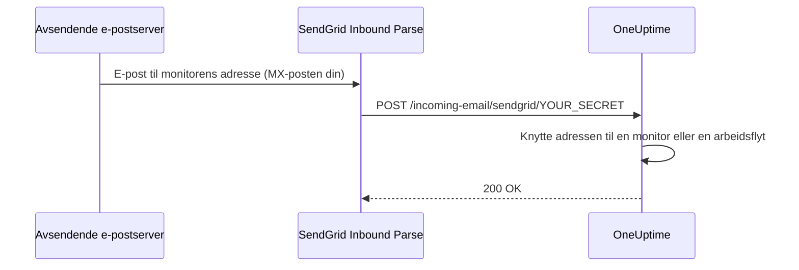

# SendGrid innkommende e-post

OneUptimes **Incoming Email Monitor** lar deg opprette og løse varsler basert på e-poster som sendes til unike, monitorspesifikke e-postadresser. Det er nyttig for å integrere eldre systemer, varslingsverktøy eller enhver tjeneste som kan sende e-post.

Det samme oppsettet lar også arbeidsflyter motta e-post: En arbeidsflyt med utløseren **Incoming Email** får sin egen adresse på det samme domenet, og hver e-post til den starter arbeidsflyten. Se [Utløsere](/docs/workflows/triggers#incoming-email).

Denne veiledningen forklarer hvordan du setter opp SendGrid Inbound Parse til å videresende innkommende e-poster til din selvhostede OneUptime-instans. OneUptime Cloud trenger ingenting av dette: Der virker adressene med en gang.

:::cards
- [Før du begynner](#forutsetninger): En SendGrid-konto, et domene og en offentlig HTTPS-adresse.
- [Oppsett](#oppsettsveiledning): Sju trinn, fra MX-posten til en test-e-post.
- [Miljøvariabler](#referanse-for-miljøvariabler): De tre innstillingene og standardverdiene deres.
- [Feilsøking](#feilsøking): E-poster som aldri kommer frem, og webhooks som feiler.
:::

## Slik fungerer det



1. Du oppretter en **Incoming Email Monitor** i OneUptime
2. OneUptime genererer en unik e-postadresse for den monitoren (f.eks. `monitor-abc123@inbound.yourdomain.com`)
3. Når en e-post sendes til den adressen, mottar SendGrid den og videresender den til OneUptime via webhook
4. OneUptime vurderer e-posten etter kriteriene du har satt opp, for å opprette eller løse varsler

## Forutsetninger

- En SendGrid-konto med tilgang til Inbound Parse
- Et domene du kontrollerer, med tilgang til DNS-innstillingene
- Et offentlig HTTPS-endepunkt som videresender SendGrid-webhooks til OneUptime-instansen din

## Nettverkstilgang

Med Inbound Parse er det SendGrid som oppretter forbindelsen til OneUptime. Det er ikke nok å bare tillate utgående internettilgang fra OneUptime.

| Retning | Mål | Protokoll / port | Formål |
| --- | --- | --- | --- |
| SendGrid → OneUptime | `https://your-oneuptime-domain.com/incoming-email/sendgrid/YOUR_SECRET` | HTTPS / TCP 443 | Levere den tolkede e-posten som en multipart-POST. |
| Avsendende e-postservere → SendGrid | `mx.sendgrid.net`, valgt via den offentlige MX-posten for det innkommende domenet ditt | SMTP / TCP 25 | Motta e-post hos SendGrid; denne forbindelsen går ikke til OneUptime-serveren din. |
| OneUptime → SendGrid, bare når sending av e-post via SendGrid-leverandøren er satt opp separat | `api.sendgrid.com` | HTTPS / TCP 443 | Sende varslings-e-poster via Mail Send API-et. |

Publiser DNS for vertsnavnet til webhooken, og lever et sertifikat som offentlige klienter stoler på. En privat OneUptime-installasjon kan nøye seg med å eksponere webhook-stien gjennom en offentlig omvendt proxy eller gateway som når OneUptime internt. Bevar stien, hemmeligheten, innholdstypen og multipart-forespørselens body, og slipp POST-en gjennom uten interaktiv pålogging eller nettleserutfordring. OneUptime-serveren trenger ikke en innkommende SMTP-lytter. Se [SendGrids oppsett av Inbound Parse](https://www.twilio.com/docs/sendgrid/for-developers/parsing-email/setting-up-the-inbound-parse-webhook).

Sett `INBOUND_EMAIL_WEBHOOK_SECRET` til en sterk tilfeldig verdi, og erstatt `YOUR_SECRET` i URL-en med den verdien. Ruten krever det siste stisegmentet. OneUptime kontrollerer verdien når hemmeligheten er satt; en tom variabel slår av kontrollen. Hold den fullstendige URL-en og monitorenes e-postadresser hemmelige, også i proxylogger. OneUptime validerer foreløpig verken SendGrids signerte Inbound Parse-hoder eller OAuth-tokener. Trenger du de mekanismene, setter du opp en gateway som validerer dem før den videresender til OneUptime, etter [SendGrids dokumentasjon om webhook-sikkerhet](https://www.twilio.com/docs/sendgrid/for-developers/parsing-email/securing-your-parse-webhooks).

SendGrid tilbyr ikke en pålitelig liste over statiske kilde-IP-er for Inbound Parse. SendGrids IP-er for sending av e-post og adressene som slås opp for `mx.sendgrid.net`, er ikke en tillatelsesliste for webhooks. Følg [SendGrids veiledning om brannmurer](https://support.sendgrid.com/hc/en-us/articles/44375457225371-How-to-Configure-Firewall-Settings-for-SendGrid-Webhook-and-Inbound-Parse-IPs) i stedet for å låse et gjeldende DNS-resultat.

Inbound Parse er atskilt fra sending av utgående e-post. For å motta monitor-e-poster trenger ikke OneUptime å kalle SendGrid-API-et. Velger du også SendGrid til å sende varsler, tillater du DNS-oppslag og utgående HTTPS til `api.sendgrid.com`; [Mail Send](https://www.twilio.com/docs/sendgrid/api-reference/mail-send/mail-send) trenger ingen innkommende tilbakekalling for innsending. Bruker du SMTP i stedet, tillater du SMTP-serveren og porten som er satt opp i OneUptime.

## Oppsettsveiledning

:::steps
### Velg domenet for innkommende e-post

Velg et underdomene som bare brukes til å motta e-post for OneUptime, for eksempel `inbound.yourdomain.com`, `email.yourdomain.com` eller `monitor.yourdomain.com`. Det brukes bare til e-post til OneUptime-monitorer og -arbeidsflyter, så ingen av postkassene dine ligger på det.

### La MX-posten peke på SendGrid

Legg til en MX-post som sender e-post for underdomenet videre til SendGrid:

| Type | Vert/Navn | Prioritet | Verdi |
| --- | --- | --- | --- |
| MX | inbound | 10 | mx.sendgrid.net |

Hvis domenet ditt er `example.com` og du bruker `inbound.example.com`, blir posten:

```text
inbound.example.com.  IN  MX  10  mx.sendgrid.net.
```

DNS-endringer kan ta opptil 48 timer å spre seg, men er som regel ferdige i løpet av noen få timer.

### Autentiser domenet i SendGrid

Det mottakende domenet må høre til et av dine [autentiserte domener i SendGrid](https://www.twilio.com/docs/sendgrid/ui/account-and-settings/inbound-parse). Gå i [SendGrid-dashbordet](https://app.sendgrid.com) til **Settings** > **Sender Authentication**, klikk på **Authenticate Your Domain**, og legg til DNS-postene den ber om (CNAME-poster for DKIM).

### Legg til Inbound Parse-webhooken

Gå i SendGrid-dashbordet til **Settings** > **Inbound Parse**, og klikk på **Add Host & URL**. Fyll ut skjemaet som nedenfor, og klikk deretter på **Add**:

| Felt | Verdi |
| --- | --- |
| **Receiving Domain** | Underdomenet ditt for innkommende e-post (f.eks. `inbound.yourdomain.com`) |
| **Destination URL** | `https://your-oneuptime-domain.com/incoming-email/sendgrid/YOUR_SECRET` |
| **Check incoming emails for spam** | Valgfritt – slå på om ønskelig |
| **Send raw, full MIME message** | La være uavkrysset (ikke nødvendig) |
| **POST the raw, full MIME message** | La være uavkrysset (ikke nødvendig) |

### Konfigurer OneUptime

Sett variablene for innkommende e-post, med den samme hemmeligheten som i Destination URL:

:::tabs
@tab Docker Compose
```bash title="config.env"
INBOUND_EMAIL_PROVIDER=SendGrid
INBOUND_EMAIL_DOMAIN=inbound.yourdomain.com
INBOUND_EMAIL_WEBHOOK_SECRET=replace-with-a-strong-random-secret
```
@tab Kubernetes
```yaml title="values.yaml"
inboundEmail:
  provider: "SendGrid"
  domain: "inbound.yourdomain.com"
  webhookSecret: "replace-with-a-strong-random-secret"
```
:::

Ta dem deretter i bruk: Kjør `npm run start` på Docker Compose, som gjenoppretter containerne med de nye verdiene, eller oppgrader Helm-releasen på Kubernetes.

### Opprett en Incoming Email-monitor

[Opprett en Incoming Email-monitor](/docs/monitor/incoming-email-monitor#opprett-en-monitor-for-innkommende-e-post). Siden **Oversikt** viser adressen, for eksempel `monitor-abc123def456@inbound.yourdomain.com`, og kriteriene avgjør hvilke e-poster som oppretter et varsel og hvilke som løser det.

Arbeidsflyter bruker det samme domenet. Legg til utløseren **Incoming Email** i en arbeidsflyt og klikk på den: Adressen (`workflow-…@inbound.yourdomain.com`) står øverst i innstillingene. Til variablene for innkommende e-post ovenfor er satt, sier utløseren at serveren ikke er satt opp til å motta e-post.

### Send en test-e-post

Send en e-post til monitorens adresse, med et emne som samsvarer med kriteriene. Monitorens sammendrag viser e-posten, og et varsel opprettes når kriteriene samsvarer.
:::

## Referanse for miljøvariabler

| Variabel | Helm-verdi | Beskrivelse | Påkrevd | Standard |
| --- | --- | --- | --- | --- |
| `INBOUND_EMAIL_PROVIDER` | `inboundEmail.provider` | Leverandøren av innkommende e-post. SendGrid er den eneste. | Nei | `SendGrid` |
| `INBOUND_EMAIL_DOMAIN` | `inboundEmail.domain` | Underdomenet som er satt opp for innkommende e-post. Innkommende e-post er av til det er satt. | Ja | Tom |
| `INBOUND_EMAIL_WEBHOOK_SECRET` | `inboundEmail.webhookSecret` | Hemmelighet som sammenlignes med det siste segmentet i webhook-URL-en: `/incoming-email/sendgrid/YOUR_SECRET`. Sett den for offentlige endepunkter; en tom verdi slår av valideringen. | Anbefalt | Tom |

Hva en Incoming Email-monitor kan se etter – emnet, avsenderen, innholdet, mottakeren og om en e-post kom frem i tide – står i [Tilgjengelige filtertyper](/docs/monitor/incoming-email-monitor#tilgjengelige-filtertyper).

## Feilsøking

:::details E-poster blir ikke mottatt
1. **Kontroller DNS-spredningen:** `dig MX inbound.yourdomain.com` skal returnere `mx.sendgrid.net`.
2. **Kontroller Inbound Parse-innstillingene i SendGrid:** Sjekk domenet ditt og webhook-URL-en i SendGrid-dashbordet under **Settings** > **Inbound Parse**.
3. **Sjekk loggene til OneUptime:** Se etter webhook-forespørsler for innkommende e-post, og eventuelle feil, i loggene til OneUptime-tjenesten `app`. SendGrid lagrer ingen detaljerte logger for Inbound Parse, så disse loggene er oversikten over hva som kom frem.
:::

:::details Webhooks feiler
1. **Kontroller den offentlige webhook-ruten:** Den fullstendige URL-en, inkludert hemmeligheten, må nå OneUptime fra internett. URL-en uten det siste hemmelige segmentet samsvarer ikke med ruten.
2. **Kontroller brannmurreglene:** Tillat HTTPS POST-forespørsler til webhook-stien uten påloggingsomdirigeringer eller nettleserutfordringer, og ikke bruk SendGrids IP-er for sending av e-post som tillatelsesliste for webhookens kilde.
3. **Kontroller SSL-sertifikatet:** Bruk et gyldig, offentlig klarert sertifikat for vertsnavnet til webhooken, og ta med sertifikatkjeden.
:::

:::details Monitoren oppretter ikke varsler
1. **Kontroller kriteriene:** Sjekk at kriteriene for å opprette varsler samsvarer med innholdet i e-posten, og test først med eksakte strenger før du bruker mønstre.
2. **Sjekk monitoren:** Sørg for at den ikke er deaktivert, og at typen er Incoming Email.
3. **Gå gjennom monitorens sammendrag:** Sjekk om e-posten ble mottatt og behandlet, og les evalueringsloggene for hvordan kriteriene samsvarte.
:::

:::details Utløseren sier at serveren ikke er satt opp til å motta e-post
`INBOUND_EMAIL_DOMAIN` er tom på serveren. Sett den, ta endringen i bruk, og åpne arbeidsflytens utløser igjen.
:::

## Beste praksis for sikkerhet

1. **Bruk HTTPS:** Bruk alltid HTTPS for webhook-endepunktet ditt
2. **Webhook-hemmelighet:** Sett `INBOUND_EMAIL_WEBHOOK_SECRET`, og ta den med i webhook-URL-en (f.eks. `/incoming-email/sendgrid/your-secret`) som ekstra validering
3. **Domenebekreftelse:** Bekreft domenet ditt i SendGrid for bedre e-postsikkerhet
4. **Begrens tilgangen:** Opprett bare monitorer for klarerte e-postkilder
5. **Overvåk logger:** Gå jevnlig gjennom loggene for innkommende e-post for mistenkelig aktivitet

## Neste steg

:::cards
- [Incoming Email Monitor](/docs/monitor/incoming-email-monitor): Kriterier, adresseformater og eksempler.
- [Arbeidsflytutløsere](/docs/workflows/triggers): Start en arbeidsflyt fra en e-post.
- [Tilgang til privat nettverk](/docs/self-hosted/private-network-access): Hva serveren din kan nå i ditt eget nettverk.
- [Arkitektur](/docs/self-hosted/architecture): Hvor webhooken lander i en selvhostet installasjon.
:::
