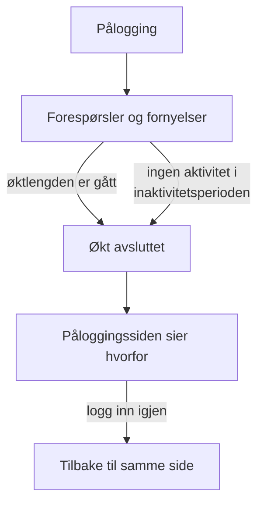

# Øktlengde

Velg hvor lenge folk forblir pålogget OneUptime før de logger inn igjen: en fast tid etter at de logget inn, en tid uten bruk, eller begge deler. Det gjelder for hver pålogging på dashbordet, Admin Dashboard og mobilappen, med passord, passnøkkel, pålogging med Google, pålogging med Microsoft eller enkel pålogging. SSO-pålogginger kan ha egne lengder.

> [!NOTE]
> Øktlengde er en del av [OneUptime Enterprise Edition](/docs/self-hosted/enterprise). Community Edition har ingen side **Øktlengde**, og hver pålogging varer slik [Uten grense](#uten-grense) beskriver.

:::cards
- [Angi en øktlengde](#angi-en-øktlengde): To innstillinger i Admin Dashboard.
- [Slik slutter en økt](#slik-slutter-en-økt): Hva serveren teller, og når.
- [SSO-pålogginger](#sso-pålogginger): Egne lengder for enkel pålogging.
- [Hva som ikke er en pålogging](#hva-som-ikke-er-en-pålogging): API-nøkler, MCP-tilkoblinger og lesere av statussider.
:::

## Uten grense

Så lenge du ikke angir en lengde, har en pålogging ingen. Tilgangstokenet varer i 15 minutter og fornyes i bakgrunnen med et oppdateringstoken, som varer i 30 dager og starter på nytt hver gang det brukes. Den som åpner OneUptime minst én gang hver 30. dag, forblir pålogget; den som ikke gjør det, logger inn igjen.

## Angi en øktlengde

:::steps
### Åpne Øktlengde
Åpne **Innstillinger** i Admin Dashboard, og deretter **Øktlengde** i sidemenyen.

### Velg lengdene
- **Logg ut folk etter**: hvor lenge en pålogging varer fra øyeblikket noen logger inn, uansett hvor aktive de er.
- **Logg ut folk etter inaktivitet i**: hvor lenge noen kan gå uten å klikke, skrive eller rulle i OneUptime.

Hvert valg lagres så snart du gjør det.

### Bekreft hvem som logges ut
En kortere lengde gjelder for alle som er pålogget nå. Når den logger ut folk med en gang, sier OneUptime først hvor mange, og om du er en av dem. Velg **Lagre og logg dem ut** for å fortsette.
:::

| Innstilling | Valg | Standard |
| --- | --- | --- |
| **Logg ut folk etter** | 1 time til 90 dager | **Ingen grense** |
| **Logg ut folk etter inaktivitet i** | 15 minutter til 14 dager | 30 dager, det lengste som finnes |

Via API-et tar `sessionLengthInMinutes` et hvilket som helst helt antall minutter fra 15 til 525600 (ett år) og `sessionIdleTimeoutInMinutes` fra 15 til 43200 (30 dager), i serverens globale konfigurasjon. Tom er standarden.

## Slik slutter en økt

- Serveren teller begge lengdene ut fra selve økten: når den logget inn, og når personen sist var aktiv. Den sjekker dem ved hver forespørsel, hver fornyelse og hver liveoppdatering, og overlater aldri utloggingen til nettleseren.
- Inaktivitetsperioden teller fra siste klikk, tastetrykk eller rulling i en hvilken som helst fane på dashbordet eller Admin Dashboard. En fane som står åpen, holder ikke en økt i live.
- Mobilappen teller som aktiv hver gang den brukes.
- Når en økt slutter, går nettleseren til påloggingssiden, som sier hvorfor. Etter å ha logget inn igjen kommer personen tilbake til siden de var på.

| Endring | Hva som skjer med dem som er pålogget nå |
| --- | --- |
| En kortere øktlengde eller inaktivitetsperiode | Alle som er forbi den, logges ut med en gang, de andre når de når den |
| En lengre, eller ingen | Ingen logges ut, og økter varer lenger fra neste fornyelse |

## SSO-pålogginger

Pålogginger via enkel pålogging følger de samme to innstillingene. For å gi dem egne lengder åpner du **Flere innstillinger** på siden **Øktlengde** og slår på **Egne lengder for SSO-pålogginger**. De to innstillingene under gjelder da for pålogginger via et prosjekts SAML- eller OpenID Connect-leverandør, eller serverens egen [globale SSO](/docs/identity/global-sso), og de to øverst på siden for alle andre pålogginger.

Et prosjekt som krever SSO, slipper dessuten bare inn en økt så lenge SSO-påloggingen varer, og det er aldri lenger enn lengden SSO-pålogginger følger.

Via API-et er bryteren `useSeparateSsoSessionLengths`, og lengdene for SSO-pålogginger er `ssoSessionLengthInMinutes` og `ssoSessionIdleTimeoutInMinutes`, med de samme områdene.

## Hva som ikke er en pålogging

- **API-nøkler** beholder utløpstiden du gir dem.
- **MCP-tilkoblinger**, KI-assistenter koblet til med OAuth, beholder sin egen levetid. I et prosjekt som krever SSO, varer en tilkobling aldri lenger enn SSO-påloggingen den ble godkjent med.
- **Private statussider** har en egen lengde for leserne sine: se [Private brukere](/docs/status-pages/index#private-brukere).

## Uten lisens

Etter prøveperioden eller utsettelsesperioden, uten gyldig lisens eller med en lisens som ikke omfatter øktlengder, kan lengdene ikke angis eller endres. De som allerede er angitt, logger fortsatt ut folk, og du kan fortsatt fjerne dem. Med Community Edition-imaget gjelder ingen lengde: verdiene blir liggende i databasen og gjelder igjen når du bytter tilbake.

## Neste steg

:::cards
- [SSO](/docs/identity/sso): Logg inn folk med identitetsleverandøren din.
- [Global SSO](/docs/identity/global-sso): Én identitetsleverandør for hele serveren.
- [Enterprise Edition](/docs/self-hosted/enterprise): Hva Enterprise Edition legger til, og lisensen.
:::
