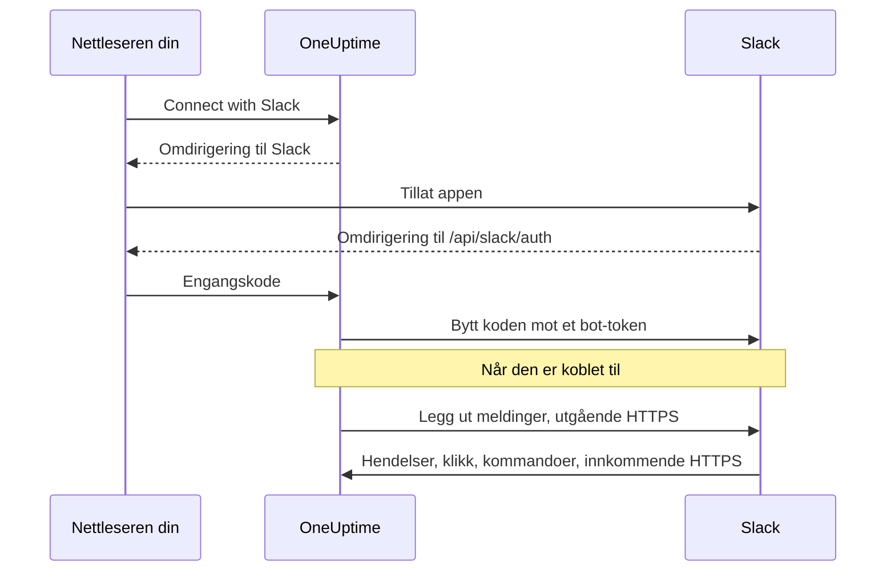
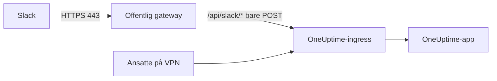

# Slack-integrasjon

Koble din selvdriftede OneUptime til Slack. Du oppretter en Slack-app fra manifestet serveren din genererer, gir OneUptime appens påloggingsinformasjon og kobler hvert prosjekt til et arbeidsområde. Deretter legger OneUptime ut hendelser, varsler og planlagt vedlikehold i kanalene dine, og teamet ditt håndterer dem fra Slack.

Denne siden er for den som drifter OneUptime-serveren. Når Slack er koblet til, settes varslingsregler opp per prosjekt: se [Slack](/docs/workspace-connections/slack).

:::cards
- [Sett opp Slack-appen](#sett-opp-slack-appen): Opprett appen fra manifestet ditt, og koble til et prosjekt.
- [Miljøvariabler](#miljøvariabler): De tre verdiene OneUptime trenger fra appen.
- [Nettverkstilgang](#nettverkstilgang-for-selvdriftede-installasjoner): Callbackene Slack må kunne nå.
- [Feilsøking](#feilsøking): Hva meldingene på Slack-siden betyr, og hva du gjør.
:::

## Slik fungerer det

Slack-appen er din egen: Den er installert i arbeidsområdet ditt og snakker bare med serveren din. Trafikken går begge veier, og hver retning trenger sin egen nettverkstilgang.



- **Utgående**: OneUptime kaller Slacks Web API for å legge ut meldinger, opprette kanaler og laste opp bilder.
- **Innkommende**: Slack kaller fire ruter på serveren din for hendelser, klikk på knapper, menyer og skråstrekkommandoer. Hver forespørsel er signert med appens signing secret. OneUptime avviser en forespørsel der signaturen ikke stemmer eller tidsstempelet er mer enn fem minutter gammelt.

## Før du begynner

- Et Slack-arbeidsområde der du kan opprette og installere apper.
- Et offentlig HTTPS-vertsnavn for OneUptime som Slack kan nå. Se [Nettverkstilgang](#nettverkstilgang-for-selvdriftede-installasjoner).
- Tilgang til serverens konfigurasjon: `config.env` for Docker Compose, eller Helm-values for Kubernetes.
- For å koble til et prosjekt: rollen **Project Owner**, **Project Admin** eller **Project Member** i det.

## Sett opp Slack-appen

:::steps
### Angi den offentlige URL-en

OneUptime bygger appmanifestet og hver callback-URL fra `HOST` og `HTTP_PROTOCOL`. Sett dem til vertsnavnet Slack skal kalle, over HTTPS:

:::tabs
@tab Docker Compose
```bash title="config.env"
HOST=oneuptime.example.com
HTTP_PROTOCOL=https
```
@tab Kubernetes
```yaml title="values.yaml"
host: oneuptime.example.com
httpProtocol: https
```
:::

Disse verdiene genererer bare URL-er. De oppretter ikke DNS-poster, sertifikater eller brannmurregler.

### Kopier appmanifestet

Åpne **Prosjektinnstillinger > Arbeidsområde > Slack**. Inntil Slack er satt opp på serveren, viser siden **Integrating Slack with your OneUptime Project** med manifestet som er generert for vertsnavnet ditt. Det serveres også på `https://oneuptime.example.com/api/slack/app-manifest`.

Kontroller at hver URL i manifestet begynner med det offentlige vertsnavnet ditt. Hvis ikke, retter du først `HOST` og `HTTP_PROTOCOL` og tar i bruk endringen.

### Opprett Slack-appen

Opprett en ny app fra et manifest på [api.slack.com/apps](https://api.slack.com/apps), velg arbeidsområdet ditt, og lim inn manifestet. Bruk alltid manifestet din egen server genererer, slik at URL-ene i det passer til vertsnavnet ditt.

### Kopier appens påloggingsinformasjon

Kopier **Client ID**, **Client Secret** og **Signing Secret** på appens side **Basic Information** under **App Credentials**.

### Legg påloggingsinformasjonen inn i OneUptime

:::tabs
@tab Docker Compose
```bash title="config.env"
SLACK_APP_CLIENT_ID=YOUR_SLACK_APP_CLIENT_ID
SLACK_APP_CLIENT_SECRET=YOUR_SLACK_APP_CLIENT_SECRET
SLACK_APP_SIGNING_SECRET=YOUR_SLACK_APP_SIGNING_SECRET
```
@tab Kubernetes
```yaml title="values.yaml"
slackApp:
  clientId: "YOUR_SLACK_APP_CLIENT_ID"
  clientSecret: "YOUR_SLACK_APP_CLIENT_SECRET"
  signingSecret: "YOUR_SLACK_APP_SIGNING_SECRET"
```

For å holde verdiene i en Kubernetes-Secret som du administrerer selv, angir du i stedet `slackApp.existingSecret`: dens `name` og nøklene `clientIdKey`, `clientSecretKey` og `signingSecretKey`.
:::

### Ta i bruk konfigurasjonen

:::tabs
@tab Docker Compose
```bash
npm run start
```

Dette oppretter containerne på nytt med den nye `config.env`. `docker compose restart` leser den ikke inn på nytt.
@tab Kubernetes
```bash
helm upgrade my-oneuptime oneuptime/oneuptime -f values.yaml
```
:::

Når OneUptime er oppe igjen, viser **Prosjektinnstillinger > Arbeidsområde > Slack** en knapp **Connect with Slack** i stedet for manifestet.

### Bekreft forespørsels-URL-en for hendelser

Bekreft forespørsels-URL-en under **Event Subscriptions** i Slack-appen. OneUptime svarer først på Slacks challenge når signing secret er satt, så prøv igjen hvis det mislyktes mens du opprettet appen.

### Koble til prosjektet

Velg **Connect with Slack** under **Prosjektinnstillinger > Arbeidsområde > Slack**, og tillat appen i Slack. Slack sender deg tilbake til samme side, som nå viser arbeidsområdet ditt.

### Koble til din egen Slack-konto

Knapper, skjemaer og kommandoer handler som OneUptime-brukeren som er knyttet til Slack-kontoen som bruker dem. Hver person åpner **Brukerinnstillinger > Arbeidsområde > Slack** og velger **Connect my account with Slack**. Den som ikke har koblet til en konto, får en direktemelding fra appen som ber om det.
:::

## Miljøvariabler

| Docker Compose (`config.env`) | Helm (`values.yaml`) | Påkrevd | Verdi |
| --- | --- | --- | --- |
| `SLACK_APP_CLIENT_ID` | `slackApp.clientId` | Ja | Appens **Client ID**. Uten den viser Slack-siden oppsettveiledningen i stedet for **Connect with Slack**. |
| `SLACK_APP_CLIENT_SECRET` | `slackApp.clientSecret` | Ja | Appens **Client Secret**, som brukes til å bytte koden Slack returnerer mot et token. |
| `SLACK_APP_SIGNING_SECRET` | `slackApp.signingSecret` | Ja | Appens **Signing Secret**. Hver forespørsel fra Slack kontrolleres mot den. |
| `HOST` | `host` | Ja | Det offentlige vertsnavnet ditt, uten skjema. |
| `HTTP_PROTOCOL` | `httpProtocol` | Ja | `https`. Slack kaller bare HTTPS-URL-er. |

## Hva appen kan gjøre

Manifestet setter opp disse funksjonene. Hver av dem når serveren din via ruten som vises, og fungerer derfor bare når Slack kan nå den ruten.

| Funksjon | Hva den gjør | Rute |
| --- | --- | --- |
| `/incident` og snarveien **Create New Incident** | Erklær en hendelse fra Slack | `POST /api/slack/interactive` |
| `/maintenance` og snarveien **Create Scheduled Event** | Planlegg vedlikehold fra Slack | `POST /api/slack/interactive` |
| `/oneuptime` | Spør OneUptime AI om logger, traces, metrikker, hendelser og monitorer | `POST /api/slack/command` |
| Knapper og skjemaer i OneUptime-meldinger | Bekreft, løs, legg til et notat, endre tilstanden, kjør en vaktpolicy | `POST /api/slack/interactive` og `POST /api/slack/options-load` |
| Hendelser | Omtaler, meldinger, reaksjoner og festede elementer, for eksempel for å lagre en melding som notat | `POST /api/slack/events` |

### Bilder i meldinger

Beskrivelser av hendelser og varsler kan inneholde skjermbilder, for eksempel fra en syntetisk monitor (se [Vis et skjermbilde](/docs/monitor/incident-alert-templating#vis-et-skjermbilde)). OneUptime viser dem i Slack-meldinger ved å laste opp hvert av dem til arbeidsområdet ditt som en privat fil, noe som krever bot-scopet `files:write`. Det genererte manifestet inneholder det.

Hvis du opprettet Slack-appen fra et eldre manifest, legger du til `files:write` under **OAuth & Permissions > Bot Token Scopes** (eller oppdaterer appen fra det gjeldende manifestet). Velg deretter **Connect with Slack** igjen under **Prosjektinnstillinger > Arbeidsområde > Slack**, slik at det nye scopet blir gitt. Inntil da vises hvert skjermbilde som sin alternative tekst.

## Nettverkstilgang for selvdriftede installasjoner

### Trafikkretning og endepunkter

| Trafikk | Nødvendig tilgang |
| --- | --- |
| OneUptime til Slack | DNS og utgående HTTPS på TCP 443 til `slack.com` for Web API-kall og utveksling av OAuth-token; `hooks.slack.com` for svar-URL-er fra kommandoer og varsler via incoming webhooks, når de brukes |
| Slack til OneUptime | Offentlig HTTPS på TCP 443 til de fire POST-rutene nedenfor, for hele integrasjonen |
| Brukerens nettleser til OneUptime | Tilgang til dashbordet og OAuth-omdirigeringer til `/api/slack/auth/:projectId/:userId` og `/api/slack/auth/:projectId/:userId/user`; disse kan fortsatt nås via brukerens VPN |

De utgående domenene beskriver OneUptimes Slack-integrasjon, ikke en fullstendig tillatelsesliste for Slack-klienter eller hver Slack-funksjon. En Slack-*incoming webhook* driftes av Slack: OneUptime sender til den, så den er ikke et innkommende endepunkt på serveren din. Se Slacks [veiledning for incoming webhooks](https://docs.slack.dev/messaging/sending-messages-using-incoming-webhooks/).

Videresend disse callbackene til OneUptime gjennom ingressen:

| Metode og bane | Formål |
| --- | --- |
| `POST /api/slack/events` | Verifisering av Events API, reaksjoner, festede elementer, omtaler og meldinger |
| `POST /api/slack/interactive` | Knapper, snarveier, innsendte modaler, `/incident` og `/maintenance` |
| `POST /api/slack/options-load` | Forespørsler om alternativer i interaktive menyer |
| `POST /api/slack/command` | Kommandoen `/oneuptime` |

OAuth er en [omdirigering i nettleseren etterfulgt av en tokenutveksling på serveren](https://docs.slack.dev/authentication/installing-with-oauth/). Manifestet registrerer `/api/slack/auth` som prefiks for omdirigerings-URL-en, og OneUptime legger til prosjekt- og brukerbanene når den starter autorisasjonen. Tilgang fra nettleseren alene lar ikke Slack levere hendelser eller klikk på knapper.

### Private installasjoner og sikkerhet for callbacker



Bruk offentlig DNS og en gateway med et offentlig klarert HTTPS-sertifikat, en fullstendig sertifikatkjede og en privat rute til OneUptime-ingressen din. Tillat innkommende TCP 443 til gatewayen, og videresend bare de fire callback-rutene ovenfor. En privat `ClusterIP`, et internt DNS-navn eller en ansatts VPN-tilkobling kan ikke nås av Slack. Delt DNS kan holde dashbordet og OAuth-rutene private under samme vertsnavn.

Generer manifestet på nytt og oppdater Slack-appen etter en endring av vertsnavnet.

Bevar gjennom gatewayen:

- metoden, banen, spørrestrengen og den opprinnelige bodyen;
- `Content-Type`, `X-Slack-Signature` og `X-Slack-Request-Timestamp`;
- den offentlige verten og HTTPS-skjemaet, via klarerte proxy-headere.

Unnta callback-rutene fra nettleser-SSO, CAPTCHA og proxyens påloggingssider, og behold OneUptimes kontroller av signing secret og tidsstempel. Hold serverens klokke synkronisert: En forespørsel som avviker med mer enn fem minutter, avvises. Slack dokumenterer [verifisering av forespørslers signatur](https://docs.slack.dev/authentication/verifying-requests-from-slack/); en kontroll av kilde-IP erstatter den ikke.

### Kontroller tilgangen, og forstå begrensningene

:::steps
1. Bekreft forespørsels-URL-en under **Event Subscriptions** i Slack-appen. Slack sender en [POST-challenge og kontrollerer TLS](https://docs.slack.dev/apis/events-api/using-http-request-urls/).
2. Send et testvarsel, kjør en skråstrekkommando, trykk på en knapp i en hendelsesmelding, og utløs en abonnert hendelse.
3. Sjekk loggene til gatewayen og OneUptime for mislykkede leveranser, uten å logge hemmeligheter.
:::

Slack forventer raske bekreftelser, blant annet [et svar innen tre sekunder for interaksjoner](https://docs.slack.dev/interactivity/handling-user-interaction/). En GET fra nettleseren eller en vellykket utgående melding bekrefter ikke disse POST-callbackene.

> [!WARNING]
> Hvis all innkommende tilkobling er forbudt, kan en allerede autorisert app fortsatt sende meldinger med utgående HTTPS, men hendelser, knapper, snarveier og kommandoer kan ikke fungere. OneUptimes manifest bruker HTTP-callbacker og slår av Socket Mode; å slå på Slacks Socket Mode er ikke en støttet erstatning for disse rutene.

[Innstillingene for tilgang til private nettverk](/docs/self-hosted/private-network-access) styrer utgående forespørsler til private mål. De gjør ikke callbacker tilgjengelige for Slack.

## Feilsøking

### Tilkoblingen ble ikke fullført

Når Slack sender deg tilbake og tilkoblingen ikke ble opprettet, viser Slack-siden du startet fra (**Prosjektinnstillinger > Arbeidsområde > Slack**, eller dine egne **Brukerinnstillinger > Arbeidsområde > Slack** hvis du koblet til kontoen din), **Slack ble ikke koblet til**, med én setning på språket ditt som sier hvorfor. Resten av siden lastes som vanlig, så du kan koble til på nytt med en gang. Den viser aldri hva Slack selv svarte: Det står i OneUptime-serverens logg, sammen med årsaken.

| Siden sier | Hva du gjør |
| --- | --- |
| **"Denne tilkoblingslenken er ugyldig, har utløpt eller er allerede brukt. Start på nytt."** | Lenken virker én gang, i 15 minutter, i nettleseren som startet den. Start på nytt fra Slack-siden, og fullfør i Slack innen 15 minutter i samme nettleser. |
| **"Du har ikke tillatelse til å koble dette prosjektet til Slack."** | Å installere OneUptime i Slack krever **Project Owner**, **Project Admin** eller **Project Member**. Det kontrolleres på nytt når Slack sender deg tilbake, så en rolle som er fjernet i mellomtiden, avslutter også tilkoblingen her. |
| **"Du er ikke lenger medlem av dette prosjektet."** | For å koble til din egen Slack-konto må du være medlem av prosjektet når Slack sender deg tilbake. |
| **"Dette prosjektet er ennå ikke koblet til et Slack-arbeidsområde."** | Installer først OneUptime i Slack fra **Prosjektinnstillinger > Arbeidsområde > Slack**, og koble deretter til din egen konto. |
| **"Du logget på et annet Slack-arbeidsområde enn det dette prosjektet er koblet til."** | Koble til kontoen din mens du er logget på Slack-arbeidsområdet prosjektet er installert i. |
| **"Tilkoblingen ble avbrutt, så ingenting ble endret."** | Forespørselen ble ikke tillatt i Slack. Start på nytt, og tillat den. |
| **"Slack er ikke satt opp på denne OneUptime-serveren."** | Angi `SLACK_APP_CLIENT_ID` og `SLACK_APP_CLIENT_SECRET` (se [Miljøvariabler](#miljøvariabler)), og start OneUptime på nytt. |
| **"OneUptime kunne ikke fullføre tilkoblingen. Prøv igjen."** | Slack svarte med en feil, eller en forespørsel eller en skriving mislyktes under fullføringen. OneUptime-serverens logg sier hvilken. Prøv igjen; hvis det fortsetter, sjekker du loggen og innstillingene til Slack-appen. |

### Andre problemer

:::details Slack kan ikke bekrefte forespørsels-URL-en for hendelser
OneUptime svarer bare på Slacks challenge når `SLACK_APP_SIGNING_SECRET` er satt og forespørselen når fram. Angi signing secret, ta i bruk konfigurasjonen, og prøv bekreftelsen på nytt. Hvis den fortsatt mislykkes, kontrollerer du at `POST /api/slack/events` kan nås fra internett med et offentlig klarert sertifikat.
:::

:::details Knapper og skråstrekkommandoer gjør ingenting, men varslene kommer fram
Varsler er utgående og fungerer derfor uten innkommende tilgang. Knapper, snarveier og kommandoer er innkommende: Kontroller at Slack kan nå `POST /api/slack/interactive` og `POST /api/slack/command`, og at gatewayen bevarer bodyen og headerne `X-Slack-Signature` og `X-Slack-Request-Timestamp`.
:::

:::details Appen sier at Slack-kontoen min ikke er koblet til OneUptime
Knapper, skjemaer og kommandoer trenger at Slack-kontoen din er knyttet til OneUptime-brukeren din. Åpne **Brukerinnstillinger > Arbeidsområde > Slack**, og velg **Connect my account with Slack**. Hvis du er fjernet fra prosjektet, sier appen det i stedet, og handlinger fra Slack avvises.
:::

:::details Skjermbilder vises som tekst
Slack-appen mangler scopet `files:write`. Se [Bilder i meldinger](#bilder-i-meldinger).
:::

## Neste steg

:::cards
- [Slack](/docs/workspace-connections/slack): Opprett varslingsregler og sammendrag for prosjektet.
- [Microsoft Teams-integrasjon](/docs/self-hosted/microsoft-teams-integration): Sett også opp Teams-boten på serveren din.
- [Tilgang til privat nettverk](/docs/self-hosted/private-network-access): La arbeidsflyter og webhooker nå interne verktøy.
:::
