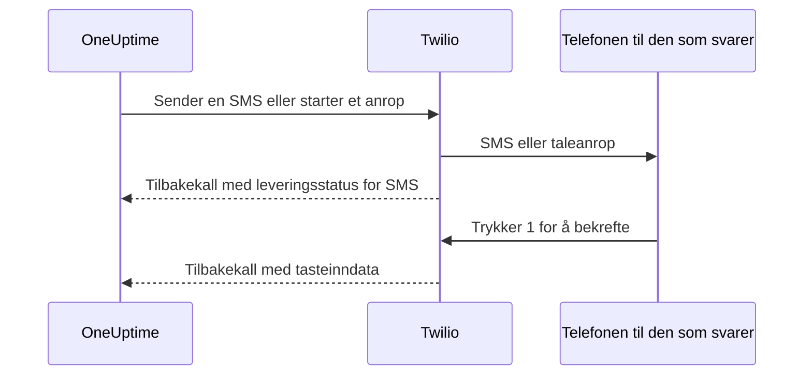

# Twilio-integrasjon

En selvdriftet OneUptime sender SMS- og talevarsler gjennom din egen Twilio-konto, og du betaler Twilio direkte. Twilio-påloggingsinformasjonen lagrer du i OneUptimes dashbord, ikke i miljøvariabler: Leveringen av varsler leser den lagrede konfigurasjonen, og Helm-chartet har ingen verdier for Twilio-påloggingsinformasjon.

> [!NOTE]
> En gammel migrering importerte `TWILIO_ACCOUNT_SID`, `TWILIO_AUTH_TOKEN` og `TWILIO_PHONE_NUMBER`; å endre disse variablene er ikke måten å oppdatere påloggingsinformasjonen i en eksisterende installasjon på.

:::cards
- [Klargjør Twilio-kontoen](#1-klargjør-twilio-kontoen): Påloggingsinformasjon, et telefonnummer og kontoens grenser.
- [Lagre påloggingsinformasjonen](#2-lagre-påloggingsinformasjonen-i-oneuptime): For ett prosjekt, eller for hele installasjonen.
- [Konfigurer nettverkstilgang](#3-konfigurer-nettverkstilgang): Hva Twilio må nå på serveren din, og når.
- [Bekreft telefonnumre](#5-bekreft-teammedlemmenes-telefonnumre): Hvordan teammedlemmenes numre bekreftes.
:::

## 1. Klargjør Twilio-kontoen

:::steps
### Kopier påloggingsinformasjonen

Åpne [Twilio Console](https://console.twilio.com/), og kopier **Account SID** og **Auth Token**.

### Skaff et telefonnummer

Skaff et Twilio-telefonnummer med SMS- og/eller talefunksjonene du trenger. Bruk formatet E.164 med landskode for avsender- og mottakernumre.

### Sjekk kontoens grenser

Sjekk saldoen på kontoen, tillatelsene for mottakerland og gjeldende krav til registrering av avsendere. Prøvekontoer har begrensninger på mottakere, geografi og annet som kan hindre ekte varsler fra OneUptime i å fungere; les [Twilios dokumentasjon om kontoer og prøveperioden](https://www.twilio.com/docs/usage/tutorials/how-to-use-your-free-trial-account) før du tester. Bruk en oppgradert konto i produksjon.
:::

## 2. Lagre påloggingsinformasjonen i OneUptime

Lagre påloggingsinformasjonen for ett prosjekt, eller én gang for hele installasjonen:

| | Prosjektkonfigurasjon | Konfigurasjon for hele installasjonen |
| --- | --- | --- |
| Hvor | Kortet **Twilio-konfigurasjon** under **Prosjektinnstillinger > Varsler > Varselinnstillinger** | **Admin Dashboard > Innstillinger > Anrop og SMS** |
| Hvem kan angi den | **Project Owner**, **Project Admin** eller **Create Call and SMS** i en egendefinert rolle | En master-admin |
| Brukes til | SMS og anrop til prosjektets medlemmer så lenge den er prosjektstandarden, statussidene den er tildelt, og retningslinjene for innkommende anrop som bruker den | SMS og anrop til medlemmene i alle prosjekter som ikke har en standardkonfigurasjon |

Slik legger du til en prosjektkonfigurasjon:

:::steps
1. Gå til **Prosjektinnstillinger > Varsler > Varselinnstillinger**.
2. Velg **Opprett Twilio-konfigurasjon** i **Twilio-konfigurasjon**.
3. Skriv inn et navn, **Twilio Account SID**, **Twilio Auth Token** og **Twilio primært telefonnummer**. Du kan også skrive inn kommaseparerte **Twilio sekundære telefonnumre** for andre land.
4. **Angi som prosjektstandard** er slått på for prosjektets første konfigurasjon, så SMS og anrop til prosjektets medlemmer, også vaktvarsler, går gjennom den med en gang du lagrer. Slå den av hvis kontoen bare er for statussider eller innkommende anrop. En senere konfigurasjon starter med bryteren av: Slå den på, eller velg **Angi som prosjektstandard** i konfigurasjonens radmeny for å flytte disse meldingene dit. En API-forespørsel som utelater `isProjectDefault`, behandles på samme måte.
5. Lagre. Bare én konfigurasjon kan være prosjektstandarden. Statussider bruker konfigurasjonen som er uttrykkelig tildelt hver statusside.

> [!IMPORTANT]
> **SMS** og **Telefonanrop** er av fra start i hvert prosjekt, og så lenge de er av, kan ingen i prosjektet legge til et telefonnummer for dem. En prosjekteier, en **Billing Admin** eller noen med **Manage Billing** slår dem på i kortet **Varslingskanaler** på samme side.
:::

For en standard for hele installasjonen kan en administrator i stedet åpne **Admin Dashboard > Innstillinger > Anrop og SMS**, redigere Twilio-påloggingsinformasjonen og telefonnumrene og lagre. Medlemmenes varsler bruker denne globale konfigurasjonen når prosjektet deres ikke har en standard. Hold Auth Token hemmelig.

## 3. Konfigurer nettverkstilgang

Sending fungerer med bare utgående tilgang. Leveringsoppdateringer, bekreftelse med tastene og innkommende anrop krever at Twilio når serveren din.

En privat installasjon trenger DNS-oppslag og utgående HTTPS over TCP 443 til Twilio for å sende SMS og anrop. Twilio anbefaler å tillate utgående HTTPS til `*.twilio.com`, fordi API-adressene er dynamiske; se [Twilios IP-adresser](https://help.twilio.com/articles/115015934048-All-About-Twilio-IP-Addresses). Bruk dette på utgående trafikk fra arbeidslasten til OneUptime-applikasjonen, også Kubernetes-NetworkPolicies og eksterne brannmurer.

Innkommende tilgang avhenger av funksjonen:

| Funksjon | Må Twilio nå OneUptime? |
| --- | --- |
| Sending av SMS | Nei. Oppdateringer av leveringsstatus trenger likevel et tilbakekall. |
| Et enkelt testanrop med tale | Nei. OneUptime sender de talte instruksjonene med i den utgående API-forespørselen. |
| Trykke 1 for å bekrefte et vaktvarsel | Ja. Twilio sender tasteinndataene til OneUptime. |
| Retningslinjer for innkommende anrop | Ja. Twilio henter anropsinstruksjoner og rapporterer resultatene av oppringingen. |

Dette er de eksterne stiene gjennom OneUptimes Nginx-gateway. Plassholderne er forskjellige for hvert varsel:

| Metode | Sti | Formål |
| --- | --- | --- |
| POST | `/notification/sms/status-callback/:smsLogId/:token` | Leveringsstatus for SMS |
| POST | `/api/user-notification-log-timeline/call/gather-input/:itemId?token=...` | Bekreftelse med tastene |
| POST | `/notification/incoming-call/voice` | Valgfrie instruksjoner for innkommende anrop |
| POST | `/notification/incoming-call/dial-status/:callLogId/:callLogItemId` | Valgfrie resultater av ruting av innkommende anrop |

OneUptime genererer URL-ene for SMS og bekreftelse automatisk. Ikke erstatt tokenene deres med en fast webhook-URL. For innkommende anrop følger du [retningslinjer for innkommende anrop](/docs/on-call/incoming-call-policy), som konfigurerer webhooken til nummeret når du knytter til et nummer.

Twilio krever [offentlig tilgjengelige webhook-URL-er](https://www.twilio.com/docs/usage/webhooks/webhooks-overview). Bruk et offentlig klarert TLS-sertifikat, og bevar den opprinnelige verten, protokollen, stien, spørringsparameterne, kroppen og headeren `X-Twilio-Signature` gjennom proxyer. Behandlerne for innkommende anrop validerer Twilios signaturer; SMS-levering bruker et URL-token per melding, og bekreftelse med tastene et signert spørringstoken. Ikke vis tokener i delte logger eller skjermbilder. Se [Twilios webhook-sikkerhet](https://www.twilio.com/docs/usage/webhooks/webhooks-security).

### Publiser tilbakekall fra en privat installasjon

:::steps
1. Publiser DNS for OneUptime-vertsnavnet ditt, for eksempel `oneuptime.example.com`, slik at det peker på en reverse proxy eller lastbalanserer som kan nås fra internett. Tillat innkommende TCP 443, og konfigurer et offentlig klarert sertifikat med full kjede. En privat IP, DNS som bare virker internt, eller en administrators VPN-tilkobling gir ikke Twilio tilgang.
2. Gi gatewayen en nettverksrute til OneUptimes private ingress, direkte eller gjennom ditt eget site-to-site-VPN eller private link. Tillat tjenestens upstream-port. En Kubernetes-tjeneste av typen `ClusterIP` trenger en tilgjengelig ingress eller en annen rute fra gatewayen. Hold databaser og andre interne tjenester private.
3. Publiser bare tilbakekallsstiene fra tabellen ovenfor som du bruker. Send dem videre gjennom OneUptimes Nginx-gateway, som knytter det eksterne prefikset `/notification` til applikasjonen. Behold `/api` på ruten for bekreftelse med tastene. Bevar HTTP-metoden og forespørselsdataene; ikke omdiriger til en annen URL. Bevar den offentlige `Host`, og angi klarerte videresendingsheadere for den offentlige verten og HTTPS-skjemaet på proxyen din.
4. Unnta disse rutene fra nettleser-SSO, CAPTCHA og påloggingssider i proxyen. La OneUptimes autentisering av tilbakekall være slått på. Begrens tilgangen til den private opprinnelsen til gatewayen og autoriserte interne klienter.
5. Angi `HOST=oneuptime.example.com` og `HTTP_PROTOCOL=https` i `config.env` for Docker Compose, eller `host: oneuptime.example.com` og `httpProtocol: https` i Helm-values. Ta i bruk endringen i installasjonen, og vent til applikasjonen har startet på nytt. Disse innstillingene lager URL-er; de oppretter ikke DNS, sertifikater eller brannmurregler. OneUptime har ingen egen innstilling for et vertsnavn for Twilio-tilbakekall. Hvis vertsnavnet endres, oppdaterer du også webhooken på eksisterende Twilio-telefonnumre.
:::

Dashbordet kan bli værende på en privat ingress: Med delt DNS slår ansatte opp det samme vertsnavnet til den ingressen gjennom bedriftsnettverket eller VPN, mens Twilio slår det opp til gatewayen. Lever et sertifikat som er gyldig for vertsnavnet, begge veier. OneUptimes [innstillinger for tilgang til private nettverk](/docs/self-hosted/private-network-access) styrer utgående forespørsler til interne tjenester; `ALLOW_PRIVATE_NETWORK_WEBHOOKS` publiserer ikke et innkommende endepunkt.

### IP-begrensninger og installasjoner uten innkommende tilgang

De vanlige kildeadressene for Twilios webhooker endres, så ikke bruk SIP- eller medie-IP-områder som tillatelsesliste for tilbakekall. Kvalifiserte Twilio-utgaver tilbyr [Static Proxy for Webhooks](https://www.twilio.com/docs/iam/twilio-editions/twilio-static-proxy). Bekreft at utgaven din er kvalifisert, og hvilke produkter som støttes, og konfigurer brannmuren med områdene Twilio publiserer nå; fortsett å validere tilbakekall også når du bruker det.

> [!WARNING]
> Hvis en retningslinje forbyr innkommende tilkoblinger, kan sending av SMS og enkel innebygd taleavspilling fungere med utgående HTTPS. Oppdateringer av SMS-levering, bekreftelse med tastene og ruting av innkommende anrop fungerer ikke uten tilgjengelige tilbakekall. En helt frakoblet installasjon kan ikke bruke Twilio.

For utvikling beskriver Twilios [veiledning for testing av webhooker](https://www.twilio.com/docs/usage/webhooks/webhook-testing) bruk av en offentlig tunnel: Send den videre til en proxy som bare tillater de nødvendige rutene, konfigurer vertsnavnet du får, som ovenfor, og stopp tunnelen etter testingen. En tunnel åpner likevel for innkommende tilgang.

## 4. Test levering og tilbakekall hver for seg

:::steps
1. Kontroller fra utsiden av bedriftsnettverket og VPN at vertsnavnet for tilbakekall slås opp til den offentlige gatewayen og leverer et gyldig TLS-sertifikat. En GET fra nettleseren tester ikke disse POST-tilbakekallene.
2. Bruk **Send test-SMS** og **Send testanrop** på prosjektets Twilio-konfigurasjon. Bekreft at meldingen kommer fram på mottakertelefonen. Begge krever tillatelse til å legge til Twilio-konfigurasjoner: **Project Owner**, **Project Admin** eller **Create Call and SMS** og **Read Call and SMS** i en egendefinert rolle.
3. Sett opp brukerens bekreftede SMS- eller anropskontakt og varslingsregler, og utløs så et kontrollert vaktvarsel. Trykk 1, og bekreft kvitteringen i OneUptime. Hvis du bruker retningslinjer for innkommende anrop, ringer du det konfigurerte nummeret og sjekker rutingen og anropsloggen.
4. Bekreft leveringsstatusen for SMS i OneUptime og i Twilios meldingslogger. En godtatt sending beviser ikke levering; [Twilio rapporterer senere statusendringer gjennom tilbakekall](https://www.twilio.com/docs/messaging/guides/track-outbound-message-status).
:::

| Symptom | Hvor du ser |
| --- | --- |
| Ingenting blir sendt | Påloggingsinformasjon, nummerets funksjoner, kontoens begrensninger og den utgående tilkoblingen. |
| SMS-en eller anropet kommer fram, men statusen eller bekreftelsen oppdateres ikke | URL-en for tilbakekall og loggene fra den offentlige ingressen. Twilios [veiledning om feil ved HTTP-henting](https://www.twilio.com/docs/api/errors/11200) hjelper med tilbakekall som ikke kan nås, TLS-problemer og HTTP-feil. |

Et vellykket testanrop alene beviser ikke at tilbakekall kan nås.

## 5. Bekreft teammedlemmenes telefonnumre

Når du legger til et telefonnummer for SMS eller anrop, sendes bekreftelseskoden med en gang, og bekreftelsesdialogen åpnes. Den viser når koden ble sendt og hvor lenge den gjelder, og sender en ny kode på forespørsel, høyst én gang i minuttet. Ingenting må sendes på nytt før du bekrefter.

Når ingen kode kan sendes, sier dialogen hvorfor i stedet for å påstå at en kode er sendt: for eksempel at ingen Twilio-konto er satt opp, så lenge det verken finnes en standardkonfigurasjon for prosjektet eller konfigurasjonen for hele installasjonen ovenfor. Et nummer der den første koden ikke kan sendes, legges ikke til, og skjemaet viser årsaken, for eksempel at Twilio avviser et mottakerland.

Et nummer som er bekreftet for SMS, er også bekreftet for anrop, uten en ny kode. Bekreftelse via anrop bekrefter ikke SMS, fordi et nummer som tar imot anrop, som en fasttelefon, ikke alltid kan motta tekstmeldinger. Hvis Twilio godtar en kode som aldri kommer fram, viser prosjektets SMS-logg leveringsstatusen.

## Neste steg

:::cards
- [Retningslinje for innkommende anrop](/docs/on-call/incoming-call-policy): La innringere nå vaktingeniørene dine via et Twilio-nummer.
- [Eskaleringsregler](/docs/on-call/escalation-rules): Bestem hvem som varsles på hvert nivå, via SMS, anrop eller en annen metode.
- [SMTP](/docs/emails/smtp): Send også e-post gjennom din egen e-postserver.
- [Tilgang til private nettverk](/docs/self-hosted/private-network-access): La arbeidsflyter og webhooker nå interne verktøy.
:::
