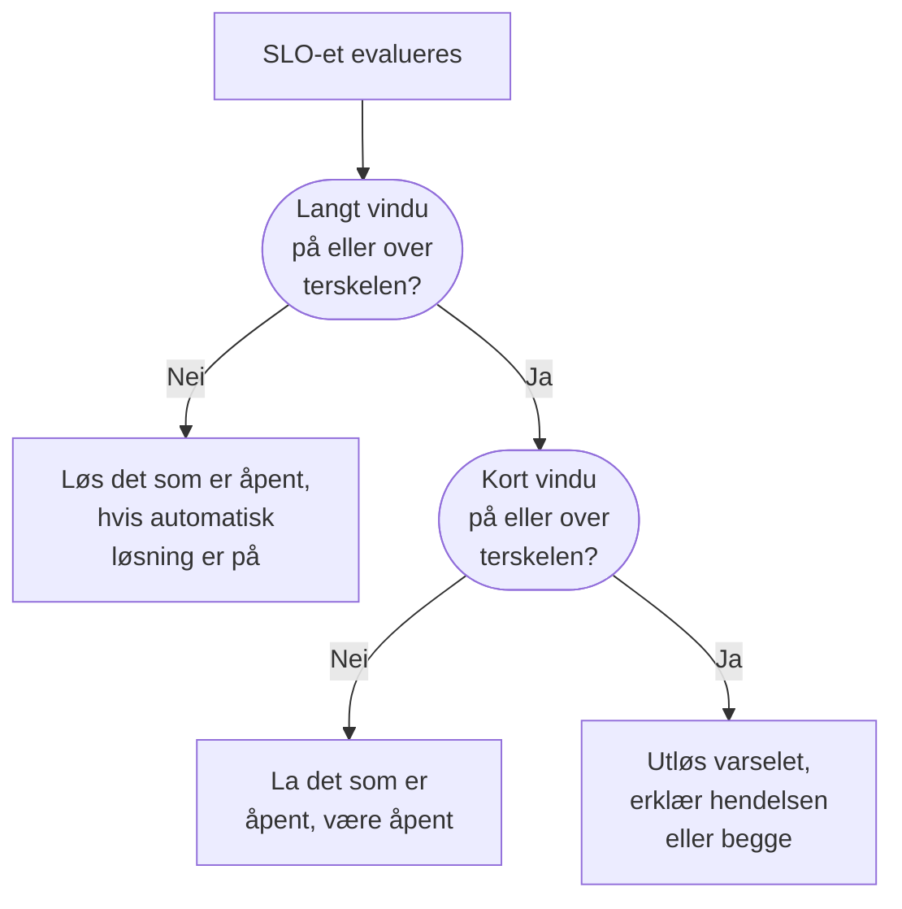

# Forbruksratevarsler og -hendelser

Feilbudsjetter forteller deg hvor du står; forbruksrateregler forteller deg når du må ut av sengen. Når et SLO bruker feilbudsjettet sitt fort nok til at det betyr noe, utløser en forbruksrateregel et varsel, erklærer en hendelse eller begge deler, med din egen tittel og beskrivelse, alvorsgrad, eiere, etiketter, vakteskalering og varsler i arbeidsområdet.

:::cards
- [Hvordan en regel bestemmer seg](#hvordan-en-regel-bestemmer-seg-for-å-utløses): To vinduer, begge over terskelen.
- [Standardregler](#standardregler): Fast burn og Slow burn, tilpasset vinduet til SLO-et.
- [Opprett en regel](#opprett-eller-rediger-en-regel): Fem trinn på siden Burn Rate Rules til SLO-et.
- [Malvariabler](#hva-hvert-varsel-og-hver-hendelse-sier): Skriv dine egne titler og beskrivelser.
:::

## Hva forbruksrate betyr

Forbruksraten er hvor fort du bruker feilbudsjettet, sammenlignet med et jevnt tempo:

```text
burn rate = (share of time that was bad) ÷ (share of time the target allows to be bad)
```

Med en forbruksrate på 1 bruker du budsjettet akkurat over vinduet og når målet uten noe til overs. Høyere tall bruker det opp tidligere. For et SLO på 99,9 % over 30 dager:

| Forbruksrate, hvis den vedvarer | Budsjettet er brukt opp etter |
| --- | --- |
| 1 | 30 dager |
| 2 | 15 dager |
| 6 | 5 dager |
| 14.4 | omtrent 2 dager (50 timer) |

Forbruksraten avhenger ikke av hvor mye budsjett som er igjen. Den svarer på «hvor ille er det nå?», og det er det du må vite for å bestemme om du skal tilkalle noen.

## Hvordan en regel bestemmer seg for å utløses

OneUptime sjekker hver aktivert forbruksrateregel ved hver evaluering av SLO-et, hvert 5. minutt. Hver regel måler forbruksraten over to vinduer og utløses bare når begge ligger på terskelen eller over:

- Det **lange vinduet** (for eksempel 1 time) viser at forbruket er vedvarende og betydelig, og ikke én mislykket sjekk.
- Det **korte vinduet** (for eksempel 5 minutter) viser at det fortsatt skjer. Uten det ville en topp for en time siden fortsatt varsle lenge etter at alt var i orden igjen.

Dette er mønsteret med flere vinduer og flere forbruksrater fra Google SRE Workbook, og det OneUptime setter opp for deg.



En regel kan ikke utløses før SLO-et har et helt langt vindu med overvåkingshistorikk: ellers ville den aller første mislykkede sjekken til en monitor, delt på noen få minutter med historikk, gi en enorm forbruksrate. Et nytt SLO kan derfor ikke utløse regelen **Fast burn** den første timen, og heller ikke regelen **Slow burn** de første seks. Har et SLO senere ikke lenger så mye historikk, for eksempel etter at monitorene er byttet ut med nye, løser regelen det den hadde åpnet, i stedet for å la det henge. En regel utløses heller ikke mens en av monitorene til SLO-et er i planlagt vedlikehold: se [Planlagt vedlikehold](#planlagt-vedlikehold).

## Standardregler

Hvert nytt SLO får to forbruksrateregler. For et vindu på 30 dager:

| Regel | Terskel | Langt vindu | Kort vindu | Utløses når |
| --- | --- | --- | --- | --- |
| **Fast burn** | 14.4× | 1 time | 5 minutter | Omtrent 2 % av budsjettet brukes på en time: det ville vært brukt opp på omtrent 2 dager. |
| **Slow burn** | 6× | 6 timer | 30 minutter | Omtrent 5 % av budsjettet brukes på seks timer: det ville vært brukt opp på omtrent 5 dager. |

Tersklene på 14.4× og 6× er regnet ut for et budsjett på 30 dager, så OneUptime tilpasser dem til vinduet til SLO-et ditt. Hver regel betyr alltid «2 % av budsjettet på 1 time» eller «5 % av budsjettet på 6 timer»:

| Vinduet til SLO-et | Terskel for Fast burn | Terskel for Slow burn |
| --- | --- | --- |
| 7 dager | 3.36× | 1.4× |
| 28 dager | 13.44× | 5.6× |
| 30 dager | 14.4× | 6× |
| 90 dager | 43.2× | 18× |

SLO-er med kalendermåned får verdiene for 30 dager. Begge reglene utløser et varsel med prosjektets høyeste varselsalvorsgrad, med standardtittelen og -beskrivelsen, løser det automatisk og legger ikke til eiere eller etiketter. De erklærer ikke hendelser, så en oppgradering av OneUptime begynner aldri å erklære hendelser for deg. Rediger dem, slett dem eller legg til dine egne.

## Opprett eller rediger en regel

Du trenger tillatelse til å opprette SLO-forbruksrateregler.

:::steps
### Åpne Burn Rate Rules

Åpne SLO-et, gå til **Burn Rate Rules** og klikk på **Opprett SLO Burn Rate Rule**, eller rediger en av standardreglene.

### Gi regelen et navn

Under **Rule** skriver du inn et **Navn**, som «Fast burn». **Aktivert** er slått på.

### Angi forbruksvinduet

Under **Burn Window** angir du **Burn Rate Threshold** (for eksempel `14.4`), **Long Window (Minutes)** og **Short Window (Minutes)**, og eventuelt **Re-fire Suppression (Minutes)**.

### Velg hva den erklærer

Under **What It Declares** slår du på **Opprett varsel**, **Erklær hendelse** eller begge. **Add SLO Owners as Owners** gjør også eierne av SLO-et til eiere av alt regelen oppretter.

### Beskriv varselet og hendelsen

Trinnene **Varsel** og **Hendelse** vises bare for det regelen erklærer. Hvert av dem har en tittel og en alvorsgrad, og sammenslåtte seksjoner: **Beskrivelse**, **Eierskap og etiketter**, **Vakt** og **Flere felt**, som inneholder automatisk løsning, personvern og utbedringsnotater. Nye regler starter med standardtittelen og -beskrivelsen, klare til å redigeres. Klikk på **Opprett SLO Burn Rate Rule** i det siste trinnet.
:::

OneUptime sjekker tallene til en regel når du lagrer den:

| Innstilling | Må være |
| --- | --- |
| **Burn Rate Threshold** | Større enn 0. |
| **Short Window (Minutes)** | Større enn 0. |
| **Long Window (Minutes)** | Lengre enn det korte vinduet. |
| **Re-fire Suppression (Minutes)** | 0 eller mer. Tom betyr lengden på det lange vinduet. |

En regel må opprette et varsel, erklære en hendelse eller begge: en regel med begge slått av avvises, fordi den ville blitt sjekket ved hver evaluering uten noen gang å erklære noe.

Regeltabellen viser for hver regel terskelen, vinduene og undertrykkingen, hva den erklærer (og om varselet eller hendelsen bare løses for hånd, eller er privat), alvorsgradene, vaktpolicyene, eierne og etikettene.

> [!TIP]
> Et godt utgangspunkt: behold de to standardreglene, send regelen for raskt forbruk til vaktpolicyen som tilkaller folk, med høy alvorsgrad, og la regelen for sakte forbruk utløse et varsel med lavere alvorsgrad for arbeidstiden. Jobber teamet ditt med hendelser, slår du på **Erklær hendelse** på regelen for raskt forbruk, og slår av **Opprett varsel** der hvis du helst ikke vil få begge.

## Hva en regel erklærer

|  | **Opprett varsel** | **Erklær hendelse** |
| --- | --- | --- |
| Fra start | På | Av |
| Hva det er | Det lette signalet: havner i listen over varsler. | Det tunge signalet: får et hendelsesnummer og starter hele responsforløpet. |
| Tittel og beskrivelse | Egne, eller standardteksten | Egne, eller standardteksten |
| Alvorsgrad | **Varselsalvor**: prosjektets høyeste hvis tom | **Hendelsesalvor**: prosjektets høyeste hvis tom |
| Eskalering | **Alert On-Call Duty Policies** | **Incident On-Call Duty Policies** |
| Eiere og etiketter | **Eiere av varselet** og **Varseletiketter** | **Eiere av hendelsen** og **Hendelsesetiketter** |
| Privat | Av | Av |
| Automatisk løsning | På | På |
| Statussider | Aldri publisert | Aldri publisert |

Fordi hver av dem settes opp for seg, kan du sende et kort varsel til vaktplanen til teamet som eier tjenesten, og en utførlig hendelse til vaktplanen for større hendelser. De lever også hver for seg: hver av dem dedupliseres, løses og undertrykkes for seg, så å løse hendelsen nullstiller ikke undertrykkingen av varselet, og omvendt.

### SLO-et er en berørt ressurs

Hvert varsel og hver hendelse som en forbruksrateregel oppretter, viser SLO-et sitt under **Berørte ressurser** og lenker til det. Filteret **Berørte ressurser** i listene over varsler og hendelser begrenser dem til ett SLO, og sidene **Varsler** og **Hendelser** til SLO-et viser dem, med merker i sidemenyen som teller de åpne. OneUptime lager denne koblingen selv, og å redigere varselet eller hendelsen fjerner den aldri.

### Forbruksratehendelser forblir interne

Et feilbudsjett som brennes fort, er et signal til utviklingen, ikke et erklært brudd. En forbruksratehendelse vises aldri på statussider og gir aldri abonnenter på statussider beskjed. Den knyttes heller ikke til noen monitorer, fordi det å løse den ellers ville skrevet om selve statushistorikken til monitorene som SLO-et måles ut fra.

Løser du en slik hendelse for hånd, erklærer ingenting den igjen før forbruket har hentet seg inn og regelen virkelig utløses på nytt, så du aldri kjemper mot regelen mens du jobber med en hendelse.

## Hva hvert varsel og hver hendelse sier

Nye regler starter med standardtittelen og -beskrivelsen, både på varselet og på hendelsen. Tøm en tittel eller beskrivelse for å gå tilbake til standardteksten. Standardtittelen er:

```text
SLO burn rate: {{sloName}} — {{ruleName}}
```

Standardbeskrivelsen nevner regelen og oppgir forbruksraten for begge vinduene mot terskelen, og gjenværende feilbudsjett.

For å skrive din egen tekst bruker du malvariabler i tittelen, beskrivelsen og utbedringsnotatene. Hvert av disse feltene viser dem under **Malvariabler**: klikk på en for å sette den inn ved markøren, eller skriv `{{` i feltet og velg en. Beskrivelsen og utbedringsnotatene har også **Sett inn variabel** i verktøylinjen. Variablene fylles ut når regelen utløses:

| Variabel | Hva den inneholder | Eksempel |
| --- | --- | --- |
| `{{sloName}}` | Navnet til SLO-et. | `Checkout availability` |
| `{{sloId}}` | ID-en til SLO-et. | `b7f4c2d8-1f3e-4a5b-9c6d-7e8f9a0b1c2d` |
| `{{sloLink}}` | Lenke til SLO-et i OneUptime-dashbordet. | `https://oneuptime.com/dashboard/project-id/slos/slo-id` |
| `{{sloStatus}}` | Statusen til SLO-et etter denne evalueringen. | `At Risk` |
| `{{ruleName}}` | Navnet på forbruksrateregelen som ble utløst. | `Fast burn` |
| `{{burnRateThreshold}}` | Forbruksrateterskelen til regelen (et multiplum av det bærekraftige tempoet). | `14.4` |
| `{{longWindowBurnRate}}` | Forbruksrate målt over det lange vinduet til regelen. | `21.5` |
| `{{shortWindowBurnRate}}` | Forbruksrate målt over det korte vinduet til regelen. | `36` |
| `{{longWindowInMinutes}}` | Lengden på det lange vinduet til regelen, i minutter. | `60` |
| `{{shortWindowInMinutes}}` | Lengden på det korte vinduet til regelen, i minutter. | `5` |
| `{{targetPercentage}}` | Målet til SLO-et, i prosent. | `99.9` |
| `{{currentSliPercentage}}` | SLI-en målt over samsvarsvinduet til SLO-et, i prosent. | `99.87` |
| `{{errorBudgetRemainingPercentage}}` | Andelen av feilbudsjettet som fortsatt er tilgjengelig, i prosent. Negativ når budsjettet er overskredet. | `42.5` |
| `{{errorBudgetRemaining}}` | Feilbudsjett som fortsatt er tilgjengelig, som varighet. Starter med et minustegn når budsjettet er overskredet. | `18m 22s` |
| `{{errorBudgetRemainingMinutes}}` | Feilbudsjett som fortsatt er tilgjengelig, i minutter. | `18.37` |
| `{{windowDescription}}` | Samsvarsvinduet til SLO-et, med ord. | `rolling 30-day window` |

For eksempel blir tittelen `{{ruleName}}: {{sloName}} is burning {{longWindowBurnRate}}x` til `Fast burn: Checkout availability is burning 21.5x`.

:::details Hvordan variabler fylles ut
- Tall avrundes til to desimaler.
- Mellomrom inne i klammeparentesene går fint: `{{ sloName }}` fungerer.
- En feilstavet variabel blir stående nøyaktig som den er, så en skrivefeil synes i varselet i stedet for å forsvinne i stillhet.
- Titler kan være 500 tegn lange, og beskrivelser og utbedringsnotater 50 000. En tittel som blir lengre enn 500 tegn etter at variablene er fylt ut, settes på én linje og kortes ned med en ellipse, så varselet eller hendelsen likevel opprettes.
- Kan lenken til SLO-et ikke bygges når regelen utløses, blir `{{sloLink}}` tom, og varselet eller hendelsen opprettes likevel.
:::

## Eiere, etiketter og personvern

- **Eiere av varselet** og **Eiere av hendelsen** er personer og team, valgt fra én liste med **Legg til eier**. De legges til på varselet eller hendelsen så snart det opprettes, og får beskjed. Personer må være medlemmer av prosjektet.
- **Add SLO Owners as Owners** legger også til eierne av SLO-et, eierbrukerne og medlemmene av eierteamene, på alt regelen oppretter. Eierne av SLO-et får allerede høre om statusendringene til selve SLO-et, så dette kan gi dem beskjed to ganger. Det er slått av som standard.
- Hver eier legges til én gang: en bruker som allerede er eier av varselet eller hendelsen, for eksempel via prosjektets eierregler, eller som er med i et eierteam som er lagt til, legges ikke til på nytt.
- **Varseletiketter** og **Hendelsesetiketter** legges til på varselet eller hendelsen, så filtre, eierregler og varslingsregler for arbeidsområdet kan treffe dem.
- Et privat varsel eller en privat hendelse er bare synlig for eierne, prosjektadministratorene og prosjekteierne.

Etiketter, eierteam og vaktpolicyer må høre til prosjektet til SLO-et.

## Løsning og undertrykking av nye utløsninger

- **Løsning følger det lange vinduet.** Med automatisk løsning på (standard) løser OneUptime varselet og hendelsen til en regel så snart forbruksraten i det lange vinduet faller under terskelen. Å løse på det korte vinduet ville gitt flimring: et brudd som kommer og går, ville blitt løst etter fem rolige minutter og tilkalt folk igjen hele natten.
- **Automatisk løsning av.** Slå av **Løs varsel automatisk** eller **Løs hendelse automatisk**, så blir den posten stående åpen til noen løser den, også etter at forbruket har hentet seg inn. Regelen åpner ikke en ny oppå den, og når den er løst for hånd og det lange vinduet er under terskelen, kan regelen utløses igjen etter undertrykkingen.
- **Undertrykking av nye utløsninger.** Etter at en post er løst, erklærer ikke regelen den typen post igjen i undertrykkingsperioden, som standard lengden på det lange vinduet. Da får et system som henter seg inn, tid til det uten å tilkalle noen for støyen som er igjen.

Noen endringer løser alltid det en regel har åpnet, uansett hva innstillingene for automatisk løsning sier, så ingenting fortsetter å eskalere for en regel som ikke lenger kan begrunne det:

- å slå av **Opprett varsel** eller **Erklær hendelse** lukker det den utgangen hadde åpnet;
- å slå av regelen eller slette den;
- å slå av evalueringen av SLO-et, arkivere SLO-et eller slette det;
- at SLO-et går over til **Pauset** eller **Misconfigured**, fordi det da ikke måler noe;
- at regelen mister terskelen eller vinduene sine, eller at SLO-et ikke lenger har et helt langt vindu med historikk.

## Planlagt vedlikehold

Mens en monitor i SLO-et er i et pågående planlagt vedlikehold, utløser ikke forbruksratereglene varsler og erklærer ikke hendelser: planlagt arbeid skal ikke tilkalle noen. Det reglene allerede hadde åpnet, løses fortsatt som vanlig. Tiden teller fortsatt mot feilbudsjettet, etter nedetidsstatusene til SLO-et.

## Feeden til SLO-et

**Feed** til SLO-et publiserer hvert varsel en regel utløser og hver hendelse den erklærer, med en lenke og forbruksratene som forklarer det, og når hver av dem løses, automatisk eller for hånd. En post som regelen plukker opp igjen fordi den fortsatt var åpen, publiseres ikke to ganger. Å opprette, redigere og slette en regel publiseres også, og registreres i **Revisjonslogger** til SLO-et. Se [SLO-feed og revisjonslogger](/docs/slo/feed-and-audit-logs).

## Feilsøking

:::details En regel ble ikke utløst rett etter at SLO-et ble opprettet
En regel utløses bare når SLO-et har et helt langt vindu med overvåkingshistorikk: én time for standardregelen for raskt forbruk, seks timer for den for sakte forbruk.
:::

:::details Et varsel ble løst mens bruddet fortsatt pågikk
Automatisk løsning følger det lange vinduet: så snart forbruksraten i det lange vinduet faller under terskelen, løses varselet. Gi regelen et lengre langt vindu, eller slå av **Løs varsel automatisk** og løs varselet for hånd.
:::

:::details Ingenting ble utløst under et planlagt vedlikehold
Forbruksrateregler er stille mens en av monitorene til SLO-et er i et pågående planlagt vedlikehold. Nedetiden teller fortsatt mot budsjettet.
:::

:::details Finnes det et minste antall målinger?
Ikke for SLO-er som måles på tilgjengeligheten til monitorer. Tilgjengelighet måles i sekunder, så hvert sekund i vinduet er en måling, og det finnes ingen situasjon med lite trafikk å beskytte seg mot. Et minste antall målinger betyr bare noe for hendelsesbaserte SLI-er, som ennå ikke er tilgjengelige.
:::

## Neste steg

:::cards
- [Feilbudsjetter](/docs/slo/error-budget): Hva budsjettet er, og hvor lenge det varer.
- [Eskaleringsregler](/docs/on-call/escalation-rules): Hvem som tilkalles, og i hvilken rekkefølge.
- [SLO-feed og revisjonslogger](/docs/slo/feed-and-audit-logs): Hvert varsel og hver hendelse en regel utløser.
:::
