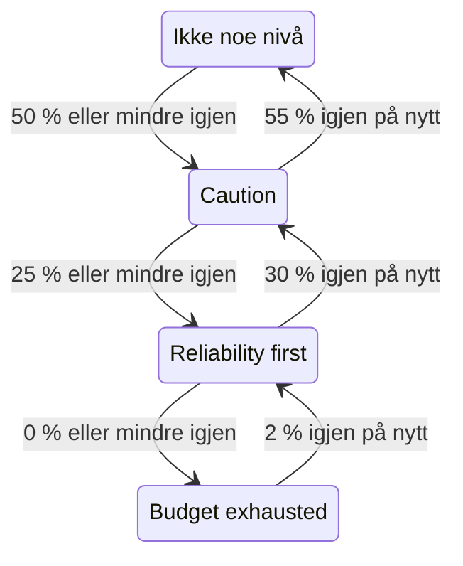

# Feilbudsjettpolicy

En feilbudsjettpolicy skriver ned hva teamet ditt har avtalt å gjøre mens feilbudsjettet til et SLO tømmes, for eksempel å gå gjennom risikable endringer når halvparten er brukt, eller å fryse utgivelser når alt er brukt. OneUptime plasserer SLO-et i nivået i policyen som budsjettet har nådd, viser teamets avtale for det nivået på sidene til SLO-et, og kan utløse et varsel eller erklære en hendelse når SLO-et går inn i et nivå. Det er praksisen med feilbudsjettpolicy fra [Google SRE Workbook](https://sre.google/workbook/error-budget-policy/).

:::cards
- [Slik fungerer nivåer](#slik-fungerer-nivåer): Hvilket nivå som gjelder, og når SLO-et forlater det.
- [Sett opp en policy](#sett-opp-en-policy): Start med den anbefalte policyen, eller skriv dine egne nivåer.
- [Varsler og hendelser](#varsler-og-hendelser): Varsle teamet ditt når SLO-et går inn i et nivå.
- [Les nivået via API-et](#les-nivået-via-api-et): Sjekk nivået fra CI og skript.
:::

## Slik fungerer nivåer

En policy er et sett med nivåer. Hvert nivå har tre felt:

| Felt | Hva det inneholder |
| --- | --- |
| **Navn** | Hva teamet kaller nivået, for eksempel "Reliability first". |
| **Budget Left Threshold (%)** | Andelen av gjenværende feilbudsjett som nivået gjelder ved eller under. Fra 0 til 100, desimaler tillatt. Hvert nivå i et SLO har sin egen terskel. |
| **What We Do** | Hva teamet har avtalt å gjøre mens SLO-et er i nivået, i Markdown. Påkrevd, opptil 10 000 tegn. |

Et nivå gjelder så lenge gjenværende budsjett er ved eller under terskelen, så et nivå på 0 % er nivået for et oppbrukt budsjett. Når flere nivåer gjelder, er SLO-et i det med lavest terskel: det mest alvorlige. Når ingen gjelder, er SLO-et ikke i noe nivå. Med nivåer på 50 %, 25 % og 0 % er et SLO med 30 % av budsjettet igjen i nivået på 50 %, og et med 10 % igjen er i nivået på 25 %.

### Å gå inn i et nivå og forlate det

Nivået følger gjenværende budsjett slik statusen til SLO-et gjør:

- Å gå inn i et nivå skjer straks: Evalueringen som finner budsjettet ved eller under terskelen til et nivå, plasserer SLO-et i det nivået. Et budsjett som faller forbi flere terskler på én gang, går rett til det mest alvorlige nivået.
- Å forlate et nivå for et mindre alvorlig venter til budsjettet er tydelig tilbake. Et nivå på 0 % forlates når 2 % av budsjettet er tilbake igjen. Alle andre nivåer forlates når budsjettet er 5 poeng over terskelen.

Et nivå på 0 % følger altså statusen **Budsjett oppbrukt**, og et nivå ved risikoterskelen til SLO-et følger **I faresonen**: se [Statusendringer og risikoterskelen](/docs/slo/error-budget#statusendringer-og-risikoterskelen). Et rullerende vindu som svinger rundt en terskel, får ikke nivået til å skifte fram og tilbake.



## Sett opp en policy

Du trenger tillatelse til å opprette nivåer i feilbudsjettpolicyen til SLO-er.

:::steps
### Åpne Error Budget Policy

Åpne SLO-et og gå til **Error Budget Policy** i seksjonen **Regler** i sidemenyen. Siden viser nivåene til SLO-et, hvert med navnet, det gjenværende budsjettet det gjelder ved, og hva teamet gjør.

### Start med den anbefalte policyen

Så lenge SLO-et ikke har noen nivåer, tilbyr siden **Use the recommended policy**. Klikk på den, sjekk de tre nivåene den viser, og bekreft. Tilpass deretter ordlyden i hvert nivå til teamets egen avtale.

### Eller legg til et nivå selv

Klikk på **Opprett SLO Error Budget Policy Tier**. Skriv inn et **Navn** og en **Budget Left Threshold (%)**, og skriv teamets avtale i **What We Do**.

### Velg hva nivået utløser

Et nivå registrerer og viser avtalen. For også å varsle noen når SLO-et går inn i nivået, åpner du de sammenslåtte innstillingene for varsel og hendelse og slår på et varsel, en hendelse eller begge. Begge er slått av som standard. Se [Varsler og hendelser](#varsler-og-hendelser).
:::

Å legge til, redigere eller slette et nivå virker med en gang: OneUptime evaluerer SLO-et på nytt innen omtrent et minutt. Er budsjettet allerede ved eller under terskelen til et nivå, kommer SLO-et da i det nivået, og nivået utløser det det er satt opp til å utløse. Å slå av et nivå eller slette det løser det nivået utløste, og SLO-et går til nivået budsjettet er i. Å slå av varselet eller hendelsen til et nivå løser det varselet eller den hendelsen.

### Den anbefalte policyen

**Use the recommended policy** legger til tre nivåer, ved halvparten av budsjettet, en fjerdedel og null, med denne engelske ordlyden:

| Nivå | Gjelder ved | Hva teamet gjør |
| --- | --- | --- |
| **Caution** | 50 % igjen eller mindre | Half of the error budget is spent. Review risky changes before they ship, and find out what has been spending the budget. |
| **Reliability first** | 25 % igjen eller mindre | Reliability comes first. Only reliability improvements and critical fixes ship until the budget recovers. |
| **Budget exhausted** | 0 % igjen eller mindre | The error budget is spent. Freeze non-critical releases: only fixes for this SLO's reliability and security fixes ship until the budget is back. |

Ingen av dem utløser et varsel eller erklærer en hendelse før du slår det på. Bare nivåene SLO-et ikke har, legges til: Et nivå med samme navn, eller med samme terskel, regnes som til stede, enten det er slått på eller av. Å be om det to ganger, fra en annen fane eller via API-et, legger altså ikke til noe to ganger. Hvert nivå som legges til slik, registreres i revisjonsloggene til SLO-et som lagt til av deg.

## Hvor nivået vises

- **Oversikt** for SLO-et viser nivået det er i og hva teamet har avtalt å gjøre der, så alle som åpner SLO-et ser avtalen som gjelder nå.
- Diagrammet **Nedbrenning av feilbudsjett** tegner en linje med etikett ved terskelen til hvert nivå, ved siden av linjen for risikoterskelen.
- **Feed** for SLO-et viser hver endring av nivå: nivået SLO-et forlot og nivået det gikk inn i, gjenværende budsjett og hva teamet har avtalt å gjøre i det nye nivået.
- **Revisjonslogger** for SLO-et registrerer hver endring av nivå som en endring OneUptime har gjort selv, og viser den derfor bare med **Lagre systemhendelser** slått på: se [Slå på revisjonslogger](/docs/slo/feed-and-audit-logs#slå-på-revisjonslogger). Å legge til, redigere og fjerne et nivå registreres på personen som gjorde det.
- Lese-API-et til SLO-et returnerer nivået: se [Les nivået via API-et](#les-nivået-via-api-et).

## Varsler og hendelser

Hvert nivå kan utløse et varsel, erklære en hendelse eller begge deler når SLO-et går inn i det. De har de samme valgene som varselet og hendelsen til en forbruksrateregel: alvorlighetsgrad, vaktpolicyer, maler for tittel, beskrivelse og utbedringsnotater, personvern, automatisk løsning, etiketter, eierteam og -brukere og å legge til eierne av SLO-et som eiere. Se [Hva en regel erklærer](/docs/slo/burn-rate-alerts#hva-en-regel-erklærer). Begge er slått av som standard, så et nivå varsler ingen før du slår på ett av dem.

- Å gå inn i et mer alvorlig nivå løser det forrige nivå utløste, uansett innstillingen for automatisk løsning, fordi det nye nivået erstatter det. Dermed er høyst varselet og hendelsen til ett nivå åpne om gangen, og de hører til nivået SLO-et er i.
- Å komme seg til et mindre alvorlig nivå, eller ut av alle nivåer, løser dem når automatisk løsning er slått på for nivået, slik den er som standard. Med automatisk løsning slått av forblir de åpne til noen løser dem.
- Det finnes ingen undertrykking av nye utløsninger. Et nivå utløser først igjen etter at SLO-et tydelig har forlatt det og gått inn i det igjen, så det kan ikke flakse. Løser noen manuelt det nivået utløste mens SLO-et fortsatt er i nivået, forblir det løst.
- Så lenge en monitor i SLO-et er i planlagt vedlikehold, utløser nivåene ingenting. Selve nivået endres likevel, og det som er åpent, løses fortsatt. Er SLO-et fortsatt i nivået når vedlikeholdet slutter, utløser nivået da det det er satt opp til å utløse.

Akkurat som for en forbruksrateregel viser et varsel eller en hendelse som et nivå utløser, SLO-et under **Berørte ressurser**, og en hendelse vises aldri på statussider. Feeden til SLO-et viser hver av dem, og når de løses.

### Hva de sier

Tittelen, beskrivelsen og utbedringsnotatene til et nivå tar malvariabler, slik en regels gjør: se [Hva hvert varsel og hver hendelse sier](/docs/slo/burn-rate-alerts#hva-hvert-varsel-og-hver-hendelse-sier). Feltene til et nivå tilbyr variablene for SLO-et og budsjettet, og tre av nivåets egne: `{{sloName}}`, `{{sloId}}`, `{{sloLink}}`, `{{sloStatus}}`, `{{policyTier}}`, `{{policyTierThresholdPercentage}}`, `{{policyTierWhatWeDo}}`, `{{targetPercentage}}`, `{{currentSliPercentage}}`, `{{errorBudgetRemainingPercentage}}`, `{{errorBudgetRemaining}}`, `{{errorBudgetRemainingMinutes}}` og `{{windowDescription}}`. En regels egne variabler, som `{{ruleName}}` og forbruksratene, tilbys ikke og er tomme i malene til et nivå.

De tre nivåvariablene virker også i malene til forbruksrateregler:

| Variabel | Hva den inneholder |
| --- | --- |
| `{{policyTier}}` | Navnet på nivået SLO-et er i etter evalueringen, eller `None` når det ikke er i noe nivå. |
| `{{policyTierThresholdPercentage}}` | Terskelen til det nivået, for eksempel `25`. Tom når SLO-et ikke er i noe nivå. |
| `{{policyTierWhatWeDo}}` | Hva teamet har avtalt å gjøre i det nivået. Tom når SLO-et ikke er i noe nivå. |

Et nivå der tittelen er tom, bruker den innebygde tittelen:

```text
SLO error budget policy: {{sloName}} — {{policyTier}}
```

Den innebygde beskrivelsen nevner nivået, setter gjenværende budsjett opp mot terskelen til nivået og sier hva teamet har avtalt å gjøre i det.

## Når budsjettet ikke måles

- Et SLO som er **Pauset** eller **Feilkonfigurert**, måler ikke noe budsjett, så nivået blir der det var, og det nivået utløste, forblir åpent til målingen fortsetter. Forbruksrateregler løser derimot da det de har åpent.
- Å slå av evalueringen av SLO-et, eller å arkivere SLO-et, løser det nivåene utløste. Nivået SLO-et er i, forblir som det var.
- Å slette SLO-et sletter nivåene og løser det de utløste.

## Les nivået via API-et

Det egne lese-API-et til SLO-et returnerer nivået det er i, så en CI-jobb eller et skript kan sjekke det før det handler, for eksempel før en utgivelse. Alle tre feltene er tomme så lenge SLO-et ikke er i noe nivå:

| Felt | Hva det inneholder |
| --- | --- |
| `currentErrorBudgetPolicyTierId` | ID-en til nivået. |
| `currentErrorBudgetPolicyTierName` | Navnet på nivået. |
| `currentErrorBudgetPolicyTierEnteredAt` | Når SLO-et gikk inn i nivået. |

De leses med SLO-ets egen lesetillatelse, den samme som budsjettet også trenger. For eksempel med en [API-nøkkel](/docs/api-reference/api-reference) for prosjektet:

```bash
curl -X POST 'https://oneuptime.com/api/service-level-objective/<slo-id>/get-item' \
  -H "ApiKey: $ONEUPTIME_API_KEY" \
  -H 'Content-Type: application/json' \
  -d '{ "select": { "name": true, "errorBudgetRemainingPercentage": true, "currentErrorBudgetPolicyTierName": true, "currentErrorBudgetPolicyTierEnteredAt": true } }'
```

Selve nivåene er en egen ressurs, `/api/service-level-objective-error-budget-policy-tier`, med forespørslene for å liste, lese, opprette, endre og slette som hver ressurs har. To forespørsler til betjener den anbefalte policyen. Begge tar `{ "serviceLevelObjectiveId": "..." }` og svarer med nivåene i `tiers`:

| Forespørsel | Hva den gjør |
| --- | --- |
| `POST /api/service-level-objective-error-budget-policy-tier/recommended-policy` | Lister de anbefalte nivåene SLO-et mangler. Den skriver ingenting. |
| `POST /api/service-level-objective-error-budget-policy-tier/recommended-policy/add` | Legger dem til og lister det den la til. Å spørre igjen legger ikke til noe. |

## Tillatelser

| Tillatelse | Lar en rolle |
| --- | --- |
| **Read SLO Error Budget Policy Tier** | Se nivåene til et SLO. |
| **Create SLO Error Budget Policy Tier** | Legge til nivåer, manuelt eller med **Use the recommended policy**. |
| **Edit SLO Error Budget Policy Tier** | Endre nivåer og slå dem på eller av. |
| **Delete SLO Error Budget Policy Tier** | Fjerne nivåer. |

Disse tillatelsene ligger i SLO-gruppen til en rolle. Rollene Project Owner og Project Admin har alle, og rollene Project Member og Viewer kan lese nivåer.

## Ikke tilgjengelig ennå

Noen deler av en feilbudsjettpolicy er ikke tilgjengelige ennå: en utrullingssperre som selv blokkerer utgivelser (en CI-jobb kan i stedet lese nivået via API-et), arbeidsflytutløsere og Slack- eller Microsoft Teams-varsler for hvert nivå, en policy som flere SLO-er deler, å kvittere for et nivå eller gi et unntak fra det, og nivåer som bygger på rekkevidden til budsjettet i stedet for gjenværende budsjett.

## Neste steg

:::cards
- [Feilbudsjetter](/docs/slo/error-budget): Hva budsjettet er, og hvordan statusen følger det.
- [Forbruksratevarsler og -hendelser](/docs/slo/burn-rate-alerts): Varsle teamet ditt når budsjettet brennes for fort.
- [SLO-feed og revisjonslogger](/docs/slo/feed-and-audit-logs): Hver endring av nivå, og hva nivåene utløste.
:::
