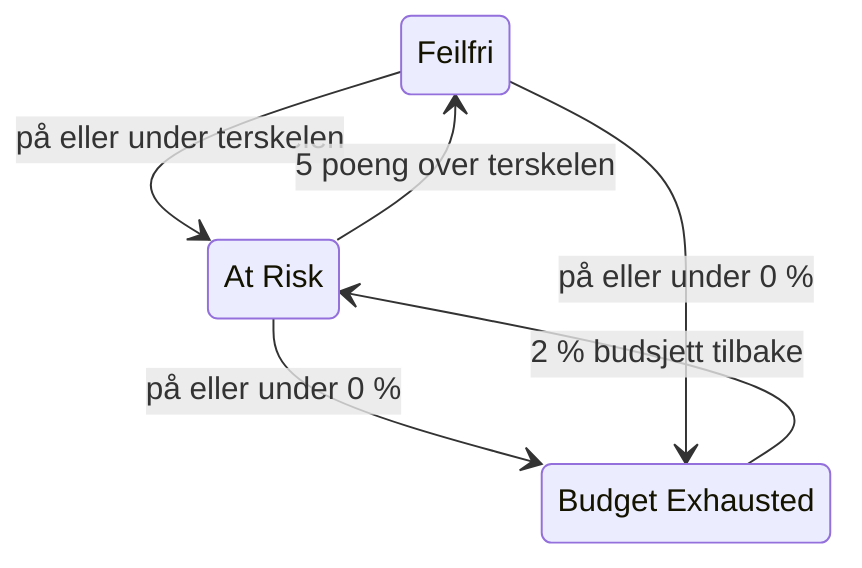

# Feilbudsjetter

Feilbudsjettet er nedetiden målet til et SLO tillater. Et mål på 99,9 % betyr ikke «gå aldri ned»: det betyr «du kan være nede i opptil 43 minutter på 30 dager, så bruk dem klokt». Denne siden forklarer hvordan OneUptime teller budsjettet, hvor lenge det varer, hvordan det kommer tilbake, og hvem som får høre om det.

:::cards
- [Hvordan budsjettet beregnes](#hvordan-budsjettet-beregnes): Formelen og budsjettet for vanlige mål.
- [Rekkevidden til budsjettet](#rekkevidden-til-budsjettet): Hvor lenge budsjettet varer i dagens tempo.
- [Hvordan budsjettet kommer tilbake](#hvordan-budsjettet-kommer-tilbake): Rullerende vinduer og kalendermåneder.
- [Beskjed til eiere](#beskjed-til-eiere): Hvem som får høre om det når budsjettet blir knapt.
:::

## Hvordan budsjettet beregnes

Det samlede budsjettet er den delen av vinduet som målet ditt ikke lover:

```text
total budget = (100% − target) × window length
```

| Mål | Vindu på 7 dager | Vindu på 28 dager | Vindu på 30 dager | Vindu på 90 dager |
| --- | --- | --- | --- | --- |
| 99% | 1h 40m 48s | 6h 43m 12s | 7h 12m | 21h 36m |
| 99.5% | 50m 24s | 3h 21m 36s | 3h 36m | 10h 48m |
| 99.9% | 10m 5s | 40m 19s | 43m 12s | 2h 9m 36s |
| 99.95% | 5m 2s | 20m 10s | 21m 36s | 1h 4m 48s |
| 99.99% | 1m 0s | 4m 2s | 4m 19s | 12m 58s |

Siden **Innstillinger** til SLO-et viser budsjettet målet tillater ved siden av målet, for eksempel «43m 12s nedetid per vindu på 30 dager».

### Budsjettet til et SLO med flere monitorer

I modusen **Any Monitor Down** er budsjettet `(100% − target) × window`, uansett hvor mange monitorer SLO-et måler: vinduet er én tidslinje.

I modusen **Monitor Seconds Average** telles budsjettet i monitorsekunder, summert på tvers av monitorene, så det vokser med antallet monitorer: et SLO med tre monitorer på 99,9 % over 30 dager har rundt 129 minutter budsjett i stedet for 43. Prosentene (SLI, gjenværende budsjett, forbruksrate) betyr det samme; bare varighetene endrer seg.

### Budsjettet for en kalendermåned

Et SLO med kalendermåned har hele månedens budsjett fra første dag: et SLO på 99,9 % i en måned med 31 dager har alle sine 44m 38s den 1. Budsjettet beregnes ikke forholdsmessig etter hvor mye av måneden som har gått, så et brudd på ett minutt om morgenen den 1. bruker ett minutt av månedens budsjett.

## Gjenværende budsjett

Etter hvert som nedetiden øker, viser **Oversikt** det gjenværende budsjettet i flisen **Error budget left**:

- som en prosentandel av totalen, som også bestemmer statusen til SLO-et og fyller stolpen. Stolpen har et merke ved risikoterskelen til SLO-et;
- som en varighet, for eksempel "31m 4s left of 43m 12s".

Når budsjettet er brukt opp, viser flisen **No budget left**. Når nedetiden overskrider det, viser flisen **Budget exceeded** og overskridelsen som tid, for eksempel "4d 23m over budget · 5m 47s allowed": SLO-et har brukt alle 5 minutter og 47 sekunder av budsjettet sitt, og 4 dager og 23 minutter til. Stolpen blir stående tom og rød.

Gjenværende budsjett lagres som et tall med fortegn for beregninger og historikkdiagrammer, så der vises et overskredet budsjett som en negativ prosentandel. En svært negativ prosentandel betyr at overskridelsen er stor sammenlignet med budsjettet; det er ikke andelen av tiden tjenesten var nede.

Hvilke sekunder som teller som nedetid, bestemmes av nedetidsstatusene til SLO-et og, for et SLO med flere monitorer, av modusen for flere monitorer, begge under **Innstillinger** → **Downtime Calculation**. Se [SLO-er – Oversikt](/docs/slo/introduction).

## Rekkevidden til budsjettet

Flisen **Budget runway** i **Oversikt** svarer på «hvis dette fortsetter, når går vi tom?». Den deler gjenværende budsjett på forbruksraten de siste 60 minuttene:

```text
runway = budget left ÷ (burn rate × (100% − target))
```

| Flisen viser | Hva det betyr |
| --- | --- |
| En varighet, som **~2d 5h** | I dagens tempo går budsjettet tomt om omtrent så lang tid. Gul, og rød ved én dag eller mindre. **Under 1m** betyr mindre enn ett minutt. |
| **Not burning** | Det er ikke brukt noe budsjett de siste 60 minuttene. |
| **Sustainable** | Bare rullerende vinduer: rekkevidden er minst ett helt vindu, så budsjettet brukes ikke raskere enn gammel nedetid faller ut av vinduet. I dette tempoet går det ikke tomt. |
| **Lasts until reset** | Bare kalendermåneder: budsjettet nullstilles ved starten av neste måned før det går tomt. |
| **Overspent** | Budsjettet er allerede brukt opp. Flisen sier hvor mye det er overskredet med. |

For SLO-er med kalendermåned sier flisen også når budsjettet nullstilles.

Rekkevidden er en lineær framskrivning. I et rullerende vindu gir gammel nedetid som faller ut av vinduet, budsjett tilbake, noe framskrivningen ser bort fra: les den som den minste tiden du har igjen. Den vises ikke før den første evalueringen, og heller ikke for SLO-er i modusen **Monitor Seconds Average**, der budsjettet telles i monitorsekunder og ikke i klokketid.

## Forbruket av feilbudsjettet

Diagrammet **Error budget burn-down** i **Oversikt** viser gjenværende budsjett, i prosent, over det gjeldende samsvarsvinduet:

- En linje ved 0 % markerer hvor budsjettet er brukt opp, og en stiplet linje markerer risikoterskelen til SLO-et.
- For SLO-er med kalendermåned faller en svak linje jevnt fra et fullt budsjett ved starten av måneden til et tomt ved nullstillingen. Under den linjen bruker måneden budsjettet for fort.
- Et punkt registreres ved hver evaluering, hvert 5. minutt, så diagrammet til et nytt SLO er tomt til den første evalueringen.
- Dra over diagrammet for å zoome inn på en del av vinduet. Dobbeltklikk, eller klikk på **Reset zoom**, for å se hele vinduet igjen.

**Open metrics** åpner siden **Målinger** til SLO-et, der fanen **Error Budget History** går opptil 400 dager tilbake. Se [SLO-metrikker og -dashbord](/docs/slo/metrics).

## Hvordan budsjettet kommer tilbake

Hvordan budsjettet kommer tilbake, avhenger av vindustypen til SLO-et:

:::tabs
@tab Rolling
Et rullerende vindu ser alltid like langt tilbake fra nå, så nedetid faller etter hvert ut av det: et brudd slutter å telle nøyaktig ett vindu etter at det skjedde. Et brudd på 30 minutter 1. juni faller ut av regnestykket for et SLO på 30 dager 1. juli, og budsjettet kommer gradvis tilbake, etter hvert som hvert sekund med nedetid forlater vinduet, ikke alt på én gang.

Så gjenoppretting må fortjenes, den kan ikke planlegges. Fortsetter små brudd å komme, faller gammel nedetid ut mens ny kommer inn, og budsjettet står stille i stedet for å hente seg inn.
@tab Calendar Month
Et SLO med kalendermåned nullstilles ved midnatt den første i hver måned, i sin tidssone. Hele budsjettet kommer tilbake på én gang, og den forrige måneden lukkes. Ingenting overføres fra én måned til den neste, i noen retning: en dårlig måned skader ikke den neste, og en god måned gir den ikke ekstra slakk.
:::

### Unge SLO-er

Et SLO med rullerende vindu som er yngre enn vinduet sitt, måles over dataene som finnes så langt, og det samlede budsjettet vokser med dem: et SLO på 30 dager som ble opprettet for en uke siden, har foreløpig et budsjett for 7 dager. Til vinduet er fullt, viser **Oversikt** hvor fullt det er, med en indikator **Window 23% full** og samme merknad i flisen **Error budget left**. Regn med at tallene roer seg etter hvert som vinduet fylles.

## Statusendringer og risikoterskelen

Gjenværende budsjett bestemmer statusen til SLO-et:

| Status | Når |
| --- | --- |
| **Feilfri** | Det er mer budsjett igjen enn risikoterskelen. |
| **At Risk** | Gjenværende budsjett ligger på risikoterskelen eller under: 20 % som standard. |
| **Budget Exhausted** | Gjenværende budsjett er null eller lavere. |

Angi risikoterskelen under **Innstillinger** → **Objective**.

Rullerende vinduer henter seg inn ett sekund om gangen, så et SLO nær en grense kunne hoppe fram og tilbake mellom to statuser. For at hver statusendring skal bety noe, forlater et SLO en status bare når det tydelig har passert grensen:



Med standardterskelen på 20 % blir et truet SLO feilfritt igjen ved 25 % gjenværende budsjett, og et SLO med oppbrukt budsjett blir truet igjen ved 2 %. Hver statusendring vises i **Feed** til SLO-et, med SLI-en, budsjettet og forbruksraten som forklarer den.

## Beskjed til eiere

Når et SLO går over til **At Risk** eller **Budget Exhausted**, gir OneUptime eierne beskjed:

- Eierne er brukerne og teammedlemmene på siden **Eiere** til SLO-et som fortsatt er medlemmer av prosjektet. Et SLO uten eiere gir i stedet prosjekteierne beskjed.
- Hver eier får en e-post som standard, og beskjeden på alle andre kanaler vedkommende slår på for **SLO status changed** under **Brukerinnstillinger** → **Varselinnstillinger** → **Overvåking**.
- Emnet i e-posten nevner statusen og SLO-et, for eksempel `[SLO At Risk] API Availability`.

For at et SLO nær en grense ikke skal varsle hele tiden, får eierne høyst én beskjed i timen. En overgang til **Budget Exhausted** sendes alltid, også innenfor den timen.

> [!TIP]
> Beskjeder til eiere forteller de som har ansvaret for et SLO, at budsjettet er i trøbbel. For å tilkalle vaktteamet ditt via eskaleringspolicyer bruker du [Forbruksratevarsler og -hendelser](/docs/slo/burn-rate-alerts). En forbruksrateregel kan også legge til eierne av SLO-et på hvert varsel og hver hendelse den oppretter.

## Neste steg

:::cards
- [Forbruksratevarsler og -hendelser](/docs/slo/burn-rate-alerts): Varsle teamet ditt når budsjettet brennes for fort.
- [SLO-metrikker og -dashbord](/docs/slo/metrics): Vis budsjettet over tid i et diagram.
- [SLO-er – Oversikt](/docs/slo/introduction): Mål, vinduer og nedetidsstatuser.
:::
