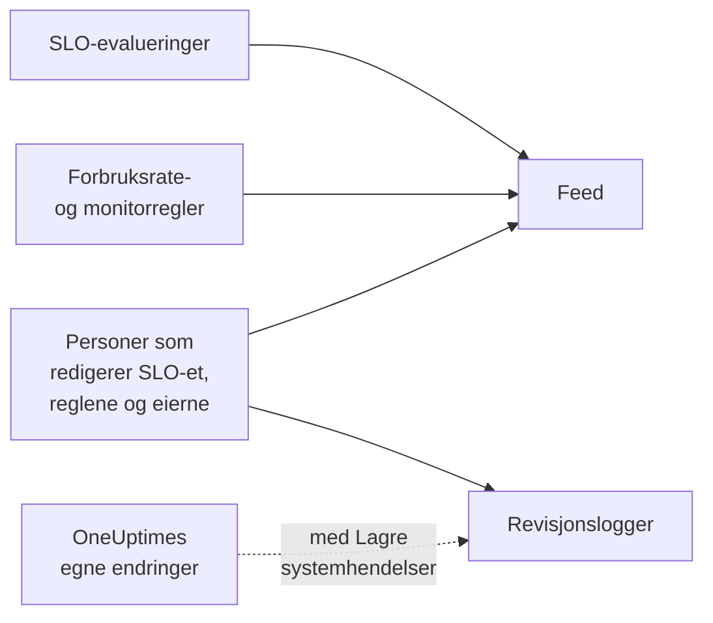

# SLO-feed og revisjonslogger

Et SLO fører to oversikter over historikken sin, og de svarer på ulike spørsmål. **Feed** svarer på «hva har skjedd med dette SLO-et?», skrevet for dem som passer på det. **Revisjonslogger** svarer på «hvem endret hva, helt nøyaktig?», felt for felt, for gjennomganger og samsvar.

## Feed eller revisjonslogger?

| | **Feed** | **Revisjonslogger** |
| --- | --- | --- |
| Svarer på | Hva som har skjedd med SLO-et | Hvem som endret hva, og når |
| Registrerer | Statusendringer, forbruksratevarsler og -hendelser, og endringer i SLO-et, reglene, monitorene og eierne | Hver endring personer har gjort i SLO-et, forbruksratereglene, monitorreglene og eierne, med gammel og ny verdi |
| Tar med OneUptimes eget arbeid | Ja: evalueringer og monitorregler som knytter til monitorer | Bare med **Lagre systemhendelser** slått på |
| Abonnementer | Alle abonnementer | Enterprise-abonnementet på OneUptime Cloud, eller Enterprise Edition på en selvhostet installasjon |
| Oppbevares | Tre år på OneUptime Cloud | 7 dager som standard, opptil 180 |

## Feeden til SLO-et

Feeden ligger på siden **Feed** til SLO-et, og de nyeste elementene under **Recent activity** i **Oversikt** til SLO-et. Elementene lenker til SLO-et, monitorene, varslene og hendelsene de nevner, og de fleste har en seksjon **More Information** med tallene eller de gamle og nye verdiene.

| Hendelse | Publiseres når |
| --- | --- |
| SLO opprettet | SLO-et opprettes. Viser målet, samsvarsvinduet, SLI-en, risikoterskelen, beskrivelsen og standardforbruksratereglene det startet med. |
| SLO oppdatert | Navnet, beskrivelsen, etikettene, målet, samsvarsvinduet, tidssonen, risikoterskelen, modusen for flere monitorer eller nedetidsstatusene endres. Viser hver gammel og ny verdi. |
| SLO aktivert eller deaktivert | Evalueringen slås på eller av. |
| SLO arkivert eller gjenopprettet | SLO-et arkiveres eller fjernes fra arkivet. |
| Status endret | En evaluering flytter SLO-et til en ny status. Viser SLI-en, feilbudsjettet, forbruksraten og risikoterskelen som forklarer den, og årsaken ved **Pauset** eller **Misconfigured**. |
| Forbruksratevarsel utløst | En forbruksrateregel oppretter et varsel. Lenker til det og viser forbruksratene som utløste det. |
| Forbruksratehendelse erklært | En forbruksrateregel erklærer en hendelse. Lenker til den og viser forbruksratene som utløste den. |
| Forbruksratevarsel eller -hendelse løst | Varselet eller hendelsen til en regel lukkes: løst automatisk, eller for hånd mens automatisk løsning var slått av. |
| Forbruksrateregel lagt til, endret eller fjernet | Noen oppretter, redigerer eller sletter en forbruksrateregel. Standardreglene til et nytt SLO står i stedet i elementet «SLO opprettet». |
| Monitorregel lagt til, endret eller fjernet | Noen oppretter, redigerer eller sletter en monitorregel. En lagring som ikke endrer noe av betydning, publiseres ikke. |
| Monitorer knyttet til eller koblet fra | Monitorer legges til i SLO-et eller fjernes fra det, for hånd eller av en monitorregel. Lange lister nevner de første monitorene «og N til». |
| Eier lagt til eller fjernet | En bruker eller et team legges til blant eierne av SLO-et eller fjernes. |
| Etikettregel brukt | En etikettregel har knyttet etiketter til SLO-et, da det ble opprettet eller da noen kjørte regelen. Nevner reglene som traff. Se [Etikett- og eierregler](/docs/slo/label-and-owner-rules). |
| Eierregel brukt | En eierregel har lagt til eiere på SLO-et. Nevner reglene som traff; hver eier den la til, får også sitt eget element «Eier lagt til». |

Noen detaljer:

- Elementene sier hvem som gjorde en endring når det var en person. Endringer OneUptime gjør selv, som en evaluering eller en monitorregel som knytter til en monitor, og endringer via API-et eller en automatisering har ingen bruker.
- Et varsel eller en hendelse som en regel plukker opp igjen fordi det fortsatt var åpent, publiseres ikke to ganger.
- For et privat varsel eller en privat hendelse utelater elementet tittelen, nummeret og lenken, fordi alle som kan lese SLO-et, kan lese feeden. Det sier likevel at det ble opprettet en privat post, og viser forbruksratene som utløste den.
- Ingen kan redigere eller slette feedelementer. På OneUptime Cloud fjernes elementer som er eldre enn tre år.

## Revisjonslogger

Siden **Revisjonslogger** til SLO-et viser endringer i:

- selve SLO-et: detaljene, innstillingene, etikettene, monitorene og arkiveringen;
- forbruksratereglene;
- monitorreglene;
- eierbrukerne og eierteamene.

Endringer i regler og eiere registreres på regelen eller eieren og samles på SLO-et, så siden viser hele historikken på ett sted, og hver oppføring lenker til siden den hører til. Relaterte elementer som etiketter og monitorer registreres med navnet sitt, ikke bare med ID-en.

To ting er utelatt:

- **Evalueringsresultater.** SLI-en, feilbudsjettet, forbruksraten, statusen og evalueringstidene endres med noen minutters mellomrom. Historikken deres finnes i **Oversikt**, på siden **Målinger** og i **Feed**.
- **Endringer OneUptime gjør selv**, som en monitorregel som knytter til eller kobler fra en monitor, med mindre **Lagre systemhendelser** er slått på for prosjektet. **Feed** registrerer tilknytninger og frakoblinger av monitorer uansett.

### Slå på revisjonslogger

Revisjonslogger er en Enterprise-funksjon: de krever **Enterprise**-abonnementet på OneUptime Cloud, eller Enterprise Edition på en selvhostet installasjon. På andre abonnementer forklarer siden **Revisjonslogger** til SLO-et hvordan du får den. På en selvhostet installasjon slutter revisjonsloggen å registrere uten en gyldig lisens (etter prøveperioden på 14 dager, eller 30 dager etter at en lisens utløper), og den fortsetter så snart en lisens aktiveres (se [When a license expires or is missing](/docs/self-hosted/enterprise#når-en-lisens-utløper-eller-mangler)). Sidene **Revisjonslogger** sier fra når det ikke registreres.

Revisjonslogger er også slått av som standard i hvert prosjekt. Slik slår du dem på:

:::steps
### Åpne innstillingene for revisjonslogger

Gå til **Prosjektinnstillinger**, åpne **Revisjonslogger** i sidemenyen og klikk på **Innstillinger**.

### Rediger innstillingene

Klikk på **Edit Audit Log Settings** og slå på **Aktiver revisjonslogger**.

### Velg hva som skal tas vare på

Angi **Oppbevaring (dager)**, fra 7 (standard) til 180, og slå på **Lagre systemhendelser** for også å registrere endringene OneUptime gjør selv. Lagre. Endringen gjelder innen omtrent ett minutt.
:::

Mens revisjonsloggen er slått av, står det **Audit logging is off** på siden **Revisjonslogger** til SLO-et, med en lenke for å slå den på. Oppføringer som ble registrert før den ble slått av, er fortsatt synlige. Prosjektets samlede revisjonslogg, for alle ressurser, finnes under **Prosjektinnstillinger** → **Revisjonslogger** → **Revisjonslogger**.

## Neste steg

:::cards
- [SLO-er – Oversikt](/docs/slo/introduction): Hver side et SLO har.
- [Monitorer og monitorregler](/docs/slo/monitor-rules): Hva som knytter til og kobler fra monitorer.
- [Forbruksratevarsler og -hendelser](/docs/slo/burn-rate-alerts): Hva som utløser og løser varslene og hendelsene i feeden.
- [Etikett- og eierregler](/docs/slo/label-and-owner-rules): Hva som legger til etiketter og eiere automatisk.
:::
