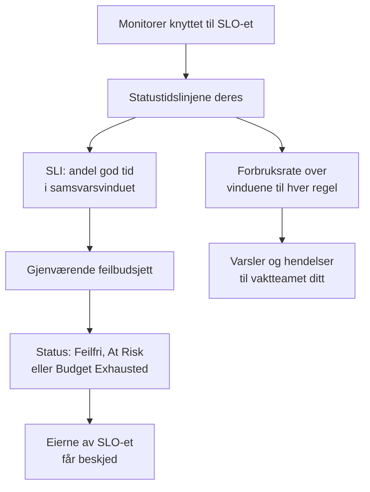

# SLO-er – Oversikt

Et service level objective (SLO) er et pålitelighetsmål for det du overvåker, som «tilgjengelig 99,9 % av tiden over rullerende 30 dager». OneUptime måler hvert SLO mot målet hvert 5. minutt, så i stedet for «virker det akkurat nå?» kan du svare på «har vi vært pålitelige nok, over et vindu som betyr noe for brukerne våre, og hvor mye rom for feil har vi igjen?».

:::cards
- [Opprett et SLO](#opprett-et-slo): Et navn og et mål. Alt annet starter med en standardverdi.
- [Monitorer og monitorregler](/docs/slo/monitor-rules): Velg monitorene et SLO måler.
- [Feilbudsjetter](/docs/slo/error-budget): Hvor mye nedetid et mål tillater, og hvordan budsjettet kommer tilbake.
- [Forbruksratevarsler og -hendelser](/docs/slo/burn-rate-alerts): Varsle teamet ditt når budsjettet brennes for fort.
:::

## Slik fungerer det

Et SLO leser statustidslinjene til monitorene som er knyttet til det: de samme dataene som statussidene dine viser. Ut fra dem beregner OneUptime hvor stor del av samsvarsvinduet som var god tid, hvor mye av feilbudsjettet som er igjen, og hvor fort det brukes opp.

## Nøkkelbegreper

| Begrep | Betydning |
| --- | --- |
| **SLI** (service level indicator) | Målingen: prosentandelen av samsvarsvinduet der monitorene til SLO-et var tilgjengelige. |
| **SLO** (service level objective) | Et mål for SLI-en, for eksempel «minst 99,9 % de siste 30 dagene». |
| **Feilbudsjett** | Nedetiden målet tillater: `(100% − target) × window`. Ved 99,9 % over 30 dager er det 43 minutter og 12 sekunder. |
| **Forbruksrate** | Hvor fort budsjettet brukes, sammenlignet med et jevnt tempo. Med en forbruksrate på 1 er budsjettet brukt opp akkurat når vinduet slutter. |

Et feilbudsjett gjør pålitelighet til noe du kan bruke. Er det mye igjen, kan du lansere raskere og ta sjanser; er det lite igjen, bør du sette ned farten og investere i stabilitet. SLO-et gir den samtalen et tall alle kan se.

## Opprett et SLO

Du trenger en rolle som kan opprette SLO-er: Project Owner, Project Admin eller en egendefinert rolle med tillatelsen Create Service Level Objective.

:::steps
### Åpne SLO-er

Åpne **SLOs** fra menyen **Produkter** i topplinjen. Den ligger i den første gruppen, ved siden av monitorer og hendelser. Klikk på **Opprett Service Level Objective**.

### Gi det et navn og et mål

Skriv inn et **Navn**, for eksempel «API Availability», og et **Target (%)**: andelen av tiden monitorene skal være tilgjengelige. Målet starter på `99.9`. Det må være større enn 0 og høyst 99,999, fordi et mål på 100 % ikke gir noe feilbudsjett å følge med på.

### Sjekk standardverdiene under Flere felt

**Flere felt** er slått sammen, med en linje som forteller hva standardverdiene gjør: SLO-et måles over et rullerende vindu på 30 dager og blir truet når det er mindre enn 20 % av feilbudsjettet igjen. Utvid den for å endre et av feltene i tabellen nedenfor.

### Lagre SLO-et

Klikk på **Opprett Service Level Objective**. OneUptime åpner det nye SLO-et. **Oversikt** viser **Choose what this SLO measures**, fordi et nytt SLO ennå ikke har noen monitorer.

### Knytt til monitorer

Klikk på **Create a monitor rule** for å knytte til alle monitorer som samsvarer, nå og senere, eller på **Add monitors** for å velge dem for hånd. Se [Monitorer og monitorregler](/docs/slo/monitor-rules).

### Se de første tallene komme inn

OneUptime evaluerer aktiverte SLO-er hvert 5. minutt. SLI-en, feilbudsjettet og forbruksgrafen vises etter den første evalueringen som har monitorer å måle.
:::

Feltene under **Flere felt**:

| Felt | Det du angir | Standard |
| --- | --- | --- |
| **Beskrivelse** | Hva SLO-et er til. | Tom |
| **Risikoterskel (%)** | Andelen av gjenværende feilbudsjett der SLO-et går over til **At Risk**. Et heltall fra 0 til 100. | 20 |
| **Window Type** | **Rolling**: de siste N dagene, som henter seg inn etter hvert som gammel nedetid faller ut av vinduet. **Calendar Month**: hver måned for seg, nullstilt den 1. | **Rolling** |
| **Window (Days)** | Bare rullerende vinduer: hvor mange dager det skal ses bakover, fra 1 til 366. Vanlig er 28 eller 30. | 30 |
| **Tidssone** | Bare kalendermåneder: tidssonen der hver måned starter og slutter. | UTC |
| **Etiketter** | Etiketter for å organisere og filtrere SLO-er. | Ingen |

Alt som bestemmer hvordan SLO-et måler, starter med en standardverdi som du endrer senere:

| Innstilling | Et nytt SLO starter med | Endres under |
| --- | --- | --- |
| Monitorer | Ingen | **Monitorer** eller **Monitor Rules** |
| Nedetidsstatuser | Alle prosjektets ikke-operative statuser | **Innstillinger** → **Downtime Calculation** |
| Modus for flere monitorer | **Any Monitor Down** | **Innstillinger** → **Downtime Calculation** |
| Evaluering | På | **Innstillinger** → **Evaluering** |
| Forbruksrateregler | En regel **Fast burn** og en regel **Slow burn**, tilpasset vinduet | **Burn Rate Rules** |

## Hva et SLO består av

| Del | Hva den bestemmer |
| --- | --- |
| Monitorer | Hvor SLI-en kommer fra. Knytt dem til for hånd eller med monitorregler: se [Monitorer og monitorregler](/docs/slo/monitor-rules). |
| Mål | Andelen god tid SLO-et lover, større enn 0 og høyst 99,999. |
| Samsvarsvindu | Perioden SLI-en og budsjettet måles over: et rullerende vindu på 1 til 366 dager, eller en kalendermåned. |
| Risikoterskel | Andelen av gjenværende budsjett der SLO-et går over til **At Risk**. |
| Nedetidsstatuser | Hvilke monitorstatuser som teller som nedetid. |
| Modus for flere monitorer | Hvordan nedetid fra flere monitorer kombineres. |

### Hvilke statuser som teller som nedetid

Hvert SLO har sin egen liste over monitorstatuser som teller som nedetid. Et nytt SLO starter med alle prosjektets statuser som ikke er merket som operative, som Degraded og Offline, slik statussidene dine gjør. Endre listen under **Innstillinger** → **Downtime Calculation**. La den være tom for å telle alle ikke-operative statuser, også dem som legges til i prosjektet senere.

> [!TIP]
> Mål de samme monitorene på to måter med to SLO-er: et strengt tilgjengelighets-SLO der både Degraded og Offline teller, og et mildere SLO for fullt brudd der bare Offline teller.

### Samsvarsvinduer

| Vindustype | Hvordan det oppfører seg |
| --- | --- |
| **Rolling** | Ser et fast antall dager bakover fra nå. Gammel nedetid faller ut av vinduet, så budsjettet kommer gradvis tilbake. |
| **Calendar Month** | Måler fra den første i måneden, i tidssonen til SLO-et (UTC som standard). Hele budsjettet kommer tilbake ved starten av hver måned. |

### Flere monitorer på ett SLO

Når et SLO måler mer enn én monitor, bestemmer **Multi Monitor Mode** hvordan nedetiden deres kombineres. Et nytt SLO bruker **Any Monitor Down**.

| Modus | Hvordan nedetid telles | Bruk den når |
| --- | --- | --- |
| **Any Monitor Down** | Ethvert øyeblikk der minst én monitor er nede, teller som nedetid for hele SLO-et. Overlappende brudd teller én gang. | Monitorene til sammen er én tjeneste: går én av dem ned, merker brukerne det. |
| **Monitor Seconds Average** | Nedetiden til hver monitor teller for seg, i gjennomsnitt over all overvåket tid: SLI = 1 − (sekunder nede for alle monitorer ÷ overvåkede sekunder for alle monitorer). | Monitorene er en flåte av like ressurser, og delvis påvirkning skal telle delvis. |

Si at monitor A er nede fra 10:00 til 11:00 mens monitor B er tilgjengelig. **Any Monitor Down** registrerer 60 minutter nedetid; **Monitor Seconds Average** registrerer tilsvarende 30 minutter, fordi én av to monitorer var nede i en time. I den modusen telles også budsjettet i monitorsekunder: se [Feilbudsjetter](/docs/slo/error-budget).

## SLO-status

OneUptime gir hvert evaluerte SLO en status:

| Status | Hva den betyr |
| --- | --- |
| **Feilfri** | Det er mer budsjett igjen enn risikoterskelen. |
| **At Risk** | Gjenværende budsjett har falt til risikoterskelen eller under: 20 % som standard. |
| **Budget Exhausted** | Budsjettet er brukt helt opp, eller overskredet. |
| **Misconfigured** | SLO-et kan ikke måles: det har ingen monitorer, monitorene finnes ikke lenger eller har ennå ikke registrert noen status i vinduet, eller målet er utenfor gyldig område. |
| **Pauset** | Alle monitorene det måler, er arkivert eller har aktiv overvåking slått av, for hånd, av en manuell hendelse eller av planlagt vedlikehold. Det fortsetter av seg selv så snart en av dem overvåkes igjen. |

Et deaktivert eller arkivert SLO evalueres ikke, så statusen blir stående som den var; SLO-listen viser i stedet et merke **Deaktivert** eller **Arkivert**. Eierne av et SLO får beskjed når statusen endres til **At Risk** eller **Budget Exhausted**: se [Feilbudsjetter](/docs/slo/error-budget).

## SLO-listen

Siden **SLOs** viser hvert SLO som ikke er arkivert, med status, SLI, gjenværende budsjett, forbruksrate, mål, vindu, monitorer, etiketter og eiere.

- Flisene over listen teller SLO-er etter status: **Feilfri**, **At Risk**, **Budget Exhausted**, **Misconfigured**, **Pauset** og **Deaktivert**. Klikk på en flis for å se bare de SLO-ene, og igjen for å se alle.
- Velg SLO-er for å legge til eller fjerne etiketter og eiere, arkivere dem eller slette dem, alle på én gang.
- Sidemenyens seksjon **Innstillinger** inneholder **Etikettregler** og **Eierregler**, som setter etiketter på nye SLO-er og gir dem eiere: se [Etikett- og eierregler](/docs/slo/label-and-owner-rules).
- Sidemenyens seksjon **Avansert** inneholder **Arkivert**, listen over arkiverte SLO-er.

## Sidene til et SLO

Åpne et SLO for å se sidene i sidemenyen:

| Side | Hva den viser |
| --- | --- |
| **Oversikt** | Statusen, nøkkeltallene, forbruket av feilbudsjettet, nylig aktivitet, åpne varsler og hendelser og forbruksratereglene. |
| **Målinger** | `oneuptime.slo.*`-metrikkene til SLO-et, den langsiktige historikken for feilbudsjettet og metrikkene for hendelsene og varslene som påvirker det. Se [SLO-metrikker og -dashbord](/docs/slo/metrics). |
| **Hendelser** | Hendelsene som forbruksratereglene har erklært. Merket teller de åpne. |
| **Varsler** | Varslene som forbruksratereglene har utløst. Merket teller de åpne. |
| **Feed** | Hva som har skjedd med SLO-et, som en tidslinje. Se [SLO-feed og revisjonslogger](/docs/slo/feed-and-audit-logs). |
| **Monitorer** | Monitorene det måler, og om hver av dem ble knyttet til av en person eller en regel. |
| **Monitor Rules** | Reglene som knytter til monitorer som samsvarer. |
| **Burn Rate Rules** | Reglene som utløser varsler og erklærer hendelser når budsjettet brennes for fort. |
| **Eiere** | Brukerne og teamene som får høre om statusendringene. |
| **Innstillinger** | Målet, samsvarsperioden, nedetidsberegningen, evalueringsbryteren og arkiveringskortet. |
| **Revisjonslogger** | Hvem som har endret SLO-et, reglene og eierne, og når. |
| **Delete SLO** | Sletter SLO-et for godt og løser forbruksratevarslene og -hendelsene det hadde åpne. |

**Monitorer**, **Monitor Rules** og **Burn Rate Rules** ligger i en seksjon **Konfigurasjon**, og **Eiere**, **Innstillinger**, **Revisjonslogger** og **Delete SLO** i en seksjon **Management**. Begge starter slått sammen, akkurat som en seksjon **Utvikler** for å styre SLO-et fra kode: klikk på tittelen til en seksjon for å åpne den.

Når noe hindrer et SLO i å måle, forteller et banner øverst på hver av sidene hva som er galt, og lenker til siden som løser det: se [Feilsøking](#feilsøking).

### Oversikten

**Oversikt** svarer på «holder vi oss innenfor budsjettet?», ovenfra og ned:

- **Sammendraget**: statusen, en setning om hva den betyr, og beskrivelsen. Ved siden av står **Oppdater** og når SLO-et sist ble evaluert. Under står målet, **Compliance window** (med en fyllingsindikator mens et ungt rullerende vindu fylles opp: se [Unge SLO-er og fyllingsindikatoren for vinduet](#unge-slo-er-og-fyllingsindikatoren-for-vinduet)), antallet monitorer og eierne.
- **Nøkkeltallene**:
  - **SLI**: andelen god tid i vinduet, og hvor mye den ligger over eller under målet.
  - **Error budget left**: en prosentandel, en varighet som "12m 30s left of 43m 12s" og en stolpe med et merke ved risikoterskelen. Når budsjettet er overskredet, viser den **Budget exceeded** og hvor mye.
  - **Burn rate**: hvor fort budsjettet brukes de siste 60 minuttene, perioden standardregelen for raskt forbruk bruker. Blir gul over 1× og rød, med **Rule threshold reached**, ved den laveste terskelen blant de aktiverte forbruksratereglene til SLO-et.
  - **Budget runway**: hvor lenge budsjettet varer i det tempoet. Se [Feilbudsjetter](/docs/slo/error-budget#rekkevidden-til-budsjettet).
- **Error budget burn-down**: gjenværende budsjett over det gjeldende vinduet. Se [Feilbudsjetter](/docs/slo/error-budget#forbruket-av-feilbudsjettet).
- **Recent activity**: de nyeste elementene i feeden til SLO-et.
- **SLO Details**: navnet, beskrivelsen og etikettene, de eneste innstillingene som redigeres i oversikten.
- **Open alerts & incidents**: det forbruksratereglene har åpent akkurat nå.
- **Burn rate rules**: terskelen til hver aktivert regel ved siden av gjeldende forbruksrate, og hva regelen erklærer.

### Innstillinger

Siden **Innstillinger** samler hvordan et SLO måler, med ett kort for hver ting:

| Kort | Det du endrer | Greit å vite |
| --- | --- | --- |
| **Objective** | **Target (%)** og **Risikoterskel (%)**, med **Edit Objective**. | Viser nedetiden målet tillater, for eksempel «43m 12s nedetid per vindu på 30 dager». |
| **Compliance Period** | **Window Type**, **Window (Days)** og **Tidssone**, med **Edit Period**. | Forbruksrateregler beholder tersklene sine når vinduet endres, så gå gjennom dem etterpå. |
| **Downtime Calculation** | **Multi Monitor Mode** og **Overvåkerstatuser for nedetid**, med **Edit Downtime Calculation**. | Uten statuser teller alle ikke-operative statuser, også dem som legges til senere. |
| **Evaluering** | Bryteren **Evaluer dette SLO-et**, som lagrer så snart du slår den om. | Å slå den av ber om bekreftelse, fordi det også løser de åpne forbruksratevarslene og -hendelsene til SLO-et. |
| **Archive SLO** | **Arkiver** eller **Fjern fra arkiv**. | Se [Arkivere et SLO](#arkivere-et-slo). |

Etter en endring av målet, perioden eller nedetidsberegningen evaluerer OneUptime SLO-et på nytt ved neste kjøring.

## Arkivere et SLO

Arkiver et SLO du ikke lenger måler, men vil beholde, som en tjeneste som er faset ut eller fjorårets mål. Arkiver det fra **Innstillinger** → **Archive SLO**, eller velg SLO-er i listen og velg **Arkiver**.

Et arkivert SLO:

- er skjult i SLO-listen, statusflisene og SLO-velgerne og -listene på dashbord;
- evalueres ikke: tallene blir stående som ved siste evaluering, forbruksratereglene utløses ikke, og det sender ingen metrikker;
- får de åpne forbruksratevarslene og -hendelsene sine løst;
- beholder innstillingene, historikken, reglene og eierne. Monitorreglene holder monitorlisten oppdatert, så det fortsetter med de riktige monitorene.

Arkiverte SLO-er står på siden **Arkivert**, under **Avansert** i sidemenyen til SLO-listen. Velg dem der og velg **Fjern fra arkiv** for å hente dem tilbake: de evalueres igjen ved neste kjøring, med SLI og budsjett beregnet på nytt ut fra historikken til monitorene.

Arkivering og evaluering er to separate brytere. Et SLO som var deaktivert før det ble arkivert, forblir deaktivert når du fjerner det fra arkivet: slå det på igjen med **Slå på evaluering** i banneret, eller med **Evaluer dette SLO-et** under **Innstillinger** → **Evaluering**.

| Du vil | Gjør dette |
| --- | --- |
| Slutte å måle en stund og beholde det i listen | Slå av evalueringen |
| Fase det ut, men beholde historikken og innstillingene | Arkiver det |
| Fjerne det for godt | Slett det |

## SLO-er på varsler, hendelser og monitorer

Hvert varsel og hver hendelse som en forbruksrateregel oppretter, er knyttet til SLO-et sitt:

- Siden til varselet eller hendelsen viser SLO-et under **Berørte ressurser**, med en lenke til det.
- Listene over varsler og hendelser viser SLO-et blant de berørte ressursene, og filteret **Berørte ressurser** begrenser en liste til ett SLO.
- Sidene **Varsler** og **Hendelser** til SLO-et viser dem, og merkene deres i sidemenyen teller de åpne.

OneUptime oppretter denne koblingen når en regel oppretter varselet eller hendelsen; du kan ikke legge den til for hånd, og å redigere varselet eller hendelsen fjerner den aldri.

Sidemenyen til en monitor har også en side **SLOs**: SLO-ene som måler den monitoren, så du vet hvilke mål som avhenger av den før du setter den på pause eller endrer den.

## Unge SLO-er og fyllingsindikatoren for vinduet

Et SLO med rullerende vindu som er yngre enn vinduet sitt, måles over dataene som finnes så langt: et SLO på 30 dager som ble opprettet i går, har én dag med data. Feilbudsjettet starter lite og vokser etter hvert som vinduet fylles, så de første tallene svinger mer enn de vil gjøre senere.

Så lenge det er slik, sier **Oversikt** fra: sammendraget viser en indikator **Window 23% full** (**Window under 1% full** den første dagen), og flisen **Error budget left** gjentar det under tallet sitt. Begge forsvinner når vinduet er fullt. SLO-er med kalendermåned viser dem aldri, fordi budsjettet deres dekker hele måneden fra første dag, og det gjør heller ikke SLO-er i modusen **Monitor Seconds Average**, der budsjettet telles på tvers av monitorene.

## Feilsøking

Et banner øverst på sidene til SLO-et forteller hva som hindrer det i å måle:

| Banner | Hva det betyr | Hva du gjør |
| --- | --- | --- |
| **No monitors attached** | SLO-et har ingen monitorer, så det er ingenting å måle. | Knytt til monitorer, eller opprett en monitorregel. |
| **Waiting for SLO evaluation** | Monitorer er knyttet til, men den siste evalueringen hadde ingen statusdata fra dem. | Sjekk at monitorene blir sjekket. Tallene vises etter neste evaluering med data. |
| **Measurement is paused** | Alle monitorene det måler, er arkivert eller har aktiv overvåking slått av. | Slå på overvåking igjen for minst én monitor, eller vent til vedlikeholdet er ferdig. |
| **The target is out of range** | Målet er ikke større enn 0 og mindre enn 100. | Angi et mål som 99,9 under **Innstillinger** → **Objective**. |
| **This SLO is disabled** | Evalueringen er slått av. | Klikk på **Slå på evaluering**. |
| **This SLO is archived** | SLO-et er arkivert. | Fjern det fra arkivet under **Innstillinger**. |
| **Not evaluated yet** | SLO-et er nettopp opprettet. | Vent på den første evalueringen, høyst noen minutter. |

## Neste steg

:::cards
- [Monitorer og monitorregler](/docs/slo/monitor-rules): Knytt til monitorer for hånd eller med regler.
- [Feilbudsjetter](/docs/slo/error-budget): Budsjettberegningen, rekkevidden og hvordan budsjettet kommer tilbake.
- [Forbruksratevarsler og -hendelser](/docs/slo/burn-rate-alerts): Varsle vaktteamet ditt når budsjettet brennes for fort.
- [SLO-metrikker og -dashbord](/docs/slo/metrics): Vis SLO-er i diagrammer, og bygg et SLO-dashbord.
:::
