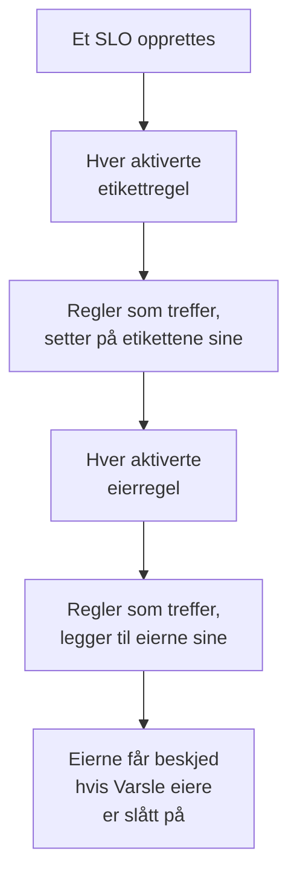

# Etikett- og eierregler

Etikettregler og eierregler holder orden på SLO-ene dine for deg. En **etikettregel** setter etiketter på hvert nye SLO den treffer, og en **eierregel** legger til eierbrukere og -team på det, så et nytt checkout-SLO får etiketten _Checkout_ og eies av checkoutteamet, uten at noen trenger å huske det. Begge fungerer som etikett- og eierreglene for alle andre produkter: se [Etikett- og eierregler](/docs/configuration/label-and-owner-rules) for det de har til felles.

## Slik fungerer det

Regler kjører når et SLO opprettes, fra dashbordet eller via API-et. Etikettregler kjører først, så en eierregel kan treffe en etikett som en etikettregel nettopp har satt på.

Begge typene gjelder for hele prosjektet. Du finner dem i sidemenyen til SLO-listen, under **Innstillinger**: **Etikettregler** og **Eierregler**. Seksjonen **Innstillinger** starter slått sammen; klikk på tittelen for å åpne den.

## Opprett en regel

:::steps
### Åpne regellisten

Åpne **SLOs**, deretter **Innstillinger** → **Etikettregler** eller **Innstillinger** → **Eierregler** i sidemenyen, og klikk på **Opprett SLO Label Rule** eller **Opprett SLO Owner Rule**.

### Velg hva regelen treffer

I trinnet **Treff** klikker du på **Legg til betingelse** for hver betingelse et SLO må oppfylle (se [Treffkriterier](#treffkriterier)). Med to eller flere velger du **Samsvar med alle** eller **Samsvar med én**. En regel uten betingelser treffer hvert nye SLO.

### Velg hva regelen legger til

Det andre trinnet i en etikettregel er **Etiketter**, der du velger **Etiketter å legge til**. Trinnet i en eierregel er **Eiere**, der du velger **Eiere** som skal legges til — personer og team, valgt fra én liste med **Legg til eier**. En regel må legge til minst én etikett eller eier.

### Sjekk navnet og de sammenslåtte feltene

**Navn** fylles ut fra det du velger, som _Legg til Checkout, Production_ eller _Legg til Checkout team som eiere_, og følger valgene dine til du skriver et eget navn. **Flere felt** inneholder den valgfrie **Beskrivelse** og, på en eierregel, **Varsle eiere**.

### Lagre regelen

Klikk på **Opprett SLO Label Rule** eller **Opprett SLO Owner Rule** igjen i det siste trinnet. Regelen starter aktivert.
:::

**Varsle eiere** (under **Flere felt**) er slått på som standard: eierne en eierregel legger til, får den samme beskjeden «du er lagt til som eier» som en eier som er lagt til for hånd. Slå det av for å legge til eiere uten å gi dem beskjed.

For å sette en regel på pause uten å slette den slår du av **Aktivert** i redigeringsskjemaet. Redigeringsskjemaet krever aldri etiketter eller eiere: en eldre regel som ikke legger til noe, kan fortsatt gis nytt navn, slås av eller slettes, og listen merker den med **Legger ikke til noe**.

Når en regel treffer et SLO:

- En etikettregel setter på hver etikett fra **Etiketter å legge til**. Etiketter SLO-et allerede har, legges ikke til to ganger, og når flere regler treffer, får SLO-et alle etikettene deres.
- En eierregel legger til hver bruker og hvert team på regelen som eier. Eiere SLO-et allerede har, hoppes over, og når flere regler treffer, får SLO-et alle eierne deres. En bruker som ikke lenger er medlem av prosjektet, eller et team fra et annet prosjekt, legges aldri til; regelens andre eiere legges likevel til.

Eierne av et SLO er personene som får høre om statusendringene: se [Feilbudsjetter](/docs/slo/error-budget).

## Treffkriterier

Hver betingelse sammenligner ett felt på SLO-et:

| Felt | Sammenlignes med | Operatorer |
| --- | --- | --- |
| **SLO-etiketter** | Etikettene til SLO-et. | **Har en av**, **Har alle**, **Har ingen av** |
| **SLO-navn** | Navnet til SLO-et. | **Inneholder**, **Inneholder ikke**, **Er lik**, **Er ikke lik**, **Starter med**, **Slutter med**, **Samsvarer med mønster**, **Samsvarer ikke med mønster** |
| **SLO-beskrivelse** | Beskrivelsen til SLO-et. | De samme som for **SLO-navn** |

En ny betingelse på navn eller beskrivelse starter på **Inneholder**. Et mønster er et regulært uttrykk, som `^checkout-.*`, eller et `*`-jokertegn, som `*checkout*`, og skiller ikke mellom store og små bokstaver. Et mønster som ikke er noen av delene, som `checkout-(01`, avvises når du lagrer, i stedet for i stillhet å ikke treffe noe.

| Du vil ha | Betingelser |
| --- | --- |
| Hvert SLO for checkouttjenesten | **SLO-navn** inneholder `checkout` |
| Hvert produksjons-SLO | **SLO-etiketter** har en av _Production_ |
| Checkout-SLO-er, men ikke de fra staging | **Samsvar med alle**: **SLO-navn** inneholder `checkout`, og **SLO-etiketter** har ingen av _Staging_ |

## Når regler kjører

- **Når et SLO opprettes**, fra dashbordet eller via API-et: hver aktiverte etikettregel, deretter hver aktiverte eierregel.
- **Når du kjører en regel** med **Run Now**: se nedenfor.

Å redigere et SLO bruker ikke reglene på nytt, og en regel fjerner aldri noe: verken etiketter eller eiere som noen har lagt til for hånd, eller dem den har lagt til selv. En regel som er slått av, gjør ingenting.

## Kjør en regel på eksisterende SLO-er

En regel du skriver i dag, gjelder for SLO-ene som opprettes etter den. For å bruke den på SLO-ene du allerede har, klikker du på **Run Now** i raden til regelen, eller på **Vis** og deretter **Run Now** på regelens egen side. Du kan også velge flere regler og kjøre dem fra tabellens massehandlinger.

En kjøring sjekker hvert SLO i prosjektet, også de arkiverte, og forteller hvor mange den traff og hvor mange den endret. Eiere som en kjøring legger til, får bare beskjed når du velger å gi dem beskjed i kjøringsdialogen og regelen har **Varsle eiere** slått på. Se [Kjøre regler på eksisterende ressurser](/docs/configuration/run-rules-now).

Etikettregler kan også kopieres mellom prosjekter: se [Importere og eksportere etikettregler](/docs/configuration/label-rule-import-export).

## Historikk

Hver gang en regel endrer et SLO, registrerer **Feed** til SLO-et hvilke regler som gjorde det. Hver eier en regel legger til, får også sitt eget feedelement «lagt til som eier», så feeden forteller hvem som ble lagt til og hvorfor. Se [SLO-feed og revisjonslogger](/docs/slo/feed-and-audit-logs).

## Tillatelser

| For å | Trenger du |
| --- | --- |
| Arbeide med etikettregler | **Create SLO Label Rule**, **Edit SLO Label Rule**, **Delete SLO Label Rule** eller **Read SLO Label Rule** |
| Arbeide med eierregler | **Create SLO Owner Rule**, **Edit SLO Owner Rule**, **Delete SLO Owner Rule** eller **Read SLO Owner Rule** |
| Kjøre en etikettregel | **Edit SLO Label Rule** og **Edit Service Level Objective** |
| Kjøre en eierregel | **Edit SLO Owner Rule**, **Edit Service Level Objective**, **Create SLO User Owner** og **Create SLO Team Owner** |

Disse tillatelsene ligger i SLO-gruppen til en rolle, og rollene Project Owner og Project Admin har alle sammen. En kjøring endrer hvert SLO i prosjektet, så en tillatelse som er begrenset til noen etiketter, eller til SLO-ene du eier, er ikke nok til å kjøre en regel.

## Neste steg

:::cards
- [Etikett- og eierregler](/docs/configuration/label-and-owner-rules): Hvordan etikett- og eierreglene til alle produkter fungerer.
- [Kjøre regler på eksisterende ressurser](/docs/configuration/run-rules-now): Hvordan Run Now fungerer for hver type regel.
- [SLO-er – Oversikt](/docs/slo/introduction): Hver side et SLO har, og SLO-listen.
:::
