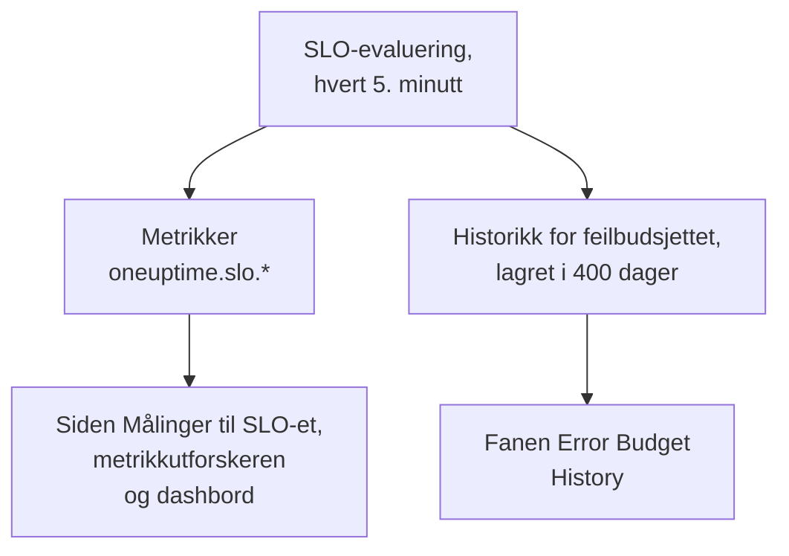

# SLO-metrikker og -dashbord

Hver gang OneUptime evaluerer et SLO, hvert 5. minutt, skriver det resultatene som metrikker med navnet `oneuptime.slo.*`. De ligger i det samme metrikklageret som monitormetrikkene dine, så du kan vise et SLO i et diagram på siden **Målinger**, åpne det i metrikkutforskeren og sette det på et hvilket som helst dashbord, filtrert og gruppert som enhver annen serie.

:::cards
- [Metrikkene](#metrikkene): Seks serier, enhetene deres og hvordan de aggregeres.
- [Siden Målinger](#siden-målinger): Diagrammene, historikken og hendelses- og varselmetrikkene til et SLO.
- [SLO-er på dashbord](#slo-er-på-dashbord): SLO-widgeten og malen SLO Dashboard.
:::

## Slik fungerer det

## Metrikkene

| Metrikk | Enhet | Aggregering | Hva den inneholder |
| --- | --- | --- | --- |
| `oneuptime.slo.sli.percent` | `%` | Avg | SLI-en over samsvarsvinduet til SLO-et: andelen av den målte tiden som var god. |
| `oneuptime.slo.target.percent` | `%` | Avg | Målet til SLO-et, sendt med hver evaluering så et diagram kan tegne det over SLI-en. |
| `oneuptime.slo.error.budget.remaining.percent` | `%` | Avg | Andelen av feilbudsjettet som ennå ikke er brukt i vinduet. Negativ når budsjettet er overskredet. |
| `oneuptime.slo.error.budget.remaining.seconds` | `seconds` | Avg | Nedetid SLO-et fortsatt kan tåle før det brytes. Negativ når budsjettet er overskredet. |
| `oneuptime.slo.burn.rate` | `x` | Max | Hvor fort budsjettet brukes, de siste 60 minuttene. 1x bruker budsjettet akkurat over vinduet. |
| `oneuptime.slo.status` | — | Max | Statusen til SLO-et ved hver evaluering: `0` er Feilfri, `1` er At Risk, `2` er Budget Exhausted. |

Aggregeringen er hvordan diagrammene til SLO-et og malen SLO Dashboard kombinerer punktene som faller i ett diagramintervall. Prosenter og varigheter tas som gjennomsnitt. Forbruksrate og status tar maksimum, så en kort forbrukstopp eller en kort tur innom Budget Exhausted ikke forsvinner i gjennomsnittet.

For et SLO i modusen **Monitor Seconds Average** teller `oneuptime.slo.error.budget.remaining.seconds` monitorsekunder, summert på tvers av monitorene, slik feilbudsjettet gjør: se [Feilbudsjetter](/docs/slo/error-budget).

### Når ingen punkter skrives

- Et deaktivert eller arkivert SLO evalueres ikke, så det sender ingenting.
- Et SLO som er **Pauset** eller **Misconfigured**, måler ingenting, så det sender bare `oneuptime.slo.target.percent`, som er konfigurasjon og ikke en måling. Diagrammene for SLI, budsjett, forbruksrate og status viser et hull.
- En verdi som ikke er et reelt tall, som en forbruksrate over et vindu uten data, hoppes over og skrives aldri som 0.

### Attributter

Hvert punkt har disse attributtene:

| Attributt | Verdi |
| --- | --- |
| `sloId` | ID-en til SLO-et. SLO-ets egne sider filtrerer på den, så å gi et SLO nytt navn deler aldri diagrammene. |
| `sloName` | Navnet til SLO-et da punktet ble skrevet. |
| `projectId` | ID-en til prosjektet. |
| `oneuptime.label.<key>` | Én attributt per SLO-etikett. En etikett med navnet `Tier 1` blir `oneuptime.label.tier_1` = `true`, og en etikett med navnet `product:checkout` blir `oneuptime.label.product` = `checkout`. Nøkler skrives med små bokstaver, og mellomrom og tegnsetting blir til `_`. |

Seriene hører til SLO-et, ikke til noen av monitorene, og teller ikke som telemetribruk.

Hendelses- og varselmetrikker har to tilsvarende attributter, `serviceLevelObjectiveIds` og `serviceLevelObjectiveNames`: kommaseparerte lister over SLO-ene hendelsen eller varselet påvirker.

### Oppbevaring

`oneuptime.slo.*`-metrikker oppbevares like lenge som monitormetrikker: **30 dager** som standard. På en selvhostet installasjon kan en masteradministrator endre det med **Monitor Metric Retention (Days)** i innstillingene for **Dataoppbevaring** i Admin Dashboard.

Det begrenser ikke fanen **Error Budget History** på siden **Målinger** til SLO-et. Den historikken lagres for seg og oppbevares i 400 dager.

## Siden Målinger

Siden **Målinger** til et SLO har fire faner:

| Fane | Hva den viser |
| --- | --- |
| **SLO Metrics** | `oneuptime.slo.*`-seriene i tre kort som deler ett tidsrom, som standard det siste døgnet: **Objective** (SLI-en med målet over, og gjenværende budsjett), **Burn** (forbruksrate og gjenværende budsjettid) og **Status**. |
| **Error Budget History** | SLI-en, gjenværende budsjett og forbruksraten over den langsiktige historikken, med linjer ved målet, ved grensene for risiko og oppbrukt budsjett og ved terskelen til hver aktivert forbruksrateregel. |
| **Hendelsesmetrikker** | Antallet, tiden til kvittering, tiden til løsning og varigheten til hendelsene som påvirker dette SLO-et, som standard den siste uken. Hendelser som forbruksratereglene har erklært, er med. |
| **Varselmetrikker** | Det samme for varsler. Varsler som forbruksratereglene har utløst, er med. |

Fanene **SLO Metrics**, **Hendelsesmetrikker** og **Varselmetrikker** leser metrikklageret, noe som krever tillatelse til å lese telemetri. En egendefinert rolle som kan lese SLO-er, men ikke telemetri, ser disse fanene tomme, mens **Error Budget History** fortsatt fungerer.

## SLO-er på dashbord

### Vis en hvilken som helst SLO-metrikk i et diagram

:::steps
#### Legg til et diagram

I redigeringsmodusen til et dashbord legger du til en diagram- eller verdiwidget og velger en av `oneuptime.slo.*`-metrikkene.

#### Grupper eller filtrer

Grupper etter `sloName` og `sloId` for én linje per SLO; `sloId` holder to SLO-er med samme navn fra hverandre. Eller filtrer på `sloName`, eller på en `oneuptime.label.*`-attributt.

#### Velg aggregeringen

Bruk aggregeringen fra tabellen over: Avg for prosentene og varighetene, Max for forbruksrate og status.
:::

### SLO-widgeten

[SLO-widgeten](/docs/dashboards/widgets#slo) viser SLI-en, gjenværende budsjett eller forbruksraten til ett SLO som en flis eller et diagram. Den får SLO-et sitt på en av to måter:

| Innstilling | Hvordan den oppfører seg |
| --- | --- |
| **Service Level Objective** | Fester widgeten til ett SLO. Velgeren viser SLO-er som ikke er arkivert. |
| **Follow SLO Variable** | Viser SLO-et som er valgt i en dashbordvariabel: en variabel av typen **Telemetry Attribute** på nøkkelen `sloName`. Ignoreres så lenge et SLO er festet. |

På et [offentlig dashbord](/docs/dashboards/sharing) lar en widget som følger en variabel, seerne velge et hvilket som helst ikke-arkivert SLO i prosjektet etter navn. En festet widget viser bare sitt eget SLO, og fortsetter å vise de siste tallene til et SLO som arkiveres senere.

### Malen SLO Dashboard

Når du oppretter et dashbord, velger du malen **SLO Dashboard** for å få en ferdig tavle med alle SLO-ene i prosjektet, i tre bånd:

1. **Service Level Objectives**: en liste over hvert ikke-arkivert SLO med status, SLI mot målet, budsjettstolpe og forbruksrate, og en opptelling av SLO-er etter status. Aktiverte SLO-er kommer først, det med minst budsjett først; et deaktivert SLO kommer sist som **Deaktivert**, med de siste tallene nedtonet.
2. **Error Budget & Burn Rate**: flisene **Lowest Error Budget Remaining**, **Least Error Budget Time Left** og **Peak Burn Rate**, og diagrammene **Error Budget Remaining by SLO** og **Burn Rate by SLO** med én linje per SLO, gruppert etter `sloName` og `sloId`.
3. **Selected SLO**: flisene **SLI**, **Error Budget Remaining** og **Burn Rate** og diagrammene **SLI History**, **Error Budget History** og **Burn Rate History** for ett SLO.

Én SLO-variabel i verktøylinjen avgrenser hele tavlen. Det er en variabel av typen Telemetry Attribute på `sloName`, så alternativene er SLO-navnene som finnes i metrikkene. Å velge et SLO snevrer listen inn til det, avgrenser diagrammene og flisene i båndet og fyller ut widgetene under **Selected SLO**, som følger variabelen. Til du velger ett, ber de deg velge et SLO i verktøylinjen.

## Feilsøking

:::details Et SLO mangler i SLO-velgeren i verktøylinjen
Velgeren viser SLO-navnene som er sendt det siste døgnet. Et nytt SLO dukker opp etter den første evalueringen; et SLO som er **Pauset** eller **Misconfigured**, kan fortsatt velges fordi det fortsatt sender målet sitt; et deaktivert eller arkivert SLO forsvinner omtrent et døgn etter det siste punktet.
:::

:::details Å velge et navn viser to SLO-er
To SLO-er har det navnet. Listen og diagrammene viser begge, og widgetene under **Selected SLO** sier at navnet er tvetydig. Gi SLO-er ulike navn.
:::

:::details Fanen SLO Metrics er tom
Rollen din kan ikke lese telemetri, eller SLO-et er ikke evaluert ennå. **Error Budget History** leser selve SLO-et og fungerer fortsatt.
:::

## Neste steg

:::cards
- [Dashbord-widgets](/docs/dashboards/widgets): Alle widgets, også SLO-widgeten.
- [Dashbord-variabler](/docs/dashboards/variables): Avgrens en hel tavle med én velger.
- [Feilbudsjetter](/docs/slo/error-budget): Hva budsjettallene betyr.
:::
