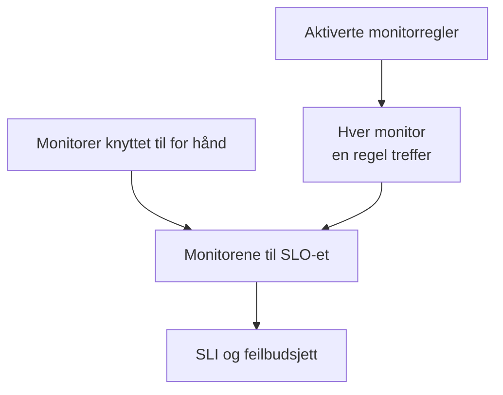

# Monitorer og monitorregler

Et SLO måler tilgjengeligheten til monitorene som er knyttet til det. Knytt dem til for hånd, la monitorregler knytte til hver monitor som samsvarer, eller gjør begge deler. Denne siden handler om sidene **Monitorer** og **Monitor Rules** til et SLO, som begge ligger under **Konfigurasjon** i sidemenyen.

:::cards
- [Velg monitorer for hånd](#knytt-til-monitorer-for-hånd): Best for et lite, fast sett.
- [Knytt til monitorer med en regel](#knytt-til-monitorer-med-en-regel): «Hver monitor med etiketten Production», holdt oppdatert for deg.
- [Treffkriterier](#treffkriterier): Feltene og operatorene en regel kan treffe på.
:::

## Hvilke monitorer et SLO måler

Et SLO måler unionen av monitorene du har knyttet til for hånd, og hver monitor som minst én av de aktiverte monitorreglene treffer.

Et nytt SLO har ingen monitorer, fordi opprettingsskjemaet ikke spør etter noen. Til det har én, kan det ikke evalueres: sidene viser **No monitors attached**, og **Oversikt** tilbyr begge måtene å knytte til monitorer på.

## Knytt til monitorer for hånd

Du trenger tillatelse til å redigere SLO-et.

:::steps
### Åpne siden Monitorer

Åpne SLO-et og gå til **Monitorer**.

### Velg monitorene

Klikk på **Add Monitors** og velg monitorer fra prosjektet. Bare monitorer som ikke allerede er knyttet til, vises.

### Lagre listen

Klikk på **Add Monitors**. Monitorene vises i listen med kilden **Manual** og teller med i SLI-en fra neste evaluering.
:::

Klikk på **Fjern** i raden til en monitor for å ta den ut av SLO-et. Selve monitoren endres ikke; den slutter bare å telle med i SLI-en og feilbudsjettet til SLO-et.

Siden **Monitorer** viser for hver monitor:

| Kolonne | Hva den viser |
| --- | --- |
| **Gjeldende status** | Gjeldende status for monitoren, eller **Arkivert**, **Deaktivert**, **Sonder ikke aktivert**, **Sonder frakoblet** eller **Ukjent** når den ikke sjekkes eller ennå ikke har rapportert noe. |
| **Kilde** | **Rule** hvis en av monitorreglene til SLO-et knyttet den til, **Manual** hvis noen knyttet den til for hånd. |
| **Etiketter** | Etikettene til monitoren. |

## Knytt til monitorer med en regel

En monitorregel beskriver monitorene et SLO skal måle, som «hver monitor med etiketten Production» eller «hver monitor der navnet starter med api-». Hver monitor som samsvarer, knyttes til, nå og hver gang monitorer opprettes eller endres, så ingen trenger å huske monitoren noen legger til neste måned.

:::steps
### Åpne Monitor Rules

Åpne SLO-et, gå til **Monitor Rules** og klikk på **Opprett SLO Monitor Rule**.

### Gi regelen et navn

Under **Grunnleggende informasjon** skriver du inn et **Navn** og eventuelt en **Beskrivelse** av hvorfor disse monitorene hører til dette SLO-et.

### Velg hva den treffer

Under **Treffkriterier** klikker du på **Legg til betingelse**, velger et felt og en operator og skriver inn eller velger verdien. Med to eller flere betingelser velger du **Samsvar med alle** eller **Samsvar med én**. En monitorregel trenger minst én betingelse.

### Lagre regelen

Klikk på **Opprett SLO Monitor Rule**. Regelen starter aktivert, og monitorene til SLO-et vurderes på nytt med en gang: hver monitor som samsvarer, knyttes til med kilden **Rule**.
:::

Regeltabellen viser for hver regel navnet, treffkriteriene med vanlige ord og om den er aktivert. For å sette en regel på pause slår du av **Aktivert** i redigeringsskjemaet. **View Monitors** åpner siden **Monitorer** til SLO-et.

### Treffkriterier

Hver betingelse sammenligner ett felt på en monitor:

| Felt | Sammenlignes med | Operatorer |
| --- | --- | --- |
| **Overvåkingsetiketter** | Etikettene til monitoren. | **Har en av**, **Har alle**, **Har ingen av** |
| **Monitortype** | Typen til monitoren, valgt fra listen over typer. | **Er lik**, **Er ikke lik** |
| **Overvåkingsnavn** | Navnet til monitoren. | **Inneholder**, **Inneholder ikke**, **Er lik**, **Er ikke lik**, **Starter med**, **Slutter med**, **Samsvarer med mønster**, **Samsvarer ikke med mønster** |
| **Overvåkingsbeskrivelse** | Beskrivelsen til monitoren. | De samme som for **Overvåkingsnavn** |

Et mønster er et regulært uttrykk, som `^api-.*`, eller et `*`-jokertegn, som `*checkout*`, og skiller ikke mellom store og små bokstaver. Et mønster som ikke er noen av delene, som `api-(01`, avvises når du lagrer, i stedet for i stillhet å ikke treffe noe. For å knytte til alle monitorer i prosjektet legger du til en betingelse på **Overvåkingsnavn** som samsvarer med mønsteret `.*`.

| Du vil ha | Betingelser |
| --- | --- |
| Hver produksjonsmonitor | **Overvåkingsetiketter** har en av _Production_ |
| Hver API-monitor | **Monitortype** er lik _API_ |
| Hver monitor unntatt de manuelle | **Monitortype** er ikke lik _Manual_ |
| Hver monitor der navnet starter med api- | **Overvåkingsnavn** samsvarer med mønsteret `^api-` |
| Checkout-monitorene, men ikke de fra staging | **Samsvar med alle**: **Overvåkingsnavn** samsvarer med mønsteret `*checkout*`, og **Overvåkingsetiketter** har ingen av _Staging_ |

### Når regler kjører

- Når du oppretter, redigerer, slår på, slår av eller sletter en regel, vurderes monitorene til SLO-et på nytt med en gang.
- Når en monitor opprettes, eller etikettene, navnet eller beskrivelsen endres, sjekker alle monitorreglene i prosjektet den, også etikettene som monitoretikettreglene dine gir den.
- Når en etikett slettes, vurderes SLO-ene der reglene brukte den, på nytt.
- Regler holder monitorlisten til et SLO oppdatert også mens SLO-et er deaktivert eller arkivert, så det fortsetter med de riktige monitorene.

Regler synkroniserer på nytt ved hver lagring, så **Run Now** er for å ta igjen det SLO-et gikk glipp av. Den finnes i hver rad, på regelens egen side (**Vis**) og i tabellens massehandlinger. Å kjøre en regel vurderer alle de aktiverte monitorreglene til SLO-et på nytt samlet, og deretter forteller dialogen hvor mange monitorer som ble knyttet til og koblet fra. Å kjøre en regel krever tillatelse til å redigere SLO-monitorregler. Se [Kjøre regler på eksisterende ressurser](/docs/configuration/run-rules-now).

### Hvilke monitorer en regel eier

- En monitor blir værende knyttet til så lenge en aktivert regel treffer den, og kobles fra så snart ingen gjør det lenger.
- Å slå av eller slette en regel kobler bare fra monitorene som ingen annen aktivert regel fortsatt treffer.
- Regler kobler bare fra monitorer som en regel har knyttet til. En monitor som er knyttet til for hånd, tas aldri over av en regel som tilfeldigvis treffer den, og kobles ikke fra når den slutter å treffe. Kilden forblir **Manual**.

## Velge for hånd mens regler er på

Så lenge minst én regel er aktivert, er det reglene som styrer monitorene til SLO-et:

- monitorer kan ikke legges til for hånd: **Add Monitors** er deaktivert, og et banner sier **This SLO's monitors are managed by its monitor rules**, med en lenke **Manage Monitor Rules**;
- monitorer som en regel har knyttet til, kan ikke fjernes for hånd, fordi regelen ville knyttet dem til igjen: knappen **Fjern** er låst, og verktøytipset forklarer hvorfor;
- monitorer som ble knyttet til for hånd før regler ble slått på, kan fortsatt fjernes.

Det gjelder også API-et. Slå av alle reglene for å velge monitorene selv igjen.

## SLO-ene en monitor teller med i

Siden til en monitor viser SLO-ene som måler den: åpne monitoren og gå til **SLOs** i sidemenyen. Sjekk den før du setter en monitor på pause eller endrer den, for å se hvilke mål som avhenger av den. Arkiverte SLO-er vises ikke, fordi de ikke evalueres.

## Fra Auto-Add Monitors With Labels

Tidligere versjoner hadde en innstilling **Auto-Add Monitors With Labels** på SLO-skjemaet. Ved oppgraderingen får hvert SLO som brukte den, en aktivert monitorregel med navnet **Auto-add monitors with labels** som treffer de samme etikettene, så det fortsetter å måle nøyaktig de samme monitorene. Feltet `monitorLabels` i SLO-API-et er foreldet: bruk SLO-monitorregler i stedet.

:::details Hva om noe fortsatt lagrer den gamle innstillingen?
En dashbordfane som ble åpnet før oppgraderingen, eller en API-klient eller arbeidsflyt som er skrevet for den forrige versjonen, kan fortsatt lagre den gamle innstillingen. Slik at et SLO ikke mister monitorer i stillhet på den måten:

- **Et SLO uten monitorregler** gjør de lagrede etikettene om til en regel **Auto-add monitors with labels**, og monitorene vurderes på nytt med en gang. Å lagre en tom liste kobler fra monitorene innstillingen hadde knyttet til, som før.
- **Et SLO som har monitorregler**, på eller av, ignorerer etiketter som er lagret via den gamle innstillingen, fordi det er reglene som bestemmer hva det måler.
- **Å opprette den første monitorregelen** for et SLO der monitorene ble knyttet til av den gamle innstillingen, konverterer først innstillingen til en regel, så den nye regelen legges til ved siden av i stedet for å erstatte den.

En konvertert regel som du sletter, blir værende slettet, med mindre monitorene fortsatt er knyttet til etterpå, for eksempel fordi en server som fortsatt kjører den forrige versjonen, knyttet dem til igjen under oppgraderingen: neste monitorendring eller neste nye regel konverterer da etikettene igjen. Slett den regelen igjen når oppgraderingen er ferdig.
:::

## Historikk

Hver tilknytning og frakobling, og hver regel som opprettes, redigeres eller slettes, vises i **Feed** til SLO-et. Regelendringer registreres også i **Revisjonslogger**. Se [SLO-feed og revisjonslogger](/docs/slo/feed-and-audit-logs).

## Feilsøking

:::details Add Monitors er deaktivert
Minst én av monitorreglene til SLO-et er aktivert, så det er reglene som styrer monitorene. Endre reglene, eller slå dem alle av for å velge monitorer for hånd.
:::

:::details Knappen Fjern for en monitor er låst
En monitorregel knyttet til den monitoren og ville knyttet den til igjen. Endre eller slå av regelen som treffer den.
:::

:::details En monitor som en regel burde treffe, er ikke knyttet til
Sjekk at regelen er aktivert, og at hver betingelse er oppfylt med **Samsvar med alle**. Etiketter som en monitoretikettregel legger til, teller også. Klikk på **Run Now** på regelen for å synkronisere SLO-et på nytt.
:::

:::details Lagring av en regel mislykkes med en mønsterfeil
Verdien er verken et regulært uttrykk eller et `*`-jokertegn, for eksempel på grunn av en parentes som ikke er lukket. Rett mønsteret, eller bruk **Inneholder**.
:::

## Neste steg

:::cards
- [SLO-er – Oversikt](/docs/slo/introduction): Hvordan nedetid fra flere monitorer kombineres.
- [Feilbudsjetter](/docs/slo/error-budget): Hva nedetiden til monitorene bruker opp.
- [Kjøre regler på eksisterende ressurser](/docs/configuration/run-rules-now): Hvordan Run Now fungerer for hver type regel.
:::
