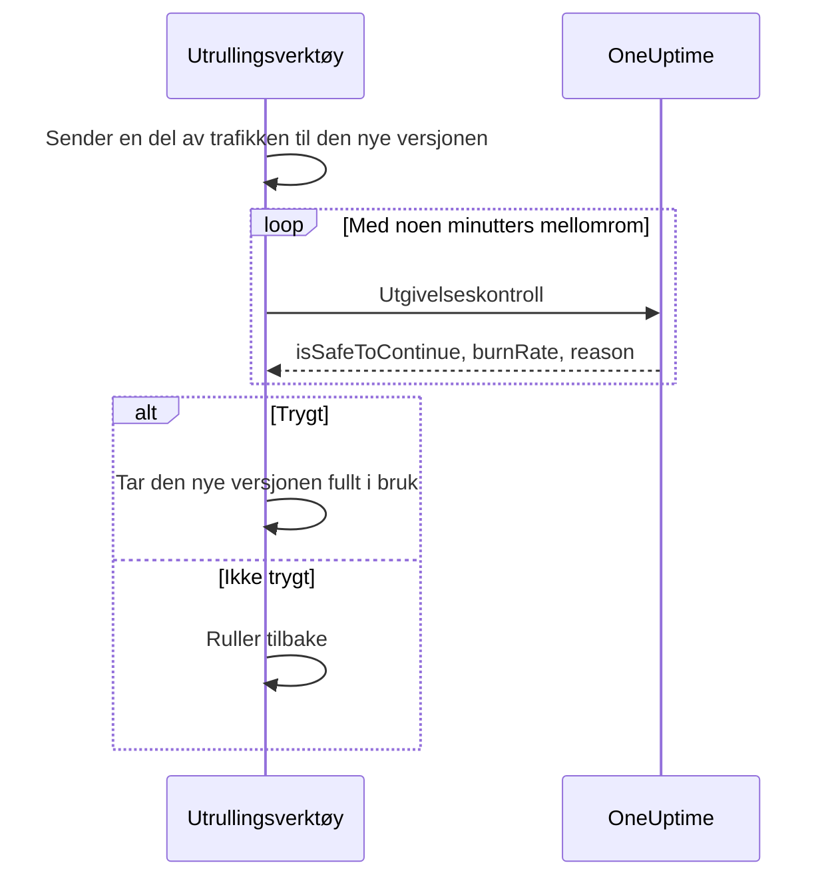

# Utgivelseskontroller

En utgivelseskontroll spør et SLO «er det trygt å fortsette å rulle ut denne utgivelsen?» mens utgivelsen rulles ut, og svarer ut fra hvor fort SLO-et brente feilbudsjettet sitt de siste minuttene. Argo Rollouts, Flagger eller en distribusjonspipeline spør mens en canary tar imot trafikk, og ruller utgivelsen tilbake ved et nei. OneUptime distribuerer ingenting selv: utrullingsverktøyet ditt gjør fortsatt utrullingen, og OneUptime forteller det hvordan det går med utgivelsen.

:::cards
- [Spør kontrollen](#spør-kontrollen): Én forespørsel med en API-nøkkel, og hva den svarer.
- [Argo Rollouts](#argo-rollouts): En analyse som avbryter utrullingen.
- [Flagger](#flagger): En webhook som stanser canaryen.
- [GitHub Actions](#github-actions): Et trinn som ruller tilbake etter en distribusjon.
- [Slå av et funksjonsflagg](#slå-av-et-funksjonsflagg): En arbeidsflyt som slår av et flagg når SLO-et bruker feilbudsjettet sitt for fort.
:::

## Slik fungerer det

[Distribusjonssperren](/docs/slo/error-budget-policy#distribusjonssperre) svarer før en utgivelse, ut fra feilbudsjettet for hele samsvarsvinduet. En utgivelse som ødelegger noe, har brukt nesten ingenting av budsjettet for en måned de første ti minuttene, så utgivelseskontrollen leser det utgivelsen endrer: forbruksraten de siste minuttene.



Kontrollen svarer med ett av tre verdikter:

| Verdikt | Når | `isSafeToContinue` |
| --- | --- | --- |
| `Pass` | Vinduet brente feilbudsjettet med `maxBurnRate` eller langsommere. | `true` |
| `Fail` | Det brente fortere, eller feilbudsjettpolicyen til SLO-et fryser distribusjoner. | `false` |
| `NotEnoughData` | Vinduet hadde færre forespørsler enn `minimumRequestCount`, eller monitorene til SLO-et registrerte ingen status i det. For lite til å kalle utgivelsen trygg. | `false` |

Med en forbruksrate på 1 traff vinduet målet til SLO-et nøyaktig, så standardverdien `1` for `maxBurnRate` underkjenner en utgivelse som gjør det dårligere enn målet.

Hva kontrollen leser, avhenger av hva SLO-et måler:

- Et [forespørsels-SLO](/docs/slo/request-slos) bedømmes ut fra forespørslene til tjenestene i vinduet, lest fra spannene deres etter hvert som de kommer inn. Legg til `serviceVersion` for å bedømme bare forespørslene til den nye versjonen: OneUptime sammenligner den med ressursattributtet `service.version` på spannene, som et OpenTelemetry-SDK setter fra `OTEL_RESOURCE_ATTRIBUTES=service.version=1.4.2`. Slik bedømmes canaryen på sine egne forespørsler, uten å bli utvannet av forespørslene til den gamle versjonen.
- Et [målings-SLO](/docs/slo/request-slos#slo-er-ut-fra-en-måling) bedømmes ut fra hendelsene til målingen i vinduet, talt slik SLI-en teller dem, så `minimumRequestCount`, `goodRequestCount` og `totalRequestCount` er hendelser. Med `serviceVersion` teller bare punktene til målingen som har ressursattributtet `service.version` med den verdien: et OpenTelemetry-SDK setter det på målingene sine slik det gjør på spannene sine.
- Et SLO for monitoroppetid bedømmes ut fra statustidslinjene til monitorene over vinduet. `minimumRequestCount` gjelder ikke for det, og en kontroll med `serviceVersion` avvises: monitorer har ingen versjoner.

## Før du begynner

Du trenger et SLO som måler det utgivelsen påvirker. Et forespørsels-SLO for tjenesten du gir ut, bedømmer en canary best, fordi det leser tjenestens egne forespørsler.

## Sett opp en utgivelseskontroll

:::steps
### Gi utrullingen en nøkkel

Opprett en [API-nøkkel](/docs/api-reference/api-reference) for prosjektet med en rolle som kan lese SLO-er, og lagre den som en hemmelighet i utrullingsverktøyet eller pipelinen.

### Kopier ID-en til SLO-et

Åpne SLO-et og kopier ID-en fra adressen: `/slos/<slo-id>`.

### Spør kontrollen én gang for hånd

Kjør forespørselen under [Spør kontrollen](#spør-kontrollen) med nøkkelen og ID-en. Den svarer med `isSafeToContinue` og en `reason`.

### Legg den til i utrullingen

Spør kontrollen fra [Argo Rollouts](#argo-rollouts), [Flagger](#flagger) eller [GitHub Actions](#github-actions), og rull tilbake når `isSafeToContinue` er `false`.
:::

## Spør kontrollen

Kontrollen er `GET` eller `POST` mot `release-check`-adressen til SLO-et. Send valgene i spørrestrengen, eller som en JSON-brødtekst med `POST`:

```bash
curl -sS "https://oneuptime.com/api/service-level-objective/<slo-id>/release-check?windowInMinutes=10&serviceVersion=1.4.2" \
  -H "ApiKey: $ONEUPTIME_API_KEY"
```

Den svarer med verdiktet først, og deretter med hva det bygger på:

```json
{
  "isSafeToContinue": false,
  "verdict": "Fail",
  "reason": "The last 10 minutes burned the error budget at 3.2x, faster than the 1x this check allows (SLI 99.68% against the 99.9% target).",
  "sloId": "<slo-id>",
  "sloName": "Checkout requests",
  "sliType": "Request Success",
  "targetPercentage": 99.9,
  "windowInMinutes": 10,
  "maxBurnRate": 1,
  "burnRate": 3.2,
  "sliPercentage": 99.68,
  "deploymentsAllowed": true,
  "errorBudgetPolicyTier": null,
  "sloStatus": "Healthy",
  "checkedAt": "2026-11-15T12:00:00.000Z",
  "goodRequestCount": 2492,
  "totalRequestCount": 2500,
  "minimumRequestCount": 1,
  "serviceVersion": "1.4.2"
}
```

Valgene:

| Valg | Standard | Hva det gjør |
| --- | --- | --- |
| `windowInMinutes` | `10` | Hvor langt tilbake kontrollen ser, i hele minutter fra 1 til 360. |
| `maxBurnRate` | `1` | Den høyeste forbruksraten som består. `2` lar vinduet brenne budsjettet dobbelt så fort som målet tillater. |
| `minimumRequestCount` | `1` | Forespørsels-SLO-er: det minste antallet forespørsler kontrollen bedømmer. Med `0` består et vindu uten forespørsler. |
| `serviceVersion` | Ingen | Forespørsels-SLO-er: bedøm bare forespørslene der spannene har denne `service.version`. |
| `includeDeploymentGate` | `true` | Svar nei så lenge feilbudsjettpolicyen til SLO-et fryser distribusjoner. Med `false` er det bare forbruksraten som avgjør. |
| `failWithStatusCode` | `false` | Svar på et nei med HTTP-status 412 i stedet for 200, for verktøy som bare leser statuskoden. |

Feltene i svaret:

| Felt | Hva det inneholder |
| --- | --- |
| `isSafeToContinue` | `true` for å fortsette utrullingen, `false` for å rulle den tilbake. |
| `verdict` | `Pass`, `Fail` eller `NotEnoughData`. |
| `reason` | Én setning til loggen for utrullingen, som sier hva som ble målt og hvorfor kontrollen svarte som den gjorde. |
| `burnRate` og `sliPercentage` | Hvor fort vinduet brente feilbudsjettet, og SLI-en over vinduet. |
| `goodRequestCount` og `totalRequestCount` | Forespørsels-SLO-er: forespørslene vinduet inneholdt, og hvor mange av dem som var gode. |
| `deploymentsAllowed` og `errorBudgetPolicyTier` | Om feilbudsjettpolicyen til SLO-et tillater distribusjoner, og nivået SLO-et er i. |
| `checkedAt` | Når kontrollen ble målt. |

Et SLO som ikke kan måles – et forespørsels-SLO uten tjenester, et latens-SLO uten grense, et målings-SLO uten en måling det kan telle, et SLO for monitoroppetid uten monitorer – får svaret HTTP 400 og hva som må rettes, så en utrulling stopper på en tydelig feil i stedet for på en gjetning. På en selvhostet installasjon bruker du installasjonens egen adresse i stedet for oneuptime.com.

## Argo Rollouts

En analyse med en `web`-måling spør kontrollen ved hvert trinn i en canary, og Argo Rollouts avbryter utrullingen og skalerer canaryen ned når den feiler. Lagre først API-nøkkelen som en hemmelighet:

```bash
kubectl create secret generic oneuptime --from-literal=api-key="$ONEUPTIME_API_KEY"
```

Legg deretter til malen, og kjør den etter det første trinnet i canaryen:

:::tabs
@tab AnalysisTemplate
```yaml title="oneuptime-release-check.yaml"
apiVersion: argoproj.io/v1alpha1
kind: AnalysisTemplate
metadata:
  name: oneuptime-release-check
spec:
  args:
    - name: version
    - name: api-key
      valueFrom:
        secretKeyRef:
          name: oneuptime
          key: api-key
  metrics:
    - name: slo-burn-rate
      interval: 2m
      count: 5
      failureLimit: 0
      successCondition: result == true
      provider:
        web:
          url: "https://oneuptime.com/api/service-level-objective/<slo-id>/release-check?windowInMinutes=10&serviceVersion={{args.version}}"
          headers:
            - key: ApiKey
              value: "{{args.api-key}}"
          jsonPath: "{$.isSafeToContinue}"
```
@tab Rollout
```yaml title="rollout.yaml"
apiVersion: argoproj.io/v1alpha1
kind: Rollout
metadata:
  name: checkout
spec:
  strategy:
    canary:
      steps:
        - setWeight: 10
        - analysis:
            templates:
              - templateName: oneuptime-release-check
            args:
              - name: version
                value: "1.4.2"
        - setWeight: 50
        - pause: { duration: 10m }
```
:::

Analysen spør fem ganger, med to minutters mellomrom, og det første neiet avbryter utrullingen. Send med den samme versjonen som podene i canaryen setter i `OTEL_RESOURCE_ATTRIBUTES`. Kan canaryen være uten trafikk ved den første vekten, legger du til `&minimumRequestCount=0` i adressen, ellers feiler en stille canary analysen med `NotEnoughData`.

## Flagger

Flagger kaller en `rollout`-webhook ved hvert trinn i analysen sin, og stanser og ruller tilbake canaryen når webhooken fortsetter å feile. Webhookene til Flagger sender ingen headere, så spør kontrollen gjennom lasttesteren til Flagger, som kjører en kommando for webhooken:

```yaml title="canary.yaml"
apiVersion: flagger.app/v1beta1
kind: Canary
metadata:
  name: checkout
spec:
  analysis:
    interval: 1m
    threshold: 2
    maxWeight: 50
    stepWeight: 10
    webhooks:
      - name: oneuptime-release-check
        type: rollout
        url: http://flagger-loadtester.test/
        timeout: 30s
        metadata:
          type: bash
          cmd: "curl -sSf -H \"ApiKey: $ONEUPTIME_API_KEY\" 'https://oneuptime.com/api/service-level-objective/<slo-id>/release-check?windowInMinutes=5&failWithStatusCode=true'"
```

Med `failWithStatusCode=true` er et nei HTTP 412, så `curl -f` avslutter med en feil, og webhooken feiler. Gi lasttesteren nøkkelen som `ONEUPTIME_API_KEY` i miljøet dens, fra en Kubernetes-hemmelighet. Når `threshold` kontroller har feilet, ruller Flagger canaryen tilbake.

## GitHub Actions

En pipeline som distribuerer alt på én gang, kan likevel følge med på utgivelsen: distribuer, spør kontrollen noen ganger, og rull tilbake når den svarer nei.

```yaml title=".github/workflows/deploy.yml"
name: Deploy
on:
  push:
    branches: [main]

jobs:
  deploy:
    runs-on: ubuntu-latest
    steps:
      - uses: actions/checkout@v4
      - name: Deploy
        run: ./deploy.sh
      - name: Watch the release against the SLO
        env:
          ONEUPTIME_API_KEY: ${{ secrets.ONEUPTIME_API_KEY }}
          SLO_ID: <slo-id>
          VERSION: ${{ github.sha }}
        run: |
          for attempt in 1 2 3 4 5; do
            sleep 120
            CHECK=$(curl -sS "https://oneuptime.com/api/service-level-objective/$SLO_ID/release-check?windowInMinutes=10&serviceVersion=$VERSION" \
              -H "ApiKey: $ONEUPTIME_API_KEY")
            echo "$CHECK" | jq -r '.reason'
            if [ "$(echo "$CHECK" | jq -r '.isSafeToContinue')" != "true" ]; then
              exit 1
            fi
          done
      - name: Roll back
        if: failure()
        run: ./rollback.sh
```

Trinnet feiler ved et nei, og ved ethvert svar uten `isSafeToContinue: true` – en feil ID, en nøkkel som ikke kan lese SLO-et, ikke noe svar i det hele tatt – så pipelinen fortsetter aldri på et svar den ikke fikk. Sett `service.version` til commiten (`${{ github.sha }}`) når tjenesten starter, så kontrollen bedømmer bare den nye versjonen.

## Slå av et funksjonsflagg

En utgivelse bak et funksjonsflagg rulles tilbake ved at flagget slås av. Det kan en arbeidsflyt gjøre for deg: når en [forbruksrateregel](/docs/slo/burn-rate-alerts) for SLO-et utløser varselet sitt eller erklærer hendelsen sin, slår arbeidsflyten av flagget i LaunchDarkly eller Unleash. En dårlig utrulling er dermed rullet tilbake i løpet av minutter, uten at noen trenger å gripe inn.

:::steps
### Kopier ID-en til forbruksrateregelen

Åpne SLO-et og gå til **Forbruksrateregler**. Åpne menyen til regelen som skal slå av flagget, og velg **Vis ID**. En regel for raskt forbruk passer best, fordi den utløses i løpet av minutter etter en dårlig utrulling.

### Opprett arbeidsflyten fra en mal

Åpne **Arbeidsflyter** og klikk på **Opprett arbeidsflyt**. Under **Eller start fra en mal** velger du kategorien **SLOs** og deretter malen for flaggtjenesten din:

| Mal | Hva den ber om |
| --- | --- |
| **Turn a LaunchDarkly flag off when an SLO burns too fast** | Et API-tilgangstoken som kan oppdatere flagget, og nøklene til LaunchDarkly-prosjektet, flagget og miljøet. |
| **Turn an Unleash flag off when an SLO burns too fast** | Unleash-adressen din, et token for en tjenestekonto eller et personlig tilgangstoken, og prosjektet, navnet og miljøet til flagget. |

Lim inn ID-en til regelen i **Burn Rate Rule ID**, fyll ut resten og opprett arbeidsflyten.

### Slå på arbeidsflyten

Arbeidsflyter opprettes avslått. Når du er klar, slår du på **Aktivert** øverst i arbeidsflytens **Bygger**.
:::

Arbeidsflyten starter hver gang en forbruksrateregel i prosjektet utløser et varsel eller erklærer en hendelse. Blokken **Hvis / Ellers** lar den bare fortsette for regelen du limte inn ID-en til, og det neste trinnet kaller flaggtjenesten: hos LaunchDarkly instruksjonen `turnFlagOff`, med en kommentar som nevner regelen og SLO-et, eller hos Unleash `off` for miljøet. Begge slår av flagget for alle i det miljøet, uansett hvilken targeting flagget har. Avviser flaggtjenesten kallet, feiler kjøringen, og kjøringens logg forteller hvorfor. Varselet til regelen tilkaller fortsatt folk, slik det alltid gjør.

**Kjør arbeidsflyt** i **Bygger** kjører arbeidsflyten som om regelen du velger, nettopp hadde blitt utløst, så den slår av flagget på ekte. Prøv det først med et flagg i et testmiljø.

For en annen flaggtjeneste, eller en LaunchDarkly-instans med egen adresse, starter du fra en av de to malene og endrer kallet i API-trinnet til et kall som slår av flagget for alle i miljøet. Velg et kall som i likhet med disse to også overstyrer segmenter og targetingregler, ellers forblir flagget slått på gjennom en gradvis utrulling.

## Neste steg

:::cards
- [SLO-er for forespørsler og latens](/docs/slo/request-slos): Mål forespørslene til en tjeneste, SLI-en som bedømmer en canary best.
- [Feilbudsjettpolicy](/docs/slo/error-budget-policy): Frys distribusjoner mens budsjettet er lavt.
- [Forbruksratevarsler og -hendelser](/docs/slo/burn-rate-alerts): Varsle teamet ditt når budsjettet brennes for fort.
:::
