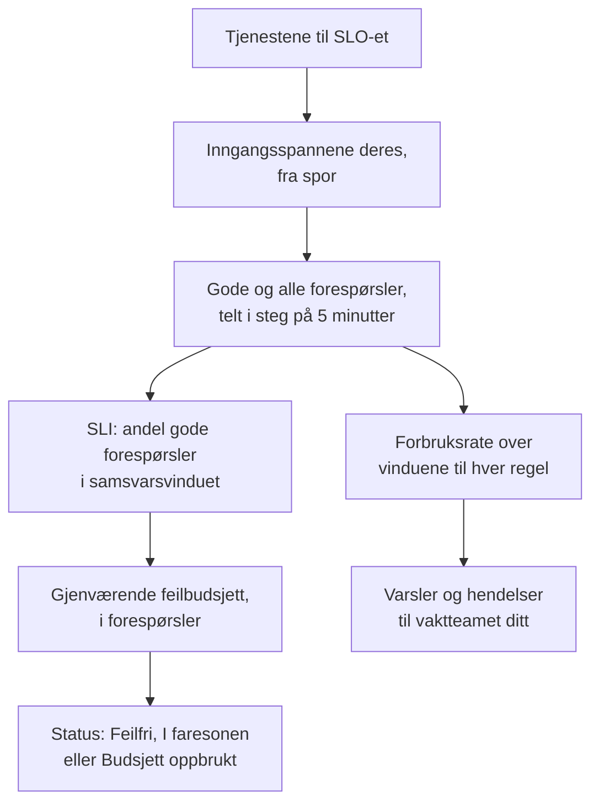

# SLO-er for forespørsler og latens

Et forespørsels-SLO måler det brukerne dine får fra en tjeneste: andelen av forespørslene som lykkes, eller som besvares raskt nok. OneUptime teller dem ut fra sporene tjenestene dine allerede sender, så det er ingen monitor å sette opp: velg tjenestene og et mål, så måler OneUptime dem hvert 5. minutt.

:::cards
- [Opprett et forespørsels-SLO](#opprett-et-forespørsels-slo): Tjenestene, en latensgrense og et mål.
- [Slik telles forespørsler](#slik-telles-forespørsler): Hvilke spans som teller, og når.
- [Utgivelseskontroller](/docs/slo/release-checks): Rull tilbake en utgivelse som brenner opp feilbudsjettet.
:::

## Vellykkede forespørsler og forespørselslatens

| Hva det måler | En forespørsel er dårlig når | Feilbudsjettet teller |
| --- | --- | --- |
| **Vellykkede forespørsler** | Statusen til spannet er `Error`. Et span uten status teller som godt, slik OpenTelemetry mener det. | Mislykkede forespørsler |
| **Forespørselslatens** | Den tok lengre tid enn **Latensgrense (ms)** for SLO-et, uansett status. | Trege forespørsler |

SLI-en er andelen gode forespørsler i samsvarsvinduet, og feilbudsjettet er de dårlige forespørslene målet tillater: ved 99,9 % én av hver 1 000. Et latens-SLO teller en forespørsel som feilet raskt, som god, så mål en viktig tjeneste på begge måter: ett SLO for at den virker, og ett for at den er rask.

## Slik fungerer det

En forespørsel er et inngangsspan for en av tjenestene til SLO-et: spannet der en forespørsel eller en melding kommer inn i tjenesten, slik listen [Spor](/docs/telemetry/traces-explorer#spor-og-spans) viser dem som standard. En forespørsel som går gjennom to av tjenestene til SLO-et, telles én gang i hver av dem.

Derfra fungerer et forespørsels-SLO som alle andre. Statusen, forbruksratereglene, feilbudsjettpolicyen, eierne og varslingene er de samme, men feilbudsjettet måles i forespørsler i stedet for minutter.

## Før du begynner

- Tjenestene sender spor til OneUptime: se [OpenTelemetry](/docs/telemetry/open-telemetry). Hver av dem står i [tjenestekatalogen](/docs/telemetry/services) under sitt `service.name`.
- En rolle som kan opprette SLO-er: Prosjekteier, Prosjektadministrator eller en egendefinert rolle med tillatelsen Create Service Level Objective.

## Opprett et forespørsels-SLO

:::steps
### Åpne SLO-er

Åpne **SLOs** fra menyen **Produkter** i topplinjen, og klikk på **Opprett Service Level Objective**.

### Velg hva SLO-et måler

Under **Hva den måler** velger du **Vellykkede forespørsler** eller **Forespørselslatens**, og deretter under **Tjenester** hvilke tjenester forespørslene skal telles fra. For **Forespørselslatens** angir du også **Latensgrense (ms)**: en forespørsel som besvares innenfor grensen, teller som rask nok, for eksempel `300`. Klikk på **Neste**.

### Gi det et navn og et mål

Skriv inn et **Navn**, for eksempel «Checkout requests», og et **Mål (%)**: andelen forespørsler som må være gode. Klikk på **Opprett Service Level Objective**.

### Se de første tallene komme inn

Den første evalueringen, innen 5 minutter, teller forespørslene fra de siste 6 timene, så SLO-et har tall med en gang. Evalueringene etter den teller også eldre forespørsler, helt til samsvarsvinduet er dekket.
:::

Vil du senere endre hva et SLO måler, tjenestene eller grensen, åpner du **Innstillinger** for SLO-et og klikker på **Rediger hva den måler**.

## Slik telles forespørsler

OneUptime teller de gode forespørslene og alle forespørslene til hvert SLO i steg på 5 minutter og tar vare på tellingene, så SLO-et leser vinduet sitt fra sine egne tellinger i stedet for fra hvert eneste span hver gang:

- Et steg telles 2 minutter etter at det er slutt, så spans som kommer sent, kommer med, og neste evaluering teller de to siste stegene på nytt for spans som kommer enda senere.
- Et nytt SLO starter med de siste 6 timene. Hver evaluering etter det teller opptil et døgn med eldre forespørsler, de nyeste først, til vinduet er dekket.
- Bare forespørsler som fortsatt er innenfor [oppbevaringstiden for telemetri](/docs/telemetry/data-retention#hvor-lenge-telemetri-oppbevares), kan telles. Telte steg oppbevares i 400 dager, lenger enn noe samsvarsvindu, så et vindu som er lengre enn oppbevaringstiden, fylles etter hvert som SLO-et blir eldre.
- Endrer du hva SLO-et måler, tjenestene eller latensgrensen, telles forespørslene på nytt fra starten. Et lengre samsvarsvindu fylles ved at det telles lenger tilbake.

Så lenge tellingene bare dekker en del av samsvarsvinduet, sier **Oversikt** fra med indikatoren **Vinduet er 23 % fylt**, og flisen **Feilbudsjett igjen** gjentar det under tallet sitt. Begge forsvinner når tellingene dekker hele vinduet.

## Feilbudsjettet i forespørsler

Budsjettet er de dårlige forespørslene målet tillater blant forespørslene som er telt i vinduet, så det vokser med trafikken: ved 99,9 % tillater et vindu med 2 000 000 forespørsler 2 000 mislykkede. I **Oversikt**:

- **Feilbudsjett igjen** viser hvor mange dårlige forespørsler som er igjen av hvor mange, eller hvor mange SLO-et er over budsjettet.
- **Budsjettets rekkevidde** viser hvor lenge budsjettet varer med den nåværende forbruksraten, så lenge trafikken holder seg som den var.
- Sammendraget viser antallet tjenester i SLO-et, og et latens-SLO viser grensen sin under målet.

Forbruksratevarsler, varslinger og feeden oppgir også budsjettet i forespørsler. Målingen `oneuptime.slo.error.budget.remaining.seconds` sendes ikke for et forespørsels-SLO; vis `oneuptime.slo.error.budget.remaining.percent` i et diagram i stedet.

Et forespørsels-SLO får de samme reglene **Fast burn**, **Slow burn** og **Slow leak** som alle nye SLO-er. I en rolig time med en håndfull forespørsler kan én enkelt feil gi et raskt forbruk, så en regel kan se bort fra vinduer med for få forespørsler: angi `minimumSampleCount` for regelen via API-et, så hopper regelen over et langt vindu med færre forespørsler enn det.

## Feilsøking

:::details SLO-et viser Waiting for requests
Ingen av tjenestene har besvart en forespørsel i vinduet ennå. Sjekk at tjenestene sender spor til OneUptime, og at spannene deres omfatter inngangsspans: en tjeneste der alle spannene er interne, har ingen forespørsler å telle.
:::

:::details SLI-en endret seg etter at jeg endret tjenestene
Endrer du hva SLO-et måler, tjenestene eller latensgrensen, telles forespørslene på nytt, først de siste 6 timene, så SLI-en og budsjettet starter på nytt derfra. Indikatoren **Vinduet er 23 % fylt** viser hvor stor del av vinduet som er telt så langt.
:::

## Neste steg

:::cards
- [Utgivelseskontroller](/docs/slo/release-checks): La Argo Rollouts, Flagger eller en pipeline rulle tilbake en utgivelse som brenner opp budsjettet.
- [Forbruksratevarsler og -hendelser](/docs/slo/burn-rate-alerts): Varsle teamet ditt når budsjettet brennes for fort.
- [Feilbudsjettpolicy](/docs/slo/error-budget-policy): Bli enige om hva teamet gjør etter hvert som budsjettet tømmes.
:::
