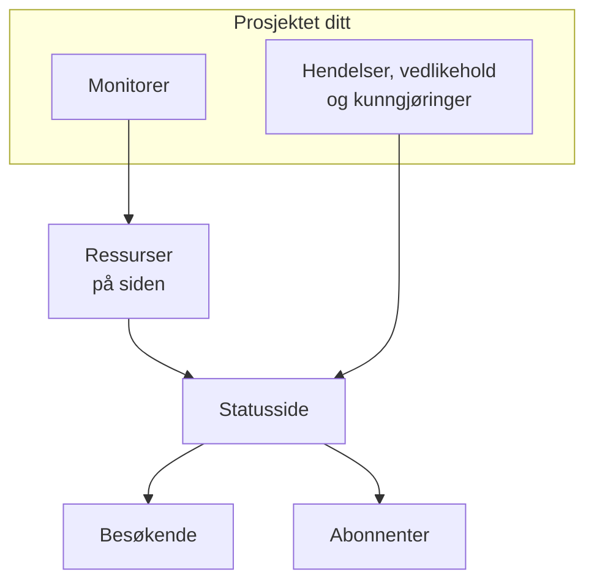

# Statussider – Oversikt

En statusside er det offentlige ansiktet til alt du overvåker: én URL som kundene dine kan åpne i stedet for å skrive til deg og spørre om problemet bare er hos dem. Den viser gjeldende status for tjenestene du velger å vise, hendelsene du jobber med, vedlikeholdet du har planlagt og enhver kunngjøring du vil feste øverst.

Når noe går i stykker klokken 2 om natten, er statussiden det første supportkøen din henviser til. Det er også derfra abonnentene dine blir varslet, så det lønner seg å sette den opp før du trenger den, ikke midt i nedetiden.

:::cards
- [Opprett en statusside](#å-opprette-en-statusside): To felt for å komme i gang, alt det andre etterpå.
- [Velg hva den viser](#å-velge-hva-som-vises-på-siden): Hendelser, episoder, kunngjøringer, vedlikehold og oppetid, på ett kort.
- [Bestem hvem som kan se den](#å-begrense-hvem-som-kan-se-siden): Alle med lenken, bare personer som logger inn, eller alle med passordet.
- [Arkiver en statusside](#å-arkivere-en-statusside): Ta en side offline uten å slette den.
:::

## Slik fungerer det

Statussider ligger under **Statussider** i menyen **Produkter** i den øverste linjen, blant de viktigste. Alt på denne siden gjelder per statusside: et prosjekt kan ha så mange det vil — en offentlig for kunder, en privat for et internt publikum, en per region for et bestemt marked.

Siden viser monitorene du setter på den, som ressurser. Hendelser og planlagt vedlikehold når siden gjennom disse monitorene, og kunngjøringer publiseres direkte på den. Besøkende leser siden, og abonnenter blir varslet om hver endring på kanalene de har valgt.

## Kort oppsummert

- **Opprettes med to felt.** En ny statusside ber bare om **Navn** og **Beskrivelse**. Ressurser, merkevare og domener setter du opp etterpå.
- **Ressurser er det de besøkende ser.** Hver rad på siden er en **Statusside Ressurs**: en monitor (eller monitorgruppe) med sitt eget visningsnavn, verktøytips og oppetidsvalg. Grupper deler en lang side inn i seksjoner og kan nøstes.
- **En URL for forhåndsvisning fra første dag.** Hver statusside får en forhåndsvisningslenke, slik at du kan se den før det finnes et egendefinert domene.
- **Rutene for besøkende avhenger av innstillinger.** Hendelser, episoder, kunngjøringer og planlagte hendelser vises bare så lenge bryteren deres i **Hva statussiden din viser** (under **Avanserte innstillinger**) er slått på, og abonnementssiden bare så lenge **Vis abonnentside** er slått på.
- **Hvem som kan se den, er ett valg.** Alle med lenken, bare personer som logger inn (private brukere, SAML- eller OIDC-SSO), eller alle med passordet, på sidens skjerm **Tilgang**, med en valgfri IP-tillatelsesliste under **Flere innstillinger**.
- **Abonnenter blir varslet automatisk.** Abonnenter via e-post, SMS, Slack, Microsoft Teams og webhook kan følge en side, hver kanal bak sin egen bryter.

## Sentrale begreper

| Begrep | Hva det betyr |
| --- | --- |
| **Statusside** | Én offentlig (eller privat) side, med egen merkevare, egne domener, ressurser og abonnenter. Modellen `StatusPage`. |
| **Ressurs** | Én rad som de besøkende ser: en monitor eller monitorgruppe vist på siden med et visningsnavn og oppetidsvalg. |
| **Gruppe** | En navngitt seksjon som inneholder ressurser. Grupper nøstes i grupper, og hvert nivå oppsummerer statusen til alt under det. |
| **Kunngjøring** | En melding du publiserer på én eller flere statussider, med et starttidspunkt og et valgfritt sluttidspunkt. |
| **Abonnent** | Noen (eller noe) som følger siden via e-post, SMS, Slack, Microsoft Teams eller en webhook. |
| **Egendefinert domene** | Et domene du eier, `status.example.com`, som peker til siden med en CNAME-post. OneUptime utsteder SSL-sertifikatet for det gratis og fornyer det. |
| **Privat bruker** | En konto som kan logge inn på en privat statusside. Atskilt fra brukerne i OneUptime-prosjektet ditt. |

## Å opprette en statusside

:::steps
### Åpne opprettelsesskjemaet

Åpne **Statussider → Alle statussider**, og klikk på **Opprett statusside**.

### Gi siden et navn

Fyll ut **Navn** (påkrevd, minst to tegn) i vinduet **Opprett ny: Statusside** og, om du vil, **Beskrivelse**, og klikk på **Opprett statusside**.

Det er hele skjemaet. Listen du kommer tilbake til, viser **Navn**, **Beskrivelse**, **Etiketter** og **Eiere**, og kan filtreres etter **Statusside-ID**, **Navn** og **Beskrivelse**.

### Åpne den nye siden

Åpne den nye siden, så havner du på skjermen **Oversikt**, som har to kort: **Status Page Preview URL**, med en lenke til selve siden, og **Detaljer for statusside**, der du kan redigere navnet, beskrivelsen og etikettene du nettopp satte. Når prosjektet har egendefinerte felt for statussider, følger et kort **Egendefinerte felt**.
:::

En side som opprettes med API-et eller med Terraform, er underlagt de samme abonnementene som innstillingene nedenfor. På OneUptime Cloud blir oppretting av en side med en påslått innstilling som abonnementet ditt ikke inkluderer (for eksempel privat, en skjult liste, egendefinert HTML, CSS eller JavaScript, e-postrapporter, abonnenter via SMS, Slack, Microsoft Teams eller webhook, en IP-tillatelsesliste) avvist med `402 Payment Required`, og meldingen nevner abonnementet. Abonnementet for hver innstilling står ved innstillingen nedenfor. Innstillinger som står på standard, slik dette skjemaet lar dem stå, fungerer på alle abonnementer.

Deretter, omtrent i rekkefølge etter nytte:

- Legg til ressurser, slik at siden viser noe: se [Statusside – ressurser og grupper](/docs/status-pages/resources-and-groups).
- Angi sidetittel, favicon, logo og forsidebilde, og koble deretter til et egendefinert domene: se [Statusside – merkevare og domener](/docs/status-pages/branding-and-domains).
- Bestem hvilke kanaler folk kan abonnere på: se [Abonnenter og kunngjøringer](/docs/status-pages/subscribers).
- Finjuster hva som vises på siden, under **Avanserte innstillinger**.

## Hvor alt ligger

Når du har åpnet en statusside, er den egne venstremenyen delt inn i ni seksjoner. Bruk den som kart for resten av denne delen av dokumentasjonen.

| Seksjon | Hva den inneholder |
| --- | --- |
| **Grunnleggende** | **Oversikt**, **Kunngjøringer**, **Eiere**. |
| **Ressurser** | Én skjerm **Ressurser** (gruppene til venstre, monitorene i den valgte gruppen til høyre) og **Monitor Rules**. |
| **Abonnenter** | **E-postabonnenter**, **SMS-abonnenter**, **Slack-abonnenter**, **MS Teams-abonnenter**, **Webhook-abonnenter**, **Abonnentsinnstillinger**. |
| **Varsellogger** | **Varsellogger**: hva som er sendt til abonnentene. |
| **Merkevare** | **Merkevare** (logo, tittel, favicon, lenker, bunntekst, farger og språk, på én side), **Egendefinerte domener**, **HTML, CSS og JavaScript**. |
| **Sikkerhet** | **Tilgang** (hvem som kan se siden), **Private brukere**, **SSO**, **OIDC**, **SCIM**. |
| **KI** | **MCP**. |
| **Utvikler** | **Terraform**, **API**, **AI-assistenter**: siden som kode. |
| **Avansert** | **Innebygd status**, **Rapporter**, **Egendefinerte felt**, **Avanserte innstillinger**, **Revisjonslogger**, **Slett statusside**. |

Bare **Grunnleggende** og **Ressurser**, det siden viser, starter åpne. Alle andre seksjoner starter sammenslått, slik som de lite brukte seksjonene i alle OneUptimes menyer: klikk på tittelen til en seksjon for å vise sidene i den. En seksjon åpner seg selv når du er på en av sidene i den, for eksempel **Avanserte innstillinger** eller **E-postabonnenter**.

To særtrekk ved navnene som er greie å kjenne til før du leter:

- Elementet **Ressurser** heter bare **Ressurser** når prosjektet har slått på monitorgrupper. Ellers heter det **Monitorer**. Det er den samme skjermen i begge tilfeller.
- Det finnes ingen egen gruppeside. Grupper og ressurser er slått sammen, og den gamle ruten `/groups` omdirigerer nå til ressursskjermen.

Utenfor en bestemt side viser selve seksjonen **Statussider** **Alle statussider**, og en seksjon **Mer** inneholder **Kunngjøringer**. En sammenslått seksjon **Innstillinger** inneholder **Kunngjøringsmaler**, **Abonnentmaler**, **Egendefinerte felt**, **Eierregler** og **Etikettregler**, som gjelder for hele prosjektet og deles av alle statussider. En sammenslått seksjon **Avansert** inneholder **Arkivert**: statussidene du har tatt offline (se [Arkiver en statusside](#å-arkivere-en-statusside)).

**Etikettregler** og **Eierregler** gir nye statussider etiketter og tildeler dem eiere. En regel har to trinn (**Treff**, betingelsene en statusside må oppfylle, og deretter **Etiketter** eller **Eiere**, det regelen legger til), og **Navn** fylles ut fra det du velger. En ny regel må legge til minst én etikett eller eier; ved redigering blir det aldri krevd, og listen merker en gammel regel som ikke legger til noe, med **Legger ikke til noe**. Se [Etikett- og eierregler](/docs/configuration/label-and-owner-rules).

## Hva de besøkende ser

Den offentlige siden er en egen applikasjon, med et lite sett ruter:

- `/`: **Oversikt**.
- `/incidents` og `/incidents/:id`: listen over hendelser og én enkelt hendelse.
- `/announcements` og `/announcements/:id`.
- `/scheduled-events` og `/scheduled-events/:id`.
- `/subscribe/email`, `/subscribe/sms`, `/subscribe/slack`, `/subscribe/microsoft-teams`, `/subscribe/webhooks`.
- `/confirm-subscription/:id`, `/update-subscription/:id` og `/unsubscribe/:token`: lenkene i meldingene abonnentene får.
- `/rss`: strømmen.
- `/login`, `/sso` og `/master-password`: bare relevante på en privat side.

Navigasjonslinjen øverst viser alltid **Oversikt**; resten vises bare når det er slått på. **Hendelser**, **Kunngjøringer** og **Planlagte hendelser** trenger hver sin bryter; **Abonner** trenger både **Vis abonnentside** og minst én påslått abonnementskanal. En privat side har også et element **Logg ut**.

En enkelt hendelse, episode, kunngjøring eller planlagt hendelse åpnes bare hvis siden ville vist den, uansett historikkvindu: en privat hendelse eller episode, en som er skjult på statussider, en planlagt hendelse som er skjult på statussider, eller en kunngjøring som er planlagt til senere, finnes heller ikke via lenken sin.

### Oversiktssiden

Oversikten er siden de fleste besøkende ser. Fra topp til bunn viser den:

1. **Pågående kunngjøringer**: kunngjøringer der starttidspunktet er passert og sluttidspunktet ikke er det.
2. **Et banner med samlet status**: én linje som oppsummerer om alle ressurser er berørt eller bare noen.
3. **En samlet oppetidsprosent**, hvis du har slått den på: på slutten av banneret med samlet status, så lenge alle ressurser er i drift. Av som standard.
4. **Ressursgruppene**, hver med sine ressurser, gjeldende status og stolper med oppetidshistorikk.
5. **Aktive hendelser**, med aktive episoder.
6. **Planlagte vedlikeholdshendelser**.

En nyopprettet side uten innhold viser en tom tilstand som ber deg legge til ressurser fra dashbordet — signalet om å gå til skjermen **Ressurser**.

Oversikten en besøkende ser, er høyst 15 sekunder gammel, og alt du fjerner fra siden, forsvinner fra den innen et sekund: en hendelse, episode eller planlagt hendelse som du skjuler på statussider, gjør privat, begrenser til andre sider eller sletter, en kunngjøring som du avslutter, utsetter eller sletter, et offentlig notat som du sletter, og en ressurs, gruppe eller monitor som du fjerner fra siden eller sletter. Andre endringer, som en ny tittel, vises innen de 15 sekundene.

Hva som setter en hendelse på denne siden, og hva som fjerner den, kan du lese om i [Hendelsestilstander og alvorlighetsgrader](/docs/incidents/states-and-severities).

## Å velge hva som vises på siden

Hva de besøkende ser, angis på ett kort: **Hva statussiden din viser**, under **Statussider → siden din → Avansert → Avanserte innstillinger**. Det har én rad for hver liste siden kan vise, deretter **Oppetidshistorikk** (med den samlede oppetidsprosenten og statusene som teller som nedetid) og linjen "Powered by OneUptime". Det finnes ingen redigeringsknapp: en bryter lagres så snart du slår den om, et antall dager når du forlater feltet eller trykker Enter, og et valg fra en liste så snart du gjør det.

- **Vis hendelser** (`showIncidentsOnStatusPage`): på som standard. Under den bestemmer **Vis de siste … dagene** (`showIncidentHistoryInDays`, standard 14) hvor langt tilbake hendelseslisten går, og **Vis hendelsesetiketter** (`showIncidentLabelsOnStatusPage`) er av som standard.
- **Vis bare hendelser som er begrenset til denne siden** (`onlyShowScopedIncidents`): også i hendelsesraden, av som standard. Slå den på, så viser siden, og varsler abonnentene sine om, bare hendelsene som er begrenset til den med **Begrens til disse statussidene**. Hendelser som ikke er begrenset til noen side, også de som en monitor, Slack, Microsoft Teams, API-et eller KI åpner av seg selv, når aldri siden før noen legger siden til dem. Den bestemmer også hvilke hendelser som tar med episodene sine til siden, og derfor er den fortsatt tilgjengelig når **Vis hendelser** er av. For sider som deler monitorer, men betjener ulike målgrupper, se [Én statusside per målgruppe](/docs/status-pages/one-status-page-per-audience).
- **Vis episoder** (`showEpisodesOnStatusPage`): på som standard, med **Vis de siste … dagene** (`showEpisodeHistoryInDays`, standard 14) og **Vis episodeetiketter** (`showEpisodeLabelsOnStatusPage`, av som standard). Episoder er en egen modell med egne endepunkter, ikke en visning av hendelser.
- **Vis kunngjøringer** (`showAnnouncementsOnStatusPage`): på som standard, med **Vis de siste … dagene** (`showAnnouncementHistoryInDays`, standard 14).
- **Vis planlagte vedlikeholdshendelser** (`showScheduledMaintenanceEventsOnStatusPage`): på som standard, med **Vis de siste … dagene** (`showScheduledEventHistoryInDays`, standard 14) og **Vis hendelsesetiketter** (`showScheduledEventLabelsOnStatusPage`, av som standard).
- **Oppetidshistorikk**: alt om sidens oppetid, i én rad:
  - **Vis de siste … dagene** (`showUptimeHistoryInDays`) er lengden på oppetidsstolpen ved hver ressurs. Den er 90 som standard og må være mellom 1 og 90. Alle valg av **Vis oppetid %** og **Vis statushistorikkdiagram** for en ressurs eller gruppe leser dette tallet, og det gjør også den samlede oppetidsprosenten.
  - **Vis samlet oppetidsprosent** (`showOverallUptimePercentOnStatusPage`): av som standard. Slå den på, så avsluttes banneret med samlet status med en oppetidsprosent for hele siden, gjennomsnittet av ressursene og gruppene, så lenge alt er i drift. Mens den er på, velger **Presisjon** (`overallUptimePercentPrecision`) hvor mange desimaler den viser: `99%`, `99.9%`, `99.99%` (standard) eller `99.999%`. Hver ressurs og hver gruppe har sin egen presisjon.
  - **Teller som nedetid** (`downtimeMonitorStatuses`): monitorstatusene der tiden teller mot hver oppetidsprosent på siden: hver ressurs sin, hver gruppe sin og den samlede. Hver status er en etikett i sin egen farge. Legg til en fra listen, eller fjern en med **×**, og endringen lagres med en gang. En ny statusside starter med alle prosjektets statuser som ikke er i drift. Det er alltid minst én status igjen: den siste kan ikke fjernes, fordi uten noen ville all oppetid på siden vist 100%.
- **Vis «Powered By OneUptime»-merkevarebygging**: på som standard, så bunnteksten for besøkende sier "Powered by OneUptime". Slå den av for å skjule linjen. Kolonnen lagrer det omvendt, som `hidePoweredByOneUptimeBranding`.

**En avslått liste** forsvinner fra siden sammen med elementet sitt i navigasjonslinjen, hvis den har et; det offentlige endepunktet avviser forespørselen, og sidens abonnenter blir ikke varslet om den typen hendelse. Raden viser da bare bryteren: hvor langt tilbake en skjult liste går, og om den viser etiketter, endrer ingenting.

**Abonnementer.** På OneUptime Cloud viser en innstilling som abonnementet ditt ikke kan endre, abonnementet den trenger, ved siden av. De fire listebryterne, de tre etikettbryterne og episodenes historikk krever **Growth**; å vise den samlede oppetidsprosenten og å skjule linjen "Powered by OneUptime" krever **Scale**. De andre historikkvinduene, **Oppetidshistorikk**, **Presisjon**, **Teller som nedetid** og **Vis bare hendelser som er begrenset til denne siden** kan endres på alle abonnementer, og hver av dem lagres for seg: en side der den samlede oppetidsprosenten allerede er på, kan endre presisjonen på hvilket som helst abonnement. Å sette en innstilling tilbake slik den er på en ny side (vise en liste igjen, skjule etikettene eller den samlede oppetidsprosenten, vise linjen "Powered by OneUptime", sette episodenes historikk tilbake til 14 dager), fungerer på alle abonnementer, så ingenting en prøveperiode endret, blir stående slik i mangel av abonnement: bryteren sier at den fortsatt kan gå tilbake, og hvilket abonnement som trengs for å endre den igjen.

Om siden viser et element **Abonner** (**Vis abonnentside**, `showSubscriberPageOnStatusPage`, på som standard), og hvilke kanaler besøkende kan abonnere på, angis ikke på denne skjermen: begge deler står på kortet **Kanaler** under **Abonnenter → Abonnentsinnstillinger** (se [Abonnementskanaler](/docs/status-pages/subscribers#abonnementskanaler)).

Under kortet står **Eksporter Statusside som JSON**, som laster ned statussidens egne innstillinger til en fil du kan importere igjen, og **Archive status page** (se [Arkiver en statusside](#å-arkivere-en-statusside)). Den samlede oppetidsprosenten og nedetidsstatusene var tidligere to egne kort her, hver bak en knapp **Rediger**; nå er de rader på kortet.

**Hvor fargene er.** Fargene på oppetidsstolpene er ikke her: **Standard stolpefarge** og fargereglene for stolpene ligger under **Flere innstillinger** i **Statussider → siden din → Merkevare → Merkevare**. Det finnes ingen innstilling for tema eller merkevarefarge noe sted; alt utover disse kontrollene gjør du med **Egendefinert CSS**.

## Å forhåndsvise før du går live

Skjermen **Oversikt** for hver statusside har et kort **Status Page Preview URL** med en direkte lenke til siden. Bruk den mens du fortsatt legger til ressurser, og før det finnes et egendefinert domene.

Bak kulissene har hver offentlig rute en forhåndsvisningstvilling under `/status-page/{statusPageId}/...`: en forhåndsvist oversikt, en forhåndsvist hendelsesliste, en forhåndsvist abonnementsside og så videre. En URL eller et skjermbilde tatt fra dashbordets forhåndsvisning vil derfor ikke samsvare med det en kunde ser når et egendefinert domene er koblet til, så kontroller alle lenker du limer inn i en runbook eller en e-post.

## Å begrense hvem som kan se siden

Ikke alle statussider er for offentligheten. Hvem som kan se en side, er ett valg, det første kortet på **Statussider → siden din → Sikkerhet → Tilgang**, **Hvem som kan se denne statussiden**:

- **Alle med lenken**: siden er offentlig. Alle nye statussider starter her.
- **Bare personer som logger inn**: besøkende havner på `/login` og logger inn som privat bruker eller med SSO- eller OIDC-leverandøren din (se nedenfor). Under valget viser kortet innloggingen som er satt opp for siden (hvor mange private brukere den har, og om SSO og OIDC er på, hver med en lenke til sin skjerm), og advarer, så lenge dette er valget, når ingen ennå kan logge inn.
- **Alle med passordet**: besøkende havner på `/master-password` og låser opp siden med et passord du deler med dem. Ingen trenger en konto. Når du velger det, ber den samme dialogen om passordet hvis siden ikke har noe; har den allerede ett, kan du beholde det eller skrive et nytt. Etterpå erstatter **Endre passord** under valget det. Passordet lagres som hash og kan ikke vises igjen, og de som skrev inn det gamle, kan fortsette å se siden i opptil 7 dager.

Et valg ber om bekreftelse og sier hva som endres for de besøkende, og lagres med en gang. Det finnes ingen redigeringsknapp.

**Bilder.** Et bilde i det siden viser (et offentlig notat, en kunngjøring, en beskrivelse) åpnes på sin egen lange adresse som ikke kan gjettes, og som fungerer uten innlogging, slik at e-poster til abonnentene dine også kan vise det. Selve siden krever fortsatt innlogging eller passordet.

**Hva som lagres.** Valget består av tre kolonner, som API-et og Terraform leser og skriver som før: `isPublicStatusPage`, `enableMasterPassword` og `masterPassword`. Besøkende blir bare bedt om passordet på en side som ikke er offentlig, med `enableMasterPassword` på og et passord satt; en privat side med bryteren på, men uten passord, er en innloggingsside. Å velge **Alle med lenken** slår også av `enableMasterPassword`, fordi en offentlig side aldri ber om det. Skjermen **Tilgang** skriver bare kolonnene et valg endrer.

**Abonnementer.** På OneUptime Cloud krever det abonnementet **Growth** å gjøre en side privat: på et lavere abonnement viser de to private valgene abonnementet de trenger, og kan ikke velges. Å gjøre den offentlig igjen (**Alle med lenken**) fungerer på alle abonnementer, så en side som ble stående privat da en prøveperiode var over, eller etter et bytte til et lavere abonnement, alltid kan åpnes igjen; dialogen sier at det krever **Growth** å gjøre den privat igjen. Å bytte fra **Bare personer som logger inn** til **Alle med passordet** fungerer på alle abonnementer, det samme gjør **Endre passord**.

### Private brukere

Legg til personene som kan logge inn, under **Statussider → siden din → Sikkerhet → Private brukere**. Det finnes en handling **Legg til i bulk**: lim inn en liste med e-postadresser, så får hver adresse en invitasjons-e-post. Private brukere har sin egen flyt for glemt passord og tilbakestilling, atskilt fra kontoene i OneUptime-prosjektet ditt.

**Private brukere og passordet legges ikke sammen.** Så lenge **Alle med passordet** er valget, kan private brukere ikke logge inn (de skriver også inn passordet), og skjermen **Private brukere** sier det, med en lenke tilbake til **Tilgang**.

### SSO og OIDC

For en privat side som er koblet til identitetsleverandøren din, setter **Statussider → siden din → Sikkerhet → SSO** opp SAML: du skriver inn påloggings-URL-en, utstederen og x509-sertifikatet, og signerings- og digest-metodene fylles ut under **Flere felt**. **Statussider → siden din → Sikkerhet → OIDC** setter opp OpenID Connect: du skriver inn utstederen, klient-ID-en og hemmeligheten, og discovery-URL-en, scopes og claim-navnene fylles ut under **Flere felt**. **SCIM** oppretter private brukere automatisk fra IdP-en. På OneUptime Cloud krever alle tre abonnementet Scale eller høyere. I en selvdriftet installasjon er SSO og OIDC en del av alle utgaver, og SCIM krever [Enterprise Edition](/docs/self-hosted/enterprise).

Å slå av eller slette en statussides SSO- eller OIDC-leverandør logger ut de private brukerne den logget inn: øktene deres avsluttes ved neste forespørsel, og å slå på leverandøren igjen henter dem ikke tilbake; de logger inn gjennom den på nytt. Et nytt sertifikat eller en ny klienthemmelighet, andre URL-er eller et nytt navn holder alle innlogget. På en side som krever SSO, stenger det alle ute å slå av den siste leverandøren, til du slår på en igjen eller slår av **Krev SSO for innlogging**; for å bytte til en annen leverandør setter du opp og tester den nye før du slår av den gamle.

Under leverandørene inneholder kortet **SSO-innstillinger** bryteren **Krev SSO for innlogging** (`requireSsoForLogin`, av som standard), som lagres så snart du slår den om. Å slå den på ber om bekreftelse først, fordi private brukere deretter ikke kan logge inn med e-post og passord: bare personene SSO- eller OIDC-leverandøren din slipper inn, kan se siden. Test SSO med lenken på den skjermen før du slår den på. Den har bare betydning så lenge **Bare personer som logger inn** er valget, og skjermen **Tilgang** viser den som **SSO påkrevd** under det valget. Mens den er på, blir også en privat bruker som logget inn med e-post og passord, logget ut ved neste forespørsel: bare økter som en SSO- eller OIDC-leverandør startet, teller. På OneUptime Cloud krever det abonnementet **Scale** å slå den på, og å slå den av fungerer på alle abonnementer. En side som fortsatt krever SSO etter at en prøveperiode med Scale er over, eller etter et bytte til et lavere abonnement, fortsetter med det til noen slår det av: sidene **SSO** og **OIDC** viser bryteren for det under abonnementstilbudet.

### IP-tillatelsesliste

Under **Flere innstillinger** på **Tilgang** begrenser seksjonen **IP-tillatelsesliste** (kolonnen `ipWhitelist`) en side til kjente nettverk. Den gjelder uansett sidens publikum: en besøkende fra en hvilken som helst annen adresse avvises, også med passordet eller en konto som privat bruker. Skriv én oppføring per linje: en IPv4- eller IPv6-adresse eller et IPv4-område som `10.0.0.0/8`; en linje som ikke er noen av delene, avvises når du lagrer. La den stå tom for å tillate alle adresser. Mens listen gjelder, viser den sammenslåtte overskriften **Flere innstillinger** **IP-tillatelsesliste** med antallet oppføringer i den. På OneUptime Cloud krever det abonnementet **Scale** å endre den; å tømme den fungerer på alle abonnementer.

## Det innebygde merket og RSS-strømmen

To måter å vise status andre steder enn på selve siden.

**Innebygd statusmerke.** Under **Statussider → siden din → Avansert → Innebygd status** slår du på **Aktiver innebygd statusmerke** (`enableEmbeddedOverallStatus`, av som standard), og klikker deretter på **Regenerer token** på kortet **Sikkerhetstoken** for å gi merket et token (`embeddedOverallStatusToken`). Merket leveres fra `/api/status-page/badge/<status-page-id>?token=<token>`, og skjermen viser det i **Badge-forhåndsvisning** med utdrag du kan kopiere, slik at du kan sette den gjeldende samlede statusen inn i dokumentasjonen din, bunnteksten i appen din eller en markedsføringsside.

**RSS-strøm.** Hver statusside leverer `/rss`: en strøm med tittelen "{sidetittel} Updates", med **Sidetittel** angitt under **Merkevare**, eller sidens navn hvis den ikke har noen, og der elementene begynner med `Incident: `, `Announcement: ` og `Scheduled Maintenance: `. Nyttig for dem som heller vil hente oppdateringene dine inn i en strømleser eller en chatbot enn å abonnere via e-post.

Hvis du heller vil hente dataene selv, bygger statussiden på offentlige lese-endepunkter for oversikten, hendelsene, de planlagte vedlikeholdshendelsene, kunngjøringene og episodene: se [Offentlig API](/docs/status-pages/public-api).

## Å arkivere en statusside

Arkiver en statusside for å ta den offline uten å slette den. En arkivert statusside:

- **Er offline.** URL-en, de egendefinerte domenene, det innebygde merket, det offentlige API-et og MCP-serveren svarer som om siden ikke fantes ("Status Page not found"), så en besøkende ikke kan skille en arkivert side fra en som aldri har eksistert. Dashbordets forhåndsvisningslenke slutter også å virke.
- **Sender ingenting til abonnentene sine.** Ingen varsler om hendelser, episoder, vedlikehold eller kunngjøringer, ingen rapporter og ingen abonnementsbekreftelser. Ingen kan abonnere på den.
- **Forsvinner fra listen over statussider.** Du finner den under **Statussider → Avansert → Arkivert**.
- **Beholder alt.** Ressursene, gruppene, merkevaren, domenene, de private brukerne og abonnentene beholdes, så når du fjerner den fra arkivet, kommer siden tilbake online akkurat slik den var.

For å arkivere en statusside åpner du den og går til **Avansert → Avanserte innstillinger → Archive status page**. For å arkivere flere velger du dem i listen **Statussider** og velger **Arkiver**. For å hente tilbake en åpner du **Statussider → Avansert → Arkivert**, velger den og velger **Fjern fra arkiv**, eller du åpner den og klikker på **Fjern fra arkiv** i banneret øverst på sidene dens.

## Neste steg

:::cards
- [Statusside – ressurser og grupper](/docs/status-pages/resources-and-groups): Sett monitorer på siden, og organiser dem i seksjoner.
- [Statusside – merkevare og domener](/docs/status-pages/branding-and-domains): Logoen og fargene dine, og siden på ditt eget domene.
- [Abonnenter og kunngjøringer](/docs/status-pages/subscribers): De fem abonnementskanalene og publisering av kunngjøringer.
- [Én statusside per målgruppe](/docs/status-pages/one-status-page-per-audience): Én side per kunde, lokasjon eller region, og hvilke som blir varslet om hver hendelse.
:::
