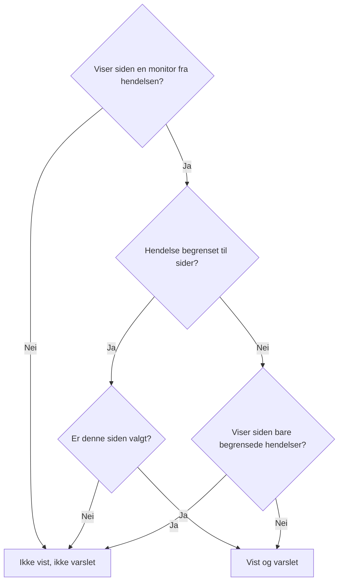

# Én statusside per målgruppe

Ulike mennesker trenger ulike nyheter. En kunde vil ikke høre om en annen kundes nedetid, og de ansatte på én lokasjon vil ikke ha en e-post hver gang en annen lokasjon mister nettverket. I OneUptime er enheten for en målgruppe statussiden: hver side har sine egne abonnenter, sin egen merkevare og sitt eget personvern. Så gi hver målgruppe sin egen side, og bestem hendelse for hendelse hvilke sider som skal høre om den.

Delt infrastruktur gjorde dette vanskelig. En hendelse når en statusside gjennom monitorene sine, så en monitor som ble delt av ti lokasjonssider, fortalte alle ti lokasjonene om en nedetid som rammet to. Den eneste løsningen var en side, eller en monitor, for hver kombinasjon av lokasjoner. Denne siden dekker innstillingene som løser det:

- **Begrens til disse statussidene** på en hendelse, slik at den vises på, og varsler, bare sidene du velger.
- **Vis bare hendelser som er begrenset til denne siden** på en statusside, slik at en hendelse som ingen har begrenset ennå, ikke når noen av disse sidene før noen bestemmer seg. Det gjelder også hendelsene som en monitor, Slack, Microsoft Teams, API-et eller KI åpner av seg selv.
- En registrering av hvilke sider som fikk vite at en hendelse ble opprettet, slik at en side du legger til senere, blir varslet én gang og de andre ikke blir varslet igjen.
- En oppsummering **Varsler** som viser hvem som vil høre om en hendelse før du erklærer den eller publiserer et offentlig notat, og **Forhåndsvisning**, som viser hva hver sides abonnenter vil få.

:::cards
- [Sett det opp](#å-sette-opp-én-side-per-målgruppe): Én side per målgruppe, og bryteren som holder hendelser uten begrensning unna dem.
- [Begrens en hendelse](#å-begrense-en-hendelse-til-statussider): Velg sidene når du erklærer den, eller senere.
- [Legg til eller fjern sider](#å-legge-til-og-fjerne-statussider): Hvem som blir varslet om en side du legger til, og hva det trekker tilbake å fjerne en.
- [Hva hver melding inneholder](#hva-hver-melding-inneholder): Verdiene hver side får, og hva de forteller hver målgruppe.
:::

## Når du bør bruke det

- **En managed service provider** med én statusside per kunde, på monitorer som kundene deler.
- **En organisasjon med lokasjoner, fabrikker eller regioner**, hver med sine egne ansatte som skal varsles.
- **Intern IT** med én side per avdeling eller bygning.

Hvis målgruppen din gjerne velger selv, kan én side være nok: la abonnentene velge ressursene de bryr seg om (se [Abonnenter og kunngjøringer](/docs/status-pages/subscribers)). Bruk én side per målgruppe når du tar valget for dem, hendelse for hendelse, eller når én målgruppe ikke skal se en annen målgruppes hendelser i det hele tatt.

## Slik når en hendelse en statusside

En hendelse når en statusside gjennom monitorene sine. En side viser en hendelse, og varsler abonnentene sine om den, når en av sidens ressurser er en av hendelsens monitorer, direkte eller gjennom en monitorgruppe på siden. To innstillinger snevrer det inn:

- **Begrens til disse statussidene** på hendelsen (`statusPages`). Står den tom, når hendelsen hver side som viser monitorene dens, slik den alltid har gjort. Med valgte sider når den bare de valgte sidene **blant** dem som viser monitorene dens.
- **Vis bare hendelser som er begrenset til denne siden** på statussiden (`onlyShowScopedIncidents`, av som standard). Med den på viser siden aldri en hendelse som ikke er begrenset til bestemte statussider, og varsler aldri noen om den.



For en side som viser en av hendelsens monitorer:

| Hendelsen er | Side med **Vis bare hendelser som er begrenset til denne siden** av | Side med den på |
| --- | --- | --- |
| Ikke begrenset til noen statusside | Vist og varslet | Ikke vist, ikke varslet |
| Begrenset til statussider, og denne siden er valgt | Vist og varslet | Vist og varslet |
| Begrenset til statussider, men ikke denne | Ikke vist, ikke varslet | Ikke vist, ikke varslet |

En side som ikke viser noen av hendelsens monitorer, viser den aldri, uansett hva du velger, og en hendelse uten monitorer varsler ingen statussideabonnenter i det hele tatt. De vanlige reglene gjelder fortsatt i tillegg: hendelsen må være **Synlig på statussiden** og ikke privat, siden må ha **Vis hendelser** på, og en abonnent som bare valgte noen ressurser eller hendelsestyper, får bare det vedkommende valgte.

De samme reglene bestemmer alt som avhenger av hvilke sider en hendelse når:

- hendelseslistene, oversikten og hendelsens egen side på den offentlige statussiden, og statussidens [Offentlig API](/docs/status-pages/public-api);
- meldingene via e-post, SMS, Slack, Microsoft Teams og webhook som sendes når hendelsen opprettes, endrer tilstand, får et offentlig notat eller får en etteranalyse;
- antallet hendelser i statussiderapporter som sendes via e-post, og som bare teller hendelsene siden viser.

En hendelsesepisode når en side når minst én av hendelsene dens gjør det. Varslene dens går til hver side hendelsene når, og siden dens på en statusside som ingen av dem når, finnes ikke. En privat hendelse når ingen side, så den tar aldri med episoden sin til en, og en privat episode vises ikke på noen side i det hele tatt.

## Å sette opp én side per målgruppe

:::steps
### Opprett en statusside for hver målgruppe

Opprett én side per målgruppe, for eksempel `Site 01` til `Site 10`. Gjør dem private hvis målgruppen er intern (se [Å begrense hvem som kan se siden](/docs/status-pages/index#å-begrense-hvem-som-kan-se-siden)). Abonnenter på en privat side kan fortsatt melde seg av uten å logge inn, via lenken i hver melding (se [Å administrere og avslutte et abonnement](/docs/status-pages/subscribers#å-administrere-og-avslutte-et-abonnement)). Gi dem etiketter som `Region East`, slik at velgeren kan legge til alle sider med en etikett med ett klikk.

### Sett den delte monitoren på hver side

Legg til den delte monitoren på hver side som en ressurs (se [Statusside – ressurser og grupper](/docs/status-pages/resources-and-groups)). En regel under **Ressurser → Monitor Rules** kan gjøre dette for deg ut fra monitorens etiketter.

### Slå på Vis bare hendelser som er begrenset til denne siden

Slå den på på hver av de sidene. Den står på kortet **Hva statussiden din viser** under **Statussider → siden din → Avansert → Avanserte innstillinger**, under **Vis hendelser**, og lagres i det øyeblikket du slår den om. Fra da av når ingenting en lokasjonsside med mindre noen velger den.

### Legg til hver målgruppes abonnenter

For ansatte bruker du **Legg til i bulk** under **E-postabonnenter**, og foretrekker hver persons egen adresse fremfor en e-postliste som `site03-all@`: alle på listen kan melde den av for alle som er på den. Hvis en abonnent du la til, melder seg av, får sidens eiere og den som la vedkommende til, en e-post (se [Delte adresser og e-postlister](/docs/status-pages/subscribers#delte-adresser-og-e-postlister)).

### La de som håndterer hendelser, lese statussider

Velgeren viser bare statussidene personen kan lese, og hendelsesrollene kan ikke lese statussider. Gi de som håndterer hendelser, rollen **Status Page Viewer** ved siden av hendelsesrollen; den kan begrenses til sider med bestemte etiketter. Uten den er velgeren tom.

### Bestem hva hver melding sier

Under **Hendelser → Innstillinger → Egendefinerte felt** definerer du de egendefinerte hendelsesfeltene teamet ditt svarer på hver gang, for eksempel `Impact` (en nedtrekksliste), `Expected Resolution` (en dato og et klokkeslett) og `Acknowledgement` (en ja/nei-bryter). Dra dem i den **Rekkefølge** du vil at de skal spørres om og vises i, og slå på **Vis ved opprettelse** slik at erklæringsskjemaet spør om dem, **Påkrevd ved opprettelse** der et svar er et must, og **Ta med i abonnentvarsler** for dem som alle målgrupper kan lese. De står da i hver sides standard-e-post. Se [Egendefinerte felt](/docs/incidents/settings#egendefinerte-felt).

### Gi hver sides e-post sin egen merkevare (valgfritt)

På abonnementet **Scale** gir du hver side en **Egendefinert SMTP-konfigurasjon** og knytter egendefinerte maler til hendelsestypene; de kan plassere et hvilket som helst felt med `{{incident.customFields.<key>}}`. Mens du skriver en mal, viser **Direkte forhåndsvisning** under den malen fylt ut med eksempelverdier. Se [Hva en egendefinert mal trenger](/docs/status-pages/subscribers#hva-en-egendefinert-mal-trenger), og [Hva hver melding inneholder](#hva-hver-melding-inneholder) før du bruker `{{affectedStatusPages}}`.

### Lagre hendelsesmaler med valgte sider (valgfritt)

En mal `Region East outage` kan ha sidene for lokasjonene i øst, og standardsvar for de egendefinerte feltene.

### Sjekk hver sides e-post før den første nedetiden

Start **Erklær hendelse** med den delte monitoren og to av lokasjonssidene valgt, og åpne **Forhåndsvisning** ved siden av **Ja** i oppsummeringen før du sender inn: den viser e-posten hver sides abonnenter ville fått, og hvilken mal den bruker og hvorfor. **Send test til meg** sender én til din egen innboks. Ingen andre får noe før du erklærer hendelsen, så forlat skjemaet uten å sende det inn når du er ferdig. Se [Hvem som blir varslet](#hvem-som-blir-varslet).
:::

## Å begrense en hendelse til statussider

### Når du erklærer den

På **Hendelser → Alle hendelser → Erklær hendelse** har trinnet **Berørte ressurser** feltet **Begrens til disse statussidene** under **Flere felt**, etter monitorene og de andre ressursene. Eksempelteksten, **Alle statussider som viser monitorene**, er det det betyr å la det stå tomt. Velg sider etter navn, eller åpne velgerens fane **Etiketter** og velg en etikett for å legge til alle sider som har den.

Skjemaet advarer deg:

- når en valgt side ikke viser noen av hendelsens monitorer, eller det ikke er knyttet noen monitor i det hele tatt. Hendelsen vil ikke vises på den siden eller varsle abonnentene dens;
- når du også angir **Endre overvåkingsstatus til**, rett under monitorene på det samme trinnet. Se [Monitorstatus er delt](#monitorstatus-er-delt);
- når du også krysser av for **Privat hendelse** under **Flere felt** på trinnet **Hendelsesdetaljer**. Private hendelser er skjult på alle statussider, også dem du valgte.

Trinnet **Detaljer**, rett etter **Berørte ressurser**, spør om de egendefinerte hendelsesfeltene som er merket med **Vis ved opprettelse** (se [Opprette en hendelse](/docs/incidents/declaring-incidents)). Svarene går til hver side hendelsen når: verdier i egendefinerte felt tilhører hendelsen, ikke en statusside.

**Opprett fra mal** fyller ut feltet fra malen. En mals sider angis på trinnet **Berørte ressurser** når du oppretter den, og etterpå på kortet **Statussideomfang** (**Hendelser → Innstillinger → Hendelsesmaler**). Som med de andre malfeltene vinner en liste du angir selv. En mals sider fylles ut også for en som håndterer hendelser og ikke kan lese statussider: den som satte opp malen, valgte dem for alle som erklærer ut fra den.

### Hvem som blir varslet

Under **Varsle statussideabonnenter**, rett under velgeren under **Flere felt** på trinnet **Berørte ressurser**, og igjen i oppsummeringen før du sender inn, viser skjemaet hvem hendelsen vil nå:

> Varsler:
>
> - Site 03 (opptil 41 via e-post)
> - Site 07 (opptil 18 via e-post)

Under det, under **Varsles ikke:**, viser det sidene som viser monitorene, men ikke blir varslet, og hvorfor: den er ikke en av sidene hendelsen er begrenset til, det er en side som bare viser hendelser som er begrenset til den, eller det er en side som ikke viser hendelser.

Når ingen blir varslet, viser oppsummeringen ingenting: hendelsen har ingen monitorer, ingen statusside viser dem, sidene har ingen abonnenter ennå, **Varsle statussideabonnenter** er av, eller hendelsen er privat. Den advarer bare når statussideomfanget er årsaken, og nevner sidene den utelater: hendelsen er ikke begrenset, og sidene som viser monitorene dens, viser bare hendelser som er begrenset til dem, den er begrenset til andre sider, eller sidene den er begrenset til, viser ingen av monitorene dens. I oppsummeringen lyder **Varsle statussideabonnenter** **Ja** eller **Nei** som alle andre bokser, med **Forhåndsvisning** ved siden av **Ja**; den tilbys ikke mens boksen er av, hendelsen er privat eller ingen monitor er knyttet til.

Den samme oppsummeringen vises under **Varsle statussideabonnenter** når du skriver et notat på hendelsens side **Offentlige notater**, for hendelsen slik den står. Der sier den også når hendelsen er skjult på statussider, siden ingenting da vil bli sendt.

Tallene er "opptil". De teller per kanal de bekreftede abonnentene på hver side som ikke har meldt seg av, og en abonnent som bare valgte noen ressurser eller hendelsestyper, får kanskje ikke denne meldingen. Sider du ikke kan lese, nevnes ikke. De telles som "statussider til som du ikke har tilgang til".

**Forhåndsvisning**, ved siden av **Ja** i oppsummeringen og ved siden av notatets avkrysningsboks, viser hva de vil få: velg en side for å se e-posten dens slik abonnentene vil motta den, med emnet, og hvilken mal den bruker og hvorfor, for eksempel at en sides egendefinerte mal ikke brukes fordi siden ikke har noen **Egendefinert SMTP-konfigurasjon**. **Send test til meg** sender sidens e-post til kontoens e-postadresse, og til ingen andre. Sider du ikke kan lese, telles, men forhåndsvises ikke. Se [Forhåndsvis e-posten før den sendes](/docs/status-pages/subscribers#forhåndsvis-e-posten-før-den-sendes).

### Etter at den er erklært

Åpne hendelsen, og gå til **Avansert → Innstillinger**. Kortet **Statussideomfang** viser sidene hendelsen er begrenset til, og **Rediger statussideomfang** endrer dem. Hendelsens **Oversikt** viser den samme listen som **Statussideomfang**, skrivebeskyttet, med en lenke **Endre under Innstillinger**.

På **Hendelser → Alle hendelser** finner filteret **Statusside** hendelsene som er begrenset til sidene du velger, eller dem som ikke er begrenset til noen side.

### Via API-et

`statusPages` er en liste over statusside-ID-er, på `POST /api/incident` og ved oppdateringer av en hendelse, og på hendelsesmaler. Hver side må tilhøre hendelsens prosjekt; en side fra et annet prosjekt avvises. Hver side du legger til, må også være en du kan lese, som i velgeren, ellers avvises forespørselen. Sider som hendelsen eller malen allerede har, beholdes uansett om du kan lese dem, og en side fra en hendelsesmal du kan lese, kan velges når du erklærer en hendelse. To kolonner til følger av det, og ingen av dem er dine å angi:

- `isScopedToStatusPages` utledes av `statusPages`. Alt du sender for den, ignoreres.
- `statusPagesNotifiedOnCreation` er registreringen av sidene som fikk vite at hendelsen ble opprettet. Se [Å legge til statussider](#å-legge-til-statussider).

For å se hvem en hendelse ville nådd uten å sende noe, kaller du målgruppeendepunktet:

```bash
curl -X POST https://oneuptime.com/api/incident/subscriber-audience \
  -H "apikey: $ONEUPTIME_API_KEY" \
  -H "Content-Type: application/json" \
  -d '{
    "monitorIds": ["<monitor-id>"],
    "statusPageIds": ["<status-page-id>"]
  }'
```

Send i stedet `{"incidentId": "<incident-id>"}` for en hendelse som allerede finnes. Svaret viser hver side som vil bli varslet, med et tall per kanal (`email`, `sms`, `slack`, `microsoftTeams`, `webhook`), sidene som er utelatt, og hvorfor, og `hiddenStatusPageCount` for sidene den som kaller, ikke kan lese. Det returnerer aldri en adresse.

## Hendelser som ingen har begrenset ennå

Monitorkriterier, Slack, Microsoft Teams, API-et og KI kan alle åpne en hendelse av seg selv, og ingen av dem vet hvilke lokasjoner en feil på en delt monitor rammer. En slik hendelse er ikke begrenset til noen side, så hver side som viser monitoren, ville vist den og varslet abonnentene sine innen omtrent ett minutt. Når en abonnent først har fått en e-post, kan den ikke tas tilbake.

**Vis bare hendelser som er begrenset til denne siden** er det som stopper det. En side med den på ignorerer hver hendelse uten begrensning. Hendelsen åpnes fortsatt, vaktordningene varsler fortsatt de som håndterer hendelser, og eierne blir fortsatt varslet, men ingen av disse sidene hører om den. Den som håndterer hendelsen, finner deretter ut hvem som er rammet, og legger til de sidene på hendelsens fane **Innstillinger**, med kryss for **Send varselet om opprettet hendelse til nylig lagt til sider**. Abonnentene deres blir varslet innen omtrent ett minutt.

## Å legge til og fjerne statussider

### Å legge til statussider

Abonnentene på en side hører én gang at en hendelse ble opprettet. Så når du legger til sider på kortet **Statussideomfang**, tilbyr redigeringsskjemaet **Send varselet om opprettet hendelse til nylig lagt til sider**, med kryss som standard:

- Med kryss settes hendelsens varsel om "opprettet" i kø igjen, og det går bare til sidene som ikke er varslet ennå. Hendelsen holder en registrering av sidene som ble varslet, så de andre ikke hører det to ganger.
- Uten kryss begynner de tilføyde sidene å vise hendelsen, og hører om alt fra nå av, men får ikke vite at den ble opprettet.

Avkrysningsboksen vises bare når et kryss ville sendt noe: minst én side du legger til, er ikke varslet ennå, og hendelsen ble erklært med **Varsle statussideabonnenter** på, er synlig på statussider og er ikke privat. Noen tilfeller håndteres for deg:

- **Varselet står fortsatt i kø, eller sendes akkurat nå.** En utsending i kø leser sidene når den går ut, og en utsending som kjører, leser dem igjen når den er ferdig, og varsler deretter sidene som ble lagt til i mellomtiden. Så det finnes ingen avkrysningsboks: sidene du legger til, blir varslet uansett. (Hvis den utsendingen mislykkes, er sidene som ble lagt til i mellomtiden, blant dem **Prøv på nytt** sender til.)
- **Hver side du legger til, er allerede varslet**, for eksempel en side du fjernet og legger til igjen, eller en hendelse som nådde alle lokasjoner og nå er snevret inn til to av dem. Ingen blir varslet igjen, så det finnes ingen avkrysningsboks.
- **Hendelsen ble aldri kunngjort.** Når den ble publisert uten **Varsle abonnenter om at denne hendelsen er opprettet**, eller erklært uten monitorer, ble ingen varslet. Et kryss i boksen varsler bare sidene du legger til, ikke sidene den allerede var begrenset til.
- **Hendelsen ble erklært før denne funksjonen ble lansert.** Varselet om "opprettet" gikk til hver side som viste monitorene dens, og det finnes ingen registrering av de sidene. Å legge til sider sender det ikke på nytt, så avkrysningsboksen tilbys ikke.
- **Hendelsen er skjult.** Ingenting sendes mens den er skjult. Når du slår **Synlig på statussiden** på igjen, tilbyr kortet **Hendelsesinnstillinger** **Varsle abonnenter om at denne hendelsen er opprettet** for sidene i omfanget som aldri ble varslet, som dem som ble lagt til mens den var skjult.

En side som legges til senere, hører om det som skjer etterpå: senere offentlige notater, tilstandsendringer og etteranalysen. Den får ikke tilsendt notatene og tilstandsendringene som ble sendt før den ble lagt til. Hvis den trenger å ta igjen noe, publiserer du et offentlig notat.

Den samme registreringen får **Prøv på nytt** på et mislykket varsel om "opprettet" til å fortsette der det stoppet: sider som allerede er varslet, hoppes over. En side teller bare som varslet når alle abonnentene der har fått meldingen; en side der en melding mislyktes, eller der utsendingen stoppet underveis, får den på nytt i sin helhet. Registreringen skrives etter hvert som hver side blir ferdig, så dette gjelder også for en utsending som ble avbrutt. Den holdes per side, ikke per abonnent: abonnentene på en side der utsendingen stoppet underveis, og som allerede hadde fått meldingen, får den en gang til.

For i stedet å starte på nytt, for eksempel etter å ha rettet en mal eller en SMTP-innstilling, krysser du av for **Send det på nytt til alle statussider, også sidene som allerede er nådd** i bekreftelsen av **Prøv på nytt**: knappen blir **Send på nytt til alle sider**, registreringen tømmes, og hver side hendelsen når nå, får det på nytt. Etter et varsel som ble sendt i sin helhet, tilbyr **Abonnentvarselsstatus** på hendelsens **Oversikt** **Send på nytt**, som gjør det samme. Begge bekreftelsene viser sidene det ville nådd nå, eller sier at det ikke ville nådd noen; den vanlige bekreftelsen av **Prøv på nytt** viser sidene som allerede er nådd, som ikke sendt på nytt, siden den hopper over dem. Ingen av dem tilbys for et varsel som ble hoppet over, eller som fortsatt står i kø eller sendes, og heller ikke til noen som ikke har lov til å redigere hendelsen.

Via API-et sender du `"miscDataProps": {"notifyAddedStatusPagesOfIncidentCreated": true}` med oppdateringen som endrer `statusPages`. Å sette `subscriberNotificationStatusOnIncidentCreated` tilbake til `Pending` selv sender fortsatt varselet om "opprettet" på nytt til hver side hendelsen når, slik det alltid har gjort: registreringen tømmes samtidig. Etter en feil fortsetter det i stedet der den mislykkede utsendingen stoppet. For også å sende det til hver side etter en feil legger du til `"miscDataProps": {"resendIncidentCreatedToAllStatusPages": true}` i den oppdateringen. Den forespørselen avvises for et varsel som ble hoppet over, eller som står i kø eller sendes.

Å skrive `shouldStatusPageSubscribersBeNotifiedOnIncidentCreated` er ikke ett av disse tilfellene. Den velges når hendelsen erklæres, og ingen prosjektrolle kan endre den via API-et etterpå. En arbeidsflyt, som skriver som systemet, og en instans' hovedadministrator kan det, men det lagrer bare den nye verdien. Å skrive den tilbake uendret, slik en arbeidsflyt som kopierer hele hendelsen, gjør, sender ingenting på nytt, og å slå den på senere sender ikke varselet om "opprettet" som hendelsen ble erklært uten. Slått av før det varselet er sendt, hoppes det over.

### Å fjerne statussider

Å fjerne en side trekker ingenting tilbake. Siden slutter å vise hendelsen, og abonnentene hører ikke noe mer om den, ikke engang at den ble løst. Når du fjerner en side som allerede er varslet om hendelsen, advarer redigeringsskjemaet deg og foreslår et avsluttende offentlig notat. Publiser det notatet først, mens siden fortsatt er på listen, og fjern deretter siden.

Å tømme hele listen er noe annet enn å fjerne sider: hendelsen er da ikke begrenset i det hele tatt. Den vises igjen på, og varsler, hver side som viser monitorene dens, unntatt sidene som bare viser hendelser som er begrenset til dem. Skjemaet advarer deg om det også.

### Når en valgt statusside slettes

Å slette en statusside fjerner den fra hver hendelse som var begrenset til den. En hendelse der alle de valgte sidene er slettet, forblir begrenset, til ingenting: den er skjult på hver statusside i stedet for å vises på hver side som viser monitorene dens. Kortet **Statussideomfang** sier det. Velg andre sider, eller tøm listen, for å vise den igjen.

Hendelsesmaler fungerer på samme måte. En mal der alle sidene er slettet, forblir begrenset: en hendelse som et [skjema](/docs/forms/on-submit#the-incident-template) eller en arbeidsflyts trinn **Create One Incident** erklærer ut fra den, er skjult på hver statusside, malens kort **Statussideomfang** advarer deg, og **Erklær hendelse** starter uten noen valgt side og ber deg velge sidene hendelsen gjelder. Velg andre sider på malen, eller lagre listen tom for å slutte å begrense hendelsene som erklæres ut fra den.

## Én e-post per person

For en hendelse som er begrenset til bestemte statussider, får en e-postadresse eller et telefonnummer som abonnerer på mer enn én av de sidene, én e-post eller SMS per utsending, ikke én per side. Sidene gjennomgås i navnerekkefølge, så den første sidens mal, merkevare og avmeldingslenke er det personen får.

Meldinger via webhook, Slack og Microsoft Teams slås aldri sammen. Payloadene deres nevner statussiden de er for, og en integrasjon som lytter per side, må se hver side.

Dette gjelder bare innenfor én utsending. Noen som abonnerer på `Site 03` og `Site 05`, og som fikk e-posten om "opprettet" gjennom `Site 03`, får den igjen når `Site 05` legges til senere. En hendelse som ikke er begrenset til noen side, sender én melding per abonnement, slik den alltid har gjort.

## Hva hver melding inneholder

Hver side hendelsen når, får de samme verdiene: de tilhører hendelsen, ikke en statusside.

- **Egendefinerte felt i standardmeldingene.** Egendefinerte hendelsesfelt med **Ta med i abonnentvarsler** på vises i hver sides meldinger om opprettelse, tilstandsendring, offentlig notat og etteranalyse, i sin **Rekkefølge**: e-post, Slack, Microsoft Teams og webhooks, men ikke SMS. Dette krever verken abonnementet Scale eller egendefinert SMTP. Se [Egendefinerte hendelsesfelt i varsler](/docs/status-pages/subscribers#egendefinerte-hendelsesfelt-i-varsler).
- **Oppdateringer.** Å endre et egendefinert felt alene varsler ingen. Det neste offentlige notatet eller den neste tilstandsendringen har de gjeldende verdiene, så for å fortelle lokasjonene at `Expected Resolution` er flyttet, endrer du feltet og publiserer deretter et offentlig notat.
- **Notatmaler.** Å velge en notatmal fyller ut plassholdere som `{{incident.title}}` og `{{incident.customFields.<key>}}` med hendelsens gjeldende verdier, og du kan fortsatt redigere notatet før du publiserer det. Se [Notatmaler](/docs/incidents/settings#notatmaler).
- **Navnene på de andre målgruppene.** `{{affectedStatusPages}}` i en egendefinert abonnentmal og `{{incident.affectedStatusPages}}` i en notatmal viser sidene hendelsen når, og alle meldingen går til, leser listen: abonnentene på `Site 03` får vite at `Site 07` også er rammet. Mellom lokasjoner i én organisasjon kan det være det du vil. Mellom kunder forteller det én kunde om en annen, så la begge være ute av malene og notatene de sidene får.

## Slik skiller det seg fra planlagt vedlikehold

Planlagte vedlikeholdshendelser har også en liste **Statussider**, men den virker annerledes:

- **Planlagt vedlikehold erstatter.** Hendelsen vises på akkurat sidene i listen sin, uansett om de viser monitorene dens.
- **En hendelse snevrer inn.** Listen dens velger bare blant sidene som allerede viser monitorene dens. Å velge en side som ikke viser noen av dem, gjør ingenting, og skjemaet sier det. Sett monitoren på den siden først.

Det hindrer at et feil valg setter en hendelse på en side om noe helt annet. Det betyr også at en hendelse uten monitorer ikke når noen statusside, uansett hvor mange du velger.

## Monitorstatus er delt

En monitor har én status, og hver statusside som viser monitoren, viser den. Å begrense en hendelse endrer ikke det. Hvis hendelsen angir **Endre overvåkingsstatus til**, eller monitoren går ned av seg selv, blir monitoren rød på hver side som viser den, også sider hendelsen ikke er begrenset til, og sider som bare viser hendelser som er begrenset til dem. Erklæringsskjemaet advarer deg når du kombinerer en statusendring med valgte sider.

**Når hver lokasjon trenger sin egen status, gir du hver lokasjon en manuell monitor.** Opprett en [Manuell overvåking](/docs/monitor/manual-monitor) per lokasjon, for eksempel `Site 03 network`, og vis den bare på den lokasjonens side. Knytt de berørte lokasjonenes manuelle monitorer til hendelsen, med **Endre overvåkingsstatus til** hvis du vil at statusen deres skal endres, og la den delte monitoren være for sidene som skal se den. Hendelsen når da akkurat lokasjonene den har monitorene til, og en statusendring vises bare på sidene deres.

## Hva som registreres

- **Hendelsesfeeden.** Oppføringen om "opprettet" for en begrenset hendelse viser sidene den er begrenset til. Hver endring av listen legger til en oppføring som viser sidene som er lagt til og fjernet, og om de tilføyde sidene vil få tilsendt varselet om "opprettet".
- **Hvert abonnentvarsel.** Oppføringen **Abonnentvarsel sendt** i hendelsesfeeden har et panel **More Information** som viser hver side utsendingen gikk til: hvor mange meldinger som ble sendt og hvor mange som mislyktes på hver kanal, og emnet e-posten ble sendt med. Det viser også sidene den hoppet over, og hvorfor (allerede varslet, eller viser ikke hendelser), sidene omfanget utelot, og om e-post og SMS ble sendt én gang per adresse. Når utsendingen satte verdier fra egendefinerte felt inn i en melding, avsluttes panelet med dem, under **Custom fields sent**.
- **Varselets status.** Hvert varsels statusmelding sier for hver side hvor mange meldinger som ble sendt og hvor mange som mislyktes på hver kanal, og etter en feil, hva **Prøv på nytt** vil gjøre. En utsending som ble avbrutt underveis, fordi serveren startet på nytt eller sluttet å svare, merkes som mislykket med en melding som starter med `Interrupted:`, i stedet for å bli stående som pågående. Se [Sjekk hva som ble sendt](/docs/status-pages/subscribers#sjekk-hva-som-ble-sendt).
- **Varsellogger** på hver statusside viser hver melding den siden har sendt.

Se [Hendelsesnotater, eiere og feed](/docs/incidents/notes-owners-and-feed) for selve feeden.

## Tillatelser

- **Å velge en statusside krever lesetilgang til den.** Statussider leses under statussiderollene, ikke hendelsesrollene, og en statusside kan begrenses etter etikett. Gi de som håndterer hendelser, **Status Page Viewer**, eventuelt begrenset til etiketter. Uten den er velgeren tom, og API-et avviser en side den som kaller, ikke kan lese, både på hendelser og på hendelsesmaler.
- **Sider redaktøren ikke kan se, beholdes.** En redaktør som bare kan lese noen av en hendelses sider, ser bare dem i velgeren, og lagring beholder sidene vedkommende ikke kan se.
- **Sidene en hendelse er begrenset til, er en del av hendelsen.** Som monitorene ser alle som kan lese hendelsen, navnene deres, på kortet **Statussideomfang**, på oversikten og i hendelsesfeeden, uansett om de kan lese de statussidene.
- **Det en utsending nådde, er også en del av hendelsen.** Når et varsel er sendt, nevner statusmeldingen og oppføringen i feeden hver statusside det gikk til, med det som ble sendt og det som mislyktes på hver, og alle som kan lese hendelsen, ser dem, uansett om de kan lese de statussidene. Bare oppsummeringen og forhåndsvisningen nedenfor, som ser fremover, holder seg til sidene personen kan lese.
- **Målgruppeoppsummeringen** er åpen for rollene som kan erklære eller redigere en hendelse eller publisere et offentlig notat på en. Den nevner bare sidene personen kan lese. Andre sider hendelsen vil varsle, telles som "statussider til som du ikke har tilgang til", og den viser aldri adresser.
- **Forhåndsvisning** er åpen for de samme rollene, og forhåndsviser bare sidene personen kan lese, høyst seksti ganger hvert tiende minutt. Som oppsummeringen viser den aldri en adresse. **Send test til meg** sender bare til personens egen kontos e-postadresse, når den er bekreftet, høyst ti ganger hvert 15. minutt.
- **Å sende et varsel på nytt** krever tillatelsen til å redigere hendelsen, for varselet om "opprettet", og både tillatelsen til å redigere offentlige notater og tillatelsen til å publisere offentlige notater som varsler abonnenter, for et notat — og det samme gjelder for å varsle abonnenter om en redigering av et notat. Ingen av dem godtas mens det varselet sendes.

## Å oppgradere en selvdriftet server

Workerne som sender abonnentvarsler, er det som holder en hendelse til sidene den er begrenset til. Mens en oppgradering til en versjon med denne funksjonen rulles ut, sender en worker som fortsatt kjører den forrige versjonen, varslene den plukker opp slik den alltid har gjort: til hver statusside som viser hendelsens monitorer, også sider som bare viser hendelser som er begrenset til dem. Så la worker-deploymenten bli ferdig med utrullingen, eller skaler de gamle workerne ned til null, før noen begrenser en hendelse til statussider eller slår på **Vis bare hendelser som er begrenset til denne siden**. Med Helm kjører `migrate.hook: true` også databasemigreringene før en ny pod starter.

## Neste steg

:::cards
- [Abonnenter og kunngjøringer](/docs/status-pages/subscribers): Abonnentkanalene, og hva hver hendelse sender.
- [Opprette en hendelse](/docs/incidents/declaring-incidents): Erklæringsskjemaet, trinn for trinn.
- [Hendelsestilstander og alvorlighetsgrader](/docs/incidents/states-and-severities): Hva annet som holder en hendelse borte fra en statusside.
- [Manuell overvåking](/docs/monitor/manual-monitor): Monitorer der du angir statusen selv.
:::
