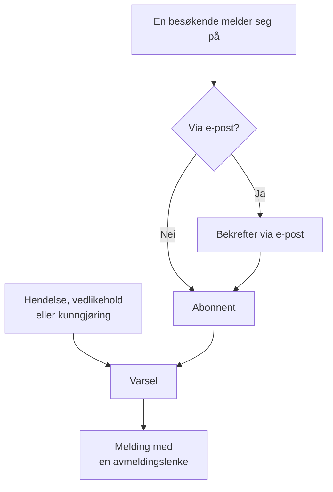

# Abonnenter og kunngjøringer

En statusside er et sted folk går til. Abonnenter er de som helst slipper — de gir deg én gang en e-postadresse, et telefonnummer, en Slack-webhook eller et HTTP-endepunkt, og deretter kommer oppdateringene dine til dem.

Kunngjøringer er den andre halvdelen av den samme jobben. En monitor kan fortelle de besøkende at kassen returnerer 500-feil; ingen monitor kan fortelle dem at du migrerer databaser på lørdag, at en ekstern leverandør har en dårlig dag, eller at hendelsen de leste om i går, er helt avsluttet. Kunngjøringer er fritekstkanalen for alt sjekkene dine ikke kan se, og de når den samme abonnentlisten.

Denne siden dekker begge deler: de fem abonnementskanalene og hvordan besøkende melder seg på, hva abonnenter kan velge å bli varslet om, flytene for dobbel bekreftelse og avmelding, e-postrapporten abonnenter kan få hver måned, og hvordan kunngjøringer skrives, planlegges og gjøres om til maler.

:::cards
- [Abonnementskanaler](#abonnementskanaler): Kanalene besøkende kan melde seg på, og siden de melder seg på.
- [Hva abonnenter får vite](#hva-abonnentene-blir-varslet-om): Kunngjøringer, vedlikehold, hendelser og episoder, og redigeringer av dem.
- [Sjekk hva som ble sendt](#sjekk-hva-som-ble-sendt): Hvert varsels status, og Prøv på nytt og Send på nytt.
- [Kunngjøringer](#kunngjøringer): Publiser en melding på én eller flere statussider.
:::

## Slik fungerer det



Hver statusside har sine egne abonnenter. En besøkende melder seg på via statussidens side **Abonner**, der en e-postadresse bekrefter med en lenke før den hører noe, eller teamet ditt legger vedkommende til i dashbordet. Fra da av varsler hver hendelse, hver planlagt vedlikeholdshendelse og hver kunngjøring som når siden, abonnentene sine, hver på kanalen de meldte seg på med, og hver melding har lenken som avslutter abonnementet.

## Abonnementskanaler

En statusside støtter fem kanaler. De, og siden besøkende melder seg på, slås på ett sted: kortet **Kanaler** under **Statussider → siden din → Abonnenter → Abonnentsinnstillinger**. Hver bryter lagres så snart du slår den om:

- **Vis abonnentside** (`showSubscriberPageOnStatusPage`) — på som standard. Setter elementet **Abonner** i statussidens navigasjonslinje, der besøkende melder seg på via kanalene nedenfor.
- **E-post** (`enableEmailSubscribers`) — på som standard. Alt annet er av til du slår det på.
- **SMS** (`enableSmsSubscribers`) — av som standard. På OneUptime Cloud betales hver SMS fra prosjektets saldo for SMS og anrop, med mindre siden har sin egen **Twilio-konfigurasjon** (se [nedenfor](#e-postbunntekst-egendefinert-smtp-og-twilio)). Å slå den på krever også at **SMS** er på for prosjektet, i kortet **Varslingskanaler** under **Prosjektinnstillinger > Varsler > Varselinnstillinger**, noe en prosjekteier, en **Billing Admin** eller noen med **Manage Billing** kan gjøre.
- **Slack** (`enableSlackSubscribers`) — av som standard.
- **Microsoft Teams** (`enableMicrosoftTeamsSubscribers`) — av som standard.
- **Webhook** (`enableWebhookSubscribers`) — av som standard.

Bryterne bestemmer hvordan besøkende kan melde seg på selv, og statussiden avviser en påmelding via en kanal som er av. De stopper ikke varsler: abonnenter som teamet ditt legger til i dashbordet, med API-et eller via en arbeidsflyt, får oppdateringer uansett hvilke kanaler som er på.

På OneUptime Cloud står abonnementets navn ved en bryter som abonnementet ditt ikke inkluderer: **Growth** for **SMS** og **Vis abonnentside**, **Scale** for **Slack**, **Microsoft Teams** og **Webhook**. Å slå av en kanal fungerer på alle abonnementer, så en kanal som en prøveperiode slo på, kan alltid slås av igjen; bryteren sier det under seg.

Hver kanal har også sin egen liste i statussidens sidemeny under **Abonnenter**: **E-postabonnenter**, **SMS-abonnenter**, **Slack-abonnenter**, **MS Teams-abonnenter** og **Webhook-abonnenter**. Det er der du ser hvem som er påmeldt, legger til noen manuelt eller legger igjen et **Notater** (`internalNote`) til deg selv om en bestemt abonnent. Så lenge en kanal er av, sier toppen av listen det, med kanalens bryter rett der, slik at du kan slå den på uten å forlate listen.

**Én bryter er ikke nok.** Elementet **Abonner** i statussidens navigasjonslinje vises bare når **Vis abonnentside** er på *og* minst én kanal er på. Hvis du slår på **E-post**, men lar **Vis abonnentside** være av, har besøkende ingen måte å komme til skjemaet på.

## Hva en besøkende ser på abonnementssiden

Siden **Abonner** har en undermeny med én fane per påslått kanal. Hver fane ber om det minste den trenger:

| Fane | Adresse | Overskrift | Hva den ber om |
| --- | --- | --- | --- |
| **E-post** | `/subscribe/email` | **Abonner via e-post** | **Din e-post**, med eksempelet `subscriber@company.com`. |
| **SMS** | `/subscribe/sms` | **Abonner via SMS** | **Ditt telefonnummer**, med eksempelet `+11234567890`. |
| **Slack** | `/subscribe/slack` | **Abonner via Slack** | **Navn på Slack-arbeidsområde** (brukes til validering) og **URL for innkommende webhook for Slack**, med eksempelet `https://hooks.slack.com/services/...`. |
| **MS Teams** | `/subscribe/microsoft-teams` | **Abonner via Microsoft Teams** | **Navn på Microsoft Teams-arbeidsområde** og **URL for innkommende webhook for Microsoft Teams**, med eksempelet `https://outlook.office.com/webhook/...`. |
| **Webhooks** | `/subscribe/webhooks` | **Abonner via webhook** | **Webhook-URL**, med eksempelet `https://example.com/webhook`. En JSON-`POST`-forespørsel sendes til den ved hver hendelse på statussiden. |

Innsendingsknappen heter **Abonner**. En påmelding via SMS, Slack, Microsoft Teams eller webhook viser *Du er abonnert.* En påmelding via e-post sier at en bekreftelseslenke er sendt, og at man skal sjekke søppelpostmappen hvis den ikke kommer (se [Dobbel bekreftelse på e-post](#dobbel-bekreftelse-på-e-post)). Fanene **E-post**, **SMS**, **Slack** og **MS Teams** har også delingen **Nytt abonnement** / **Administrer eksisterende abonnement**, slik at noen som allerede abonnerer, kan komme tilbake til preferansene sine uten å lete etter en gammel melding.

## La abonnentene velge ressurser og hendelsestyper

Som standard får en abonnent alt på siden. To brytere på kortet **Avanserte abonnentinnstillinger** endrer det:

- **Tillat abonnenter å velge ressurser** (`allowSubscribersToChooseResources`) — av som standard. Slå den på, så får påmeldingsskjemaet en bryter **Abonner på alle ressurser**; slå den av, så vises **Velg ressurser å abonnere på**, slik at den besøkende kan velge enkeltressurser.
- **Tillat abonnenter å velge hendelsestyper** (`allowSubscribersToChooseEventTypes`) — av som standard. Samme form: en bryter **Abonner på alle hendelsestyper**, og **Velg hendelsestyper å abonnere på** under når den er av.

Med én av dem på er påmeldingsskjemaet fortsatt én side. Under hvor oppdateringene skal sendes (e-postadressen, telefonnummeret, arbeidsområdet eller webhooken) kommer **Preferanser**, slått sammen til én linje som sier hva den besøkende vil få. Hver ressurs og hver type hendelse er allerede valgt, så den starter som "Du får alle oppdateringer fra denne statussiden.", og en besøkende som vil ha alt, trykker på **Abonner** uten å åpne den. Alle andre åpner **Preferanser** og snevrer inn ressursene eller hendelsestypene; slått sammen igjen følger linjen det de valgte ("Du får bare oppdateringer om ressursene du har valgt."). Med begge av finnes det ingen **Preferanser**: skjemaet er hvor oppdateringene skal sendes, og deretter **Abonner**.

Siden **Oppdater abonnement** (se nedenfor) viser de samme valgene åpne, siden det er dem en abonnent kommer for å endre.

Hendelsestypene er `Incident`, `Announcement` og `Scheduled Event`.

**En monitorgruppe står for hver monitor i den.** En ressurs på siden er enten en monitor eller en monitorgruppe, og en abonnent som velger en monitorgruppe, blir varslet om hendelser, planlagte vedlikeholdshendelser (inkludert notatene deres) og kunngjøringer for enhver monitor i gruppen, akkurat som om vedkommende hadde valgt den monitoren, og det er også slik statussiden viser dem. Den som bare har valgt andre ressurser, blir ikke varslet, og den som har valgt en monitor og gruppen som inneholder den, får ett varsel, ikke to.

Valgene havner i abonnentposten som **Is Subscribed to All Resources** (`isSubscribedToAllResources`, standard true), **Is Subscribed to All Event Types** (`isSubscribedToAllEventTypes`, standard true), **Subscribed to Resources** og **Subscribed to Event Types**.

**En abonnent velger blant ressursene på sin egen side.** **Subscribed to Resources** nevner ressurser fra abonnentens egen statusside, uansett hvem som skriver det: en besøkende på siden, en kollega i dashbordet, en API-nøkkel eller en arbeidsflyt. En besøkende velger blant det siden viser vedkommende, så en ressurs der monitoren er arkivert, og som siden skjuler, er ikke en vedkommende kan velge. En ressurs fra en annen statusside, eller en som siden skjuler for en besøkende, avvises med `400` som nevner feltet og ID-en, slik som en ID som ikke samsvarer med noe. En endring spør bare om ressursene den legger til, så et abonnement beholder en ressurs det allerede nevner, for eksempel en der monitoren ble arkivert etter at den ble valgt. En abonnent blir bare varslet om en hendelse gjennom ressurser på sin egen side.

Nyttig for: en side som dekker flere produkter. En kunde som bare bruker API-et ditt, vil ikke ha et varsel hver gang markedsføringsnettstedet vakler — la dem snevre inn listen selv i stedet for å se dem melde seg av helt.

Det samme kortet inneholder også **Tidssoner for abonnenter**.

## Dobbel bekreftelse på e-post

E-postabonnenter bekrefter alltid. Når en abonnent opprettes med en e-postadresse og ikke ble opprettet som allerede bekreftet, tvinges **Is Subscription Confirmed** (`isSubscriptionConfirmed`) til `false`, og et sekssifret **Subscription Confirmation Token** genereres. OneUptime sender deretter en bekreftelseslenke på formen `{statusPageUrl}/confirm-subscription/{statusPageSubscriberId}?verification-token={token}`. Den besøkende havner på en side **Bekreft abonnement** og ser, når det har gått gjennom, *Abonnement bekreftet*.

Abonnenter via SMS, Slack, Microsoft Teams og webhook hopper over dette — de opprettes med `isSubscriptionConfirmed` allerede satt til `true`. Det samme gjør e-postabonnenter som teamet ditt legger til under **E-postabonnenter**: der er **Ikke send bekreftelseslenke** på som standard. Slå den av for å la adressen bekrefte som ved en påmelding.

**Ubekreftet betyr stille.** Spørringen som henter abonnenter til et varsel, filtrerer på `isUnsubscribed: false` og `isSubscriptionConfirmed: true`. En e-postadresse som aldri klikket på lenken, blir stående i listen **E-postabonnenter** og mottar ingenting. Hvis noen sverger på at de abonnerer, men ikke hører noe, sjekk den kolonnen først.

Det finnes ingen bryter for å slå av e-postbekreftelsen — den er ubetinget for alle som melder seg på via statussiden. En egen kolonne per abonnent, **Send You Have Subscribed Message** (`sendYouHaveSubscribedMessage`, standard true), styrer e-posten "du abonnerer" som sendes når en abonnent er bekreftet.

## Å administrere og avslutte et abonnement

Hver melding en abonnent får, har en avmeldingslenke på formen `{statusPageUrl}/unsubscribe/{statusPageSubscriberId}-{token}`: nederst i en e-post, i teksten i en SMS, Slack- eller Microsoft Teams-melding og som `unsubscribeUrl` i en webhooks payload. Tokenet er en tilfeldig hemmelighet som hører til akkurat det abonnementet, så lenken fungerer uten innlogging. Det gjelder også en privat statusside, der alt annet krever en innlogget besøkende.

Det eneste unntaket er en SMS fra en **public** statusside, som i stedet har abonnentens lenke til **Oppdater abonnement** (se nedenfor). Den siden fungerer på en offentlig statusside uten innlogging, og lenken er 57 tegn kortere. En SMS faktureres per segment på 160 tegn, så den lengre lenken ville skjøvet de fleste standardtekster over i et segment til. `{{unsubscribeUrl}}` i en egendefinert SMS-mal følger samme regel. En SMS fra en privat statusside har avmeldingslenken.

SMS-loggen (fanen **SMS** under **Varsellogger**, på statussiden og i prosjektinnstillingene) lagrer teksten i hver SMS, og flere prosjektmedlemmer kan lese den enn det er som kan administrere abonnenter. Derfor viser loggen en avmeldingslenke der tokenet er erstattet med `[redacted]`, for eksempel `{statusPageUrl}/unsubscribe/{statusPageSubscriberId}-[redacted]`. Bare abonnentens egen telefon får den fungerende lenken. API-et returnerer heller aldri tokenet til en ny abonnent, ikke engang i svaret på forespørselen som opprettet den.

**Å åpne lenken endrer ingenting.** Siden viser statussidens navn og logo og abonnementet lenken hører til: en e-postadresse i sin helhet, et telefonnummer maskert unntatt de fire siste sifrene, navnet på et Slack- eller Microsoft Teams-arbeidsområde eller en webhooks vert. Den spør *Vil du slutte å motta varsler fra denne statussiden?*, og bare et trykk på **Avslutt abonnement** avslutter abonnementet, så e-postskannere og lenkeforhåndsvisninger som åpner hver lenke i en melding, ikke kan melde noen av. Ingenting annet fra siden vises, og ingen av sidens egendefinerte JavaScript kjøres. Å bekrefte to ganger, eller å åpne lenken til et abonnement som allerede er avsluttet, sier bare at det er avsluttet. På en offentlig statusside lenker avmeldingssiden også til abonnentens side **Oppdater abonnement**, for å velge hvilke varsler man får i stedet.

Siden **Oppdater abonnement**, `{statusPageUrl}/update-subscription/{statusPageSubscriberId}`, har tittelen **Oppdater abonnement** og forteller den besøkende at de kan oppdatere preferansene sine eller melde seg av der. Den inneholder:

- De velgerne for ressurser og hendelsestyper som siden tillater.
- En bryter **Avslutt abonnement**, beskrevet som avmelding fra alle ressurser. Den skriver **Er avmeldt** (`isUnsubscribed`, standard false).
- En innsendingsknapp med teksten **Oppdater abonnement**; lagring viser *Endringene dine er lagret.*

På en privat statusside krever den en innlogget besøkende, som resten av siden. Den som har mistet lenken, bruker **Administrer eksisterende abonnement** på siden **Abonner** og trykker på **Send administrasjonslenke**. Lenken går til selve abonnementet — e-postadressen, telefonnummeret eller Slack- eller Microsoft Teams-kanalen —, aldri til en adresse i forespørselen, og siden svarer det samme uansett om et abonnement samsvarte eller ikke, så den kan ikke brukes til å finne ut hvem som abonnerer. Den meldingen lenker til siden **Oppdater abonnement** og gir en egendefinert mal begge lenkene: `manageSubscriptionUrl` og `unsubscribeUrl`.

Endepunktene bak alt dette er `POST .../subscribe/:statusPageId`, `POST .../manage-subscription/:statusPageId`, `POST .../get-subscription/:statusPageId/:subscriberId`, `PUT .../update-subscription/:statusPageId/:subscriberId` og `GET` og `POST .../unsubscribe/:statusPageId/:subscriberId/:token`. Avmeldings-`GET` beskriver bare lenken. `POST` avslutter abonnementet uansett innhold, også innholdet `List-Unsubscribe=One-Click` i en avmeldingsforespørsel med ett klikk. Begge gir det samme svaret for et feil token, en slettet abonnent og en abonnent på en annen statusside, så de kan ikke brukes til å finne ut hvem som abonnerer.

Avmelding snur et flagg i stedet for å slette en rad, så posten blir stående i kanallisten med **Er avmeldt** satt — nyttig når du senere må forklare hvorfor en bestemt adresse sluttet å få e-post. Den registrerer også **Avsluttet den** (`unsubscribedAt`), uansett hvem som avsluttet abonnementet: abonnenten via lenken eller siden **Oppdater abonnement**, eller en kollega i dashbordet eller via API-et. Hver abonnentliste har en kolonne og et filter **Avsluttet den**. Å slå av **Er avmeldt** igjen fjerner den. Abonnementer som ble avsluttet før OneUptime registrerte dette, har ingen dato.

Lenker i meldinger som ble sendt før avmeldingssiden fantes, fungerer fortsatt: en lenke til **Oppdater abonnement** åpner fortsatt den siden. Veldig gamle meldinger hadde `/api/status-page-subscriber/unsubscribe/{statusPageSubscriberId}`, som tidligere meldte av så snart den ble åpnet. Den endrer ikke lenger noe: den fører til avmeldingssiden, som sier at lenken er utdatert, og at man skal bruke den i en nyere melding.

### Delte adresser og e-postlister

Alle som kan lese en postkasse, kan melde den av. For en adresse som noen meldte på selv, er det meningen. For en som teamet ditt la til, for eksempel en lokasjons e-postliste som `site03-all@`, betyr det at én leser kan fjerne alle på listen fra siden før neste nedetid. Derfor:

- **Legg til folk med deres egne adresser der du kan.** Skjemaet **Legg til i bulk** og skjemaet for e-postabonnenter sier det i beskrivelsen av e-postfeltet.
- **Teamet blir varslet.** En abonnent som teamet ditt la til, er en som er lagt til fra dashbordet, med en API-nøkkel (REST-API-et, Terraform, et skript) eller av en arbeidsflyt; API-et leser det som **Is Added By Team** (`isAddedByTeam`). Når en slik melder seg av, via lenken sin eller siden **Oppdater abonnement**, får statussidens eiere (eierbrukerne og medlemmene av eierteamene) hver én e-post som nevner abonnenten, med en lenke til sidens abonnentliste. Det gjør også kollegaen som la den til, når det var en kollega. En side uten eiere sender e-posten bare til den kollegaen, så en abonnent som en API-nøkkel eller en arbeidsflyt la til en side uten eiere, blir ikke rapportert. Personer som meldte seg på selv på statussiden, blir aldri rapportert. Abonnenter som en API-nøkkel eller en arbeidsflyt la til før OneUptime registrerte dette, kan ikke skilles fra påmeldinger og blir heller ikke rapportert.
- **Abonnentlistene viser det.** Over hver liste nevner en melding abonnentene teamet ditt la til som har meldt seg av de siste 30 dagene.

Avmeldingssiden advarer leseren av et slikt abonnement før vedkommende bekrefter: hvis det er en delt adresse, stopper avmeldingen varslene for alle som mottar dem, og teamet blir varslet.

## Hva abonnentene blir varslet om

Abonnenter hører om de tre hendelsestypene ovenfor, men hver kilde har sin egen bryter, så ingenting sendes ved et uhell.

### Varsler om kunngjøringer

Selve kunngjøringen har **Should subscribers be notified?** (`shouldStatusPageSubscribersBeNotified`), som opprettelsesskjemaet viser som avkrysningsboksen **Varsle statussideabonnenter** under **Tidsplan og varsler**, på som standard. Abonnenter blir varslet én gang, når kunngjøringen begynner å vises, så det avgjøres når kunngjøringen opprettes; en redigering kan ikke endre det. En arbeidsflyt som skriver det senere, lagrer det bare: å skrive det tilbake uendret sender aldri kunngjøringen på nytt, å slå det på sender den ikke, og å slå det av før varselet er sendt, hopper over varselet. Hvis kunngjøringen nevner monitorer under **Berørte monitorer**, begrenses varselet til de monitorene: på en side der abonnenter velger ressurser, går det til abonnentene på de monitorene, på monitorgruppene som inneholder dem, og på alle ressurser. La det stå tomt, så blir alle abonnenter varslet. På en statusside som ikke viser noen av de monitorene, verken direkte eller gjennom en gruppe, er kunngjøringen for alle som leser den siden, så hver abonnent der som får kunngjøringer, blir varslet.

### Planlagte vedlikeholdshendelser

En planlagt vedlikeholdshendelse har sitt eget sett med abonnentkolonner: **Should subscribers be notified when event is created?**, **Should subscribers be notified when event is changed to ongoing?**, **Should subscribers be notified when event is changed to ended?**, pluss **Subscriber notifications before the event** og **Next subscriber notification before the event at?** for forhåndsvarsler. **Statussider** på hendelsen bestemmer hvilke sider den vises på, og **Should be visible on status page?** bestemmer om den vises i det hele tatt.

**Opprett planlagt vedlikeholdshendelse** går gjennom to trinn og deretter en gjennomgang, slik **Erklær hendelse** gjør:

1. **Hendelse** — **Tittel**, **Beskrivelse**, **Begynner den** og **Slutter den**. En ny hendelse starter ved neste hele time på klokken din og varer en time; endre tidene bare når de er feil. Å flytte **Begynner den** flytter **Slutter den** med, slik at vinduet beholder lengden, og hendelsen må slutte etter at den starter. **Eiere** og **Etiketter** venter under **Flere felt**.
2. **Berørte ressurser** — først **Monitorer**, og rett under dem **Endre overvåkingsstatus til** når en monitor er valgt: monitorene endres til den statusen når hendelsen starter, og tilbake til i drift når den slutter. Deretter **Andre berørte ressurser**: vertene, klyngene, containervertene, databasene, IoT-flåtene, nettverkslokasjonene og tjenestene vedlikeholdet berører. Deretter **Vis hendelse på disse statussidene**, og så **Varsler til abonnenter**, slått sammen til én linje som sier hva som vil skje. Som standard står det "Abonnenter på hendelsens statussider varsles når den planlegges, når den starter og når den slutter." Åpne den for å endre **Når hendelsen planlegges**, **Når hendelsen starter**, **Når hendelsen slutter** og **Påminnelser før hendelsen**; linjen følger det du krysser av, og gjennomgangstrinnet viser den også.

Fra fanen **Planlagt vedlikehold** på en vert, en Kubernetes-, Proxmox-, Ceph- eller Docker Swarm-klynge, en Docker- eller Podman-vert, en vCenter, et lagringssystem, en IoT-flåte, en database, en tjeneste eller en nettverkslokasjon åpner **Opprett planlagt vedlikeholdshendelse** (og **Opprett fra mal**) det samme skjemaet med den ressursen allerede valgt under **Andre berørte ressurser**, og brødsmulene går tilbake til den fanen. Fanen **Planlagt vedlikehold** på et inventarelement velger verten, tjenesten eller Kubernetes-klyngen elementet peker på, og brødsmulene går tilbake gjennom den ressursens fane.

Bare tittelen må skrives: alt annet har en standardverdi, så **Neste** går gjennom de andre trinnene uten å spørre om noe, og **Opprett planlagt vedlikeholdshendelse** står på gjennomgangen til slutt. Ingen blir varslet før du velger en statusside. De tre innstillingene **Når hendelsen…** velges når hendelsen opprettes, og en arbeidsflyt som skriver **Når hendelsen planlegges** senere, lagrer den bare: skrevet tilbake uendret eller slått på sender den ingenting, og slått av før varselet om "planlagt" er sendt, hoppes det varselet over. Knappen **Rediger** på hendelsens kort **Maintenance Details** endrer tittelen, vinduet og etikettene (**Hendelse**) og statussidene og påminnelsene (**Statussider**). Knappen **Rediger** på kortet **Berørte ressurser** spør på samme måte som skjemaet: **Monitorer**, deretter **Endre overvåkingsstatus til** når det finnes en monitor, og deretter **Andre berørte ressurser**, og kortet viser statusen under monitorene. Alle som kan redigere hendelsen, kan endre monitorstatusen til hendelsen starter. Når den starter — på starttidspunktet, eller når noen flytter den til en pågående tilstand manuelt, fra Slack eller Microsoft Teams eller via API-et —, endres monitorene til statusen den har i det øyeblikket, og det samme gjør monitorer som legges til mens den pågår. Å flytte den fra **Scheduled** direkte til en egen tilstand plassert mellom **Ongoing** og **Ended**, som "Verifying", starter den på samme måte: monitorene endres til statusen dens, slik de ville gjort i **Ongoing**, og går tilbake til i drift når den slutter. Fra da av kan statusen ikke lenger endres: kortets **Rediger** viser den skrivebeskyttet med "Hendelsen har startet, så dette kan ikke lenger endres.", og API-et avviser en endring med "Change Monitor Status to can no longer be changed: this event has already started." Å skrive tilbake statusen hendelsen allerede har, godtas fortsatt. Maler for planlagt vedlikehold (**Innstillinger → Hendelsesmaler**) bruker de samme trinnene, med malens navn først og den gjentakende tidsplanen til slutt. En mal ber om **Endre overvåkingsstatus til** uansett om den nevner monitorer, fordi statusen også gjelder monitorene som velges når en hendelse planlegges fra den. Kortet **Berørte ressurser** for en eksisterende mal spør på samme måte og viser statusen malen velger, eller **Monitorer beholder statusen sin.** når den ikke velger noen; alle som kan redigere malen, kan endre det der.

**Hvilke statussider?** Så snart hendelsen nevner monitorer, foreslås statussidene som viser dem, under **Vis hendelse på disse statussidene**: "Statussider som viser de berørte monitorene:" etterfulgt av navnet på hver side. Klikk på et navn for å legge til den siden, eller på **Legg til alle** for å legge til alle. En side teller når den viser en av monitorene, direkte eller gjennom en monitorgruppe. Bare statussidene du kan se, foreslås, og arkiverte sider og sider som ikke viser planlagte vedlikeholdshendelser, utelates. Ingenting velges for deg: en statusside du velger, viser hendelsen og varsler, med standardvarslene, abonnentene sine, så det forblir ditt valg. Trinnet **Statussider** i hendelsens **Rediger** og skjemaene for en mal for planlagt vedlikehold foreslår på samme måte ut fra hendelsens eller malens monitorer.

**Egne tilstander.** En hendelse pågår i **Ongoing** og i hver egen tilstand plassert mellom **Ongoing** og **Ended** — et "Verifying"-trinn, for eksempel. En egen tilstand plassert før **Ongoing** har ikke startet ennå, og en plassert etter **Ended** — "Reviewing" — er over. Alt som spør om en hendelse pågår, bruker denne ene regelen. En slik hendelse vises som pågående på statussidene sine — på oversikten, på hendelsens egen side og i RSS-strømmen — og i listene **Ongoing** under **Planlagt vedlikehold** og **Hjem**, menymerkene deres og flisen **Pågående vedlikehold** på **Hjem**, og Microsoft Teams-appen viser den som pågående vedlikehold. Monitorene forblir i vedlikehold, nettverkslokasjonene og telemetriseriene den dekker, forblir dempet, og SLO-burn-rate-varsler på monitorene holdes tilbake. Ved **Slutter den** avsluttes den slik en pågående hendelse gjør, og abonnentene varsles hvis **Når hendelsen slutter** er på. Å flytte den fra **Ongoing** eller "Verifying" direkte til en egen tilstand plassert etter **Ended** avslutter den slik **Ended** gjør: monitorene går tilbake til i drift, og hendelsens overskrift viser hvor lenge den varte. Å flytte den fra **Ongoing** til "Verifying", eller fra **Ended** til "Reviewing", starter eller avslutter ingenting på nytt. En tilstands plassering er plasseringen i listen på siden **Hendelsesstatus**, under **Planlagt vedlikehold → Innstillinger**.

**Venter på å starte, over og fullført.** Den samme plasseringen avgjør resten. En hendelse venter på **Begynner den** i **Scheduled** og i hver egen tilstand plassert mellom **Scheduled** og **Ongoing** — et "Confirmed"-trinn, for eksempel. På starttidspunktet starter den derfra slik den starter fra **Scheduled**: den går over i **Ongoing**, monitorene endres til **Endre overvåkingsstatus til**-statusen dens, eierne blir varslet, og abonnentene også hvis **Når hendelsen starter** er på. Inntil da står den blant de kommende hendelsene — på oversikten, siden med planlagte hendelser og RSS-strømmen på statussidene, og når noen spør Microsoft Teams-appen om planlagt vedlikehold —, og påminnelsene før hendelsen sendes fortsatt til abonnentene. Feeden og statussidens tidslinje viser en slik tilstand med klokken de viser for **Scheduled**. En egen tilstand plassert før **Scheduled** — en "Draft" eller et godkjenningstrinn — har heller ikke startet, men venter på en person: ingenting starter en hendelse der på tidspunktet, og den vises ikke som kommende. En hendelse er over i **Ended**, i **Completed** og i hver egen tilstand plassert etter **Ended**, og hendelsens **Oversikt** behandler den som over overalt — overskriften, kortet **Målinger** og tidslinjen den viser. Den er fullført i **Completed** og i hver egen tilstand plassert etter den — "Archived": det er det som stopper påminnelsene til eierne (**Remind until event is Completed**), det Slack og Microsoft Teams avviser **Mark as Complete** for, og det feeden og statussidens tidslinje merker som ferdig. I **Ended**, eller i "Reviewing" mellom **Ended** og **Completed**, er den over, men ikke fullført ennå.

**Nettverkslokasjoner følger hver tilstandsendring.** Nettverkslokasjonene en hendelse dekker, slutter å regne den planlagte nedetiden mot lokasjonene over dem mens den pågår. Hver endring av hendelsens tilstand beregner statusen deres på nytt med en gang, i begge retninger — også når den går tilbake, slik den gjør når oppføringen for tilstanden den er i, slettes fra **Tilstandstidslinje**: flyttet tilbake fra "Verifying" til **Scheduled** slutter den å dempe dem med en gang i stedet for ved neste gjennomgang, som fortsatt kjører hvert femte minutt som sikkerhetsnett.

**Hva feeden registrerer ved en redigering.** En redigering legger til en oppføring **Scheduled Maintenance was updated.** i hendelsens **Planlagt Vedlikehold Feed** — også publisert i Slack- og Microsoft Teams-kanalene dens — med en linje for hver ting den endret: tittelen, **Begynner den**, **Slutter den**, beskrivelsen, påminnelsene før hendelsen, hva hendelsen berører, **Endre overvåkingsstatus til**, statussidene den vises på, og etikettene, hver med sin nye verdi. En verdi som lagres slik den var, får ingen linje, så å lagre kortet **Maintenance Details** uten å endre noe — det sender tittelen, vinduet, etikettene, statussidene og påminnelsene hver gang — eller en API-klient, en arbeidsflyt eller Terraform som skriver hendelsen tilbake slik den er, legger ikke til noen oppføring i det hele tatt. Et tidspunkt er det samme når det angir det samme øyeblikket, uansett hvordan det er skrevet — et som er skrevet uten tidssone, er UTC, slik det lagres —, og påminnelsene, statussidene, de berørte ressursene og etikettene er det samme settet i vilkårlig rekkefølge. Å fjerne alle påminnelser, statussider eller etiketter registreres som "No reminders before the event.", "Not shown on any status page." eller "All labels removed.", og å fjerne den siste berørte ressursen utenom monitorene — den siste verten, klyngen eller tjenesten, for eksempel — som "No other affected resources.". Hendelsens påminnelsesregel matches på nytt, og ventetiden på neste påminnelse starter på nytt, bare når etikettene endres eller bryteren **Send påminnelser** slås om. En påminnelsesregel (**Planlagt vedlikehold → Regler → Reminder Rules**) med **Remind While Event is Scheduled** av teller den første påminnelsen fra hendelsens start, så å flytte **Begynner den** til et annet tidspunkt flytter den påminnelsen med så lenge starten fortsatt ligger foran; påminnelsene fra en regel som minner mens hendelsen er planlagt, blir værende der de er. En monitors feed registrerer på samme måte en redigering av navnet, beskrivelsen og etikettene.

Hvis en hendelse opprettes med **Når hendelsen planlegges** av (under **Varsler til abonnenter** på opprettelsesskjemaets trinn **Berørte ressurser**), starter nye offentlige notater på den med **Notify status page subscribers** av, med en linje under avkrysningsboksen som forklarer hvorfor. Det gjelder på hendelsens side **Offentlige notater** og i **Add Public Note** på **Planlagt Vedlikehold Feed**, som åpner den samme notatredigereren. Notater som publiseres uten et uttrykkelig valg, følger den samme innstillingen **Når hendelsen planlegges**: notater fra Slack og Microsoft Teams, arbeidsflyter og API-forespørsler som utelater `shouldStatusPageSubscribersBeNotifiedOnNoteCreated`. En uttrykkelig `true` eller `false` beholdes alltid. **Når hendelsen planlegges** slår bare av kunngjøringen som sendes når hendelsen opprettes. Påminnelser (**Subscriber notifications before the event**, satt med **Påminnelser før hendelsen** på opprettelsesskjemaet) og varslene som **Når hendelsen starter** og **Når hendelsen slutter** angir, er egne innstillinger og sendes fortsatt. Hvis abonnentene allerede har hørt om hendelsen på den måten, for eksempel fra en påminnelse eller varselet om at den pågår, krysser du av i boksen for å varsle dem om notatet.

Vinduet **Merk planlagt vedlikehold som `<state name>`**, som åpnes fra knappene øverst på hendelsens side **Oversikt**, har én avkrysningsboks **Varsle statussideabonnenter** som dekker både tilstandsendringen og vinduets **Offentlig notat** (slått sammen under **Legg til et offentlig notat**). På en hendelse som er opprettet med **Når hendelsen planlegges** på, starter den på, som før. På en hendelse som er opprettet med den av, starter den av, med den samme linjen under, unntatt i to tilfeller der den starter på, i tråd med hva den automatiske tilstandsendringen ville kunngjort:

- Du flytter hendelsen til den pågående tilstanden, eller fra en tilstand der den ikke har startet, til en egen tilstand plassert mellom **Ongoing** og **Ended** (den starter), og **Når hendelsen starter** er på.
- Du flytter hendelsen til en avsluttet eller fullført tilstand, eller fra en tilstand der den pågår, til en egen tilstand plassert etter **Ended** (den slutter), og **Når hendelsen slutter** er på.

**Et notat som sendes med en tilstandsendring, er den eneste meldingen.** Skriv et **Offentlig notat** i det vinduet (eller i massehandlingen **Endre tilstand**) med **Varsle statussideabonnenter** på, så får abonnentene notatet, på hver kanal, i stedet for en egen melding om tilstandsendringen: én melding, ikke to. Tilstandsendringen viser **Varsler sendt**, og statusmeldingen sier at notatet bar den. Notatet publiseres når tilstandsendringen er lagret: det følger endringen i hendelsens feed og i Slack og Microsoft Teams, og en tilstandsendring som ikke lagres, publiserer ikke noe notat og varsler ingen. Et notat med bare mellomrom publiseres ikke, og abonnentene får meldingen om tilstandsendringen. Med boksen av varsler verken tilstandsendringen eller notatet noen. Via API-et går notatet med tilstandsendringen i `"miscDataProps": {"publicNote": "..."}` på `POST /api/scheduled-maintenance-state-timeline`, og `shouldStatusPageSubscribersBeNotified` avgjør for begge (utelatt varsler tilstandsendringen, og notatet gjør det ikke). Hendelser fungerer på samme måte; se [Hendelsestilstander og alvorlighetsgrader](/docs/incidents/states-and-severities#gi-statussideabonnenter-beskjed-om-en-tilstandsendring).

**Notatet nevner den nye tilstanden.** Siden det er den eneste meldingen, sier et notat som sendes med en tilstandsendring, hva hendelsen er nå, på hver kanal, slik meldingen om tilstandsendringen gjorde: e-postens emne lyder `[Ongoing Scheduled Maintenance] <title>`, og detaljene viser en rad **Status**, SMS-en sier `Maintenance <title> on <status page> is Ongoing.`, meldinger i Slack og Microsoft Teams har en linje `**Status:** Ongoing`, og webhookens payload `ScheduledMaintenanceNoteCreated` har `scheduledMaintenanceState` i `data`. Et notat som publiseres alene, leses som alltid. Å publisere notatet krever **Create Scheduled Maintenance Status Page Note** (de innebygde rollene for planlagt vedlikehold og for prosjektet har den): den som ikke har den, får ikke tilbud om **Legg til et offentlig notat**, og en tilstandsendring som vedkommende sender med et notat, avvises, så hendelsen beholder tilstanden i stedet for å endres uten at noen blir varslet.

Det manuelle skjemaet på hendelsens side **Tilstandstidslinje** og massehandlingen **Endre tilstand** i listen over planlagt vedlikehold ser ikke på disse innstillingene: avkrysningsboksen **Varsle statussideabonnenter** starter alltid på.

Hendelser som opprettes fra en mal, tar **Når hendelsen planlegges** fra malen, sammen med de andre abonnentinnstillingene. **Opprett fra mal** fyller ut opprettelsesskjemaet med malens verdier, og gjentakende hendelser som en mal planlegger under **Innstillinger → Hendelsesmaler**, kopierer dem.

### Hendelser

`Incident` er den tredje hendelsestypen. Hva som i det hele tatt får en hendelse til å nå en statusside — hvilke ressurser den berører, og hvilke tilstander som holder den synlig — er beskrevet i [Hendelsestilstander og alvorlighetsgrader](/docs/incidents/states-and-severities). Offentlige notater på en hendelse som ble erklært uten å varsle abonnenter, starter med **Varsle statussideabonnenter** av; se [Hendelsesnotater, eiere og feed](/docs/incidents/notes-owners-and-feed#publiser-et-offentlig-notat).

En hendelses meldinger — opprettet, tilstand endret, offentlig notat og etteranalyse — går til abonnentene på hver statusside som viser en av monitorene dens. To innstillinger snevrer det inn. **Begrens til disse statussidene** på hendelsen holder den til sidene du velger blant dem, og **Vis bare hendelser som er begrenset til denne siden** på en statusside holder unna hver hendelse som ikke er begrenset til den. For en hendelse som er begrenset til bestemte sider, får en e-postadresse eller et telefonnummer som abonnerer på flere av dem, én e-post eller SMS per utsending, ikke én per side; meldinger via webhook, Slack og Microsoft Teams slås aldri sammen. Erklæringsskjemaet og siden **Offentlige notater** viser hvem som blir varslet, før noe sendes. Se [Én statusside per målgruppe](/docs/status-pages/one-status-page-per-audience).

#### Etteranalysen

Abonnenter hører om en hendelses etteranalyse én gang, når den publiseres: første gang statussiden viser den. Statussiden viser en etteranalyse når **Publiser på statussiden** er på og etteranalysen har et notat; vedleggene vises sammen med notatet, aldri uten det. Så å slå på publisering over et skrevet notat publiserer den, og det gjør også å skrive notatet til en etteranalyse som er slått på. **Varsle abonnenter** på det samme skjemaet avgjør om de blir varslet i det hele tatt. Etter det:

- **Å lagre den på nytt varsler ingen.** Skjemaet **Rediger evalueringsnotat** sender hele etteranalysen ved hver lagring, og en API-klient, Terraform eller en arbeidsflyt kan skrive hele hendelsen tilbake; det som allerede var publisert, er ikke nytt.
- **Å redigere en publisert etteranalyse varsler heller ingen.** Statussiden viser det nye notatet med en gang, og hendelsesfeeden registrerer det én gang, som **Postmortem Note updated**, men abonnentene er allerede varslet. Mellomrom rundt notatet teller ikke som en endring.
- **Å fjerne den fra statussiden varsler ingen, og å publisere den igjen varsler dem igjen**: de så den forsvinne. Å tømme notatet i en publisert etteranalyse fjerner den også fra statussiden.
- **En etteranalyse som er slått på uten notat, viser ingenting**, så ingen blir varslet før notatet er skrevet.
- **En etteranalyse som publiseres mens hendelsen er skjult, sendes når hendelsen blir synlig.** Statussiden viser bare en etteranalyse på en hendelse den viser — **Synlig på statussiden** på, og hendelsen ikke privat —, så ingen blir varslet mens hendelsen er skjult, og varselets status lyder **Ikke sendt ennå: hendelse skjult på statussider**. Å slå på **Synlig på statussiden** sender den, én gang (for en privat hendelse sammen med å slå av **Privat hendelse**), og bryteren på hendelsens side **Innstillinger** forteller deg det før du lagrer. Å skjule hendelsen og vise den igjen sender ikke noe mer, og å vise en hendelse der etteranalysen allerede er sendt eller ikke er publisert, sender ingenting. En etteranalyse som en tidligere versjon hoppet over på denne måten, sendes på samme måte hvis hendelsen fortsatt var skjult da du oppgraderte; en der hendelsen er gjort synlig siden, forblir usendt, fordi statussiden har vist den siden da.
- **Varsle abonnenter leses når varselet sendes.** En etteranalyse som publiseres med den av, kunngjøres ikke, og å slå den på etterpå sender ikke varselet den ble publisert uten.

Varselets status står på hendelsens side **Etteranalyse**; et som mislyktes, tilbyr **Prøv på nytt** (se [Prøv på nytt og send på nytt](#prøv-på-nytt-og-send-på-nytt)). Via API-et publiserer det å skrive `showPostmortemOnStatusPage` som `true` over et skrevet `postmortemNote` den, også når forespørselen skriver hele hendelsen tilbake, inkludert varselstatusen slik den står, og å gjøre en skjult hendelse synlig — skrive `isVisibleOnStatusPage` som `true`, og `isPrivate` som `false` for en privat — sender en etteranalyse som venter på det. Å skrive `subscriberNotificationStatusOnPostmortemPublished` som `Pending` sender den på nytt. Et varsel som allerede venter eller sendes, settes ikke i kø en gang til, og en etteranalyse som ble publisert mens et varsel ble forberedt, kunngjøres fortsatt én gang. Det automatiske KI-utkastet til etteranalyse skrives aldri inn i en etteranalyse som er slått på, så et ugjennomgått utkast når aldri abonnenter.

#### Forhåndsvis e-posten før den sendes

**Forhåndsvisning** er en liten lenke ved siden av verdien den forhåndsviser: ved siden av **Ja** under **Varsle statussideabonnenter** på siste trinn i **Erklær ny hendelse**, og ved siden av avkrysningsboksen **Varsle statussideabonnenter** mens du skriver et offentlig notat. Den åpner **Forhåndsvisning av varsel**, som viser e-posten abonnentene på hver statusside vil få, bygget og gjengitt av den samme koden, malen og de samme innstillingene som varselet sendes med, så det du ser, er det de mottar:

- velg en statusside for å se e-posten dens, med emnet og "opptil"-tallene per kanal;
- en linje sier hvilken mal som brukes og hvorfor, for eksempel at sidens egendefinerte mal ikke brukes fordi siden ikke har noen **Egendefinert SMTP-konfigurasjon**;
- når ingenting vil bli sendt (ingen monitorer, en privat eller skjult hendelse, **Varsle statussideabonnenter** av, eller ingen statusside som viser hendelsen), sier den det i stedet for å vise en e-post.

Bare statussidene du kan se, forhåndsvises; de andre telles. E-posten vises i en isolert ramme som ikke kjører skript. Avmeldingslenken i den er et eksempel, fordi hver abonnents e-post har sin egen.

**Send test til meg** sender den viste sidens e-post til kontoens e-postadresse med `[Test]` først i emnet, via sidens **Egendefinert SMTP-konfigurasjon** når den har en. Den sender aldri til noen annen adresse, krever at kontoens e-postadresse er bekreftet, og hver person kan sende ti test-e-poster hvert 15. minutt.

#### Egendefinerte hendelsesfelt i varsler

Egendefinerte hendelsesfelt med **Ta med i abonnentvarsler** på (under **Hendelser → Innstillinger → Egendefinerte felt**) sendes med hendelsens meldinger — opprettet, tilstand endret, offentlig notat publisert eller oppdatert, og etteranalyse. Dette fungerer på alle abonnementer som har egendefinerte felt; det krever verken en egendefinert mal eller egendefinert SMTP.

- **E-post** viser dem i detaljboksen, under hendelsens egne rader, i feltenes **Rekkefølge**. Et felt hendelsen ikke har en verdi for, utelates. Et ja/nei-felt lyder **Ja** eller **Nei**, en dato er dagen som ble valgt (den samme dagen for hver mottaker, uansett hvor de er, for en dato som er valgt i en hvilken som helst tidssone fra UTC−10:59 til UTC+13), en dato og et klokkeslett vises i statussidens tidssoner for abonnenter, lang tekst beholder linjene sine, og rik tekst vises formatert, med de samme reglene for lenker som notater. De innebygde bildene gjøres synlige for personene den sendes til, når den første meldingen som inneholder den, sendes.
- **Slack** og **Microsoft Teams** viser dem på samme måte, ett per linje.
- **Webhook**-payloads har dem i `data.customFields`, med hvert felts **Malvariabel** som nøkkel: `{ "name": ..., "type": ..., "value": ... }`, med verdien slik den er lagret (`null` når hendelsen ikke har noen). Nøklene endres ikke når et felt får nytt navn.
- **SMS** utelater dem. En SMS faktureres per segment, og standardteksten fyller allerede nesten ett; en egendefinert SMS-mal kan plassere et hvilket som helst felt med `{{incident.customFields.<key>}}`.
- Varsler om **Incident episode** har ingen egendefinerte felt: en episode grupperer hendelser som har hver sine verdier. Hver medlemshendelses egne varsler har feltene dens.

Oppføringen **Abonnentvarsel sendt** i hendelsesfeeden viser under **Custom fields sent** verdiene hver utsending la inn i en melding. Abonnenter er som regel utenfor teamet ditt, så slå bare på innstillingen for felt som trygt kan deles med dem.

Seksjonen **Varsellogger** i statussidens sidemeny (`{id}/notification-logs`) er der du går når du må se hva siden faktisk har sendt.

### Hendelsesepisoder

En hendelsesepisode registrerer i `shouldStatusPageSubscribersBeNotifiedOnEpisodeCreated` om abonnentene fikk vite at den ble opprettet. Episoder som opprettes med knappen **Opprett episode** eller av **Grupperingsregler**, har den på; en API-forespørsel kan opprette en med den satt til `false`.

På en episode som er opprettet med den satt til `false`, starter nye offentlige notater med **Notify status page subscribers** av, med en linje under som forklarer hvorfor, på episodens side **Offentlige notater** og i **Add Public Note** på **Episodefeed**, som åpner den samme notatredigereren. Du kan fortsatt krysse av. Notater som publiseres uten et uttrykkelig valg, følger den samme innstillingen: notater fra Slack, arbeidsflyter og API-forespørsler som utelater `shouldStatusPageSubscribersBeNotifiedOnNoteCreated`. En uttrykkelig `true` eller `false` beholdes alltid. Bare denne innstillingen teller: i motsetning til en hendelse endrer det ikke hvor avkrysningsboksen starter, å gjøre en episode privat.

Dette dekker bare offentlige notater. Episodens tilstandsendringer (**Bekreft**, **Løs** og automatisk løsning) varsler fortsatt abonnenter, fordi verken episodens vindu for tilstandsendring eller skjemaet på siden **Tilstandstidslinje** har en avkrysningsboks **Varsle statussideabonnenter**.

En episode som opprettes i en senere tilstand — med **Innledende tilstand** på skjemaet **Opprett episode**, eller en tilstand som sendes via API-et —, kunngjøres én gang, av varselet om opprettelse: den første tilstanden sendes aldri for seg som en tilstandsendring, uansett hvilken tilstand det er, og en episode som er opprettet med `shouldStatusPageSubscribersBeNotifiedOnEpisodeCreated` satt til `false`, kunngjør den ikke i det hele tatt. Den første raden i tilstandstidslinjen registrerer det varselet som hoppet over, med årsaken.

### Varsle abonnenter om en redigering

Abonnenter hører om en kunngjøring eller et offentlig notat én gang, når det publiseres. Å redigere det etterpå endrer hva statussiden viser, men varsler ingen, med mindre du ber om det ved den redigeringen.

Redigeringsskjemaet for en kunngjøring, og for et offentlig notat på en hendelse, en planlagt vedlikeholdshendelse eller en hendelsesepisode, har en avkrysningsboks **Varsle abonnenter om denne oppdateringen**. Den starter uten kryss hver gang, så en rettet skrivefeil forblir stille; kryss av når endringen betyr noe — et nytt vedlikeholdsvindu, en revidert påvirkning, en rettet kundeoppdatering. Den finnes ikke på opprettelsesskjemaene, som har sitt eget valg **Varsle statussideabonnenter**. På en kunngjøring står den på trinnet **Kunngjøring**, rett under beskrivelsen.

Når du lagrer med kryss i boksen, får abonnentene det redigerte innholdet merket som en oppdatering i stedet for som et nytt innlegg:

- **E-post** bruker sin egen mal — for eksempel emnet `[Announcement Updated] <title>` og overskriften `Announcement Updated: <title>`, eller **Updated Note** i detaljboksen i en notat-e-post.
- **SMS**, **Slack** og **Microsoft Teams** sier at kunngjøringen eller notatet er oppdatert.
- **Webhook**-abonnenter mottar `AnnouncementUpdated`, `IncidentNoteUpdated`, `ScheduledMaintenanceNoteUpdated` eller `EpisodeNoteUpdated` som `eventType`, med det nyeste innholdet i `data`.

Oppdateringen går til de samme personene som originalen ville nådd i dag: de samme kanalbryterne, de samme preferansene for ressurser og hendelsestyper og de samme synlighetssjekkene (en skjult hendelse eller en side med **Vis kunngjøringer** av sender fortsatt ingenting).

To tilfeller sender med vilje ingenting, og registrerer hvorfor:

- **Det opprinnelige varselet er ikke sendt ennå.** Hvis en kunngjøring eller et notat fortsatt venter på å bli kunngjort, leser det varselet elementet når det sendes, og har allerede redigeringen din, så en egen melding om "oppdatert" ville bare forvirret folk. Hvis originalen sendes akkurat da, venter oppdateringen i stedet og sendes når originalen er ferdig: den utsendingen leste elementet før redigeringen din, så abonnentene kan ha fått teksten fra før den.
- **Kunngjøringen er planlagt til senere.** Til **Begynn å vise kunngjøring fra** er passert, er den ikke på noen statusside, og den som blir varslet når den går live, ser den redigerte versjonen.

Det redigerte elementet viser en **Oppdateringsvarselsstatus** ved siden av den opprinnelige, med de samme tilstandene (**Sending Soon**, **Varsler sendt**, **Mislyktes** og så videre). **Prøv på nytt** på et mislykket oppdateringsvarsel sender oppdateringen på nytt, aldri den opprinnelige meldingen om "publisert". Hver statusside kan tilpasse disse meldingene med malhendelsestypene **Subscriber Announcement Updated**, **Subscriber Incident Note Updated**, **Subscriber Scheduled Maintenance Note Updated** og **Subscriber Episode Note Updated**; uten en egendefinert mal brukes den innebygde oppdateringsteksten.

Via API-et sender du valget ved siden av feltene du endrer, i `miscDataProps`:

```json
{
  "data": {
    "description": "The maintenance now starts on Sunday at 02:00 UTC."
  },
  "miscDataProps": {
    "notifySubscribersOfUpdate": true
  }
}
```

som innhold i `PUT /api/status-page-announcement/<announcement-id>` (eller `incident-public-note`, `scheduled-maintenance-public-note`, `incident-episode-public-note`). Utelat `miscDataProps`, så er redigeringen stille, som før.

## Sjekk hva som ble sendt

Hvert abonnentvarsel har sin egen status ved siden av det det handler om. For en hendelse er det varselet om "opprettet" på hendelsens **Oversikt**, hver rad i **Tilstandstidslinje**, hvert offentlig notat og **Etteranalyse**. Planlagte vedlikeholdshendelser og kunngjøringer viser sine på samme måte, og hendelsesepisoder på de offentlige notatene sine. Klikk på statusen for å lese meldingen, som sier hva som skjedde. Offentlige notater viser statusen som et merke med sin egen ordlyd:

| Status | På et offentlig notat | Hva det betyr |
| --- | --- | --- |
| **Sending Soon** | **Notifying subscribers soon** | I kø. Jobben som sender det, kjører hvert minutt. |
| **Notifications Being Sent** | **Notifying subscribers** | Jobben arbeider seg gjennom abonnentene. |
| **Varsler sendt** | **Subscribers notified** | Det er sendt. Se nedenfor hva det betyr. |
| **Mislyktes** | **Notification failed** | Ikke alle abonnenter fikk det, eller utsendingen stoppet. Meldingen sier hva som ble sendt, og hva **Prøv på nytt** gjør. |
| **Notifications skipped.** | **Subscribers not notified** | Det skulle ikke sendes noe, for eksempel fordi hendelsen er skjult på statussider. Meldingen sier hvorfor. |

### Slik telles en utsending

Varsler for hendelser og hendelsesepisoder — opprettet, tilstand endret, offentlig notat publisert eller oppdatert, og etteranalyse — telles melding for melding:

- **En melding teller som sendt** når e-postserveren eller SMS-leverandøren har tatt imot den, eller når endepunktet hos Slack, Microsoft Teams eller webhooken har svart. "Sendt" er så langt OneUptime kan se: en e-postserver kan fortsatt avvise en e-post senere.
- **En melding teller som mislykket** når den avvises, når utsendingen gir en feil, eller når den ikke får svar innen 4 minutter. Én feil gjør varselet **Mislyktes**; de andre abonnentene får det fortsatt.
- **Alle abonnenter nås.** En statussides abonnenter leses 10 000 om gangen til den siste, med 20 meldinger underveis samtidig. Et varsel slutter å starte nye meldinger 20 minutter etter at det startet: statussidene og abonnentene det ikke nådde innen da, står oppført som ikke sendt, og det merkes som **Mislyktes**.
- **Tallene registreres per statusside.** Statusmeldingen viser for hver statusside hvor mange meldinger som ble sendt og mislyktes på hver kanal, for eksempel `Site 03: 41 email sent. Site 07: 16 email, 2 SMS sent; 2 email failed.` Oppføringen **Abonnentvarsel sendt** i hendelsens feed viser de samme tallene med emnet hver sides e-post ble sendt med. **Varsellogger** på hver statusside viser hver melding.

Varsler om planlagt vedlikehold og kunngjøringer telles ennå ikke på denne måten. Meldingene deres overleveres til avsenderne uten å vente på svar, så **Varsler sendt** betyr at de er overlevert, og én utsending når høyst 10 000 abonnenter på hver statusside.

### Utsendinger som ble avbrutt

En utsending der serveren starter på nytt eller slutter å svare underveis, kan ikke bli ferdig, og ingenting annet ville avgjort den. Derfor merkes et varsel som fortsatt står på **Notifications Being Sent** etter 40 minutter, lenger enn noen utsending får ta, som **Mislyktes**, med en melding som starter med `Interrupted:` og sier hva **Prøv på nytt** vil gjøre. Dette dekker alle varslene ovenfor, også planlagt vedlikehold og kunngjøringer. Sjekken kjører hvert 5. minutt.

### Prøv på nytt og send på nytt

**Prøv på nytt** tilbys på et varsel som **Mislyktes**. Det setter varselet tilbake i køen, og neste kjøring av utsendingsjobben, innen et minutt, sender det på nytt. På en hendelse tilbys det også å sende på nytt etter at et varsel er sendt: **Send varsel på nytt** på et offentlig notat og **Send på nytt** på hendelsens varsel om "opprettet", på **Oversikt**. Begge spør først og viser statussidene det ville nådd nå, med et "opptil"-tall per kanal. Ingen av dem tilbys på et varsel som ble hoppet over, eller mens et fortsatt står i kø eller sendes. Se [Hendelsesnotater, eiere og feed](/docs/incidents/notes-owners-and-feed#når-et-offentlig-notat-faktisk-når-abonnentene).

Et varsel som sendes på nytt, sendes slik ting står når det går ut: til statussidene det når da, og til abonnentene deres da. For en hendelse betyr det at sidene som siden er lagt til eller fjernet fra omfanget, teller med, og det samme gjør personene som har meldt seg på eller av siden.

**Fremdrift holdes per statusside, ikke per abonnent.**

- **Hendelsens varsel om "opprettet"** registrerer hver statusside når alle abonnentene der har fått det, og **Prøv på nytt** hopper over de sidene. En side der en melding mislyktes, eller der utsendingen stoppet underveis, får det på nytt i sin helhet, så abonnentene på den siden som allerede fikk det, får det en gang til. For å sende det til alle sider på nytt bruker du **Send på nytt til alle sider** (se [Å legge til statussider](/docs/status-pages/one-status-page-per-audience#å-legge-til-statussider)).
- **Alle andre varsler** — en tilstandsendring, et offentlig notat, en etteranalyse og varslene for episoder, planlagte vedlikeholdshendelser og kunngjøringer — har ingen slik registrering. **Prøv på nytt** sender det på nytt til alle statussider, også til abonnentene som allerede fikk det.

For en hendelse som er begrenset til bestemte statussider, gjelder regelen om én e-post eller SMS per person innenfor hver utsending, så et nytt forsøk, som er en egen utsending, kan nå noen som fikk det første. Se [Én e-post per person](/docs/status-pages/one-status-page-per-audience#én-e-post-per-person).

## E-postrapporter

En statusside kan sende abonnentene sine en rapport via e-post etter en tidsplan: for hver ressurs på siden oppetiden, nedetiden og hendelsene over en periode. Det angis på kortet **E-postrapporter** under **Statussider → siden din → Avansert → Rapporter**.

- **Send e-postrapporter** slår rapporter på og av, og lagres så snart du slår den om. Det er ingenting å fylle ut i noen av tilfellene.
- **Første gang rapporter slås på**, får siden en tidsplan: en rapport den 1. hver måned kl. 09:00, med start den neste 1. i måneden, hver om hele den foregående kalendermåneden, så rapporten som sendes 1. november, dekker oktober. 09:00 er i rapportens tidssone, som er UTC med mindre du endrer den.
- **Mens rapporter er på**, sier kortet når neste rapport sendes, og hvilke datoer den dekker, hvor ofte rapporter sendes, hva hver dekker, og tidssonen. **Rediger tidsplan** endrer dem på én side: **Hvor ofte**, og **Første rapport den**, som hver senere rapport følger etter hvor ofte du sender dem, på samme tid på dagen. Under **Flere felt** står **Rapportens tidssone** og **Rapporteringsperiode**: den foregående hele kalenderperioden (en ukerapport dekker mandag til søndag) eller et rullerende antall dager som slutter når rapporten sendes. Neste rapport og datoene beregnes mens du redigerer, før du lagrer. Hvis kortet sier **Ikke planlagt ennå** mens rapporter er på, lagrer du tidsplanen med **Rediger tidsplan**: det beregner når neste rapport sendes.
- **Å slå av rapporter** beholder tidsplanen. Slått på igjen sendes rapporter etter den igjen fra neste dato, så en side som var av i en måned, sender ikke rapporten den gikk glipp av.
- **Send testrapport**, under kortet, sender en rapport via e-post til en adresse du oppgir, slik at du kan se hva abonnenter får, uansett om rapporter er på eller ikke. Den krever det samme som å slå på rapporter: tillatelse til å redigere siden og, på OneUptime Cloud, abonnementet **Growth**.

Rapporter går til sidens e-postabonnenter; abonnenter via SMS, Slack, Microsoft Teams og webhook får dem ikke. En mal **Subscriber Report** som er knyttet til siden, erstatter den innebygde e-posten når siden har en **Egendefinert SMTP-konfigurasjon** (se [Å tilpasse varselmaler](#å-tilpasse-varselmaler)). På OneUptime Cloud krever det abonnementet **Growth** eller høyere å slå på rapporter, og på et lavere abonnement står abonnementets navn ved bryteren. Å slå dem av fungerer på alle abonnementer, så en side som en prøveperiode lot sende rapporter, alltid kan stoppe: bryteren sier det under seg, og å slå på rapporter igjen krever **Growth**.

**Via API-et eller Terraform** gir det siden den samme standardtidsplanen å slå på `isReportEnabled` uten `reportStartDateTime` eller `reportRecurringInterval`, i stedet for å la rapporter være på uten noe planlagt. En tidsplan du sender med, beholdes, og det samme gjør en siden allerede har. Send `reportRecurringInterval` uten `reportStartDateTime`, så sendes den første rapporten kl. 09:00 ved starten av neste periode i det intervallet: neste dag for en daglig tidsplan, neste mandag for en ukentlig, den 1. i neste måned for en månedlig og 1. januar for en årlig; en tidsplan per time starter ved neste hele time. Serveren beregner `sendNextReportBy`, tidspunktet neste rapport sendes, og avviser en `reportStartDateTime` eller `reportRecurringInterval` den ikke kan lese.

## Å tilpasse varselmaler

Fanen **Varselmaler** under **Abonnentsinnstillinger** viser malene denne statussiden bruker, med kolonnene **Malnavn**, **Hendelsestype** og **Varselmetode** — slik at du kan variere ordlyden per hendelsestype og per kanal i stedet for å godta én standardmelding for alt.

Maler for hele prosjektet ligger ett nivå opp, under **Statussider → Innstillinger → Abonnentmaler**, ved siden av **Kunngjøringsmaler**.

### Hva en egendefinert mal trenger

På OneUptime Cloud er varselmaler for abonnenter en funksjon i abonnementet **Scale**; selvdriftede installasjoner har ingen abonnementsgrenser. En mal brukes først når den er knyttet til en statusside på den sidens fane **Varselmaler**, og to kanaler krever i tillegg at siden sender via din egen leverandør:

| Kanal | En tilknyttet mal brukes når siden har |
| --- | --- |
| **E-post** | en **Egendefinert SMTP-konfigurasjon** (se [nedenfor](#e-postbunntekst-egendefinert-smtp-og-twilio)) |
| **SMS** | en **Twilio-konfigurasjon** |
| **Slack** og **Microsoft Teams** | ingenting mer |

Uten dem sender siden sin standard-e-post eller -SMS. Når en tilknyttet e-post- eller SMS-mal ikke kan brukes av den grunnen, sier fanen **Varselmaler** det med **Egendefinerte maler krever konfigurasjon**. Egendefinerte SMTP- og Twilio-konfigurasjoner krever abonnementet **Growth** eller høyere. Webhook-abonnenter får alltid standard-JSON-payloaden.

Ingenting av dette trengs for å få egendefinerte hendelsesfelt med i meldinger. Felt som er merket med **Ta med i abonnentvarsler**, er med i standardmeldingene via e-post, Slack, Microsoft Teams og webhook på alle abonnementer som har egendefinerte felt (se [Egendefinerte hendelsesfelt i varsler](#egendefinerte-hendelsesfelt-i-varsler)). En egendefinert mal er for å plassere dem selv, hvor som helst i ditt eget oppsett.

### Hendelsesvariabler

Maler for de fem hendelsestypene for hendelser — **Subscriber Incident Created**, **Subscriber Incident State Changed**, **Subscriber Incident Note Created**, **Subscriber Incident Note Updated** og **Subscriber Incident Postmortem Published** — kan bruke disse i tillegg til sine egne variabler:

| Variabel | Fylles med |
| --- | --- |
| `{{incidentLabels}}` | Hendelsens etiketter, atskilt med komma. |
| `{{affectedStatusPages}}` | Navnene på alle statussidene hendelsen vises på, atskilt med komma. |
| `{{incident.customFields.<key>}}` | Verdien til et egendefinert hendelsesfelt, etter feltets **Malvariabel**, uansett om feltet er merket med **Ta med i abonnentvarsler**. |

Nøkkelen er feltets **Malvariabel**, som ikke endres når feltet får nytt navn; malskjemaet viser prosjektets egendefinerte hendelsesfelt, hvert med sin variabel, under malens innhold (se [Sett inn variabler](#sett-inn-variabler)). Maler som er lagret med den eldre `{{customFields.<key>}}`, fylles ut på samme måte. Et felt hendelsen ikke har en verdi for, blir stående tomt. I en e-posts innhold escapes et vanlig felt som enhver annen verdi, mens et felt med rik tekst, lang tekst eller dato og klokkeslett settes inn som HTML: formatert Markdown, linjene eller én linje per abonnenttidssone. Innebygde bilder i et felt med rik tekst gjøres synlige for personene det sendes til.

**To av dem er interne data.** `{{affectedStatusPages}}` nevner hver målgruppe hendelsen når: med [én statusside per målgruppe](/docs/status-pages/one-status-page-per-audience) får abonnentene på én lokasjon vite hvilke andre lokasjoner som er berørt, og én kunde får vite navnene på andre. Et egendefinert felt kan inneholde notater som er ment for teamet ditt. Plasser dem bare i maler der abonnentene kan se dem.

**Å plassere etiketter og egendefinerte felt krever tilgang til hendelser.** `{{incidentLabels}}` og `{{incident.customFields.<key>}}` leser teamets hendelsesposter, som statussiden ikke viser. Derfor kan en mal som plasserer dem, bare lagres av noen som kan lese alle hendelser og de egendefinerte feltene deres — **Project Owner**, **Project Admin**, **Project Member** eller **Viewer**, eller **Incident Admin**, **Incident Member** eller **Incident Viewer**, uten en begrensning til enkelte etiketter eller til hendelser de eier. **Status Page Admin** og **Status Page Member** alene kan skrive maler, men ikke legge til disse plassholderne; de kan fortsatt redigere resten av en mal som allerede har dem. `{{affectedStatusPages}}` krever ikke mer enn selve malen.

### Tilstanden i notatmaler

Maler for **Subscriber Incident Note Created** og **Subscriber Scheduled Maintenance Note Created** kan nevne hendelsens tilstand med `{{incidentState}}` og `{{scheduledMaintenanceState}}`. For et notat som publiseres med en tilstandsendring, er det tilstanden endringen gikk til, selv om hendelsen har gått videre når meldingen sendes; for alle andre notater er det hendelsens tilstand når meldingen sendes. Malene **Note Updated** får hendelsens tilstand når oppdateringen sendes. En egendefinert e-postmal uten eget emne faller for et notat som publiseres med en tilstandsendring, tilbake på tilstandsendringens emne: `[Incident Resolved] <title>` eller `[Scheduled Maintenance Ongoing] <title>`.

### Sett inn variabler

Du trenger aldri å skrive navnet på en variabel. Under malens innhold — og under emnet i en e-postmal — viser **Malvariabler** hver variabel malens hendelse kan bruke, med hva den fylles med: statussidens, hendelsens egne og, for en hendelse av typen incident, prosjektets egendefinerte hendelsesfelt etter navn. Den forblir sammenslått til du åpner den, og et klikk på en variabel setter den inn der markøren står. HTML-redigereren i en e-postmal har også **Sett inn variabel** i verktøylinjen, og i alle disse feltene åpner det listen under markøren å skrive `{{`: fortsett å skrive for å snevre den inn, velg med piltastene, og trykk Enter eller Tab. For en rapportmal slutter listen med det løkkene når, som `{{this.resourceName}}` inne i `{{#each report.resources}}`. En mals egen side har hele **Referanse for malvariabler**.

### Verdier i maler

Innholdet i en **E-post**-mal sendes som HTML, så verdiene OneUptime setter inn i det, escapes: en tittel, et navn, en alvorlighetsgrad eller tilstand og en URL leses som tegnene de inneholder, og markup i dem (en hendelse med tittelen `<a href="...">`, for eksempel) vises som tekst i stedet for å bli en lenke. Beskrivelser, notater, etteranalysen og `{{resourcesAffected}}` er allerede HTML og settes inn som de er. Malens egen HTML sendes slik du skrev den. Et emne og en SMS viser tekst slik den er skrevet, så de får hver vanlige verdi uendret, og beskrivelser, notater, etteranalysen og felt med rik tekst som ren tekst: Markdown-formateringen forsvinner, og det gjør også HTML-tagger og -kommentarer, som `<b>`, `</p>` eller `<!-- draft -->`. Et `<` som ikke starter en av dem, som i `p99 < 200 ms`, blir stående. For å beholde vinkelparenteser setter du teksten i et innebygd kodeutdrag, som i `Map<String, Integer>` mellom enkle backticks: en inngjerdet kodeblokk utelates, og det samme gjør alt inne i en kommentar. En melding i Slack eller Microsoft Teams er Markdown, så i hver melding til abonnenter — en hendelses, en hendelsesepisodes, en planlagt vedlikeholdshendelses eller en kunngjørings, og velkomst- og testmeldingene — escapes hver vanlige verdi (en tittel, statussidens navn, en alvorlighetsgrad eller tilstand, de berørte ressursene, teksten i et egendefinert felt) for Markdown, både i standardmeldingene og i dine egne maler: den leses som tegnene den inneholder, på én linje, og klammer, `<` eller en omtale som `<!channel>` i den vises som tekst i stedet for å bli en lenke, et bilde eller et ping. Beskrivelser og notater er allerede Markdown og settes inn som de er.

Lenker og bilder i Markdown som når en e-post (beskrivelser, notater, kunngjøringer), beholdes bare for `http`-, `https`- og `mailto`-adresser (`http` og `https` for bilder); alle andre lenker vises som teksten sin.

### Direkte forhåndsvisning

Mens du skriver en mal, fyller **Direkte forhåndsvisning** under malens innhold den ut med eksempelverdier, på samme måte som hvert varsel fylles ut med ekte verdier. En e-postmal vises slik e-posten ville sett ut, i en isolert ramme, med HTML-verdier som HTML og alle andre verdier escapet; de andre kanalene viser teksten de ville sendt. Plassholdere som malens hendelse ikke tilbyr, vises under forhåndsvisningen: de sendes slik de er skrevet. Rapportmaler har ingen forhåndsvisning, fordi de fylles ut med rapportens egne data når rapporten sendes.

## E-postbunntekst, egendefinert SMTP og Twilio

Tre kort til under **Abonnentsinnstillinger** styrer hvordan meldinger til abonnenter forlater prosjektet ditt:

- **Innstillinger for e-postbunntekst** — **Aktiver egendefinert e-postbunntekst** og **Bunntekst for e-postvarsel til abonnenter** setter din egen bunntekst på e-poster til abonnenter.
- **Egendefinert SMTP** — **Egendefinert SMTP-konfigurasjon** sender e-post til abonnenter via din egen e-postserver i stedet for standardserveren.
- **Twilio-konfigurasjon** — **Twilio-konfigurasjon** er Twilio-kontoen som brukes for SMS-abonnenter.

Egendefinert SMTP er verdt å sette opp tidlig hvis du har e-postabonnenter: e-post som kommer fra ditt eget domene, blir langt sjeldnere filtrert bort og langt oftere stolt på av kunden som leser den klokken 2 om natten.

## Kunngjøringer

En kunngjøring er en post på prosjektnivå (modellen `StatusPageAnnouncement`) som du sender ut til én eller flere statussider, eventuelt begrenset til bestemte monitorer, med et vindu der den vises.

Du oppretter en fra **Statussider → Mer → Kunngjøringer**, eller fra **Kunngjøringer** i sidemenyen til en enkelt statusside. Opprettet fra en statusside er den siden allerede valgt, så den ber bare om en tittel og en beskrivelse: **Neste** går gjennom resten, og **Opprett kunngjøring** på gjennomgangen tar deg tilbake til sidens liste **Kunngjøringer** (eller til prosjektets liste, hvis du fjernet den siden underveis). Opprettelsesskjemaet har to trinn og deretter en gjennomgang:

1. **Kunngjøring** — **Tittel** (påkrevd, minst to tegn) og **Beskrivelse** (Markdown, påkrevd: det er teksten folk leser på statussiden). **Vedlegg**, for filer som skal være tilgjengelige med kunngjøringen på statussiden, venter under **Flere felt**.
2. **Statussider** — **Vis kunngjøring på disse statussidene**, et påkrevd flervalg (én kunngjøring kan rettes mot flere sider samtidig), og **Berørte monitorer**: hvis du ikke velger noen, blir alle abonnenter varslet. Når monitorer er valgt, foreslås statussidene som viser dem, under statussidevelgeren ("Statussider som viser de berørte monitorene:", og deretter navnet på hver side). Klikk på et navn for å legge til den siden, eller på **Legg til alle**; ingenting velges for deg. Under dem er **Tidsplan og varsler** slått sammen til én linje som sier hva som vil skje: "Vises nå og blir stående til du avslutter den. Abonnenter varsles når den begynner å vises." Åpne den for å endre **Begynn å vise kunngjøring fra** (standard er nå), **Slutt å vise kunngjøring kl.** (tom: kunngjøringen blir stående til du angir en slutt) eller **Varsle statussideabonnenter** (på som standard). Linjen følger svarene dine. Slutten må komme etter starten og, på en ny kunngjøring, fortsatt ligge foran: en som allerede er over, ville aldri blitt vist.

Gjennomgangstrinnet viser den samme linjen. **Opprett fra mal** fyller ut skjemaet fra en mal; opprettet fra en statusside beholdes malens egne statussider ved siden av den siden.

Kunngjøringens egen side redigerer den på de samme to trinnene. **Varsle abonnenter om denne oppdateringen** står under beskrivelsen (se [Varsle abonnenter om en redigering](#varsle-abonnenter-om-en-redigering)), og **Tidsplan** inneholder starten og slutten. Å angi en slutt som er passert, er måten å ta ned en kunngjøring på.

Besøkende leser kunngjøringer på `/announcements`, delt inn i **Aktive kunngjøringer** og **Tidligere kunngjøringer**, hver merket med **Kunngjort den**. Kunngjøringer som er live akkurat nå, er også festet øverst på oversiktssiden. Når det ikke er noe å vise, står det *Ingen kunngjøringer* på siden, med merknaden om at ingen er publisert ennå.

Vedlegg leveres fra `GET {statusPageCrudPath}/status-page-announcement/attachment/:statusPageId/:announcementId/:fileId`, bak den samme lesesjekken som selve statussiden — så et vedlegg på en privat side forblir privat.

## Slik fungerer planlegging av kunngjøringer

**Show At** (`showAnnouncementAt`) og **End At** (`endAnnouncementAt`) styrer alt, men oversiktssiden og kunngjøringslisten stiller ulike spørsmål, og forskjellen lurer folk.

- **Oversiktssiden** viser en kunngjøring når `showAnnouncementAt` ligger i fortiden og `endAnnouncementAt` enten ligger i fremtiden eller er tom.
- **Listen `/announcements`** viser kunngjøringer der `showAnnouncementAt` faller innenfor kunngjøringenes historikkvindu (`showAnnouncementHistoryInDays`, standard 14), og deler dem deretter på klientsiden i aktive og tidligere.

To konsekvenser som er verdt å planlegge rundt:

- **En kunngjøring uten sluttdato utløper aldri.** La **Slutt å vise kunngjøring kl.** stå tom, så blir den festet på oversiktssiden på ubestemt tid. Sett en sluttdato på alt som er tidsbestemt.
- **En gammel, men fortsatt aktiv kunngjøring kan forsvinne fra listen.** Hvis den startet for mer enn `showAnnouncementHistoryInDays` dager siden, faller den ut av `/announcements` mens den blir værende på oversikten. Øk historikkvinduet hvis du har langvarige meldinger.

**Bilder følger kunngjøringen.** Et bilde i en kunngjørings beskrivelse åpnes for alle fra **Begynn å vise kunngjøring fra** og fremover, ikke før. Mens en kunngjøring er planlagt til senere, åpnes bildene bare for medlemmene i prosjektet ditt, slik at selve kunngjøringen bare vises i dashbordet. Så snart den begynner å vises, åpnes bildene for alle, på statussiden og i e-postene abonnentene får. De forblir slik etter at den er over, fordi statussidene fortsatt viser den under **Tidligere kunngjøringer**, og lenken fortsetter å virke. Flytt en kunngjøring til et senere tidspunkt, så blir bildene private igjen til da.

Om kunngjøringer vises i det hele tatt, angis på kortet **Hva statussiden din viser** under **Avanserte innstillinger**: **Vis kunngjøringer** (`showAnnouncementsOnStatusPage`, standard true) og, under den, **Vis de siste … dagene** (`showAnnouncementHistoryInDays`, standard 14). Med **Vis kunngjøringer** av avviser kunngjøringsendepunktet forespørselen fullstendig.

## Kunngjøringsmaler

Hvis du publiserer den samme typen melding gang på gang — et månedlig varsel om vedlikehold, en gjentakende forringelse hos en tredjepart —, så forbered den på forhånd. **Statussider → Innstillinger → Kunngjøringsmaler** lagrer modellen `StatusPageAnnouncementTemplate`. Skjemaet går gjennom **Malinformasjon** (**Malnavn**, **Malbeskrivelse**) og deretter kunngjøringens egne trinn: **Kunngjøring** (**Tittel**, **Beskrivelse**) og **Statussider** (**Vis kunngjøring på disse statussidene**, **Berørte monitorer** og **Varsle statussideabonnenter**, på som standard), så utsendingen og beslutningen om å varsle tas én gang i stedet for hver gang. En mal har ingen tidsplan: en kunngjøring som lages fra den, begynner å vises når den opprettes, med mindre du endrer det under **Tidsplan og varsler**.

## Webhook-abonnenter og SSRF-beskyttelse

Webhook-abonnenter mottar en JSON-`POST`-forespørsel ved hver hendelse på statussiden, noe som gjør dem til den enkleste måten å føre statussidens oppdateringer inn i et eget system på — en chatbot, et internt dashbord, en saksbehandlingskø. Payloads for hendelser inneholder `data.customFields`, hendelsens egendefinerte felt som er merket med **Ta med i abonnentvarsler** (se [Egendefinerte hendelsesfelt i varsler](#egendefinerte-hendelsesfelt-i-varsler)).

Fordi påmelding er en offentlig handling på en offentlig side, beskytter OneUptime målet:

- En generell **Webhook-URL** valideres før den godtas, og private adresser, loopback-, link-local- og sky-metadata-adresser avvises. Du kan ikke peke et abonnement mot noe inne i OneUptime-installasjonens eget nettverk.
- En **URL for innkommende webhook for Slack** må starte med `https://hooks.slack.com/services/`.
- En **URL for innkommende webhook for Microsoft Teams** må være en `https`-adresse på `office.com`, `office365.com`, `logic.azure.com` eller `environment.api.powerplatform.com`, eller på et underdomene av et av dem.

Hvis et webhook-abonnement avvises ved påmelding, er en intern eller feilformatert URL det første du bør sjekke.

## Neste steg

:::cards
- [Statussider – Oversikt](/docs/status-pages/index): Hva en statusside er, og hvordan den er satt sammen.
- [Statusside – ressurser og grupper](/docs/status-pages/resources-and-groups): Monitorene og gruppene abonnenter velger mellom.
- [Én statusside per målgruppe](/docs/status-pages/one-status-page-per-audience): Begrens en hendelse til sidene der abonnentene bør høre om den.
- [Statusside – merkevare og domener](/docs/status-pages/branding-and-domains): Utseendet til siden meldingene dine lenker til.
:::
