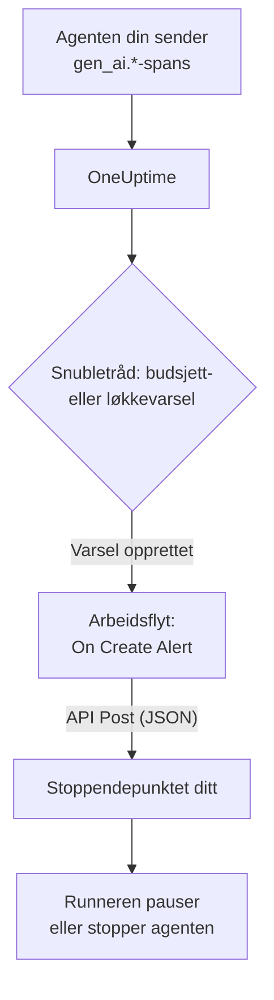

# Circuit breakers for AI-agenter

En AI-agent feiler sjelden ved å krasje. Den feiler ved å fortsette: den prøver et ødelagt verktøy på nytt, planlegger det samme steget igjen eller starter flere underagenter, mens hver runde koster flere tokens. Denne siden bygger en circuit breaker for dette av deler OneUptime allerede har: et varsel som oppdager den løpske agenten, og en arbeidsflyt som kaller et endepunkt du eier, for å stoppe den.

:::cards
- [Velg en snubletråd](#velg-en-snubletråd): Varsle på forbruk, eller på ett verktøy som kalles igjen og igjen.
- [Bygg stoppendepunktet](#bygg-stoppendepunktet): Den lille tjenesten som setter agenten din på pause.
- [Bygg arbeidsflyten](#bygg-arbeidsflyten): Fra et nytt varsel til et kall til endepunktet ditt.
- [Test circuit breakeren](#test-circuit-breakeren): Utløs den for hånd, og deretter på ordentlig.
:::

## Slik fungerer det



Circuit breakeren følger med på OpenTelemetry-dataene agenten din allerede sender, direkte eller [gjennom en gateway](/docs/telemetry/ai-gateways), og handler ved siden av forespørselsbanen, ikke i den. Ingenting legges til hvert modellkall, og bytte av leverandør, SDK eller gateway ødelegger den ikke.

Prisen er hastighet: den stopper en løpsk agent i løpet av minutter, ikke millisekunder. Behold stegbegrensninger og tidsavbrudd i selve agenten, og la circuit breakeren fange opp det som slipper forbi dem.

| Snubletråd | Fanger | Tid til varsel |
| --- | --- | --- |
| Et budsjettvarsel fra en metrikk-overvåking | Forbruk som fortsetter å stige, uansett årsak | Opptil 15 minutter, pluss ett minutt for monitoren |
| Et løkkevarsel fra en trase-overvåking | Det samme verktøyet kalt om og om igjen | 1 til 5 minutter |

## Før du begynner

- Agenten din sender GenAI-spans til OneUptime. Se [AI- / LLM-observerbarhet](/docs/telemetry/ai-llm-observability).
- Et HTTPS-endepunkt som kan pause eller stoppe agentens runner, og som kan nås fra OneUptime. Du bygger det i [Bygg stoppendepunktet](#bygg-stoppendepunktet).
- Tillatelse til å opprette monitorer og arbeidsflyter i prosjektet.

## Velg en snubletråd

Begge snubletrådene ender på samme måte: en monitor oppretter et varsel, og det nye varselet starter arbeidsflyten. Du kan sette opp begge: arbeidsflyten bryr seg ikke om hvilken som slo til.

### Et budsjettvarsel

Forbruk er det sikreste tegnet på en løpsk agent. Et budsjett summerer dagens AI-forbruk hvert 15. minutt og publiserer det som to metrikker, `oneuptime.llm.budget.spend.usd` og `oneuptime.llm.budget.percent.used`, hver med budsjettets ID i `oneuptime.llm.budget.id`.

:::steps
1. Åpne **Produkter → AI / LLM → Budsjetter**, og klikk på **Opprett LLM Cost Budget**. Angi et **Daglig budsjett (USD)**, og velg agentens tjeneste i **Tjeneste (valgfritt)**, slik at budsjettet bare følger med på den agenten.
2. Velg **Vis ID** i radmenyen til det nye budsjettet, og kopier ID-en.
3. Opprett en [Metrikk-overvåking](/docs/monitor/metrics-monitor) på `oneuptime.llm.budget.percent.used`, filtrert på attributtet `oneuptime.llm.budget.id` med ID-en du kopierte, og sett **Tidsintervall** til **Past 30 Minutes**.
4. Legg til et kriterium **Greater Than Or Equal To** `100` som oppretter et varsel, og gi det en **Varseltittel** som navngir agenten, for eksempel `LLM budget exceeded: support-bot`. Både arbeidsflyten og endepunktet ditt leser den tittelen.
:::

Filtrer på ID-en, ikke navnet: gir du et budsjett nytt navn, får serien nytt navn, og en monitor som filtrerer på det gamle navnet, ville i det stille slutte å treffe. Hold tidsintervallet på 30 minutter: et budsjett publiserer ett punkt hvert 15. minutt, så et kortere intervall finner ingenting mellom to punkter, og varselet åpnes og løses om og om igjen.

Et ekstra kriterium på `80` med lavere alvorlighetsgrad gir først et menneske beskjed gjennom varselets vaktpolicy, før circuit breakeren slår til ved `100`.

### Et løkkevarsel

En agent som har satt seg fast, etterlater et spor du kan kjenne igjen: det samme verktøy-spanet, om og om igjen. En sunn kjøring kaller ikke ett verktøy flere titalls ganger i løpet av noen få minutter, så en telling fanger løkken lenge før budsjettet gjør det.

:::steps
1. Åpne **Overvåkere**, klikk på **Opprett monitor**, og velg **Spor** under **Flere monitortyper**.
2. Under **Flere felt** setter du **Filtrer etter telemetritjeneste** til agentens tjeneste og **Filtrer etter attributter** til `gen_ai.tool.name` lik verktøyet du venter at den går i løkke på, for eksempel `search_web`. Hvis instrumenteringen din gir hvert verktøys span et navn, setter du heller det navnet i **Span-navn**.
3. Sett **Overvåk spor i (tid)** til **Siste 5 minutter**.
4. Legg til et kriterium **Span Count** **Greater Than** et tall som ingen sunn kjøring når på fem minutter, for eksempel `50`, som oppretter et varsel med en tittel som `Agent loop: support-bot`.
:::

En ekstra trase-overvåking med **Filtrer etter span-status** satt til **Feil** og en lavere telling fanger stormer av nye forsøk: et verktøy som fortsetter å feile, og en agent som fortsetter å prøve det igjen.

## Bygg stoppendepunktet

Arbeidsflyten sender en `POST` med en JSON-body til et endepunkt du kjører. Hva «stopp» betyr, bestemmer du. Fra den minste virkningen til den største:

| Handling | Virkning |
| --- | --- |
| Stopp nytt arbeid | Runneren starter ingen nye kjøringer for den agenten |
| Avbryt kjøringene | Den agentens pågående kjøringer avbrytes |
| Sett bassenget på pause | Alle workers tømmes til noen tilbakestiller circuit breakeren |

Et minimalt endepunkt i Express som slår ut en circuit breaker per agent:

```typescript title="circuit-breaker.ts"
import express from "express";

const app = express();
app.use(express.json());

const tripped = new Set<string>(); // agents whose breaker is open

app.post("/circuit-breaker", (req, res) => {
  if (req.headers["authorization"] !== `Bearer ${process.env.KILL_TOKEN}`) {
    return res.status(401).end();
  }

  const alertTitle: string = req.body.alertTitle ?? "";

  // "LLM budget exceeded: support-bot" -> "support-bot"
  const agent: string = alertTitle.split(": ").pop() ?? "unknown";

  tripped.add(agent); // your run loop checks this set
  abortActiveRuns(agent); // cancel that agent's runs in flight

  // Answer fast; do the slow cleanup in the background.
  return res.status(200).json({ tripped: agent });
});
```

Bygg det etter disse reglene:

- Gjør utløsningen idempotent. En advarsel og et brudd, eller et budsjettvarsel og et løkkevarsel samtidig, kan utløse den mer enn én gang, og en ny utløsning må ikke endre noe.
- Svar innen et sekund eller to, og rydd opp i bakgrunnen. Arbeidsflyten regner ethvert 2xx-svar som en suksess.
- Krev en hemmelighet. Alle som kan kalle endepunktet, kan stoppe agentene dine, så sjekk et bearer-token, som arbeidsflyten sender fra en hemmelig global variabel.
- Tilbakestill den for hånd. En utløst circuit breaker forblir utløst til noen har sett på kjøringen: åpne agentens samtale under **Produkter → AI / LLM → Samtaler** for å lese eller spille av hva den gjorde.

Forespørselen sendes fra OneUptime. På OneUptime Cloud må endepunktet ditt kunne nås fra internett. En selvhostet installasjon avviser private nettverksadresser med mindre en administrator tillater dem: se [Utgående nettverkstilgang](/docs/workflows/configuration#utgående-nettverkstilgang).

## Bygg arbeidsflyten

Lagre først endepunktets token et sted der arbeidsflyten kan bruke det uten å vise det: åpne **Arbeidsflyter → Globale variabler**, klikk på **Opprett Workflow Variabel**, gi den navnet `AGENT_KILL_TOKEN`, legg tokenet i **Innhold**, og slå på **Hemmelighet**. En hemmelig verdi fjernes fra kjøringslogger og stegspor.

:::steps
### Opprett arbeidsflyten

Åpne **Produkter → Arbeidsflyter**, og klikk på **Opprett arbeidsflyt**. Klikk på **Start fra bunnen**, gi den navnet `AI agent circuit breaker`, og klikk på **Opprett arbeidsflyt**. Den åpnes i **Bygger**, slått av.

### Legg til utløseren

Klikk på den stiplede blokken **Choose what starts this workflow**, og velg **On Create Alert** i panelet **Add Trigger**. Klikk på utløseren, kryss av for tittelen og beskrivelsen i **Select Fields**, og klikk på **Lagre**. ID-en på blokken, `alert-on-create-1`, er det senere blokker bruker for å vise til den.

### Sjekk tittelen

Klikk på **Legg til komponent**, velg **If / Else**, og koble utløserens punkt **Success** til den. Sett **Value to check** til varselets tittel (klikk på **{ }**, og velg den), **Comparison** til **inneholder** og **Compare with** til begynnelsen titlene på snubletrådene dine har felles, for eksempel `LLM budget exceeded`.

### Kall endepunktet ditt

Legg til **API Post (JSON)**, og koble punktet **Yes** på **If / Else** til den. Sett **URL** til endepunktet ditt, for eksempel `https://agents.example.com/circuit-breaker`, og fyll inn hodene og body nedenfor.

### Rapporter en feil

Legg til **Send Message to Slack** eller **Send Email**, og koble API-blokkens punkt **Error** til den. En circuit breaker som ikke klarer å slå ut, er det ene varselet et menneske må se.

### Slå den på

Slå på **Aktivert** øverst i **Bygger**.
:::

API-blokkens **Request Headers**:

```json title="Request Headers"
{
  "Authorization": "Bearer {{global.variables.AGENT_KILL_TOKEN}}",
  "Content-Type": "application/json"
}
```

Dens **Request Body**:

```json title="Request Body"
{
  "source": "oneuptime-circuit-breaker",
  "alertId": "{{local.components.alert-on-create-1.returnValues.model._id}}",
  "alertTitle": "{{local.components.alert-on-create-1.returnValues.model.title}}",
  "alertDescription": "{{local.components.alert-on-create-1.returnValues.model.description}}"
}
```

For å reagere på flere snubletråder lar du alle titlene deres begynne på samme måte, eller du kjeder flere **If / Else**-blokker fra punktet **No**. Se [Bygge en arbeidsflyt](/docs/workflows/authoring) for lerretet og [Variabler](/docs/workflows/variables) for `{{…}}`-referansene.

## Test circuit breakeren

:::steps
1. Utløs den for hånd. Åpne **Varsler**, klikk på **Opprett varsel**, og opprett ett med tittelen `LLM budget exceeded: test`. Kjøringen vises under **Arbeidsflyter → Logger → Kjøringer**, og endepunktet ditt mottar kallet.
2. Utløs den på ordentlig. Opprett et budsjett med en bitteliten grense, for eksempel `0.01` USD, på tjenesten til en testagent, rett en budsjettmonitor mot det, og la agenten kjøre: prosenten passerer 100, varselet åpnes, arbeidsflyten kjører og circuit breakeren slår ut. For løkkevarselet gir du en testagent et verktøy som alltid feiler.
3. Utløs den to ganger. Opprett det samme varselet igjen: endepunktet ditt må ta imot den andre utløsningen uten å endre noe.
:::

## Slik oppfører circuit breakeren seg over tid

- Arbeidsflyten kjører når et varsel opprettes, så en snubletråd utløser circuit breakeren én gang per varsel, ikke én gang per evaluering.
- Et budsjett teller UTC-døgnet, så prosenten starter på 0 igjen ved midnatt UTC. Et budsjettvarsel kan da bli løst, og den neste dårlige dagen åpner et nytt varsel som utløser circuit breakeren igjen.
- En monitor holder varselet sitt åpent så lenge kriteriene er oppfylt. Med **Løs varsel automatisk** slått på løses varselet når de ikke lenger er det, og det neste bruddet åpner et nytt varsel.
- Tilbakestilling er et menneskes avgjørelse på begge sider: løs varselet i OneUptime, og tilbakestill circuit breakeren i runneren din.
- Hvert nytt varsel i prosjektet starter arbeidsflyten. Det er **If / Else** som holder andre varsler unna circuit breakeren: ikke utelat den.

## Feilsøking

:::details Arbeidsflyten kjører ikke
Sjekk at **Aktivert** er slått på øverst i **Bygger**: arbeidsflyter opprettes avslått. Sjekk deretter at varselet ble opprettet etter at du slo på arbeidsflyten: utløseren starter bare en kjøring for et nytt varsel.
:::

:::details Arbeidsflyten kjører, men tar alltid grenen No
Tittelen er tom eller samsvarer ikke. Et felt som utløserens **Select Fields** ikke krysser av for, kommer tomt frem, så kryss av for tittelen. Sammenlign deretter varselets tittel med **Compare with**: **inneholder** må finne akkurat den teksten i den.
:::

:::details Endepunktet ditt svarer 401
Hodet `Authorization` samsvarer ikke med tokenet endepunktet ditt forventer. Sjekk navnet i `{{global.variables.AGENT_KILL_TOKEN}}` og verdien som er lagret i den globale variabelen. Verdien til en hemmelig variabel kan ikke leses tilbake, så skriv den inn på nytt med **Update Content** hvis du er i tvil.
:::

:::details Budsjettvarselet åpnes og løses om og om igjen
Monitorens **Tidsintervall** er kortere enn budsjettets 15 minutter mellom to punkter. Sett det til **Past 30 Minutes**.
:::

:::details Forespørselen når aldri frem til endepunktet ditt
Åpne kjøringen under **Arbeidsflyter → Logger → Kjøringer** og steget **API Post (JSON)**: det forteller hvorfor forespørselen mislyktes. På OneUptime Cloud må endepunktet kunne nås fra internett; en selvhostet installasjon avviser private nettverksadresser med mindre en administrator tillater dem.
:::

## Neste steg

:::cards
- [AI- / LLM-observerbarhet](/docs/telemetry/ai-llm-observability): Budsjetter, kostnader og spanene circuit breakeren følger med på.
- [Trase-overvåking](/docs/monitor/traces-monitor): Span-filtre og kriterier i detalj.
- [Arbeidsflyter](/docs/workflows/index): Utløsere, komponenter, variabler og kjøringer.
- [AI-gatewayer](/docs/telemetry/ai-gateways): Alle agentenes modellkall gjennom én eksport.
:::
