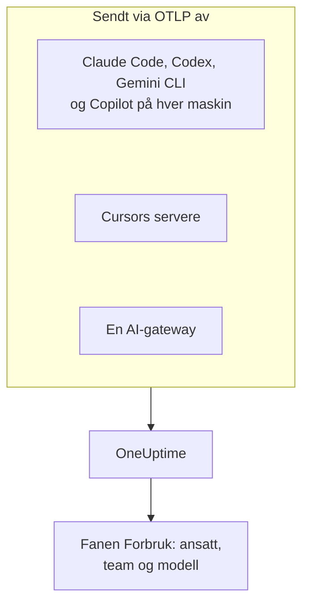

# AI-kodeassistenter

Utviklerne dine bruker Claude Code, Cursor, Codex, Gemini CLI og Copilot, og fakturaene fortsetter å vokse. Denne siden svarer på spørsmålene en leder har: **hvem som bruker hvilket verktøy, med hvilke modeller, og hva hver person og hvert team bruker**.

De fleste kodeassistenter eksporterer OpenTelemetry selv, så det er ingenting å installere på utviklernes maskiner: pek eksporten mot OneUptime, så havner tokens, kostnad og verktøybruk ved siden av AI-kallene fra dine egne apper. Alt her kommer inn via OpenTelemetry; OneUptime spør ikke noen leverandørs administrasjons- eller fakturerings-API.

:::cards
- [Støttematrise](#støttematrise): Hva hvert verktøy sender, og om det nevner en person.
- [Tilordning til ansatte og team](#tilordning-til-ansatte-og-team): Nøklene som setter et navn og et team på forbruket.
- [Fanen Forbruk](#fanen-forbruk): Hva forbrukstabellene kan og ikke kan vise for en kodeassistent.
- [Hvor du begynner](#hvor-du-begynner): En utrullingsrekkefølge som viser resultater fra første dag.
:::

## Slik fungerer det

Hvert verktøy sender telemetrien sin til OneUptimes OTLP-endpoint med inntaksnøkkelen din: fra hver utviklermaskin, fra leverandørens servere (Cursor) eller fra en gateway som modelltrafikken din går gjennom.



## Før du begynner

1. Opprett en inntaksnøkkel for telemetri under **Prosjektinnstillinger → Telemetri og APM → Inntaksnøkler**.
2. OTLP-endpointet ditt er `https://oneuptime.com/otlp`, eller `https://YOUR-ONEUPTIME-HOST/otlp` hvis du drifter OneUptime selv.
3. Hver eksport sender nøkkelen i headeren `x-oneuptime-token`.

Én inntaksnøkkel for hele flåten er greit. Den havner på hver utviklermaskin, så behandle den som en delt legitimasjon som bare kan sende data, og roter den som enhver annen.

## Støttematrise

Tre ting avgjør hva du får fra et verktøy: om det i det hele tatt sender OpenTelemetry, hvordan telemetrien når OneUptime, og om noe i den nevner en person.

| Verktøy | Hva det sender | Hvordan det når OneUptime | Hvem det nevner | Veiledning |
| --- | --- | --- | --- | --- |
| Claude Code | Målinger og logger; traces i beta | Fra hver maskin; miljøvariabler eller en fil med administrerte innstillinger | `user.email`, når det er logget inn med en Claude-konto | [Claude Code](/docs/telemetry/claude-code) |
| Cursor | Målinger og logger | Fra Cursors servere, satt opp én gang i Cursors dashbord; bare med Enterprise-abonnementet | `cursor.user.id`, et heltall | [Cursor](/docs/telemetry/cursor) |
| OpenAI Codex | Traces, målinger og logger, hver slått på i `~/.codex/config.toml` | Fra hver maskin, én fullstendig URL per signal | Ingen på spans eller målinger: du setter selv `user.id` og `user.email` i `[otel.span_attributes]` | [OpenAI Codex](/docs/telemetry/openai-codex) |
| Gemini CLI | Traces, målinger og logger | Fra hver maskin, vanligvis gjennom en lokal collector | `user.email`, når det er logget inn | [Gemini CLI og GitHub Copilot](/docs/telemetry/gemini-cli-and-copilot) |
| GitHub Copilot | Traces, målinger og logger, bare fra agentflatene | Fra editoren eller agentverten | Ingen: du setter selv `enduser.id` og `user.email` på hver maskin | [Gemini CLI og GitHub Copilot](/docs/telemetry/gemini-cli-and-copilot) |
| Cline | Målinger og logger | Konfigurert sentralt, i Clines organisasjonsdashbord | En anonymisert `user_id` | — |
| LiteLLM og Portkey | Traces av hvert kall gjennom gatewayen | Fra gatewayprosessen | Med LiteLLM eieren av den virtuelle nøkkelen | [AI-gatewayer](/docs/telemetry/ai-gateways) |
| Dine egne apper | Det GenAI-instrumenteringen din sender | Fra appen din | Den du setter som `user.id` | [AI- / LLM-observerbarhet](/docs/telemetry/ai-llm-observability) |
| Windsurf, JetBrains AI, Amazon Bedrock, Azure OpenAI | Ingen egen OpenTelemetry | Bare gjennom en gateway du setter foran | Den gatewayen nevner | [AI-gatewayer](/docs/telemetry/ai-gateways) |

En tankestrek betyr at OneUptime ikke har en veiledning for verktøyet ennå. Telemetrien tas likevel inn som all annen OpenTelemetry.

:::details Hva GitHub Copilot eksporterer, helt nøyaktig
Copilot eksporterer bare OpenTelemetry fra agentflatene sine: chat og agentmodus i VS Code, agentverten bak Copilot CLI, Copilot SDK og agentarbeidsflyter i JetBrains-IDE-er gjennom Copilot-pluginen. GitHub dokumenterer ingen eksport for innebygde forslag, Copilot på github.com eller Copilots kodegjennomgang. Copilot sender ingen brukerattributter av noe slag, så sett `enduser.id` og `user.email` per maskin via `resourceAttributes` eller `OTEL_RESOURCE_ATTRIBUTES`.
:::

:::details Amazon Bedrock, Azure OpenAI, Windsurf og JetBrains AI
- **Amazon Bedrock**: API-ene `InvokeModel` og `Converse` sender ingen OpenTelemetry. Bedrock AgentCore er annerledes: AWS dokumenterer målinger, spans og logger for det, sendt til CloudWatch som standard. Med `DISABLE_ADOT_OBSERVABILITY=true` slår du av kjøremiljøets standard ADOT-konfigurasjon, så du kan peke ADOT-SDK-et mot OneUptime i stedet.
- **Azure OpenAI**: tjenesten sender ingenting, og Azure Monitor-målingene har ingen brukerdimensjon. Instrumenter klienten, eller sett API Management eller en annen gateway foran.
- **Windsurf**: dokumenterer ingen telemetrieksport. Data per bruker ligger i Windsurfs Enterprise-API, som OneUptime ikke spør.
- **JetBrains AI Assistant og Junie**: eksporterer ikke forbruk. JetBrains' OpenTelemetry-plugin tar imot telemetrien fra din egen app inne i IDE-en; den sender ingenting ut.
:::

## Tilordning til ansatte og team

OneUptime kopierer personen som gjorde et kall, og teamet deres, inn i kolonner når telemetrien kommer inn, slik at fanen **Forbruk** kan rangere personer og team uten attributtfiltre.

### Attributter som leses som den ansatte

På et span vinner den første nøkkelen som finnes, i denne rekkefølgen:

| Kolonne | Nøkler, den foretrukne først |
| --- | --- |
| Ansatt-id | `user.id`, `enduser.id`, `litellm.metadata.user_api_key_user_id`, `metadata.user_api_key_user_id`, `traceloop.association.properties.user_id`, `langfuse.user.id`, `user.account_uuid`, `user.account_id`, `cursor.user.id` |
| Den ansattes e-post | `user.email`, `litellm.metadata.user_api_key_user_email`, `metadata.user_api_key_user_email`, `traceloop.association.properties.user_email`, `enduser.email` |
| Team / kostnadssted | `team.id`, `team`, `cost_center`, `department`, `litellm.metadata.user_api_key_team_id`, `litellm.team.id`, `metadata.user_api_key_team_id`, `cursor.team.id` |

På et datapunkt for en måling er listen kortere og begynner med e-posten, fordi kodeassistentene som sender målinger, sender `user.email` selv:

| Kolonne | Nøkler, den foretrukne først |
| --- | --- |
| Ansatt | `user.email`, `user.id`, `user.account_uuid`, `user.account_id`, `cursor.user.id` |
| Team / kostnadssted | `team.id`, `team`, `cost_center`, `department`, `cursor.team.id` |
| Modell | `gen_ai.request.model`, `model`, `cursor.model.name` |

Slik leses disse nøklene:

- **Hver nøkkel leses også med prefikset `resource.`.** OTLP-inntak lagrer ressursattributter under det prefikset, så `OTEL_RESOURCE_ATTRIBUTES=team.id=platform` kommer inn som `resource.team.id`. Nøklene uten prefiks prøves først, så en verdi på spannet slår en verdi på hele prosessen.
- **Fanen Forbruk viser en persons e-post når kallet har en, og ellers id-en.** Rader med samme e-post legges sammen, så én utvikler på to maskiner blir én rad.
- **Identitet leses bare fra AI-kall.** `user.id`, `user.email` og `team.id` er generiske nøkler som nettleser- og backend-spans også bærer; bare spans som allerede er gjenkjent som AI-kall, får kolonnene.
- **Loggposter leses ikke for identitet.** Det betyr noe for Codex, som bare setter `user.email` på loggene sine.
- LiteLLM staver disse nøklene på to måter: standard-`otel`-callbacken bruker prefikset `metadata.`, og den valgfrie OpenTelemetry v2-modusen (`LITELLM_OTEL_V2=true`) navnerommet `litellm.`. OneUptime leser begge, så en standard proxy fungerer uten ekstra oppsett.

### Team og kostnadssteder

Ingen instrumentering sender `team.id`, `team`, `cost_center` eller `department`: organisasjonen din setter dem, vanligvis via `OTEL_RESOURCE_ATTRIBUTES` på verktøyets prosess.

```bash
export OTEL_RESOURCE_ATTRIBUTES="team.id=platform,team=Platform_Engineering,cost_center=eng-123,department=engineering"
```

Sett den der du allerede klargjør utviklermaskiner: en MDM-profil, en fil med administrerte innstillinger eller en shellprofil fra dotfilene dine. Verdier kan ikke inneholde mellomrom: bruk understreker, eller prosentkoding som `%20`. Codex har ingen ressursattributter, så sett de samme nøklene i `[otel.span_attributes]` i stedet.

For å dele opp forbruket etter applikasjon bruker du tjenestenavnet (`OTEL_SERVICE_NAME`, eller verktøyets egen innstilling). Inndelingen **Applikasjon / Tjeneste** dekker bare verktøy som sender GenAI-spans.

### Hva som bevisst ikke behandles som den ansatte

Et kall kan bære to forskjellige personer: den ansatte som gjorde det, og kunden det ble gjort for. Disse nøklene bærer kunden, og OneUptime leser dem aldri inn i en identitetskolonne:

- `gen_ai.user` og `llm.user`: slik instrumenteringer gjengir OpenAIs forespørselsparameter `user`, som OpenAI beskriver som en identifikator for sluttbrukerne dine.
- `litellm.metadata.user_api_key_end_user_id`, `metadata.user_api_key_end_user_id` og `litellm.end_user.id`: LiteLLMs sluttbruker, i motsetning til nøkkeleieren, som er den ansatte.

Å lese en kunde-id som en ansatt ville gjøre en supportbot som betjener 40 000 kunder, til 40 000 fantomansatte, mens utvikleren som eier forbruket, ville se ut til ikke å bruke noe. Nøklene blir værende i spannets attributter, og **LLM**-fanen i trace-visningen viser dem som sluttbrukeren.

### Personvern

Den ansattes e-postkolonne inneholder personopplysninger. Traces' **Scrub-regler** dekker den nøyaktig slik de dekker attributtet den ble lest fra, så en regel som maskerer e-poster, maskerer også kolonnen. Du finner dem under **Spor → Innstillinger**.

## Kodeassistentmålinger OneUptime leser

Kodeassistentene gir målingene sine sitt eget prefiks i stedet for `gen_ai.*`, så OneUptime kjenner hver av dem ved navn:

| Måling | Verktøy | Enhet |
| --- | --- | --- |
| `claude_code.token.usage` | Claude Code | Tokens |
| `claude_code.cost.usage` | Claude Code | USD |
| `cursor.token.usage` | Cursor | Tokens |
| `cursor.cost.usage` | Cursor | USD, et anslag etter Cursors egen beregning |
| `codex.turn.token_usage` | OpenAI Codex | Tokens |
| `codex.turn.cost_microusd` | OpenAI Codex | Milliondeler av en USD: OneUptime regner dem om, så ikke gjør det selv |

OneUptime leser også tokens fra `gen_ai.client.token.usage`, `gen_ai.client.token.count`, `llm.token.usage` og `llm.usage.tokens`, og kostnad fra `gen_ai.client.cost`, `gen_ai.client.cost.usd`, `gen_ai.usage.cost`, `litellm_spend_metric` og `litellm.cost.total`.

To ting å vite før du leser tallene:

- **`gemini_cli.token.usage` er utelatt med vilje.** Gemini CLI sender tokens to ganger, som sin egen måling og som `gen_ai.client.token.usage`, og å lese begge ville doble dem. Tokens telles én gang, gjennom `gen_ai.client.token.usage`. Gemini CLI sender ingen kostnadsmåling: slå på traces for at hvert kall skal bli priset.
- **Bare input- og outputtokens telles.** Tokentypen leses fra `gen_ai.token.type`, `llm.token.type`, `type`, `cursor.token.type` eller `token_type`, og bare `input` og `output` (eller de eldre `prompt` og `completion`) teller. Cachelesing og -skriving, Codex' `total` (som gjentar de andre) og `reasoning_output` (en del av `output`) utelates, så en total fra målinger er mindre enn summen av alt et verktøy sender.

## Fanen Forbruk

Åpne **Produkter → AI / LLM**, og gå til **Forbruk**. Den rangerer **Ansatt**, **Team**, **Modell**, **Leverandør** og **Applikasjon / Tjeneste** etter forbruk, over de siste 7 dagene, med mindre du velger et annet tidsrom. Kall som ikke nevner noen, telles under **Ikke tilordnet**: en stor rad **Ikke tilordnet** forteller deg hvilket verktøy som fortsatt mangler identiteten sin.

### Kodeassistentmålinger er en reserve, ikke et tillegg

GenAI-spans kommer først: målingene leses bare for et tall spans ikke rapporterte noe for, og de to legges aldri sammen ([hvorfor](/docs/telemetry/ai-llm-observability#spans-kommer-først-målinger-fyller-hullene)). For kodeassistenter har det én tydelig konsekvens: **hvis det samme prosjektet mottar GenAI-spans med kostnad, vises ikke kodeassistentenes forbruk.** Gi kodeassistentene et eget prosjekt, med sin egen inntaksnøkkel.

Når reserven gjelder, er dette hva hver inndeling kan vise for et verktøy som bare sender målinger:

| Inndeling | Fra målinger |
| --- | --- |
| **Ansatt** | Ja, fra hver identitetsnøkkel ovenfor, med og uten prefikset `resource.` |
| **Team** | Ja, fra teamnøklene |
| **Modell** | Ja: Claude Code og Codex sender en `model` uten prefiks, Cursor `cursor.model.name` |
| **Leverandør** | Nei: kodeassistentenes målinger nevner ingen leverandør |
| **Applikasjon / Tjeneste** | Nei: målingene deres hører ikke til noen OneUptime-tjeneste |

En rad lest fra målinger bærer bare kostnad: cellene for kall og tokens viser `—`, fordi en forbruksteller ikke har detaljer per kall, og en 0 der ville påstå at personen ikke gjorde noen kall. Tabellen er merket med **fra GenAI-målinger**.

## Ingen OpenTelemetry? Sett en gateway foran

For Windsurf, JetBrains AI, Bedrocks modell-API-er, Azure OpenAI og alt annet uten egen eksport setter du en AI-gateway foran. Hvert kall går da gjennom én prosess som sender OpenTelemetry, og du konfigurerer eksporten én gang.

**Bruk LiteLLM med én virtuell nøkkel per ansatt.** LiteLLM setter nøkkeleierens id og e-post på hvert span, som OneUptime leser som den ansatte, og nøkkelens team som teamet. Den priser også hvert kall selv, med egendefinerte priser du setter på proxyen, og kostnaden den rapporterer, vinner over OneUptimes anslag. Ikke bruk sluttbruker-id-en dens til dette: det er kunden. Oppsettet står i [AI-gatewayer](/docs/telemetry/ai-gateways).

To begrensninger før du planlegger rundt en gateway:

- **En gateway ser bare trafikk som sendes gjennom den.** Cursors egen overstyring av basis-URL-en er en innstilling per bruker som bare dekker chatmodeller (Tab-fullføring bruker fortsatt Cursors modeller), så foretrekk Cursors innebygde eksport.
- **En gateway ser modellkallet, ikke agenten.** Den registrerer prompter og svar, men ikke verktøykallene, filredigeringene og beslutningene om å godta eller avvise som et verktøys egen telemetri rapporterer.

## Promptinnhold: standardene er forskjellige fra verktøy til verktøy

Prompter og svar er de mest risikable dataene i denne pipelinen: de inneholder rutinemessig kildekode, kundedata og innlimte legitimasjoner. Sjekk standarden for hvert verktøy:

| Verktøy | Promptinnhold som standard |
| --- | --- |
| Claude Code | Av: hver type innhold har sin egen variabel for å slå det på |
| Cursor | Av: bare den valgfrie familien `conversation_content` sender meldingstekst |
| OpenAI Codex | Av: `log_user_prompt` er `false` som standard |
| Gemini CLI | **På**: `logPrompts` er `true` som standard, så sett den til `false` når du slår på telemetri |
| GitHub Copilot | Av: `captureContent`, som administrerte innstillinger kan låse med `lockCaptureContent` |
| LiteLLM | På med standard-`otel`-callbacken (slå det av med `turn_off_message_logging`); av i OpenTelemetry v2-modus |

Codex sender også målingene sine til OpenAI som standard: se [OpenAI Codex](/docs/telemetry/openai-codex). Der du samler inn innhold med vilje, gjelder traces' **Scrub-regler** og **Drop-filtre** for det som for all annen telemetri.

## Hva OneUptime ikke gjør ennå

- **Ingen administrasjons- eller faktureringskoblinger mot leverandører.** OneUptime spør ikke Anthropics Admin API, Cursors Admin API, OpenAIs endpoints for forbruk og kostnader, GitHubs Copilot-fakturering eller API-ene til Windsurf eller JetBrains. Hent tall på fakturanivå fra leverandøren.
- **Kostnad er et anslag med mindre et verktøy rapporterer den.** En rapportert kostnad brukes som den er; ellers priser OneUptime tokens etter listepriser. Cursors `cursor.cost.usage` er selv et anslag.
- **Identitet på loggposter leses ikke.** Codex' `user.email`, som den bare sender på logger, knyttes ikke til forbruket.
- **Cursors `cursor.user.email` leses ikke ennå**, så Cursor-brukere vises som heltallet `cursor.user.id`.
- **Codex-spans nevner ingen modell**, så OneUptime kan ikke prise dem: Codex viser tokens per person, og kostnaden bare i totalene.
- **Verktøy endrer seg raskt.** Hvis denne siden sier at et verktøy ikke har noen eksport, sjekk den gjeldende dokumentasjonen før du bygger rundt en gateway.

## Hvor du begynner

Rull ut i denne rekkefølgen; hvert steg er nyttig i seg selv. Bruk et prosjekt som ikke allerede mottar GenAI-spans fra dine egne apper, ellers holder [reserveregelen](#kodeassistentmålinger-er-en-reserve-ikke-et-tillegg) kodeassistentenes forbruk borte fra siden.

1. **Gemini CLI**, hvis noen bruker det. Det sender `user.email` uten oppsett, så det viser tilordningen fungere hele veien. Slå på traces også: det sender ingen kostnadsmåling.
2. **Claude Code**: én fil med administrerte innstillinger for flåten, `user.email` gratis, en ekte kostnadsmåling og godkjenningsrate, commits, pull requests og kodelinjer per utvikler.
3. **Cursor**, med Enterprise-abonnementet: én skjerm i Cursors dashbord, ingen utviklermaskin berørt, selv om personer kommer inn som heltall.
4. **Copilot og Codex**, som begge trenger en identitet satt på hver maskin. Gjør det når du klargjør maskiner: kall som kom inn uten, kan ikke tilordnes i ettertid.
5. **En LiteLLM-gateway** for alt annet, med én virtuell nøkkel per ansatt.

## Neste steg

:::cards
- [Claude Code](/docs/telemetry/claude-code): Slå på Claude Codes eksport for én maskin eller hele flåten.
- [Cursor](/docs/telemetry/cursor): Send Cursors teamtelemetri fra Cursors dashbord.
- [OpenAI Codex](/docs/telemetry/openai-codex): Konfigurer Codex' tre eksportører, og sett en identitet på spansene.
- [AI- / LLM-observerbarhet](/docs/telemetry/ai-llm-observability): Samtaler, varsler, kostnad og budsjetter for hvert AI-kall.
:::
