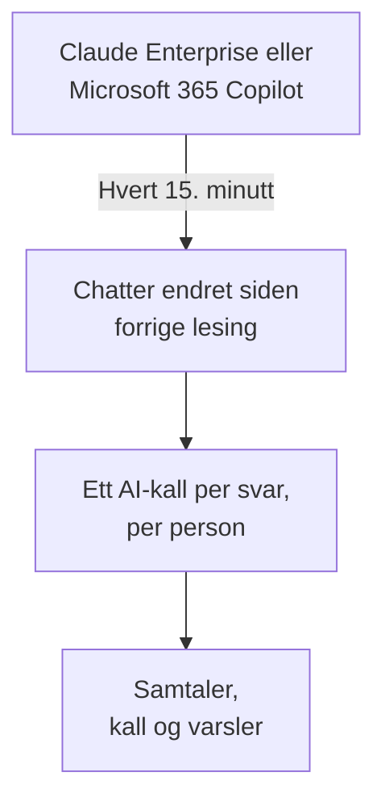

# Virksomhetens AI-verktøy

Se hva folkene dine spør AI-verktøyene virksomheten betaler for om, som samtaler per person. Koble til Claude Enterprise eller Microsoft 365 Copilot med påloggingsinformasjon som bare kan lese, så henter OneUptime hver ny chat inn i **Samtaler** hvert 15. minutt. Bare prosjektets eiere og administratorer kan lese dem, med mindre du velger noe annet.

:::cards
- [Si fra til folkene dine først](#si-fra-til-folkene-dine-først): Chattene deres er deres egne ord.
- [Koble til et verktøy](#koble-til-et-verktøy): Lim inn påloggingsinformasjonen, velg hvem som kan lese, test og koble til.
- [Personvern](#personvern): Hvem som kan lese samtalene, og om ordene beholdes.
- [Andre AI-verktøy](#andre-ai-verktøy): ChatGPT Enterprise, Gemini, Open WebUI, LibreChat og kodeassistenter.
:::

## Si fra til folkene dine først

> [!IMPORTANT]
> Dette er folkenes egne ord. Før du kobler til et verktøy, si til dem at chattene deres med det lagres og hvem som kan lese dem, og sjekk med juridisk avdeling eller HR hva retningslinjene deres og lokal lov krever.

## Slik fungerer det

Hvert 15. minutt ber OneUptime verktøyet om chattene som er endret siden forrige lesing. Hvert svar blir ett AI-kall fra personen som spurte, med spørsmålene stilt siden forrige svar, og hver chat blir én samtale.

Chattene kommer inn på samme måte som AI-kallene fra appene dine, så scrub-regler, drop-filtre, oppbevaring og AI-varslene gjelder for dem. Verktøyene betales per lisens, så disse kallene har verken tokens eller kostnad. Et spørsmål uten svar i en time kommer inn alene, så også en chat AI-en aldri svarte på, vises.

## Før du begynner

- Rollen Project Owner eller Project Admin. Bare de kan koble til, endre eller fjerne et verktøy.
- En administrator av verktøyet til å lage påloggingsinformasjonen: avsnittet for hvert verktøy nedenfor sier hvem.
- Folkene dine informert, og svaret fra juridisk avdeling eller HR.

## Koble til et verktøy

:::steps
### Åpne Koble til

Åpne **Produkter → AI / LLM → Koble til**. Under **Virksomhetens AI-verktøy** klikker du på verktøyets flis.

### Lim inn påloggingsinformasjonen

Under **Påloggingsinformasjon** fyller du ut det verktøyet ber om. Hemmeligheter lagres kryptert og vises aldri igjen.

### Velg hvem som kan lese

Under **Personvern** stiller du inn **Hvem som kan lese samtaler** og **Behold det som ble skrevet**, slik [Personvern](#personvern) forklarer.

### Test det

Under **Test** klikker du på **Test tilkoblingen**. OneUptime teller chattene fra de siste 7 dagene: ingenting noen har skrevet, blir lest, vist eller lagret.

### Koble til

Klikk på **Koble til**. Den første lesingen starter innen ett minutt og henter de siste 7 dagene.
:::

## Claude Enterprise

OneUptime leser hver claude.ai-chat i organisasjonen din via Compliance API: hvem som spurte, hva Claude ble spurt om, hva den svarte og hvilken modell den brukte. En chat som får en ny melding, leses på nytt, og svarene som allerede er hentet, gjenkjennes og hoppes over.

:::steps
### Slå på Compliance API

Organisasjonens primære eier åpner Organization settings, API i claude.ai og slår på Compliance API.

### Lag en compliance-tilgangsnøkkel

Lag der en nøkkel med scopet `read:compliance_user_data`. Den starter med `sk-ant-api01-`.

### Koble til Claude Enterprise

Lim inn nøkkelen som **Samsvarstilgangsnøkkel**.
:::

## Microsoft 365 Copilot

OneUptime leser hver persons Copilot-interaksjonshistorikk fra Microsoft Graph: hva vedkommende spurte Copilot om i Teams, Outlook, Word, Excel, PowerPoint, Loop eller Copilot Chat, hva den svarte og i hvilken app. En prompt og svarene på den blir ett AI-kall, og en Copilot-økt én samtale. En stor tenant leses i deler og fortsetter der forrige lesing stoppet.

:::steps
### Registrer en app

Registrer en app i Microsoft Entra ID, og lag en klienthemmelighet for den.

### Gi tillatelsene

Gi appen applikasjonstillatelsene `AiEnterpriseInteraction.Read.All` og `User.Read.All` fra Microsoft Graph, og gi administratorsamtykke.

### Koble til Copilot

Fyll ut **Katalog-ID (tenant)**, **Program-ID (klient)** og **Klienthemmelighet**. Vil du bare lese noen personer, setter du objekt-ID-en til en gruppe i **Bare personer i denne gruppen** under **Flere felt**, og gir appen også `GroupMember.Read.All`. For Azure Government endrer du **Sky** på samme sted.
:::

## Personvern

| Innstilling | Hva den gjør |
| --- | --- |
| **Hvem som kan lese samtaler** | **Prosjekteiere og administratorer**, standarden: ingen andre i prosjektet ser disse samtalene, eller AI-kallene de består av, noe sted i OneUptime. **Alle som kan lese AI-kall**: alle som kan lese prosjektets traces. |
| **Behold det som ble skrevet** | På, standarden: spørsmålene og svarene beholdes. Av: OneUptime beholder hvem som spurte, når, med hvilken modell og i hvilken app, men ikke ordene. |

En endring av hvem som kan lese, gjelder innen ett minutt. Å slå av **Behold det som ble skrevet** gjelder for chattene som leses etterpå; det som ble beholdt før, blir værende til oppbevaringen tar slutt.

Vil du beholde ordene men maskere deler av dem, som e-postadresser eller kortnumre, bruker du **Scrub-regler** under **Spor → Innstillinger**: de gjelder før noe lagres. Samtalene beholdes så lenge tilkoblingens tjeneste beholder sine traces: se [Dataoppbevaring](/docs/telemetry/data-retention). Å fjerne en tilkobling stopper lesingen; det den har lest, blir værende, lesbart for de samme personene, til oppbevaringen tar slutt.

## Andre AI-verktøy

Disse verktøyene har ikke noe API OneUptime kan lese folks chatter med, eller trenger en annen vei.

### ChatGPT Enterprise

OpenAI åpner bare Compliance API for et workspace på forespørsel og publiserer ikke hva postene inneholder, så OneUptime kan ennå ikke lese chatter fra ChatGPT Enterprise. Å koble til OpenAI-organisasjonen din som en [leverandørkonto](/docs/telemetry/ai-provider-accounts#openai) viser API-forbruket og -kostnadene, som ikke omfatter ChatGPT.

### Gemini for Google Workspace

Google tilbyr ikke noe API for å lese folks Gemini-chatter. Google Vault oppbevarer dem for eDiscovery.

### Kodeassistenter

Claude Code, Codex, Gemini CLI, GitHub Copilot og Cursor sender sin egen OpenTelemetry: se [AI-kodeassistenter](/docs/telemetry/ai-coding-assistants).

### Open WebUI og LibreChat

Selvhostede chatteapper kaller modellene gjennom et API du angir. Sett en LiteLLM-proxy foran modellene og send tracene derfra til OneUptime, slik [AI-gatewayer](/docs/telemetry/ai-gateways#litellm-proxy) viser: promptene og svarene i hver chat kommer inn som AI-kall. En virtuell nøkkel per person viser hvem som spurte; en nøkkel alle deler, nevner ingen. Open WebUIs egen OpenTelemetry-eksport sporer webforespørsler og databasekall, ikke chattene.

## Feilsøking

:::details Testen finner ingen chatter
Ingen har brukt verktøyet de siste 7 dagene, eller påloggingsinformasjonen tilhører en annen organisasjon eller tenant. For Copilot sjekker du at gruppen under **Bare personer i denne gruppen** er den du mener.
:::

:::details Påloggingen virker, men får ikke lese det tilkoblingen trenger
For Copilot gir du administratorsamtykke for appens Graph-tillatelser, og også `GroupMember.Read.All` når du angir en gruppe. For Claude Enterprise lager du nøkkelen med scopet `read:compliance_user_data`.
:::

:::details Noen ser ikke samtalene
**Hvem som kan lese samtaler** står på **Prosjekteiere og administratorer**. En eier eller administrator kan endre det med **Rediger** i tilkoblingens rad.
:::

:::details Samtalene viser hvem som spurte, men ingen ord
**Behold det som ble skrevet** var slått av da de ble lest. Å slå det på gjelder for chattene som leses etterpå.
:::

## Neste steg

:::cards
- [AI- / LLM-observerbarhet](/docs/telemetry/ai-llm-observability): Les og spill av samtaler, og få beskjed når svarene går galt.
- [Kontoer hos AI-leverandører](/docs/telemetry/ai-provider-accounts): Forbruk og kostnad for kontoene dine hos OpenAI, Anthropic, Azure, Bedrock og Vertex AI.
- [AI-kodeassistenter](/docs/telemetry/ai-coding-assistants): Forbruk per utvikler for kodeverktøyene.
- [Dataoppbevaring](/docs/telemetry/data-retention): Hvor lenge samtalene beholdes.
:::
