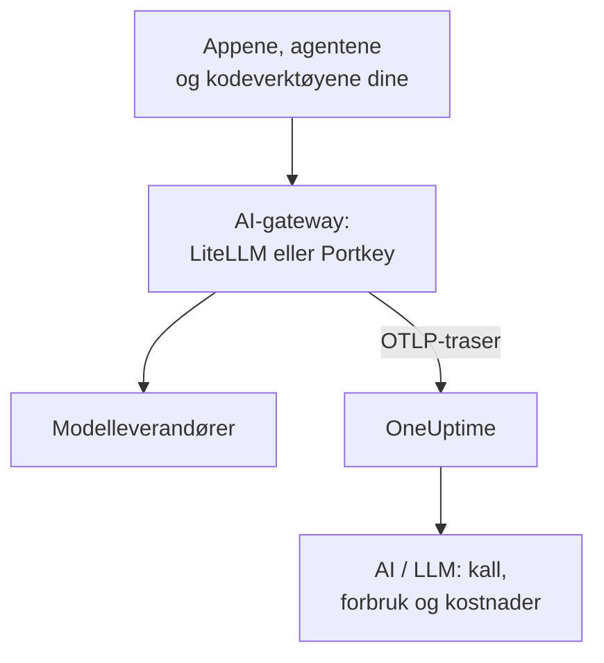

# AI-gatewayer (LiteLLM, Portkey)

En AI-gateway sitter mellom appene dine og modelleverandørene, så hvert modellkall går gjennom den. Send gatewayens OpenTelemetry til OneUptime én gang, så kommer hvert kall bak den inn i [AI / LLM](/docs/telemetry/ai-llm-observability) med modell, tokens, kostnad og, med mindre du slår det av, prompten og svaret, uten at du må instrumentere hver app.

:::cards
- [LiteLLM Proxy](#litellm-proxy): Innebygd eksport, satt opp med tre variabler.
- [Hvem brukte hva](#én-virtuell-nøkkel-per-ansatt): Én virtuell LiteLLM-nøkkel per ansatt navngir hver person.
- [Portkey](#portkey): Innebygd eksport på selvhostede gatewayer; andre steder instrumenterer du appen.
- [Sjekk at kallene kommer frem](#sjekk-at-kallene-kommer-frem): Hva du bør se, og hva du gjør hvis du ikke ser det.
:::

## Slik fungerer det



| | LiteLLM Proxy | Portkey, selvhostet eller Enterprise | Portkey, åpen kildekode eller hostet |
| --- | --- | --- | --- |
| Eksport til OneUptime | Innebygd | Innebygd, eksperimentell | Ingen: instrumenter appen i stedet |
| Endepunkt som skal angis | `https://oneuptime.com/otlp/v1/traces` | `https://oneuptime.com/otlp` | Appens egen eksportør |
| Navngir hver person | Ja, med én virtuell nøkkel per ansatt | Nei | Bare det appen sender |
| Prompter og svar | Sendes, med mindre du slår dem av | Sendes alltid | Avhenger av instrumenteringen |

## Før du begynner

- En ingestion-nøkkel: åpne **Prosjektinnstillinger → Telemetri og APM → Inntaksnøkler**, og klikk på **Opprett ingestion-nøkkel**.
- OTLP-basis-URL-en din: `https://oneuptime.com/otlp`, eller `https://YOUR-ONEUPTIME-HOST/otlp` hvis du hoster OneUptime selv. OneUptime tar imot OTLP over HTTP, i protobuf og i JSON.
- Nøkkelen følger med i hodet `x-oneuptime-token` på hver eksportforespørsel.

## LiteLLM Proxy

LiteLLMs OpenTelemetry-callback er en del av proxyen med åpen kildekode, og det offisielle Docker-imaget (`ghcr.io/berriai/litellm`) inneholder pakkene den trenger.

:::steps
### Slå på otel-callbacken

Legg til `otel` i callbackene i proxyens `config.yaml`:

```yaml title="config.yaml"
model_list:
  - model_name: gpt-4o
    litellm_params:
      model: openai/gpt-4o
      api_key: os.environ/OPENAI_API_KEY

litellm_settings:
  callbacks: ["otel"]
```

### Rett eksportøren mot OneUptime

Angi tre variabler på proxyen:

```bash
export OTEL_EXPORTER="otlp_http"
export OTEL_ENDPOINT="https://oneuptime.com/otlp/v1/traces"
export OTEL_HEADERS="x-oneuptime-token=YOUR_INGESTION_TOKEN"
```

### Start proxyen

:::tabs
@tab Docker
```bash
docker run \
  -v $(pwd)/config.yaml:/app/config.yaml \
  -e OPENAI_API_KEY="sk-..." \
  -e OTEL_EXPORTER="otlp_http" \
  -e OTEL_ENDPOINT="https://oneuptime.com/otlp/v1/traces" \
  -e OTEL_HEADERS="x-oneuptime-token=YOUR_INGESTION_TOKEN" \
  -e OTEL_SERVICE_NAME="litellm-gateway" \
  -p 4000:4000 \
  ghcr.io/berriai/litellm:main-stable \
  --config /app/config.yaml
```
@tab pip
```bash
pip install 'litellm[proxy]' opentelemetry-api opentelemetry-sdk opentelemetry-exporter-otlp
litellm --config config.yaml
```
:::

`litellm[proxy]` alene inneholder ikke OpenTelemetry-pakkene, så installer dem ved siden av.

### Send en forespørsel gjennom den

Kall proxyen én gang, og sjekk deretter AI / LLM som beskrevet i [Sjekk at kallene kommer frem](#sjekk-at-kallene-kommer-frem).
:::

| Variabel | Verdi | Merknader |
| --- | --- | --- |
| `OTEL_EXPORTER` | `otlp_http` | Leses også som `OTEL_EXPORTER_OTLP_PROTOCOL` |
| `OTEL_ENDPOINT` | `https://oneuptime.com/otlp/v1/traces` | Den fullstendige stien `/v1/traces` fungerer med alle LiteLLM-versjoner; leses også som `OTEL_EXPORTER_OTLP_ENDPOINT` |
| `OTEL_HEADERS` | `x-oneuptime-token=YOUR_INGESTION_TOKEN` | Kommaseparerte `key=value`-par; leses også som `OTEL_EXPORTER_OTLP_HEADERS` |
| `OTEL_SERVICE_NAME` | Navnet på gatewayen din | Tjenesten kallene vises under; `litellm` hvis du ikke angir noe |

### Hva LiteLLM sender

Hvert kall bærer `gen_ai.system`, `gen_ai.request.model`, `gen_ai.response.model`, `gen_ai.usage.input_tokens` og `gen_ai.usage.output_tokens`, parameterne sine, og prompten og svaret: alt OneUptime trenger for å [lese kallet](/docs/telemetry/ai-llm-observability).

Siden LiteLLM 1.81 ligger disse attributtene på forespørselens span `Received Proxy Server Request`, og det finnes ikke lenger et eget span `litellm_request`. Når én forespørsel gjør flere modellkall, overskriver hvert kall der attributtene til det forrige, så angi `USE_OTEL_LITELLM_REQUEST_SPAN=true` for å få et span `litellm_request` for hvert kall.

LiteLLM priser hvert kall selv, inkludert egne satser du har satt opp på proxyen, og rapporterer prisen som `gen_ai.cost.total_cost`. OneUptime foretrekker en rapportert pris fremfor sitt eget estimat, og [estimerer ut fra tokenene](/docs/telemetry/ai-llm-observability) bare når LiteLLM ikke kunne prise kallet, for eksempel for en egen modell uten angitt pris.

### Én virtuell nøkkel per ansatt

Gi hver person sin egen virtuelle LiteLLM-nøkkel, så kommer hvert kall vedkommende gjør, inn med hvem det er. LiteLLM skriver ID-en, e-postadressen og teamet til nøkkelens eier på spanet, og OneUptime leser dem som den ansatte og teamet, slik at fanen **Forbruk** rangerer forbruket per person uten at noe må settes opp på maskinene deres.

Virtuelle nøkler krever en database og en hovednøkkel på proxyen (`DATABASE_URL` og `LITELLM_MASTER_KEY`). Opprett en bruker med vedkommendes e-postadresse, og deretter en nøkkel for den brukeren:

```bash
curl -X POST "http://localhost:4000/user/new" \
  -H "Authorization: Bearer YOUR_MASTER_KEY" \
  -H "Content-Type: application/json" \
  -d '{"user_email": "alice@example.com"}'

curl -X POST "http://localhost:4000/key/generate" \
  -H "Authorization: Bearer YOUR_MASTER_KEY" \
  -H "Content-Type: application/json" \
  -d '{"user_id": "USER_ID_FROM_THE_FIRST_CALL", "team_id": "platform"}'
```

| Span-attributt fra LiteLLM | OneUptime leser det som |
| --- | --- |
| `metadata.user_api_key_user_id` | Den ansattes ID |
| `metadata.user_api_key_user_email` | Den ansattes e-postadresse |
| `metadata.user_api_key_team_id` | Teamet |
| `metadata.user_api_key_end_user_id` | Aldri den ansatte: det er `user` som appen din sender for sin egen kunde |

I LiteLLMs OpenTelemetry v2-modus kommer de samme verdiene med prefikset `litellm.` (`litellm.metadata.user_api_key_user_email` og så videre), som OneUptime også leser.

### Hold prompter utenfor

Callbacken `otel` sender som standard hele prompter og svar. For å holde dem utenfor bruker du et av disse alternativene:

:::tabs
@tab Alle callbacker
```yaml title="config.yaml"
litellm_settings:
  callbacks: ["otel"]
  turn_off_message_logging: true
```
@tab Bare OTel-callbacken
```yaml title="config.yaml"
litellm_settings:
  callbacks: ["otel"]

callback_settings:
  otel:
    message_logging: False
```
@tab Miljøvariabel
```bash
export OTEL_INSTRUMENTATION_GENAI_CAPTURE_MESSAGE_CONTENT="NO_CONTENT"
```
:::

`callback_settings` er en nøkkel på øverste nivå, ikke en nøkkel under `litellm_settings`. For å beholde prompter, men maskere deler av dem, bruker du heller renseregler under **Spor → Innstillinger**.

:::details LiteLLMs OpenTelemetry v2-modus
Nyere LiteLLM-versjoner har en valgfri OpenTelemetry v2-modus (`LITELLM_OTEL_V2=true`, ingen endring i `config.yaml`). Den sender én trase per forespørsel, med HTTP-håndteringen, autentiseringen, guardrails og modellkallet som GenAI-spans med navn som `chat gpt-4o`. I v2-modus er prompter slått av som standard; slå dem på med `OTEL_INSTRUMENTATION_GENAI_CAPTURE_MESSAGE_CONTENT`. Kostnaden kommer som `litellm.cost.total`, som OneUptime også leser. Bruk den ene modusen eller den andre, ikke begge.
:::

## Portkey

Hva Portkey kan sende, avhenger av hvordan du kjører den:

| Utrulling | Eksport til OneUptime |
| --- | --- |
| Selvhostet gateway eller Enterprise-gateway | Innebygd (eksperimentell): angi variablene nedenfor |
| Gateway med åpen kildekode (`portkey-ai/gateway`) | Ingen: instrumenter appen som kaller den |
| Hostet gateway (portkey.ai) | Ingen på gatewayen: instrumenter appen som kaller den |

Portkey har også et eget OpenTelemetry-endepunkt (`api.portkey.ai/v1/otel`). Det tar imot traser i Portkey, motsatt retning av denne siden.

### Selvhostede gatewayer og Enterprise-gatewayer

Angi disse variablene på gatewayens container:

```yaml title="docker-compose.yml"
services:
  portkey-gateway:
    environment:
      EXPERIMENTAL_GEN_AI_OTEL_TRACES_ENABLED: "true"
      EXPERIMENTAL_GEN_AI_OTEL_EXPORTER_OTLP_ENDPOINT: "https://oneuptime.com/otlp"
      EXPERIMENTAL_GEN_AI_OTEL_EXPORTER_OTLP_HEADERS: "x-oneuptime-token=YOUR_INGESTION_TOKEN"
```

- Oppgi basis-URL-en for OTLP: Portkey legger selv til `/v1/traces`.
- Hodene er kommaseparerte `key=value`-par. `EXPERIMENTAL_GEN_AI_OTEL_RESOURCE_ATTRIBUTES` legger til ressursattributter på samme måte, for eksempel `deployment.environment=production`.
- Portkey sender OTLP over HTTP bare som JSON, noe OneUptime tar imot uten en collector imellom.
- Hvert kall er et span med navnet `{operation} {model}`, for eksempel `chat gpt-4o`, under tjenesten `portkey`, med `gen_ai.provider.name`, den forespurte og den leverte modellen, tokentellingene, `gen_ai.conversation.id`, og meldingene i `gen_ai.input.messages` og `gen_ai.output.messages`.
- Hele prompter og svar er alltid med. Masker det som trengs med renseregler under **Spor → Innstillinger**.
- Hvert kall sendes for seg etter svaret, uten batching og uten nye forsøk: en mislykket eksport er tapt. Behandle det som observerbarhet, ikke som en revisjonslogg.
- Hvis `x-portkey-trace-id` er en gyldig trase-ID (32 heksadesimale tegn), gjenbruker Portkey den, slik at gatewayens spans henger sammen med trasen til din egen app.

Portkey merker denne eksporten som eksperimentell. Hvis variablene ikke har noen virkning, sammenlign Portkeys gjeldende dokumentasjon med versjonen av gatewayen din.

### Gatewayer med åpen kildekode og hostede gatewayer

Gatewayen med åpen kildekode har ingen eksportør, og på den hostede gatewayen kan du ikke angi variablene. Instrumenter i stedet appen som kaller Portkey. Portkey snakker OpenAI-API-et, så GenAI-instrumenteringene fra [AI- / LLM-observerbarhet](/docs/telemetry/ai-llm-observability) (OpenLLMetry, OpenInference, OpenLIT) sporer kallene fra SDK-en din, også når basis-URL-en peker til Portkey:

```python
from traceloop.sdk import Traceloop
from openai import OpenAI

Traceloop.init(
    app_name="my-ai-agent",
    api_endpoint="https://oneuptime.com/otlp",
    headers={"x-oneuptime-token": "YOUR_INGESTION_TOKEN"},
)

client = OpenAI(
    base_url="https://api.portkey.ai/v1",   # or your gateway's URL
    default_headers={"x-portkey-api-key": "PORTKEY_API_KEY"},
)
# Calls through Portkey are now traced to OneUptime.
```

Disse spanene beskriver kallet slik appen din gjorde det: modellen den ba om, tiden den ventet, tokenene den fikk tilbake. Det gatewayen bestemte underveis, som en reserveløsning, et nytt forsøk eller et cachetreff, blir værende i Portkey. For å se det i OneUptime bruker du eksporten fra den selvhostede gatewayen.

## Sjekk at kallene kommer frem

:::steps
1. Send en forespørsel gjennom gatewayen, og vent noen sekunder.
2. Åpne **Produkter → AI / LLM → Kall**. Kallet står i listen med leverandør, modell og tokens.
3. Klikk på kallet for å åpne trasen, og åpne fanen **LLM** for spanet: modellen, tokenene, parameterne og, med mindre du slo dem av, prompten og svaret.
4. Åpne **Forbruk**: kallet teller med i totalene, med kostnaden gatewayen rapporterte eller OneUptime estimerte.
:::

## Feilsøking

:::details Ingenting kommer fra LiteLLM
Angi `OTEL_EXPORTER="console"` en kort stund. Hvis det dukker opp spans i proxyens utdata, sporer LiteLLM, og problemet ligger i endepunktet eller nøkkelen. `DEBUG_OTEL="true"` viser hva eksportøren gjør.
:::

:::details Nøkkelen avvises
OneUptime svarer `401` på en manglende, ukjent eller utløpt nøkkel, og `422` på en deaktivert nøkkel eller en nettlesernøkkel. Opprett en servernøkkel under **Prosjektinnstillinger → Telemetri og APM → Inntaksnøkler**, og send den i `x-oneuptime-token`.
:::

:::details Endepunktet er feil
LiteLLM tar den fullstendige stien, `https://oneuptime.com/otlp/v1/traces`. Portkey tar basis-URL-en, `https://oneuptime.com/otlp`, og legger selv til `/v1/traces`.
:::

:::details Spans kommer frem, men ikke i AI / LLM
Filtrer **Spor** på gatewayens tjeneste (`litellm`, `portkey` eller din `OTEL_SERVICE_NAME`) for å se de rå spanene. Et span teller bare som et modellkall når det bærer `gen_ai.*`-attributter: sjekk at callbacken er `otel`, og at kallet gikk til en modell.
:::

:::details Forbruket vises som ikke tilordnet
Kallene navngir ingen person. Gi hver ansatt sin egen virtuelle nøkkel, som i [Én virtuell nøkkel per ansatt](#én-virtuell-nøkkel-per-ansatt). Feltet `user` som appen din sender, navngir kunden dens, ikke den ansatte, og leses aldri som den ansatte.
:::

:::details Av flere kall vises bare det siste
Siden LiteLLM 1.81 deler modellkallene i en forespørsel ett span. Angi `USE_OTEL_LITELLM_REQUEST_SPAN=true` for å få et span for hvert kall.
:::

## Neste steg

:::cards
- [AI- / LLM-observerbarhet](/docs/telemetry/ai-llm-observability): Samtaler, varsler, forbruk og daglige kostnadsbudsjetter for disse kallene.
- [AI-kodeassistenter](/docs/telemetry/ai-coding-assistants): Sett en gateway foran verktøy som ikke sender telemetri selv.
- [Circuit breakers for AI-agenter](/docs/telemetry/ai-agent-circuit-breaker): Stopp en løpsk agent når varselet slår til.
- [Trase-overvåking](/docs/monitor/traces-monitor): Varsle på span-mønstre, som et verktøy som kalles i en løkke.
:::
