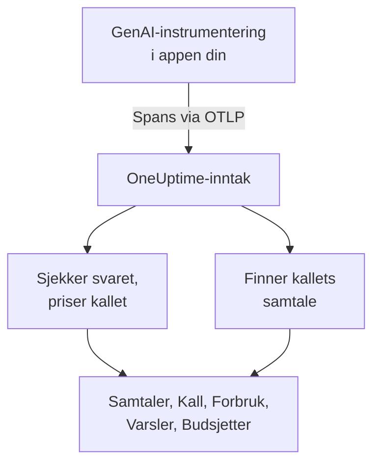
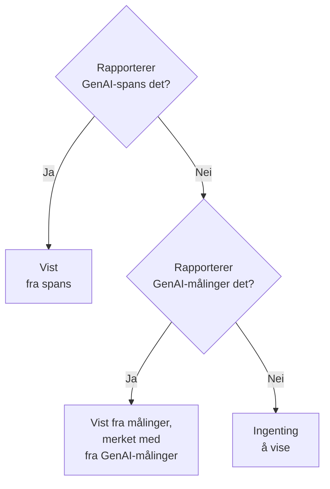

# AI- / LLM-observerbarhet

Les hver samtale AI-en din har hatt, spill den av slik den skjedde, og få beskjed når den svarer dårlig. OneUptime bygger alt dette på standard OpenTelemetry: Hvis appen din sender spans med **GenAI-semantiske konvensjoner** (`gen_ai.*`), får du samtaler, varsler, forbruk og kostnad uten et proprietært SDK.

:::cards
- [Sett det opp](#sett-det-opp-i-fem-steg): Fem steg, fra det første spannet til merkede svar.
- [Spill av en samtale](#les-og-spill-av-en-samtale): Les en chat slik personen så den, i tempoet den skjedde i.
- [Få varsler](#få-beskjed-når-ai-en-svarer-dårlig): Ferdige varsler for svar som feiler, blir avvist, kuttet, merket eller er trege.
- [Følg med på forbruket](#se-hvem-som-bruker-hva): Kostnad per person, team, modell og app, med daglige budsjetter.
:::

## Slik fungerer det

GenAI-instrumenteringen i appen din eksporterer hvert kall til modellen som et OpenTelemetry-span. Når spannet kommer inn, leser OneUptime `gen_ai.*`-attributtene, sjekker svaret for problemer, priser kallet og legger det under samtalen det hører til.



Åpne **Produkter → AI / LLM** under **Observerbarhet**. Produktet har sju faner:

| Fane | Hva den viser |
| --- | --- |
| **Samtaler** | Hver samtale AI-en din har hatt, med dem som trenger oppmerksomhet først. Over listen: samtaler, AI-svar, hvor mange som trenger oppmerksomhet, kostnad og den typiske svartiden. |
| **Kall** | Hvert modell-, embedding-, agent- og verktøykall. Filtrer på tjeneste, leverandør, modell, operasjon, person, team eller samtale; klikk på et kall for å åpne det i trace-visningen. |
| **Forbruk** | Kall, tokens og kostnad for et tidsrom, rangert etter ansatt, team, modell, leverandør eller app. |
| **Varsler** | Ferdige varsler for når AI-en svarer dårlig, og AI / LLM-monitorene dine. |
| **Budsjetter** | Daglige kostnadsgrenser, publisert som målinger du kan varsle på. |
| **Priser** | Dine egne priser for modeller den innebygde prislisten ikke kjenner. |
| **Oppsett** | De fem stegene nedenfor, med prosjektets endpoint. |

I trace-visningen har spannet for hvert AI-kall også en **LLM**-fane: leverandør, modell, tokens, kostnad, forespørselsparametere og prompten og svaret.

## Før du begynner

- Et OneUptime-prosjekt der du kan opprette en inntaksnøkkel for telemetri.
- En app som kaller en modell, og en GenAI-instrumentering for språket den bruker: **OpenLLMetry** (Traceloop), **OpenInference** (Arize), **Vercel AI SDK** eller OpenTelemetry-instrumenteringene for OpenAI, Anthropic og Gemini.

> [!TIP]
> Modelltrafikk som går gjennom en gateway som LiteLLM eller Portkey, kan eksporteres fra gatewayen i stedet for fra hver app: se [AI-gatewayer](/docs/telemetry/ai-gateways). For kodeassistentene utviklerne dine bruker, se [AI-kodeassistenter](/docs/telemetry/ai-coding-assistants).

## Sett det opp i fem steg

Det første steget er alt du trenger for å se kall. Hvert steg etter det viser mer.

:::steps
### Send AI-kallene dine

Opprett en inntaksnøkkel under **Prosjektinnstillinger → Telemetri og APM → Inntaksnøkler** ([OpenTelemetry-hurtigstarten](/docs/telemetry/open-telemetry#opprett-en-inntaksnøkkel) går gjennom det). Pek deretter instrumenteringen din mot OneUptime:

:::tabs
@tab Python
```bash
pip install traceloop-sdk opentelemetry-exporter-otlp
```

```python
from traceloop.sdk import Traceloop

Traceloop.init(
    app_name="my-ai-agent",
    api_endpoint="https://oneuptime.com/otlp",
    headers={"x-oneuptime-token": "YOUR_INGESTION_TOKEN"},
)
# Your OpenAI, Anthropic and LangChain calls are now traced.
```
@tab Node.js
```bash
npm install @traceloop/node-server-sdk
```

```typescript
import * as traceloop from "@traceloop/node-server-sdk";

traceloop.initialize({
  appName: "my-ai-agent",
  baseUrl: "https://oneuptime.com/otlp",
  headers: { "x-oneuptime-token": "YOUR_INGESTION_TOKEN" },
});
```
@tab OpenTelemetry SDK
```bash
export OTEL_EXPORTER_OTLP_ENDPOINT="https://oneuptime.com/otlp"
export OTEL_EXPORTER_OTLP_HEADERS="x-oneuptime-token=YOUR_INGESTION_TOKEN"
export OTEL_EXPORTER_OTLP_PROTOCOL="http/protobuf"
export OTEL_SERVICE_NAME="my-ai-agent"
```
:::

Drifter du OneUptime selv? Bruk `https://YOUR-ONEUPTIME-HOST/otlp` i stedet for `https://oneuptime.com/otlp`. Kall modellen din én gang, så dukker kallet opp under **Kall**.

### Registrer hva som ble sagt

En samtale viser bare hva folk spurte om og hva AI-en svarte når instrumenteringen din registrerer det. OpenLLMetry registrerer prompter og svar med mindre du setter `TRACELOOP_TRACE_CONTENT=false`. OpenTelemetry-instrumenteringene registrerer dem bare når du ber om det:

```bash
export OTEL_INSTRUMENTATION_GENAI_CAPTURE_MESSAGE_CONTENT=true
```

Nyere OpenTelemetry-instrumenteringer tar `span_only`, `event_only` eller `span_and_event` i stedet for `true`. Uten registrert innhold viser en samtale fortsatt tidene, kostnaden og problemene sine. Prompter kan inneholde sensitive data: [Personvern og maskering](#personvern-og-maskering) viser hvordan du maskerer dem før de lagres.

### Samle kall i samtaler

En chatapp gjør ett modellkall per tur. Sett `gen_ai.conversation.id` (eller `session.id`) til chattens id på hvert AI-kall, så vises hver chat som én samtale, uansett hvor mange kall og traces den tok. Med OpenLLMetry setter du det én gang per forespørsel:

```python
from traceloop.sdk import Traceloop

Traceloop.set_association_properties({
    "session_id": chat.id,
    "user_email": user.email,
})
```

Med Vercel AI SDK sender du chattens id som `experimental_telemetry: { metadata: { sessionId } }`. Kall uten samtale-id vises fortsatt, én forespørsel (én trace) om gangen.

### Oppgi hvem som spurte

Sett `user.id` eller `user.email` på hvert AI-kall (assosiasjonsegenskapen ovenfor setter e-posten). Da viser hver samtale hvem den var med, du kan søke i listen etter person, og fanen **Forbruk** rangerer forbruket etter ansatt. [Tilordning til ansatte og team](/docs/telemetry/ai-coding-assistants#tilordning-til-ansatte-og-team) viser alle identitetsnøklene OneUptime leser.

### Merk dårlige svar

OneUptime sjekker hvert svar når det kommer inn, og merker hva som gikk galt med det:

| Problem | Hva det betyr | Funnet fra |
| --- | --- | --- |
| Feilet | Kallet endte med en feil, så det kom ikke noe svar | Span-status Error, `error.type` eller en avslutningsårsak `error` |
| Avvist | AI-en nektet, eller et sikkerhetsfilter blokkerte svaret | En avslutningsårsak for avvisning eller sikkerhet (`content_filter`, `refusal`, `SAFETY` og lignende), en avvisning i svaret eller et svar som starter med en standardavvisning på engelsk |
| Kuttet | Svaret stoppet ved tokengrensen | En avslutningsårsak `length`, `max_tokens` eller `MAX_TOKENS` |
| Tomt | Ingen tekst og ikke noe verktøykall | Registrert innhold som ikke inneholder noe, eller 0 outputtokens |
| Merket | En evaluering appen din sendte, sa at svaret var dårlig | En `gen_ai.evaluation.result`-hendelse |

De fire første krever ingenting av deg. For å merke et svar som guardrailen din, evalueringen din eller en tommel ned-knapp avviser, legger du til en `gen_ai.evaluation.result`-hendelse på svarets span, mens spannet er åpent, med `gen_ai.evaluation.score.label` satt til `fail`:

```python
from opentelemetry import trace

trace.get_current_span().add_event(
    "gen_ai.evaluation.result",
    {
        "gen_ai.evaluation.name": "relevance",
        "gen_ai.evaluation.score.label": "fail",
        "gen_ai.evaluation.explanation": "The answer is about another product.",
    },
)
```

Etiketter som `incorrect`, `wrong`, `unhelpful`, `toxic`, `unsafe` og `hallucination` teller også som feilet. OneUptime sender aldri samtalene dine til en annen AI for å vurdere dem: hver sjekk leser bare det kallet selv bærer.
:::

## Les og spill av en samtale

En samtale åpnes i sin helhet, slik en chatapp viser historikken sin: det personen sa til høyre, AI-ens svar til venstre med modell, tid, tokens og kostnad, verktøykall imellom, og hva som gikk galt, merket der det skjedde. **Detaljer** under et svar viser hvorfor det stoppet, evalueringene og en lenke til kallet i Spor.

Linjen nederst spiller av samtalen slik personen opplevde den:

| Kontroll | Hva den gjør |
| --- | --- |
| **Spill av på nytt** | Spiller av samtalen fra den første meldingen, i tempoet den skjedde i. "AI-en svarer…" teller opp mens et svar er på vei. Klikk på tidspunktet for en melding for å spille av derfra. |
| **Hopp over ventetid** | På som standard: forkorter all stillhet som varer mer enn 3 sekunder. |
| `1x` | Endrer hastigheten: 1x, 2x, 4x eller 8x. |
| **K**, **J** eller **←**, **L** eller **→** | Spill av eller pause, gå én melding tilbake, gå én melding fram. |

Sidens adresse husker meldingen en avspilling stoppet ved (`?step=`), så en lenke du deler, åpnes på det tidspunktet.

## Få beskjed når AI-en svarer dårlig

Fanen **Varsler** viser varslene de fleste AI-apper trenger. Når du velger ett, åpnes **Opprett monitor** ferdig utfylt, og du kan endre alt før du lagrer:

| Varsel | Når det gir beskjed | Alvorlighetsgrad |
| --- | --- | --- |
| Svar går galt | Mer enn 5 % av svarene på 15 minutter feiler, blir avvist, kuttet, er tomme eller merket | Warning |
| AI-kall feiler | Mer enn 10 % av kallene til modellen på 5 minutter ender med en feil | Critical |
| AI-en nekter å svare | Mer enn 5 % av svarene på 30 minutter er avvisninger | Warning |
| Svar blir kuttet | 3 eller flere svar på 30 minutter stopper ved tokengrensen | Warning |
| Svar blir merket | En evaluering merker et svar som dårlig | Warning |
| Svar er trege | Mer enn 10 % av svarene på 15 minutter tar mer enn 30 sekunder | Warning |
| AI-en slutter å svare | AI-en gir ingen svar på 30 minutter | Critical |

Varslene på en andel av svarene venter også på minst 3 dårlige svar, så ett dårlig svar av to tilkaller ingen. Et Critical-varsel får prosjektets høyeste varselalvorlighetsgrad og et Warning-varsel den neste: High og Low i et nytt prosjekt.

Hvert varsel er en **AI / LLM**-monitor. Innstillingene sier hva som teller som et dårlig svar (**Tell et svar som dårlig når det**, **Eller tar lenger enn (sekunder)**), hvor langt tilbake hver sjekk ser (**Tidsvindu**, 15 minutter som standard), hvilke **Apper** den overvåker og, under **Flere felt**, hvilken **Modell**. En **Forhåndsvisning** viser hva monitoren ville telt akkurat nå. Kriteriene sammenligner tre tall: **Dårlige AI-svar (i %)**, **Dårlige AI-svar** og **AI-svar**.

Et ferdig varsel oppretter et varsel som løser seg selv, og viser monitoren som **Degraded** mens svarene er dårlige. Hendelsen er fylt ut, men slått av: slå den på for å tilkalle noen.

## Se hvem som bruker hva

Fanen **Forbruk** viser kall, tokens og kostnad for et tidsrom (de siste 7 dagene, med mindre du velger et annet) og en tabell over de 25 største i én av fem inndelinger: **Ansatt**, **Team**, **Modell**, **Leverandør** og **Applikasjon / Tjeneste**. Kall som ikke nevner noen, telles under **Ikke tilordnet** og kastes aldri.

Personer og team kommer fra identitetsattributter på kallet: se [Tilordning til ansatte og team](/docs/telemetry/ai-coding-assistants#tilordning-til-ansatte-og-team).

### Spans kommer først, målinger fyller hullene

GenAI-spans bærer modellen, tokens og kostnaden for ett kall, så der de finnes, svarer de på alt. Noen verktøy publiserer token- og kostnadsmålinger og ingen GenAI-spans, som de fleste kodeassistenter. OneUptime leser bare disse målingene for et tall spans ikke rapporterte noe for, og legger aldri de to sammen: mange instrumenteringer sender begge for det samme kallet, og å legge dem sammen ville telle hver dollar to ganger.



| Hvor | Hva som faller tilbake på målinger | Når |
| --- | --- | --- |
| Input- og outputtokens | Begge totalene | Spans' tokentotaler er begge 0 |
| Kostnad (USD) | Kostnaden, med Codex' kostnad i mikro-USD regnet om til USD | Spans' kostnadstotal er 0 |
| LLM-kall | Ingenting: bare spans | — |
| Tabellene **Ansatt**, **Team**, **Modell** | Bare kostnad; cellene for kall og tokens viser `—` | Den tabellen fant ingen rader fra spans |
| Tabellene **Leverandør**, **Applikasjon / Tjeneste** | Ingenting: bare spans | — |
| Samtaler | Ingenting: samtaler bygges fra spans | — |

Et tall fra målinger er merket med **fra GenAI-målinger**, fordi det ikke har tilsvarende rader under **Kall**. Så snart GenAI-spansene dine rapporterer et tall, vises altså ikke andelen til et verktøy som bare sender målinger. For å se forbruket til et slikt verktøy for seg sender du det til et eget prosjekt, der det ikke kommer inn GenAI-spans.

## Hva et kall koster

En kostnad instrumenteringen din rapporterer (`gen_ai.usage.cost`), brukes som den er, også når den er 0. Når ingen rapporteres, anslår OneUptime en når spannet kommer inn, ut fra antall tokens og en innebygd prisliste for vanlige modeller fra OpenAI, Anthropic, Google Gemini, Mistral, DeepSeek, xAI, Cohere, Amazon Nova og Meta Llama. Den leverte modellen prises først, deretter den forespurte modellen.

Modeller matches på det lengste navneprefikset, så id-er med dato eller leverandørprefiks som `gpt-4o-2024-08-06` og `us.anthropic.claude-sonnet-4-5-20250929-v1:0` finner prisen til familien sin. En modell listen ikke kjenner, også en ny utgivelse, blir aldri gjettet: kostnaden blir stående på 0 til du priser den. Anslagene bruker listepriser uten rabatter for cache eller batch.

For å prise en modell selv (en forhandlet pris, en finjustert modell eller en modell du drifter selv) legger du den til på fanen **Priser**, under **Egendefinerte LLM-priser**: et **Modellprefiks**, en **Inputpris (USD per 1M tokens)** og en **Outputpris (USD per 1M tokens)**. Det lengste matchende prefikset vinner på tvers av prisene dine og den innebygde listen; ved likt vinner prisen din. En pris gjelder for kall som kommer inn omtrent ett minutt etter at du lagrer den; kall som allerede er lagret, beholder kostnaden sin.

## Daglige kostnadsbudsjetter

Et budsjett følger én dags forbruk, i USD, over UTC-døgnet. Hvert 15. minutt legger OneUptime sammen dagens AI-forbruk (fra spans, eller fra GenAI-kostnadsmålinger når ingen span rapporterte noe), viser det på budsjettet og publiserer to målinger:

| Måling | Hva den er |
| --- | --- |
| `oneuptime.llm.budget.spend.usd` | Dagens forbruk så langt, i USD |
| `oneuptime.llm.budget.percent.used` | Forbruket som prosent av den daglige grensen |

Begge bærer `oneuptime.llm.budget.id` og `oneuptime.llm.budget.name`, og budsjettets omfang når det har et.

:::steps
### Opprett budsjettet

På fanen **Budsjetter** klikker du på **Opprett LLM Cost Budget**. Gi det et navn og et **Daglig budsjett (USD)**, og la omfanget stå tomt for hele prosjektet, eller velg en **Tjeneste (valgfritt)**, en **LLM-leverandør (valgfritt)** eller en **LLM-modell (valgfritt)**. Flere budsjetter kan overvåke ulike omfang.

### Varsle på det

Opprett en [metrikk-overvåking](/docs/monitor/metrics-monitor) på `oneuptime.llm.budget.percent.used`, filtrert på `oneuptime.llm.budget.id` (navnet endres når du gir budsjettet nytt navn). Legg til et kriterium `>= 80` som utløser en advarsel, og ett `>= 100` som utløser et kritisk varsel.

### Utvid vinduet

Sett monitorens rullerende vindu til 30 minutter. Et budsjett publiserer ett punkt hvert 15. minutt, så standardvinduet på 1 minutt ville ikke finne noe mellom to punkter.
:::

Et budsjettvarsel kan også kjøre en arbeidsflyt som stopper en løpsk agent: se [Circuit breakers for AI-agenter](/docs/telemetry/ai-agent-circuit-breaker).

## Dashboards og varsler på målinger

GenAI-målinger som `gen_ai.client.token.usage` og `gen_ai.client.operation.duration` kommer inn som vanlige OpenTelemetry-målinger. Vis dem i et [dashboard](/docs/dashboards/index), eller varsle på dem med en [metrikk-overvåking](/docs/monitor/metrics-monitor), for eksempel når p95 for `gen_ai.client.operation.duration` krysser en terskel, gruppert etter modell.

## Personvern og maskering

AI-kall lagres som trace-spans, så traces' **Scrub-regler** og **Drop-filtre** gjelder for dem: masker et attributt, eller dropp et span, før det lagres. Du finner begge under **Spor → Innstillinger**. Den ansattes e-postkolonne maskeres sammen med attributtet den ble lest fra, så en regel som maskerer e-poster, dekker den også.

Samtaler leses med samme tillatelse som traces: den som kan lese prosjektets traces, kan lese samtalene, og ingen andre.

## Attributter OneUptime leser

OneUptime leser OpenTelemetrys GenAI-konvensjoner og skrivemåtene OpenLLMetry, OpenInference, Vercel AI SDK og LiteLLM bruker, så de vanlige bibliotekene fungerer som de er. For hver verdi vinner den første nøkkelen et span bærer:

| Verdi | Nøkler, i rekkefølgen de prøves |
| --- | --- |
| Leverandør | `gen_ai.system`, `gen_ai.provider.name`, `llm.system`, `llm.provider` |
| Operasjon | `gen_ai.operation.name`, `llm.request.type`, `openinference.span.kind` |
| Forespurt modell | `gen_ai.request.model`, `llm.model_name`, `llm.request.model` |
| Levert modell | `gen_ai.response.model`, `llm.response.model` |
| Inputtokens | `gen_ai.usage.input_tokens`, `gen_ai.usage.prompt_tokens`, `llm.token_count.prompt`, `llm.usage.prompt_tokens` |
| Outputtokens | `gen_ai.usage.output_tokens`, `gen_ai.usage.completion_tokens`, `llm.token_count.completion`, `llm.usage.completion_tokens` |
| Tokens totalt | `gen_ai.usage.total_tokens`, `llm.token_count.total`, `llm.usage.total_tokens` |
| Kostnad (USD) | `gen_ai.usage.cost`, `gen_ai.usage.cost_usd`, `gen_ai.usage.total_cost`, `llm.usage.total_cost`, `gen_ai.cost.total_cost`, `litellm.cost.total` |
| Samtale | `gen_ai.conversation.id`, `session.id`, `langfuse.session.id`, `traceloop.association.properties.session_id`, `ai.telemetry.metadata.sessionId` |
| Agent | `gen_ai.agent.name`, `agent.name` |
| Verktøy | `gen_ai.tool.name`, `tool.name`, `ai.toolCall.name` |
| Avslutningsårsak | `gen_ai.response.finish_reasons`, `gen_ai.response.finish_reason`, `llm.response.finish_reason`, `ai.response.finishReason` |
| Feil | `error.type` |

Et span teller som et AI-kall når det bærer en av disse verdiene, eller et attributt som begynner med `gen_ai.`, `llm.` eller `traceloop.`. Tokens totalt er input pluss output når ingen total rapporteres. Nøklene `gen_ai.usage.total_tokens` og `gen_ai.usage.cost` er ikke en del av konvensjonene, som ikke definerer noen av dem; OneUptime leser dem fordi vanlige instrumenteringer sender dem.

Identitetsnøklene (hvem som gjorde kallet, og teamet deres) står under [Tilordning til ansatte og team](/docs/telemetry/ai-coding-assistants#tilordning-til-ansatte-og-team).

### Hvor prompter og svar leses fra

Samtalevisningen leser meldingene til et kall fra, i denne rekkefølgen:

- hendelsen `gen_ai.client.inference.operation.details`;
- attributtene `gen_ai.input.messages`, `gen_ai.output.messages` og `gen_ai.system_instructions`;
- de eldre hendelsene per rolle: `gen_ai.system.message`, `gen_ai.user.message`, `gen_ai.assistant.message`, `gen_ai.tool.message` og `gen_ai.choice`;
- de indekserte attributtene: OpenLLMetrys `gen_ai.prompt.N.content` og `gen_ai.completion.N.content`, OpenInferences `llm.input_messages.N.message.content` og `llm.output_messages.N.message.content`;
- meldingsmatrisene i `gen_ai.prompt`, `gen_ai.completion`, `ai.prompt.messages`, `ai.response.text`, `input.value` og `output.value`.

## Feilsøking

:::details Kall kommer inn, men ingen samtaler viser tekst
Instrumenteringen din registrerer ikke innhold. Slå det på slik [Registrer hva som ble sagt](#registrer-hva-som-ble-sagt) viser; kall som ble gjort før det, forblir uten tekst.
:::

:::details Hvert kall i en chat vises som en egen samtale
Kallene bærer ingen samtale-id. Sett `gen_ai.conversation.id` eller `session.id` på hvert kall i chatten, slik [Samle kall i samtaler](#samle-kall-i-samtaler) viser.
:::

:::details Kall viser tokens, men koster $0
Modellen står ikke i den innebygde prislisten, eller spannet nevner ingen modell. Legg til modellens priser på fanen **Priser**; kall som kommer inn etter det, blir priset.
:::

:::details Fanen Forbruk sier fra GenAI-målinger og viser `—` for kall og tokens
Tallene kommer fra et verktøy som sender målinger og ingen GenAI-spans, som en kodeassistent. En måling bærer kostnad, men ingen detaljer per kall, så de cellene forblir tomme. Se [Spans kommer først, målinger fyller hullene](#spans-kommer-først-målinger-fyller-hullene).
:::

:::details En budsjettmonitor veksler mellom to tilstander
Monitorens rullerende vindu er kortere enn 15 minutter, så noen ganger finner den ikke noe punkt. Sett det til 30 minutter.
:::

## Neste steg

:::cards
- [AI-kodeassistenter](/docs/telemetry/ai-coding-assistants): Forbruk per utvikler for Claude Code, Cursor, Codex, Gemini CLI og Copilot.
- [AI-gatewayer](/docs/telemetry/ai-gateways): Trace modellkallene til alle apper fra én LiteLLM- eller Portkey-gateway.
- [Circuit breakers for AI-agenter](/docs/telemetry/ai-agent-circuit-breaker): Stopp en løpsk agent når et budsjettvarsel utløses.
- [OpenTelemetry](/docs/telemetry/open-telemetry): Endpoints, inntaksnøkler og grenser for hvert signal.
:::
