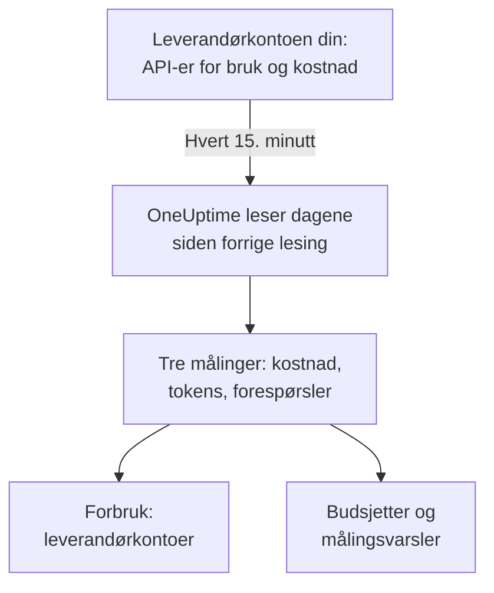

# Kontoer hos AI-leverandører

Se hva kontoene dine hos AI-leverandører har brukt og hva det har kostet, uten å endre appene dine. Koble til en konto hos OpenAI, Anthropic, Azure OpenAI og Microsoft Foundry, Amazon Bedrock eller Google Vertex AI med påloggingsinformasjon som bare kan lese, så leser OneUptime forbruket hvert 15. minutt inn i **Forbruk**, **Budsjetter** og målinger du kan varsle på.

:::cards
- [Koble til en konto](#koble-til-en-konto): Velg leverandøren, lim inn påloggingsinformasjonen, test den og koble til.
- [Hva hver leverandør gir](#hva-hver-leverandør-gir): Kostnad, tokens og forespørsler, og hvordan hver leverandør grupperer dem.
- [Se forbruket](#se-forbruket): Etter modell, person, prosjekt eller ressurs, API-nøkkel og tilkobling.
- [Budsjetter og varsler](#budsjetter-og-varsler): Et daglig budsjett på regningen og varsler på målingene.
:::

## Slik fungerer det

Hvert 15. minutt ber OneUptime hver tilkoblede konto om forbruket per UTC-døgn og lagrer det som tre målinger i tilkoblingens egen tjeneste. Hver lesing tar dagene siden forrige lesing, og de siste 3 dagene på nytt, i dag medregnet, fordi leverandørene fortsetter å legge til i dag og retter dagene som nettopp er gått.

Forbruket til en konto er det den ble fakturert for, én dag om gangen. Det inneholder ingen samtaler, prompter eller svar: for det sender du AI-kallene fra appene dine, slik [AI- / LLM-observerbarhet](/docs/telemetry/ai-llm-observability) viser. De to holdes adskilt, så ingenting telles to ganger.

## Før du begynner

- Rollen Project Owner eller Project Admin. Bare de kan koble til, endre eller fjerne en konto; alle som leser prosjektets telemetri, ser tilkoblingene og forbruket.
- Påloggingsinformasjon for kontoen fra noen som administrerer den. Hver leverandørs avsnitt nedenfor sier hvilken og hvor den lages.
- Ingenting å installere: OneUptime kaller leverandørens API fra sine egne servere.

## Koble til en konto

:::steps
### Åpne Koble til

Åpne **Produkter → AI / LLM → Koble til**. Under **Kontoene dine hos AI-leverandører** klikker du på leverandørens flis.

### Lim inn påloggingsinformasjonen

Under **Påloggingsinformasjon** fyller du ut det leverandøren ber om. Hemmeligheter lagres kryptert og vises aldri igjen, verken i Dashboardet eller via API-et. **Navn** og innstillingene de fleste lar være, ligger under **Flere felt**.

### Test den

Under **Test** klikker du på **Test tilkoblingen**. OneUptime leser forbruket for de siste 7 dagene og viser hva det fant: kostnad, tokens, forespørsler, modeller, personer, nøkler og prosjekter. Ingenting lagres før du kobler til.

### Koble til

Klikk på **Koble til**. Den første lesingen starter innen ett minutt og henter de siste 30 dagene.
:::

Tilkoblede kontoer står under flisene, med **Status** og **Sist lest**. **Les nå** leser med en gang, **Test** sjekker de lagrede innstillingene på nytt, **Slå av** stopper lesingen og beholder det som er lest, og **Rediger** endrer innstillingene: en hemmelighet som står tom, beholder den lagrede. **View error** viser hvorfor en lesing feilet, uten noen hemmelighet.

## Hva hver leverandør gir

| Leverandør | Kostnad | Gruppert etter | Påloggingsinformasjon |
| --- | --- | --- | --- |
| OpenAI | Det OpenAI rapporterer | Prosjekt, API-nøkkel, person og modell | En administratornøkkel |
| Anthropic | Det Anthropic rapporterer | Workspace, API-nøkkel, person og modell | En administratornøkkel |
| Azure OpenAI og Microsoft Foundry | Anslått ut fra tokens | Ressurs og modell | En app med Monitoring Reader |
| Amazon Bedrock | Anslått ut fra tokens | Region og modell | En tilgangsnøkkel som leser CloudWatch |
| Google Vertex AI | Anslått ut fra tokens | Region og modell | En tjenestekonto med Monitoring Viewer |

Alle leverandører unntatt Anthropic teller også forespørsler: forbruksrapporten til Anthropic har ingen. En anslått kostnad bruker prislisten fra [Hva et kall koster](/docs/telemetry/ai-llm-observability#hva-et-kall-koster) og dine egne priser fra **Priser**, og er merket som et anslag. En modell prislisten ikke kjenner, har ingen kostnad før du priser den der.

Ingen av disse påloggingene kan kalle en modell: hver av dem leser forbruk, kostnader eller målinger og ingenting annet.

## OpenAI

OneUptime leser OpenAI-organisasjonen din med en administratornøkkel: forbruket av completions og embeddings per dag, modell, prosjekt, API-nøkkel og person, og hver dags kostnader per prosjekt og post. En kostnadspost fordeles på nøklene og personene som brukte modellen, så også raden til en person har en kostnad. Prosjekt- og nøkkelnavn og personenes e-postadresser erstatter ID-ene til OpenAI.

:::steps
### Lag en OpenAI-administratornøkkel

Åpne Settings, Organization, Admin keys i dashbordet til OpenAI, og lag en nøkkel. Bare eiere av organisasjonen kan det. Den starter med `sk-admin-`.

### Koble til OpenAI

Lim inn nøkkelen som **Administratornøkkel**.
:::

## Anthropic

OneUptime leser Claude API-organisasjonen din med en administratornøkkel: forbruksrapporten for meldinger per dag, modell, workspace, API-nøkkel og person, og kostnadsrapporten per workspace og post, fordelt på samme måte. Claude Code brukt med organisasjonens nøkler eller Console-pålogginger står også i disse rapportene, under personen eller nøkkelen som brukte det.

:::steps
### Lag en Anthropic-administratornøkkel

Åpne Settings, Admin keys i Claude Console, og lag en nøkkel. Bare administratorer av organisasjonen kan det. Den starter med `sk-ant-admin01-`.

### Koble til Anthropic

Lim inn nøkkelen som **Administratornøkkel**.
:::

## Azure OpenAI og Microsoft Foundry

OneUptime leser hver Azure OpenAI- og Foundry-ressurs i et abonnement fra Azure Monitor: tokens og forespørsler per dag, ressurs og modell. Azure Monitor teller tokens, ikke penger, og nevner verken person eller nøkkel, så kostnaden er anslaget til OneUptime, og person og nøkkel blir stående tomme.

:::steps
### Registrer en app

Registrer en app i Microsoft Entra ID, og lag en klienthemmelighet for den.

### La den lese målingene

Gi appen rollen Monitoring Reader på abonnementet.

### Koble til Azure

Fyll ut **Katalog-ID (tenant)**, **Program-ID (klient)**, **Abonnements-ID** og **Klienthemmelighet**. For Azure Government endrer du **Sky** under **Flere felt**.
:::

## Amazon Bedrock

OneUptime leser CloudWatch-målingene `AWS/Bedrock` for hver region du oppgir: inndata-, utdata- og hurtigbuffertokens og kall, per dag og modell. CloudWatch teller tokens, ikke penger, og nevner verken person eller nøkkel: kostnaden er anslaget til OneUptime, og hver region står oppført som et prosjekt.

:::steps
### Lag en tilgangsnøkkel

Lag en IAM-bruker eller -rolle med en policy som tillater `cloudwatch:GetMetricData` og `cloudwatch:ListMetrics`, og en tilgangsnøkkel for den.

### Koble til Bedrock

Fyll ut **Tilgangsnøkkel-ID**, **Hemmelig tilgangsnøkkel** og **Regioner**, skilt med komma: `us-east-1` hvis du ikke endrer det.
:::

## Google Vertex AI

OneUptime leser Cloud Monitoring-målingene som Vertex AI publiserer for modellene sine, Gemini og partnermodeller som Claude: inndata- og utdatatokens og kall, per dag, region og modell. Cloud Monitoring teller tokens, ikke penger, og nevner verken person eller nøkkel: kostnaden er anslaget til OneUptime.

:::steps
### Lag en tjenestekonto

Lag en tjenestekonto med rollen Monitoring Viewer i prosjektet, og en JSON-nøkkel for den.

### Koble til Vertex AI

Fyll ut **Prosjekt-ID**, og lim inn hele nøkkelfilen som **Tjenestekontonøkkel (JSON)**.
:::

## Se forbruket

Åpne **Forbruk**, og velg **Leverandørkontoer**. Der ser du kostnadene, tokens og forespørslene kontoene dine rapporterte for tidsrommet, rangert etter **Modell**, **Person**, **Leverandør**, **Prosjekt eller ressurs**, **API-nøkkel** eller **Tilkobling**. Tidsrommet starter ved midnatt UTC den første dagen, fordi leverandørene rapporterer hele dager.

**Leverandørkontoer** og **AI-kallene dine** legges aldri sammen. Et kall appen din gjør med en nøkkel fra en tilkoblet konto, er med i begge, så å legge dem sammen ville telle det to ganger.

## Budsjetter og varsler

Et budsjett teller det ene eller det andre. Under **Budsjetter** lager du et budsjett og setter **Tell utgifter fra** til **Leverandørkontoer**: det teller hva de tilkoblede kontoene ble fakturert for UTC-døgnet, avgrenset av **LLM-leverandør (valgfritt)** og **LLM-modell (valgfritt)** når du fyller dem ut. Leverandørene rapporterer en dags forbruk minutter til timer senere, så for varsler innen minutter bør du heller budsjettere **AI-kallene dine**.

Forbruket til hver konto lagres som tre målinger, som du kan vise på et [dashbord](/docs/dashboards/index) eller overvåke med en [Metrikk-overvåking](/docs/monitor/metrics-monitor):

| Måling | Hva den er |
| --- | --- |
| `oneuptime.llm.provider.cost` | Kostnaden for en dag, i USD |
| `oneuptime.llm.provider.tokens` | Tokens for en dag, etter `gen_ai.token.type`: `input` (hurtigbufrede tokens medregnet), `output`, `cache_read` og `cache_write` |
| `oneuptime.llm.provider.requests` | Forespørslene for en dag |

Hvert punkt får tidsstempelet for starten av sitt UTC-døgn. Det bærer `oneuptime.llm.connection.id` og `oneuptime.llm.connection.name`, og det leverandøren nevner: `gen_ai.provider.name`, `gen_ai.request.model`, `user.email`, `oneuptime.llm.provider.project` og `oneuptime.llm.provider.api_key`. En anslått kostnad bærer `oneuptime.llm.cost.estimated`.

## Når det leses

| Lesing | Når |
| --- | --- |
| Den første | Innen ett minutt etter tilkobling, 30 dager tilbake |
| De neste | Hvert 15. minutt |
| Etter at en nøkkel eller tillatelse er avvist | 60 minutter senere |
| Etter enhver annen feil | 15 minutter senere |
| Slått av | Ingen før den slås på igjen |

En plan uten telemetrifunksjoner leser ingenting. Å fjerne en tilkobling stopper lesingen og beholder det den har lest til tjenestens oppbevaring fjerner det.

## Hvorfor OneUptime ikke har en egen gateway

OneUptime leser kontoene dine; det står aldri mellom appene dine og leverandørene. En proxy ville holdt på leverandørnøklene dine og lagt til et ekstra ledd i hvert modellkall appene dine gjør. Går modelltrafikken din allerede gjennom LiteLLM, Portkey eller OpenRouter, sender du gatewayens traces til OneUptime slik [AI-gatewayer](/docs/telemetry/ai-gateways) viser, og kobler til kontoen for regningen.

## Feilsøking

:::details Testen sier at nøkkelen eller hemmeligheten ikke ble godtatt
Sjekk at du kopierte alt, at den ikke er tilbakekalt, og at det er den typen denne leverandøren ber om: en administratornøkkel fra OpenAI eller Anthropic, ikke en prosjekt- eller API-nøkkel.
:::

:::details Påloggingen virker, men får ikke lese det tilkoblingen trenger
Gi den rollen denne siden nevner for leverandøren: Monitoring Reader på Azure-abonnementet, de to CloudWatch-handlingene i AWS, Monitoring Viewer på Google Cloud-prosjektet.
:::

:::details Testen går gjennom, men ingenting vises for i dag
Leverandørene rapporterer en dags forbruk minutter til timer etterpå og retter det i en dag eller to. De neste lesingene henter det.
:::

:::details Kostnaden avviker fra fakturaen
En rapportert kostnad er leverandørens tall før skatter, kreditter og rabatter. En anslått kostnad er tokens til listepris, eller til dine egne priser fra **Priser**.
:::

## Neste steg

:::cards
- [AI- / LLM-observerbarhet](/docs/telemetry/ai-llm-observability): Samtaler, varsler og kostnad for AI-kallene fra dine egne apper.
- [Virksomhetens AI-verktøy](/docs/telemetry/ai-company-tools): Hva folkene dine spør Claude Enterprise og Microsoft 365 Copilot om.
- [AI-gatewayer](/docs/telemetry/ai-gateways): Spor hvert modellkall gjennom LiteLLM, Portkey eller OpenRouter.
- [Metrikk-overvåking](/docs/monitor/metrics-monitor): Varsle på leverandørmålingene.
:::
