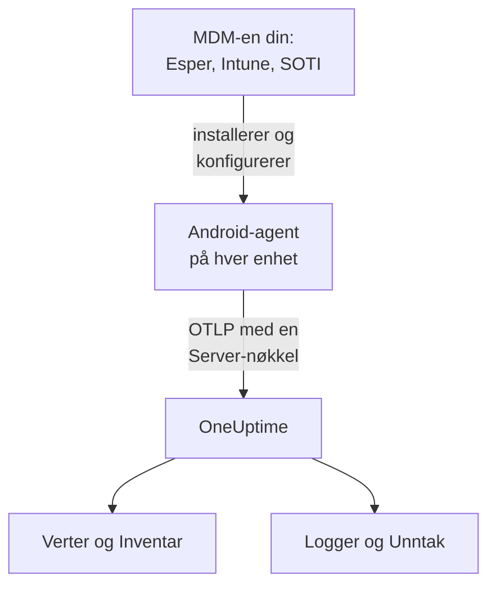

# Android-agent

OneUptimes Android-agent rapporterer til OneUptime om en Android-enhet som organisasjonen din eier, for eksempel en bestillingskiosk, en POS-terminal, en håndterminal eller en avspiller for digital skilting: minnet, lagringen, nettverket, batteriet og temperaturen, omstartene, appene som er installert på den, og krasj og logger fra appene på den. MDM-en din installerer og konfigurerer den på hele flåten på én gang. Hver enhet blir en vert under **Verter** og et element i **Inventar**, ved siden av serverne og Windows-maskinene dine.

:::cards
- [Når du bør bruke den](#agenten-eller-app-instrumentering): Agenten ser enheten, app-instrumentering ser appen din.
- [Rull den ut med Esper](#rull-den-ut-med-esper): Last opp APK-en, send ut innstillingene og start den én gang.
- [Innstillinger](#innstillinger): Hver nøkkel i den administrerte konfigurasjonen.
- [Les andre appers logger](#les-andre-appers-logger): Gi READ_LOGS én gang, med adb eller MDM-en din.
:::

## Slik fungerer det

Agenten er en liten app som kjører som en forgrunnstjeneste. Hvert minutt leser den tilstanden til enheten og sender den til OneUptime over OTLP med en **Server**-inntaksnøkkel, sammen med omstartene, de installerte appene og loggene til enheten. Den starter av seg selv når enheten slås på, tar vare på det den samler inn på enheten mens nettverket er nede, og sender det når nettverket er tilbake. Den holder aldri en enhet i dvale våken, og den komprimerer det den sender.



## Agenten eller app-instrumentering

| | [OpenTelemetry Android](/docs/rum/android-setup) i appen din | Android-agenten |
| --- | --- | --- |
| Hva den ser | Appen din: krasj, ANR-er, skjermer, økter, forespørsler og arbeidsflyter | Enheten: minne, lagring, nettverk, batteri, omstarter, installerte apper, og krasj og ANR-er i alle apper |
| Hvor det vises | **Overvåking av reelle brukere**, **Spor** og **Unntak** | **Verter**, **Inventar**, **Logger** og **Unntak** |
| Hvordan du installerer den | I koden til appen din | Som en app, gjennom MDM-en din |

På enheter du eier, bruker du begge, og gir enheten samme navn i begge: agentens innstilling `device_name` og `host.name` som appen din setter. Enheten blir da ett element i **Inventar**, med telemetrien fra appen og fra enheten samlet.

## Før du begynner

- Enheter med Android 7.0 eller nyere, administrert av en MDM som støtter Androids administrerte konfigurasjoner: Esper, Microsoft Intune, Workspace ONE, SOTI og andre MDM-løsninger for Android Enterprise. For én enkelt enhet holder det med adb.
- En **Server**-inntaksnøkkel, opprettet under **Prosjektinnstillinger → Telemetri og APM → Inntaksnøkler** med **Opprett inntaksnøkkel**.
- Agenten: `oneuptime-android-agent.apk`, som er vedlagt hver [OneUptime-utgivelse](https://github.com/OneUptime/oneuptime/releases/latest).
- Utgående HTTPS fra enhetene til OneUptime-URL-en din. Agenten avviser en URL som ikke begynner med `https://`, siden hver forespørsel inneholder inntaksnøkkelen.

## Rull den ut med Esper

:::steps
### Last opp APK-en

I Esper-konsollen laster du opp `oneuptime-android-agent.apk` til **App Library** og legger den til i blueprinten for enhetene som skal overvåkes.

### Send ut innstillingene

Åpne agentens **Managed Configuration** i blueprinten og lim inn innstillingene. Esper fyller inn plassholderne på hver enhet, med Esper Agent 8.00.0764 eller nyere:

```json title="Managed configuration"
{
  "oneuptime_url": "https://oneuptime.com",
  "oneuptime_token": "YOUR_TELEMETRY_INGESTION_TOKEN",
  "device_name": "${esper.deviceName}",
  "device_serial": "${esper.serialNumber}",
  "device_type": "kiosk",
  "labels": "region=emea"
}
```

Hvis du drifter OneUptime selv, setter du din egen URL i `oneuptime_url`. Kjør deretter Converge på enhetene, slik at de leser de nye innstillingene.

### Start den én gang

Android starter ikke en nylig installert app ved oppstart før den har blitt åpnet én gang. Slå på **Launch on Start** for agenten i blueprinten, i Multi-App-modus, eller åpne agenten én gang på hver enhet. Fra da av starter den av seg selv hver gang enheten slås på, og etter hver oppdatering.

### Finn enhetene i OneUptime

Innen et minutt vises hver enhet under **Verter**, med navnet fra `device_name`, og i **Inventar**. Agentens egen skjerm på enheten viser om den rapporterer, og hva som stopper den når den ikke gjør det.
:::

Andre MDM-løsninger fungerer på samme måte: Legg til APK-en som en LOB-app eller intern app, sett de samme nøklene i appkonfigurasjonen, og åpne den én gang på hver enhet.

## Innstillinger

Agenten leser disse nøklene fra den administrerte konfigurasjonen sin. En enhet uten administrert konfigurasjon kan i stedet settes opp på agentens egen skjerm, med URL-en, inntaksnøkkelen og navnet på enheten. En nøkkel som legges inn der, lagres kryptert med Android Keystore.

| Nøkkel | Hva den angir | Standard |
| --- | --- | --- |
| `oneuptime_url` | OneUptime-URL-en din | `https://oneuptime.com` |
| `oneuptime_token` | En **Server**-inntaksnøkkel | Ingen: Uten en nøkkel sender agenten ingenting |
| `device_name` | Navnet på enheten under **Verter** og i **Inventar**, som er identiteten dens der | Modellen og starten av Android ID-en |
| `device_serial` | Serienummeret, som Android ikke gir til apper fra og med Android 10 | Ingen |
| `device_type` | Hva den er, for eksempel en kiosk, en POS-terminal eller en håndterminal | `Android device` |
| `device_location` | Hvor den står, for eksempel nummeret til en butikk | Ingen |
| `labels` | Etiketter for verten, som `name=value`-par atskilt med komma | Ingen |
| `collection_interval_seconds` | Hvor ofte den rapporterer, fra 30 til 600 sekunder | `60` |
| `logcat_enabled` | Om den sender det den leser fra Logcat | `true` |
| `logcat_min_level` | De minst alvorlige Logcat-linjene den sender på Android 12 og eldre: `verbose`, `debug`, `info`, `warn`, `error` eller `fatal` | `warn` |
| `installed_apps_enabled` | Om den sender de installerte appene | `true` |

En plassholder som MDM-en din ikke fylte inn, for eksempel `${esper.deviceName}` sendt som den er, ignoreres, og agentens skjerm sier fra om det. Hold `device_name` uendret når en enhet først har begynt å rapportere: Et nytt navn er en ny vert.

## Les andre appers logger

Android lar en app lese andre appers logger bare med tillatelsen READ_LOGS, og bare adb kan gi den: verken appen selv eller en enhetspolicy. Gi den én gang på hver enhet, så forblir den gitt gjennom omstarter og oppdateringer:

```bash
adb shell pm grant com.oneuptime.androidagent android.permission.READ_LOGS
```

Med Esper kjører du kommandoen over **Secure Remote ADB**: Slå på ADB-tilgang for enheten, koble til med `espercli secureadb connect -d DEVICE_ID`, og kjør deretter kommandoen. Android starter agenten på nytt når tillatelsen gis, og agenten begynner å lese med en gang.

Hva agenten da leser, avhenger av Android-versjonen:

- Android 13 og nyere: krasj og ANR-er i alle apper. Android viser andre appers logglinjer bare til en app som er på skjermen, etter at personen ved enheten har tillatt det, så en agent som kjører i bakgrunnen, kan ikke lese dem.
- Android 12 og eldre: krasj og ANR-er i alle apper, og logglinjene til alle apper på `logcat_min_level` og høyere.

Uten READ_LOGS rapporterer agenten alt annet, og både skjermen dens og loggene til enheten forklarer hvordan du gir tillatelsen.

## Hva den rapporterer

| Hva | Hvor det vises i OneUptime |
| --- | --- |
| Minne, lagring, nettverk og oppetid | Siden til enheten under **Verter**: de samme målingene som innsamleren på en server sender, så varslingsmalene for verter fungerer |
| Batterinivå og -temperatur, og om enheten er koblet til ekstern strøm | Målingene `hw.battery.charge`, `hw.temperature` og `android.battery.plugged` |
| Termisk tilstand | Målingene `android.thermal.status` og `android.thermal.headroom` |
| Omstarter | **Logger**, med `@event.name:device.boot`: hvor lenge enheten hadde vært oppe, om den ble slått av på riktig måte, hvor lenge den var av, og omstartsløkker |
| Installerte apper | **Logger**, med `@event.name:android.package.inventory` én gang om dagen, og hver installasjon, oppdatering og fjerning |
| Krasj og ANR-er i alle apper | **Unntak**, som uhåndterte, oppkalt etter appen |
| Merke, modell, serienummer, OS-versjon og fastvare | Elementet for enheten i **Inventar** |

Fra og med Android 8 skjuler Android enhetens CPU-bruk for apper, så agenten rapporterer CPU-bruk bare på Android 7, og på bygg som tillater det.

Varslingsmalene for verter som passer for en enhet, er Host Stopped Reporting, High Memory Utilization, High Filesystem Usage og Host Restarted. En enhet som fortsetter å starte på nytt, logger en advarsel ved hver oppstart, med `android.boot.recent_count` satt til antall oppstarter den siste timen.

## Feilsøking

:::details En enhet vises ikke under Verter
Åpne agenten på enheten: Skjermen forteller hva som mangler, for eksempel en inntaksnøkkel, en URL den ikke kan bruke, eller en opplasting som mislyktes, og hvorfor. På en enhet der agenten aldri ble åpnet etter installasjonen, har den heller ikke startet: Åpne den én gang, eller slå på **Launch on Start**.
:::

:::details Agenten sier at OneUptime avviste inntaksnøkkelen
Bruk en **Server**-nøkkel som er slått på og ikke utløpt. En **Nettleser**-nøkkel avvises fra en enhet.
:::

:::details Ingen logger fra andre apper
Gi READ_LOGS, slik [Les andre appers logger](#les-andre-appers-logger) beskriver. På Android 13 og nyere leses bare krasj og ANR-er fra andre apper.
:::

:::details To enheter vises som én vert
De har samme `device_name`. Bruk en plassholder som er forskjellig fra enhet til enhet, for eksempel `${esper.deviceName}` eller `${esper.serialNumber}`.
:::

## Neste steg

:::cards
- [Android-oppsett](/docs/rum/android-setup): Instrumenter din egen app med OpenTelemetry Android.
- [Verter](/docs/telemetry/hosts): Sidene, avlesningene og varslene til en vert.
- [Verts-monitor](/docs/monitor/host-monitor): Få et varsel når en enhet slutter å rapportere eller begynner å gå tom for lagringsplass.
- [Unntak](/docs/telemetry/exceptions): Gå gjennom krasjene og ANR-ene enhetene dine rapporterer.
:::
