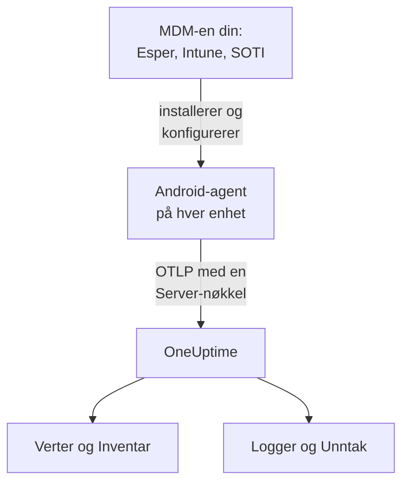

# Android-agent

OneUptimes Android-agent rapporterer til OneUptime om en Android-enhet som organisasjonen din eier, for eksempel en bestillingskiosk, en POS-terminal, en håndterminal eller en avspiller for digital skilting: minnet, lagringen, nettverket, batteriet og temperaturen, omstartene, appene som er installert på den, og krasj og logger fra appene på den. MDM-en din installerer og konfigurerer den på hele flåten på én gang. Hver enhet blir en vert under **Verter** og et element i **Inventar**, ved siden av serverne og Windows-maskinene dine.

:::cards
- [Når du bør bruke den](#agenten-eller-app-instrumentering): Agenten ser enheten, app-instrumentering ser appen din.
- [Rull den ut med Esper](#rull-den-ut-med-esper): Last opp APK-en, send ut innstillingene og start den én gang.
- [Innstillinger](#innstillinger): Hver nøkkel i den administrerte konfigurasjonen.
- [Les andre appers logger](#les-andre-appers-logger): Gi READ_LOGS én gang, med adb eller MDM-en din.
- [Loggøkter](#loggøkter): Logger fra alle apper en stund, tillatt av personen ved enheten.
:::

## Slik fungerer det

Agenten er en liten app som kjører som en forgrunnstjeneste. Hvert minutt leser den tilstanden til enheten og sender den til OneUptime over OTLP med en **Server**-inntaksnøkkel, sammen med omstartene, de installerte appene og loggene til enheten. Den starter av seg selv når enheten slås på, tar vare på det den samler inn på enheten mens nettverket er nede, og sender det når nettverket er tilbake. Den holder aldri en enhet i dvale våken, og den komprimerer det den sender.



## Agenten eller app-instrumentering

| | [OpenTelemetry Android](/docs/rum/android-setup) i appen din | Android-agenten |
| --- | --- | --- |
| Hva den ser | Appen din: krasj, ANR-er, skjermer, økter, forespørsler og arbeidsflyter | Enheten: minne, lagring, nettverk, batteri, omstarter, installerte apper, og krasj og ANR-er i alle apper |
| Hvor det vises | **Overvåking av reelle brukere**, **Spor** og **Unntak** | **Verter**, **Inventar**, **Logger** og **Unntak** |
| Hvordan du installerer den | I koden til appen din | Som en app, gjennom MDM-en din |

På enheter du eier, bruker du begge, og gir enheten samme navn i begge: agentens innstilling `device_name` og `host.name` som appen din setter. Enheten blir da ett element i **Inventar**, med telemetrien fra appen og fra enheten samlet.

## Før du begynner

- Enheter med Android 7.0 eller nyere, administrert av en MDM som støtter Androids administrerte konfigurasjoner: Esper, Microsoft Intune, Workspace ONE, SOTI og andre MDM-løsninger for Android Enterprise. For én enkelt enhet holder det med adb.
- En **Server**-inntaksnøkkel, opprettet under **Prosjektinnstillinger → Telemetri og APM → Inntaksnøkler** med **Opprett inntaksnøkkel**.
- Agenten: `oneuptime-android-agent.apk`, som er vedlagt hver [OneUptime-utgivelse](https://github.com/OneUptime/oneuptime/releases/latest).
- Utgående HTTPS fra enhetene til OneUptime-URL-en din. Agenten avviser en URL som ikke begynner med `https://`, siden hver forespørsel inneholder inntaksnøkkelen.

## Rull den ut med Esper

:::steps
### Last opp APK-en

I Esper-konsollen laster du opp `oneuptime-android-agent.apk` til **App Library** og legger den til i blueprinten for enhetene som skal overvåkes.

### Send ut innstillingene

Åpne agentens **Managed Configuration** i blueprinten og lim inn innstillingene. Esper fyller inn plassholderne på hver enhet, med Esper Agent 8.00.0764 eller nyere:

```json title="Managed configuration"
{
  "oneuptime_url": "https://oneuptime.com",
  "oneuptime_token": "YOUR_TELEMETRY_INGESTION_TOKEN",
  "device_name": "${esper.deviceName}",
  "device_serial": "${esper.serialNumber}",
  "device_type": "kiosk",
  "labels": "region=emea"
}
```

Hvis du drifter OneUptime selv, setter du din egen URL i `oneuptime_url`. Kjør deretter Converge på enhetene, slik at de leser de nye innstillingene.

### Start den én gang

Android starter ikke en nylig installert app ved oppstart før den har blitt åpnet én gang. Slå på **Launch on Start** for agenten i blueprinten, i Multi-App-modus, eller åpne agenten én gang på hver enhet. Fra da av starter den av seg selv hver gang enheten slås på, og etter hver oppdatering.

### Finn enhetene i OneUptime

Innen et minutt vises hver enhet under **Verter**, med navnet fra `device_name`, og i **Inventar**. Agentens egen skjerm på enheten viser om den rapporterer, og hva som stopper den når den ikke gjør det.
:::

Andre MDM-løsninger fungerer på samme måte: Legg til APK-en som en LOB-app eller intern app, sett de samme nøklene i appkonfigurasjonen, og åpne den én gang på hver enhet.

## Innstillinger

Agenten leser disse nøklene fra den administrerte konfigurasjonen sin. En enhet uten administrert konfigurasjon kan i stedet settes opp på agentens egen skjerm, med URL-en, inntaksnøkkelen og navnet på enheten. En nøkkel som legges inn der, lagres kryptert med Android Keystore.

| Nøkkel | Hva den angir | Standard |
| --- | --- | --- |
| `oneuptime_url` | OneUptime-URL-en din | `https://oneuptime.com` |
| `oneuptime_token` | En **Server**-inntaksnøkkel | Ingen: Uten en nøkkel sender agenten ingenting |
| `device_name` | Navnet på enheten under **Verter** og i **Inventar**, som er identiteten dens der | Modellen og starten av Android ID-en |
| `device_serial` | Serienummeret, som Android ikke gir til apper fra og med Android 10 | Ingen |
| `device_type` | Hva den er, for eksempel en kiosk, en POS-terminal eller en håndterminal | `Android device` |
| `device_location` | Hvor den står, for eksempel nummeret til en butikk | Ingen |
| `labels` | Etiketter for verten, som `name=value`-par atskilt med komma | Ingen |
| `collection_interval_seconds` | Hvor ofte den rapporterer, fra 30 til 600 sekunder | `60` |
| `logcat_enabled` | Om den sender det den leser fra Logcat | `true` |
| `logcat_min_level` | De minst alvorlige Logcat-linjene den sender på Android 12 og eldre: `verbose`, `debug`, `info`, `warn`, `error` eller `fatal` | `warn` |
| `installed_apps_enabled` | Om den sender de installerte appene | `true` |

En plassholder som MDM-en din ikke fylte inn, for eksempel `${esper.deviceName}` sendt som den er, ignoreres, og agentens skjerm sier fra om det. Hold `device_name` uendret når en enhet først har begynt å rapportere: Et nytt navn er en ny vert.

Agentens skjerm, varslingene dens og titlene og beskrivelsene MDM-en din viser for disse nøklene, er på enhetens språk, på alle språkene OneUptimes dashbord finnes på.

## Les andre appers logger

Android lar en app lese andre appers logger bare med tillatelsen READ_LOGS, og bare adb kan gi den: verken appen selv eller en enhetspolicy. Gi den én gang på hver enhet, så forblir den gitt gjennom omstarter og oppdateringer:

```bash
adb shell pm grant com.oneuptime.androidagent android.permission.READ_LOGS
```

Med Esper kjører du kommandoen over **Secure Remote ADB**: Slå på ADB-tilgang for enheten, koble til med `espercli secureadb connect --device DEVICE_ID`, og kjør deretter kommandoen. Android starter agenten på nytt når tillatelsen gis, og agenten begynner å lese med en gang.

Hva agenten da leser, avhenger av Android-versjonen:

- Android 13 og nyere: krasj og ANR-er i alle apper. Android viser andre appers logglinjer bare til en app som er på skjermen, etter at personen ved enheten har tillatt det, så en agent som kjører i bakgrunnen, kan ikke lese dem. Be om dem en stund med en [loggøkt](#loggøkter).
- Android 12 og eldre: krasj og ANR-er i alle apper, og logglinjene til alle apper på `logcat_min_level` og høyere.

Uten READ_LOGS rapporterer agenten alt annet, og både skjermen dens og loggene til enheten forklarer hvordan du gir tillatelsen.

### Stack traces fra krasj og årsaker til omstart

Android lagrer hele rapporten for hvert appkrasj, hvert native krasj og hver ANR, og årsaken til hver omstart, i sin DropBox. Agenten leser dem for alle apper når den har READ_LOGS og brukstilgang, og på Android 15 og nyere READ_DROPBOX_DATA. Gi dem én gang med adb, slik som READ_LOGS:

```bash
adb shell pm grant com.oneuptime.androidagent android.permission.READ_DROPBOX_DATA
adb shell appops set com.oneuptime.androidagent GET_USAGE_STATS allow
```

Den første kommandoen gjelder Android 15 og nyere; brukstilgang kan også slås på under **Innstillinger → Brukstilgang** på enheten. En enhetspolicy kan ikke gi disse, og agentens skjerm viser kommandoene som fortsatt må kjøres. Med dem har hvert krasj under **Unntak** hele stack tracen sin, et native krasj signalet sitt og biblioteket det krasjet i, en ANR stacken til hovedtråden sin, og en omstart under **Logger** årsaken Android oppgir for den. Kortnumre, e-postadresser, tokener og passord i det agenten leser, erstattes med `[card number]`, `[email]`, `[token]` og `[redacted]` før det sendes.

### Gi dem på en hel flåte

Hver rapport fra agenten sier hvilke av dem den fortsatt mangler. For å få en liste over enhetene som trenger dem, åpner du **Inventar**, deretter **Alle elementer**, og filtrerer på **Agenttillatelser**: **Mangler**. Slå på kolonnen **Agenttillatelser** for å se hva hver enhet mangler, og eksporter listen som CSV.

En enhetspolicy kan ikke gi disse: READ_LOGS og READ_DROPBOX_DATA er tillatelser som bare adb, systemet eller produsenten av enheten kan gi, og brukstilgang slås på av adb eller av personen ved enheten. Hva Esper tilbyr, og hvorfor ingenting av det gir dem:

- **Apptillatelser**, i en blueprint eller med kommandoen `SET_APP_PERMISSION`, går gjennom Androids enhetseier-API, som bare gir tillatelsene en app ber personen ved enheten om. Android avviser disse tre.
- **Administrert konfigurasjon** angir agentens egne innstillinger, aldri Androids tillatelser.
- **Run Shell Script** kjører på Linux- og Windows-enheter, ikke på Android-enheter.
- **Secure Remote ADB** når én enhet om gangen, fra en datamaskin som kjører `espercli`. På enheter med Esper Foundation trengs det ingen ved enheten. På andre enheter godtar noen ved enheten **Allow USB debugging?** første gang.

Gi dem derfor med adb:

- **Før en enhet sendes ut**, når den klargjøres med en USB-kabel. Dette gir alle tre på hver enhet som er koblet til datamaskinen:

  ```bash
  for serial in $(adb devices | awk 'NR > 1 && $2 == "device" { print $1 }'); do
    adb -s "$serial" shell pm grant com.oneuptime.androidagent android.permission.READ_LOGS
    adb -s "$serial" shell pm grant com.oneuptime.androidagent android.permission.READ_DROPBOX_DATA
    adb -s "$serial" shell appops set com.oneuptime.androidagent GET_USAGE_STATS allow
  done
  ```

  På Android 14 og eldre sier den andre kommandoen at tillatelsen er ukjent: Den enheten trenger den ikke.
- **På en enhet ute i felt**, over Secure Remote ADB, én enhet fra listen **Mangler** om gangen.
- **Bare brukstilgang** kan slås på av personen ved enheten, under **Innstillinger → Brukstilgang**, eller med knappen på agentens skjerm.

Innen et minutt tar enhetens neste rapport den ut av listen **Mangler**.

### CPU-bruk

Fra og med Android 8 skjuler Android CPU-bruken til en enhet for apper. Bare en app som er enhetseier, kan lese den, og bare på enheter der maskinvaren rapporterer den. Agenten leser den når den er enhetseier, noe du angir med adb på en enhet som ikke har noen kontoer og ingen annen enhetseier:

```bash
adb shell dpm set-device-owner com.oneuptime.androidagent/.admin.AgentDeviceAdminReceiver
```

En enhet som MDM-en din allerede eier, kan ikke ha en annen eier, så CPU-bruken er ikke tilgjengelig, og agentens skjerm sier fra om det. CPU-bruken utelates da fra vertslisten, og malen **High CPU Utilization** tilbys ikke for den.

## Loggøkter

En loggøkt sender logger fra alle apper på en enhet en stund, for feilsøking. På Android 13 og nyere er det den eneste måten å lese andre appers logglinjer på, fordi Android viser dem bare til en app som er på skjermen, etter at personen ved enheten har tillatt det.

:::steps
### Be om en loggøkt

Åpne enheten under **Verter**, deretter **Logger**, og klikk på **Be om loggøkt** under **Loggøkter**. Velg hvor lenge enheten sender loggene sine, fra 15 minutter til 4 timer, og det laveste nivået den sender: **Info**, **Feilsøking** eller **Detaljert**. Legg til et **Notat** for å si hvorfor du ber om dem, for eksempel «Undersøker hvorfor betalingsappen krasjer etter kl. 18».

### Tillat den på enheten

Innen et minutt viser enheten en varsling om at noen har bedt om loggene dens, med vedkommendes navn og notatet ditt. Personen ved enheten åpner agenten, der forespørselen vises med notatet ditt under, og trykker på **Tillat**. På Android 13 og nyere spør Android deretter om å gi tilgang til alle enhetslogger, og det tillater personen også.

### Les linjene

Økten står på **Samler inn**, og linjene fra alle apper kommer inn i loggene til enheten. Klikk på **Vis linjer** for å se bare linjene fra økten, eller på **Last ned linjer** for å lagre dem som en fil. Økten avsluttes når tiden er ute, eller når noen stopper den på enheten eller avbryter den i OneUptime.
:::

Notatet er én linje på opptil 200 tegn. Enheten viser det slik du skrev det, i anførselstegn, i varslingen og på agentens skjerm mens økten venter eller kjører; det oversettes aldri. Linjeskift blir til mellomrom, og kortnumre, e-postadresser, tokener og passord i det erstattes med `[card number]`, `[email]`, `[token]` og `[redacted]` før det lagres, slik som i det agenten sender. Listen over økter viser det under den som ba om økten, og vertens **Revisjonslogger** tar vare på det sammen med forespørselen.

**Last ned linjer** lagrer linjene fra økten som en tekstfil i formatet `logcat -v threadtime` skriver ut, som brukerstøtten hos en leverandør kan lese: hver linje med tidspunktet ned på millisekundet, prosessen og tråden, nivået, taggen og meldingen. Tidspunktene er i UTC. De første linjene i filen sier hvilken økt, enhet og hvilket notat den gjelder, og hvem som ba om økten. Den inneholder linjene som **Logger** viser, slik agenten har maskert dem, så den krever samme tillatelse som å lese loggene til enheten. En fil inneholder høyst 100 000 linjer og 32 MB; filen til en lengre økt slutter med å si hvor mange linjer økten har.

En økt trenger READ_LOGS og `logcat_enabled`; uten dem står den på **Utilgjengelig**. Én økt om gangen kjører på en enhet. En forespørsel som ingen tillater innen en time, utløper, og en økt som enheten starter på nytt under, avsluttes med den, siden Androids tillatelse avsluttes med agentens prosess. Å be om en økt krever tillatelse til å redigere verten, og vertens **Revisjonslogger** viser hvem som ba om den, og når.

## Hva den rapporterer

| Hva | Hvor det vises i OneUptime |
| --- | --- |
| Minne, lagring, nettverk og oppetid | Siden til enheten under **Verter**: de samme målingene som innsamleren på en server sender, så varslingsmalene for verter fungerer |
| Batterinivå og -temperatur, og om enheten er koblet til ekstern strøm | Målingene `hw.battery.charge`, `hw.temperature` og `android.battery.plugged` |
| Termisk tilstand | Målingene `android.thermal.status` og `android.thermal.headroom` |
| CPU-bruk | Målingen `system.cpu.utilization`: på Android 7, og på Android 8 og nyere når agenten er [enhetseier](#cpu-bruk) |
| Omstarter | **Logger**, med `@event.name:device.boot`: hvor lenge enheten hadde vært oppe, om den ble slått av på riktig måte, hvor lenge den var av, hvorfor den startet på nytt, og omstartsløkker |
| Installerte apper | **Logger**, med `@event.name:android.package.inventory` én gang om dagen, og hver installasjon, oppdatering og fjerning |
| Krasj og ANR-er i alle apper | **Unntak**, som uhåndterte, oppkalt etter appen, med stackene sine når agenten leser [DropBox](#stack-traces-fra-krasj-og-årsaker-til-omstart) |
| Merke, modell, serienummer, OS-versjon, sikkerhetspatchnivå og fastvare | Elementet for enheten i **Inventar**, med filteret og kolonnen **Sikkerhetspatchnivå** |
| Hvor gammelt sikkerhetspatchnivået er | Målingen `android.os.security_patch.age`, i dager |
| Det som fortsatt må gis til agenten | Elementet for enheten i **Inventar**, med filteret og kolonnen **Agenttillatelser** |

Under **Verter** står enhetens OS som Android, med Androids logo.

En enhet ligger etter med sikkerhetspatchene sine når sikkerhetspatchnivået er mer enn 90 dager gammelt. Google publiserer en sikkerhetsbulletin for Android hver måned, og Android Enterprise Recommended pålegger produsenten av en enhet å levere hver av dem innen 90 dager, så en enhet som ligger lenger etter, mangler rettelser som produsenten burde ha levert. I **Inventar** viser filteret **Sikkerhetspatchnivå** disse enhetene under **Utdatert**; malen **Security Patch Out of Date** gir et varsel for hver av dem.

Antall oppstarter den siste timen er målingen `android.boot.recent_count`, og en enhet som fortsetter å starte på nytt, logger en advarsel ved hver oppstart. Under **Verter** tilbys en Android-enhet egne varslingsmaler: Device Unplugged, Low Battery, Device Overheating, Restart Loop, Storage Nearly Full og Security Patch Out of Date, sammen med Host Stopped Reporting, Host Restarted og High Memory Utilization, og High CPU Utilization når den rapporterer CPU-bruk. De første feilsøkingskommandoene i hvert varsel er adb-kommandoer. Se [Verts-monitor](/docs/monitor/host-monitor#android-enheter).

## Feilsøking

:::details En enhet vises ikke under Verter
Åpne agenten på enheten: Skjermen forteller hva som mangler, for eksempel en inntaksnøkkel, en URL den ikke kan bruke, eller en opplasting som mislyktes, og hvorfor. På en enhet der agenten aldri ble åpnet etter installasjonen, har den heller ikke startet: Åpne den én gang, eller slå på **Launch on Start**.
:::

:::details Agenten sier at OneUptime avviste inntaksnøkkelen
Bruk en **Server**-nøkkel som er slått på og ikke utløpt. En **Nettleser**-nøkkel avvises fra en enhet.
:::

:::details Ingen logger fra andre apper
Gi READ_LOGS, slik [Les andre appers logger](#les-andre-appers-logger) beskriver. På Android 13 og nyere leses bare krasj og ANR-er fra andre apper, med mindre en [loggøkt](#loggøkter) kjører.
:::

:::details En loggøkt blir stående på Venter på godkjenning
Ingen ved enheten har tillatt den ennå. Noen må åpne agenten på enheten og trykke på **Tillat**, og på Android 13 og nyere også tillate dialogboksen fra Android, mens agenten er på skjermen. En økt som dialogboksen fra Android avslo, står på **Avslått**: Be om en ny.
:::

:::details To enheter vises som én vert
De har samme `device_name`. Bruk en plassholder som er forskjellig fra enhet til enhet, for eksempel `${esper.deviceName}` eller `${esper.serialNumber}`.
:::

## Neste steg

:::cards
- [Android-oppsett](/docs/rum/android-setup): Instrumenter din egen app med OpenTelemetry Android.
- [Verter](/docs/telemetry/hosts): Sidene, avlesningene og varslene til en vert.
- [Verts-monitor](/docs/monitor/host-monitor): Få et varsel når en enhet slutter å rapportere eller begynner å gå tom for lagringsplass.
- [Unntak](/docs/telemetry/exceptions): Gå gjennom krasjene og ANR-ene enhetene dine rapporterer.
:::
