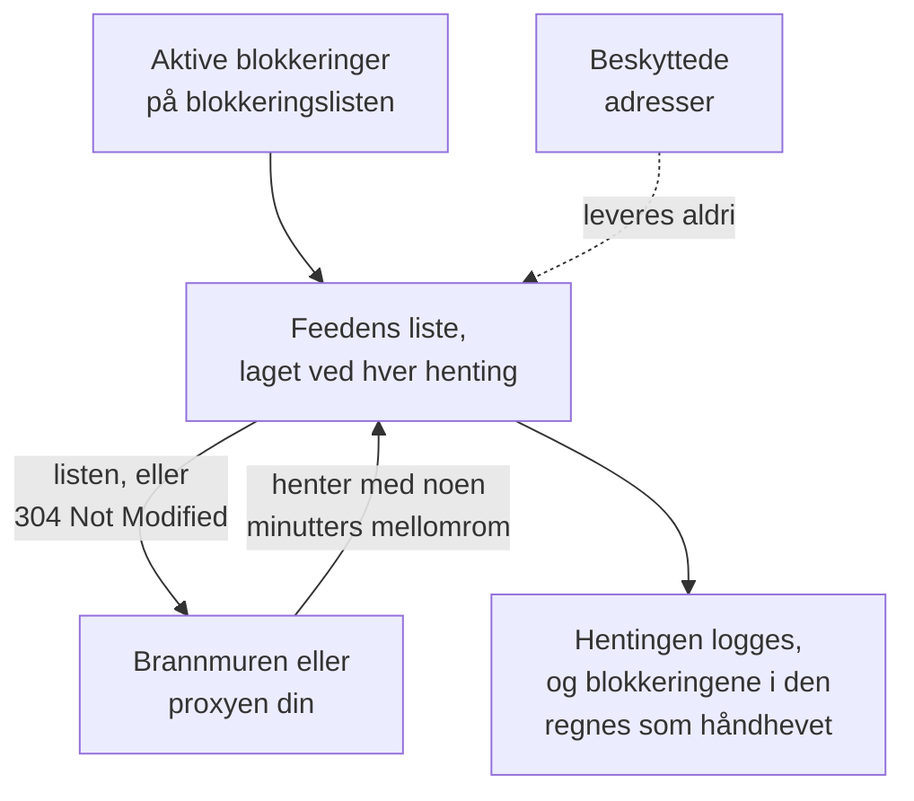

# Blokkeringslistefeeder for brannmurer og proxyer

En blokkeringslistefeed er en hemmelig URL som brannmuren eller proxyen din leser prosjektets [blokkeringsliste](/docs/telemetry/security-cases#blokkeringsliste) fra med noen minutters mellomrom. Palo Alto Networks, FortiGate, Check Point, Cisco Secure Firewall, OPNsense og pfSense leser den som en ekstern liste, og kommandoer du kopierer fra OneUptime, tar den i bruk med nftables, ipset, nginx, HAProxy eller Windows-brannmuren. Det er brannmuren din som kobler seg til OneUptime: OneUptime trenger aldri en rute inn i nettverket ditt eller et passord til brannmuren din.

:::cards
- [Opprett en feed](#opprett-en-feed): Velg brannmuren, kopier hemmeligheten, og følg trinnene for den.
- [Sett opp brannmuren din](#sett-opp-brannmuren-din): Trinnene for hver brannmur og proxy, og hvor ofte den henter.
- [Når en blokkering er håndhevet](#når-en-blokkering-er-håndhevet): Først når en brannmur har hentet en liste som inneholder den.
- [Roter eller tilbakekall hemmeligheten](#roter-eller-tilbakekall-hemmeligheten): En ny hemmelighet med et døgns overlapp, eller ingen i det hele tatt med en gang.
:::

## Slik fungerer det



Hver henting lager listen ut fra blokkeringene som er aktive i det øyeblikket. En blokkering som utløper eller oppheves, er borte fra neste henting, og en beskyttet adresse er aldri med, heller ikke en som ble beskyttet etter at den ble blokkert. En blokkering regnes først som håndhevet hos feeden når en brannmur har hentet en liste som inneholder den.

## Før du begynner

- En brannmur eller proxy som leser en liste over adresser fra en `https`-URL, eller en Linux- eller Windows-vert der du kan kjøre kommandoer som root eller som administrator.
- En vei ut til OneUptime over HTTPS fra brannmuren: `https://oneuptime.com` eller adressen til din egen OneUptime-server.
- En rolle som kan opprette feeder: Prosjekteier, Prosjektadministrator eller Sikkerhetsadministrator. Sikkerhetsmedlem og Sikkerhetsleser kan lese feeder og hentingene deres. Se [Roller](/docs/permissions/reference#roller).

## Opprett en feed

:::steps
### Gå til Blokkeringslistefeeder

Åpne **Produkter → Sikkerhetshendelser → Playbooks → Blokkeringslistefeeder**.

### Opprett feeden

Klikk på **Opprett Blokkeringslistefeed**, og velg under **Brannmur** brannmuren som leser den. **Navn** er det Blokkeringslisten kaller feeden der en blokkering håndheves; står feltet tomt, får feeden navnet til brannmuren, for eksempel "FortiGate feed". Under **Flere felt** velger **Leverer** IPv4 og IPv6, bare IPv4 eller bare IPv6, og **Tillatte kildeadresser** begrenser hvem som kan lese feeden.

### Kopier hemmeligheten

Siden til feeden åpnes med hemmeligheten, som vises bare én gang: OneUptime lagrer bare hashen av den. Kopier den, og klikk deretter på **Ferdig**. Til du forlater siden, fyller trinnene på den inn hemmeligheten for deg.

### Følg trinnene for brannmuren din

**Sett opp brannmuren din** viser URL-en du skal lime inn, hvordan brannmuren din sender hemmeligheten, og trinnene i dens egen konsoll, ferdig utfylt. Velg en annen brannmur der for å se trinnene for den i stedet. Etter den første hentingen fra brannmuren din viser statusen til feeden **Leser**, og **Hentinger** viser hentingen.
:::

## Hva en feed leverer

| Fil | For | Hva den inneholder |
| --- | --- | --- |
| `blocklist.txt` | Palo Alto Networks, pfSense, ipset, HAProxy, Windows-brannmuren og alle andre brannmurer | Én adresse eller ett område per linje. |
| `blocklist.txt?comments=1` | FortiGate, Check Point, Cisco Secure Firewall og OPNsense, som hopper over linjer som starter med `#` | Hver adresse eller hvert område etter en linje som sier hvorfor den er blokkert. |
| `nftables.nft` | nftables | En fil for `nft -f` som tømmer settene `blocklist_v4` og `blocklist_v6` i tabellen `inet oneuptime` og fyller dem på nytt. |
| `nginx.conf` | nginx | En `deny`-linje for hver adresse eller hvert område. |
| Navnet på en fil etterfulgt av `.md5`, for eksempel `blocklist.txt.md5` | Cisco Secure Firewall | Filens MD5, slik at brannmuren bare laster ned listen når den er endret. |

URL-en til en feed er `https://oneuptime.com/api/blocklist-feed/<feed ID>/<file>`, og siden til feeden viser den utfylt for brannmuren din. Med `?comments=1` ser listen slik ut:

```text
# OneUptime case CASE-42 until 2026-11-21 10:42 UTC
203.0.113.7
# OneUptime blocklist until lifted
198.51.100.0/24
```

En feed leverer de aktive blokkeringene der handlingen er **Blokker**. Den leverer aldri en utfordring, som en brannmur ikke kan utføre, og en feed som bare leverer IPv4 eller bare IPv6, utelater de andre adressene. Filen for nftables utelater en adresse som et område i listen allerede dekker, siden nftables avviser overlappende oppføringer i et sett.

Når ingenting er blokkert, inneholder `blocklist.txt` én adresse, `192.0.2.1` (`2001:db8::1` for en feed som bare leverer IPv6). Det er en adresse som er satt av til dokumentasjon, og som ingen trafikk på internett kommer fra: Palo Alto Networks og Cisco beholder den siste listen de leste når en liste kommer tom tilbake, så en tom liste ville fortsatt blokkert det du har opphevet.

Hvert svar har en `ETag`. En brannmur som sender den tilbake i `If-None-Match`, får `304 Not Modified` så lenge listen er uendret, og kommandoene du får fra OneUptime, gjør det.

## Slik sender en brannmur hemmeligheten

| Hvordan | Hva brannmuren sender | Brukes av |
| --- | --- | --- |
| Basic-autentisering | Et hvilket som helst brukernavn, for eksempel `oneuptime`, med hemmeligheten som passord | Palo Alto Networks (bare over HTTPS), FortiGate og Check Point |
| Bearer-token | `Authorization: Bearer <secret>` | Kommandoene for nftables, ipset, nginx, HAProxy og Windows-brannmuren |
| Hemmelighet i URL-en | `https://oneuptime.com/api/blocklist-feed/<feed ID>/<secret>/blocklist.txt` | Cisco Secure Firewall, OPNsense og pfSense, som ikke dokumenterer noen annen måte å sende den på |

En forespørsel uten hemmelighet, eller med feil hemmelighet, får `401 Unauthorized`. En URL med feil hemmelighet i får `404 Not Found`, slik som en adresse som ikke finnes. OneUptimes egen webserver skriver ikke feed-URL-er til tilgangsloggen sin, så en hemmelighet i en URL havner ikke der.

## Begrens hvem som kan lese en feed

**Tillatte kildeadresser** under **Flere felt** tar opptil 50 adresser og områder, én per linje, for eksempel `203.0.113.7` eller `198.51.100.0/24`. En forespørsel fra en hvilken som helst annen adresse får `403 Forbidden`, selv med riktig hemmelighet. La feltet stå tomt for å la alle adresser som har hemmeligheten, lese feeden.

Hver adresse kan hente en feed 60 ganger i minuttet og hente feeder 600 ganger i minuttet til sammen. Utover det får den `429 Too Many Requests` med en `Retry-After`-header.

## Når en blokkering er håndhevet

En blokkering regnes som håndhevet hos en feed når en brannmur har hentet en liste som inneholder den, etter at blokkeringen ble opprettet, og i ti minutter etter hver slik henting. Et `304 Not Modified`-svar teller som en henting av den samme listen. På siden **Blokkeringsliste** blir feedens brikke under **Håndhevet hos** da grønn, og verktøytipset sier hvor lenge etter blokkeringen brannmuren hentet den, for eksempel "En brannmur hentet denne blokkeringen fra FortiGate feed 3 min etter at den ble opprettet. Sist hentet for 2 minutter siden."

Etter ti minutter uten henting sier brikken at brannmuren ikke har hentet feeden siden: brannmuren blokkerer kanskje fortsatt adressen, men OneUptime kan ikke vite det. La derfor brannmuren din hente feeden hvert femte minutt eller oftere. En brannmur som henter sjeldnere, for eksempel OPNsense, blokkerer fortsatt mellom hentingene sine, og OneUptime regner bare blokkeringen som håndhevet der i de ti minuttene etter hver henting.

En blokkering som utløper eller oppheves, er borte fra neste henting, og brikken venter på at en brannmur skal hente listen uten den. Når OneUptime ikke kan lese hvilke adresser som er beskyttet, svarer feeden med `503 Service Unavailable` og `Retry-After: 60` i stedet for med en liste som kanskje inneholder en av dem, og brannmuren beholder listen den har.

## Når en brannmur slutter å lese

OneUptime lærer hvor ofte hver feed hentes. Når en feed ikke er hentet på tre ganger det vanlige intervallet sitt, og minst ti minutter, viser statusen **Sluttet å lese**, **Blokkeringsliste** nevner den over listen, og Prosjekteierne får én e-post: "Your firewall stopped reading the blocklist feed _feednavn_". Til en brannmur har hentet en feed to ganger, forventer OneUptime en henting hvert femte minutt, hver time fra OPNsense og hver dag fra pfSense.

Den neste hentingen fjerner det, og en senere stans sender en ny e-post. En feed med tilbakekalt hemmelighet regnes aldri som stanset.

## Roter eller tilbakekall hemmeligheten

**Roter hemmelighet** på siden til feeden oppretter en ny hemmelighet og viser den én gang. Hemmeligheten den erstatter, virker videre i 24 timer, så du kan gi alle brannmurer den nye; **Hentinger** merker en henting som fortsatt sendte den gamle, som **Forrige hemmelighet**. Roterer du igjen innen de 24 timene, slutter den eldste hemmeligheten å virke med en gang.

**Tilbakekall hemmelighet** avslutter hemmeligheten, og den forrige, med en gang: bruk den når en hemmelighet har lekket. Feeden svarer da ingen, og brannmurene dens beholder listen de har uten å oppdatere den, til **Roter hemmelighet** oppretter en ny hemmelighet. Sletting av en feed avslutter feeden, hemmeligheten og hentingene.

## Sett opp brannmuren din

Siden til feeden viser disse trinnene for brannmuren du velger, med URL-en, brukernavnet og, rett etter at hemmeligheten er opprettet, hemmeligheten utfylt.

| Brannmur | Fil | Hemmelighet | Henteintervall | Rommer høyst |
| --- | --- | --- | --- | --- |
| Palo Alto Networks | `blocklist.txt` | Basic-autentisering | 5 minutter, det korteste den tilbyr | 30 egendefinerte lister og 50 000 adresser totalt (150 000 på seriene PA-3200, PA-5200 og PA-7000) |
| FortiGate | `blocklist.txt?comments=1` | Basic-autentisering | 5 minutter (1 til 43 200; 5 som standard) | 300 000 adresser fordelt på alle trusselfeedene sine |
| Check Point | `blocklist.txt?comments=1`, IPv4 | Basic-autentisering | 5 minutter (hver time som standard) | 50 000 adresser i en feed |
| Cisco Secure Firewall | `blocklist.txt?comments=1` og MD5-en for den | I URL-en | 5 minutter (2 timer som standard) | |
| OPNsense | `blocklist.txt?comments=1` | I URL-en | 1 time, det korteste den tilbyr | |
| pfSense | `blocklist.txt` | I URL-en | 1 dag, det korteste den tilbyr | |
| nftables, ipset, nginx, HAProxy, Windows-brannmuren | Sine egne | Bearer-token | 1 minutt | |

### Palo Alto Networks

1. Gå til **Objects → External Dynamic Lists** i webgrensesnittet, og klikk på **Add**.
2. Sett **Type** til **IP List** og **Source** til URL-en til feeden, `https://oneuptime.com/api/blocklist-feed/<feed ID>/blocklist.txt`.
3. Slå på **Client Authentication** med **Username** `oneuptime` og feedens hemmelighet som **Password**.
4. Sett **Check for updates** til **Every Five Minutes**, klikk på **OK**, og utfør en commit.
5. Under **Policies → Security** legger du til en regel med listen som **Source Address** og handlingen **Deny**, og utfører en commit.

Palo Alto Networks sender brukernavnet og passordet bare over HTTPS. Den leser bare en kommentar etter en adresse, aldri på en egen linje, så feeden for den er den enkle listen. Se [Configure the Firewall to Access an External Dynamic List](https://docs.paloaltonetworks.com/pan-os/11-1/pan-os-admin/policy/use-an-external-dynamic-list-in-policy/configure-the-firewall-to-access-an-external-dynamic-list).

### FortiGate

1. Gå til **Security Fabric → External Connectors**, klikk på **Create New**, og velg **IP Address** under **Threat Feeds**.
2. Sett **URL of external resource** til URL-en til feeden, `https://oneuptime.com/api/blocklist-feed/<feed ID>/blocklist.txt?comments=1`.
3. Slå på **HTTP basic authentication** med **Username** `oneuptime` og feedens hemmelighet som **Password**.
4. Sett **Refresh Rate** til 5 minutter, og klikk på **OK**.
5. Under **Policy & Objects → Firewall Policy** bruker du feeden som **Source** i en policy og setter **Action** til **DENY**.

Se [Configuring a threat feed](https://docs.fortinet.com/document/fortigate/7.6.0/administration-guide/379433/configuring-a-threat-feed).

### Check Point

1. Åpne **Object Explorer** i SmartConsole, og velg **New → More → Network Object → Network Feed**.
2. Sett **Feed URL** til URL-en til feeden, `https://oneuptime.com/api/blocklist-feed/<feed ID>/blocklist.txt?comments=1`, **Format** til **Flat list** og **Data type** til **IP Address**.
3. Under **Advanced Settings** angir du **Username** `oneuptime` og feedens hemmelighet som passord for **Authentication**.
4. Sett **Check feed interval** til 5 minutter, klikk på **Test Feed** og deretter på **OK**.
5. Bruk feeden som **Source** i en Access Control-regel med handlingen **Drop**, og installer policyen.

Check Point dokumenterer IPv4-adresser for en nettverksfeed, så en feed som er laget for den, leverer bare IPv4. Se [Network Feed](https://sc1.checkpoint.com/documents/R82/WebAdminGuides/EN/CP_R82_SecurityManagement_AdminGuide/Content/Topics-SECMG/Network_Feed.htm).

### Cisco Secure Firewall

1. Velg **Objects → Security Intelligence** i management center, og klikk på **Add Network Lists and Feeds**.
2. Sett **Type** til **Feed**, **Feed URL** til URL-en til feeden, `https://oneuptime.com/api/blocklist-feed/<feed ID>/<secret>/blocklist.txt?comments=1`, og **MD5 URL** til den samme URL-en med `.md5` etter `blocklist.txt`.
3. Sett **Update Frequency** til 5 minutter, og lagre.
4. Åpne **Security Intelligence → Networks** i tilgangskontrollpolicyen din, legg feeden til i **Block List**, og lagre og distribuer deretter.

Cisco krever en MD5-URL for en oppdateringsfrekvens på 30 minutter eller mindre, og de administrerte enhetene henter oppdateringer fra management center hvert 30. minutt, så en blokkering når dem opptil 30 minutter etter at feeden er hentet. Se [Creating Security Intelligence feeds](https://docs.manage.security.cisco.com/cdfmc/t_creating_security_intelligence_feeds.html).

### OPNsense

1. Gå til **Firewall → Aliases**, og legg til et alias av typen **URL Table (IPs)**.
2. Sett **Content** til URL-en til feeden, `https://oneuptime.com/api/blocklist-feed/<feed ID>/<secret>/blocklist.txt?comments=1`, og **Refresh Frequency** til 0 dager og 1 time.
3. Lagre, klikk på **Apply**, og legg deretter til en regel under **Firewall → Rules** som blokkerer trafikk der **Source** er aliaset.

OPNsense henter en URL-tabell høyst én gang i timen, så OneUptime bekrefter bare blokkeringene dens i de ti minuttene etter hver henting. Den blokkerer dem fortsatt innimellom. Se [Aliases](https://docs.opnsense.org/manual/aliases.html).

### pfSense

1. Gå til **Firewall → Aliases**, klikk på **Add**, og velg **URL Table (IPs)**.
2. Skriv inn URL-en til feeden, `https://oneuptime.com/api/blocklist-feed/<feed ID>/<secret>/blocklist.txt`, og sett oppdateringsintervallet til 1 dag.
3. Klikk på **Save** og **Apply Changes**, og legg deretter til en regel under **Firewall → Rules** med aliaset som **Source** og handlingen **Block**.

> [!WARNING]
> pfSense henter en URL-tabell høyst én gang om dagen: for tregt til å blokkere et angrep mens det pågår. Bruk den til lange blokkeringer, ved siden av en brannmur som henter med noen minutters mellomrom.

Se [Alias Types](https://docs.netgate.com/pfsense/en/latest/firewall/aliases-types.html).

### nftables

Kjør kommandoene siden til feeden viser, én gang som root. De lager tabellen `inet oneuptime` med to sett, `blocklist_v4` og `blocklist_v6`, regler i kjedene `input` og `forward` som forkaster trafikk fra adressene i dem, og skriptet `/usr/local/sbin/oneuptime-blocklist`, som lagrer hemmeligheten i `/etc/oneuptime-blocklist`, som bare root kan lese.

```bash
# Run once, as root.
install -d -m 700 /etc/oneuptime-blocklist /var/lib/oneuptime-blocklist
printf 'Authorization: Bearer %s\n' 'YOUR_FEED_SECRET' > /etc/oneuptime-blocklist/auth
chmod 600 /etc/oneuptime-blocklist/auth
cat > /usr/local/sbin/oneuptime-blocklist <<'SCRIPT'
#!/bin/sh
# Loads the OneUptime blocklist into nftables when it changed.
set -eu
URL='https://oneuptime.com/api/blocklist-feed/<feed ID>/nftables.nft'
STATE=/var/lib/oneuptime-blocklist
if ! nft list table inet oneuptime >/dev/null 2>&1; then
  rm -f "$STATE/etag"
  nft -f - <<'NFT'
table inet oneuptime {
  set blocklist_v4 { type ipv4_addr; flags interval; auto-merge; }
  set blocklist_v6 { type ipv6_addr; flags interval; auto-merge; }
  chain input {
    type filter hook input priority filter; policy accept;
    ip saddr @blocklist_v4 drop
    ip6 saddr @blocklist_v6 drop
  }
  chain forward {
    type filter hook forward priority filter; policy accept;
    ip saddr @blocklist_v4 drop
    ip6 saddr @blocklist_v6 drop
  }
}
NFT
fi
TMP=$(mktemp)
trap 'rm -f "$TMP" "$TMP.h"' EXIT
ETAG=$(cat "$STATE/etag" 2>/dev/null || true)
CODE=$(curl --silent --show-error --max-time 60 --header @/etc/oneuptime-blocklist/auth \
  ${ETAG:+--header "If-None-Match: $ETAG"} \
  --dump-header "$TMP.h" --output "$TMP" --write-out '%{http_code}' "$URL")
[ "$CODE" = 304 ] && exit 0
[ "$CODE" = 200 ] || { echo "oneuptime-blocklist: the feed answered $CODE" >&2; exit 1; }
nft -f "$TMP"
sed -n 's/^[Ee][Tt][Aa][Gg]:[[:space:]]*//p' "$TMP.h" | tr -d '\r' > "$STATE/etag"
SCRIPT
chmod 700 /usr/local/sbin/oneuptime-blocklist
echo '* * * * * root flock -n /run/oneuptime-blocklist.lock /usr/local/sbin/oneuptime-blocklist' > /etc/cron.d/oneuptime-blocklist
/usr/local/sbin/oneuptime-blocklist
```

Skriptet kjører hvert minutt fra `/etc/cron.d/oneuptime-blocklist`. Det laster inn `nftables.nft` bare når listen er endret, i én transaksjon, så settene aldri er halvfulle. Se [Sets](https://wiki.nftables.org/wiki-nftables/index.php/Sets).

### ipset og iptables

Kjør kommandoene siden til feeden viser, én gang som root. De lager to sett, `oneuptime_v4` og `oneuptime_v6`, og regler i kjeden `PREROUTING` i tabellen `raw`, for iptables og ip6tables, som forkaster trafikk fra adressene i dem.

Skriptet kjører hvert minutt fra cron. Når listen er endret, fyller det to nye sett og bytter dem ut med de gamle, så reglene aldri ser et halvfullt sett. Se [ipset](https://ipset.netfilter.org/ipset.man.html).

### nginx

Legg include-linjen til i `server`-blokken for hvert nettsted som skal beskyttes, og kjør deretter kommandoene siden til feeden viser, én gang som root:

```nginx
server {
    include /etc/nginx/oneuptime-blocklist.conf;
}
```

```bash
# Run once, as root.
install -d -m 700 /etc/oneuptime-blocklist /var/lib/oneuptime-blocklist
printf 'Authorization: Bearer %s\n' 'YOUR_FEED_SECRET' > /etc/oneuptime-blocklist/auth
chmod 600 /etc/oneuptime-blocklist/auth
touch /etc/nginx/oneuptime-blocklist.conf
cat > /usr/local/sbin/oneuptime-blocklist <<'SCRIPT'
#!/bin/sh
# Writes the OneUptime blocklist for nginx when it changed, and reloads nginx.
set -eu
URL='https://oneuptime.com/api/blocklist-feed/<feed ID>/nginx.conf'
STATE=/var/lib/oneuptime-blocklist
TMP=$(mktemp)
trap 'rm -f "$TMP" "$TMP.h"' EXIT
ETAG=$(cat "$STATE/etag" 2>/dev/null || true)
CODE=$(curl --silent --show-error --max-time 60 --header @/etc/oneuptime-blocklist/auth \
  ${ETAG:+--header "If-None-Match: $ETAG"} \
  --dump-header "$TMP.h" --output "$TMP" --write-out '%{http_code}' "$URL")
[ "$CODE" = 304 ] && exit 0
[ "$CODE" = 200 ] || { echo "oneuptime-blocklist: the feed answered $CODE" >&2; exit 1; }
cp /etc/nginx/oneuptime-blocklist.conf "$STATE/last.conf"
cp "$TMP" /etc/nginx/oneuptime-blocklist.conf
if nginx -t -q; then nginx -s reload; else cp "$STATE/last.conf" /etc/nginx/oneuptime-blocklist.conf; exit 1; fi
sed -n 's/^[Ee][Tt][Aa][Gg]:[[:space:]]*//p' "$TMP.h" | tr -d '\r' > "$STATE/etag"
SCRIPT
chmod 700 /usr/local/sbin/oneuptime-blocklist
echo '* * * * * root flock -n /run/oneuptime-blocklist.lock /usr/local/sbin/oneuptime-blocklist' > /etc/cron.d/oneuptime-blocklist
/usr/local/sbin/oneuptime-blocklist

# Then add this line to the server block of the site to protect, and reload nginx:
#   include /etc/nginx/oneuptime-blocklist.conf;
```

Skriptet kjører hvert minutt fra cron. Når listen er endret, skriver det `/etc/nginx/oneuptime-blocklist.conf`, kontrollerer konfigurasjonen med `nginx -t` og laster inn nginx på nytt, og det legger den forrige filen tilbake hvis kontrollen mislykkes.

Bak en lastbalanserer eller et CDN ser nginx adressen til lastbalansereren, ikke den besøkendes, med mindre realip-modulen er satt opp: sett `set_real_ip_from` til adressene til lastbalansereren og `real_ip_header` til headeren den sender, eller blokker ved lastbalansereren i stedet. Se [ngx_http_access_module](https://nginx.org/en/docs/http/ngx_http_access_module.html).

### HAProxy

Opprett listefilen som root, legg to linjer til i `haproxy.cfg`, og last deretter inn HAProxy på nytt én gang: Runtime API-et oppdaterer bare en liste HAProxy allerede leser.

```text
global
    stats socket /run/haproxy/admin.sock mode 660 level admin

frontend www
    http-request deny if { src -n -f /etc/haproxy/oneuptime-blocklist.lst }
```

Kjør deretter resten av kommandoene siden til feeden viser. Skriptet kjører hvert minutt fra cron og skriver, når listen er endret, `/etc/haproxy/oneuptime-blocklist.lst` og oppdaterer HAProxy via Runtime API-et, uten omlasting. Se [The Runtime API](https://docs.haproxy.org/3.4/management.html#9.3).

### Windows-brannmur

Kjør kommandoene siden til feeden viser, én gang i PowerShell som administrator. De lagrer et skript og hemmeligheten i `C:\ProgramData\OneUptime\Blocklist`, som bare SYSTEM og Administratorer kan lese, og registrerer den planlagte oppgaven "OneUptime Blocklist", som kjører skriptet hvert minutt som SYSTEM.

Skriptet vedlikeholder innkommende regler som blokkerer alle adresser på listen, 1 000 per regel: "OneUptime blocklist 0", "OneUptime blocklist 1" og så videre. Se [Set-NetFirewallRule](https://learn.microsoft.com/en-us/powershell/module/netsecurity/set-netfirewallrule).

### Andre brannmurer

1. Pek brannmuren eller proxyen din mot URL-en til feeden, `https://oneuptime.com/api/blocklist-feed/<feed ID>/blocklist.txt`: én adresse eller ett område per linje.
2. Send feedens hemmelighet som passord for Basic-autentisering med et hvilket som helst brukernavn, eller som bearer-token.
3. La den hente listen hvert 5. minutt eller oftere: en blokkering regnes som håndhevet der i ti minutter etter hver henting.

### Kubernetes

Blokker ved edge-nettverket eller sky-WAF-en foran klyngen, koblet til som et mål for blokkeringslisten under **Sikkerhetstilkoblinger** eller **Skytilkoblinger**, eller på en proxy du kjører foran den med kommandoene for nginx eller HAProxy. Community-kontrolleren Ingress NGINX er avviklet, og depotet ble arkivert i mars 2026, så OneUptime dokumenterer ikke annotasjonene. Se [Ingress NGINX Retirement](https://kubernetes.io/blog/2025/11/11/ingress-nginx-retirement/).

## Grenser

| Hva | Grense |
| --- | --- |
| Oppføringer i en feed | 20 000 |
| Tillatte kildeadresser | 50 adresser og områder |
| Hentinger av én feed fra én adresse | 60 i minuttet |
| Hentinger av alle feeder fra én adresse | 600 i minuttet |
| En erstattet hemmelighet virker videre | 24 timer |
| En blokkering regnes som håndhevet etter en henting | 10 minutter |
| Lagrede hentinger | 30 dager |

## Feilsøking

:::details Brannmuren får 401 Unauthorized
Hemmeligheten den sender, er ikke feedens. Sjekk at passordet, eller bearer-tokenet, er hele hemmeligheten, uten noe foran eller etter. En hemmelighet som ble erstattet for mer enn 24 timer siden, virker ikke lenger: **Roter hemmelighet** oppretter en ny.
:::

:::details Brannmuren får 404 Not Found
URL-en peker på en feed som ikke finnes, en fil som en feed ikke leverer, eller feil hemmelighet i URL-en. Kopier URL-en på nytt fra siden til feeden.
:::

:::details Brannmuren får 403 Forbidden
**Tillatte kildeadresser** for feeden inneholder ikke adressen brannmuren henter fra. **Hentinger** viser adressen hver henting kom fra.
:::

:::details Brikken til en blokkering sier at den venter på at en brannmur skal hente feeden
Ingen brannmur har hentet feeden siden blokkeringen ble opprettet. Sjekk **Hentinger** på siden til feeden: en brannmur som henter hvert femte minutt, har blokkeringen innen fem minutter.
:::

## Neste steg

:::cards
- [Sikkerhetssaker og playbooks](/docs/telemetry/security-cases): Blokker en adresse fra en sak, manuelt eller fra en playbook.
- [Trusseletterretning](/docs/telemetry/threat-intelligence): Hent kjente ondsinnede adresser inn i OneUptime.
- [Sikkerhetshendelser](/docs/telemetry/security-events): Finn adressene som er verdt å blokkere.
:::
