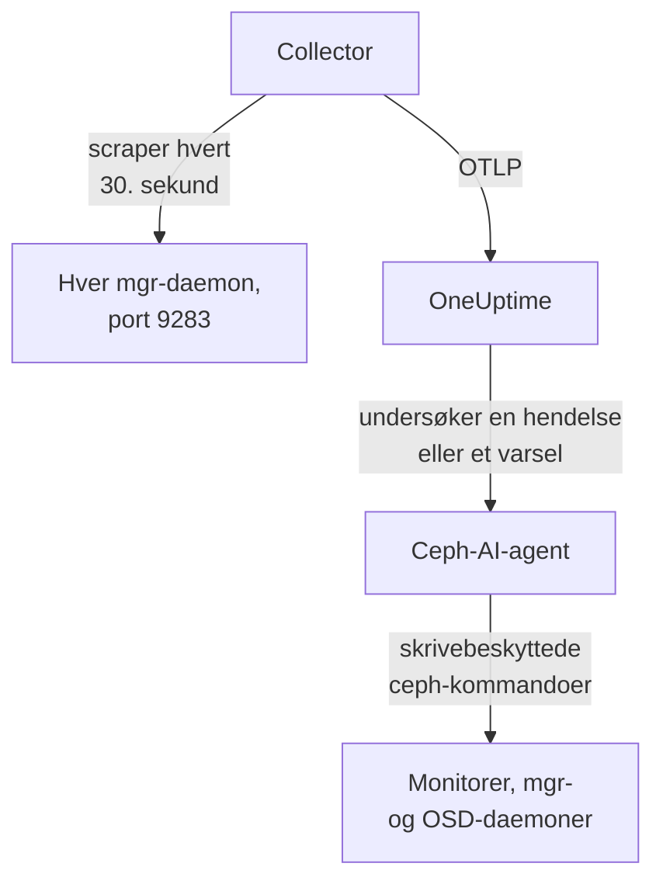

# Ceph-agent

OneUptimes Ceph-agent overvåker en Ceph-klynge: tilstanden, monitor-quorumet, OSD-ene, poolene og placement groups. Den scraper Ceph mgr-modulen `prometheus` på hver mgr-daemon, stempler hver metrikk med navnet på klyngen din og sender den til OneUptime, der klyngen vises med OSD-ene, poolene og daemonene sine. [Ceph-overvåkere](/docs/monitor/ceph-monitor) varsler ut fra det som kommer inn.

:::cards
- [Installer agenten](#installer-agenten): Aktiver mgr-modulen, deretter installasjonsskriptet eller Docker Compose.
- [Hva agenten samler inn](#hva-agenten-samler-inn): Seriene bak Ceph-sidene, metrikkene og varselmalene.
- [AI-agent](#ai-agent): La OneUptime AI lese klyngen mens den undersøker.
- [Feilsøking](#feilsøking): Et diagnoseskript, og de vanlige problemene.
:::

## Slik fungerer det

Agenten er to containere som du kjører med Docker Compose på én maskin. En OpenTelemetry Collector scraper mgr-modulen `prometheus` på hver mgr-daemon hvert 30. sekund. Bare den aktive mgr-en svarer med metrikker, så når den feiler over til en standby, fortsetter metrikkene å komme uten noen endring. Ceph-AI-agenten ved siden av lar OneUptime AI kjøre skrivebeskyttede `ceph`-kommandoer mens den undersøker en hendelse eller et varsel.



Klyngen registrerer seg med de første dataene sine, under navnet agenten stempler på hver metrikk som `ceph.cluster.name`.

## Før du begynner

- Docker Engine 20.10 eller nyere med Docker Compose v2-pluginen, på en maskin som når Ceph mgr-daemonene dine på port 9283.
- Et skall på en Ceph-adminnode, der `ceph`-CLI-en fungerer med administratorrettigheter.
- En inntaksnøkkel. Opprett en under **Prosjektinnstillinger → Telemetri og APM → Inntaksnøkler** og kopier verdien.
- Utgående HTTPS fra den maskinen til OneUptime-URL-en din.

## Installer agenten

:::steps
### Aktiver mgr-modulen prometheus

På en Ceph-adminnode:

```bash
ceph mgr module enable prometheus
```

Hver mgr-daemon leverer da Prometheus-metrikker på port `9283` under `/metrics`. Bare den aktive mgr-en returnerer metrikker: standby-mgr-er svarer med et tomt svar, eller med en HTTP-feil hvis `mgr/prometheus/standby_behaviour` er satt til `error`. Derfor scraper agenten hver mgr. List dem opp:

```bash
ceph mgr stat                    # active mgr
ceph orch ps --daemon-type mgr   # all mgrs (cephadm clusters)
```

### Installer og start agenten

:::tabs
@tab install.sh
Last ned installasjonsskriptet og kjør det på maskinen som skal være vert for agenten:

```bash
curl -sSL https://raw.githubusercontent.com/OneUptime/oneuptime/master/agents/CephAgent/install.sh -o install.sh
bash install.sh
```

Skriptet spør etter OneUptime-URL-en din, inntaksnøkkelen, et navn på klyngen og mgr-endepunktene, og om [AI-agenten](#ai-agent) kan bruke rettinger. Der `ceph` fungerer med administratorrettigheter, tilbyr det også å opprette AI-agentens egen Ceph-klient. Det installerer til `/opt/oneuptime-ceph-agent`, skriver en `.env`-fil med `0600` og starter agenten med Docker Compose. Å kjøre skriptet igjen gjenbruker alt i den `.env`-filen i stedet for å spørre på nytt, og det er slik du [oppgraderer agenten](#oppgradere-agenten).
@tab Docker Compose
Last ned `docker-compose.yml` og `otel-collector-config.yaml` fra [CephAgent-mappen](https://github.com/OneUptime/oneuptime/tree/master/agents/CephAgent) til en ny mappe:

```bash
mkdir oneuptime-ceph-agent && cd oneuptime-ceph-agent
curl -fsSLO https://raw.githubusercontent.com/OneUptime/oneuptime/master/agents/CephAgent/docker-compose.yml
curl -fsSLO https://raw.githubusercontent.com/OneUptime/oneuptime/master/agents/CephAgent/otel-collector-config.yaml
```

Opprett en `.env`-fil ved siden av dem:

```bash title=".env"
ONEUPTIME_URL=YOUR_ONEUPTIME_URL
ONEUPTIME_TELEMETRY_INGESTION_KEY=YOUR_TELEMETRY_INGESTION_TOKEN
CEPH_CLUSTER_NAME=my-ceph-cluster
CEPH_MGR_ENDPOINTS=[ceph-mon-1:9283,ceph-mon-2:9283,ceph-mon-3:9283]
```

List opp hver mgr-daemon, den aktive og standby-ene, kommaseparert og i hakeparenteser: Parentesene får collectoren til å lese verdien som en liste over scrape-mål. Start agenten:

```bash
docker compose up -d
```

AI-agentens container starter også, og venter på en egen Ceph-klient: se [AI-agent](#ai-agent).
:::

### Sjekk at agenten kjører

```bash
docker compose ps
docker logs -f oneuptime-ceph-agent
```

`docker compose ps` viser collectoren (`oneuptime-ceph-agent`) og AI-agenten (`oneuptime-ceph-ai-agent`). Collectorens logger skal vise denne linjen når den har startet:

```text
Everything is ready. Begin running and processing data.
```

### Finn klyngen i OneUptime

Åpne **Produkter → Infrastruktur → Ceph → Alle klynger**. Klyngen vises under `CEPH_CLUSTER_NAME` innen et minutts tid, med OSD-ene, poolene og daemonene sine.
:::

## Miljøvariabler

Installasjonsskriptet skriver disse til `/opt/oneuptime-ceph-agent/.env`; en Docker Compose-installasjon leser dem fra `.env` ved siden av `docker-compose.yml`. Etter at du har endret en, kjør `docker compose up -d` i den mappen.

| Variabel | Påkrevd | Beskrivelse |
| --- | --- | --- |
| `ONEUPTIME_URL` | Ja | OneUptime-URL-en din, for eksempel `https://oneuptime.com` eller den selvhostede instansen din. Bruk `http://` og porten hvis instansen bare bruker HTTP. |
| `ONEUPTIME_TELEMETRY_INGESTION_KEY` | Ja | Inntaksnøkkelen fra **Prosjektinnstillinger → Telemetri og APM → Inntaksnøkler**. |
| `CEPH_CLUSTER_NAME` | Ja | Klyngens navn i OneUptime, stemplet på hver metrikk som ressursattributtet `ceph.cluster.name`. Hold det stabilt: å endre det senere registrerer en ny klynge. Standard er `ceph`. |
| `CEPH_MGR_ENDPOINTS` | Ja | Hver mgr-daemon som en kommaseparert `host:port`-liste i hakeparenteser, for eksempel `[ceph-mon-1:9283,ceph-mon-2:9283,ceph-mon-3:9283]`. Installasjonsskriptet legger til parentesene for deg. |

AI-agentens egne innstillinger står under [AI-agent](#ai-agent).

## Slik scraper agenten

- **Hver mgr, hvert 30. sekund.** mgr-modulen `prometheus` mellomlagrer hver scrape i `mgr/prometheus/scrape_interval` (15 sekunder som standard). Scrape aldri oftere enn det: Du ville bare lest mellomlageret på nytt.
- **`honor_labels: true`.** Etikettene Ceph eksporterer (`ceph_daemon`, `pool_id`, instansetiketter per daemon) beholdes som de er. Uten dette ville etiketten `instance` blitt skrevet om for hvert scrape-mål og endret seg hver gang den aktive mgr-en byttes, noe som ødelegger hver serie.

## Hva agenten samler inn

Agenten sender alt mgr-modulen `prometheus` eksporterer. OneUptimes Ceph-sider, metrikkatalog og varselmaler bygger på disse seriene:

| Kategori | Metrikker |
| --- | --- |
| Klyngetilstand | `ceph_health_status` (0 = OK, 1 = WARN, 2 = ERR), `ceph_health_detail` (én serie per aktiv helsesjekk, med etikettene `name` og `severity`, fra Quincy og nyere; grunnlaget for varselmalene for helsesjekker og for **Active Health Checks** i oversikten), `ceph_healthcheck_slow_ops`, `ceph_daemon_health_metrics` (per daemon, etter `type`), `ceph_mon_quorum_status`, `ceph_mon_metadata`, `ceph_cluster_total_bytes`, `ceph_cluster_total_used_bytes` |
| OSD | `ceph_osd_up`, `ceph_osd_in`, `ceph_osd_apply_latency_ms`, `ceph_osd_commit_latency_ms`, `ceph_osd_stat_bytes`, `ceph_osd_stat_bytes_used`, `ceph_osd_numpg`, `ceph_osd_metadata`, per OSD etter etiketten `ceph_daemon` (for eksempel `osd.3`) |
| Pool | `ceph_pool_stored`, `ceph_pool_max_avail`, `ceph_pool_objects`, `ceph_pool_rd`, `ceph_pool_wr`, `ceph_pool_rd_bytes`, `ceph_pool_wr_bytes`, `ceph_pool_metadata`. Dataseriene har bare en etikett `pool_id`; poolens navn står på `ceph_pool_metadata`. |
| Placement groups | `ceph_pg_total`, `ceph_pg_active`, `ceph_pg_clean`, `ceph_pg_degraded`, `ceph_pg_undersized` (alle per pool, etter `pool_id`), `ceph_num_objects_degraded`, `ceph_num_objects_misplaced` |
| Daemoner | `ceph_mgr_metadata`, `ceph_mds_metadata` og `ceph_rgw_metadata`, i tillegg til monitor- og OSD-metadataene over. Hver navngir en daemon og har versjonen dens i etiketten `ceph_version`: Siden **Daemons** viser dem. |

### Flere scrape-mål

mgr-modulen dekker klyngens tilstand og kapasitet. For en nærmere titt kan du legge til flere jobber under `scrape_configs` i `otel-collector-config.yaml`:

- **`ceph-exporter` (Reef 18.2 og nyere).** cephadm kjører en `ceph-exporter`-daemon på hver vert i klyngen, som leverer ytelsestellere per daemon på port `9926`. Legg til ett mål per vert.
- **`node_exporter`.** Den vanlige følgesvennen for CPU-, minne-, disk- og nettverksmetrikker for hver Ceph-vert, på port `9100` som standard.

Begge får ressursattributtet `ceph.cluster.name` fra den medfølgende prosessoren `resource`, så de havner på samme klynge i OneUptime.

## Valgfritt — Send Ceph-klyngeloggen

Agenten kan følge `/var/log/ceph/ceph.log` og sende den til OneUptime, noe som fyller klyngens side **Cluster Log**. Det er av som standard fordi agenten da må kjøre på en vert som har klyngeloggen: som standard en monitorvert.

:::steps
### Slå på receiveren

I `otel-collector-config.yaml`, fjern kommentarene rundt mottakeren `filelog` og pipelinen `logs`.

### Monter loggmappen

I `docker-compose.yml`, fjern kommentaren rundt volumet som monterer mappen inn i collectoren:

```yaml
- /var/log/ceph:/var/log/ceph:ro
```

### Start agenten på nytt

```bash
docker compose up -d
```
:::

Linjene sendes etter hvert som de skrives. OneUptime leser formatet til `ceph.log` (tid, daemon, nivå `INF`/`WRN`/`ERR`, melding) når den viser dem, og prosessoren `resource` stempler `ceph.cluster.name`, så loggen havner på denne klyngen.

## Merk klyngen med prosjektetiketter

Et ressursattributt som starter med `oneuptime.label.`, blir en prosjektetikett på klyngen: `oneuptime.label.<dimension>=<value>` er etiketten `<dimension>:<value>`. Legg til attributtene i prosessoren `resource` i `otel-collector-config.yaml`, ved siden av `ceph.cluster.name`:

```yaml
processors:
  resource:
    attributes:
      # ...existing attributes...
      - key: oneuptime.label.team
        value: storage
        action: upsert
      - key: oneuptime.label.env
        value: production
        action: upsert
```

Collectoren leser konfigurasjonen bare når den starter: Kjør `docker compose restart oneuptime-ceph-agent`. Klyngen viser deretter etikettene `team:storage` og `env:production`. Etiketter sammenlignes uten hensyn til store og små bokstaver, så en eksisterende etikett `Production` gjenbrukes i stedet for å dupliseres, og agenten fjerner aldri en etikett som noen har lagt til i OneUptime.

## Kjør som en systemd-tjeneste

For å starte agenten sammen med maskinen og starte den på nytt når den feiler, installer systemd-enheten dens. Den forutsetter at agenten ligger i `/opt/oneuptime-ceph-agent`, der installasjonsskriptet legger den:

```bash
sudo curl -fsSL https://raw.githubusercontent.com/OneUptime/oneuptime/master/agents/CephAgent/systemd/oneuptime-ceph-agent.service -o /etc/systemd/system/oneuptime-ceph-agent.service
sudo systemctl daemon-reload
sudo systemctl enable --now oneuptime-ceph-agent
```

## Oppgradere agenten

Agenten rapporterer collector-versjonen filene dens fester, som sin **Agentversjon**. Når den er eldre enn versjonen denne OneUptime-utgivelsen fester, vises et varseltegn ved siden av den på klyngens **Oversikt**. Velg det for å se disse kommandoene. En agent som ble installert før filene rapporterte en versjon, viser ingen før den er oppgradert på denne måten.

Collector-imaget er festet i `docker-compose.yml`, og konfigurasjonen er en fil ved siden av, så å hente nye images alene flytter ikke agenten fremover. Kjør `install.sh` igjen: det gjenbruker hver verdi i den eksisterende `.env`-filen din (ingenting spørres om igjen), fornyer `docker-compose.yml` og `otel-collector-config.yaml` (en fil du har redigert, beholdes som `<file>.bak.<timestamp>`), henter imagene og oppretter agenten på nytt, slik at collectoren leser den nye konfigurasjonen. AI-agentens mappe `ceph/` forblir som den er.

```bash
curl -sSL https://raw.githubusercontent.com/OneUptime/oneuptime/master/agents/CephAgent/install.sh -o install.sh
bash install.sh
```

Installerte du den med Docker Compose i stedet? I agentens mappe, last ned begge filene på nytt (og gjør eventuelle endringer du hadde gjort i dem, på nytt), hent deretter imagene og opprett agenten på nytt:

```bash
curl -fsSLO https://raw.githubusercontent.com/OneUptime/oneuptime/master/agents/CephAgent/docker-compose.yml
curl -fsSLO https://raw.githubusercontent.com/OneUptime/oneuptime/master/agents/CephAgent/otel-collector-config.yaml
docker compose pull
docker compose up -d --force-recreate
```

## Avinstallere agenten

```bash
cd /opt/oneuptime-ceph-agent
docker compose down
```

Hvis du opprettet AI-agentens Ceph-klient, fjern den på en adminnode med `ceph auth del client.oneuptime-ai`.

## AI-agent

Agentens `docker-compose.yml` kjører også **Ceph-AI-agenten**, `oneuptime-ceph-ai-agent` (image `oneuptime/resource-ai-agent:release`). Mens OneUptime AI undersøker en hendelse eller et varsel på denne klyngen, kjører den skrivebeskyttede `ceph`-kommandoer gjennom den — `ceph health detail`, `ceph osd tree`, `ceph pg dump_stuck`, `ceph crash ls` — og bruker, bare hvis du tillater det, rettinger som å merke en OSD som in igjen eller fjerne `noout`. Den registrerer seg som klyngen med navnet `CEPH_CLUSTER_NAME`, slik collectoren gjør, og vises på klyngens side **KI → AI-agent** i OneUptime.

- **AI-undersøkelser er på som standard.** Så snart agenten kobler seg til, undersøker OneUptime AI hendelser og varsler på denne klyngen med den, og klyngens **Oversikt** viser agentens status. For å stoppe, sett `ONEUPTIME_AI_INVESTIGATION=false` der agenten kjører (**Endre** under **Hva AI kan gjøre** på AI-agentsiden viser hvordan), eller utelat agenten.
- **Dens egen Ceph-klient er den harde grensen.** Den kobler til som `client.oneuptime-ai`, med klyngens minimale `ceph.conf` og den klientens nøkkelring i en mappe `ceph/` ved siden av `docker-compose.yml` (montert skrivebeskyttet på `/etc/ceph`). Med lese-caps kan ingenting den kjører, endre klyngen. Ved en ny installasjon tilbyr `install.sh` å opprette klienten; å kjøre det igjen gjør aldri det. Legg aldri admin-nøkkelringen i den mappen.
- Den er **skrivebeskyttet** med mindre du setter `ONEUPTIME_AI_ALLOW_WRITES=true` og gir klienten caps for rettingene (agentens README lister dem opp); `ONEUPTIME_AI_WRITE_TARGETS` (for eksempel `osd.*,cluster`) begrenser hva en retting kan røre. `ONEUPTIME_AI_FIXES` i samme `.env` sier hvordan rettinger kjøres — `ask-for-approval` (en person godkjenner hver enkelt), `automatic` eller `bypass-approval` — og AI-agentsiden viser det skrivebeskyttet ([Hva AI kan gjøre, fastsatt av agenten](/docs/ai/infrastructure-ai-agents#what-ai-may-do-set-by-the-agent)).
- Den kobler seg utover til monitorene (TCP 3300 og 6789) og mgr- og OSD-daemonene (TCP 6800–7300), kjører som UID 1000 uten capabilities og kjører aldri `auth`, `config-key`, `tell` eller noe som sletter data. Slett tjenesten `oneuptime-ceph-ai-agent` fra `docker-compose.yml` hvis du ikke bruker OneUptime AI.

For å opprette klienten for hånd, kjør dette på en Ceph-adminnode, i agentens mappe (kopier de to filene til mappen `ceph/` på agentens maskin hvis det er en annen):

```bash
mkdir -p ceph
ceph config generate-minimal-conf > ceph/ceph.conf
ceph auth get-or-create client.oneuptime-ai mon 'allow r' mgr 'allow r' osd 'allow r' -o ceph/ceph.client.oneuptime-ai.keyring
sudo chown 1000:1000 ceph/ceph.client.oneuptime-ai.keyring
sudo chmod 600 ceph/ceph.client.oneuptime-ai.keyring
docker compose up -d
```

Hva den kan kjøre, hvordan rettinger fungerer og hvordan du feilsøker den: [Infrastructure AI Agents](/docs/ai/infrastructure-ai-agents#ceph-clusters).

## Feilsøking

:::details Kjør diagnoseskriptet først
Agenten leveres med et skript, [`troubleshoot.sh`](https://github.com/OneUptime/oneuptime/blob/master/agents/CephAgent/troubleshoot.sh), som sjekker hele kjeden: container-kjøretiden, hvert mgr-endepunkt du har konfigurert, klyngenavnet som er stemplet på hver metrikk, tokenets form, collectorens egne metrikker, og om OneUptime godtar inntaksnøkkelen. Det advarer når ingen endepunkter returnerer `ceph_health_status`, eller når bare ett er konfigurert, siden bare den aktive mgr-en leverer metrikker. Nøkkelsjekken betyr mest. OneUptime avviser en dårlig nøkkel med `401` (`422` for en deaktivert nøkkel eller en nettlesernøkkel), og collectoren behandler begge som permanente: den dropper batchen og logger én `Exporting failed`-feil, som er lett å overse mens containeren forblir sunn. Skriptet spør `GET <url>/otlp/v1/validate` innenfra agentens nettverk for et direkte `200` (gyldig) eller `401` (ugyldig), og faller tilbake til `POST /fluentd/v1/logs` på eldre servere.

```bash
curl -sSL https://raw.githubusercontent.com/OneUptime/oneuptime/master/agents/CephAgent/troubleshoot.sh -o troubleshoot.sh
bash troubleshoot.sh    # add -d <dir> if you installed outside /opt/oneuptime-ceph-agent
```

Det avslutter med en dom som navngir den mest sannsynlige årsaken.
:::

:::details Ingen klynge vises i OneUptime
1. Les collectorens logger: `docker logs oneuptime-ceph-agent`. En `401` ved eksport betyr en dårlig inntaksnøkkel; en avvist tilkobling betyr en feil `ONEUPTIME_URL`.
2. Sjekk at en mgr leverer metrikker: `curl http://ACTIVE_MGR_HOST:9283/metrics | head` skal skrive ut `ceph_*`-linjer. Hvis ikke, aktiver modulen med `ceph mgr module enable prometheus`.
3. Sjekk at `CEPH_MGR_ENDPOINTS` står i hakeparenteser. Uten dem leser collectoren hele den kommaseparerte listen som ett mål, som ikke finnes.
:::

:::details Klyngen vises som frakoblet
En klynge blir frakoblet når OneUptime ikke har mottatt noe fra den på 15 minutter; OneUptime sjekker hvert 5. minutt, og tid da OneUptime selv ikke mottok data, teller ikke. Sjekk at collectoren kjører (`docker compose ps`), at loggene ikke viser eksportfeil, og at maskinen fortsatt når OneUptime-URL-en din. Klyngen blir tilkoblet igjen med de neste dataene.
:::

:::details Metrikkene stopper etter en mgr-failover
Du scraper sannsynligvis bare mgr-en som tidligere var aktiv. List opp hver mgr-daemon i `CEPH_MGR_ENDPOINTS`: Å scrape standby-ene koster nesten ingenting, og de svarer med tomme svar.
:::

:::details Scrape-feil for standby-mgr-er i collectorens logger
Forventet når `mgr/prometheus/standby_behaviour` er satt til `error` på klyngen din: Standby-ene svarer da med HTTP 500. Scrapen av den aktive mgr-en lykkes fortsatt, så feilene er støy; sett oppførselen tilbake til `default` for å dempe dem.
:::

:::details Metrikkene havner under feil klynge
OneUptime registrerer en Ceph-klynge etter `ceph.cluster.name`, som agenten tar fra `CEPH_CLUSTER_NAME`. Å endre det etter de første dataene oppretter en ny klynge i stedet for å gi den første nytt navn.
:::

## Neste trinn

:::cards
- [Ceph-overvåking](/docs/monitor/ceph-monitor): Varsle om tilstand, OSD-er, placement groups, kapasitet, krasj og trege operasjoner.
- [Proxmox-agent](/docs/telemetry/proxmox): Kjører du Ceph under Proxmox VE? Overvåk klyngen også.
- [Infrastructure AI Agents](/docs/ai/infrastructure-ai-agents): Hva Ceph-AI-agenten kan kjøre, og hvordan rettinger fungerer.
- [OpenTelemetry-collector på verten](/docs/telemetry/host-otel-collector): Operativsystemets visning av hver Ceph-vert.
:::
