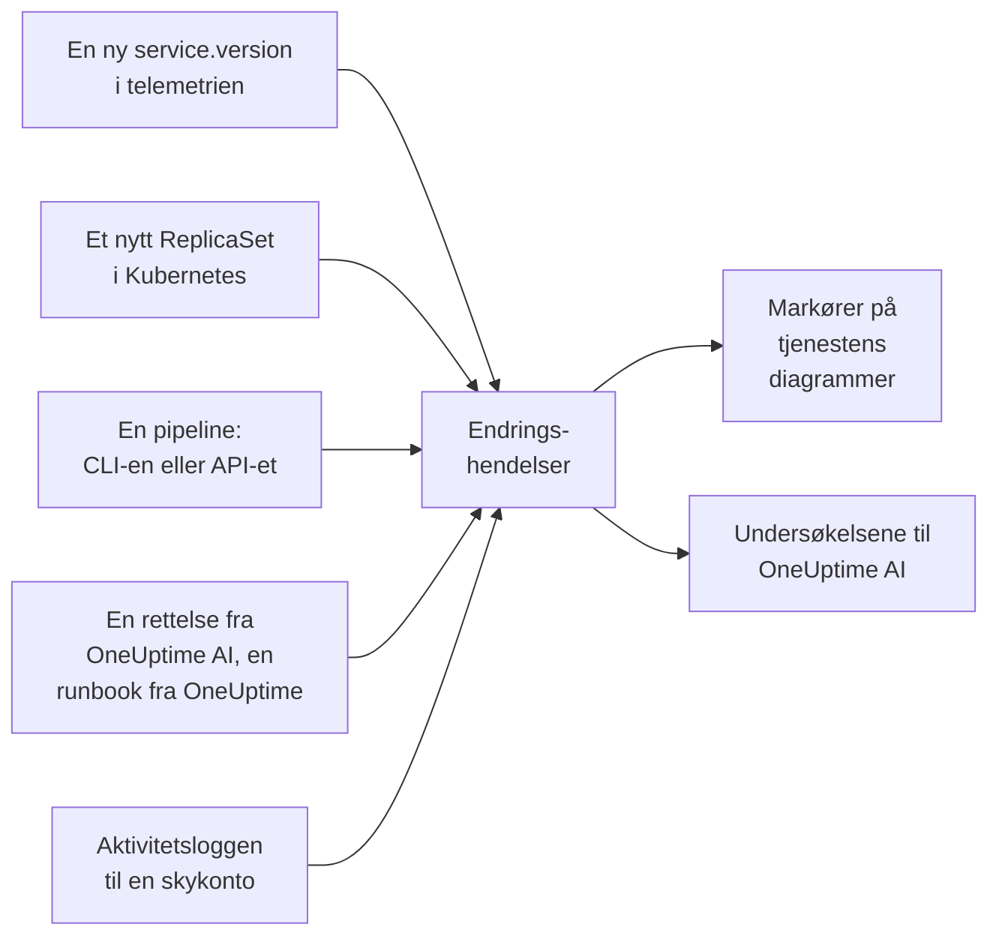

# Utrullinger og endringer

OneUptime fører en oversikt over hva som er endret i prosjektet ditt: utrullinger, Kubernetes-rollouts, konfigurasjonsendringer, endringene i de tilkoblede skykontoene dine og rettelsene den har kjørt selv. Hver endring tegnes som en markør på diagrammene til tjenesten eller skyressursen sin, og OneUptime AI leser dem når den undersøker en hendelse, så "det startet rett etter utrullingen kl. 10:02" er det første du får vite, ikke det siste.

:::cards
- [Hva OneUptime registrerer på egen hånd](#hva-oneuptime-registrerer-på-egen-hånd): Utrullinger og rollouts fra telemetri, endringene i skykontoene dine, og sine egne rettelser.
- [Registrer en utrulling fra en pipeline](#registrer-en-utrulling-fra-en-pipeline): CLI-en, GitHub Actions og API-et.
- [Slik bruker OneUptime AI endringer](#slik-bruker-oneuptime-ai-endringer): De mistenkte endringene i hver undersøkelse.
- [Referanse](#referanse): Felt, attributter og grenser.
:::

## Slik fungerer det



## Hva OneUptime registrerer på egen hånd

Disse krever ikke at du sender noe. OneUptime registrerer dem ut fra telemetrien den allerede mottar, og ut fra det den gjør selv.

| Endring | Registreres når | Kilde |
| --- | --- | --- |
| En utrulling | En tjeneste begynner å rapportere en `service.version` den ikke har rapportert før i miljøet sitt | `service-version` |
| En rollout | Podene i en Kubernetes-Deployment begynner å kjøre et ReplicaSet de ikke har kjørt før: et nytt image, en endret miljøvariabel eller konfigurasjonsreferanse, eller en omstart | `kubernetes` |
| En rettelse OneUptime AI kjørte | En AI-agent rapporterer resultatet av en kommando som endrer noe, for eksempel `kubectl rollout restart` | `oneuptime-ai` |
| En runbook | En runbook OneUptime kjørte, fullføres, mislykkes eller avbrytes etter at den har startet | `runbook` |
| En skyendring | Aktivitetsloggen til en tilkoblet skykonto registrerer en endring: AWS CloudTrail, aktivitetsloggen i Azure eller revisjonsloggen Admin Activity i Google Cloud | `cloud` |
| En leverandørhendelse | Skyleverandøren publiserer en helsehendelse om kontoen: AWS Health, Azure Service Health eller Resource Health, eller Google Cloud Service Health | `cloud-health` |

- **Den første versjonen en tjeneste rapporterer, er utgangspunktet dens, ikke en utrulling.** En tjeneste som har kjørt i måneder, blir ikke rullet ut i det øyeblikket OneUptime begynner å motta telemetrien dens.
- **En rollback til en versjon som er sett de siste 30 dagene, registreres ikke,** fordi den versjonen ikke er ny. En rollback som OneUptime AI kjører, registreres som en rettelse.
- **Utover 6 nye versjoner eller ReplicaSets i løpet av en time registreres ingen flere før timen er omme.** En "versjon" som endres med hver pod, for eksempel et byggetidsstempel, ville ellers registrert en utrulling for hver pod.

En utrulling registreres bare for en tjeneste som rapporterer `service.version`. Sett den, sammen med miljøet og commiten, i ressursattributtene til OpenTelemetry-SDK-en eller -collectoren din:

```bash
OTEL_RESOURCE_ATTRIBUTES="service.version=2.3.1,deployment.environment.name=production,vcs.ref.head.revision=$GIT_SHA"
```

En rollout krever [Kubernetes-agenten](/docs/telemetry/kubernetes-agent), som merker telemetrien fra hver pod med podens Deployment og ReplicaSet.

En skyendring eller en leverandørhendelse krever en [tilkoblet skykonto](/docs/telemetry/cloud-accounts). Hver av dem knyttes til skyressursen den nevner, når OneUptime lister den ressursen, og tegnes på ressursens diagrammer. Typen kommer fra operasjonen: `deployment`, `scaling` eller `rollback` når navnet på operasjonen sier det, ellers `config-change`, og `provider-event` for en helsehendelse. Diagrammer som ikke er filtrert til noen ressurs, utelater aktivitetsloggen til en skykonto, så en travel konto ikke fortrenger utrullingene dine; leverandørens helsehendelser blir værende.

## Registrer en utrulling fra en pipeline

En pipeline kan registrere en utrulling, eller en hvilken som helst annen endring, idet den skjer: en konfigurasjonsendring, en migrering, et funksjonsflagg. Den skriver med en telemetri-inntaksnøkkel til prosjektet ditt, den typen applikasjonene dine sender telemetri med. Opprett en under **Prosjektinnstillinger → Telemetri og APM → Inntaksnøkler**.

En nøkkel som er låst til én tjeneste, registrerer hver endring under den tjenesten.

:::tabs
@tab CLI
```bash
oneuptime deploy \
  --service checkout \
  --service-version 2.3.1 \
  --commit "$GIT_SHA" \
  --environment production \
  --url https://oneuptime.com \
  --ingestion-key "$ONEUPTIME_TELEMETRY_INGESTION_KEY"
```
@tab GitHub Actions
```yaml title=".github/workflows/deploy.yml"
- name: Record the deploy in OneUptime
  env:
    ONEUPTIME_URL: https://oneuptime.com
    ONEUPTIME_TELEMETRY_INGESTION_KEY: ${{ secrets.ONEUPTIME_TELEMETRY_INGESTION_KEY }}
  run: |
    npx -y @oneuptime/cli deploy \
      --service checkout \
      --service-version "${{ github.ref_name }}" \
      --commit "${{ github.sha }}" \
      --repository "${{ github.server_url }}/${{ github.repository }}" \
      --environment production
```
@tab API
```bash
curl -X POST https://oneuptime.com/telemetry/change-events/v1/ingest \
  -H "Content-Type: application/json" \
  -H "x-oneuptime-token: $ONEUPTIME_TELEMETRY_INGESTION_KEY" \
  -d '{"events": [{"serviceName": "checkout", "version": "2.3.1", "commit": "1a2b3c4", "environment": "production"}]}'
```
:::

På en selvhostet OneUptime bruker du din egen adresse i stedet for `https://oneuptime.com`. API-et svarer med hvor mange hendelser det lagret, og hvor mange det hoppet over:

```json
{ "ingested": 1, "skipped": 0 }
```

Se [`oneuptime deploy`](/docs/cli/command-reference#oneuptime-deploy) for alle alternativene til CLI-en.

## Slik bruker OneUptime AI endringer

Hver [AI-undersøkelse](/docs/ai/ai-sre) av en hendelse eller et varsel starter fra endringene som er registrert i de 2 timene før den, og i de 10 minuttene etter, for en pipeline som registrerer utrullingen sin først når rollouten er ferdig. Endringene på tjenestene, klyngene, vertene og skyressursene hendelsen er koblet til, kommer først.

For opptil 4 av dem som nevner en tjeneste, leser OneUptime tjenestens telemetri i de 30 minuttene før og etter endringen, og markerer endringen som **mistenkt** når tjenesten ble målbart dårligere rett etter den:

| Signal | Mistenkt når |
| --- | --- |
| Mislykkede spans | Feilraten ble minst doblet og steg med minst ett prosentpoeng, over minst 10 mislykkede spans |
| Latens | p99 økte med minst halvparten, og med minst 100 ms |
| Unntak | Minst tre ganger så mange i minuttet, og minst 10 av dem |
| Nye unntak | En unntakstype som først ble sett i versjonen endringen rullet ut, mellom 10 minutter før og 30 minutter etter endringen, oppstod minst 3 ganger |

OneUptime avgjør hvilken endring som er mistenkt ut fra disse tallene, ikke ut fra hva tittelen på en endring sier. Undersøkelsen sjekker en mistenkt endring først, sier om den forårsaket hendelsen, og sier om det å rulle den tilbake er den raskeste trygge rettelsen.

Når den mistenkte endringen er en Kubernetes-rollout på en klynge der [AI-rettelser](/docs/ai/ai-sre#slik-fungerer-rettelser) er slått på, ruller OneUptime AI den tilbake først, med en `kubectl rollout undo` som OneUptime bygger ut fra den registrerte endringen. En utrulling som leverer kode, rulles tilbake gjennom commitene sine: undersøkelsen nevner commiten eller pull requesten som forårsaket problemet, så en [pull-forespørsel med en rettelse](/docs/ai/ai-sre#automatiske-koderettelser) kan rulle tilbake nøyaktig den.

OneUptime sjekker også hver utrulling på egen hånd, enten noen blir varslet eller ikke. Når de 30 minuttene etter en utrulling har gått, sammenligner den dem med de 30 minuttene før etter de samme tersklene, og når tjenesten ble dårligere, nevner en [AI-innsikt](/docs/ai/ai-sre#innsikt-proaktiv-oppdagelse) utrullingen på den tjenesten.

En pull-forespørsel med en rettelse som OneUptime AI åpnet, sjekkes på samme måte: når en registrert utrulling inneholder commiten, følger OneUptime med der på det rettelsen var til - unntaket, operasjonen den gjorde raskere, monitoren bak hendelsen eller varselet, telemetrien den legger til - og sier om rettelsen virket (se [Automatiske koderettelser](/docs/ai/ai-sre#automatiske-koderettelser)). Den utrullede rettelsen leses bare i utrullingens versjon når tjenestens egen telemetri melder den versjonen, og ellers fra 10 minutter etter utrullingen, når gamle instanser har stoppet.

I en undersøkelse og i [Ask AI](/docs/ai/ask-ai) lister `recent_changes` endringene i et hvilket som helst tidsvindu, og `get_change_details` viser hva en utrulling leverte: commitene siden tjenestens forrige utrulling, forfatterne deres, pull requestene og filene de endret. Det krever commiten på endringen og et repository som er koblet til via [GitHub App](/docs/ai/github-app).

## Referanse

### Felt

| Felt | Hva det er |
| --- | --- |
| `title` | Hva som ble endret, for eksempel `Deploy 2.3.1`. En utrulling som sender `version`, kan utelate det |
| `eventType` | Typen endring: `deployment` (standard), `config-change`, `scaling`, `rollback`, `feature-flag` eller din egen |
| `serviceName` | Tjenesten endringen hører til. Uten en tjeneste gjelder endringen hele prosjektet |
| `time` | Når det skjedde, som ISO 8601 eller epoch i sekunder eller millisekunder. Standard er tidspunktet den kom inn |
| `description` | Detaljer om endringen |
| `version` | Versjonen som ble rullet ut |
| `previousVersion` | Versjonen den erstattet |
| `commit` | Commiten som ble rullet ut (også `commitSha` eller `sha`) |
| `repository` | Repositoriet til commiten (også `repositoryUrl`) |
| `branch` | Branchen som ble rullet ut |
| `pullRequest` | Pull requesten som ble rullet ut |
| `environment` | Miljøet det ble rullet ut til |
| `attributes` | Opptil 50 attributter til, som tekst, tall eller boolske verdier |

Feltene på øverste nivå lagres som attributter under OpenTelemetry-navnene: `version` som `service.version`, `commit` som `vcs.ref.head.revision`, `repository` som `vcs.repository.url.full`, `branch` som `vcs.ref.head.name`, `pullRequest` som `vcs.change.id` og `environment` som `deployment.environment.name`. Et attributt som sendes under ett av disse navnene, går foran feltet sitt.

Attributter med navn som begynner med `oneuptime.`, er OneUptimes egne og fjernes fra det en pipeline sender. Hver endring en pipeline registrerer, oppgir det i `oneuptime.change.source`, som er `api`.

En endring som er lest fra en skykonto, navngir kontoen og ressursen under OpenTelemetrys navn, `cloud.provider`, `cloud.account.id`, `cloud.region` og `cloud.resource_id`, og holder operasjonen i `oneuptime.cloud.operation`, hvem som kjørte den i `oneuptime.cloud.actor`, om den mislyktes i `oneuptime.change.status` og skykontoen i `oneuptime.cloud_account.id`.

### Grenser

| Grense | Verdi |
| --- | --- |
| Hendelser i én forespørsel | 100 |
| Tittel | 500 tegn |
| Beskrivelse | 5 000 tegn |
| Attributter | 50 |
| Tid | Et tidspunkt mer enn 366 dager tilbake, eller mer enn 60 minutter frem, erstattes med tidspunktet hendelsen kom inn |

## Neste steg

:::cards
- [AI SRE](/docs/ai/ai-sre): Hva en undersøkelse leser, og hvordan den retter det den finner.
- [Kommandoreferanse](/docs/cli/command-reference): Hver kommando i CLI-en.
- [OpenTelemetry](/docs/telemetry/open-telemetry): Send tjenestenes telemetri, med versjonene deres.
- [Koble til en skykonto](/docs/telemetry/cloud-accounts): Endringene og helsehendelsene i AWS-, Azure- og Google Cloud-kontoene dine.
:::
