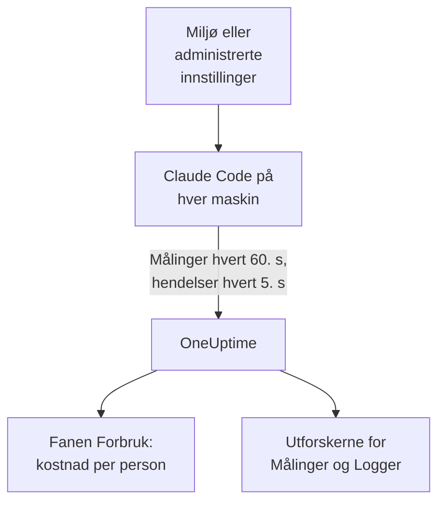

# Claude Code

Claude Code eksporterer selv OpenTelemetry-målinger og -hendelser rett til OneUptime: ingen collector og ingen gateway imellom. Slå det på med noen få miljøvariabler, eller for en hel flåte med én fil med administrerte innstillinger, og se kostnad, tokens, økter, commits og godtatte redigeringer per utvikler.

:::cards
- [Sett opp én maskin](#sett-opp-én-maskin): Seks miljøvariabler og en omstart.
- [Rull ut til flåten](#rull-ut-til-flåten): Én fil med administrerte innstillinger på hver maskin.
- [Tilordne forbruk til personer](#tilordne-forbruk-til-personer-og-team): Hvem som er logget inn, og når du må sette identiteten selv.
- [Feilsøking](#feilsøking): Hva du sjekker når ingenting kommer inn.
:::

## Slik fungerer det



Claude Code sender:

- **Kostnad og tokens**: `claude_code.cost.usage` (USD) og `claude_code.token.usage`, per modell, per hovedagent eller subagent, og per agent, skill, plugin eller MCP-server som gjorde kallet.
- **Aktivitet**: økter, commits, pull requests, tillagte og fjernede kodelinjer og aktiv tid.
- **Redigeringsbeslutninger**: `claude_code.code_edit_tool.decision` teller godtatte og avviste redigeringer, så godkjenningsraten er `accept / (accept + reject)`, per språk og per verktøy.
- **Hendelser**: prompter, verktøyresultater, API-forespørsler og -feil, endringer av tillatelsesmodus og tilkoblinger til MCP-servere, som OTLP-loggposter.

Hvert datapunkt for en måling og hver hendelse bærer `user.email` når utvikleren er logget inn med en Claude-konto, og OneUptime leser den som den ansatte på målingene, der kostnaden og tokens er.

## Før du begynner

1. Opprett en inntaksnøkkel for telemetri under **Prosjektinnstillinger → Telemetri og APM → Inntaksnøkler**.
2. OTLP-endpointet ditt er `https://oneuptime.com/otlp`, eller `https://YOUR-ONEUPTIME-HOST/otlp` hvis du drifter OneUptime selv.
3. Bruk én nøkkel for hele flåten. Den havner på hver utviklermaskin, så behandle den som en delt legitimasjon som bare kan sende data, og roter den som enhver annen.

## Sett opp én maskin

:::steps
### Eksporter variablene

Legg dem til i shellprofilen din (`.zshrc` eller `.bashrc`), eller eksporter dem i terminalen du starter Claude Code fra:

```bash
export CLAUDE_CODE_ENABLE_TELEMETRY=1
export OTEL_METRICS_EXPORTER=otlp
export OTEL_LOGS_EXPORTER=otlp
export OTEL_EXPORTER_OTLP_PROTOCOL=http/protobuf
export OTEL_EXPORTER_OTLP_ENDPOINT="https://oneuptime.com/otlp"
export OTEL_EXPORTER_OTLP_HEADERS="x-oneuptime-token=YOUR_INGESTION_TOKEN"
```

| Variabel | Hva den gjør |
| --- | --- |
| `CLAUDE_CODE_ENABLE_TELEMETRY` | Hovedbryteren: uten den eksporteres ingenting. |
| `OTEL_METRICS_EXPORTER`, `OTEL_LOGS_EXPORTER` | `otlp` sender til OneUptime. `otlp,console` skriver også ut det som sendes, nyttig mens du setter opp. |
| `OTEL_EXPORTER_OTLP_PROTOCOL` | `http/protobuf`; `http/json` og `grpc` fungerer også. |
| `OTEL_EXPORTER_OTLP_ENDPOINT` | Basis-URL-en. Claude Code legger selv til `/v1/metrics` og `/v1/logs`. |
| `OTEL_EXPORTER_OTLP_HEADERS` | Kommaseparerte `key=value`-par; her inntaksnøkkelen din. |

### Start Claude Code på nytt

Variablene leses når Claude Code starter. Målinger sendes hvert 60. sekund og hendelser hvert 5. sekund, så bruk Claude Code i et minutt før du ser etter.

### Sjekk at data kommer inn

Åpne **Målinger**, og søk etter `claude_code.token.usage`, åpne deretter **Produkter → AI / LLM**, og gå til **Forbruk**: kostnaden din vises under e-posten din, merket med **fra GenAI-målinger**.
:::

For å sende målinger og hendelser til forskjellige steder setter du i stedet `OTEL_EXPORTER_OTLP_METRICS_ENDPOINT` og `OTEL_EXPORTER_OTLP_LOGS_ENDPOINT`, med full sti (`https://oneuptime.com/otlp/v1/metrics`, `https://oneuptime.com/otlp/v1/logs`).

## Rull ut til flåten

I en organisasjon leverer du de samme variablene i en fil med administrerte innstillinger. Den har samme form som `settings.json`, med variablene i en `env`-blokk:

```json title="managed-settings.json"
{
  "env": {
    "CLAUDE_CODE_ENABLE_TELEMETRY": "1",
    "OTEL_METRICS_EXPORTER": "otlp",
    "OTEL_LOGS_EXPORTER": "otlp",
    "OTEL_EXPORTER_OTLP_PROTOCOL": "http/protobuf",
    "OTEL_EXPORTER_OTLP_ENDPOINT": "https://oneuptime.com/otlp",
    "OTEL_EXPORTER_OTLP_HEADERS": "x-oneuptime-token=YOUR_INGESTION_TOKEN",
    "OTEL_RESOURCE_ATTRIBUTES": "team.id=platform,cost_center=eng-123"
  }
}
```

:::steps
### Legg filen der Claude Code leser den

| Plattform | Sti |
| --- | --- |
| macOS | `/Library/Application Support/ClaudeCode/managed-settings.json` |
| Linux og WSL | `/etc/claude-code/managed-settings.json` |
| Windows | `C:\Program Files\ClaudeCode\managed-settings.json` |

Claude Code leser ikke lenger den gamle Windows-stien `C:\ProgramData\ClaudeCode\managed-settings.json`. Hvis du allerede leverer en fil med administrerte innstillinger, legger du i stedet til en tilleggsfil, som `managed-settings.d/10-telemetry.json` ved siden av: Claude Code slår først sammen `managed-settings.json` og deretter hver `*.json`-fil i `managed-settings.d/` i alfabetisk rekkefølge.

### Sjekk én maskin

Kjør `/status` i Claude Code. Linjen `Setting sources` skal si `Enterprise managed settings (file)`, eller `(drop-ins)` eller `(file + drop-ins)` for en tilleggsfil. En annen kilde i parentes betyr at en høyere rangert kilde vant, og at din ikke ble brukt.

### Se flåten komme inn

På fanen **Forbruk** vises hver utvikler som en rad så snart vedkommende har brukt Claude Code med de nye innstillingene.
:::

Den samme JSON-en kan også komme fra serveradministrerte innstillinger i administrasjonskonsollen til claude.ai (hentet ved oppstart og hver time), fra en macOS-konfigurasjonsprofil i domenet `com.anthropic.claudecode` eller fra en `Settings`-verdi under `HKLM\SOFTWARE\Policies\ClaudeCode` på Windows.

:::details Hvilken administrert kilde som vinner, og hvordan telemetrivariablene kombineres
Som standard bruker Claude Code den høyest rangerte kilden som setter en policynøkkel, og ignorerer de andre: serveradministrerte innstillinger, så en MDM- eller operativsystempolicy, så filene med administrerte innstillinger og så registerverdien `HKCU` per bruker. `env`-blokken er unntaket: siden versjon 2.1.223 slås den sammen variabel for variabel på tvers av administrasjonskildene.

Det gjør ikke telemetrivariablene: variablene `OTEL_EXPORTER_OTLP_*`, innholdsbryterne `OTEL_LOG_*`, `OTEL_LOGS_EXPORTER` og variablene for tracing-betaen kommer samlet fra den høyest rangerte kilden som setter noen av dem, så et endpoint fra én kilde aldri pares med legitimasjon fra en annen. Hvis en høyere rangert kilde setter noen av dem, bidrar en tilleggsfil for telemetri ikke med noe.

Serveradministrerte innstillinger krever ett steg til: et ikke-tomt `OTEL_EXPORTER_OTLP_ENDPOINT` brukes først etter at hver utvikler har godtatt en sikkerhetsdialog i en interaktiv økt, og endringer i eksportørinnstillingene gjelder fra neste oppstart. Filer og MDM-policyer har ingen dialog.
:::

:::details Roter inntaksnøkkelen uten å redigere hver maskin
I stedet for en fast header setter du `"otelHeadersHelper": "/path/to/generate-otel-headers.sh"` i innstillingene. Skriptet skriver ut et flatt JSON-objekt med headere, som `{"x-oneuptime-token":"..."}`. Claude Code kjører det ved oppstart og igjen hvert `CLAUDE_CODE_OTEL_HEADERS_HELPER_DEBOUNCE_MS` millisekund (`1740000` som standard, 29 minutter). Feil vises i `/status`.
:::

## Tilordne forbruk til personer og team

**Den ansatte er `user.email`.** Claude Code sender den når utvikleren er logget inn med en Claude-konto, og det finnes ingen variabel for å slå den av. OneUptime leser den fra hvert datapunkt for kostnad og tokens, uten oppsett.

**Andre innlogginger sender ingen e-post.** Med en API-nøkkel, eller med Claude på Amazon Bedrock, Google Cloud eller Microsoft Foundry, er det ingen Claude-konto i økten, og Claude Code sender bare `user.id` og `session.id`. Sett identiteten selv, per maskin, i de administrerte innstillingene eller i et oppstartsskript:

```bash
export OTEL_RESOURCE_ATTRIBUTES="user.email=jdoe@example.com,team.id=platform"
```

**`user.id` er ikke en person.** Det er en tilfeldig id Claude Code skriver til `~/.claude.json` ved første kjøring: én per installasjon, og en ny hvis filen slettes. Uten e-post vises hver installasjon som sin egen rad. Ett unntak: en økt som er logget inn på en gateway for Claude-apper, sender den innloggede identiteten (`user.id` er identitetsleverandørens subject, `user.email` e-posten) og ignorerer `user.*`-nøkler du setter selv.

**Team og kostnadssteder** kommer fra `OTEL_RESOURCE_ATTRIBUTES`: OneUptime leser `team.id`, `team`, `cost_center` og `department`. Verdier kan ikke inneholde mellomrom, og anførselstegn beskytter dem ikke: skriv `team=Platform_Engineering`, eller bruk prosentkoding, som i `team=Platform%20Engineering`. Claude Code kopierer disse nøklene over på hvert datapunkt (`OTEL_METRICS_INCLUDE_RESOURCE_ATTRIBUTES`, på som standard), og OneUptime leser dem uansett. En nøkkel du setter selv, overstyrer aldri en som Claude Code setter selv.

## Hva OneUptime viser

På **Produkter → AI / LLM → Forbruk** fyller `claude_code.cost.usage` tabellene **Ansatt**, **Team** og **Modell**, og `claude_code.token.usage` tokentotalene. To regler avgjør hva du ser:

- **Målingene fyller hullene i spans; de legges aldri oppå dem.** Hvis det samme prosjektet mottar GenAI-spans med kostnad fra dine egne apper, vises ikke Claude Codes forbruk. Send Claude Code til et eget prosjekt. Se [Spans kommer først, målinger fyller hullene](/docs/telemetry/ai-llm-observability#spans-kommer-først-målinger-fyller-hullene).
- **En rad fra målinger bærer bare kostnad.** Cellene for kall og tokens viser `—`, og tabellene **Leverandør** og **Applikasjon / Tjeneste** forblir tomme: målingene nevner ingen leverandør og hører ikke til noen OneUptime-tjeneste.

Alt annet, som godkjenningsrate, kodelinjer, commits og pull requests per utvikler, eller forbruk per `query_source`, viser du i et [dashboard](/docs/dashboards/index) ut fra målingene nedenfor, og varsler på med en [metrikk-overvåking](/docs/monitor/metrics-monitor).

## Målinger

Hver måling er en teller og bærer standardattributtene i tillegg til sine egne.

| Måling | Enhet | Egne attributter |
| --- | --- | --- |
| `claude_code.session.count` | ingen | `start_type`: `fresh`, `resume`, `continue`, `agents_view` |
| `claude_code.lines_of_code.count` | ingen | `type`: `added`, `removed`; `model` |
| `claude_code.commit.count` | ingen | ingen |
| `claude_code.pull_request.count` | ingen | ingen |
| `claude_code.cost.usage` | USD | `model`; `query_source`: `main`, `subagent`, `auxiliary`; `speed`: `fast`, `normal`; `effort`; `agent.name`, `skill.name`, `plugin.name`, `marketplace.name`, `mcp_server.name`, `mcp_tool.name` |
| `claude_code.token.usage` | tokens | `type`: `input`, `output`, `cacheRead`, `cacheCreation`; og de samme attributtene som `claude_code.cost.usage` |
| `claude_code.code_edit_tool.decision` | ingen | `tool_name`: `Edit`, `Write`, `NotebookEdit`; `decision`: `accept`, `reject`; `source`; `language` |
| `claude_code.active_time.total` | s | `type`: `user` (ved tastaturet), `cli` (verktøy og modellsvar) |

Standardattributtene er `session.id`, `app.version`, `app.entrypoint`, `organization.id`, `user.account_uuid`, `user.account_id`, `user.id`, `user.email` og `terminal.type`, pluss dine `OTEL_RESOURCE_ATTRIBUTES`. Noen av dem kan slås av: se [Hold målingsvolumet nede](#hold-målingsvolumet-nede).

- Cachetokentypene er i camelCase: `cacheRead` og `cacheCreation`. OneUptimes tokentotaler teller bare `input` og `output`.
- På kostnads- og tokenmålingene står navnene på dine egne agenter og MCP-servere, og på plugins og skills fra tredjeparter, som `custom` eller `third-party`, med mindre `OTEL_LOG_TOOL_DETAILS=1` er satt (Claude Code 2.1.273 eller nyere).

## Hendelser

Hendelser kommer inn som OTLP-loggposter, hver med `event.name`, `event.timestamp` og `event.sequence`. De du oftest kommer til å bruke:

| Hendelse | Hva den registrerer |
| --- | --- |
| `claude_code.user_prompt` | En prompt: lengden og kommandoen; teksten bare hvis du slår det på |
| `claude_code.api_request` | En modellforespørsel: `model`, `cost_usd`, `cost_usd_micros`, `duration_ms`, `input_tokens`, `output_tokens`, cachetokens |
| `claude_code.api_error` | En forespørsel som feilet etter nye forsøk: `model`, `error`, `status_code`, `attempt` |
| `claude_code.tool_result` | En verktøykjøring: `tool_name`, `success`, `duration_ms` og beslutningen som tillot den |
| `claude_code.tool_decision` | Om et verktøy ble tillatt, og av hva |
| `claude_code.mcp_server_connection` | En MCP-server som kobler til eller feiler |

Claude Code sender mange flere, som avvisninger, endringer av tillatelsesmodus og hendelser fra plugins, hooks og skills: Anthropics [overvåkingsreferanse](https://code.claude.com/docs/en/monitoring-usage) viser alle. I `cost_usd_micros` er kostnaden et helt antall milliondeler av en USD, som summeres uten avrundingsavvik.

## Hold målingsvolumet nede

Claude Code setter som standard `session.id` på hvert datapunkt, og hver økt er en ny serie. På tvers av en flåte driver den ene attributten opp målingsvolumet, og kostnadsrapportering trenger den ikke:

```bash
export OTEL_METRICS_INCLUDE_SESSION_ID=false
```

| Variabel | Standard | Legger til |
| --- | --- | --- |
| `OTEL_METRICS_INCLUDE_SESSION_ID` | `true` | `session.id`, en ny verdi hver økt |
| `OTEL_METRICS_INCLUDE_VERSION` | `false` | `app.version` |
| `OTEL_METRICS_INCLUDE_ACCOUNT_UUID` | `true` | `user.account_uuid` og `user.account_id` |
| `OTEL_METRICS_INCLUDE_ENTRYPOINT` | `false` | `app.entrypoint` |
| `OTEL_METRICS_INCLUDE_RESOURCE_ATTRIBUTES` | `true` | Nøklene dine fra `OTEL_RESOURCE_ATTRIBUTES` |
| `OTEL_METRICS_INCLUDE_REPOSITORY` | `false` | Repositoriets `vcs.*`-attributter |

`user.email`, `user.id`, `organization.id` og `terminal.type` har ingen bryter. Hendelser er det travleste signalet: hver aktiv utvikler sender hvert 5. sekund (`OTEL_LOGS_EXPORT_INTERVAL`, i millisekunder). Øk verdien for å sende færre og større batcher, eller sett `OTEL_LOGS_EXPORTER=none` hvis du bare trenger kostnad og forbruk, som alt ligger i målingene.

## Prompt- og verktøyinnhold er av som standard

Claude Code eksporterer ikke prompter, svar, verktøyargumenter eller verktøyutdata med mindre du slår på hver enkelt:

| Variabel | Standard | Hva `1` slår på |
| --- | --- | --- |
| `OTEL_LOG_USER_PROMPTS` | av | Prompttekst |
| `OTEL_LOG_ASSISTANT_RESPONSES` | av | Svartekst; når den ikke er satt, følger den `OTEL_LOG_USER_PROMPTS` |
| `OTEL_LOG_TOOL_DETAILS` | av | Verktøyparametere, Bash-kommandoer og de ekte navnene på agenter, plugins, skills og MCP-servere |
| `OTEL_LOG_TOOL_CONTENT` | av | Verktøyinndata og -utdata, bare på trace-spans |
| `OTEL_LOG_RAW_API_BODIES` | av | Fullstendige bodyer for API-forespørsler og -svar (`file:<dir>` skriver dem til disk i stedet) |

Vi anbefaler å la dem være av: målingene og de maskerte hendelsene svarer allerede på hvem som brukte hva, på hvilken modell og med hvilken godkjenningsrate. Innsamling av innhold flytter prompter, kildekode og verktøyutdata over i et telemetrilager med andre tilgangskontroller enn repositoriene dine. Hvis du slår det på for en undersøkelse, begrenser `CLAUDE_CODE_OTEL_CONTENT_MAX_LENGTH` (`61440` som standard) hvor mye som sendes per post, og traces' **Scrub-regler** og **Drop-filtre** under **Spor → Innstillinger** maskerer eller dropper det før det lagres.

## Målinger kommer inn som deltaer

Claude Code sender deltamålinger som standard: hvert datapunkt er økningen siden forrige eksport, ikke en løpende total. Når du viser dem i grafer eller varsler på dem, summerer du datapunktene over vinduet, og du bruker ikke en rate- eller tellernullstillingsfunksjon slik du ville gjort med en kumulativ teller: tallene blir feil uten å se feil ut.

```bash
export OTEL_EXPORTER_OTLP_METRICS_TEMPORALITY_PREFERENCE=cumulative
```

Lås `cumulative` bare hvis hver eksportør i organisasjonen din bruker det, og ikke bland de to i en flåte.

## Traces (beta)

Claude Code har også en beta-eksportør for traces, som tegner hver interaksjon som et tre av spans: `claude_code.interaction`, med `claude_code.llm_request` og `claude_code.tool` under seg.

```bash
export CLAUDE_CODE_ENHANCED_TELEMETRY_BETA=1
export OTEL_TRACES_EXPORTER=otlp
```

> [!WARNING]
> Hold traces-betaen unna prosjektet du bruker for forbruk. Modellspansene bærer `gen_ai.system` og `gen_ai.request.model`, så OneUptime viser dem under **Kall**, men tokens ligger i `input_tokens` og `output_tokens`, ikke i `gen_ai.usage.*`-nøklene, så de kommer inn uten tokens og uten kostnad. Så snart de finnes, er det disse radene tabellene **Ansatt**, **Team** og **Modell** viser, til $0, i stedet for forbruket fra målingene.

I Agent SDK-økter og ikke-interaktive `-p`-økter fanger Claude Code opp en innkommende `TRACEPARENT`, så spansene slutter seg til kallerens trace; interaktive økter ignorerer den. Den sender bare headeren `traceparent` til modellen når `ANTHROPIC_BASE_URL` ikke er satt eller er Anthropics API; bak din egen proxy setter du `CLAUDE_CODE_PROPAGATE_TRACEPARENT=1`.

## Feilsøking

:::details Ingenting kommer inn i det hele tatt
Sjekk først `CLAUDE_CODE_ENABLE_TELEMETRY=1`: uten den gjør ingen annen variabel noe. Legg deretter til `console` i eksportørene (`OTEL_METRICS_EXPORTER=otlp,console`), og følg med på terminalen: hvis det skrives ut datapunkter, fungerer Claude Code, og problemet er endpointet, nøkkelen eller nettverket.
:::

:::details Filen med administrerte innstillinger ser ut til å bli ignorert
Kjør `/status`, og les linjen `Setting sources`. Står det ingen administrert kilde, ligger filen på feil sti, er ikke gyldig JSON eller kan ikke leses av utviklerens konto. Står det en annen kilde, vant den, og din ble ikke brukt. Serveradministrerte innstillinger venter dessuten på at utvikleren godtar godkjenningsdialogen i en interaktiv økt.
:::

:::details Forbruket vises som Ikke tilordnet, eller som én rad per installasjon
De utviklerne er ikke logget inn med en Claude-konto: de bruker en API-nøkkel, Amazon Bedrock, Google Cloud eller Microsoft Foundry. Sett `user.email` i `OTEL_RESOURCE_ATTRIBUTES` for dem, slik [Tilordne forbruk til personer og team](#tilordne-forbruk-til-personer-og-team) viser.
:::

:::details Teamet eller kostnadsstedet mangler
Sjekk at `OTEL_RESOURCE_ATTRIBUTES` er satt på maskinen, ikke inneholder mellomrom og ikke gjenbruker en nøkkel som Claude Code setter selv: verdien fra Claude Code vinner.
:::

:::details Tallene ser for små eller for store ut
Claude Code sender deltaer: summer datapunktene over vinduet, slik [Målinger kommer inn som deltaer](#målinger-kommer-inn-som-deltaer) forklarer. Og vent et helt minutt: målinger sendes hvert 60. sekund.
:::

:::details Nøkkelen avvises
OneUptime avviser en feil `x-oneuptime-token`. Kopier nøkkelen på nytt fra **Prosjektinnstillinger → Telemetri og APM → Inntaksnøkler**, og sjekk at headeren lyder `x-oneuptime-token=YOUR_INGESTION_TOKEN` uten mellomrom rundt `=`.
:::

## Neste steg

:::cards
- [AI-kodeassistenter](/docs/telemetry/ai-coding-assistants): Slik tilordnes forbruk på tvers av alle kodeassistenter.
- [AI- / LLM-observerbarhet](/docs/telemetry/ai-llm-observability): Samtaler, varsler, kostnad og budsjetter for dine egne AI-kall.
- [Metrikk-overvåking](/docs/monitor/metrics-monitor): Varsle på forbruk eller tokens per utvikler.
:::
