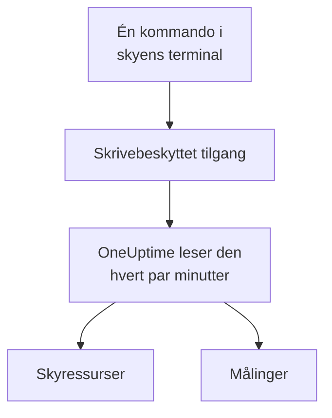

# Koble til en skykonto

Koble til en AWS-konto, et Azure-abonnement eller et Google Cloud-prosjekt fra dashbordet, så viser OneUptime ressursene og leser de viktigste målingene deres etter en tidsplan. Du kjører én kommando i skyens egen nettleserterminal og limer inn det den skriver ut: ingen collector å kjøre og ingenting å installere.

:::cards
- [Amazon Web Services](#amazon-web-services): En IAM-rolle som OneUptime logger på med, eller en tilgangsnøkkel.
- [Microsoft Azure](#microsoft-azure): En app med rollen Monitoring Reader.
- [Google Cloud](#google-cloud): En tjenestekonto med rollen Monitoring Viewer.
- [Hva OneUptime leser](#hva-oneuptime-leser): Hvilke ressurser og målinger, hvor ofte, og hva det koster.
:::

## Slik fungerer det



- **Tilgangen kan bare lese.** Kommandoen lager en tilgang som leser målinger og ingenting annet: tre lesehandlinger på AWS, rollen **Monitoring Reader** på Azure og rollen **Monitoring Viewer** på Google Cloud. Slett den for å stenge OneUptime ute.
- **OneUptime leser etter en tidsplan.** Hvert 5. minutt for Azure og Google Cloud, og hvert 10. minutt for AWS, med mindre du velger et annet intervall når du kobler til.
- **Hver ressurs får sin egen side.** Ressurser vises under **Sky → Alle ressurser** med de viktigste målingene, eierne og etikettene sine, som ressursene en collector rapporterer.

## Før du begynner

- **En prosjekteier eller -administrator.** Bare de kan koble til, teste og redigere skykontoer.
- **Skyens terminal** (AWS CloudShell, Azure Cloud Shell eller Google Cloud Shell), logget på som noen som kan opprette en IAM-rolle eller -bruker, en appregistrering eller en tjenestekonto.

## Amazon Web Services

:::steps
### Åpne AWS-skjemaet

Gå til **Sky → Koble til**, og velg **Amazon Web Services**.

### Kjør kommandoen i AWS CloudShell

Velg hvordan OneUptime logger på. En **IAM-rolle** er den anbefalte måten: ingenting hemmelig lagres, og du kan slette rollen når som helst. Skjemaet viser kommandoen, skrevet for prosjektet ditt: den lager en rolle som stoler på OneUptimes AWS-konto med prosjektets eksterne ID, og skriver ut rollens ARN. Bruk en **Tilgangsnøkkel** når en rolle ikke er mulig. Denne kommandoen lager en bruker med de samme tillatelsene og skriver ut nøkkelen:

```bash
aws iam create-user --user-name OneUptimeReadOnly > /dev/null 2>&1 || true
aws iam put-user-policy --user-name OneUptimeReadOnly --policy-name OneUptimeReadOnly --policy-document '{"Version":"2012-10-17","Statement":[{"Effect":"Allow","Action":["cloudwatch:GetMetricData","cloudwatch:ListMetrics","tag:GetResources"],"Resource":"*"}]}'
aws iam create-access-key --user-name OneUptimeReadOnly
```

### Lim inn det AWS-kommandoen skrev ut

Lim inn alt kommandoen skrev ut i **Det kommandoen skrev ut**. OneUptime plukker ut rollens ARN, eller tilgangsnøkkel-ID-en og hemmeligheten.

### Test og koble til AWS

OneUptime tester tilkoblingen når dette trinnet åpnes: den logger på, teller ressursene den finner og sier hva det koster å lese dem. Velg **Koble til** for å lagre.
:::

Rollen og brukeren kan gjøre tre ting, og ingenting annet:

| Handling | Hva OneUptime bruker den til |
| --- | --- |
| `cloudwatch:ListMetrics` | Finne ressursene som rapporterer målinger, i hver region |
| `cloudwatch:GetMetricData` | Lese de viktigste målingene deres |
| `tag:GetResources` | Gi hver ressurs navn etter `Name`-taggen |

> [!NOTE]
> På en selvdriftet OneUptime trenger måten **IAM-rolle** en egen AWS-identitet for OneUptime: sett `CLOUD_CONNECT_AWS_ACCESS_KEY_ID` og `CLOUD_CONNECT_AWS_SECRET_ACCESS_KEY` til nøkkelen til en IAM-bruker som kan kalle `sts:AssumeRole`. Uten dem tilbyr skjemaet en **Tilgangsnøkkel**.

## Microsoft Azure

:::steps
### Åpne Azure-skjemaet

Gå til **Sky → Koble til**, og velg **Microsoft Azure**.

### Kjør kommandoen i Azure Cloud Shell

Kommandoen lager en app med rollen **Monitoring Reader** på det gjeldende abonnementet ditt, og skriver ut detaljene:

```bash
az ad sp create-for-rbac --name OneUptimeReadOnly --role "Monitoring Reader" --scopes "/subscriptions/$(az account show --query id --output tsv)"
```

### Lim inn det Azure-kommandoen skrev ut

Lim inn alt kommandoen skrev ut i **Det kommandoen skrev ut**. OneUptime plukker ut `tenant`, `appId` og `password`.

### Test og koble til Azure

OneUptime tester tilkoblingen når dette trinnet åpnes. Velg **Koble til** for å lagre.
:::

For å lese flere abonnementer med den samme appen gir du den rollen på hvert av dem:

```bash
az role assignment create --assignee <APP_ID> --role "Monitoring Reader" --scope /subscriptions/<SUBSCRIPTION_ID>
```

OneUptime leser alle abonnementene appen kan lese, med mindre du oppgir noen under **Abonnementer**.

## Google Cloud

:::steps
### Åpne Google Cloud-skjemaet

Gå til **Sky → Koble til**, og velg **Google Cloud**.

### Kjør kommandoen i Google Cloud Shell

Kjør den i prosjektet som skal overvåkes. Den slår på Cloud Monitoring API, lager en tjenestekonto med rollen **Monitoring Viewer** og skriver ut nøkkelen:

```bash
PROJECT_ID=$(gcloud config get-value project)
gcloud services enable monitoring.googleapis.com
gcloud iam service-accounts create oneuptime-read-only --display-name "OneUptime (read only)"
gcloud projects add-iam-policy-binding "$PROJECT_ID" --member "serviceAccount:oneuptime-read-only@$PROJECT_ID.iam.gserviceaccount.com" --role roles/monitoring.viewer --condition=None > /dev/null
gcloud iam service-accounts keys create oneuptime-key.json --iam-account "oneuptime-read-only@$PROJECT_ID.iam.gserviceaccount.com"
cat oneuptime-key.json && rm oneuptime-key.json
```

### Lim inn nøkkelen

Lim inn alt kommandoen skrev ut. OneUptime leser nøkkelens eget prosjekt, og lagrer nøkkelen kryptert.

### Test og koble til Google Cloud

OneUptime tester tilkoblingen når dette trinnet åpnes. Velg **Koble til** for å lagre.
:::

For å lese flere prosjekter med den samme tjenestekontoen gir du den rollen i hvert av dem og oppgir dem under **Prosjekter**:

```bash
gcloud projects add-iam-policy-binding <PROJECT_ID> --member "serviceAccount:oneuptime-read-only@<KEY_PROJECT_ID>.iam.gserviceaccount.com" --role roles/monitoring.viewer
```

## Hva OneUptime leser

| | AWS | Azure | Google Cloud |
| --- | --- | --- | --- |
| Ressurser | De som rapporterer målinger til CloudWatch, i alle regionene du bruker | Alle ressurser i abonnementene | De som rapporterer målinger til Cloud Monitoring |
| Målinger | De viktigste målingene for hver tjeneste, som CPU, nettverk og statussjekker for en instans | Opptil 8 viktige målinger per ressurs | De viktigste målingene for hver ressurstype |
| Leses hvert | 10. minutt | 5. minutt | 5. minutt |
| En slettet ressurs | Arkiveres etter 7 dager uten målinger | Arkiveres ved neste lesing | Arkiveres etter 7 dager uten målinger |

Hver lesing fortsetter der den forrige stoppet, så hvert datapunkt skrives én gang. Den første lesingen av en ny tilkobling starter innen ett minutt og går en time tilbake; etter en pause går en lesing høyst 6 timer tilbake.

Kallene OneUptime gjør, faktureres skykontoen din, til skyens priser. Testen anslår hva det den finner koster, og sjeldnere lesing koster mindre: endre **Intervall for lesing av målinger** under **Flere felt**.

| Sky | Pris |
| --- | --- |
| AWS | CloudWatch `GetMetricData`: $0.01 per 1 000 målinger, og hver viktig måling av en ressurs er én måling per lesing |
| Azure | De første 1 000 000 målingslesingene i måneden for hvert abonnement er gratis, deretter $0.01 per 1 000 |
| Google Cloud | De første 1 000 000 tidsseriene lest i måneden er gratis, deretter $0.50 per million |

## Feilsøking

:::details Testen sier at nøkkelen eller hemmeligheten ikke ble godtatt
Kopier alt kommandoen skrev ut, og lim det inn på nytt. En nøkkel som ble laget for ett minutt siden, kan bruke ett minutt på å virke.
:::

:::details Testen logger på, men kan ikke lese
Kjør kommandoen på nytt: den gir rollen OneUptime trenger. På AWS kjører du kommandoen skjemaet viser for dette prosjektet: en rolle som er laget for et annet prosjekt, stoler på det prosjektets eksterne ID, ikke på dette prosjektets.
:::

:::details Google Cloud lar ikke kommandoen lage en nøkkel
En organisasjonspolicy, `iam.disableServiceAccountKeyCreation`, kan forby nøkler for tjenestekontoer. Be administratoren i organisasjonen din om et unntak for prosjektet, eller [send målingene med din egen collector](/docs/telemetry/cloud-resources).
:::

:::details Ingen ressurser vises
På AWS og Google Cloud vises en ressurs når den rapporterer målinger. Hvis en tilkobling ikke virker, sier **View error** under **Sky → Koble til** hvorfor den siste lesingen mislyktes.
:::

## Neste steg

:::cards
- [Skyressurser](/docs/telemetry/cloud-resources): Kjør heller din egen OpenTelemetry Collector, eller strøm CloudWatch-målinger.
- [Målingsmonitor](/docs/monitor/metrics-monitor): Varsle på målingene til en ressurs.
:::
