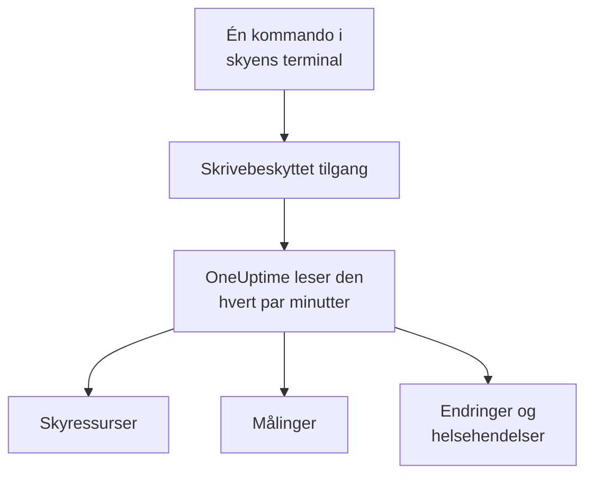

# Koble til en skykonto

Koble til en AWS-konto, et Azure-abonnement eller et Google Cloud-prosjekt fra dashbordet, så lister OneUptime hver ressurs i det, leser de viktigste målingene deres og sier hvordan det står til med hver av dem, registrerer hva som er endret i dem og hva skyleverandøren sier om helsen deres, og leser hva kontoen koster og hvordan den kunne kostet mindre. Du kjører én kommando i skyens egen nettleserterminal og limer inn det den skriver ut: Det er ingen collector å kjøre og ingenting å installere.

:::cards
- [Amazon Web Services](#amazon-web-services): En IAM-rolle som OneUptime logger på med, eller en tilgangsnøkkel.
- [Microsoft Azure](#microsoft-azure): En app med rollene Monitoring Reader og Cost Management Reader.
- [Google Cloud](#google-cloud): En tjenestekonto med seks roller som bare kan lese.
- [Hva OneUptime leser](#hva-oneuptime-leser): Ressurser, målinger, endringer, helsehendelser og kostnader, hvor ofte, og hva det koster å lese dem.
- [Skykostnader og besparelser](/docs/telemetry/cloud-costs): Hva hver konto koster, måtene å bruke mindre på og budsjetter som varsler.
- [Strøm CloudWatch-målinger og -logger](/docs/telemetry/cloud-streaming): Hver måling innen minutter, og CloudWatch Logs, via Amazon Data Firehose.
- [Strøm Azure Monitor-målinger og -logger](/docs/telemetry/cloud-streaming-azure): Nøkkelmålinger innen minutter og ressurslogger, lest fra hendelseshuber i abonnementet ditt.
- [Strøm Google Cloud-logger](/docs/telemetry/cloud-streaming-google-cloud): Hver logg så snart den skrives, pushet via Pub/Sub.
- [Datasikkerhet](#datasikkerhet): Hva tilkoblingen lar Datasikkerhet lese, og hva hvert nivå legger til i kommandoen.
- [La AI rette problemer](#la-ai-rette-problemer): Én kommando til, så kan OneUptime AI rette det den finner.
:::

## Slik fungerer det



- **Tilgangen kan bare lese.** Kommandoen lager en tilgang som leser ressursene dine og hvordan de er satt opp, målingene deres, hva som er endret, leverandørens helsehendelser og hva kontoen koster, og ingenting annet: handlingene nedenfor på AWS, rollene **Monitoring Reader** og **Cost Management Reader** på Azure og seks leseroller på Google Cloud. OneUptime leser aldri data eller hemmeligheter med den, unntatt logglinjer når du lar AI lese en kontos logger, og innholdsprøver når du slår dem på for [Datasikkerhet](#datasikkerhet). Slett den for å stenge OneUptime ute.
- **OneUptime leser etter en tidsplan.** Hvert 5. minutt for Azure og Google Cloud, og hvert 10. minutt for AWS, med mindre du velger et annet intervall når du kobler til. Hver lesing registrerer også hva som er endret siden forrige, og hvert 30. minutt lister en lesing alle ressursene på nytt.
- **Hver ressurs får sin egen side.** Ressurser vises under **Sky → Alle ressurser** med helsen, de viktigste målingene, eierne og etikettene sine. Siden til en listet ressurs viser også **Tilkoblede ressurser** (hva den kjører i, hva som sender trafikk til den), endepunktene, taggene og innstillingene, og **Hendelser**, **Varsler** og **Endringer**.
- **Hver konto får sin egen side.** Kontoer vises under **Sky → Kontoer** med ressursene sine etter type og region, **Kostnader**, **Endringer** og en **Topologi** over hvordan ressursene henger sammen.
- **Sky åpner på oversikten sin.** **Sky → Oversikt** lister ressursene som trenger oppmerksomhet og hvorfor, hva kontoene koster denne måneden, og hva skyene dine sier kan spares. [Skykostnader og besparelser](/docs/telemetry/cloud-costs) forklarer hvordan kostnader, besparelser og budsjetter leses. Når kontoene dine kjører apper på administrerte app-plattformer, teller kortet **App-plattformer** miljøene og appene deres, og hvert tall åpner den listen i App-plattformer, allerede filtrert til de kontoene.
- **OneUptime AI leser hva som er endret.** En undersøkelse av en hendelse eller et varsel som er koblet til en skyressurs, leser først endringene for den ressursen, og leser kontoens aktivitetslogg på nytt når den starter.

## Før du begynner

- **En Prosjekteier eller Prosjektadministrator.** Bare de kan koble til, teste og redigere skykontoer.
- **Skyens terminal** (AWS CloudShell, Azure Cloud Shell eller Google Cloud Shell), logget på som noen som kan opprette en IAM-rolle eller -bruker, en appregistrering eller en tjenestekonto.

## Amazon Web Services

:::steps
### Åpne AWS-skjemaet

Gå til **Sky → Koble til** og velg **Amazon Web Services**.

### Kjør kommandoen i AWS CloudShell

Velg hvordan OneUptime logger på. En **IAM-rolle** er den anbefalte måten: Ingenting hemmelig lagres, og du kan slette rollen når som helst. Skjemaet viser kommandoen skrevet for prosjektet ditt: Den oppretter en rolle som stoler på OneUptimes AWS-konto med prosjektets eksterne ID, og skriver ut rollens ARN.

Under **Hva som skal leses** velger du denne kontoen eller hver konto i AWS Organization. Kjør organisasjonens kommando i administrasjonskontoen: Den legger til et StackSet som setter den samme rollen i hver konto, nå og etter hvert som kontoer kommer til, og lar administrasjonskontoens rolle liste kontoene. Én tilkobling leser opptil 50 kontoer.

Bruk en **Tilgangsnøkkel** når en rolle ikke er mulig: Den leser bare sin egen konto. Denne kommandoen oppretter en bruker med de samme tillatelsene og skriver ut nøkkelen:

```bash
aws iam create-user --user-name OneUptimeReadOnly > /dev/null 2>&1 || true
aws iam put-user-policy --user-name OneUptimeReadOnly --policy-name OneUptimeReadOnly --policy-document '{"Version":"2012-10-17","Statement":[{"Effect":"Allow","Action":["cloudwatch:GetMetricData","cloudwatch:ListMetrics","tag:GetResources","iam:ListAccountAliases","cloudformation:ListResources","ec2:DescribeInstances","ec2:DescribeVolumes","ec2:DescribeVpcs","ec2:DescribeSubnets","ec2:DescribeSecurityGroups","ec2:DescribeNatGateways","autoscaling:DescribeAutoScalingGroups","elasticloadbalancing:Describe*","ecs:ListClusters","ecs:DescribeClusters","ecs:ListServices","ecs:DescribeServices","eks:ListClusters","eks:DescribeCluster","lambda:ListFunctions","rds:DescribeDBInstances","rds:DescribeDBClusters","elasticache:DescribeReplicationGroups","sqs:ListQueues","sqs:GetQueueAttributes","sns:ListTopics","sns:GetTopicAttributes","sns:ListSubscriptionsByTopic","dynamodb:ListTables","dynamodb:DescribeTable","kinesis:ListStreams","kinesis:DescribeStreamSummary","states:ListStateMachines","states:DescribeStateMachine","cloudfront:ListDistributions","elasticfilesystem:DescribeFileSystems","es:ListDomainNames","es:DescribeDomains","apprunner:ListServices","apprunner:DescribeService","elasticbeanstalk:DescribeEnvironments","wafv2:ListWebACLs","wafv2:GetWebACL","network-firewall:ListFirewalls","globalaccelerator:ListAccelerators","cognito-idp:ListUserPools","appsync:ListGraphqlApis","sagemaker:ListEndpoints","cloudtrail:LookupEvents","health:DescribeEvents","health:DescribeEventDetails","ce:GetCostAndUsage","ce:GetCostAndUsageWithResources","ce:GetSavingsPlansCoverage","ce:GetSavingsPlansUtilization","ce:GetReservationCoverage","ce:GetReservationUtilization","cost-optimization-hub:ListRecommendations","rds:DescribeEvents","autoscaling:DescribeScalingActivities","ec2:DescribeInstanceStatus","ecs:DescribeTaskDefinition","lambda:GetFunctionConfiguration","lambda:GetFunctionConcurrency","lambda:GetAlias","servicequotas:ListServiceQuotas","logs:DescribeLogGroups","logs:FilterLogEvents"],"Resource":"*"},{"Effect":"Allow","Action":["apigateway:GET"],"Resource":["arn:aws:apigateway:*::/restapis*","arn:aws:apigateway:*::/apis*"]}]}'
aws iam create-access-key --user-name OneUptimeReadOnly
```

### Lim inn det AWS-kommandoen skrev ut

Lim inn alt kommandoen skrev ut, i **Det kommandoen skrev ut**. OneUptime henter ut rollens ARN, eller tilgangsnøkkelens ID og hemmeligheten.

### Test og koble til AWS

OneUptime tester tilkoblingen så snart dette trinnet åpnes: Det logger på, teller ressursene det finner og sier hva det koster å lese dem. Velg **Koble til** for å lagre.
:::

Rollen og brukeren kan gjøre dette, og ingenting annet:

| Hva OneUptime bruker dem til | Handlinger |
| --- | --- |
| Finne ressursene som rapporterer målinger, og lese målingene deres | `cloudwatch:GetMetricData`, `cloudwatch:ListMetrics` |
| Navngi hver ressurs og lese taggene | `tag:GetResources`, `iam:ListAccountAliases` |
| Liste hver ressurs og hvordan den er konfigurert, gjennom Cloud Control | `cloudformation:ListResources`, `ec2:DescribeInstances`, `ec2:DescribeVolumes`, `ec2:DescribeVpcs`, `ec2:DescribeSubnets`, `ec2:DescribeSecurityGroups`, `ec2:DescribeNatGateways`, `autoscaling:DescribeAutoScalingGroups`, `elasticloadbalancing:Describe*`, `ecs:ListClusters`, `ecs:DescribeClusters`, `ecs:ListServices`, `ecs:DescribeServices`, `eks:ListClusters`, `eks:DescribeCluster`, `lambda:ListFunctions`, `rds:DescribeDBInstances`, `rds:DescribeDBClusters`, `elasticache:DescribeReplicationGroups`, `sqs:ListQueues`, `sqs:GetQueueAttributes`, `sns:ListTopics`, `sns:GetTopicAttributes`, `sns:ListSubscriptionsByTopic`, `dynamodb:ListTables`, `dynamodb:DescribeTable`, `kinesis:ListStreams`, `kinesis:DescribeStreamSummary`, `states:ListStateMachines`, `states:DescribeStateMachine`, `cloudfront:ListDistributions`, `elasticfilesystem:DescribeFileSystems`, `es:ListDomainNames`, `es:DescribeDomains`, `apprunner:ListServices`, `apprunner:DescribeService`, `elasticbeanstalk:DescribeEnvironments`, `wafv2:ListWebACLs`, `wafv2:GetWebACL`, `network-firewall:ListFirewalls`, `globalaccelerator:ListAccelerators`, `cognito-idp:ListUserPools`, `appsync:ListGraphqlApis`, `sagemaker:ListEndpoints`, `apigateway:GET` |
| Lese hva som er endret: kontoens administrasjonshendelser | `cloudtrail:LookupEvents` |
| Lese AWS sine egne helsehendelser for kontoen | `health:DescribeEvents`, `health:DescribeEventDetails` |
| Lese hva kontoen koster, fra Cost Explorer | `ce:GetCostAndUsage`, `ce:GetCostAndUsageWithResources`, `ce:GetSavingsPlansCoverage`, `ce:GetSavingsPlansUtilization`, `ce:GetReservationCoverage`, `ce:GetReservationUtilization` |
| Lese måtene å bruke mindre på, fra Cost Optimization Hub | `cost-optimization-hub:ListRecommendations` |
| Lese ressursens nåværende status og siste hendelser under en undersøkelse | `rds:DescribeEvents`, `autoscaling:DescribeScalingActivities`, `ec2:DescribeInstanceStatus`, `ecs:DescribeTaskDefinition`, `lambda:GetFunctionConfiguration`, `lambda:GetFunctionConcurrency`, `lambda:GetAlias` |
| Lese kontoens kvoter under en undersøkelse | `servicequotas:ListServiceQuotas` |
| Lese logglinjer, bare når du lar AI lese en kontos logger | `logs:DescribeLogGroups`, `logs:FilterLogEvents` |
| Liste organisasjonens kontoer, fra administrasjonskontoen | `organizations:ListAccounts` |

`apigateway:GET` er bare tillatt på API-enes egne definisjoner, aldri på nøklene deres, og bare administrasjonskontoens rolle kan liste organisasjonens kontoer. AWS Health svarer bare kontoer med en Business-, Enterprise On-Ramp- eller Enterprise-støtteplan: Uten en spør OneUptime igjen en dag senere.

I hver region viser OneUptime EC2-instanser og -volumer, VPC-er, delnett og sikkerhetsgrupper, NAT-gatewayer, Auto Scaling-grupper, lastbalanserere (Application, Network, Gateway og Classic), EKS-klynger, ECS-klynger og -tjenester, Lambda-funksjoner, RDS-databaser, ElastiCache, SQS-køer, SNS-emner, DynamoDB-tabeller, Kinesis-strømmer, Step Functions-tilstandsmaskiner, API Gateway-API-er, EFS-filsystemer, OpenSearch-domener, App Runner-tjenester, Elastic Beanstalk-miljøer, WAF-web-ACL-er, Network Firewall-brannmurer, Cognito-brukerpooler, AppSync GraphQL-API-er og SageMaker-endepunkter med taggene sine, CloudFront-distribusjoner og web-ACL-ene deres én gang, i us-east-1, og Global Accelerator-akseleratorer én gang, i us-west-2. Den registrerer også hvordan de henger sammen: delnettet og VPC-en hver ressurs kjører i og sikkerhetsgruppene som beskytter den, hvor hver lastbalanserer sender trafikk, og nettverket og nodeinstansene i hver EKS-klynge. En rolle som ble opprettet før OneUptime viste en type, leses fortsatt uten den og uten advarsel: kjør kommandoen på nytt for å vise den typen også, for eksempel delnett, sikkerhetsgrupper og EKS-klynger, eller web-ACL-ene, brannmurene, akseleratorene, brukerpoolene, GraphQL-API-ene og endepunktene, som da vises allerede før de rapporterer en måling.

> [!NOTE]
> På en selvhostet OneUptime trenger veien med en **IAM-rolle** en AWS-identitet som tilhører OneUptime selv og kan kalle `sts:AssumeRole`: IAM-rollen serveren kjører som (rollen til podene på Amazon EKS, satt i Helm-chartets `serviceAccount.annotations`, oppgaverollen på Amazon ECS eller instansprofilen på Amazon EC2), eller nøkkelen til en IAM-bruker i `CLOUD_CONNECT_AWS_ACCESS_KEY_ID` og `CLOUD_CONNECT_AWS_SECRET_ACCESS_KEY`, som brukes når den er satt. Uten noen av dem tilbyr skjemaet en **Tilgangsnøkkel**.

## Microsoft Azure

:::steps
### Åpne Azure-skjemaet

Gå til **Sky → Koble til** og velg **Microsoft Azure**.

### Kjør kommandoen i Azure Cloud Shell

Kommandoen oppretter en app med rollene **Monitoring Reader** og **Cost Management Reader** på det nåværende abonnementet ditt, og skriver ut detaljene med datoen hemmeligheten utløper:

```bash
SCOPE="/subscriptions/$(az account show --query id --output tsv)"
OUT=$(az ad sp create-for-rbac --name OneUptimeReadOnly --role "Monitoring Reader" --scopes "$SCOPE")
APP=$(echo "$OUT" | jq -r .appId)
az role assignment create --assignee "$APP" --role "Cost Management Reader" --scope "$SCOPE" > /dev/null
END=$(az ad app credential list --id "$APP" --query "max([].endDateTime)" --output tsv)
echo "$OUT" | jq --arg end "$END" '. + {endDateTime: $end}'
```

Under **Hva som skal leses** velger du i stedet hvert abonnement i leietakeren, og rollen tildeles leietakerens rotadministrasjonsgruppe:

```bash
SCOPE="/providers/Microsoft.Management/managementGroups/$(az account show --query tenantId --output tsv)"
OUT=$(az ad sp create-for-rbac --name OneUptimeReadOnly --role "Monitoring Reader" --scopes "$SCOPE")
APP=$(echo "$OUT" | jq -r .appId)
az role assignment create --assignee "$APP" --role "Cost Management Reader" --scope "$SCOPE" > /dev/null
END=$(az ad app credential list --id "$APP" --query "max([].endDateTime)" --output tsv)
echo "$OUT" | jq --arg end "$END" '. + {endDateTime: $end}'
```

### Lim inn det Azure-kommandoen skrev ut

Lim inn alt kommandoen skrev ut, i **Det kommandoen skrev ut**. OneUptime henter ut `tenant`, `appId`, `password` og datoen den utløper.

### Test og koble til Azure

OneUptime tester tilkoblingen så snart dette trinnet åpnes. Velg **Koble til** for å lagre.
:::

For å lese flere abonnementer med den samme appen gir du den begge rollene på hvert av dem:

```bash
az role assignment create --assignee <APP_ID> --role "Monitoring Reader" --scope /subscriptions/<SUBSCRIPTION_ID>
az role assignment create --assignee <APP_ID> --role "Cost Management Reader" --scope /subscriptions/<SUBSCRIPTION_ID>
```

OneUptime leser hvert abonnement appen kan lese, opptil 50, med mindre du lister noen under **Abonnementer**. Appens hemmelighet slutter å virke på utløpsdatoen: Fra 30 dager før advarer hver lesing om det. Kjør kommandoen på nytt og lim inn det den skriver ut, for å gi den en ny.

I hvert abonnement viser OneUptime ressursene av hver type den leser målinger fra, med taggene, regionene og ressursgruppene deres, og i tillegg delnettene i hvert virtuelle nettverk og hver nettverkssikkerhetsgruppe med reglene sine. Den registrerer også hvordan de henger sammen: delnettet og det virtuelle nettverket hver virtuelle maskin, nettverksgrensesnitt og skaleringssett kjører i og nettverkssikkerhetsgruppene som beskytter den, på grensesnittene og på delnettet, hvor hver lastbalanserer og application gateway sender trafikk, og nettverket og node-skaleringssettene i hver AKS-klynge. **Monitoring Reader** leser alt dette, så det er ikke noe mer å tildele.

## Google Cloud

:::steps
### Åpne Google Cloud-skjemaet

Gå til **Sky → Koble til** og velg **Google Cloud**.

### Kjør kommandoen i Google Cloud Shell

Kjør den i prosjektet som skal overvåkes. Den slår på API-ene OneUptime leser, oppretter en tjenestekonto med rollene **Monitoring Viewer**, **Cloud Asset Viewer**, **Logs Viewer**, **Service Health Viewer**, **BigQuery Job User** og **Compute Recommender Viewer**, og skriver ut nøkkelen:

```bash
PROJECT_ID=$(gcloud config get-value project)
gcloud services enable monitoring.googleapis.com cloudasset.googleapis.com logging.googleapis.com cloudresourcemanager.googleapis.com servicehealth.googleapis.com bigquery.googleapis.com recommender.googleapis.com
gcloud iam service-accounts create oneuptime-read-only --display-name "OneUptime (read only)" > /dev/null 2>&1 || true
gcloud projects add-iam-policy-binding "$PROJECT_ID" --member "serviceAccount:oneuptime-read-only@$PROJECT_ID.iam.gserviceaccount.com" --role roles/monitoring.viewer --condition=None > /dev/null
gcloud projects add-iam-policy-binding "$PROJECT_ID" --member "serviceAccount:oneuptime-read-only@$PROJECT_ID.iam.gserviceaccount.com" --role roles/cloudasset.viewer --condition=None > /dev/null
gcloud projects add-iam-policy-binding "$PROJECT_ID" --member "serviceAccount:oneuptime-read-only@$PROJECT_ID.iam.gserviceaccount.com" --role roles/logging.viewer --condition=None > /dev/null
gcloud projects add-iam-policy-binding "$PROJECT_ID" --member "serviceAccount:oneuptime-read-only@$PROJECT_ID.iam.gserviceaccount.com" --role roles/servicehealth.viewer --condition=None > /dev/null
gcloud projects add-iam-policy-binding "$PROJECT_ID" --member "serviceAccount:oneuptime-read-only@$PROJECT_ID.iam.gserviceaccount.com" --role roles/bigquery.jobUser --condition=None > /dev/null
gcloud projects add-iam-policy-binding "$PROJECT_ID" --member "serviceAccount:oneuptime-read-only@$PROJECT_ID.iam.gserviceaccount.com" --role roles/recommender.computeViewer --condition=None > /dev/null
gcloud iam service-accounts keys create oneuptime-key.json --iam-account "oneuptime-read-only@$PROJECT_ID.iam.gserviceaccount.com"
cat oneuptime-key.json && rm oneuptime-key.json
```

Under **Hva som skal leses** velger du i stedet hvert prosjekt i organisasjonen, og rollene tildeles prosjektets organisasjon:

```bash
PROJECT_ID=$(gcloud config get-value project)
ORG_ID=$(gcloud projects get-ancestors "$PROJECT_ID" --format="value(id)" | tail -1)
gcloud services enable monitoring.googleapis.com cloudasset.googleapis.com logging.googleapis.com cloudresourcemanager.googleapis.com servicehealth.googleapis.com bigquery.googleapis.com recommender.googleapis.com
gcloud iam service-accounts create oneuptime-read-only --display-name "OneUptime (read only)" > /dev/null 2>&1 || true
gcloud organizations add-iam-policy-binding "$ORG_ID" --member "serviceAccount:oneuptime-read-only@$PROJECT_ID.iam.gserviceaccount.com" --role roles/monitoring.viewer --condition=None > /dev/null
gcloud organizations add-iam-policy-binding "$ORG_ID" --member "serviceAccount:oneuptime-read-only@$PROJECT_ID.iam.gserviceaccount.com" --role roles/cloudasset.viewer --condition=None > /dev/null
gcloud organizations add-iam-policy-binding "$ORG_ID" --member "serviceAccount:oneuptime-read-only@$PROJECT_ID.iam.gserviceaccount.com" --role roles/logging.viewer --condition=None > /dev/null
gcloud organizations add-iam-policy-binding "$ORG_ID" --member "serviceAccount:oneuptime-read-only@$PROJECT_ID.iam.gserviceaccount.com" --role roles/servicehealth.viewer --condition=None > /dev/null
gcloud organizations add-iam-policy-binding "$ORG_ID" --member "serviceAccount:oneuptime-read-only@$PROJECT_ID.iam.gserviceaccount.com" --role roles/bigquery.jobUser --condition=None > /dev/null
gcloud organizations add-iam-policy-binding "$ORG_ID" --member "serviceAccount:oneuptime-read-only@$PROJECT_ID.iam.gserviceaccount.com" --role roles/recommender.computeViewer --condition=None > /dev/null
gcloud iam service-accounts keys create oneuptime-key.json --iam-account "oneuptime-read-only@$PROJECT_ID.iam.gserviceaccount.com"
cat oneuptime-key.json && rm oneuptime-key.json
```

### Lim inn nøkkelen

Lim inn alt kommandoen skrev ut. OneUptime leser nøkkelens eget prosjekt og lagrer nøkkelen kryptert.

### Test og koble til Google Cloud

OneUptime tester tilkoblingen så snart dette trinnet åpnes. Velg **Koble til** for å lagre.
:::

For å lese flere prosjekter med den samme tjenestekontoen gir du den disse rollene i hvert av dem og lister dem under **Prosjekter**:

```bash
for ROLE in roles/monitoring.viewer roles/cloudasset.viewer roles/logging.viewer roles/servicehealth.viewer roles/recommender.computeViewer; do gcloud projects add-iam-policy-binding <PROJECT_ID> --member "serviceAccount:oneuptime-read-only@<KEY_PROJECT_ID>.iam.gserviceaccount.com" --role "$ROLE"; done
```

En organisasjons tilkobling leser opptil 50 av prosjektene, med mindre du lister noen under **Prosjekter**.

I hvert prosjekt viser OneUptime Compute Engine-instanser, VPC-nettverk, delnett og brannmurregler, lastbalanserere med videresendingsregler og backend-tjenester, Cloud Storage-bøtter, GKE-klynger, Cloud SQL-, Memorystore- og Spanner-instanser, Cloud Run-tjenester, Cloud Functions og Pub/Sub-emner og -abonnementer, med etiketter, regioner og soner. Den registrerer også hvordan de henger sammen: delnettet og nettverket en instans kjører i og brannmurreglene som gjelder for den, hva hver lastbalanserer sender trafikk til, og nettverket og node-VM-ene til hver GKE-klynge. Et prosjekt der Cloud Asset API er slått av, kobles likevel til, med en advarsel som gir kommandoen for å slå det på: `gcloud services enable cloudasset.googleapis.com`.

Google Cloud har ikke noe API for kostnadene til et prosjekt: OneUptime leser dem fra faktureringskontoens eksport til BigQuery, så snart du oppgir tabellen under **Tabell for fakturaeksport**. [Skykostnader og besparelser](/docs/telemetry/cloud-costs#google-cloud) viser hvordan.

## Datasikkerhet

Den samme tilkoblingen kan la [Datasikkerhet](/docs/data-security/index) lese datalagrene i kontoen: bucketene, databasene og datavarehusene. Under **Flere felt** står **Datasikkerhet** på **Av** til du velger noe annet, og kommandoen skjemaet viser, endres med det:

| Datasikkerhet | Hva Datasikkerhet kan lese | Hva kommandoen legger til |
| --- | --- | --- |
| **Av** | Ingen av datalagrene i kontoen | Ingenting |
| **Bare konfigurasjon** | Hvem som kan nå hvert datalager, og hvordan det er kryptert, sikkerhetskopiert og logget. Aldri data. | På AWS en ekstra innebygd policy, `OneUptimeDataSecurity`, med lesehandlinger. På Azure og Google Cloud ingenting: **Monitoring Reader** og **Cloud Asset Viewer** leser det allerede. |
| **Konfigurasjon og innholdsprøver** | Det, og prøver av objekter og rader, for å finne sensitive data i dem | På AWS den samme policyen med `s3:ListBucket`, `s3:GetObject` og `kms:Decrypt` bare gjennom S3. På Azure **Storage Blob Data Reader**. På Google Cloud `roles/storage.objectViewer` og `roles/bigquery.dataViewer`. |

På AWS legger kommandoen for rollen til policyen med én linje til. På innholdsnivået er den:

```bash
aws iam put-role-policy --role-name "$ROLE" --policy-name OneUptimeDataSecurity --policy-document '{"Version":"2012-10-17","Statement":[{"Effect":"Allow","Action":["s3:ListAllMyBuckets","s3:GetBucketLocation","s3:GetBucketPolicyStatus","s3:GetBucketPublicAccessBlock","s3:GetAccountPublicAccessBlock","s3:GetBucketAcl","s3:GetBucketPolicy","s3:GetEncryptionConfiguration","s3:GetBucketVersioning","s3:GetBucketLogging","s3:GetBucketOwnershipControls","s3:GetReplicationConfiguration","s3:GetBucketTagging","rds:DescribeDBInstances","rds:DescribeDBClusters","rds:DescribeDBSnapshots","rds:DescribeDBSnapshotAttributes","rds:DescribeDBClusterSnapshots","rds:DescribeDBClusterSnapshotAttributes","dynamodb:ListTables","dynamodb:DescribeTable","dynamodb:DescribeContinuousBackups","redshift:DescribeClusters","redshift:DescribeLoggingStatus","es:ListDomainNames","es:DescribeDomains","elasticache:DescribeReplicationGroups","elasticfilesystem:DescribeFileSystems","kms:ListAliases","iam:GetAccountAuthorizationDetails","iam:GenerateCredentialReport","iam:GetCredentialReport"],"Resource":"*"},{"Effect":"Allow","Action":["s3:ListBucket"],"Resource":"arn:aws:s3:::*"},{"Effect":"Allow","Action":["s3:GetObject"],"Resource":"arn:aws:s3:::*/*"},{"Effect":"Allow","Action":["kms:Decrypt"],"Resource":"*","Condition":{"StringLike":{"kms:ViaService":"s3.*.amazonaws.com"}}}]}'
```

IAM begrenser en brukers egne innebygde policyer til 2 048 tegn til sammen, så med en **Tilgangsnøkkel** legges policyen på en gruppe, `OneUptimeDataSecurity`, som brukeren blir med i:

```bash
aws iam create-user --user-name OneUptimeReadOnly > /dev/null 2>&1 || true
aws iam put-user-policy --user-name OneUptimeReadOnly --policy-name OneUptimeReadOnly --policy-document '{"Version":"2012-10-17","Statement":[{"Effect":"Allow","Action":["cloudwatch:GetMetricData","cloudwatch:ListMetrics","tag:GetResources","iam:ListAccountAliases","cloudformation:ListResources","ec2:DescribeInstances","ec2:DescribeVolumes","ec2:DescribeVpcs","ec2:DescribeSubnets","ec2:DescribeSecurityGroups","ec2:DescribeNatGateways","autoscaling:DescribeAutoScalingGroups","elasticloadbalancing:Describe*","ecs:ListClusters","ecs:DescribeClusters","ecs:ListServices","ecs:DescribeServices","eks:ListClusters","eks:DescribeCluster","lambda:ListFunctions","rds:DescribeDBInstances","rds:DescribeDBClusters","elasticache:DescribeReplicationGroups","sqs:ListQueues","sqs:GetQueueAttributes","sns:ListTopics","sns:GetTopicAttributes","sns:ListSubscriptionsByTopic","dynamodb:ListTables","dynamodb:DescribeTable","kinesis:ListStreams","kinesis:DescribeStreamSummary","states:ListStateMachines","states:DescribeStateMachine","cloudfront:ListDistributions","elasticfilesystem:DescribeFileSystems","es:ListDomainNames","es:DescribeDomains","apprunner:ListServices","apprunner:DescribeService","elasticbeanstalk:DescribeEnvironments","wafv2:ListWebACLs","wafv2:GetWebACL","network-firewall:ListFirewalls","globalaccelerator:ListAccelerators","cognito-idp:ListUserPools","appsync:ListGraphqlApis","sagemaker:ListEndpoints","cloudtrail:LookupEvents","health:DescribeEvents","health:DescribeEventDetails","ce:GetCostAndUsage","ce:GetCostAndUsageWithResources","ce:GetSavingsPlansCoverage","ce:GetSavingsPlansUtilization","ce:GetReservationCoverage","ce:GetReservationUtilization","cost-optimization-hub:ListRecommendations","rds:DescribeEvents","autoscaling:DescribeScalingActivities","ec2:DescribeInstanceStatus","ecs:DescribeTaskDefinition","lambda:GetFunctionConfiguration","lambda:GetFunctionConcurrency","lambda:GetAlias","servicequotas:ListServiceQuotas","logs:DescribeLogGroups","logs:FilterLogEvents"],"Resource":"*"},{"Effect":"Allow","Action":["apigateway:GET"],"Resource":["arn:aws:apigateway:*::/restapis*","arn:aws:apigateway:*::/apis*"]}]}'
aws iam create-group --group-name OneUptimeDataSecurity > /dev/null 2>&1 || true
aws iam put-group-policy --group-name OneUptimeDataSecurity --policy-name OneUptimeDataSecurity --policy-document '{"Version":"2012-10-17","Statement":[{"Effect":"Allow","Action":["s3:ListAllMyBuckets","s3:GetBucketLocation","s3:GetBucketPolicyStatus","s3:GetBucketPublicAccessBlock","s3:GetAccountPublicAccessBlock","s3:GetBucketAcl","s3:GetBucketPolicy","s3:GetEncryptionConfiguration","s3:GetBucketVersioning","s3:GetBucketLogging","s3:GetBucketOwnershipControls","s3:GetReplicationConfiguration","s3:GetBucketTagging","rds:DescribeDBInstances","rds:DescribeDBClusters","rds:DescribeDBSnapshots","rds:DescribeDBSnapshotAttributes","rds:DescribeDBClusterSnapshots","rds:DescribeDBClusterSnapshotAttributes","dynamodb:ListTables","dynamodb:DescribeTable","dynamodb:DescribeContinuousBackups","redshift:DescribeClusters","redshift:DescribeLoggingStatus","es:ListDomainNames","es:DescribeDomains","elasticache:DescribeReplicationGroups","elasticfilesystem:DescribeFileSystems","kms:ListAliases","iam:GetAccountAuthorizationDetails","iam:GenerateCredentialReport","iam:GetCredentialReport"],"Resource":"*"},{"Effect":"Allow","Action":["s3:ListBucket"],"Resource":"arn:aws:s3:::*"},{"Effect":"Allow","Action":["s3:GetObject"],"Resource":"arn:aws:s3:::*/*"},{"Effect":"Allow","Action":["kms:Decrypt"],"Resource":"*","Condition":{"StringLike":{"kms:ViaService":"s3.*.amazonaws.com"}}}]}'
aws iam add-user-to-group --user-name OneUptimeReadOnly --group-name OneUptimeDataSecurity
aws iam create-access-key --user-name OneUptimeReadOnly
```

På Azure legger innholdsnivået til **Storage Blob Data Reader** på det samme omfanget som **Monitoring Reader**:

```bash
SCOPE="/subscriptions/$(az account show --query id --output tsv)"
OUT=$(az ad sp create-for-rbac --name OneUptimeReadOnly --role "Monitoring Reader" --scopes "$SCOPE")
APP=$(echo "$OUT" | jq -r .appId)
az role assignment create --assignee "$APP" --role "Cost Management Reader" --scope "$SCOPE" > /dev/null
az role assignment create --assignee "$APP" --role "Storage Blob Data Reader" --scope "$SCOPE" > /dev/null
END=$(az ad app credential list --id "$APP" --query "max([].endDateTime)" --output tsv)
echo "$OUT" | jq --arg end "$END" '. + {endDateTime: $end}'
```

På Google Cloud legger det til de to rollene:

```bash
PROJECT_ID=$(gcloud config get-value project)
gcloud services enable monitoring.googleapis.com cloudasset.googleapis.com logging.googleapis.com cloudresourcemanager.googleapis.com servicehealth.googleapis.com bigquery.googleapis.com recommender.googleapis.com
gcloud iam service-accounts create oneuptime-read-only --display-name "OneUptime (read only)" > /dev/null 2>&1 || true
gcloud projects add-iam-policy-binding "$PROJECT_ID" --member "serviceAccount:oneuptime-read-only@$PROJECT_ID.iam.gserviceaccount.com" --role roles/monitoring.viewer --condition=None > /dev/null
gcloud projects add-iam-policy-binding "$PROJECT_ID" --member "serviceAccount:oneuptime-read-only@$PROJECT_ID.iam.gserviceaccount.com" --role roles/cloudasset.viewer --condition=None > /dev/null
gcloud projects add-iam-policy-binding "$PROJECT_ID" --member "serviceAccount:oneuptime-read-only@$PROJECT_ID.iam.gserviceaccount.com" --role roles/logging.viewer --condition=None > /dev/null
gcloud projects add-iam-policy-binding "$PROJECT_ID" --member "serviceAccount:oneuptime-read-only@$PROJECT_ID.iam.gserviceaccount.com" --role roles/servicehealth.viewer --condition=None > /dev/null
gcloud projects add-iam-policy-binding "$PROJECT_ID" --member "serviceAccount:oneuptime-read-only@$PROJECT_ID.iam.gserviceaccount.com" --role roles/bigquery.jobUser --condition=None > /dev/null
gcloud projects add-iam-policy-binding "$PROJECT_ID" --member "serviceAccount:oneuptime-read-only@$PROJECT_ID.iam.gserviceaccount.com" --role roles/recommender.computeViewer --condition=None > /dev/null
gcloud projects add-iam-policy-binding "$PROJECT_ID" --member "serviceAccount:oneuptime-read-only@$PROJECT_ID.iam.gserviceaccount.com" --role roles/storage.objectViewer --condition=None > /dev/null
gcloud projects add-iam-policy-binding "$PROJECT_ID" --member "serviceAccount:oneuptime-read-only@$PROJECT_ID.iam.gserviceaccount.com" --role roles/bigquery.dataViewer --condition=None > /dev/null
gcloud iam service-accounts keys create oneuptime-key.json --iam-account "oneuptime-read-only@$PROJECT_ID.iam.gserviceaccount.com"
cat oneuptime-key.json && rm oneuptime-key.json
```

Kommandoen for et lavere nivå erstatter AWS-policyen med den lavere. **Av** legger ikke til noe, så det lar det en tidligere kommando ga, bli stående til du sletter det: policyen `OneUptimeDataSecurity` på AWS, med `aws iam delete-role-policy --role-name <your role> --policy-name OneUptimeDataSecurity`, og rollene fra innholdsnivået på Azure og Google Cloud. Datasikkerhet slutter uansett å lese med en gang: den leser bare det tilkoblingens nivå sier. [Sett opp Datasikkerhet](/docs/data-security/setup) lister opp hver handling i policyen, og hva Datasikkerhet tar vare på av det den leser.

## Hva OneUptime leser

| | AWS | Azure | Google Cloud |
| --- | --- | --- | --- |
| Ressurser | Hver ressurs av typene OneUptime kjenner, i hver region du bruker, fra Cloud Control | Hver ressurs i abonnementene, fra Resource Graph | Hver ressurs i prosjektene, fra Cloud Asset Inventory |
| Målinger | De viktigste målingene for hver tjeneste, som CPU, nettverk og statussjekker for en instans | Opptil 20 viktige målinger per ressurs | De viktigste målingene for hver ressurstype |
| Endringer | Administrasjonshendelsene i CloudTrail | De administrative hendelsene i aktivitetsloggen | Revisjonsloggen Admin Activity |
| Helsehendelser | AWS Health | Service Health og Resource Health | Service Health |
| Kostnader | Hver dags, etter tjeneste og region, og etter ressurs med Kostnader per ressurs slått på, fra Cost Explorer | Hver dags, etter ressurs og tjeneste, fra Cost Management | Hver dags, etter tjeneste, region og ressurs, fra fakturaeksporten din til BigQuery |
| Måter å bruke mindre på | Cost Optimization Hub | Azure Advisor | Recommender |
| Forpliktelser | Savings Plans og Reserved Instances: hva de dekker og hvor mye av dem som brukes, fra Cost Explorer | Spareplaner og reservasjoner, fra Cost Management | Rabatter for forpliktet bruk, fra fakturaeksporten din til BigQuery |
| Leses hvert | 10. minutt | 5. minutt | 5. minutt |
| En slettet ressurs | Arkiveres når en fullstendig liste ikke lenger har den | Arkiveres når en fullstendig liste ikke lenger har den | Arkiveres når en fullstendig liste ikke lenger har den |

Hver lesing fortsetter der den forrige stoppet, så hvert datapunkt og hver endring skrives én gang. Med **Skyrevisjonslogger** slått på i Sikkerhetshendelser tar de samme lesingene også vare på kontoenes revisjonslogger som [sikkerhetshendelser](/docs/telemetry/security-events#les-revisjonsloggene-til-skykontoene-dine). En ny tilkoblings første lesing starter innen ett minutt og går en time tilbake for målinger og 2 timer tilbake for endringer; etter en pause går en lesing høyst 6 timer tilbake. En ressurs som bare rapporterer målinger, og som ingen liste har, arkiveres etter 7 dager uten målinger. Kostnader leses to ganger om dagen, og måtene å bruke mindre på og forpliktelsene én gang om dagen.

Kallene OneUptime gjør, faktureres skykontoen din, til skyens priser. Å liste ressurser, lese endringer og helsehendelser, lese måtene å bruke mindre på og lese Azures kostnader koster ingenting; å lese målinger gjør det, og det samme gjør det å lese kostnadene til AWS og Google Cloud. Testen anslår kostnaden for det den finner, og å lese sjeldnere koster mindre: Endre **Intervall for lesing av målinger** under **Flere felt**.

| Sky | Pris |
| --- | --- |
| AWS | CloudWatch `GetMetricData`: $0.01 per 1 000 målinger, og hver viktige måling for en ressurs er én måling per lesing |
| AWS-kostnader | Cost Explorer: $0.01 per forespørsel. En lesing av kostnadene gjør noen få, forpliktelsene fire om dagen og Kostnader per ressurs noen få til om dagen |
| Azure | De første 1 000 000 målingslesingene i måneden for hvert abonnement er gratis, deretter $0.01 per 1 000 |
| Google Cloud | De første 1 000 000 tidsseriene som leses i måneden, er gratis, deretter $0.50 per million |
| Google Cloud-kostnader | BigQuery fakturerer spørringen mot fakturaeksporten din: den første 1 TiB i måneden er gratis, deretter $6.25 per TiB |

De viktigste målingene for et Service Bus- eller Event Hubs-navneområde leses for hver av køene, emnene og event hubene i det, delt opp etter dimensjonen `EntityName`, i det samme ene kallet per navneområde og lesing: med en lesing hvert 5. minutt koster et navneområde med 50 køer 12 kall i timen, like mye som et navneområde med én kø. En lesing tar opptil 1 000 av dem per navneområde og sier fra når det er flere. Målingene for hver av dem vises på siden deres under [Køer](/docs/telemetry/queues#azure-service-bus), tildelt slik collectorens `azure_monitor`-receiver tildeler dem, og der den receiveren også leser en måling for en kø, beholdes verdiene dens og tilkoblingens utelates, så ingenting telles to ganger.

Azure Monitors målinger leses slik Microsoft anbefaler for den som leser mange ressurser. Ressursene i et abonnement, en region og en type som leses med de samme målingene, deler `metrics:getBatch`-kall med opptil 50, hvert kall ber bare om aggregeringer som hver av målingene i det leveres med, og høyst 4 kall kjører samtidig i en region i et abonnement, færre mens Azure sier at den er opptatt. Et kall som Azure begrenser, sendes på nytt etter en ventetid, eller så mye senere som Azure ber om, og en måling som Azure var for opptatt til å svare for, etterspørres på nytt i samme lesing og ved neste. En måling som Azure sier at den ikke leverer for en ressurs, etterspørres ikke igjen på et døgn. Lesing i bunker krever rollen **Monitoring Reader** på selve abonnementet, som oppsettkommandoen tildeler: der appen bare har den på noen ressurser, leses de én om gangen, og lesingen sier fra. Over en ressurs' målinger viser siden når de sist ble lest, og **Vis hvorfor** viser dem som ikke kunne leses, med Azures svar.

Noen få nøkkelmålinger som Azure Monitor høyst holder per fem minutter, som helsesjekken til en App Service-app og lagringen til en Azure Cosmos DB-konto, leses i et eget kall hvert 15. minutt, 3 punkter per kall: lest hvert 5. minutt koster en slik ressurs 4 kall mer i timen, og en ressurs uten dem ingenting mer. Raden til hver av dem på ressursens side sier at den kommer hvert 5. minutt; gi en monitor av en av dem et vindu på 30 minutter eller mer. Mellom kallene deres beholder en ressurs de siste verdiene deres til de er 40 minutter gamle, slik at de ikke kommer og går på siden og i helsen dens, og flisen til hver av dem sier hvor gammel verdien er. En App Service-app med helsesjekk vurderes etter den: **Redusert** så snart en instans feiler den, og **Ikke feilfri** så snart færre enn halvparten av instansene består den. Siden til en Azure Cosmos DB-konto starter med datastørrelsen, indeksstørrelsen og dokumentene. Noen få nøkkelmålinger holder Azure Monitor per time, som brukt kapasitet for en Azure Storage-konto: de leses én gang i timen, når de er 2 timer gamle, og beholdes til de er 4 timer gamle. Filsystembruken til en App Service-app, som Azure Monitor lagrer i perioder på seks timer, kommer hver 6. time, 12 til 18 timer etter perioden den måler, og beholdes til den er 19 timer gammel.

Minne- og diskbruken til en Compute Engine-VM er ikke Google Clouds egne målinger: [Ops Agent](https://docs.cloud.google.com/stackdriver/docs/solutions/agents/ops-agent/installation) rapporterer dem fra innsiden av VM-en. OneUptime leser dem fra hver VM som kjører den, og vurderer hvor fullt minnet og den fulleste disken er; siden til en VM uten den sier at den trenger agenten, og lenker til Googles veiledning for å installere den. Et prosjekt der ingen VM kjører den, blir spurt én gang i timen, ikke ved hver lesing. En VM som rapporterer dem, tilbys tre anbefalte monitorer til, hver over 15 minutter: minnet på 95 % eller mer, og en av diskene på 90 % eller mer og på 95 % eller mer. Hendelsen til hver av dem gir kommandoen `gcloud compute ssh` som viser hva som fyller VM-en, til å kjøre i Google Cloud Shell. En VM uten agenten tilbys ingen av de tre.

Fanen **Målinger** på en ressurs viser under **Flere målinger** de andre målingene skyen publiserer for den når du velger **Hent målinger**, noe som ikke koster noe. Med **Legg til** leses én av dem sammen med de viktigste målingene til ressursen fra neste lesing, for den ressursen eller for hver ressurs av typen dens som tilkoblingen leser, så du kan vise den i diagrammer og varsle på den som en viktig måling; dialogen sier først hva det legger til på regningen. En måling med dimensjoner kan også legges til delt opp etter én av dem, for eksempel `ApiName` i Azure eller `AvailabilityZone` for en lastbalanserer i AWS, som en serie for hver verdi, opptil 10 for hver ressurs. På Google Cloud, som fakturerer hver tidsserie en lesing returnerer, ber OneUptime bare om de 10 travleste verdiene for hver ressurs og sjekker hver time hvilke det er. En VM som begynner å rapportere en slik måling, når Ops Agent kjører på den, leses fra neste lesing. For en måling der Google Cloud ikke kan rangere verdiene, finnes de travleste hver time blant alle verdiene, som Google Cloud fakturerer: dialogen sier det før den legges til, og regner dem med i kostnaden. **Fjern** nevner først monitorene, dashbord-widgetene, SLO-ene og opptaksreglene som leser målingen, hver som en lenke, siden de ikke får nye data når den er fjernet. For en måling som er lagt til for hver ressurs av typen sin, kan **Fjern** i stedet beholde den bare for ressursene de leser, så resten ikke lenger koster noe. Høyst 10 tillagte målinger leses for en ressurs, og 50 for en tilkobling, og Prosjekteiere og Prosjektadministratorer kan legge dem til og fjerne dem. Hver seksjon i målingene til en ressurs teller også de viktigste målingene ressursen ikke rapporterte i tidsrommet som vises: Klikk på tallet for å se hvor lenge de har manglet, hva den sannsynlige årsaken er, for eksempel en måling som bare en replika rapporterer, eller en lesing skyen avviste, og hva som løser det.

To nøkkelmålinger som skyene deres avvikler, leses ikke lenger: `ServerSideLatency` for en Azure Cosmos DB-konto, som `ServerSideLatencyDirect` og `ServerSideLatencyGateway` erstatter, og `pubsub.googleapis.com/topic/send_message_operation_count` for et Pub/Sub-emne, som `pubsub.googleapis.com/topic/message_sizes_count` erstatter. En Metrics-monitor som leste en av dem, leser nå det som erstatter den, og **Nylig aktivitet** på **Oversikt** sier hva som er endret: en Cosmos DB-monitor leser latensen kontoen rapporterer, direkte eller via gateway, med de samme tersklene, og en Pub/Sub-monitor leser publiserte meldinger per minutt der den leste publiseringsoperasjoner per sekund, så hver terskel som sammenlignes med den, er 60 ganger det den var. Gå gjennom kriteriene til en flyttet monitor. Diagrammene på et dashbord og målingen til et SLO flyttes på samme måte. En monitor som ikke kunne flyttes, som en Pub/Sub-monitor som leser publiseringer etter svarkode, får fortsatt målingen sin lest, og **Oversikt** sier hva den skal lese i stedet; en monitor for en Cosmos DB-konto som ikke hadde rapportert noen av de to ventetidene, flyttes innen en time etter at kontoen rapporterer en.

## Det du ser i OneUptime

- **Kontoens side.** Under **Sky → Kontoer** teller oversikten for en konto ressursene etter type og region, og sier når en tilkobling sist leste den. **Ressurser** lister dem, **Endringer** lister hva som er endret i den, det nyeste først, og **Topologi** tegner regionene, nettverkene i dem og hva som kjører i hvert, med de åpne hendelsene og varslene på ressursene de er koblet til. På **Endringer** står det **OneUptime AI** ved en endring OneUptime AI har gjort, med hendelsen eller varselet den rettet, hvem som godkjente den eller at den kjørte av seg selv, og en lenke til oppføringen dens i kontoens **AI-logger**. **Feed** registrerer hvordan kontoen kom til OneUptime, når Sky-AI-agenten koblet til eller ble tilbakestilt, og hvem som endret hva OneUptime AI kan gjøre i den. Visningen **Tilkoblinger** tegner hva hver ressurs er koblet til, rundt den: først kontoens mest tilkoblede ressurser, deretter ressursen du velger, søket ditt eller det som trenger oppmerksomhet, og et klikk flytter en ressurs til midten. **Åpne i Topologi** på kortet **Tilkoblede ressurser** for en ressurs åpner den der.
- **En ressurs sine endringer.** En endring lagres som en endringshendelse koblet til ressursen den endret og til kontoen, og tegnes som en markør i ressursens målingsdiagrammer sammen med hendelsene og varslene. Diagrammer som ikke er filtrert til noen ressurs, utelater en skykontos aktivitetslogg, så en travel konto ikke fortrenger utrullingene dine; leverandørens helsehendelser blir værende.
- **Hendelser og varsler.** Koble en skyressurs til en monitor, en hendelse eller et varsel under de tilkoblede ressursene, så listes hendelsene og varslene på ressursens side. En monitor av et nettsted, et API, SSL, ping eller en port der verten fører til et endepunkt for en ressurs, direkte eller via DNS, viser ressursen under **Foreslåtte skyressurser** på kortet **Tilkoblede ressurser**: Velg **Koble til ressurs** for å koble den til.
- **Helsen til en ressurs.** Hver lesing tar vare på den nyeste verdien av de viktigste målingene til en ressurs og vurderer dem: En ressurs viser **Feilfri**, **Redusert** eller **Ikke feilfri**, med årsaken, for eksempel statussjekker som feiler eller lagring som nesten er full, og **Rapporterer ikke** når målingene stopper. **Sky → Oversikt** og oversikten til en konto lister det som trenger oppmerksomhet, det mest presserende først. En ressurs' side starter med tallene typen leses etter, som en virtuell maskins CPU, minne, nettverk og disker, og et tall som forrige lesing ikke ga, viser **Ikke rapportert**.
- **Anbefalte monitorer.** En kontos **Anbefalinger** viser monitorene OneUptime anbefaler for ressursene dens, etter ressurstype, med ressursene hver av dem er for og hvor mange som allerede har den: legg til én på en ressurs, eller på alle ressurser av samme type på én gang, og sidemenyen teller dem som fortsatt skal settes opp. Fanen **Anbefalinger** på en ressurs tilbyr dens egne. Hver monitor leser de viktigste målingene tilkoblingen leser, hvert 5. minutt, over de siste 30 minuttene på AWS og de siste 15 på Azure og Google Cloud, og er knyttet til ressursen sin. En tilkobling som leses sjeldnere, gir hver monitor et lengre vindu, langt nok til å vurdere hver verdi en lesing bringer: lest hver time, de siste 2 timene. En monitor som ble opprettet før intervallet endret seg, beholder vinduet sitt. Et antall, som feil eller strupede forespørsler, summeres over det vinduet, slik at en konto som [strømmer målingene sine](/docs/telemetry/cloud-streaming) og en som leses, varsler likt, den strømmede tidligere. Dagene et sertifikat har igjen, som ACM publiserer to ganger om dagen, leses én gang i timen: monitoren leser de siste 2 dagene og varsler så snart sertifikatet har 30 dager eller færre igjen, eller når ACM slutter å publisere dem fordi det er utløpt. Tilkoblingene til en RDS-instans måles mot 90 % av tilkoblingsgrensen for klassen og motoren dens. Mens en [vedlikeholdshendelse](/docs/scheduled-maintenance/creating-events) inneholder en ressurs, åpner monitorene dens ingen hendelse eller varsel. En App Service-app med helsesjekk får tilbud om to til, over de siste 30 minuttene, siden Azure Monitor holder målingen per fem minutter: én for en instans som feiler den, og én for færre enn halvparten av instansene som består den; hver hendelse gir kommandoen for Azure Cloud Shell som navngir instansen som feiler.
- **Hva kontoene koster.** **Sky → Forbruk → Kostnader** tegner forbruket hver dag og hvor det går, **Sky → Forbruk → Besparelser** lister måtene å bruke mindre på, og **Sky → Forbruk → Budsjetter** varsler før en måned koster mer enn den skal: [Skykostnader og besparelser](/docs/telemetry/cloud-costs).

## La AI rette problemer

OneUptime AI leser alle tilkoblede kontoer mens den undersøker, med den skrivebeskyttede tilgangen ovenfor. Hvis den også skal rette problemer, for eksempel starte en tjeneste på nytt, skalere den ut eller rulle den tilbake, åpner du kontoen under **Sky → Kontoer** og velger **La AI rette problemer** på kortet **AI-agent** i **Oversikt** for kontoen.

Dialogen stiller ett spørsmål, **Hvor langt kan AI gå?**: **Spør meg først**, standarden, der OneUptime AI foreslår hver rettelse og en person godkjenner den med ett klikk, eller **Rett trygge problemer på egen hånd**, der trygge endringer kjører automatisk og mer risikable fortsatt venter på godkjenning. Alt annet har en trygg standard under **Flere felt**. Deretter viser den én kommando, skrevet for denne kontoen: kjør den i AWS CloudShell, Azure Cloud Shell eller Google Cloud Shell, logget på som noen som kan opprette roller i kontoen. Kommandoen oppretter en rolle som bare kan gjøre endringene som er slått på, og starter Sky-AI-agenten med den i kontoen din. Agenten kobler til av seg selv innen noen få minutter, og dialogen sier ifra: det er ingenting å lime inn tilbake.

Kommandoen inneholder en nøkkel som bare er laget for agenten til denne kontoen, og som virker i en dag til agenten kobler til med den: Åpne dialogen på nytt for en ny. Bare den som kan tilbakestille agenten og redigere kontoen, får en.

På en AWS-konto som en tilkobling som leser en AWS Organization har funnet, spør dialogen også **Hvilke kontoer?**: valget **Alle kontoer i organisasjonen** setter opp en agent i hver av kontoene med én kommando i administrasjonskontoens AWS CloudShell, hver agent med sin egen nøkkel og den samme rollen med minst mulig tilgang, og viser hvilke agenter som har koblet til.

Agenten kjører hele måneden i kontoen din, fakturert av skyen din til listeprisene. I Google Cloud kjører den på sin egen lille VM, i et nettverk som ikke slipper noe inn; for et prosjekt der organisasjonen ikke gir noen VM en ekstern IP-adresse, velger du **Cloud Run** under **Hvor agenten kjører** i **Flere felt**:

| Sky | Hva som kjører | Omtrent |
| --- | --- | --- |
| AWS | Én ECS Fargate-oppgave på 0.25 vCPU og 0.5 GB, og den offentlige IPv4-adressen dens, til prisene i `us-east-1` | $13 i måneden |
| Azure | Én Container Apps-replika på 0.25 vCPU og 0.5 GiB, etter abonnementets månedlige gratiskvote på 180 000 vCPU-sekunder og 360 000 GiB-sekunder | $14 i måneden |
| Google Cloud | Én `e2-micro`-VM i Compute Engine, med standard oppstartsdisk på 10 GB og den eksterne IPv4-adressen dens, til prisene i `us-central1`. Google Clouds gratisnivå dekker én `e2-micro`-VM i måneden i `us-central1`, `us-west1` og `us-east1` | $10 i måneden |
| Google Cloud, på Cloud Run | Én Cloud Run-instans på 1 vCPU og 0.5 GiB med CPU alltid tildelt, som tar en hel vCPU, etter det månedlige gratisnivået på 240 000 vCPU-sekunder og 450 000 GiB-sekunder | $45 i måneden |

Hva agenten kan endre, hvordan hver endring plasseres i et nivå og angres, og hvordan du leser loggene: [AI-agenter for infrastrukturen](/docs/ai/infrastructure-ai-agents#i-en-skykonto).

## Feilsøking

:::details Testen sier at nøkkelen eller hemmeligheten ikke ble godtatt
Kopier alt kommandoen skrev ut, og lim det inn på nytt. En nøkkel som ble laget for et minutt siden, kan bruke et minutt på å virke. En utløpt Azure-hemmelighet avvises også: Kjør kommandoen på nytt.
:::

:::details Testen logger på, men kan ikke lese
Kjør kommandoen på nytt: Den tildeler rollene OneUptime trenger. På AWS kjører du kommandoen skjemaet viser for dette prosjektet: En rolle laget for et annet prosjekt stoler på det prosjektets eksterne ID, ikke dette prosjektets.
:::

:::details Google Cloud lar ikke kommandoen opprette en nøkkel
En organisasjonspolicy, `iam.disableServiceAccountKeyCreation`, kan forby nøkler for tjenestekontoer. Be administratoren i organisasjonen din om et unntak for prosjektet, eller [send målingene med din egen collector](/docs/telemetry/cloud-resources).
:::

:::details Ingen ressurser vises
Den første lesingen lister hver ressurs i kontoen, enten den rapporterer målinger eller ikke. Hvis en tilkobling ikke virker, sier **Vis feil** under **Sky → Koble til** hvorfor den siste lesingen mislyktes.
:::

:::details Noen av organisasjonens kontoer mangler
Én tilkobling leser opptil 50 kontoer, abonnementer eller prosjekter, og hver lesing sier fra når det finnes flere. Koble til de andre med en egen tilkobling.
:::

:::details En lesing har advarsler
En lesing som virker, kan likevel utelate noe, for eksempel en måling skyen ikke returnerte for noen ressurser, eller køene i et navneområde utover de første 1 000. Under **Sky → Koble til** sier tilkoblingens status da hvor mange advarsler den siste lesingen hadde: velg dem for å lese hver enkelt.
:::

## Neste steg

:::cards
- [Skyressurser](/docs/telemetry/cloud-resources): Kjør heller din egen OpenTelemetry Collector, eller strøm CloudWatch-målinger.
- [Utrullinger og endringer](/docs/telemetry/change-events): Hver endring OneUptime registrerer, og hvordan OneUptime AI leser dem.
- [Målingsmonitor](/docs/monitor/metrics-monitor): Varsle på målingene til en ressurs.
:::
