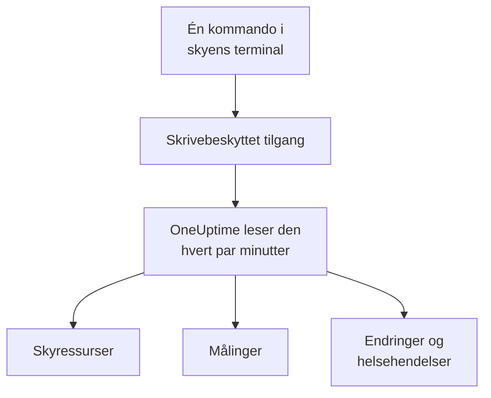

# Koble til en skykonto

Koble til en AWS-konto, et Azure-abonnement eller et Google Cloud-prosjekt fra dashbordet, så lister OneUptime hver ressurs i det, leser de viktigste målingene deres og registrerer hva som er endret i dem og hva skyleverandøren sier om helsen deres. Du kjører én kommando i skyens egen nettleserterminal og limer inn det den skriver ut: Det er ingen collector å kjøre og ingenting å installere.

:::cards
- [Amazon Web Services](#amazon-web-services): En IAM-rolle som OneUptime logger på med, eller en tilgangsnøkkel.
- [Microsoft Azure](#microsoft-azure): En app med rollen Monitoring Reader.
- [Google Cloud](#google-cloud): En tjenestekonto med fire roller som bare kan lese.
- [Hva OneUptime leser](#hva-oneuptime-leser): Ressurser, målinger, endringer og helsehendelser, hvor ofte, og hva det koster.
:::

## Slik fungerer det



- **Tilgangen kan bare lese.** Kommandoen lager en tilgang som leser ressursene dine og hvordan de er satt opp, målingene deres, hva som er endret og leverandørens helsehendelser, og ingenting annet: handlingene nedenfor på AWS, rollen **Monitoring Reader** på Azure og fire leseroller på Google Cloud. OneUptime leser aldri data eller hemmeligheter med den, unntatt logglinjer når du lar AI lese en kontos logger. Slett den for å stenge OneUptime ute.
- **OneUptime leser etter en tidsplan.** Hvert 5. minutt for Azure og Google Cloud, og hvert 10. minutt for AWS, med mindre du velger et annet intervall når du kobler til. Hver lesing registrerer også hva som er endret siden forrige, og hvert 30. minutt lister en lesing alle ressursene på nytt.
- **Hver ressurs får sin egen side.** Ressurser vises under **Sky → Alle ressurser** med de viktigste målingene, eierne og etikettene sine. Siden til en listet ressurs viser også **Tilkoblede ressurser** (hva den kjører i, hva som sender trafikk til den), endepunktene, taggene og innstillingene, og **Hendelser**, **Varsler** og **Endringer**.
- **Hver konto får sin egen side.** Kontoer vises under **Sky → Kontoer** med ressursene sine etter type og region, **Endringer** og en **Topologi** over hvordan ressursene henger sammen.
- **OneUptime AI leser hva som er endret.** En undersøkelse av en hendelse eller et varsel som er koblet til en skyressurs, leser først endringene for den ressursen, og leser kontoens aktivitetslogg på nytt når den starter.

## Før du begynner

- **En prosjekteier eller -administrator.** Bare de kan koble til, teste og redigere skykontoer.
- **Skyens terminal** (AWS CloudShell, Azure Cloud Shell eller Google Cloud Shell), logget på som noen som kan opprette en IAM-rolle eller -bruker, en appregistrering eller en tjenestekonto.

## Amazon Web Services

:::steps
### Åpne AWS-skjemaet

Gå til **Sky → Koble til** og velg **Amazon Web Services**.

### Kjør kommandoen i AWS CloudShell

Velg hvordan OneUptime logger på. En **IAM-rolle** er den anbefalte måten: Ingenting hemmelig lagres, og du kan slette rollen når som helst. Skjemaet viser kommandoen skrevet for prosjektet ditt: Den oppretter en rolle som stoler på OneUptimes AWS-konto med prosjektets eksterne ID, og skriver ut rollens ARN.

Under **Hva som skal leses** velger du denne kontoen eller hver konto i AWS Organization. Kjør organisasjonens kommando i administrasjonskontoen: Den legger til et StackSet som setter den samme rollen i hver konto, nå og etter hvert som kontoer kommer til, og lar administrasjonskontoens rolle liste kontoene. Én tilkobling leser opptil 50 kontoer.

Bruk en **Tilgangsnøkkel** når en rolle ikke er mulig: Den leser bare sin egen konto. Denne kommandoen oppretter en bruker med de samme tillatelsene og skriver ut nøkkelen:

```bash
aws iam create-user --user-name OneUptimeReadOnly > /dev/null 2>&1 || true
aws iam put-user-policy --user-name OneUptimeReadOnly --policy-name OneUptimeReadOnly --policy-document '{"Version":"2012-10-17","Statement":[{"Effect":"Allow","Action":["cloudwatch:GetMetricData","cloudwatch:ListMetrics","tag:GetResources","iam:ListAccountAliases","cloudformation:ListResources","ec2:DescribeInstances","ec2:DescribeVolumes","ec2:DescribeVpcs","ec2:DescribeNatGateways","autoscaling:DescribeAutoScalingGroups","elasticloadbalancing:DescribeLoadBalancers","elasticloadbalancing:DescribeLoadBalancerAttributes","elasticloadbalancing:DescribeTargetGroups","elasticloadbalancing:DescribeTargetGroupAttributes","elasticloadbalancing:DescribeTargetHealth","elasticloadbalancing:DescribeTags","ecs:ListClusters","ecs:DescribeClusters","ecs:ListServices","ecs:DescribeServices","lambda:ListFunctions","rds:DescribeDBInstances","rds:DescribeDBClusters","elasticache:DescribeReplicationGroups","sqs:ListQueues","sqs:GetQueueAttributes","sns:ListTopics","sns:GetTopicAttributes","sns:ListSubscriptionsByTopic","dynamodb:ListTables","dynamodb:DescribeTable","kinesis:ListStreams","kinesis:DescribeStreamSummary","states:ListStateMachines","states:DescribeStateMachine","cloudfront:ListDistributions","elasticfilesystem:DescribeFileSystems","es:ListDomainNames","es:DescribeDomains","apprunner:ListServices","apprunner:DescribeService","cloudtrail:LookupEvents","health:DescribeEvents","health:DescribeEventDetails","rds:DescribeEvents","autoscaling:DescribeScalingActivities","ec2:DescribeInstanceStatus","ecs:DescribeTaskDefinition","lambda:GetFunctionConfiguration","lambda:GetFunctionConcurrency","lambda:GetAlias","servicequotas:ListServiceQuotas","logs:DescribeLogGroups","logs:FilterLogEvents"],"Resource":"*"},{"Effect":"Allow","Action":["apigateway:GET"],"Resource":["arn:aws:apigateway:*::/restapis","arn:aws:apigateway:*::/restapis/*","arn:aws:apigateway:*::/apis","arn:aws:apigateway:*::/apis/*"]}]}'
aws iam create-access-key --user-name OneUptimeReadOnly
```

### Lim inn det AWS-kommandoen skrev ut

Lim inn alt kommandoen skrev ut, i **Det kommandoen skrev ut**. OneUptime henter ut rollens ARN, eller tilgangsnøkkelens ID og hemmeligheten.

### Test og koble til AWS

OneUptime tester tilkoblingen så snart dette trinnet åpnes: Det logger på, teller ressursene det finner og sier hva det koster å lese dem. Velg **Koble til** for å lagre.
:::

Rollen og brukeren kan gjøre dette, og ingenting annet:

| Hva OneUptime bruker dem til | Handlinger |
| --- | --- |
| Finne ressursene som rapporterer målinger, og lese målingene deres | `cloudwatch:GetMetricData`, `cloudwatch:ListMetrics` |
| Navngi hver ressurs og lese taggene | `tag:GetResources`, `iam:ListAccountAliases` |
| Liste hver ressurs og hvordan den er konfigurert, gjennom Cloud Control | `cloudformation:ListResources`, `ec2:DescribeInstances`, `ec2:DescribeVolumes`, `ec2:DescribeVpcs`, `ec2:DescribeNatGateways`, `autoscaling:DescribeAutoScalingGroups`, `elasticloadbalancing:DescribeLoadBalancers`, `elasticloadbalancing:DescribeLoadBalancerAttributes`, `elasticloadbalancing:DescribeTargetGroups`, `elasticloadbalancing:DescribeTargetGroupAttributes`, `elasticloadbalancing:DescribeTargetHealth`, `elasticloadbalancing:DescribeTags`, `ecs:ListClusters`, `ecs:DescribeClusters`, `ecs:ListServices`, `ecs:DescribeServices`, `lambda:ListFunctions`, `rds:DescribeDBInstances`, `rds:DescribeDBClusters`, `elasticache:DescribeReplicationGroups`, `sqs:ListQueues`, `sqs:GetQueueAttributes`, `sns:ListTopics`, `sns:GetTopicAttributes`, `sns:ListSubscriptionsByTopic`, `dynamodb:ListTables`, `dynamodb:DescribeTable`, `kinesis:ListStreams`, `kinesis:DescribeStreamSummary`, `states:ListStateMachines`, `states:DescribeStateMachine`, `cloudfront:ListDistributions`, `elasticfilesystem:DescribeFileSystems`, `es:ListDomainNames`, `es:DescribeDomains`, `apprunner:ListServices`, `apprunner:DescribeService`, `apigateway:GET` |
| Lese hva som er endret: kontoens administrasjonshendelser | `cloudtrail:LookupEvents` |
| Lese AWS sine egne helsehendelser for kontoen | `health:DescribeEvents`, `health:DescribeEventDetails` |
| Lese ressursens nåværende status og siste hendelser under en undersøkelse | `rds:DescribeEvents`, `autoscaling:DescribeScalingActivities`, `ec2:DescribeInstanceStatus`, `ecs:DescribeTaskDefinition`, `lambda:GetFunctionConfiguration`, `lambda:GetFunctionConcurrency`, `lambda:GetAlias` |
| Lese kontoens kvoter under en undersøkelse | `servicequotas:ListServiceQuotas` |
| Lese logglinjer, bare når du lar AI lese en kontos logger | `logs:DescribeLogGroups`, `logs:FilterLogEvents` |
| Liste organisasjonens kontoer, fra administrasjonskontoen | `organizations:ListAccounts` |

`apigateway:GET` er bare tillatt på API-enes egne definisjoner, aldri på nøklene deres, og bare administrasjonskontoens rolle kan liste organisasjonens kontoer. AWS Health svarer bare kontoer med en Business-, Enterprise On-Ramp- eller Enterprise-støtteplan: Uten en spør OneUptime igjen en dag senere.

> [!NOTE]
> På en selvhostet OneUptime trenger veien med en **IAM-rolle** en AWS-identitet som tilhører OneUptime selv: Sett `CLOUD_CONNECT_AWS_ACCESS_KEY_ID` og `CLOUD_CONNECT_AWS_SECRET_ACCESS_KEY` til nøkkelen til en IAM-bruker som kan kalle `sts:AssumeRole`. Uten dem tilbyr skjemaet en **Tilgangsnøkkel**.

## Microsoft Azure

:::steps
### Åpne Azure-skjemaet

Gå til **Sky → Koble til** og velg **Microsoft Azure**.

### Kjør kommandoen i Azure Cloud Shell

Kommandoen oppretter en app med rollen **Monitoring Reader** på det nåværende abonnementet ditt, og skriver ut detaljene med datoen hemmeligheten utløper:

```bash
SCOPE="/subscriptions/$(az account show --query id --output tsv)"
OUT=$(az ad sp create-for-rbac --name OneUptimeReadOnly --role "Monitoring Reader" --scopes "$SCOPE")
APP=$(echo "$OUT" | jq -r .appId)
END=$(az ad app credential list --id "$APP" --query "max([].endDateTime)" --output tsv)
echo "$OUT" | jq --arg end "$END" '. + {endDateTime: $end}'
```

Under **Hva som skal leses** velger du i stedet hvert abonnement i leietakeren, og rollen tildeles leietakerens rotadministrasjonsgruppe:

```bash
SCOPE="/providers/Microsoft.Management/managementGroups/$(az account show --query tenantId --output tsv)"
OUT=$(az ad sp create-for-rbac --name OneUptimeReadOnly --role "Monitoring Reader" --scopes "$SCOPE")
APP=$(echo "$OUT" | jq -r .appId)
END=$(az ad app credential list --id "$APP" --query "max([].endDateTime)" --output tsv)
echo "$OUT" | jq --arg end "$END" '. + {endDateTime: $end}'
```

### Lim inn det Azure-kommandoen skrev ut

Lim inn alt kommandoen skrev ut, i **Det kommandoen skrev ut**. OneUptime henter ut `tenant`, `appId`, `password` og datoen den utløper.

### Test og koble til Azure

OneUptime tester tilkoblingen så snart dette trinnet åpnes. Velg **Koble til** for å lagre.
:::

For å lese flere abonnementer med den samme appen gir du den rollen på hvert av dem:

```bash
az role assignment create --assignee <APP_ID> --role "Monitoring Reader" --scope /subscriptions/<SUBSCRIPTION_ID>
```

OneUptime leser hvert abonnement appen kan lese, opptil 50, med mindre du lister noen under **Abonnementer**. Appens hemmelighet slutter å virke på utløpsdatoen: Fra 30 dager før advarer hver lesing om det. Kjør kommandoen på nytt og lim inn det den skriver ut, for å gi den en ny.

## Google Cloud

:::steps
### Åpne Google Cloud-skjemaet

Gå til **Sky → Koble til** og velg **Google Cloud**.

### Kjør kommandoen i Google Cloud Shell

Kjør den i prosjektet som skal overvåkes. Den slår på API-ene OneUptime leser, oppretter en tjenestekonto med rollene **Monitoring Viewer**, **Cloud Asset Viewer**, **Logs Viewer** og **Service Health Viewer**, og skriver ut nøkkelen:

```bash
PROJECT_ID=$(gcloud config get-value project)
gcloud services enable monitoring.googleapis.com cloudasset.googleapis.com logging.googleapis.com cloudresourcemanager.googleapis.com servicehealth.googleapis.com
gcloud iam service-accounts create oneuptime-read-only --display-name "OneUptime (read only)" > /dev/null 2>&1 || true
gcloud projects add-iam-policy-binding "$PROJECT_ID" --member "serviceAccount:oneuptime-read-only@$PROJECT_ID.iam.gserviceaccount.com" --role roles/monitoring.viewer --condition=None > /dev/null
gcloud projects add-iam-policy-binding "$PROJECT_ID" --member "serviceAccount:oneuptime-read-only@$PROJECT_ID.iam.gserviceaccount.com" --role roles/cloudasset.viewer --condition=None > /dev/null
gcloud projects add-iam-policy-binding "$PROJECT_ID" --member "serviceAccount:oneuptime-read-only@$PROJECT_ID.iam.gserviceaccount.com" --role roles/logging.viewer --condition=None > /dev/null
gcloud projects add-iam-policy-binding "$PROJECT_ID" --member "serviceAccount:oneuptime-read-only@$PROJECT_ID.iam.gserviceaccount.com" --role roles/servicehealth.viewer --condition=None > /dev/null
gcloud iam service-accounts keys create oneuptime-key.json --iam-account "oneuptime-read-only@$PROJECT_ID.iam.gserviceaccount.com"
cat oneuptime-key.json && rm oneuptime-key.json
```

Under **Hva som skal leses** velger du i stedet hvert prosjekt i organisasjonen, og rollene tildeles prosjektets organisasjon:

```bash
PROJECT_ID=$(gcloud config get-value project)
ORG_ID=$(gcloud projects get-ancestors "$PROJECT_ID" --format="value(id)" | tail -1)
gcloud services enable monitoring.googleapis.com cloudasset.googleapis.com logging.googleapis.com cloudresourcemanager.googleapis.com servicehealth.googleapis.com
gcloud iam service-accounts create oneuptime-read-only --display-name "OneUptime (read only)" > /dev/null 2>&1 || true
gcloud organizations add-iam-policy-binding "$ORG_ID" --member "serviceAccount:oneuptime-read-only@$PROJECT_ID.iam.gserviceaccount.com" --role roles/monitoring.viewer --condition=None > /dev/null
gcloud organizations add-iam-policy-binding "$ORG_ID" --member "serviceAccount:oneuptime-read-only@$PROJECT_ID.iam.gserviceaccount.com" --role roles/cloudasset.viewer --condition=None > /dev/null
gcloud organizations add-iam-policy-binding "$ORG_ID" --member "serviceAccount:oneuptime-read-only@$PROJECT_ID.iam.gserviceaccount.com" --role roles/logging.viewer --condition=None > /dev/null
gcloud organizations add-iam-policy-binding "$ORG_ID" --member "serviceAccount:oneuptime-read-only@$PROJECT_ID.iam.gserviceaccount.com" --role roles/servicehealth.viewer --condition=None > /dev/null
gcloud iam service-accounts keys create oneuptime-key.json --iam-account "oneuptime-read-only@$PROJECT_ID.iam.gserviceaccount.com"
cat oneuptime-key.json && rm oneuptime-key.json
```

### Lim inn nøkkelen

Lim inn alt kommandoen skrev ut. OneUptime leser nøkkelens eget prosjekt og lagrer nøkkelen kryptert.

### Test og koble til Google Cloud

OneUptime tester tilkoblingen så snart dette trinnet åpnes. Velg **Koble til** for å lagre.
:::

For å lese flere prosjekter med den samme tjenestekontoen gir du den de fire rollene i hvert av dem og lister dem under **Prosjekter**:

```bash
for ROLE in roles/monitoring.viewer roles/cloudasset.viewer roles/logging.viewer roles/servicehealth.viewer; do gcloud projects add-iam-policy-binding <PROJECT_ID> --member "serviceAccount:oneuptime-read-only@<KEY_PROJECT_ID>.iam.gserviceaccount.com" --role "$ROLE"; done
```

En organisasjons tilkobling leser opptil 50 av prosjektene, med mindre du lister noen under **Prosjekter**.

## Hva OneUptime leser

| | AWS | Azure | Google Cloud |
| --- | --- | --- | --- |
| Ressurser | Hver ressurs av typene OneUptime kjenner, i hver region du bruker, fra Cloud Control | Hver ressurs i abonnementene, fra Resource Graph | Hver ressurs i prosjektene, fra Cloud Asset Inventory |
| Målinger | De viktigste målingene for hver tjeneste, som CPU, nettverk og statussjekker for en instans | Opptil 8 viktige målinger per ressurs | De viktigste målingene for hver ressurstype |
| Endringer | Administrasjonshendelsene i CloudTrail | De administrative hendelsene i aktivitetsloggen | Revisjonsloggen Admin Activity |
| Helsehendelser | AWS Health | Service Health og Resource Health | Service Health |
| Leses hvert | 10. minutt | 5. minutt | 5. minutt |
| En slettet ressurs | Arkiveres når en fullstendig liste ikke lenger har den | Arkiveres når en fullstendig liste ikke lenger har den | Arkiveres når en fullstendig liste ikke lenger har den |

Hver lesing fortsetter der den forrige stoppet, så hvert datapunkt og hver endring skrives én gang. En ny tilkoblings første lesing starter innen ett minutt og går en time tilbake for målinger og 2 timer tilbake for endringer; etter en pause går en lesing høyst 6 timer tilbake. En ressurs som bare rapporterer målinger, og som ingen liste har, arkiveres etter 7 dager uten målinger.

Kallene OneUptime gjør, faktureres skykontoen din, til skyens priser. Å liste ressurser og lese endringer og helsehendelser koster ingenting på alle tre skyene; å lese målinger gjør det. Testen anslår kostnaden for det den finner, og å lese sjeldnere koster mindre: Endre **Intervall for lesing av målinger** under **Flere felt**.

| Sky | Pris |
| --- | --- |
| AWS | CloudWatch `GetMetricData`: $0.01 per 1 000 målinger, og hver viktige måling for en ressurs er én måling per lesing |
| Azure | De første 1 000 000 målingslesingene i måneden for hvert abonnement er gratis, deretter $0.01 per 1 000 |
| Google Cloud | De første 1 000 000 tidsseriene som leses i måneden, er gratis, deretter $0.50 per million |

## Det du ser i OneUptime

- **Kontoens side.** Under **Sky → Kontoer** teller oversikten for en konto ressursene etter type og region, og sier når en tilkobling sist leste den. **Ressurser** lister dem, **Endringer** lister hva som er endret i den, det nyeste først, og **Topologi** tegner regionene, nettverkene i dem og hva som kjører i hvert, med de åpne hendelsene og varslene på ressursene de er koblet til.
- **En ressurs sine endringer.** En endring lagres som en endringshendelse koblet til ressursen den endret og til kontoen, og tegnes som en markør i ressursens målingsdiagrammer sammen med hendelsene og varslene. Diagrammer som ikke er filtrert til noen ressurs, utelater en skykontos aktivitetslogg, så en travel konto ikke fortrenger utrullingene dine; leverandørens helsehendelser blir værende.
- **Hendelser og varsler.** Koble en skyressurs til en overvåking, en hendelse eller et varsel under de tilkoblede ressursene, så listes hendelsene og varslene på ressursens side. En overvåking av et nettsted, et API, SSL, ping eller en port der verten fører til et endepunkt for en ressurs, direkte eller via DNS, viser ressursen under **Foreslåtte skyressurser** på kortet **Tilkoblede ressurser**: Velg **Koble til ressurs** for å koble den til.

## Feilsøking

:::details Testen sier at nøkkelen eller hemmeligheten ikke ble godtatt
Kopier alt kommandoen skrev ut, og lim det inn på nytt. En nøkkel som ble laget for et minutt siden, kan bruke et minutt på å virke. En utløpt Azure-hemmelighet avvises også: Kjør kommandoen på nytt.
:::

:::details Testen logger på, men kan ikke lese
Kjør kommandoen på nytt: Den tildeler rollene OneUptime trenger. På AWS kjører du kommandoen skjemaet viser for dette prosjektet: En rolle laget for et annet prosjekt stoler på det prosjektets eksterne ID, ikke dette prosjektets.
:::

:::details Google Cloud lar ikke kommandoen opprette en nøkkel
En organisasjonspolicy, `iam.disableServiceAccountKeyCreation`, kan forby nøkler for tjenestekontoer. Be administratoren i organisasjonen din om et unntak for prosjektet, eller [send målingene med din egen collector](/docs/telemetry/cloud-resources).
:::

:::details Ingen ressurser vises
Den første lesingen lister hver ressurs i kontoen, enten den rapporterer målinger eller ikke. Hvis en tilkobling ikke virker, sier **View error** under **Sky → Koble til** hvorfor den siste lesingen mislyktes.
:::

:::details Noen av organisasjonens kontoer mangler
Én tilkobling leser opptil 50 kontoer, abonnementer eller prosjekter, og hver lesing sier fra når det finnes flere. Koble til de andre med en egen tilkobling.
:::

## Neste steg

:::cards
- [Skyressurser](/docs/telemetry/cloud-resources): Kjør heller din egen OpenTelemetry Collector, eller strøm CloudWatch-målinger.
- [Utrullinger og endringer](/docs/telemetry/change-events): Hver endring OneUptime registrerer, og hvordan OneUptime AI leser dem.
- [Målingsmonitor](/docs/monitor/metrics-monitor): Varsle på målingene til en ressurs.
:::
