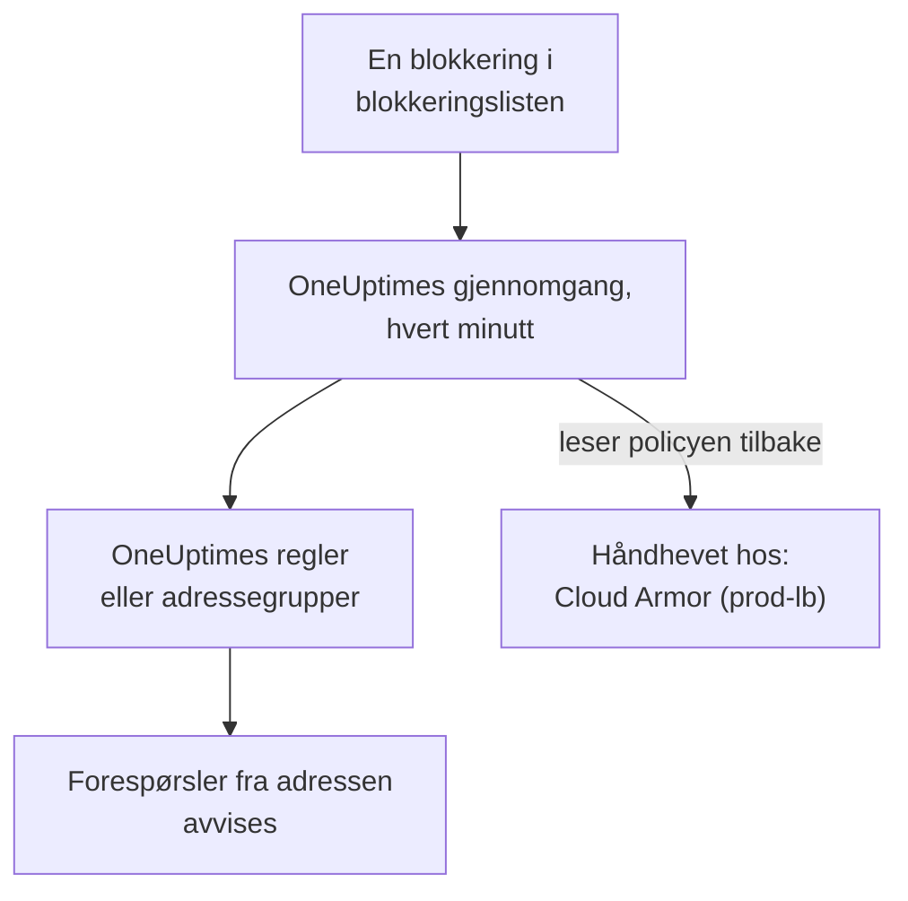

# Blokker adresser i Cloud Armor

Prosjektets blokkeringsliste kan håndheves i Google Cloud Armor-sikkerhetspolicyene til lastbalansererne dine. Slå det på for en Google Cloud-tilkobling du allerede har, velg sikkerhetspolicyene, og hver adresse blokkeringslisten blokkerer, blokkeres der, enten det var en person, en playbook eller OneUptime AI som blokkerte den.

:::cards
- [Slå det på](#slå-det-på): Én innstilling på Google Cloud-tilkoblingen, og rollen den trenger.
- [Hva OneUptime oppretter](#hva-oneuptime-oppretter): Egne regler i hver policy, eller adressegrupper med Cloud Armor Enterprise.
- [Hvilken adresse som sammenlignes](#hvilken-adresse-som-sammenlignes): Adressen som koblet seg til, eller bruker-IP-en bak en proxy.
:::

## Slik fungerer det

OneUptime vedlikeholder egne regler i hver sikkerhetspolicy du velger, og legger adressene blokkeringslisten blokkerer, inn i dem. Hvert minutt endrer den det som er endret, én regel om gangen, og leser deretter policyen tilbake. På siden **Blokkeringsliste** viser **Håndhevet hos** for en blokkering først Cloud Armor (prod-lb) når policyen har blokkeringen; inntil da er den ikke håndhevet.

## Før du begynner

- Et Google Cloud-prosjekt som er koblet til OneUptime (se [Koble til en skykonto](/docs/telemetry/cloud-accounts#google-cloud)).
- En rolle som kan endre hvor blokkeringslisten håndheves: **Prosjekteier**, **Prosjektadministrator** eller **Sikkerhetsadministrator**.
- Noen som kan opprette roller og tildele dem i Google Cloud-prosjektet, til å kjøre én kommando i Cloud Shell.

## Slå det på

:::steps
### Åpne tilkoblingen
Åpne **Sky → Koble til** og rediger Google Cloud-tilkoblingen.

### Slå på innstillingen
Under **Flere felt** setter du **Blokker adresser i Cloud Armor** til **På**, og lagrer. Oppsettkommandoen skjemaet viser, tildeler nå rollen nedenfor der den tildeler de andre. En tilkobling du allerede har, trenger ikke å kjøre den på nytt: Dialogen **Legg til WAF** gir linjene som tildeler rollen i prosjektet til policyen.

### Legg til sikkerhetspolicyene
Åpne **Sikkerhetshendelser → Playbooks → Blokkeringsliste**. Under **Sky-WAF-er** klikker du **Legg til WAF** og velger en sikkerhetspolicy. OneUptime spør Google Cloud om tilkoblingen får skrive den, uten å skrive noe.

### Tildel rollen hvis den mangler
Når en tillatelse mangler, viser dialogen linjene som tildeler den i prosjektet til policyen. Kjør dem i Cloud Shell, klikk **Kontroller på nytt**, og legg deretter til policyen. **Status** for den viser **Håndhever** når OneUptime har satt den opp.
:::

Sikkerhetspolicyene kommer fra inventaret til tilkoblingen: En policy som OneUptime ikke har lest ennå, vises etter neste lesing. Så lenge en policy håndhever blokkeringslisten, kan innstillingen til tilkoblingen ikke slås av, og tilkoblingen kan ikke slettes: Fjern policyen først, så OneUptime tar ut reglene sine.

## Hva OneUptime oppretter

OneUptime velger hvordan en policy rommer blokkeringslisten når du legger den til.

| Hva | Navn | Hvor |
| --- | --- | --- |
| Regler som avviser med 403, hver med opptil 10 adresser eller områder | Beskrivelsen deres begynner med `OneUptime blocklist <project> #1`, `#2`, ... | I hver policy du velger, høyst 20 av dem. |
| To adressegrupper, IPv4 og IPv6 | `oneuptime-<project>-block-ipv4`, `oneuptime-<project>-block-ipv6` | Globale, i prosjektet til policyen. Bare med Cloud Armor Enterprise. |
| Én regel som avviser med 403 alt som en av gruppene inneholder | Beskrivelsen begynner med `OneUptime blocklist <project>, address groups` | I hver global backend-policy du velger, med Cloud Armor Enterprise. |

`<project>` er de første åtte tegnene i den eksterne ID-en til prosjektet ditt, så to OneUptime-prosjekter som velger én policy, aldri skriver hverandres regler. Cloud Armor navngir en regel bare etter prioriteten, så OneUptime kjenner igjen sine egne regler på beskrivelsen.

- **Regler.** Cloud Armor rommer 10 adresser eller områder i en regel, så en policy rommer opptil 200 blokkeringer i OneUptimes 20 regler; en blokkering som ikke får plass, sier det på raden sin.
- **Adressegrupper.** En global backend-policy i et prosjekt med Cloud Armor Enterprise rommer i stedet blokkeringslisten i to adressegrupper: 10 000 IPv4- og 2 000 IPv6-områder. Alle slike policyer i prosjektet deler dem, og én regel i hver policy avviser det de inneholder. Gruppene bruker 16 000 enheter av prosjektets kvote for adressegrupper.

OneUptime legger til, endrer og fjerner hver av reglene sine for seg, med regelmetodene til Cloud Armor: Den skriver aldri policyen som en helhet, og skriver aldri en regel du har laget. En enkelt adresse skrives som `/32` eller `/128`.

## Reglenes plass i policyen

OneUptime plasserer reglene sine på ledige prioriteter før den første regelen din som slipper en forespørsel gjennom, laveste først, så ingen regel du har laget, slipper en blokkert adresse gjennom: en regel som tillater, struper, utestenger etter hastighet eller fordeler rettferdig. En regel du har laget som avviser, kan komme først. OneUptime nummererer aldri om, endrer eller fjerner en regel du har laget: Når ingen prioritet er ledig før den første regelen din av denne typen, viser policyen **Ingen ledig prioritet**, og OneUptime legger til regelen sin så snart du frigjør én.

## Hvilken adresse som sammenlignes

| Sikkerhetspolicy | Klientadresse | Når du skal velge den |
| --- | --- | --- |
| Backend | **Adressen som koblet seg til lastbalansereren (origin.ip)** | Standardvalget. |
| Backend | Bruker-IP-en fra policyens forespørselsheadere (origin.user_ip) | For en lastbalanserer bak en annen proxy eller et annet CDN. |
| Edge | Adressen som koblet seg til lastbalansereren (origin.ip) | Det eneste valget: En edge-policy leser ingen annen adresse. |

`origin.user_ip` er adressen i policyens headere for bruker-IP (`userIpRequestHeaders`), som en proxy eller et CDN foran lastbalansereren skriver. Er ingen satt, eller er det ingen gyldig adresse i dem, er den `origin.ip`. Velg den bare når en slik proxy skriver dem, siden en klient som når lastbalansereren direkte, kan skrive dem selv. Valget ligger under **Flere felt** i dialogen **Legg til WAF**, og du kan endre det senere med **Klientadresse** på raden til policyen.

En network edge-sikkerhetspolicy, for passthrough Network Load Balancers, kan ikke velges, og dialogen **Legg til WAF** sier hvorfor: Reglene i den treffer pakker, ikke forespørsler.

OneUptimes regler i Cloud Armor avviser bare. En blokkering som ber om å utfordre en adresse, tas ikke i bruk i Cloud Armor, og sier det. En utfordring fra en policy for automatisk respons håndheves der som en blokkering like lenge.

## Når en regel endres manuelt

Når noen setter en av OneUptimes regler til forhåndsvisning, endrer den eller sletter den, eller sletter en av OneUptimes adressegrupper, lar OneUptime den være slik den ble etterlatt. Policyen viser **Endret manuelt**, og blokkeringene den inneholdt, håndheves ikke, med årsak, til noen klikker **Gjenopprett** på raden til policyen. Gjenopprett skriver regelen på nytt slik OneUptime skriver den, på sin egen prioritet så lenge den er ledig, og oppretter en slettet adressegruppe på nytt.

OneUptime sjekker ikke at en policy er knyttet til en backend-tjeneste. En policy som ikke er knyttet til noen, blokkerer ingenting.

## Behold en policy i Terraform

En `google_compute_security_policy` med `rule`-blokker eier alle reglene i policyen, så neste plan fjerner OneUptimes regler. Behold reglene dine som `google_compute_security_policy_rule`-ressurser, som lar andre regler være, eller legg til `ignore_changes = [rule]` i `lifecycle`-blokken til policyen.

## Tillatelser

Oppsettkommandoen legger til en egendefinert rolle, `oneuptimeCloudArmorBlocklist`, der den tildeler de andre rollene til tilkoblingen, og tildeler den til tjenestekontoen til tilkoblingen. Linjene dialogen **Legg til WAF** viser, legger til den samme rollen i prosjektet til policyen. En policy som rommer blokkeringslisten i regler, ikke i adressegrupper, trenger bare sine egne tillatelser.

| Tillatelse | Hvorfor |
| --- | --- |
| `compute.securityPolicies.get`, `compute.securityPolicies.update` | Lese en global policy og endre OneUptimes regler i den. |
| `compute.regionSecurityPolicies.get`, `compute.regionSecurityPolicies.update` | Lese en regional policy og endre OneUptimes regler i den. |
| `compute.globalOperations.get`, `compute.regionOperations.get` | Vente til en endring er ferdig. |
| `compute.projects.get` | Lese om prosjektet har Cloud Armor Enterprise. |
| `networksecurity.addressGroups.get`, `networksecurity.addressGroups.list`, `networksecurity.addressGroups.create`, `networksecurity.addressGroups.update`, `networksecurity.addressGroups.delete`, `networksecurity.addressGroups.use` | Vedlikeholde OneUptimes adressegrupper, og vise til dem fra regelen. Bare med Cloud Armor Enterprise. |
| `networksecurity.operations.get` | Vente til endringen av en adressegruppe er ferdig. |

Rollen kan ikke slette en policy, og OneUptime skriver aldri noe annet. Oppsettkommandoen slår også på API-ene for Compute Engine og Network Security.

## Fjern det

:::steps
### Fjern sikkerhetspolicyen
På **Sikkerhetshendelser → Playbooks → Blokkeringsliste** klikker du **Fjern** på raden til policyen. OneUptime tar reglene sine ut av policyen, og sletter adressegruppene sine når ingen annen policy i prosjektet bruker dem.

### Slå av innstillingen
Rediger tilkoblingen, sett **Blokker adresser i Cloud Armor** til **Av**, og lagre. Innstillingen kan slås av når ingen policy i tilkoblingen håndhever blokkeringslisten lenger.
:::

Når OneUptime ikke lenger får skrive policyen, krysser du av for **Fjern bare fra OneUptime** i dialogen **Fjern WAF**. OneUptime fjerner policyen fra blokkeringslisten og nevner reglene og adressegruppene den lot bli igjen: De fortsetter å blokkere det de inneholder, til du sletter dem i Google Cloud.

## Feilsøking

:::details Håndhever ikke
Statusen til policyen sier hva Google Cloud svarte og hva du skal gjøre. Et avslag nevner tillatelsen som mangler: Kjør linjene **Legg til WAF** viser for policyen, og klikk deretter **Kontroller på nytt**. Et avslag på grunn av en kvote nevner kvoten: Be Google Cloud om mer, eller slett regler du ikke lenger bruker.
:::

:::details Ingen ledig prioritet
Hver prioritet før den første regelen din som slipper en forespørsel gjennom, er opptatt. Gi den regelen et høyere nummer, og klikk deretter **Kontroller på nytt**.
:::

:::details En policy står ikke i listen
OneUptime viser sikkerhetspolicyene til tilkoblinger med innstillingen slått på, når den har lest dem. En policy som er lagt til siden, vises etter neste lesing av tilkoblingen.
:::

## Neste steg

:::cards
- [Sikkerhetssaker og playbooks](/docs/telemetry/security-cases): Blokker en adresse fra en sak, og se trinnet bli kontrollert.
- [Koble til en skykonto](/docs/telemetry/cloud-accounts): Tilkoblingen denne innstillingen hører til.
:::
