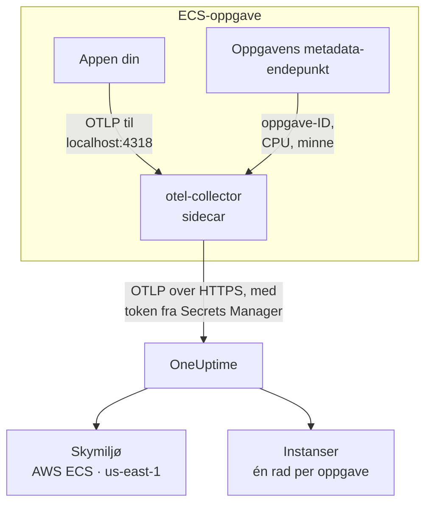

# AWS ECS / Fargate

Send spor, logger og metrikker fra Amazon ECS-oppgavene dine til OneUptime, både med Fargate- og EC2-oppstartstypen. Hver oppgave som rapporterer `cloud.platform=aws_ecs`, havner i ett **Cloud Environment** per AWS-konto og region, for eksempel _AWS ECS · us-east-1 · 123456789012_, enten den kjører én tjeneste eller femti.

:::cards
- [Slik fungerer det](#slik-fungerer-det): Hva ECS-detektoren og sidecar-collectoren gjør.
- [Oppsett](#oppsett): Lagre tokenet, legg innstillingene til i oppgavedefinisjonen, rull ut og sjekk.
- [Den fullstendige oppgavedefinisjonen](#den-fullstendige-oppgavedefinisjonen): En komplett Fargate-oppgavedefinisjon du kan registrere.
- [Feilsøking](#feilsøking): Oppgaver som henger i PENDING, avviste eksporter, tomme instanser eller fliser.
:::

## Slik fungerer det



- **ECS-detektoren gir miljøet navn.** OpenTelemetrys ECS-ressursdetektor, i SDK-en eller i en collector, leser metadata-endepunktet som ECS gir hver container, og stempler kontoen, regionen og oppgaven på alt oppgaven sender. Ingenting er hardkodet.
- **Oppgaven gir hver instans navn.** Fanen **Instanser** i miljøet viser de kjørende oppgavene etter oppgave-ID, med CPU og minne.
- **En sidecar-collector legger til CPU og minne.** Receiveren `awsecscontainermetrics` i den leser CPU og minne for hver oppgave fra det samme endepunktet, og den har tokenet, så applikasjonen aldri ser det.

ECS-detektoren setter disse ressursattributtene:

| Attributt | Satt av ECS-detektoren | Brukes til |
| ------------------------------------------------------------------ | ----------------------- | --------------------------------------------------------------------------------------------------------- |
| `cloud.platform` | `aws_ecs` | Arkiverer telemetrien under **Skymiljøer**. Verdien må være nøyaktig |
| `cloud.account.id` | `123456789012` | En del av miljønøkkelen |
| `cloud.region` | `us-east-1` | En del av miljønøkkelen |
| `aws.ecs.task.arn` | oppgavens ARN | Gir én kjørende oppgave navn under **Instanser**, etter oppgave-ID-en på slutten |
| `aws.ecs.task.id` | oppgave-ID-en | Det samme; nyere detektorversjoner setter begge |
| `aws.ecs.cluster.arn`, `aws.ecs.task.family`, `aws.ecs.launchtype` | clusteret og oppgaven | Beholdes på hvert spenn, hver logg og metrikk så du kan søke på dem; ikke en del av miljøet |

Miljønøkkelen er `aws_ecs|123456789012|us-east-1`. Oppgave-ID-en gir en instans navn også når SDK-en i tillegg setter `service.instance.id`: containermetrikkene fra sidecaren har bare oppgave-ID-en, så når den er nøkkelen, holdes spennene til en oppgave og CPU og minne for den på én rad. Se [Skymiljøer](/docs/telemetry/cloud-environments) for hele regelen.

## Før du begynner

- **En inntaksnøkkel.** Opprett en nøkkel av typen **Server** under **Prosjektinnstillinger → Telemetri og APM → Inntaksnøkler**, og kopier tokenet.
- **Et ECS-cluster og en oppgavedefinisjon du kan revidere**, og AWS CLI konfigurert for den kontoen.
- **Applikasjonen din instrumentert med en OpenTelemetry-SDK** som eksporterer OTLP, i hvilket som helst språk.

## Velg hvordan telemetrien forlater oppgaven

| | Sidecar collector | SDK direct |
| ----------------------- | ---------------------------------------------- | ----------------------------------------------- |
| Ekstra container | `otel-collector` i hver oppgave | Ingen |
| CPU og minne per oppgave | Ja, fra receiveren `awsecscontainermetrics` | Nei |
| Har tokenet | Collectoren | Applikasjonen |
| Hemmeligheten inneholder | Bare tokenet | Hele headeren `x-oneuptime-token=...` |

De fleste team bruker sidecar-collectoren: den stempler attributtene `cloud.*` selv på telemetri fra biblioteker som ikke vet noe om ECS. SDK direct er det enkleste valget for én enkelt tjeneste. Hvert steg nedenfor har en fane for begge; velg én, så følger hvert steg den.

## Oppsett

:::steps
### Lagre tokenet i Secrets Manager

> [!IMPORTANT]
> Tokenet er en hemmelighet. Oppbevar det i AWS Secrets Manager, og referer til det fra oppgavedefinisjonen med `secrets` og `valueFrom`. Et token i en vanlig oppføring under `environment` er synlig for alle som kan lese oppgavedefinisjonen, og dukker opp i hver utdata fra `describe-task-definition` og hver CloudFormation-diff.

:::tabs
@tab Sidecar collector
```bash
aws secretsmanager create-secret \
  --name oneuptime/ingestion-token \
  --region us-east-1 \
  --secret-string "YOUR_TELEMETRY_INGESTION_TOKEN"
```

Collectorens konfigurasjon legger til headernavnet, så denne hemmeligheten inneholder bare tokenet.
@tab SDK direct
```bash
aws secretsmanager create-secret \
  --name oneuptime/ingestion-token \
  --region us-east-1 \
  --secret-string "x-oneuptime-token=YOUR_TELEMETRY_INGESTION_TOKEN"
```

ECS legger verdien av en hemmelighet uendret i variabelen, og `OTEL_EXPORTER_OTLP_HEADERS` trenger hele paret `name=value`, så denne hemmeligheten inneholder hele headeren.
:::

Noter ARN-en kommandoen skriver ut. Den slutter med et tilfeldig suffiks, for eksempel `oneuptime/ingestion-token-AbCdEf`, og du limer den inn i oppgavedefinisjonen.

### La oppgaven lese hemmeligheten

Oppgavens kjøringsrolle (rollen ECS starter oppgaven med, ikke rollen koden din kjører som) må kunne lese hemmeligheten. Knytt denne policyen til `ecsTaskExecutionRole`:

```json title="secret-access-policy.json"
{
  "Version": "2012-10-17",
  "Statement": [
    {
      "Effect": "Allow",
      "Action": ["secretsmanager:GetSecretValue"],
      "Resource": "arn:aws:secretsmanager:us-east-1:123456789012:secret:oneuptime/ingestion-token-*"
    }
  ]
}
```

Hvis en kundeadministrert KMS-nøkkel krypterer hemmeligheten, trenger rollen også `kms:Decrypt` på den nøkkelen. Uten en av dem starter ikke oppgaven: den stopper med `ResourceInitializationError: unable to pull secrets`.

### Legg innstillingene til i oppgavedefinisjonen

:::tabs
@tab Sidecar collector
1. **AWS Console → Amazon Elastic Container Service → Task definitions** → velg familien → **Create new revision**.
2. Under **Container - 1** (applikasjonen din) utvider du **Environment variables** og legger til applikasjonsvariablene nedenfor.
3. **+ Add container**: navn `otel-collector`, image `otel/opentelemetry-collector-contrib:latest` (lås en versjon når det fungerer), **Essential container: No**. Under **Docker configuration → Command** skriver du inn `--config=env:OTEL_COLLECTOR_CONFIG`.
4. Legg til miljøvariabelen `ONEUPTIME_TOKEN` på collector-containeren med **Value type: ValueFrom** og hemmelighetens ARN, og `OTEL_COLLECTOR_CONFIG` med **Value type: Value** og collector-konfigurasjonen nedenfor.
5. Under **Startup dependency ordering** på applikasjonscontaineren legger du til `otel-collector` med betingelsen **Start**, så applikasjonen aldri starter før noe lytter på port 4318.
6. Under **Task execution role** sjekker du at det er rollen du knyttet policyen til.

Applikasjonsvariabler. I nettverksmodusen `awsvpc` (alltid på Fargate) deler containerne i en oppgave ett nettverk, så `localhost` er sidecaren:

```bash
OTEL_SERVICE_NAME=checkout-api
OTEL_EXPORTER_OTLP_ENDPOINT=http://localhost:4318
OTEL_EXPORTER_OTLP_PROTOCOL=http/protobuf
```

Collector-konfigurasjon. Collectoren leser alt fra variabelen `OTEL_COLLECTOR_CONFIG`, så det er ingen fil å bygge inn i et image, og den fyller ut `${env:ONEUPTIME_TOKEN}` fra hemmeligheten ECS legger i miljøet dens:

```yaml title="OTEL_COLLECTOR_CONFIG"
receivers:
  otlp:
    protocols:
      http:
        endpoint: 0.0.0.0:4318
      grpc:
        endpoint: 0.0.0.0:4317
  # Per-task and per-container CPU / memory from the ECS task metadata
  # endpoint. This is what fills the CPU and memory tiles in OneUptime.
  awsecscontainermetrics:
    collection_interval: 20s
processors:
  # Stamps cloud.provider, cloud.platform=aws_ecs, cloud.account.id,
  # cloud.region and aws.ecs.task.arn on every span, log and metric.
  resourcedetection:
    detectors: [env, ecs]
    timeout: 5s
  batch: {}
exporters:
  otlphttp/oneuptime:
    endpoint: https://oneuptime.com/otlp
    headers:
      x-oneuptime-token: ${env:ONEUPTIME_TOKEN}
service:
  pipelines:
    traces:
      receivers: [otlp]
      processors: [resourcedetection, batch]
      exporters: [otlphttp/oneuptime]
    metrics:
      receivers: [otlp, awsecscontainermetrics]
      processors: [resourcedetection, batch]
      exporters: [otlphttp/oneuptime]
    logs:
      receivers: [otlp]
      processors: [resourcedetection, batch]
      exporters: [otlphttp/oneuptime]
```

Verken detektoren `ecs` eller receiveren `awsecscontainermetrics` trenger en IAM-tillatelse: begge leser metadata-endepunktet som ECS gir hver container i `ECS_CONTAINER_METADATA_URI_V4`.
@tab SDK direct
1. **AWS Console → Amazon Elastic Container Service → Task definitions** → velg familien → **Create new revision**.
2. Under **Container - 1** (applikasjonen din) utvider du **Environment variables** og legger til variablene nedenfor. Legg til `OTEL_EXPORTER_OTLP_HEADERS` med **Value type: ValueFrom** og hemmelighetens ARN som verdi.
3. Legg til bryteren som slår på ECS-ressursdetektoren for språket ditt, fra tabellen nedenfor.
4. Under **Task execution role** sjekker du at det er rollen du knyttet policyen til.

```bash
OTEL_SERVICE_NAME=checkout-api
OTEL_EXPORTER_OTLP_ENDPOINT=https://oneuptime.com/otlp
OTEL_EXPORTER_OTLP_PROTOCOL=http/protobuf
# Injected from Secrets Manager (secrets / valueFrom), not typed here.
OTEL_EXPORTER_OTLP_HEADERS=x-oneuptime-token=YOUR_TELEMETRY_INGESTION_TOKEN
```

| Språk | Slå på ECS-detektoren |
| -------- | --------------------------------------------------------------------------------------------------------------- |
| Node.js | `OTEL_NODE_RESOURCE_DETECTORS=env,host,os,aws` (auto-instrumentations-node) |
| Python | `pip install opentelemetry-sdk-extension-aws`, deretter `OTEL_EXPERIMENTAL_RESOURCE_DETECTORS=aws_ecs` |
| Java | `-Dotel.resource.providers.aws.enabled=true` (agenten leveres med provideren slått av) |
| Go | `import "go.opentelemetry.io/contrib/detectors/aws/ecs"`, og send `ecs.NewResourceDetector()` til `resource.New` |
| .NET | Pakken `OpenTelemetry.Resources.AWS`: `.ConfigureResource(r => r.AddAWSECSDetector())` |

I en fil med oppgavedefinisjonen er hemmeligheten `"secrets": [{ "name": "OTEL_EXPORTER_OTLP_HEADERS", "valueFrom": "<secret ARN>" }]`.
:::

Hvis du hoster OneUptime selv, bruker du `https://YOUR-ONEUPTIME-HOST/otlp` som endepunkt.

### Rull ut den nye revisjonen

Klikk **Create**, deretter **Clusters → your cluster → Services → select the service → Update → Task definition revision: latest → Deploy**. Eller fra CLI-en:

```bash
aws ecs update-service \
  --cluster production \
  --service checkout-api \
  --task-definition checkout-api
```

### Sjekk tilkoblingen

Sjekk tokenet først: det er den billigste sjekken, og ingenting etter den fungerer uten.

```bash
curl -i https://oneuptime.com/otlp/v1/validate \
  -H "x-oneuptime-token: YOUR_TELEMETRY_INGESTION_TOKEN"
```

`200` med `"valid": true` betyr at tokenet er godtatt. `401` betyr at det er ukjent, tilbakekalt, deaktivert eller utløpt. Kjør den samme kommandoen inne i oppgaven med ECS Exec for å bevise at oppgaven selv kan nå OneUptime:

```bash
aws ecs execute-command --cluster production --task <task id> \
  --container app --interactive --command "sh"
```

Collectorens CloudWatch-loggstrøm (`otel/otel-collector/...`) skal vise `Everything is ready`, uten linjer med `401` eller `connection refused`. Innen ett minutt etter det første spennet, den første loggen eller metrikken vises miljøet under **Sky → All Environments** som _AWS ECS · us-east-1 · 123456789012_.
:::

## Den fullstendige oppgavedefinisjonen

Sidecar-oppsettet som en fil du registrerer med `aws ecs register-task-definition --cli-input-json file://task-definition.json`. Bytt ut konto-ID-en, regionen, imaget og hemmelighetens ARN:

```json title="task-definition.json"
{
  "family": "checkout-api",
  "requiresCompatibilities": ["FARGATE"],
  "networkMode": "awsvpc",
  "cpu": "512",
  "memory": "1024",
  "executionRoleArn": "arn:aws:iam::123456789012:role/ecsTaskExecutionRole",
  "taskRoleArn": "arn:aws:iam::123456789012:role/checkout-api-task-role",
  "containerDefinitions": [
    {
      "name": "app",
      "image": "123456789012.dkr.ecr.us-east-1.amazonaws.com/checkout-api:1.4.2",
      "essential": true,
      "portMappings": [{ "containerPort": 8080, "protocol": "tcp" }],
      "environment": [
        { "name": "OTEL_SERVICE_NAME", "value": "checkout-api" },
        {
          "name": "OTEL_EXPORTER_OTLP_ENDPOINT",
          "value": "http://localhost:4318"
        },
        { "name": "OTEL_EXPORTER_OTLP_PROTOCOL", "value": "http/protobuf" }
      ],
      "dependsOn": [
        { "containerName": "otel-collector", "condition": "START" }
      ],
      "logConfiguration": {
        "logDriver": "awslogs",
        "options": {
          "awslogs-group": "/ecs/checkout-api",
          "awslogs-region": "us-east-1",
          "awslogs-stream-prefix": "app"
        }
      }
    },
    {
      "name": "otel-collector",
      "image": "otel/opentelemetry-collector-contrib:latest",
      "essential": false,
      "command": ["--config=env:OTEL_COLLECTOR_CONFIG"],
      "secrets": [
        {
          "name": "ONEUPTIME_TOKEN",
          "valueFrom": "arn:aws:secretsmanager:us-east-1:123456789012:secret:oneuptime/ingestion-token-AbCdEf"
        }
      ],
      "environment": [
        {
          "name": "OTEL_COLLECTOR_CONFIG",
          "value": "receivers:\n  otlp:\n    protocols:\n      http:\n        endpoint: 0.0.0.0:4318\n      grpc:\n        endpoint: 0.0.0.0:4317\n  awsecscontainermetrics:\n    collection_interval: 20s\nprocessors:\n  resourcedetection:\n    detectors: [env, ecs]\n    timeout: 5s\n  batch: {}\nexporters:\n  otlphttp/oneuptime:\n    endpoint: https://oneuptime.com/otlp\n    headers:\n      x-oneuptime-token: ${env:ONEUPTIME_TOKEN}\nservice:\n  pipelines:\n    traces:\n      receivers: [otlp]\n      processors: [resourcedetection, batch]\n      exporters: [otlphttp/oneuptime]\n    metrics:\n      receivers: [otlp, awsecscontainermetrics]\n      processors: [resourcedetection, batch]\n      exporters: [otlphttp/oneuptime]\n    logs:\n      receivers: [otlp]\n      processors: [resourcedetection, batch]\n      exporters: [otlphttp/oneuptime]\n"
        }
      ],
      "logConfiguration": {
        "logDriver": "awslogs",
        "options": {
          "awslogs-group": "/ecs/checkout-api",
          "awslogs-region": "us-east-1",
          "awslogs-stream-prefix": "otel"
        }
      }
    }
  ]
}
```

Verdien av `OTEL_COLLECTOR_CONFIG` er collector-konfigurasjonen som én JSON-streng. I stedet for å escape den for hånd kan du ha YAML-en i `collector.yaml` og la `jq` gjøre det:

```bash
jq --rawfile cfg collector.yaml \
  '.containerDefinitions[1].environment[0].value = $cfg' \
  task-definition.json > task-definition.rendered.json
aws ecs register-task-definition --cli-input-json file://task-definition.rendered.json
```

## Nettverk

Oppgaven må nå to ting utenfor VPC-en din: Secrets Manager for å starte, og OneUptime for å eksportere.

- **Fargate-oppgaver i private subnett** trenger en rute til internett: en NAT-gateway i subnettets rutetabell, eller et offentlig subnett med `assignPublicIp=ENABLED`. En oppgave uten noen av delene henger i `PENDING` på hemmeligheten, før collectoren sender noe.
- **Utgående trafikk i sikkerhetsgruppen** må tillate TCP 443 til OneUptime-verten: `oneuptime.com`, eller din egen vert på porten den lytter på. Standard sikkerhetsgruppe tillater all utgående trafikk; en låst gruppe gjør det ofte ikke. Telemetri trenger ingen inngående regel.
- **VPC-grensesnittendepunkter** for `com.amazonaws.us-east-1.secretsmanager` (og `ecr.api`, `ecr.dkr` og S3 for nedlasting av images) holder AWS-kallene unna NAT-stien. OneUptime selv trenger fortsatt ruten til internett.

```bash
aws ecs update-service \
  --cluster production \
  --service checkout-api \
  --task-definition checkout-api \
  --network-configuration "awsvpcConfiguration={subnets=[subnet-0abc1234],securityGroups=[sg-0def5678],assignPublicIp=ENABLED}"
```

## Hva du får

- **Oversikt**: forespørsler, feilrate og p95-latens fra sporene dine, flisene **CPU** og **Minne** og **Toppinstanser etter CPU**. Flisene fylles fra `ecs.task.cpu.utilized` og `ecs.task.memory.utilized` fra receiveren `awsecscontainermetrics`, eller fra enhver metrikk `container.cpu.utilization` og `container.memory.usage` som bærer oppgavens identitet. SDK direct sender ingen av dem.
- **Instanser**: én rad per kjørende oppgave, navngitt etter oppgave-ID-en (slutten av `aws.ecs.task.arn`), med siste CPU, minne og tidspunkt for sist sett. En oppgave som slutter å rapportere, blir **Stale**.
- **Logger**, **Spor** og **Målinger**: alt som bar `cloud.platform=aws_ecs` for denne kontoen og regionen.
- **Tjenester**: de samme oppgavene, delt opp etter `service.name`.

## Feilsøking

ECS-feilene, i den rekkefølgen de oppstår:

:::details En oppgave henger i PENDING med "unable to pull secrets"
Hele feilen er `ResourceInitializationError: unable to pull secrets`. Enten mangler oppgavens kjøringsrolle `secretsmanager:GetSecretValue` på hemmeligheten (eller `kms:Decrypt` på nøkkelen til den), eller så har oppgaven ingen rute til Secrets Manager: ingen NAT-gateway og ikke noe VPC-endepunkt. Se [Nettverk](#nettverk).
:::

:::details Collectoren logger 401
Hemmeligheten inneholder feil verdi. For sidecar-collectoren må den være bare tokenet; for SDK direct hele headeren `x-oneuptime-token=...`. Sjekk selve tokenet med kommandoen i [Sjekk tilkoblingen](#sjekk-tilkoblingen).
:::

:::details Miljøet vises, men Instanser er tom
Telemetrien har ingen oppgaveidentitet. Sørg for at detektoren `ecs` kjører: ressursen må ha `aws.ecs.task.arn`, `aws.ecs.task.id` eller `service.instance.id`.
:::

:::details Instanser fylles, men flisene CPU og Minne forblir tomme
Receiveren `awsecscontainermetrics` mangler i pipelinen `metrics`, eller den pipelinen hopper over prosessoren `resourcedetection`, så containermetrikkene kommer uten `cloud.platform`. SDK direct fyller aldri disse flisene.
:::

Et miljø som aldri vises, havner under **Verter** eller **Serverløse funksjoner**, viser **Frakoblet** eller deler seg i to, er dekket på [Feilsøking i skyen](/docs/telemetry/cloud-troubleshooting).

## Neste steg

:::cards
- [Skymiljøer](/docs/telemetry/cloud-environments): Slik identifiseres miljøer og instanser.
- [Feilsøking i skyen](/docs/telemetry/cloud-troubleshooting): Feilene alle plattformer har felles.
- [Skyressurser (IaaS og PaaS)](/docs/telemetry/cloud-resources): Lastbalansererne, RDS-databasene og bøttene dine fra CloudWatch.
- [OpenTelemetry](/docs/telemetry/open-telemetry): Instrumenter applikasjonen din, og se endepunkter og grenser.
:::
