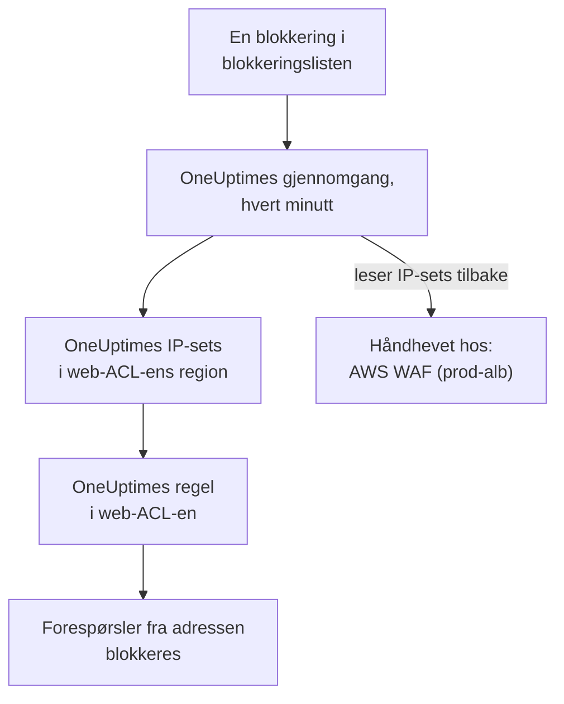

# Blokker adresser i AWS WAF

Prosjektets blokkeringsliste kan håndheves i web-ACL-ene i AWS WAF foran CloudFront-distribusjonene, lastbalansererne og API Gateway-API-ene dine. Slå det på for en AWS-skytilkobling du allerede har, velg web-ACL-ene, og hver adresse blokkeringslisten blokkerer, blokkeres der, enten det var en person, en playbook eller OneUptime AI som blokkerte den.

:::cards
- [Slå det på](#slå-det-på): Én innstilling på AWS-tilkoblingen, og oppsettkommandoen dens på nytt.
- [Hva OneUptime oppretter](#hva-oneuptime-oppretter): Fire IP-sets per region, og to regler per web-ACL.
- [Administrer web-ACL-en i kode](#administrer-web-acl-en-i-kode): Legg til reglene selv i Terraform eller CloudFormation.
:::

## Slik fungerer det

OneUptime vedlikeholder egne IP-sets i hver region en valgt web-ACL ligger i, og en regel i hver web-ACL som blokkerer adressene i dem. Hvert minutt skriver den hvert set én gang med det blokkeringslisten inneholder, og leser dem deretter tilbake. På siden **Blokkeringsliste** viser **Håndhevet hos** for en blokkering først AWS WAF (prod-alb) når AWS WAF har blokkeringen og regelen i web-ACL-en blokkerer den; inntil da er den ikke håndhevet.

## Før du begynner

- En AWS-konto som er koblet til OneUptime (se [Koble til en skykonto](/docs/telemetry/cloud-accounts#amazon-web-services)).
- En rolle som kan endre hvor blokkeringslisten håndheves: **Prosjekteier**, **Prosjektadministrator** eller **Sikkerhetsadministrator**.
- Noen som kan kjøre oppsettkommandoen til tilkoblingen i AWS-kontoen på nytt.

## Slå det på

:::steps
### Åpne tilkoblingen
Åpne **Sky → Koble til** og rediger AWS-tilkoblingen.

### Velg hvem som legger til regelen
Under **Flere felt** setter du **Blokker adresser i AWS WAF** til **På, og OneUptime legger til regelen sin**, eller til **På, og jeg legger til regelen i kode** hvis web-ACL-ene dine forvaltes i Terraform eller CloudFormation.

### Kjør oppsettkommandoen på nytt
Kommandoen skjemaet nå viser, gir tilgang til IP-sets, og til regelen når OneUptime legger den til. Kjør den i AWS CloudShell, og lagre deretter tilkoblingen.

### Legg til web-ACL-ene
Åpne **Sikkerhetshendelser → Playbooks → Blokkeringsliste**. Under **Sky-WAF-er** klikker du **Legg til web-ACL**, velger en web-ACL og hvor den leser klientens adresse, og legger den til. OneUptime setter den opp med en gang, og **Status** for den viser **Håndhever** når regelen dens blokkerer OneUptimes IP-sets.
:::

Web-ACL-ene kommer fra inventaret til tilkoblingen: En web-ACL som OneUptime ikke har lest ennå, vises etter neste lesing. Så lenge en web-ACL håndhever blokkeringslisten, kan innstillingen til tilkoblingen verken slås av eller endres fra regelen OneUptime legger til, til regelen i kode, og tilkoblingen kan ikke slettes: Fjern web-ACL-en først, så OneUptime tar ut regelen sin.

## Hva OneUptime oppretter

| Hva | Navn | Hvor |
| --- | --- | --- |
| Fire IP-sets: blokkering og utfordring, IPv4 og IPv6 | `oneuptime-<project>-block-ipv4`, `oneuptime-<project>-block-ipv6`, `oneuptime-<project>-challenge-ipv4`, `oneuptime-<project>-challenge-ipv6` | I hver region en valgt web-ACL ligger i. Web-ACL-ene til CloudFront er globale, og deres IP-sets ligger i `us-east-1`. |
| To regler: én blokkerer, én utfordrer | `OneUptime-Blocklist-<project>`, `OneUptime-Challenge-<project>` | I hver valgt web-ACL, når OneUptime legger til regelen sin. |

`<project>` er de første åtte tegnene i den eksterne ID-en til prosjektet ditt, så to OneUptime-prosjekter i én konto aldri skriver hverandres sets. Web-ACL-er i én region deler sets. En enkelt adresse skrives som `/32` eller `/128`. AWS WAF rommer 10 000 adresser i et set, og 100 IP-sets i en region med mindre AWS har hevet grensen for deg; en blokkering som ikke får plass, sier det på raden sin.

## Regelens plass i web-ACL-en

OneUptime plasserer de to reglene sine på ledige prioriteter under den første regelen din, så de kjører før reglene du har skrevet. Uten regler i web-ACL-en får de prioritetene 0 og 1. OneUptime nummererer aldri om, endrer eller fjerner en regel du har laget: Når det ikke er to ledige prioriteter under den første regelen din, viser web-ACL-en **Ingen ledig prioritet**, og OneUptime legger til reglene sine så snart du frigjør to.

Hver regel slår til når klientens adresse ligger i ett av dens sets, IPv4 eller IPv6. AWS WAF oppdaterer en web-ACL som en helhet, så OneUptime leser den, legger til reglene sine og skriver den tilbake med web-ACL-ens låsetoken, og leser den på nytt hvis noen andre har skrevet den i mellomtiden.

## Videresendte adresser

En web-ACL bak en annen proxy eller et annet CDN ser adressen til proxyen, ikke klientens. Velg under **Klientadresse** hvor den leser klientens adresse:

| Klientadresse | Hva regelen leser |
| --- | --- |
| **Forespørselens kildeadresse** | Adressen forespørselen kom fra. Standardvalget. |
| Den siste adressen i `X-Forwarded-For`-headeren | Adressen den siste proxyen la til. En adresse foran den er en forespørselen bare hevdet. |
| `CF-Connecting-IP`-headeren | Den ene adressen Cloudflare skriver. |
| `True-Client-IP`-headeren | Den ene adressen Akamai eller Cloudflare Enterprise skriver. |

En forespørsel uten headeren slår ikke til: AWS WAF slipper den gjennom i stedet for å blokkere adressen til en proxy.

## Administrer web-ACL-en i kode

Med **På, og jeg legger til regelen i kode** oppretter OneUptime bare IP-sets og skriver aldri til web-ACL-en din. Klikk **Vis regel** på raden til web-ACL-en: Den gir begge reglene som Terraform (`rule`-blokker i `aws_wafv2_web_acl`) og som CloudFormation, med ARN-en til hvert set og headeren web-ACL-en leser. Legg dem til i koden din før de andre reglene dine, og ta den i bruk.

Til reglene er på plass, viser web-ACL-en **Venter på regelen din**, og blokkeringene i den håndheves ikke. OneUptime leser web-ACL-en ved hver gjennomgang, og blokkeringene håndheves fra den første gjennomgangen som for hvert set finner en regel som blokkerer det, uansett hva du har kalt regelen.

## Tillatelser

Oppsettkommandoen legger til en innebygd policy, `OneUptimeWafBlocklist`, på rollen. Med en tilgangsnøkkel havner den på grunn av IAMs grense for en brukers egne policyer på en gruppe, `OneUptimeWafBlocklist-<project>`, som brukeren blir med i.

| Handling | Ressurs | Hvorfor |
| --- | --- | --- |
| `wafv2:ListIPSets` | Alle | Finne OneUptimes IP-sets i en region. |
| `wafv2:GetIPSet`, `wafv2:CreateIPSet`, `wafv2:UpdateIPSet`, `wafv2:DeleteIPSet` | Bare OneUptimes IP-sets (`oneuptime-<project>-*`) | Vedlikeholde IP-sets, og slette dem når du fjerner den siste web-ACL-en i en region. |
| `wafv2:GetSampledRequests` | Web-ACL-er | Lese forespørslene en regel avviste: beviset blokkeringstrinnet i en sak kontrolleres mot. |
| `wafv2:UpdateWebACL` | Web-ACL-er, og IP-sets, regex-sets og regelgrupper de viser til | Legge til OneUptimes regler. Bare med **På, og OneUptime legger til regelen sin**. |

Lesing av en web-ACL, `wafv2:GetWebACL`, er allerede med i den skrivebeskyttede policyen til tilkoblingen.

## Fjern det

:::steps
### Fjern web-ACL-en
På **Sikkerhetshendelser → Playbooks → Blokkeringsliste** klikker du **Fjern** på raden til web-ACL-en. OneUptime tar reglene sine ut av web-ACL-en, og tømmer og sletter sine IP-sets når ingen annen web-ACL i regionen bruker dem.

### Slå av innstillingen
Rediger tilkoblingen, sett **Blokker adresser i AWS WAF** til **Av**, og lagre. Innstillingen kan slås av når ingen web-ACL i tilkoblingen håndhever blokkeringslisten lenger.
:::

Når OneUptime ikke lenger får skrive web-ACL-en, krysser du av for **Fjern bare fra OneUptime** i dialogen **Fjern web-ACL**. OneUptime fjerner web-ACL-en fra blokkeringslisten og nevner hvilke regler og IP-sets den lot bli igjen i AWS WAF: De fortsetter å blokkere det de inneholder, til du sletter dem der. En regel du har laget som fortsatt viser til et set, beholder det også: OneUptime tømmer det og nevner det.

## Feilsøking

:::details Håndhever ikke
Statusen til web-ACL-en sier hva AWS svarte og hva du skal gjøre. Et avslag nevner handlingen og innstillingen som gir tilgang til den: Slå på innstillingen, eller velg **På, og OneUptime legger til regelen sin**, kjør deretter oppsettkommandoen til tilkoblingen på nytt, og klikk **Kontroller på nytt**.
:::

:::details Ingen ledig prioritet
Den første regelen din har prioritet 0 eller 1, så det er ikke to ledige prioriteter under den. Øk prioritetsnumrene til reglene dine med to, og klikk deretter **Kontroller på nytt**.
:::

:::details En web-ACL står ikke i listen
OneUptime viser web-ACL-ene til tilkoblinger med innstillingen slått på, når den har lest dem. Web-ACL-er som bare er sett gjennom målingene sine, trenger oppsettkommandoen til tilkoblingen på nytt, som lar OneUptime lese dem.
:::

## Neste steg

:::cards
- [Sikkerhetssaker og playbooks](/docs/telemetry/security-cases): Blokker en adresse fra en sak, og se trinnet bli kontrollert.
- [Koble til en skykonto](/docs/telemetry/cloud-accounts): Tilkoblingen denne innstillingen hører til.
:::
