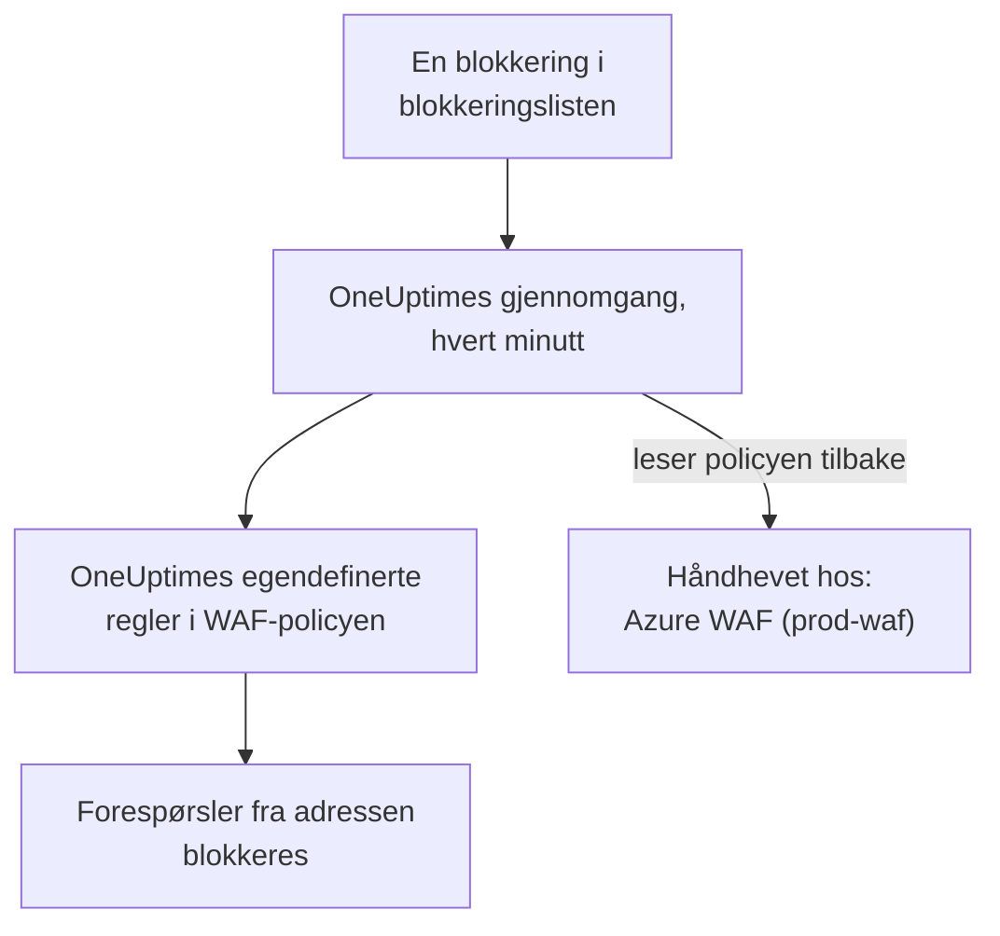

# Blokker adresser i Azure WAF

Prosjektets blokkeringsliste kan håndheves i Azure WAF-policyene til Application Gateway-ene og Front Door-ene dine. Slå det på for en Azure-skytilkobling du allerede har, velg WAF-policyene, og hver adresse blokkeringslisten blokkerer, blokkeres der, enten det var en person, en playbook eller OneUptime AI som blokkerte den.

:::cards
- [Slå det på](#slå-det-på): Én innstilling på Azure-tilkoblingen, og rollen den trenger.
- [Hva OneUptime oppretter](#hva-oneuptime-oppretter): Egendefinerte regler fra OneUptime i hver policy du velger.
- [Hvilken adresse som sammenlignes](#hvilken-adresse-som-sammenlignes): Adressen som koblet seg til, eller den opprinnelige klienten bak en proxy.
:::

## Slik fungerer det

OneUptime vedlikeholder sine egne egendefinerte regler i hver WAF-policy du velger, og legger adressene blokkeringslisten blokkerer, inn i dem. Hvert minutt skriver den policyen én gang med det blokkeringslisten inneholder, og leser den deretter tilbake. På siden **Blokkeringsliste** viser **Håndhevet hos** for en blokkering først Azure WAF (prod-waf) når policyen har blokkeringen og Azure har tatt i bruk endringen; inntil da er den ikke håndhevet.

## Før du begynner

- Et Azure-abonnement som er koblet til OneUptime (se [Koble til en skykonto](/docs/telemetry/cloud-accounts#microsoft-azure)).
- En rolle som kan endre hvor blokkeringslisten håndheves: **Prosjekteier**, **Prosjektadministrator** eller **Sikkerhetsadministrator**.
- Noen som kan tildele roller i Azure-abonnementet, til å kjøre én kommando i Azure Cloud Shell.

## Slå det på

:::steps
### Åpne tilkoblingen
Åpne **Sky → Koble til** og rediger Azure-tilkoblingen.

### Slå på innstillingen
Under **Flere felt** setter du **Blokker adresser i Azure WAF** til **På**, og lagrer. Oppsettkommandoen skjemaet viser, tildeler nå rollen nedenfor på hele abonnementet. En tilkobling du allerede har, trenger ikke å kjøre den på nytt: Dialogen **Legg til WAF** gir linjene som tildeler rollen på én policy alene.

### Legg til WAF-policyene
Åpne **Sikkerhetshendelser → Playbooks → Blokkeringsliste**. Under **Sky-WAF-er** klikker du **Legg til WAF** og velger en WAF-policy. OneUptime spør Azure om tilkoblingen får skrive den, uten å skrive noe.

### Tildel rollen hvis den mangler
Når en tillatelse mangler, viser dialogen linjene som tildeler den på den policyen alene. Kjør dem i Azure Cloud Shell, klikk **Kontroller på nytt**, og legg deretter til policyen. **Status** for den viser **Håndhever** når OneUptime har lest den.
:::

WAF-policyene kommer fra inventaret til tilkoblingen: En policy som OneUptime ikke har lest ennå, vises etter neste lesing. Så lenge en policy håndhever blokkeringslisten, kan innstillingen til tilkoblingen ikke slås av, og tilkoblingen kan ikke slettes: Fjern policyen først, så OneUptime tar ut reglene sine.

## Hva OneUptime oppretter

| Hva | Navn | Hvor |
| --- | --- | --- |
| Egendefinerte regler, hver med én IP-samsvarsbetingelse og handlingen Block | `OneUptime<project>Block1`, `OneUptime<project>Block2`, ... | I hver WAF-policy du velger, høyst 10 av dem. |

`<project>` er de første åtte tegnene i den eksterne ID-en til prosjektet ditt, så to OneUptime-prosjekter som velger én policy, aldri skriver hverandres regler. En regel rommer 540 adresser eller områder på Application Gateway, 600 med CRS 3.2 eller et Default Rule Set, og 600 på Front Door. Med ti regler rommer en policy 5 400 eller 6 000 blokkeringer; en blokkering som ikke får plass, sier det på raden sin.

OneUptime endrer ingenting i en policy utenom sine egne regler. Azure skriver en WAF-policy bare som en helhet, så OneUptime leser policyen med ETag-en, endrer sine egne regler og skriver den tilbake med ETag-en i `If-Match`: Alle andre regler, innstillinger og administrerte regelsett skrives slik de ble lest. Når noen andre har skrevet policyen i mellomtiden, avviser Azure skrivingen, og OneUptime leser den på nytt og gjør endringen sin på toppen av det som ble skrevet.

## Reglenes plass i policyen

OneUptime plasserer reglene sine på ledige prioriteter før den første regelen din som tillater trafikk, laveste først, så ingen regel du har laget, slipper en blokkert adresse gjennom. En regel du har laget som blokkerer eller logger, kan komme først. OneUptime nummererer aldri om, endrer eller fjerner en regel du har laget: Når ingen prioritet er ledig før den første Allow-regelen din, viser policyen **Ingen ledig prioritet**, og OneUptime legger til regelen sin så snart du frigjør én.

## Hvilken adresse som sammenlignes

| WAF-policy | Klientadresse | Når du skal velge den |
| --- | --- | --- |
| Front Door | **Adressen som koblet seg til Front Door (SocketAddr)** | Standardvalget. |
| Front Door | Den opprinnelige klienten, fra X-Forwarded-For (RemoteAddr) | For en Front Door bak en annen proxy eller et annet CDN. |
| Application Gateway | Adressen som koblet seg til gatewayen (RemoteAddr) | Det eneste valget: IP-samsvaret leser ingen annen adresse. |

Front Door henter `RemoteAddr` fra `X-Forwarded-For`-headeren, som en klient som kobler seg direkte til Front Door, kan skrive selv. Velg den bare når en annen proxy eller et annet CDN foran Front Door skriver den headeren. Valget ligger under **Flere felt** i dialogen **Legg til WAF**, og du kan endre det senere med **Klientadresse** på raden til policyen.

IP-samsvaret i Application Gateway leser bare IPv4-adresser, så en IPv6-blokkering tas ikke i bruk der, og raden sier hvorfor.

OneUptimes regler i Azure WAF blokkerer bare. En blokkering som ber om å utfordre en adresse, tas ikke i bruk i Azure WAF, og sier det. En utfordring fra en policy for automatisk respons håndheves der som en blokkering like lenge.

## Hvor lang tid en endring tar

Application Gateway tar i bruk en endring idet Azure skriver den. Front Door godtar endringen og sprer den til edge-lokasjonene sine i løpet av de neste minuttene: Policyen viser **Tar i bruk endringen**, og **Håndhevet hos** for en ny blokkering venter på policyen til Azure melder at den er klargjort. Blokkeringen håndheves fra da av.

## Når en regel endres manuelt

Når noen slår av, endrer eller sletter en av OneUptimes regler i Azure, lar OneUptime den være slik den ble etterlatt. Policyen viser **Endret manuelt**, og blokkeringene regelen inneholdt, håndheves ikke, med årsak, til noen klikker **Gjenopprett** på raden til policyen. Gjenopprett skriver regelen på nytt slik OneUptime skriver den, på sin egen prioritet så lenge den er ledig.

En policy som ikke blokkerer noe, sier det også, og blokkeringene i den håndheves ikke:

- En policy som er slått av.
- En policy i modusen **Detection**, som bare logger det OneUptimes regler treffer.
- En policy som ikke er knyttet til en Application Gateway, en lytter, en baneregel eller et Front Door-domene.

## Behold en policy i Terraform

Terraform skriver også en WAF-policy som en helhet, så neste plan fjerner OneUptimes regler. For å la OneUptime beholde dem legger du til `ignore_changes = [custom_rules]` i `lifecycle`-blokken til en `azurerm_web_application_firewall_policy`, eller `ignore_changes = [custom_rule]` i den til en `azurerm_cdn_frontdoor_firewall_policy`, og holder dine egne egendefinerte regler utenfor koden til den policyen.

## Tillatelser

Oppsettkommandoen legger til en egendefinert rolle, `OneUptime WAF Blocklist`, og tildeler den til appen til tilkoblingen på abonnementet. Linjene dialogen **Legg til WAF** viser, tildeler den samme rollen på én policy alene.

| Handling | Hvorfor |
| --- | --- |
| `Microsoft.Network/ApplicationGatewayWebApplicationFirewallPolicies/read`, `Microsoft.Network/ApplicationGatewayWebApplicationFirewallPolicies/write` | Lese en Application Gateway-WAF-policy og skrive OneUptimes regler i den. |
| `Microsoft.Network/FrontDoorWebApplicationFirewallPolicies/read`, `Microsoft.Network/FrontDoorWebApplicationFirewallPolicies/write` | Lese en Front Door-WAF-policy og skrive OneUptimes regler i den. |

Rollen kan ikke slette en policy, og OneUptime skriver aldri noe annet.

## Fjern det

:::steps
### Fjern WAF-policyen
På **Sikkerhetshendelser → Playbooks → Blokkeringsliste** klikker du **Fjern** på raden til policyen. OneUptime tar reglene sine ut av policyen, og endrer ingenting annet i den.

### Slå av innstillingen
Rediger tilkoblingen, sett **Blokker adresser i Azure WAF** til **Av**, og lagre. Innstillingen kan slås av når ingen policy i tilkoblingen håndhever blokkeringslisten lenger.
:::

Når OneUptime ikke lenger får skrive policyen, krysser du av for **Fjern bare fra OneUptime** i dialogen **Fjern WAF**. OneUptime fjerner policyen fra blokkeringslisten og nevner reglene den lot bli igjen i den: De fortsetter å blokkere det de inneholder, til du sletter dem i Azure.

## Feilsøking

:::details Håndhever ikke
Statusen til policyen sier hva Azure svarte og hva du skal gjøre. Et avslag nevner tillatelsen som mangler: Kjør linjene **Legg til WAF** viser for policyen, og klikk deretter **Kontroller på nytt**.
:::

:::details Ingen ledig prioritet
Den første regelen din som tillater trafikk, har prioritet 1, eller hver prioritet før den er opptatt. Gi den et høyere prioritetsnummer, og klikk deretter **Kontroller på nytt**.
:::

:::details En policy står ikke i listen
OneUptime viser WAF-policyene til tilkoblinger med innstillingen slått på, når den har lest dem. En policy som er lagt til siden, vises etter neste lesing av tilkoblingen.
:::

## Neste steg

:::cards
- [Sikkerhetssaker og playbooks](/docs/telemetry/security-cases): Blokker en adresse fra en sak, og se trinnet bli kontrollert.
- [Koble til en skykonto](/docs/telemetry/cloud-accounts): Tilkoblingen denne innstillingen hører til.
:::
