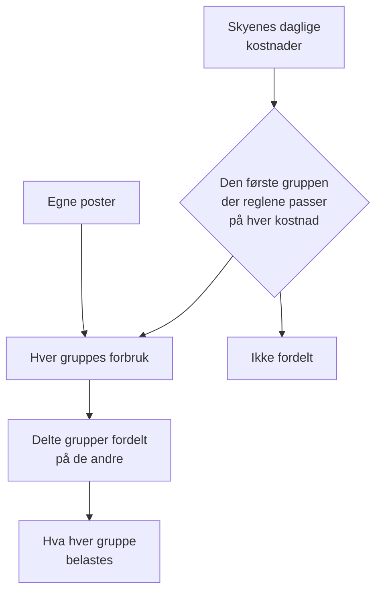

# Fordeling av skykostnader

Kostnadsgrupper svarer på det første spørsmålet på hver månedlige skyregning: hvem brukte pengene? En **kostnadsvisning** som «Etter team» eller «Etter kostnadssted» fordeler forbruket fra de tilkoblede kontoene dine i **kostnadsgrupper** etter regler, uten at noe telles to ganger. Det ingen regel tar, forblir synlig som ikke-fordelt forbruk, og delte kostnader fordeles på gruppene. Du finner dem under **Sky → Forbruk → Kostnadsgrupper**.

:::cards
- [Opprett en visning](#opprett-en-visning): Etter team fra eierne du allerede har angitt, etter en tagg eller med dine egne grupper.
- [Skriv reglene til en gruppe](#skriv-reglene-til-en-gruppe): Kontoer, tjenester, tagger, eierteam, etiketter og mer.
- [Ikke-fordelt forbruk](#ikke-fordelt-forbruk): Det ingen regel tar, og ett klikk for å fordele det.
- [Delte kostnader](#delte-kostnader): En supportplan eller en delt klynge, fordelt på gruppene.
:::

## Slik fungerer det



- **Den første gruppen som passer, tar kostnaden.** Gruppene i en visning har en rekkefølge, og hver kostnad havner i den første gruppen der reglene passer på den, så ingenting telles to ganger. Gruppene og det ikke-fordelte forbruket blir alltid til sammen periodens totalsum.
- **Regler leser alt en kostnad har.** Kontoen, skyleverandøren, tjenesten, regionen, ressursen og taggene dens, og det OneUptime vet om ressursen: eierteamene, etikettene, App Platforms-miljøet og appen.
- **Alt regnes ut når du ser.** Ingenting skrives per kostnad. En regel du endrer, fordeler hver måned OneUptime tar vare på, på nytt, opptil 400 dager tilbake, uten ventetid.
- **Flere visninger kan fordele det samme forbruket.** «Etter team» og «Etter kostnadssted» fordeler hver for seg alt, på sin egen måte.

## Før du begynner

- **Kostnader som leses.** [Koble til en skykonto](/docs/telemetry/cloud-accounts), og la den [lese kostnadene sine](/docs/telemetry/cloud-costs).
- **Tagger eller eiere, hvis du vil ha dem.** Regler på tagger trenger kostnader som har dem; på AWS slår du på [Kostnader per ressurs](/docs/telemetry/cloud-costs#kostnader-per-ressurs). Eierteam kommer fra eierne til hver ressurs, angitt for hånd eller med [eierregler](/docs/configuration/label-and-owner-rules).

## Opprett en visning

Åpne **Sky → Forbruk → Kostnadsgrupper**. Et prosjekt uten en visning får tilbud om tre måter å starte på:

| Start | Hva den lager |
| --- | --- |
| **Etter team, fra eiere** | En gruppe for hvert team som eier skyressurser, knyttet til teamet. |
| **Etter en tagg** | En gruppe for hver verdi av en tagg kostnadene dine har, for eksempel `team` eller `cost-center`. |
| **Dine egne grupper** | En tom visning. Du skriver selv reglene for hver gruppe. |

OneUptime oppretter gruppene i en visning etter tagg eller etter eierteam når du lagrer den, og deretter hver time etter hvert som nye taggverdier og eiere dukker opp. Du kan gi disse gruppene nye navn, knytte dem til et team eller dele dem. Reglene deres forblir OneUptimes. For å opprette de manglende gruppene nå åpner du visningen og klikker på **Opprett grupper nå**.

## Skriv reglene til en gruppe

Åpne en visning og deretter **Opprett Kostnadsgruppe** under **Grupper**. En kostnad hører til gruppen når **en** av reglene passer på den, og en regel passer når **alle** betingelsene gjør det. En betingelse sammenligner noe en kostnad har, med verdiene du velger eller skriver:

| Felt | Hva det leser |
| --- | --- |
| **Tagg** | Verdien til en tagg, ut fra taggens nøkkel. **er angitt** og **er ikke angitt** spør om kostnaden har den. |
| **Konto** | Den tilkoblede kontoen kostnaden faktureres til. |
| **Eierteam** | Teamene som eier ressursen i OneUptime. |
| **Tjeneste** | Tjenesten, slik skyens fakturering kaller den. |
| **Etikett** | Etikettene til ressursen, eller til kontoen dens, i OneUptime. |
| **Region** | Regionen. La verdien stå tom for en global tjeneste. |
| **Sky** | AWS, Azure eller Google Cloud. |
| **Ressurs** | Ressursen, slik skyen din kaller den. |
| **App Platforms-miljø** og **App** | Det et miljø eller en app faktureres, slik **Sky → Forbruk → Kostnader** teller det. |
| **Kubernetes-navnerom** og **Kubernetes-klynge** | Navnerommene i en klynge, når en delt gruppe fordeles etter dem. Se [Kubernetes-klynger](#kubernetes-klynger). |

Tekst sammenlignes uten hensyn til store og små bokstaver: `Payments` og `payments` er ett team. Nøkkelen til en tagg sammenlignes slik den er skrevet, slik skyene dine lagrer den.

For eksempel tar en gruppe **Betalinger** med tre regler en kostnad som er tagget `team: payments`, **eller** fakturert til kontoen payments, **eller** eid av teamet Betalinger.

### Rekkefølgen på gruppene

Dra gruppene under **Grupper** for å endre rekkefølgen. En gruppe der en tidligere gruppe allerede dekker reglene, kan aldri ta en kostnad, og raden dens sier hvilken gruppe som tar alt. En gruppe der reglene også passer på kostnader en tidligere gruppe tar, sier hvor mye av dem den får.

### Ressurser med flere eierteam

En ressurs som to team eier, deles likt mellom dem: halvparten til hvert team går gjennom reglene for seg. En regel som ikke spør om eiere, for eksempel en tagg eller en konto, tar fortsatt hele kostnaden. En halvpart der teamet ikke har en gruppe, forblir ikke fordelt.

## Ikke-fordelt forbruk

Siden til en visning viser det ingen regel tar ennå: tjenestene, kontoene, taggverdiene og eierteamene det består av, de dyreste først. Klikk på **Legg til i gruppe** ved siden av en av dem for å legge til en regel for den i en gruppe eller i en ny gruppe. Kostnadene flyttes straks inn i gruppen, også for tidligere måneder.

## Delte kostnader

En supportplan, en delt klynge eller en nettverkshub tilhører alle. Gjør den til en egen gruppe, slå deretter på **Delt** under **Flere felt**, og velg hvordan kostnadene fordeles på de andre gruppene i visningen:

| Fordeling | Hvordan |
| --- | --- |
| **Fordel etter andel av forbruket** | Hver gruppe tar sin andel av de andre gruppenes skyforbruk den måneden. En måned de ikke brukte noe, fordeles likt. |
| **Fordel likt** | Det samme beløpet til hver gruppe. |
| **Fordel etter faste prosenter** | Prosentene du angir for hver gruppe, til sammen 100. |
| **Fordel etter Kubernetes-navnerom** | Hva hvert navnerom i en klynge kostet den måneden. Se nedenfor. |

Kostnadene til en delt gruppe fordeles dag for dag med hver måneds andeler, så en måned gir de samme tallene enten den leses per dag eller per måned. Ikke-fordelt forbruk får aldri en andel.

### Kubernetes-klynger

Nodene i en klynge faktureres av skyen din, mens klyngens egen kostnadsmotor sier hva hvert navnerom brukte. Slik belaster du hvert team for arbeidslastene sine i en delt klynge:

1. Opprett en gruppe der reglene passer på klyngens noder, for eksempel **Tagg** `eks:cluster-name` **er en av** `prod`.
2. Slå på **Delt**, velg **Fordel etter Kubernetes-navnerom**, og velg **Kubernetes-klynge**.
3. Gi teamenes grupper regler som leser navnerommenes labels, som teller som tagger. For eksempel **Tagg** `team` **er en av** `payments`, eller **Kubernetes-navnerom** **starter med** `payments-`.

Hver måned fordeles nodenes kostnader etter hva hvert navnerom kostet i klyngens [kostnadsmotor](/docs/telemetry/kubernetes-cost), og delen til hvert navnerom går til den første gruppen der reglene passer på det. Ledig kapasitet, og et navnerom ingen gruppe tar, blir værende hos klyngens gruppe. Klyngens egne prissatte kostnader legges aldri til regningen din, så ingenting telles to ganger.

## Egne poster

Under **Sky → Forbruk → Kostnadsgrupper → Egne poster** legger du til en belastning eller kreditering som regningene fra skyene dine ikke har med: en andel av en supportavtale, en bedriftsrabatt, et internt påslag eller et plattformgebyr.

- **Én gang eller hver måned.** En månedlig post fordeles over dagene i hver måned, så en del av en måned får sin del.
- **På en konto eller en gruppe.** En post som er lagt til en konto, går gjennom reglene i hver visning slik kontoens kostnader gjør. En post som er lagt til en gruppe, går rett til den.
- **Alltid atskilt.** Hvert tall holder poster atskilt fra det skyene fakturerte, så skyenes egne tall fortsatt stemmer med konsollene deres.

## Se forbruket til hver gruppe

- **Sky → Forbruk → Kostnader**: Velg **Kostnadsgrupper** og en visning under **Hvor pengene går**. Forbruket til hver gruppe, sammenlignet med perioden før.
- **Siden til en visning**: hva hver gruppe ble belastet, med de delte kostnadene, det ingen regel tar, og **Last ned CSV** for månedens viderefakturering.
- **Siden til en gruppe**: forbruket dag for dag, tjenestene, ressursene og kontoene den belastes mest for, og reglene. Den viser bare forbruket til den gruppen, så knytt gruppen til sitt **Team**, og send teamet siden: alle som har lov til å lese skyforbruket, kan åpne den.

## API, CLI og MCP

Visninger, grupper og poster er API-ressurser (`cloud-cost-view`, `cloud-cost-group`, `cloud-cost-line-item`), med CLI-kommandoer og MCP-verktøy som enhver ressurs. Reglene til en gruppe er JSON:

```json
[
  { "conditions": [{ "field": "tag", "key": "team", "operator": "is", "values": ["payments"] }] },
  { "conditions": [{ "field": "ownerTeam", "operator": "is", "values": ["<team ID>"] }] }
]
```

For å lese hva en visning fordeler, for hele UTC-dager fra `startDate` til `endDate`:

```bash
curl -X POST "https://oneuptime.com/api/cloud-cost-view/<view ID>/allocation" \
  -H "apikey: <API key>" -H "tenantid: <project ID>" -H "Content-Type: application/json" \
  -d '{"startDate": "2026-11-01", "endDate": "2026-11-30", "currency": "USD"}'
```

Svaret har `total` for hver gruppe og hva den består av (`cloud`, `lineItems`, `sharedIn`, `sharedOut`), tallene per dag eller per måned, perioden før, og hva det ikke-fordelte forbruket består av. `POST /cloud-cost-group/<group ID>/spend` svarer for én gruppe.

## Grenser

- En visning har høyst 500 grupper. En visning etter tagg oppretter grupper for de 500 dyreste verdiene.
- En gruppe har høyst 25 regler, en regel 20 betingelser og en betingelse 200 verdier.
- Kostnader lagres i 400 dager, så en visning leser høyst 400 dager.

## Feilsøking

:::details En gruppe får ingenting
Reglene passer kanskje ennå ikke på noen kostnad, eller en tidligere gruppe tar alle kostnadene de passer på. Raden under **Grupper** nevner da den gruppen: dra denne over den, eller snevre inn reglene til den tidligere gruppen.
:::

:::details En kostnad er i feil gruppe
En kostnad havner i den første gruppen der reglene passer på den. Dra gruppen den hører til, over gruppen som tar den, eller snevre inn reglene til den gruppen.
:::

:::details En regel på en tagg passer på ingenting
En kostnad beholder taggene den hadde da den ble lest: etikettene i en faktureringseksport fra Google Cloud, ellers taggene til ressursen den faktureres til, noe som på AWS krever [Kostnader per ressurs](/docs/telemetry/cloud-costs#kostnader-per-ressurs). Nøkkelen til en tagg sammenlignes slik den er skrevet.
:::

:::details En visning etter tagg eller etter eierteam mangler en gruppe
OneUptime oppretter de manglende gruppene hver time: én for hver taggverdi i kostnadene de siste 400 dagene, eller for hvert team som eier skyressurser, opptil 500 grupper. Klikk på **Opprett grupper nå** på siden til visningen for å opprette dem med en gang.
:::

:::details Tallene utelater en konto
Tallene i en visning er i valutaen de fleste kontoene dine faktureres i. En konto som faktureres i en annen, er utelatt fra dem, og det samme er en post i en annen valuta.
:::

## Neste steg

:::cards
- [Skykostnader og besparelser](/docs/telemetry/cloud-costs): Hva de tilkoblede kontoene dine koster, og hvordan du bruker mindre.
- [Etikett- og eierregler](/docs/configuration/label-and-owner-rules): Gi ressurser eierteam og etiketter som reglene kan lese.
- [Kubernetes-kostnadsobserverbarhet](/docs/telemetry/kubernetes-cost): Hva hver Kubernetes-arbeidslast koster.
:::
