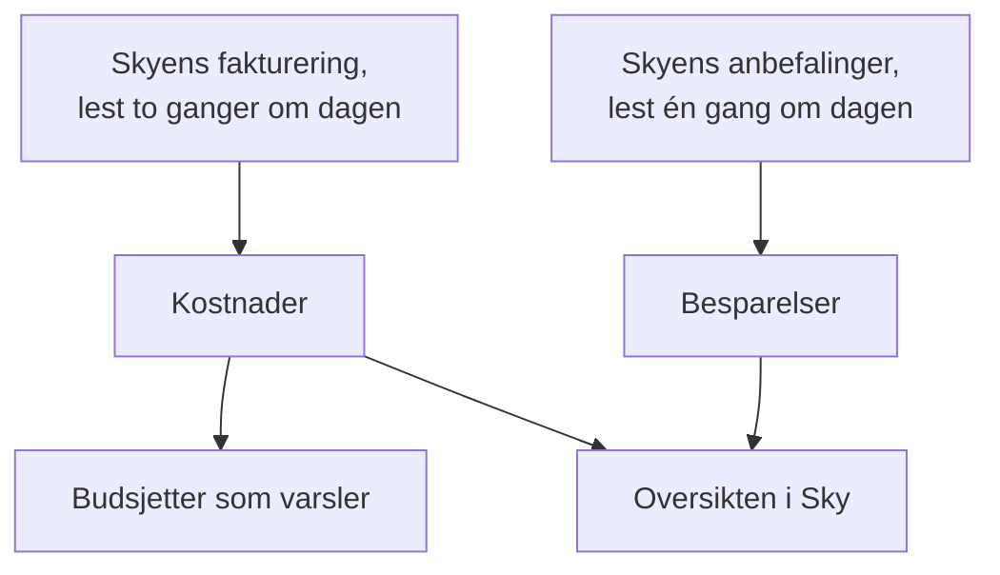

# Skykostnader og besparelser

En tilkoblet skykonto sier også hva den koster, og hvordan den kunne kostet mindre. OneUptime leser kostnadene for hver dag fra skyens egen fakturering og anbefalingene fra skyens egen anbefalingstjeneste, viser dem under **Sky → Forbruk → Kostnader** og **Sky → Forbruk → Besparelser**, og varsler før en måned koster mer enn budsjettet under **Sky → Forbruk → Budsjetter**.

:::cards
- [Amazon Web Services](#amazon-web-services): Cost Explorer og Cost Optimization Hub, hver slått på én gang.
- [Microsoft Azure](#microsoft-azure): Cost Management og Azure Advisor, med én rolle til.
- [Google Cloud](#google-cloud): Fakturaeksporten din til BigQuery, og Recommender.
- [Budsjetter](#budsjetter): Et varsel når forbruket i en måned passerer en andel av budsjettet.
:::

## Slik fungerer det



- **Kostnadene kommer fra skyens egen fakturering.** AWS Cost Explorer, Azure Cost Management og Google Clouds fakturaeksport til BigQuery, før kreditter og refusjoner, i valutaen kontoen faktureres i. Hvert beløp er en dags, i UTC-dager, slik skyen fakturerer dem.
- **En sky rapporterer den siste dagen eller to for sent.** Hver lesing tar den siste uken på nytt, og hele forrige måned i de første dagene av en måned, så kostnaden for en dag faller på plass etter hvert som skyen avslutter den. Den første lesingen til en tilkobling går tilbake til starten av måneden før forrige måned.
- **Månedens prognose følger tempoet den siste uken.** Den er det måneden har kostet så langt, med hver gjenværende dag til gjennomsnittet av de siste sju hele dagene.
- **Besparelsene kommer fra skyens egen anbefalingstjeneste.** AWS Cost Optimization Hub, Azure Advisor og Google Clouds Recommender: en mindre størrelse, en ressurs som står ubrukt, en forpliktelse som lønner seg, hver med det den ville spart i måneden. En anbefaling du gjennomfører eller avviser i skyens konsoll, forsvinner ved neste lesing.

## Før du begynner

- **En tilkoblet konto.** [Koble til en skykonto](/docs/telemetry/cloud-accounts) med dagens oppsettkommando: Den lar tilkoblingen lese kostnader og anbefalinger. En tilkobling som ble laget før, leser ingen av delene før du kjører kommandoen på nytt.

## Amazon Web Services

Tilkoblingen leser kostnader med `ce:GetCostAndUsage`, forpliktelsene sine med `ce:GetSavingsPlansCoverage`, `ce:GetSavingsPlansUtilization`, `ce:GetReservationCoverage` og `ce:GetReservationUtilization` og anbefalinger med `cost-optimization-hub:ListRecommendations`. Cost Explorer og Cost Optimization Hub må slås på i kontoen først:

:::steps
### Slå på Cost Explorer

Åpne Cost Explorer én gang i AWS-konsollen Billing and Cost Management: AWS forbereder kontoens kostnader innen en dag. Koble til organisasjonens administrasjonskonto for å lese kostnadene til hver medlemskonto.

### Meld deg på Cost Optimization Hub

Åpne Cost Optimization Hub i den samme konsollen og meld deg på, for organisasjonen fra administrasjonskontoen eller bare for kontoen. Anbefalingene kommer innen en dag.
:::

Cost Explorer tar $0.01 for hver forespørsel: en lesing av kostnadene gjør noen få, og forpliktelsene leses med fire om dagen. Cost Optimization Hub er gratis.

### Kostnader per ressurs

Cost Explorer oppgir også hva hver ressurs koster, for de siste 14 dagene, når data på ressursnivå er slått på. Åpne Cost Management-innstillingene i AWS-konsollen Billing and Cost Management, og slå på data på ressursnivå med daglig granularitet, for organisasjonen fra administrasjonskontoen dens. AWS klargjør dem innen 48 timer.

Rediger deretter tilkoblingen under **Sky → Koble til**, og slå på **Kostnader per ressurs** under **Flere felt**. Tilkoblingen leser dem med `ce:GetCostAndUsageWithResources` én gang om dagen: de 14 dagene første gang, deretter de siste tre på nytt, med noen få forespørsler hver gang. Det den leser, blir værende med kostnadene til kontoen etter at Cost Explorer har glemt det. En tilkobling som ble laget før, må få oppsettkommandoen sin kjørt på nytt, som legger til handlingen.

## Microsoft Azure

Appen leser kostnader med rollen **Cost Management Reader**, på samme område som **Monitoring Reader**: Oppsettkommandoen tildeler begge. Azure Advisors anbefalinger leses med **Monitoring Reader**, så det er ingenting å slå på. For å gi en app som ble laget før, rollen, kjører du:

```bash
az role assignment create --assignee <APP_ID> --role "Cost Management Reader" --scope /subscriptions/<SUBSCRIPTION_ID>
```

Cost Management svarer for hvert abonnement, med ressursen hver kostnad gjelder, og det koster ingenting å lese. Når den ikke kan svare for et abonnement, sier kontoens **Kostnader** hvorfor.

## Google Cloud

Google Cloud har ikke noe API for kostnadene til et prosjekt: OneUptime leser dem fra faktureringskontoens eksport til BigQuery.

:::steps
### Eksporter faktureringen til BigQuery

Åpne Billing og deretter Billing export i Google Cloud-konsollen, og slå på eksporten av detaljerte brukskostnader til et BigQuery-datasett. Google skriver den noen timer på etterskudd, fra dagen du slår den på.

### La tjenestekontoen lese den

Gi tjenestekontoen til tilkoblingen **BigQuery Data Viewer** på eksportens datasett. Oppsettkommandoen har allerede gitt den **BigQuery Job User**, så den kan kjøre spørringen i sitt eget prosjekt.

### Oppgi eksportens tabell

Rediger tilkoblingen under **Sky → Koble til**, og sett under **Flere felt** **Tabell for fakturaeksport** til tabellens fulle navn: `<PROJECT_ID>.<DATASET>.gcp_billing_export_resource_v1_<BILLING_ACCOUNT_ID>`.
:::

Den detaljerte eksporten nevner ressursen hver kostnad gjelder; standardeksporten sier bare tjenesten og regionen. BigQuery fakturerer spørringen: den første 1 TiB i måneden er gratis, deretter $6.25 per TiB, og en måned av en eksport er fra noen få megabyte til noen få gigabyte. Recommenders anbefalinger om maskintyper og ubrukte ressurser leses med **Compute Recommender Viewer**, som oppsettkommandoen tildeler, og koster ingenting.

## Måter å bruke mindre på

**Sky → Forbruk → Besparelser** lister hver anbefaling, den største besparelsen først: hva som skal gjøres, ved hvilken ressurs, hva som ville endret seg og hva den sparer i måneden. Stripen over legger dem sammen, totalt og etter type: en mindre størrelse, en ressurs som står ubrukt, en forpliktelse. En anbefaling lenker til siden til ressursen sin når OneUptime har ressursen.

### Størrelsestilpasning ut fra OneUptimes egne målinger

En ressurs som ingen anbefalingstjeneste uttaler seg om, fordi den ikke er slått på, ikke dekker typen eller finner ressursen for ny, får størrelsen vurdert av OneUptime ut fra CPU- og minnemålingene som tilkoblingen har tatt de siste 14 dagene. OneUptime vurderer EC2-instanser, RDS-databaser og ElastiCache-klynger på AWS, virtuelle maskiner, fleksible PostgreSQL- og MySQL-servere og App Service-planer på Azure, og Compute Engine-VM-er og Cloud SQL-instanser på Google Cloud:

- **Overprovisjonert** når størrelsen som er halvparten så stor, eller en firedel, fortsatt ville hatt plass: på den mindre størrelsen ville CPU-ens 95. persentil vært høyst 60 %, den høyeste CPU-målingen høyst 100 % og minnetoppen høyst 70 %, når minnet leses.
- **Underprovisjonert** når CPU-ens 95. persentil er 85 % eller mer, eller minnetoppen 90 % eller mer: størrelsen som er dobbelt så stor.

En ressurs vurderes så snart den har 6 dager med målinger. Siden dens viser **Størrelsestilpasning** ved siden av hva den koster, og en overprovisjonert står under **Sky → Forbruk → Besparelser** med OneUptime som kilde. Det en endring sparer, er dens andel av det ressursen kostet de siste 30 dagene, så det er kjent så snart skyen fakturerer ressursen ved navn: den detaljerte eksporten til Azure og Google Cloud gjør det, og AWS gjør det når Kostnader per ressurs er slått på. En EC2-instans rapporterer minnet bare med CloudWatch-agenten, og en Compute Engine-VM bare med Ops Agent: uten den vurderes den bare ut fra CPU-en. Burstable størrelser som t3, B-serien og e2-micro vurderes aldri.

### Forpliktelser

**Sky → Forbruk → Besparelser** og **Kostnader** for en konto viser hvor mye av forbruket de siste 30 dagene forpliktelsene til hver konto betalte for, og hvor mye av dem som ble brukt, én linje for hver type:

- AWS: Savings Plans og Reserved Instances, fra Cost Explorer. Administrasjonskontoen til en organisasjon leser dem for hver konto i organisasjonen.
- Azure: spareplaner og reservasjoner, fra Cost Management, i amortisert kostnad.
- Google Cloud: rabatter for forpliktet bruk, fra fakturaeksporten din. Eksporten sier ikke hvor mye av en forpliktelse som ble stående ubrukt, så hvor mye som brukes, vises ikke.

En konto uten forpliktelser viser hva som kjørte til on demand-priser som en forpliktelse ville betalt billigere for. Tallene for hver type er skyens egne, og typer legges aldri sammen: en reservasjon og en Savings Plan kan begge telle forbruket til den samme maskinen som sitt å dekke.

## Budsjetter

:::steps
### Opprett et budsjett

Under **Sky → Forbruk → Budsjetter** oppretter du et budsjett: dets **Månedlig beløp** og den **Konto** det gjelder, eller ingen for alle kontoer.

### Velg når det varsler

**Varsle ved** tar andelene av budsjettet det skal varsles ved, i prosent: 80 og 100 til å begynne med. **Varsle når det ligger an til overskridelse** varsler også, én gang i måneden, når tempoet den siste uken ville tatt måneden over budsjettet. **Varsle ved uvanlige dager** varsler også dagen etter en dag som kostet langt mer enn vanlig: se [Uvanlige dager](#uvanlige-dager). **Varselsalvor** og **Vaktretningslinjer** sier hvor alvorlige varslene er og hvem som tilkalles.
:::

Et budsjett kontrolleres etter hver lesing av kostnadene og hver time. Når månedens forbruk passerer en terskel, lages det ett varsel for den, den høyeste når en lesing passerer flere på én gang, og en ny måned løser forrige måneds varsler. Et budsjett teller bare kontoene som faktureres i valutaen sin.

AI-agenter kan opprette og endre budsjetter via [MCP-serveren](/docs/ai/mcp-server), og skript med CLI-ens kommando `oneuptime cloud-budget`: se [Ressursoperasjoner](/docs/cli/resource-operations).

### Uvanlige dager

Etter hver lesing holdes hver av en kontos siste 14 hele dager opp mot de 14 dagene før. En dag er uvanlig når en tjeneste kostet det dobbelte av sin vanlige dag eller mer, eller hele kontoen halvannen gang sin vanlige dag eller mer. I begge tilfeller må det være minst 10 mer enn vanlig i kontoens valuta og minst 5 % av kontoens vanlige dag, så noen få øre aldri teller som en topp. En dags vanlige verdi er medianen av de 14 dagene før, så én topp flytter den lite, og en konto vurderes først når den har en ukes kostnader.

**Sky → Forbruk → Kostnader** markerer de uvanlige dagene på det daglige forbruket, over søylene deres, og viser dem under. På tvers av alle kontoer åpner hver markering **Kostnader** for kontoen sin. Et budsjett som regner med kontoen, lager ett varsel for hver konto og dag, dagen etter, og nevner hver tjeneste som lå høyt. En topp som varer i flere dager, varsles den dagen den begynte, og en dag som er mer enn en uke gammel, varsles ikke. Et budsjett som ble opprettet før disse varslene fantes, lager dem ikke før du redigerer det og slår dem på.

## Hvor pengene går

**Sky → Forbruk → Kostnader** deler forbruket i en periode opp etter tjeneste, region, konto eller ressurs, og på tre måter til:

- Etter miljø i app-plattformer: plattformtjenesten til hvert miljø i kontoen og regionen dets, som Amazon ECS eller Cloud Run, og ressursene til et Elastic Beanstalk-miljø etter taggen AWS gir dem.
- Etter app: det en plattform fakturerer en app for ved navn, som en Cloud Run-tjeneste eller en Container App. Amazon ECS fakturerer oppgavene sine og App Service planene sine, så kostnadene til appene deres forblir miljøets.
- Etter tagg: hver verdi av taggen du velger. En kostnad beholder taggene den hadde da den ble lest: etikettene fra en fakturaeksport fra Google Cloud, ellers taggene til ressursen den faktureres til, som på AWS krever Kostnader per ressurs.

Under listen sier kortet hva resten utgjorde: det som ikke er i noe miljø, det som faktureres til et miljø som helhet, eller det som ikke har taggen. Kostnader som ble lest før tagger ble tatt vare på, leses på nytt én gang, så langt tilbake som en første lesing, slik at taggene deres fylles inn.

## Det du ser i OneUptime

- **Oversikten i Sky.** **Sky → Oversikt** viser månedens forbruk mot forrige måneds på samme dag, de dyreste tjenestene og de største måtene å bruke mindre på, ved siden av det som trenger oppmerksomhet.
- **Forbruket hver dag.** **Sky → Forbruk → Kostnader** tegner hver av de siste 30 dagene og markerer dagene som kostet langt mer enn vanlig, viser de dagene og deler en periode opp etter tjeneste, region, konto, ressurs, miljø i app-plattformer, app eller tagg. Kontoene der kostnadene ikke leses, er listet under, hver med årsaken.
- **Kostnadene til en konto.** **Kostnader** for en konto viser det samme for kontoen alene, med forpliktelsene og måtene den kan bruke mindre på.
- **Kostnaden til en ressurs.** Siden til en ressurs viser hva den har kostet denne måneden og de siste 30 dagene når skyen fakturerer den ved navn, med måtene den kan bruke mindre på og størrelsestilpasningen sin.

## Feilsøking

:::details En konto sier Krever tillatelse
Tilkoblingen kan ikke lese kontoens kostnader ennå. Kjør oppsettkommandoen på nytt fra **Sky → Koble til**: Den legger til det lesingen av kostnader trenger. På Google Cloud gir du også tjenestekontoen **BigQuery Data Viewer** på eksportens datasett.
:::

:::details En konto sier Ikke satt opp
Skyen har ingen kostnader å gi ennå. På AWS slår du på Cost Explorer; på Google Cloud oppgir du eksportens tabell under **Tabell for fakturaeksport**. De første beløpene kommer med neste lesing, innen 12 timer.
:::

:::details Kostnader per ressurs sier Ikke satt opp
Data på ressursnivå er ikke slått på for kontoen. Slå det på med daglig granularitet i Cost Management-innstillingene i AWS-konsollen Billing and Cost Management, for medlemmene i en organisasjon fra administrasjonskontoen dens. AWS klargjør det innen 48 timer, og lesingen neste dag tar det med.
:::

:::details Forpliktelsene sier Krever tillatelse
Tilkoblingen får ennå ikke lese Savings Plans og reservasjoner for kontoen. Kjør oppsettkommandoen dens på nytt fra **Sky → Koble til**: den legger til de fire handlingene de leses med.
:::

:::details Beløpene utelater en konto
Beløpene er i valutaen de fleste kontoene dine faktureres i. En konto som faktureres i en annen, er listet under med valutaen sin, og et budsjett teller bare kontoene som faktureres i budsjettets egen.
:::

:::details Denne måneden er lavere enn i skyens konsoll
Skyen rapporterer den siste dagen eller to for sent, og beløpene er før kreditter og refusjoner. De neste lesingene tar det igjen.
:::

## Neste steg

:::cards
- [Koble til en skykonto](/docs/telemetry/cloud-accounts): Koble til en annen konto, eller kjør kommandoen på nytt.
- [Skyressurser](/docs/telemetry/cloud-resources): Målingene til hver ressurs, fra en egen collector.
- [Kubernetes-kostnadsobservability](/docs/telemetry/kubernetes-cost): Hva hver Kubernetes-arbeidslast koster.
:::
