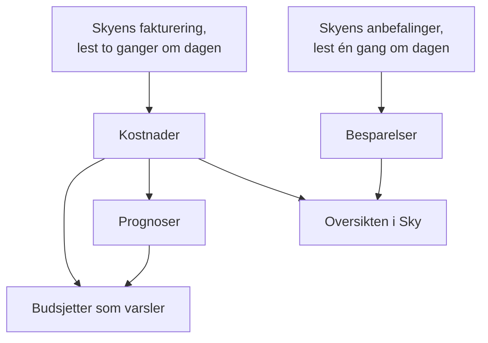

# Skykostnader og besparelser

En tilkoblet skykonto sier også hva den koster, og hvordan den kunne kostet mindre. OneUptime leser kostnadene for hver dag fra skyens egen fakturering og anbefalingene fra skyens egen anbefalingstjeneste, viser dem under **Sky → Forbruk → Kostnader** og **Sky → Forbruk → Besparelser**, viser Savings Plans, reservasjoner og rabatter for forpliktet bruk under **Sky → Forbruk → Forpliktelser**, gir deg beskjed under **Sky → Forbruk → Budsjetter** før en måned, et kvartal eller et år koster mer enn budsjettet, og forutsier de kommende månedene under **Sky → Forbruk → Prognose**. Når du tillater det, gjennomfører den også besparelsene en eier godkjenner, stopper ressurser som ikke er produksjon, utenfor arbeidstid, og kontrollerer hver endring mot regningen.

:::cards
- [Amazon Web Services](#amazon-web-services): Cost Explorer og Cost Optimization Hub, hver slått på én gang.
- [Microsoft Azure](#microsoft-azure): Cost Management og Azure Advisor, med én rolle til.
- [Google Cloud](#google-cloud): Fakturaeksporten din til BigQuery, og Recommender.
- [Fakturert, amortisert og netto](#fakturert-amortisert-og-netto): Hver kostnad på tre måter, så forpliktelser og kreditter havner der pengene gikk.
- [Forpliktelser og fornyelser](#forpliktelser-og-fornyelser): Hver forpliktelse, varsler før en utløper eller mens den er underutnyttet, og hva som skal fornyes eller kjøpes.
- [Gjennomfør besparelser](#gjennomfør-besparelser): Bruk en besparelse med eierens godkjenning, og angre den.
- [Tidsplaner utenfor arbeidstid](#tidsplaner-utenfor-arbeidstid): Stopp ressurser som ikke er produksjon, om natten og i helgene.
- [AI-regler for besparelser](#ai-regler-for-besparelser): Forslag til eiere, eller endringer innenfor en grense.
- [Budsjetter](#budsjetter): En måneds, et kvartals eller et års budsjett for hvilken som helst konto, kostnadsgruppe eller tjeneste.
- [Prognoser](#prognoser): Hva de neste 12 månedene ligger an til å koste, og hvor sikkert det er.
- [Påkrevde tagger](#påkrevde-tagger): Hvor mye av forbruket ditt som har taggene du krever, og nye ressurser uten dem.
:::

## Slik fungerer det



- **Kostnadene kommer fra skyens egen fakturering.** AWS Cost Explorer, Azure Cost Management og Google Clouds fakturaeksport til BigQuery, i valutaen kontoen faktureres i, hver lagret fakturert, amortisert og netto: se [Fakturert, amortisert og netto](#fakturert-amortisert-og-netto). Hvert beløp er en dags, i UTC-dager, slik skyen fakturerer dem.
- **En sky rapporterer den siste dagen eller to for sent.** Hver lesing tar den siste uken på nytt, og hele forrige måned i de første dagene av en måned, så kostnaden for en dag faller på plass etter hvert som skyen avslutter den. Den første lesingen til en tilkobling går tilbake til starten av måneden før forrige måned.
- **Månedens prognose følger tempoet den siste uken.** Den er det måneden har kostet så langt, med hver gjenværende dag til gjennomsnittet av de siste sju hele dagene.
- **Besparelsene kommer fra skyens egen anbefalingstjeneste.** AWS Cost Optimization Hub, Azure Advisor og Google Clouds Recommender: en mindre størrelse, en ressurs som står ubrukt, en forpliktelse som lønner seg, hver med det den ville spart i måneden. En anbefaling du gjennomfører eller avviser i skyens konsoll, forsvinner ved neste lesing.

## Før du begynner

- **En tilkoblet konto.** [Koble til en skykonto](/docs/telemetry/cloud-accounts) med dagens oppsettkommando: Den lar tilkoblingen lese kostnader og anbefalinger. En tilkobling som ble laget før, leser ingen av delene før du kjører kommandoen på nytt.

## Amazon Web Services

Tilkoblingen leser kostnader med `ce:GetCostAndUsage`, forpliktelsene sine med `ce:GetSavingsPlansCoverage`, `ce:GetSavingsPlansUtilization`, `ce:GetSavingsPlansUtilizationDetails`, `ce:GetReservationCoverage` og `ce:GetReservationUtilization`, de kjøpte Savings Plans med `savingsplans:DescribeSavingsPlans` og anbefalinger med `cost-optimization-hub:ListRecommendations` og `cost-optimization-hub:GetRecommendation`. Oppsettkommandoen tildeler Cost Explorers lesinger som tre familier, `ce:GetCostAndUsage*`, `ce:GetSavingsPlans*` og `ce:GetReservation*`, alle sammen lesinger, så brukeren til en tilgangsnøkkel fortsatt holder seg innenfor de 2 048 tegnene IAM tillater policyen. Cost Explorer og Cost Optimization Hub må slås på i kontoen først:

:::steps
### Slå på Cost Explorer

Åpne Cost Explorer én gang i AWS-konsollen Billing and Cost Management: AWS forbereder kontoens kostnader innen en dag. Koble til organisasjonens administrasjonskonto for å lese kostnadene til hver medlemskonto.

### Meld deg på Cost Optimization Hub

Åpne Cost Optimization Hub i den samme konsollen og meld deg på, for organisasjonen fra administrasjonskontoen eller bare for kontoen. Anbefalingene kommer innen en dag.
:::

Cost Explorer tar $0.01 for hver forespørsel: en lesing av kostnadene gjør to eller noen få flere, én for fakturert og amortisert og én for netto, og forpliktelsene leses med fire om dagen for dekningen og bruken og seks til tolv flere om dagen for hver enkelts egen. Savings Plans API og Cost Optimization Hub er gratis.

### Kostnader per ressurs

Cost Explorer oppgir også hva hver ressurs koster, for de siste 14 dagene, når data på ressursnivå er slått på. Åpne Cost Management-innstillingene i AWS-konsollen Billing and Cost Management, og slå på data på ressursnivå med daglig granularitet, for organisasjonen fra administrasjonskontoen dens. AWS klargjør dem innen 48 timer.

Rediger deretter tilkoblingen under **Sky → Koble til**, og slå på **Kostnader per ressurs** under **Flere felt**. Tilkoblingen leser dem med `ce:GetCostAndUsageWithResources` én gang om dagen: de 14 dagene første gang, deretter de siste tre på nytt, med noen få forespørsler hver gang. Det den leser, blir værende med kostnadene til kontoen etter at Cost Explorer har glemt det. En tilkobling som ble laget før, må få oppsettkommandoen sin kjørt på nytt, som legger til handlingen.

## Microsoft Azure

Appen leser kostnader med rollen **Cost Management Reader**, på samme område som **Monitoring Reader**: Oppsettkommandoen tildeler begge. Azure Advisors anbefalinger leses med **Monitoring Reader**, så det er ingenting å slå på. For å gi en app som ble laget før, rollen, kjører du:

```bash
az role assignment create --assignee <APP_ID> --role "Cost Management Reader" --scope /subscriptions/<SUBSCRIPTION_ID>
```

Cost Management svarer for hvert abonnement, med ressursen hver kostnad gjelder, og det koster ingenting å lese. Når den ikke kan svare for et abonnement, sier kontoens **Kostnader** hvorfor.

Cost Management begrenser hvor raskt kostnadene til en leietaker leses, likt for alle som leser dem: hver spørring koster en spørringsbehandlingsenhet (QPU) for hver måned med data den leser, og en leietaker har 12 QPU hvert 10. sekund, 60 i minuttet og 600 i timen. OneUptime leser abonnementene til en leietaker ett om gangen innenfor to tredjedeler av hver kvote, venter så lenge Cost Management ber om når den avviser en spørring, og fortsetter ved neste lesing der den slapp. Et abonnement som ikke er lest ennå, sier **I kø** og når det leses; et som har beløp, beholder dem i mellomtiden. De amortiserte kostnadene leses ved hver lesing og de faktiske kostnadene én gang om dagen, så den første lesingen av et abonnement spør Cost Management to ganger og bruker dobbelt så mange spørringsenheter: de første beløpene til en stor leietaker tar noen få lesinger til.

Reservasjonene og spareplanene til leietakeren leses med **Reservations Reader** og **Savings plan Reader**, som Azure gir på leietakerens eget nivå, der bare en global administrator med utvidet tilgang kan tildele dem. Oppsettkommandoen prøver, og sier fra når den ikke får lov. For å tildele dem senere, som global administrator med utvidet tilgang:

```bash
az role assignment create --assignee <APP_ID> --role "Reservations Reader" --scope /providers/Microsoft.Capacity
az role assignment create --assignee <APP_ID> --role "Savings plan Reader" --scope /providers/Microsoft.BillingBenefits
```

Uten dem leses kostnader og anbefalinger som før, og **Sky → Forbruk → Forpliktelser** sier hvilken rolle som skal tildeles.

## Google Cloud

Google Cloud har ikke noe API for kostnadene til et prosjekt: OneUptime leser dem fra faktureringskontoens eksport til BigQuery.

:::steps
### Eksporter faktureringen til BigQuery

Åpne Billing og deretter Billing export i Google Cloud-konsollen, og slå på eksporten av detaljerte brukskostnader til et BigQuery-datasett. Google skriver den noen timer på etterskudd, fra dagen du slår den på.

### La tjenestekontoen lese den

Gi tjenestekontoen til tilkoblingen **BigQuery Data Viewer** på eksportens datasett. Oppsettkommandoen har allerede gitt den **BigQuery Job User**, så den kan kjøre spørringen i sitt eget prosjekt.

### Oppgi eksportens tabell

Rediger tilkoblingen under **Sky → Koble til**, og sett under **Flere felt** **Tabell for fakturaeksport** til tabellens fulle navn: `<PROJECT_ID>.<DATASET>.gcp_billing_export_resource_v1_<BILLING_ACCOUNT_ID>`.
:::

Den detaljerte eksporten nevner ressursen hver kostnad gjelder; standardeksporten sier bare tjenesten og regionen. BigQuery fakturerer spørringen: den første 1 TiB i måneden er gratis, deretter $6.25 per TiB, og en måned av en eksport er fra noen få megabyte til noen få gigabyte. Recommenders anbefalinger om maskintyper og ubrukte ressurser leses med **Compute Recommender Viewer**, som oppsettkommandoen tildeler, og koster ingenting. Compute Engines forpliktelser vises fra Cloud Asset Inventory med **Cloud Asset Viewer**, som oppsettkommandoen allerede tildeler: ingenting mer å gi.

## Fakturert, amortisert og netto

Hver kostnad lagres på tre måter, og **Sky → Forbruk → Kostnader**, en kontos **Kostnader**, Skys oversikt og budsjetter viser den du velger:

- **Fakturert** er hver belastning den dagen skyen fakturerte den, før kreditter og refusjoner. En forhåndsbetalt Savings Plan eller reservasjon er én stor belastning den dagen den ble kjøpt, og bruken den dekker, ser gratis ut resten av varigheten.
- **Amortisert** fordeler gebyrene for hver forpliktelse over dagene og ressursene den dekker, så pengene havner der de ble brukt. Fortsatt før kreditter og refusjoner. Det er dette sidene viser, med mindre du velger noe annet.
- **Netto** er amortisert, minus kreditter, refusjoner og rabatter: det fakturaen blir på.

| | Fakturert | Amortisert | Netto |
|---|---|---|---|
| AWS | Cost Explorers ublandede kostnader (unblended) | Cost Explorers amortiserte kostnader | Cost Explorers netto amortiserte kostnader, med kreditter og refusjoner |
| Azure | Cost Managements faktiske kostnader | Cost Managements amortiserte kostnader | De amortiserte kostnadene: Azure trekker fra kreditter på faktureringskontoen, som et abonnements tilkobling ikke leser |
| Google Cloud | Eksportens kostnader | Kostnadene minus kredittene fra rabattene for forpliktet bruk og fra abonnementer | Kostnadene minus alle kreditter |

Bryteren over beløpene endrer grunnlaget på siden, og OneUptime husker valget ditt for dette prosjektet i nettleseren din. Prosjektets eget grunnlag, det sidene åpner med og som budsjetter følger med på, finner du under **Sky → Innstillinger → Kostnadsinnstillinger**. Et budsjett kan følge sitt eget grunnlag: rediger det og angi **Kostnadsgrunnlag**.

Kostnader som ble lest før de tre ble lagret, viser det fakturerte beløpet på hvert grunnlag. Hver tilkobling leser kostnadene sine på nytt én gang, så langt tilbake som en første lesing, så hvert grunnlag fylles ut.

## Måter å bruke mindre på

**Sky → Forbruk → Besparelser** lister hver anbefaling, den største besparelsen først: hva som skal gjøres, ved hvilken ressurs, hva som ville endret seg og hva den sparer i måneden. Stripen over legger dem sammen, totalt og etter type: en mindre størrelse, en ressurs som står ubrukt, en forpliktelse. En anbefaling lenker til siden til ressursen sin når OneUptime har ressursen, og en som OneUptime kan gjennomføre, har **Bruk**: se [Gjennomfør besparelser](#gjennomfør-besparelser).

### Størrelsestilpasning ut fra OneUptimes egne målinger

En ressurs som ingen anbefalingstjeneste uttaler seg om, fordi den ikke er slått på, ikke dekker typen eller finner ressursen for ny, får størrelsen vurdert av OneUptime ut fra CPU- og minnemålingene som tilkoblingen har tatt de siste 14 dagene. OneUptime vurderer EC2-instanser, RDS-databaser og ElastiCache-klynger på AWS, virtuelle maskiner, fleksible PostgreSQL- og MySQL-servere og App Service-planer på Azure, og Compute Engine-VM-er og Cloud SQL-instanser på Google Cloud:

- **Overprovisjonert** når størrelsen som er halvparten så stor, eller en firedel, fortsatt ville hatt plass: på den mindre størrelsen ville CPU-ens 95. persentil vært høyst 60 %, den høyeste CPU-målingen høyst 100 % og minnetoppen høyst 70 %, når minnet leses.
- **Underprovisjonert** når CPU-ens 95. persentil er 85 % eller mer, eller minnetoppen 90 % eller mer: størrelsen som er dobbelt så stor.

En ressurs vurderes så snart den har 6 dager med målinger. Siden dens viser **Størrelsestilpasning** ved siden av hva den koster, og en overprovisjonert står under **Sky → Forbruk → Besparelser** med OneUptime som kilde. Det en endring sparer, er dens andel av det ressursen kostet de siste 30 dagene, så det er kjent så snart skyen fakturerer ressursen ved navn: den detaljerte eksporten til Azure og Google Cloud gjør det, og AWS gjør det når Kostnader per ressurs er slått på. Burstable størrelser som t3, B-serien og e2-micro vurderes aldri.

Skyen din leser minnet til en VM bare med en egen agent inne i VM-en: CloudWatch-agenten på en EC2-instans, Ops Agent på en Compute Engine-VM og ingen for en Azure-VM, som rapporterer ledig minne i stedet for brukt minne. En VM som [OneUptimes vertsinnsamler](/docs/telemetry/hosts) kjører på, vurderes i stedet ut fra minnet vertsinnsamleren leser:

- **VM-en og verten er én maskin** når leverandør, konto, region og instans-ID alle stemmer: EC2-instans-ID-en, den numeriske ID-en til en Compute Engine-VM eller `vmId` til en Azure-VM. Et vertsnavn alene gir aldri treff, og en VM som to verter gjør krav på, som en klonet maskin, knyttes ikke til noen av dem. Siden til VM-en nevner verten, og siden til verten nevner VM-en, hver med en lenke til den andre.
- **Minne er vertens brukte minne, uten hurtigbuffer og buffere**, tallet vertens side viser i diagrammet, over de samme 14 dagene. En travel filhurtigbuffer leses aldri som en full maskin. Verten trenger også 6 dager med målinger.
- **Der begge leser minnet**, som på en Compute Engine-VM med Ops Agent og vertsinnsamleren, brukes den med flest målinger. CPU er alltid skyens måling.

**Størrelsestilpasning** for VM-en sier hvor minnet kom fra, og det gjør også linjen dens under **Sky → Forbruk → Besparelser**. En VM som bare vurderes ut fra CPU-en, sier det, med en lenke for å installere vertsinnsamleren. Vertsinnsamleren stempler skyens identitet med trinnet `resourcedetection/cloud`, som [konfigurasjonen i vertsveiledningen](/docs/telemetry/host-otel-collector) har med. En vert med OneUptimes standardkonfigurasjon får trinnet med OneUptimes neste utgivelse, og en vert med egen konfigurasjon må få det lagt til. Kubernetes-noder overlates til [Kubernetes-kostnadsobservability](/docs/telemetry/kubernetes-cost), som vurderer forespørslene til det som kjører på dem.

### Forpliktelser

**Sky → Forbruk → Besparelser** og **Kostnader** for en konto viser hvor mye av forbruket de siste 30 dagene forpliktelsene til hver konto betalte for, og hvor mye av dem som ble brukt, én linje for hver type:

- AWS: Savings Plans og Reserved Instances, fra Cost Explorer. Administrasjonskontoen til en organisasjon leser dem for hver konto i organisasjonen.
- Azure: spareplaner og reservasjoner, fra Cost Management, i amortisert kostnad.
- Google Cloud: rabatter for forpliktet bruk, fra fakturaeksporten din. Eksporten sier ikke hvor mye av en forpliktelse som ble stående ubrukt, så hvor mye som brukes, vises ikke.

En konto uten forpliktelser viser hva som kjørte til on demand-priser som en forpliktelse ville betalt billigere for. Tallene for hver type er skyens egne, og typer legges aldri sammen: en reservasjon og en Savings Plan kan begge telle forbruket til den samme maskinen som sitt å dekke. Hver enkelt forpliktelse vises under **Sky → Forbruk → Forpliktelser**: se [Forpliktelser og fornyelser](#forpliktelser-og-fornyelser).

## Forpliktelser og fornyelser

**Sky → Forbruk → Forpliktelser** viser hver Savings Plan, reservasjon og rabatt for forpliktet bruk som tilkoblingene dine kan lese, så ingen utløper ubemerket:

- **Aktive forpliktelser** øverst teller de aktive og dem som utløper innen 90 dager, **Utnyttelse** hvor mye av dem som ble brukt de siste 30 dagene og hva som ble stående ubrukt, og **Dekning** hvor mye av forbruket de dekker.
- **Utløper snart** viser dem som utløper innen 90 dager og ikke fornyer seg selv, hver med fornyelsesplanen sin: hva som må kjøpes for å beholde rabatten (forpliktelsen per time eller instansene, i andelen som ble brukt), hva det koster og sparer i måneden, når det er tjent inn, og hvor mye av forbruket som er dekket nå og når den utløper. **Forny i konsollen** åpner siden der skyen fornyer den.
- **Alle forpliktelser** er hele listen: hva hver er og dekker, kontoen, når den utløper, varigheten og betalingsalternativet, hvor mye av den som ble brukt de siste 30 dagene, og bruken den betalte for og hva det sparte.
- **Kjøpsplaner** er det skyens anbefalingstjeneste foreslår å kjøpe, hver med hva den ville kostet og spart i måneden, når den ville vært tjent inn, og hvordan dekningen ville endret seg. **Kjøp i konsollen** åpner siden den kjøpes på.
- Under dem forpliktelsene til hver konto etter type, slik kontoens **Kostnader** viser dem, og når forpliktelsene varsler, med **Endre varsler**.

OneUptime planlegger bare: den kjøper, fornyer eller returnerer aldri en forpliktelse. Du kjøper i skyens konsoll.

| | Hvor forpliktelsene kommer fra | Hva som er kjent om hver |
|---|---|---|
| AWS | Cost Explorers Savings Plans og Reserved Instances, hver med sin egen bruk, og Savings Plans API for de kjøpte planene, også dem i kø for å starte | Utløpet, varigheten, betalingsalternativet, forpliktelsen per time eller instansene, gebyrene og bruken de siste 30 og 7 dagene |
| Azure | Leietakerens reservasjoner og spareplaner | Utløpet, varigheten, faktureringsplanen, om den fornyer seg selv, og bruken de siste 30 og 7 dagene |
| Google Cloud | Compute Engines forpliktelser, fra Cloud Asset Inventory | Utløpet, planen, ressursene og om den fornyer seg selv. Google Cloud sier ikke hvor mye av en forpliktelse som brukes |

Administrasjonskontoen til en organisasjon viser hver kontos på AWS. Forbruksbaserte rabatter for forpliktet bruk, som Google Cloud holder på faktureringskontoen i stedet for i et prosjekt, vises ikke ennå.

### Forpliktelsesvarsler

Forpliktelser lager varsler som tilkaller via vaktpolicyer som ethvert varsel. Under **Sky → Innstillinger → Kostnadsinnstillinger** sier **Forpliktelsesvarsler** når:

- **Varsle før en forpliktelse utløper**: til å begynne med 90, 30 og 7 dager før utløpet. Ett varsel ved den nærmeste av de dagene forpliktelsen har nådd, der hver nærmere overtar fra den forrige. En forpliktelse som fornyer seg selv, eller der en fornyelse står i kø for å starte når den utløper, lager ingen.
- **Varsle ved utnyttelse under**: til å begynne med 80 %, av de siste 7 dagene til en forpliktelse, når den har kjørt en uke. Varselet løses når bruken er tilbake.
- **Varsle ved dekning under**: til å begynne med 60 %, av forbruket en kontos forpliktelser av én type kunne dekket, etter å ha dekket mer. Det løses når dekningen er tilbake. Tomt lager dekning ikke noe varsel.

**Varsle om forpliktelser** slår dem alle av, og **Varselsalvor**, **Vaktpolicyer** og **Eiere** sier hvor alvorlige de er, hvem som tilkalles og hvem som eier dem. Hvert varsel sier hva forpliktelsen dekker og hva den betalte for, og viser til fornyelsesplanen. Et varsel løses av seg selv når forpliktelsen utløper, fornyes eller ikke lenger vises.

## Gjennomfør besparelser

OneUptime gjennomfører en besparelse gjennom kontoens skytilkobling så snart innstillingen **Besparelseshandlinger** tillater det: [Besparelseshandlinger](/docs/telemetry/cloud-accounts#besparelseshandlinger) sier hva hvert valg gir tilgang til. Den gjør bare endringer i ett trinn: Den stopper en ubrukt instans eller database, endrer et gp2-volum til gp3, sletter en disk som ikke er koblet til, et gammelt øyeblikksbilde eller et ubrukt image, frigir en ubrukt adresse og endrer, når du tillater det, størrelsen på en instans eller database til den anbefalte. Den kjøper aldri en forpliktelse: **Kjøp i konsollen** åpner skyens side for det.

:::steps
### Velg Bruk

Under **Sky → Forbruk → Besparelser** velger du **Bruk** ved en besparelse. Dialogen sier hva som endres, hva den sparer i måneden, hvordan den angres eller at den ikke kan det, og hvem som godkjenner den.

### En eier godkjenner den

En person som er angitt som eier av ressursen, eller et medlem av et team som eier den, og som også kan redigere den, godkjenner endringen. En ressurs uten eier godkjennes av en Prosjekteier eller Prosjektadministrator. Når du selv kan godkjenne den, gjennomfører **Bruk** den med en gang, som deg. Ellers venter den under **Venter på godkjenning** til en eier velger **Godkjenn**, eller **Skjul** med en årsak.

### OneUptime gjennomfører den

Endringen gjøres gjennom tilkoblingen og står på ressursens og kontoens tidslinjer, med hvem som godkjente den. Av en slettet disk tas først et siste øyeblikksbilde, med mindre du slår av **Ta et siste øyeblikksbilde først**.
:::

Hver endring sier hvordan den angres: **Angre** under **Gjennomførte endringer** starter en stoppet instans igjen, setter et volum eller en størrelse tilbake, eller gjenoppretter en slettet disk fra det siste øyeblikksbildet. Det som sletter for godt, som et øyeblikksbilde, et image eller en frigitt adresse, kan ikke angres, og dialogen sier det før du bruker det. Der prosjektet krever to godkjenninger med **Krev to godkjenninger for mer risikable rettinger**, krever en endring som ikke kan angres, to personer.

En ressurs der taggene sier at den administreres som kode, for eksempel av Terraform eller CloudFormation, endres i stedet i koden sin: Dialogen tilbyr **Åpne pull-forespørsel** til repositoriet som deklarerer den, så neste apply ikke tar besparelsen tilbake.

### Bevist av regningen

**Spart denne måneden** teller bare det skyens regning viser. Så snart tre dager etter en endring har satt seg på regningen, sammenlignes ressursens kostnad per dag med uken før endringen: Den er **Synlig på regningen** når kostnaden har falt med minst en fjerdedel av det som ble lovet, **Ikke synlig på regningen** når den ikke har det, og **Kan ikke måles** når skyen ikke fakturerer ressursen etter navn. **Regningen kontrolleres** teller endringene som fortsatt venter på de dagene.

## Tidsplaner utenfor arbeidstid

Under **Sky → Forbruk → Tidsplaner** stopper en tidsplan instanser og databaser som ikke er produksjon, utenfor arbeidstid, og starter dem igjen:

:::steps
### Velg ressursene

Angi skytaggen som velger dem, for eksempel `Schedule` = `office-hours`, i én konto eller i alle.

### Si når de kjører

Velg arbeidsdagene, tidspunktet de starter og tidspunktet de stopper, i 24-timersformat, og tidssonen.
:::

Når arbeidstiden slutter, stopper en tidsplan gjennom kontoens tilkobling hver kjørende ressurs som taggen velger, og som er kjent for ikke å være produksjon, og når den begynner, starter den bare det den selv stoppet: En ressurs som noen stoppet manuelt, forblir stoppet. **Se ressurser** viser hva en tidsplan velger nå, og hvorfor den lar noen kjøre. Den stopper EC2-instanser og RDS-databaser på AWS, virtuelle maskiner på Azure og Compute Engine-instanser på Google Cloud. AWS starter selv en database som har vært stoppet i sju dager, igjen.

En tidsplan stopper aldri produksjon, og aldri en ressurs der ingenting sier hvilket miljø den er i. En ressurs er kjent for ikke å være produksjon når:

- en av taggene sier det, under en nøkkel som `environment`, `env`, `stage`, `tier` eller `deployment.environment`, med et ord som `dev`, `test`, `qa`, `staging` eller `sandbox`;
- kontoen er merket som **Ikke-produksjon** under **Miljø** i kontoens **Innstillinger**;
- eller en av etikettene sier det, for eksempel `Staging` eller `env: dev`.

Produksjon vinner: En tagg som sier `prod`, `production` eller `live`, eller en konto merket som **Produksjon**, holder en ressurs kjørende uansett hva annet sier. Navnet på en ressurs leses aldri for dette. Slår du av en tidsplan, stopper den ingenting mer og starter det den stoppet når arbeidstiden begynner; sletter du den, startes det den stoppet, med en gang.

## AI-regler for besparelser

Med **Aktiver AI** slått på foreslår OneUptime AI etter hver lesing av kontoens besparelser hver besparelse den kan gjennomføre, for ressursens eiere, og de godkjenner eller avviser den under **Venter på godkjenning**. Under **Sky → Innstillinger → AI-regler for besparelser** sier en regel hva OneUptime AI gjør med besparelsene den passer på, etter type endring, ressursens miljø og skyen: **Av**, **Foreslå for eieren** eller **Handle uten å spørre**, opp til en månedlig grense. Uten regel foreslås hver besparelse, og ingen gjennomføres; med regler bare det en regel passer på, og mellom regler som passer, vinner den mest forsiktige.

En regel handler bare uten å spørre på en ressurs som er kjent for ikke å være produksjon, bare for en endring som kan angres, bare opp til den laveste grensen blant reglene som passer, og høyst 10 ganger i timen i et prosjekt: Alt annet foreslås. En endring gjort uten å spørre står på tidslinjene med regelen som gjorde den, og eierne kan angre den. En avvist eller angret besparelse foreslås ikke igjen på 30 dager.

## Budsjetter

:::steps
### Opprett et budsjett

Opprett et budsjett under **Sky → Forbruk → Budsjetter**, og velg hva det **Gjelder for**: alle kontoer, én **Konto**, en **Kostnadsgruppe** slik reglene dens fordeler forbruket, eller tjenestene, regionene og taggene et **Filter** nevner, skrevet slik en kostnadsgruppes regler er. La **Kostnadsgrunnlag** stå tomt for å telle prosjektets.

### Si hva det kan koste

**Periode** er en måned, et kvartal eller et år, og **Beløp** er hva én periode kan koste. Kvartaler og år starter i **Årets første måned**: fra april går et år fra april til mars. Et års **Budsjettplan** kan fordele beløpet likt på månedene, eller gi hver måned sitt eget i en **Månedsplan**. Hver måned holdes da til sin egen andel, så en rolig måned aldri får varsel for en travel måneds forbruk.

### Velg når det varsler

**Varsle ved** tar andelene av budsjettet det skal handles ved, i prosent: 80 og 100 til å begynne med. **Varsle når det ligger an til overskridelse** varsler også, én gang per periode, når perioden ligger an til å koste mer enn budsjettet. **Varsle ved uvanlige dager** varsler også dagen etter en dag som kostet langt mer enn vanlig: se [Uvanlige dager](#uvanlige-dager). **Varselsalvor** sier hvor alvorlige varslene er.

### Velg hvem som får beskjed

Personene og teamene under **Varsle** får beskjed på e-post og chat når forbruket passerer en andel under 100 %, uten varsel, så ingen blir tilkalt for forbruk innenfor budsjettet. **Gi kostnadsgruppens team beskjed** gir også beskjed til teamet kostnadsgruppen hører til. Fra 100 % opprettes et varsel, de eier det, og **Vaktpolicyer** blir tilkalt. Et budsjett uten noen å gi beskjed oppretter et varsel ved hver andel.
:::

Et budsjett kontrolleres etter hver lesing av kostnadene og hver time. Når periodens forbruk passerer en andel, får personene som skal varsles beskjed, eller fra 100 % opprettes et varsel, ett for den høyeste når en lesing passerer flere samtidig, og en ny periode løser forrige periodes varsler. Et år fordelt per måned kontrolleres én måned om gangen, mot den månedens andel. Et budsjett teller bare kontoene som faktureres i valutaen sin, på sitt grunnlag: et amortisert budsjett utløses ikke av en forpliktelse kjøpt på forhånd, som et fakturert budsjett teller den dagen den ble kjøpt.

En periode ligger an til å bli overskredet når det den har kostet så langt, resten av denne måneden i siste hele ukes tempo og de senere månedene i et kvartal eller et år etter [prognosen](#prognoser) til sammen blir mer enn budsjettet.

Raden for hvert budsjett viser hva det teller, perioden og perioden så langt: for et år fordelt per måned denne måneden mot sin andel, med året ved siden av. Siden viser perioden måned for måned mot hver måneds andel, denne måneden dag for dag, hva som kostet mest, og hvem som får beskjed. Siden for et årsbudsjett kan lagre prognosen som plan.

AI-agenter kan opprette og endre budsjetter via [MCP-serveren](/docs/ai/mcp-server), og skript med CLI-ens kommando `oneuptime cloud-budget`: se [Ressursoperasjoner](/docs/cli/resource-operations).

### Uvanlige dager

Etter hver lesing holdes hver av en kontos siste 14 hele dager opp mot de 14 dagene før. En dag er uvanlig når en tjeneste kostet det dobbelte av sin vanlige dag eller mer, eller hele kontoen halvannen gang sin vanlige dag eller mer. I begge tilfeller må det være minst 10 mer enn vanlig i kontoens valuta og minst 5 % av kontoens vanlige dag, så noen få øre aldri teller som en topp. En dags vanlige verdi er medianen av de 14 dagene før, så én topp flytter den lite, og en konto vurderes først når den har en ukes kostnader.

**Sky → Forbruk → Kostnader** markerer de uvanlige dagene i det daglige forbruket, over søylene, og lister dem under. På tvers av alle kontoer åpner hver markering kontoens **Kostnader**. Et månedsbudsjett for alle kontoer eller én konto oppretter ett varsel for hver konto og dag, dagen etter, og nevner hver tjeneste som lå høyt. Ethvert annet budsjett holder det det teller mot sin egen vanlige dag på samme måte. En topp som varer i flere dager, rapporteres den dagen den begynte, og en dag som er mer enn en uke gammel, rapporteres ikke. Et budsjett som ble opprettet før disse varslene, oppretter dem først når du redigerer det og slår dem på.

## Prognoser

**Sky → Forbruk → Prognose** sier hva forbruket ligger an til å koste i hver av de neste 12 månedene, for alt, en konto, en kostnadsgruppe eller en tjeneste, på kostnadsgrunnlaget du velger. Den sier hvordan hver prognose lages, fra de hele månedene med kostnader OneUptime lagrer, et år eller litt mer:

- **Denne måneden** er det den har kostet så langt, med hver dag som gjenstår på gjennomsnittet av de siste sju hele dagene, slik et budsjett fremskriver den.
- **Med færre enn 3 hele måneder** fører hver kommende måned det tempoet videre, uten sannsynlig spenn: det er lest for lite til å skille en trend fra et enkeltutslag.
- **Fra 3 hele måneder** går en trend gjennom hver måneds gjennomsnittsdag: medianen av stigningene mellom hver to måneder, så én avvikende måned knapt flytter den.
- **Fra 12 hele måneder** husker hver kalendermåned også hvor langt den lå over eller under trenden i fjor, så en desembertopp også forutsies for neste desember.

Hver kommende måned har et sannsynlig spenn, der den bør lande 8 av 10 ganger, ut fra hvor langt tidligere måneder falt fra trenden sin, og aldri smalere enn 5 % hver vei. Det blir bredere jo lenger frem en måned ligger, og jo færre måneder prognosen bygger på. Fra 12 hele måneder er hvert spenn enda bredere, fordi et år bare viser hver kalendermåned én gang. En prognose er ikke et løfte: en ny tjeneste, en migrering eller en prisendring flytter de kommende månedene på måter ingen tidligere måned viser.

**Hva om** lar hver kommende måned vokse eller krympe fra måneden du velger, med andelen du skriver, for eksempel 20 % fra januar. **Lagre som budsjettplan** gjør de neste tolv månedene til planen for et årsbudsjett, i et nytt budsjett eller et du har, med hver måned holdt til sin forventede andel.

## Budsjetter og prognoser i API-et

Budsjetter er en API-ressurs (`cloud-budget`), med CLI-kommandoer og MCP-verktøy som enhver ressurs. Et budsjetts `scope` er `allAccounts`, `account` (med `cloudAccountId`), `costGroup` (med `cloudCostGroupId`) eller `filter` (med `filterRules`, skrevet slik en kostnadsgruppes regler er). Dets `period` er `month`, `quarter` eller `year`, fra `fiscalYearStartMonth`, 1 til 12. Et års `planSplit` er `none`, `equal` eller `byMonth`, med de tolv månedene i `monthlyPlan`, i regnskapsårets rekkefølge.

Slik leser du et budsjetts periode måned for måned, denne månedens dager og hva som kostet mest, slik siden gjør:

```bash
curl -X POST "https://oneuptime.com/api/cloud-budget/<budget ID>/spend" \
  -H "apikey: <API key>" -H "tenantid: <project ID>"
```

Slik forutsier du et omfang 1 til 24 måneder frem, med et valgfritt hva-om:

```bash
curl -X POST "https://oneuptime.com/api/cloud-budget/forecast" \
  -H "apikey: <API key>" -H "tenantid: <project ID>" -H "Content-Type: application/json" \
  -d '{"scope": "costGroup", "cloudCostGroupId": "<group ID>", "monthsAhead": 12, "growth": {"percent": 20, "fromMonth": "2027-01"}}'
```

Svarets `forecast` har sin `method` (`pace`, `trend` eller `trendAndSeason`), månedene den ble laget fra og hver måned med sitt `amount` og, for de kommende, sitt `low` og `high`. Send `basis` som `billed`, `amortized` eller `net` for å forutsi på det grunnlaget; uten det ligger prognosen på prosjektets, og svarets `basis` sier hvilket. Et budsjetts forbruk ligger på dets eget grunnlag.

## Hvor pengene går

**Sky → Forbruk → Kostnader** deler forbruket i en periode opp etter tjeneste, region, konto eller ressurs, og på tre måter til:

- Etter miljø i app-plattformer: plattformtjenesten til hvert miljø i kontoen og regionen dets, som Amazon ECS eller Cloud Run, og ressursene til et Elastic Beanstalk-miljø etter taggen AWS gir dem.
- Etter app: det en plattform fakturerer en app for ved navn, som en Cloud Run-tjeneste eller en Container App. Amazon ECS fakturerer oppgavene sine og App Service planene sine, så kostnadene til appene deres forblir miljøets.
- Etter tagg: hver verdi av taggen du velger. En kostnad beholder taggene den hadde da den ble lest: etikettene fra en fakturaeksport fra Google Cloud, ellers taggene til ressursen den faktureres til, som på AWS krever Kostnader per ressurs.

Under listen sier kortet hva resten utgjorde: det som ikke er i noe miljø, det som faktureres til et miljø som helhet, eller det som ikke har taggen. Kostnader som ble lest før tagger ble tatt vare på, leses på nytt én gang, så langt tilbake som en første lesing, slik at taggene deres fylles inn.

## Påkrevde tagger

Forbruk er bare så godt fordelt som taggene det har. Under **Sky → Forbruk → Tagger** angir du hvilke tagger alle ressurser må ha, for eksempel `team`, `env` og `cost-center`, og ser hvor mye av forbruket og ressursene dine som har dem, hvilke ressurser som ikke har det, og hvem som opprettet hver nye ressurs uten dem.

:::steps
### Krev en tagg

Velg **Krev en tagg** og skriv inn **Taggnøkkel**. Under **Tillatte verdier** lister du verdiene den kan ha, skilt med komma, eller lar feltet stå tomt for å tillate alle verdier. Velg en **Konto** for å kreve taggen bare i den kontoen. En **Beskrivelse** under **Flere felt** forteller i e-postene hva taggen er til.

### Les dekningen

Siden åpner med hvor mye av forbruket de siste 30 dagene og av ressursene dine som har alle påkrevde tagger. Under det står ressursene som mangler en tagg, de dyreste først, så hver tagg for seg, utviklingen de siste 12 ukene og hver konto.

### Tagg det som mangler

Hver ressurs som mangler en tagg, viser verdien OneUptime foreslår og kommandoen som setter den i skyen din. En ressurs som er deklarert i kode, sier hvilken kode som deklarerer den: legg til taggen der, ellers fjerner neste utrulling den igjen.
:::

- **Nøkler samsvarer uavhengig av store og små bokstaver.** `Team`, `team` og `TEAM` er én nøkkel, og en ressurs har taggen når en hvilken som helst skrivemåte av den har en tillatt verdi. Verdier samsvarer også uavhengig av store og små bokstaver, og en tom verdi er ingen verdi.
- **En tillatt verdi kan være et mønster.** `*` står for vilkårlige tegn og `?` for ett, så `prod-*` passer på `prod-eu` og `prod-us`. Mønstre er ikke regulære uttrykk.
- **En kontos egne tagger.** En tagg som kreves i én konto, erstatter der prosjektets tagg med samme nøkkel, og en konto kan kreve en egen nøkkel. **Tagger** for en konto viser begge.
- **Ingenting endres i skyen din.** OneUptime stopper eller tagger aldri en ressurs på grunn av en manglende tagg. Den gir personer beskjed og foreslår verdien.

### Dekning

- **Forbruk med tagger** er andelen av kostnadene de siste 30 dagene som har alle påkrevde tagger, etter taggene hver kostnad ble lest med. Den beregnes hver gang du åpner siden, så en tagg du krever i dag, måles også over de siste 30 dagene. AWS-kostnader har først tagger når [Kostnader per ressurs](#kostnader-per-ressurs) er slått på: til da viser forbruket til en AWS-konto **Ikke målt** i stedet for 0 %.
- **Ressurser med tagger** er andelen av ressursene tilkoblingene dine viser som har alle påkrevde tagger, slik de er tagget nå.
- **Dekning over tid** viser hver av de siste 12 ukene: forbruk fra kostnadene og ressurser fra tellingen OneUptime gjør hver dag.

### Nye ressurser

En ressurs som tilkoblingen din viser etter kontoens første fullstendige liste, er ny. Tilkoblingen lager en liste hvert 30. minutt, så en ny ressurs blir funnet innen den timen den opprettes. Om en som mangler en påkrevd tagg, gis det beskjed én gang:

- **Hvem som får beskjed.** Den som opprettet den, når endringsloggen til kontoen nevner et medlem av prosjektet ditt ved e-postadressen, og eierne av ressursen, ut fra eierregler og team. Kan ingen av dem få beskjed, får Prosjekteierne det. Hver av dem må kunne lese skyressursene dine.
- **Hvor ofte.** Én e-post i timen samler alt nytt for hver person. Under **Flere innstillinger** sender **Én e-post per ressurs** hver for seg, og **Utløs et varsel** utløser også et varsel for hver konto, med alvorlighetsgraden og vaktpolicyene under **Hvor varsler går**.
- **Når den blir tagget.** En ressurs som tagges før e-posten sendes, utelates fra den, og listen **Nye ressurser** markerer hver som **Tagget** så snart den har dem.

### Foreslåtte verdier

OneUptime foreslår bare en verdi når taggen tillater den:

- **En teamaktig nøkkel**, for eksempel `team`, `owner` eller `squad`: teamet som eier ressursen.
- **En miljøaktig nøkkel**, for eksempel `env`, `environment` eller `stage`: App Platforms-miljøet til en app som kjører som ressursen, eller for en VM utrullingsmiljøet verten rapporterer.
- **Enhver nøkkel**: verdien de fleste ressursene ved siden av har, i samme CloudFormation-stakk, samme Azure-ressursgruppe eller med samme navn før nummeret, for eksempel `web-1` og `web-2`. Minst to må være enige.
- **En tagg som tillater én verdi**: den verdien.

Kommandoen setter taggen i ett trinn, fra skyens eget skall: `aws resourcegroupstaggingapi tag-resources` på AWS, `az tag update --operation Merge` på Azure og `gcloud ... add-labels` eller `--update-labels` for Compute Engine-VM-er og -disker, Cloud Storage-bøtter og Cloud SQL-instanser på Google Cloud.

## Rapporter og eksporter

### Kostnadsrapporter

**Sky → Forbruk → Rapporter** sender etter en tidsplan hva skyene koster, på e-post og til Slack- eller Microsoft Teams-kanaler, slik at de som trenger tallene får dem uten å åpne OneUptime. En rapport har:

- **Dekker**: alle kontoer, én konto, en kostnadsgruppe eller en kostnadsvisning med alle gruppene.
- **Periode**: forrige uke (mandag til søndag), forrige måned eller måneden til dato. Hver sammenlignes med perioden før: uken før, måneden før eller forrige måned til samme dag.
- **Kostnadsgrunnlag**: fakturert, amortisert eller netto. Tomt er det prosjektets, som Kostnader åpner med. Rapporten sier alltid hvilket grunnlag den bruker.
- **Tidsplan**: hver uke eller hver måned, på en dag og et klokkeslett i en tidssone, etter de samme reglene som sammendragene i Slack og Microsoft Teams. En ny ukentlig rapport sendes neste mandag kl. 09:00 i din tidssone, en månedlig den 1., og senere rapporter beholder den dagen og det klokkeslettet hele året.

E-posten sier hva perioden kostet mot perioden før, budsjettene den teller mot (hver måned til dato, på budsjettets eget grunnlag), tjenestene som steg og falt mest, gruppene i en kostnadsvisning og det ingen gruppe tar, de uvanlige dagene, de største ventende besparelsene og hvor mye av forbruket forpliktelser dekker. Tallene er vedlagt som CSV. **Åpne Kostnader** åpner **Kostnader** på nøyaktig rapportens dager, grunnlag og visning, slik at tallene i rapporten og på siden er de samme. Kontoer som faktureres i en annen valuta, holdes utenfor tallene, og rapporten nevner dem.

En Slack- eller Microsoft Teams-kanal får en kort melding: summen og endringen, budsjettet, de første linjene i rapportens lister og **Åpne Kostnader**.

### Hvem som får en rapport

- Personer og team i prosjektet får den på e-post, gjennom varslingsinnstillingene sine, der hver person kan slå av skykostnadsrapporter. Hver person får tallene de kan lese: den som har tilgang begrenset av etiketter, får bare sine kontoer, og den som ikke lenger kan lese prosjektets skykostnader, utelates.
- **E-postadresser** utenfor prosjektet, for eksempel regnskapsførerens, og Slack- og Microsoft Teams-kanaler krever tillatelsen Skyadministrator, eller Prosjektadministrator eller Prosjekteier, fordi OneUptime ikke kan vite hvem som leser dem. De får rapporten slik personen som la dem til, kan lese den, og slutter å få den hvis personen mister tillatelsen. En API-nøkkel kan ikke angi dem.
- Den som kan opprette de andre Sky-postene, fra Skymedlem og opp, kan opprette, endre og slette rapporter. Den som har Sky på nivået Leser, kan lese dem.

En rapport går til høyst 200 personer, 25 adresser og 10 kanaler av hvert slag. **Siste utsendelse** viser når den sist ble sendt, og hvem den utelot og hvorfor.

### En del for hvert team

En rapport over en kostnadsvisning kan sende hver gruppe sin egen del med **Send hver gruppes team sin del**. Medlemmene av teamet til hver gruppe, angitt på gruppen, får gruppens forbruk mot perioden før, tjenestene i den som steg og falt mest, og de uvanlige dagene. En delt gruppe har ingen egen del: kostnadene ligger i gruppene den fordeles mellom. Rapportens egne personer, team og adresser får alle gruppene. Den som er med i to gruppers team, får begge delene. Én månedlig rapport over en kostnadsvisning på denne måten er månedens showback.

### Forhåndsvisning og Send meg en kopi

**Forhåndsvisning** viser hva en rapport sier nå, slik du kan lese den og slik e-posten viser den, og hvem den siste utsendelsen utelot og hvorfor. **Send meg en kopi** sender den til deg på e-post nå.

### Last ned CSV

**Last ned CSV** lagrer det et kort viser: **Hvor pengene går** på **Kostnader**, i enhver oppdeling og mot perioden før, hver dags forbruk, anbefalingene under **Besparelser** og siden til en kostnadsgruppe. Filnavnet sier hva den inneholder, hva den er delt opp etter, visningen og kontoen, kostnadsgrunnlaget og dagene, for eksempel `cloud-costs-by-service-amortized-2026-11-01-to-2026-11-30.csv`. Tall er vanlige tall, og en tekst som et regneark ville lese som en formel, begynner med en apostrof.

### FOCUS

**Eksporter FOCUS** på **Kostnader** laster ned alle periodens kostnader som en FOCUS 1.2-fil, FinOps Open Cost and Usage Specification i versjon 1.2, som økonomiverktøy leser. En fil har høyst 93 dager, og hver valuta kontoene faktureres i, hver linje i sin egen.

Filen har hver kolonne FOCUS 1.2 gjør obligatorisk, og de betingede som OneUptime har data for: `RegionId`, `RegionName`, `ResourceId`, `ResourceName`, `SubAccountId`, `SubAccountName` og `Tags`. Den har en linje for hver kostnad OneUptime lagrer: en dag, en konto, en tjeneste, en region og, der skyen nevner den, en ressurs.

- `BilledCost` er det skyen fakturerte, og `EffectiveCost` det det kostet med forpliktelser fordelt over det de dekker.
- Det skyen trakk fra, kredittene, refusjonene og rabattene, er en egen linje med `ChargeCategory` satt til `Credit`. Filens `EffectiveCost` lagt sammen er nettokostnaden.
- `ChargeCategory` er `Tax` for kostnadene AWS fakturerer under Tax-tjenesten sin, og `Usage` for resten.
- `BillingAccountId` er kontoen tilkoblingen leser regningen fra: administrasjonskontoen til en AWS-organisasjon, en Google Cloud-faktureringskonto eller Azure-abonnementet, siden Azure-faktureringskontoen ikke leses. `SubAccountId` er AWS-kontoen, Azure-abonnementet eller Google Cloud-prosjektet.
- Datoer er hele UTC-dager, der slutten av belastningsperioden og av faktureringsperioden ikke er med. Faktureringsperioden er kalendermåneden.

Det FOCUS 1.2 ber om, men OneUptime ikke leser, står tomt eller settes lik slik spesifikasjonen tillater. `PricingQuantity` og `PricingUnit` er tomme, fordi kostnadene leses per dag, tjeneste, region og ressurs, ikke per brukstype. `ListCost` og `ContractedCost` er lik `BilledCost`, slik FOCUS ber om når enhetspriser ikke er kjent. Et kjøp, for eksempel forhåndsbetalingen for en reservasjon, er bruken av tjenesten det ble kjøpt for. Det finnes ingen kolonner for SKU-er, forpliktelsesrabatter, kapasitetsreservasjoner eller fakturaer. FOCUS 1.3 og 1.4 legger til kolonner som en leser av 1.2 klarer seg uten.

### Fra API-et og CLI-en

API-et svarer med en oppdeling, ikke bare kostnadenes linjer, slik at et økonomisystem kan hente månedens viderefakturering:

- `POST /api/cloud-cost/breakdown` med `by` (`service`, `region`, `account`, `resource`, `environment`, `app`, `tag` med en `tagKey`, eller `group` med en `cloudCostViewId`), en `period` (`this-month`, `last-month`, `last-week`, `last-30-days`) eller en `startDate` og en `endDate`, og eventuelt `cloudAccountIds`, `currency`, `basis` og `compareWithPrevious`. Svaret er periodens sum og hver andel, med perioden før ved siden av, eller med `"format": "csv"` den CSV-en som **Last ned CSV** gir.
- `POST /api/cloud-cost/export` med en `period`, eller en `startDate` og en `endDate`, svarer med FOCUS-filen.

Begge leser slik nøkkelen kan lese kostnadene. Fra [CLI-en](/docs/cli/command-reference):

```bash
oneuptime cloud-cost breakdown --by group --view <view-id> --period last-month
oneuptime cloud-cost export --period last-month --file focus.csv
```

### På et dashbord

Widgeten **Skykostnad** setter en sum, en oppdeling eller en trend for forbruket ved siden av tjenestene som bruker pengene. Se [Dashbordwidgeter](/docs/dashboards/widgets#skykostnader).

## Det du ser i OneUptime

- **Oversikten i Sky.** **Sky → Oversikt** viser månedens forbruk mot forrige måneds på samme dag, de dyreste tjenestene og de største måtene å bruke mindre på, ved siden av det som trenger oppmerksomhet.
- **Forbruket hver dag.** **Sky → Forbruk → Kostnader** tegner hver av de siste 30 dagene og markerer dagene som kostet langt mer enn vanlig, viser de dagene og deler en periode opp etter tjeneste, region, konto, ressurs, miljø i app-plattformer, app eller tagg, fakturert, amortisert eller netto. Kontoene der kostnadene ikke leses, er listet under, hver med årsaken.
- **Hver forpliktelse.** **Sky → Forbruk → Forpliktelser** viser hver med når den utløper og hvor mye av den som brukes, dem som snart utløper med hva som skal fornyes, og hva som skal kjøpes.
- **Rapporter.** **Sky → Forbruk → Rapporter** viser hver planlagte rapport med det den dekker, når den sendes neste gang og hvordan den siste utsendelsen gikk.
- **Kostnadene til en konto.** **Kostnader** for en konto viser det samme for kontoen alene, med forpliktelsene og måtene den kan bruke mindre på.
- **Påkrevde tagger.** **Sky → Forbruk → Tagger** viser hvor mye av forbruket og ressursene som har de påkrevde taggene dine, og **Tagger** for en konto viser det samme for kontoen alene.
- **Kostnaden til en ressurs.** Siden til en ressurs viser hva den har kostet denne måneden og de siste 30 dagene når skyen fakturerer den ved navn, med måtene den kan bruke mindre på og størrelsestilpasningen sin.
- **Hvert budsjett.** **Sky → Forbruk → Budsjetter** lister hvert budsjett med hva det teller, perioden og perioden så langt, og hvert åpner siden sin.
- **De kommende månedene.** **Sky → Forbruk → Prognose** tegner månedene en prognose ble laget fra, denne måneden slik den ligger an og de neste 12, med hvordan den ble laget.
- **Hva som ble spart.** **Sky → Forbruk → Besparelser** åpner med hva de gjennomførte endringene har spart denne måneden ifølge regningen, endringene som venter på godkjenning, og de gjennomførte, og timene tidsplaner har stoppet ressurser.

## Feilsøking

:::details En konto sier Krever tillatelse
Tilkoblingen kan ikke lese kontoens kostnader ennå. Kjør oppsettkommandoen på nytt fra **Sky → Koble til**: Den legger til det lesingen av kostnader trenger. På Google Cloud gir du også tjenestekontoen **BigQuery Data Viewer** på eksportens datasett.
:::

:::details En konto sier Ikke satt opp
Skyen har ingen kostnader å gi ennå. På AWS slår du på Cost Explorer; på Google Cloud oppgir du eksportens tabell under **Tabell for fakturaeksport**. De første beløpene kommer med neste lesing, innen 12 timer.
:::

:::details En konto sier I kø
Kostnadene venter på tur: Azure Cost Management begrenser hvor raskt kostnadene til en leietaker leses. Kontoen sier når de leses, ved tilkoblingens første lesing fra da av, og ingenting må gjøres. En konto som allerede har beløp, beholder dem i mellomtiden.
:::

:::details Kostnader per ressurs sier Ikke satt opp
Data på ressursnivå er ikke slått på for kontoen. Slå det på med daglig granularitet i Cost Management-innstillingene i AWS-konsollen Billing and Cost Management, for medlemmene i en organisasjon fra administrasjonskontoen dens. AWS klargjør det innen 48 timer, og lesingen neste dag tar det med.
:::

:::details Forpliktelsene sier Krever tillatelse
Tilkoblingen får ennå ikke lese Savings Plans og reservasjoner for kontoen. Kjør oppsettkommandoen dens på nytt fra **Sky → Koble til**: den legger til handlingene de leses med. På Azure tildeler en global administrator med utvidet tilgang **Reservations Reader** og **Savings plan Reader**: se [Microsoft Azure](#microsoft-azure).
:::

:::details Amortisert og netto viser det samme som fakturert
Kostnader som ble lest før de tre ble lagret, viser det fakturerte beløpet på hvert grunnlag frem til tilkoblingens neste lesing av kostnader, som leser dem på nytt så langt tilbake som den første. På Azure er netto alltid de amortiserte kostnadene.
:::

:::details En forpliktelse utløper, og det kom ikke noe varsel
En forpliktelse som fornyer seg selv, eller der en fornyelse står i kø for å starte når den utløper, lager ingen, og det gjør heller ikke en i et prosjekt der forpliktelsesvarslene er slått av under **Sky → Innstillinger → Kostnadsinnstillinger**. Et varsel trenger også at prosjektet har en varselsalvor.
:::

:::details Beløpene utelater en konto
Beløpene er i valutaen de fleste kontoene dine faktureres i. En konto som faktureres i en annen, er listet under med valutaen sin, og et budsjett teller bare kontoene som faktureres i budsjettets egen.
:::

:::details En besparelse har ingen Bruk
OneUptime gjør bare endringer i ett trinn: En forpliktelse, eller en anbefaling som endrer mer enn én ting, gjøres i skyens konsoll. Bruk åpner en dialog som sier hvorfor den ikke kan gjøres herfra når kontoens tilkobling ikke tillater det: Slå på **Besparelseshandlinger** for den, og kjør oppsettkommandoen på nytt.
:::

:::details En tidsplan lar en ressurs kjøre
**Se ressurser** sier hvorfor: Den er produksjon, ingenting sier at den ikke er produksjon, eller kontoens tilkobling tillater ikke besparelseshandlinger. Tagg den, for eksempel `environment` = `dev`, eller merk kontoen som **Ikke-produksjon**.
:::

:::details En prognose har ikke noe sannsynlig spenn
Den ble laget fra færre enn 3 hele måneder med kostnader, så hver kommende måned fører siste hele ukes tempo videre, og det oppgis ikke noe spenn. Spennet kommer så snart den tredje hele måneden er lest. En tilkoblings første lesing går tilbake til starten av måneden før forrige måned.
:::

:::details Noen fikk beskjed om et budsjett, men det kom ikke noe varsel
Under 100 % gir et budsjett som nevner personer eller team som skal varsles, dem beskjed og oppretter ikke noe varsel, så ingen blir tilkalt. Fra 100 % oppretter det et varsel, og vaktpolicyene blir tilkalt. Et budsjett uten noen å gi beskjed oppretter et varsel ved hver andel.
:::

:::details Denne måneden er lavere enn i skyens konsoll
Skyen rapporterer den siste dagen eller to for sent, og fakturerte og amortiserte beløp er før kreditter og refusjoner. De neste lesingene tar det igjen. Sammenlign med grunnlaget skyens konsoll viser: AWS åpner med ublandede kostnader, som er fakturert.
:::

## Neste steg

:::cards
- [Fordeling av skykostnader](/docs/telemetry/cloud-cost-allocation): Fordel utgiftene på team, produkter og kostnadssteder.
- [Koble til en skykonto](/docs/telemetry/cloud-accounts): Koble til en annen konto, eller kjør kommandoen på nytt.
- [Skyressurser](/docs/telemetry/cloud-resources): Målingene til hver ressurs, fra en egen collector.
- [Kubernetes-kostnadsobservability](/docs/telemetry/kubernetes-cost): Hva hver Kubernetes-arbeidslast koster.
:::
