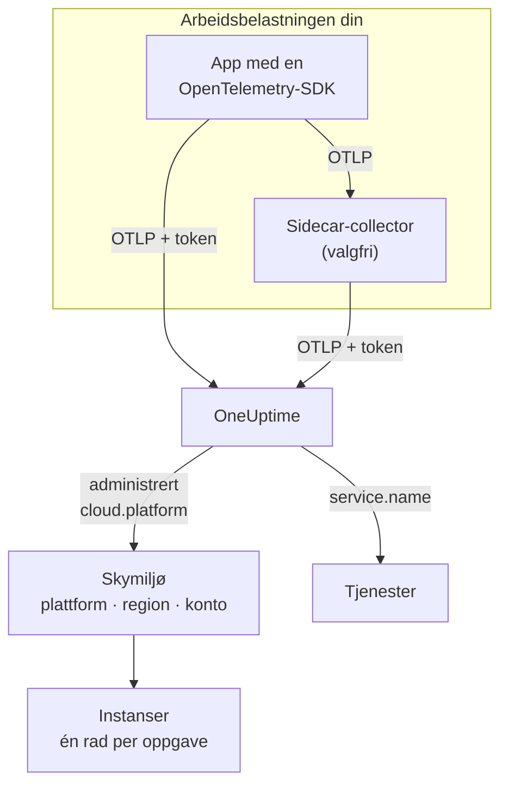

# Skymiljøer

Et **Cloud Environment** er stedet der containerne dine kjører på en administrert skyplattform: kontoen og regionen til et ECS-cluster, prosjektet og regionen til Cloud Run, abonnementet og regionen til Container Apps. OneUptime oppretter et første gang telemetrien din kommer frem med de riktige ressursattributtene, og samler hver arbeidsbelastning som kjører der. Det er ingenting å registrere for hånd.

:::cards
- [AWS ECS / Fargate](/docs/telemetry/cloud-aws-ecs): Oppgaver på Fargate eller EC2, med CPU og minne per oppgave.
- [Google Cloud Run](/docs/telemetry/cloud-gcp-cloud-run): Tjenester og jobber, også oppført som serverløse funksjoner.
- [Azure Container Apps](/docs/telemetry/cloud-azure-container-apps): Replikaer, med region og abonnement satt for hånd.
- [Andre skyplattformer](/docs/telemetry/cloud-other-platforms): Elastic Beanstalk, App Runner, App Engine, App Service og Container Instances.
:::

## Slik fungerer det



- **En ressursdetektor forteller hvor arbeidsbelastningen kjører.** En OpenTelemetry-ressursdetektor, i SDK-en eller i en collector, leser plattformens metadata og setter `cloud.platform`, `cloud.account.id` og `cloud.region` på alt arbeidsbelastningen sender. Der det ikke finnes noen detektor, setter du dem selv.
- **Miljøet samler alt.** Hver arbeidsbelastning med samme plattform, konto og region havner i ett miljø. Tjenestene beholder sine egne rader under **Tjenester**.
- **Hver kjørende oppgave er en instans.** Fanen **Instanser** i miljøet viser de kjørende oppgavene, instansene eller replikaene, med CPU og minne i sanntid der plattformen kan levere dem.

## Før du begynner

- **En inntaksnøkkel.** Opprett en nøkkel av typen **Server** under **Prosjektinnstillinger → Telemetri og APM → Inntaksnøkler**, og kopier tokenet: se [Opprett en inntaksnøkkel](/docs/telemetry/open-telemetry#opprett-en-inntaksnøkkel). Det er en hemmelighet: hver plattformside viser hvor du oppbevarer det i hemmelighetslageret til den skyen.
- **OpenTelemetry i applikasjonen din.** En OpenTelemetry-SDK som eksporterer OTLP, eller en OpenTelemetry Collector som kjører ved siden av applikasjonen.

## Støttede plattformer

| Plattform | `cloud.platform` | `cloud.*` fylles ut av | Instansidentitet | Veiledning |
| ------------------------- | --------------------------- | ---------------------- | --------------------------------- | ------------------------------------------------------------------ |
| AWS ECS / Fargate | `aws_ecs` | ressursdetektor | `aws.ecs.task.arn` | [AWS ECS / Fargate](/docs/telemetry/cloud-aws-ecs) |
| AWS Elastic Beanstalk | `aws_elastic_beanstalk` | ressursdetektor | `host.id` | [Andre skyplattformer](/docs/telemetry/cloud-other-platforms) |
| AWS App Runner | `aws_app_runner` | satt for hånd | `host.name` | [Andre skyplattformer](/docs/telemetry/cloud-other-platforms) |
| Google Cloud Run | `gcp_cloud_run` | ressursdetektor | `faas.instance` | [Google Cloud Run](/docs/telemetry/cloud-gcp-cloud-run) |
| Google App Engine | `gcp_app_engine` | ressursdetektor | `faas.instance` | [Andre skyplattformer](/docs/telemetry/cloud-other-platforms) |
| Azure Container Apps | `azure_container_apps` | ressursdetektor | `azure.container_app.instance.id` | [Azure Container Apps](/docs/telemetry/cloud-azure-container-apps) |
| Azure Container Instances | `azure_container_instances` | satt for hånd | `host.name` | [Andre skyplattformer](/docs/telemetry/cloud-other-platforms) |
| Azure App Service | `azure_app_service` | ressursdetektor | `host.id` | [Andre skyplattformer](/docs/telemetry/cloud-other-platforms) |

- **Ressursdetektor:** en OpenTelemetry-ressursdetektor, i SDK-en eller i Collectorens prosessor `resourcedetection`, setter attributtene `cloud.*` for deg.
- **Satt for hånd:** det finnes ingen detektor, så du setter attributtene i `OTEL_RESOURCE_ATTRIBUTES`. Plattformens side viser den nøyaktige linjen.
- **Azure-detektorene vet mindre.** Detektorene for Container Apps kjenner verken regionen eller abonnementet, og detektorene for App Service kjenner ikke abonnementet: sett selv det som mangler.
- **Azure-stavemåter med punktum fungerer.** Azure-detektorene for Node.js og .NET skriver `azure.container_apps` og `azure.app_service`. OneUptime skriver dem om til verdiene med understrek ovenfor når de mottas.

## Slik identifiserer OneUptime et miljø

Det finnes ett miljø for hver kombinasjon av tre ressursattributter:

| Attributt | Påkrevd | Hva det er |
| ------------------ | -------- | ------------------------------------------------------------------------------------------- |
| `cloud.platform` | Ja | En av verdiene i [Støttede plattformer](#støttede-plattformer) |
| `cloud.account.id` | Nei | AWS-konto-ID-en, Google Cloud-prosjekt-ID-en eller Azure-abonnements-ID-en |
| `cloud.region` | Nei | Regionen, for eksempel `us-east-1`, `us-central1` eller `eastus` |

OneUptime setter sammen de tre med `|` til **miljønøkkelen**, og gir miljøet navn etter de samme verdiene, for eksempel _AWS ECS · us-east-1 · 123456789012_:

```text title="Environment keys"
aws_ecs|123456789012|us-east-1
gcp_cloud_run|my-project|us-central1
azure_container_apps|00000000-0000-0000-0000-000000000000|eastus
```

> [!IMPORTANT]
> En del som mangler, blir stående i nøkkelen som et tomt segment: `aws_ecs||us-east-1`. En arbeidsbelastning som utelater `cloud.account.id`, havner derfor i et annet miljø enn en som setter den. Det er den vanlige grunnen til at du ser to miljøer der du ventet ett.

### Instansidentitet

Innenfor et miljø får hver kjørende oppgave, instans eller replika én rad under **Instanser**. Navnet kommer fra det første av disse ressursattributtene som telemetrien har med seg:

1. `aws.ecs.task.id`
2. `aws.ecs.task.arn` (forkortet til oppgave-ID-en)
3. `faas.instance`
4. `azure.container_app.instance.id`
5. `service.instance.id`
6. `container.id`
7. `host.id`
8. `host.name`

Plattformens egen identitet kommer først med vilje. En sidecar-collector og applikasjonens SDK ser den begge to, og den overlever omstarter. En SDK finner som regel på en ny `service.instance.id` for hver prosess (Node.js-SDK-en gjør det som standard), så hvis den var nøkkelen først, ville én ECS-oppgave bli delt i to rader. `service.instance.id` brukes når plattformen ikke setter noen egen identitet. Kolonnen **Instansidentitet** i [Støttede plattformer](#støttede-plattformer) nevner attributtet et typisk oppsett bruker på hver plattform.

### Miljøer du oppretter for hånd

Det trengs sjelden: inntaket oppretter miljøer for deg. For å opprette et før telemetrien kommer, åpner du **Sky → All Environments** og klikker **Opprett Skyressurs**. Velg **Skyplattform**, og skriv deretter inn **Sky-konto-ID** og **Skyregion** nøyaktig slik telemetrien din rapporterer dem. OneUptime bygger nøkkelen `platform|account|region` av disse tre, og inntaket matcher et miljø bare på nøkkelen. Miljøet får navnet inntaket ville gitt det; vil du vise et annet navn, åpner du **Flere felt** og skriver et **Visningsnavn**.

## Det som ikke er et skymiljø

| Du kjører på | Hvor det vises | Hvorfor |
| ------------------------------------------------------------------------------------------------- | ------------------------ | ---------------------------------------------------------------------------------------------------- |
| EC2, Compute Engine, Azure VM (`aws_ec2`, `gcp_compute_engine`, `azure_vm`) | **Verter** | En virtuell maskin er en vert. Se [OpenTelemetry-collector på verten](/docs/telemetry/host-otel-collector) |
| EKS, GKE, AKS, selvadministrert Kubernetes | **Kubernetes** | Rutes etter attributtene `k8s.*`. Se [Kubernetes-agent](/docs/telemetry/kubernetes-agent) |
| Lambda, Cloud Functions, Azure Functions (`aws_lambda`, `gcp_cloud_functions`, `azure_functions`) | **Serverløse funksjoner** | Rutes etter `faas.name`, eller etter `service.name` på en `cloud.platform` for FaaS. Se [Serverløse funksjoner](/docs/telemetry/serverless-functions) |
| Lastbalanserere, bøtter, administrerte databaser og andre IaaS- eller PaaS-ressurser | **Cloud Resources** | Oppdaget fra metrikkene som Azure Monitor, CloudWatch og Cloud Monitoring publiserer. Se [Skyressurser](/docs/telemetry/cloud-resources) |

> [!NOTE]
> Cloud Run og App Engine vises med vilje på to steder. Detektoren deres setter både en administrert `cloud.platform` og `faas.name`, så hver tjeneste er også sin egen **Serverløs funksjon**, mens **Cloud Environment** samler alle tjenestene i det prosjektet og den regionen. Den samme telemetrien arkiveres under begge.

## Koble til en arbeidsbelastning

Hver plattformside har disse stegene med den skyens egne kommandoer og konsollskjermer. I grove trekk:

:::steps
### Sett skyattributtene på telemetrien din

:::tabs
@tab Sidecar collector
En ekstra container i oppgaven, instansen eller replikaen. Applikasjonen eksporterer til `localhost:4318`, og collectorens prosessor `resourcedetection` stempler `cloud.*` på alt som går gjennom den. Collectoren har tokenet, og på ECS sender den også CPU og minne per oppgave:

```yaml title="collector.yaml"
processors:
  resourcedetection:
    detectors: [env, ecs] # [env, gcp] on Cloud Run and App Engine; [env, azurecontainerapps] on Container Apps
    timeout: 5s
```
@tab SDK direct
Applikasjonens SDK eksporterer rett til OneUptime. Slå på plattformens ressursdetektor i SDK-en, for eksempel `OTEL_NODE_RESOURCE_DETECTORS=env,host,os,aws` i Node.js: hver plattformside viser bryteren for hvert språk. Det er ingen ekstra container, og ingen CPU eller minne for containeren.
:::

### Eksporter OTLP til OneUptime

:::tabs
@tab Sidecar collector
```yaml title="collector.yaml"
exporters:
  otlphttp/oneuptime:
    endpoint: https://oneuptime.com/otlp
    headers:
      x-oneuptime-token: ${env:ONEUPTIME_TOKEN}

service:
  pipelines:
    traces:
      receivers: [otlp]
      processors: [resourcedetection, batch]
      exporters: [otlphttp/oneuptime]
    metrics:
      receivers: [otlp]
      processors: [resourcedetection, batch]
      exporters: [otlphttp/oneuptime]
    logs:
      receivers: [otlp]
      processors: [resourcedetection, batch]
      exporters: [otlphttp/oneuptime]
```

Collectoren fyller ut `${env:ONEUPTIME_TOKEN}` fra en miljøvariabel som plattformen fyller fra hemmelighetslageret sitt: Secrets Manager, Secret Manager eller hemmeligheter i Container Apps.
@tab SDK direct
```bash
OTEL_EXPORTER_OTLP_ENDPOINT="https://oneuptime.com/otlp"
OTEL_EXPORTER_OTLP_HEADERS="x-oneuptime-token=YOUR_TELEMETRY_INGESTION_TOKEN"
```
:::

Hvis du hoster OneUptime selv, bruker du `https://YOUR-ONEUPTIME-HOST/otlp`.

### Sjekk tilkoblingen

```bash
curl -i https://oneuptime.com/otlp/v1/validate \
  -H "x-oneuptime-token: YOUR_TELEMETRY_INGESTION_TOKEN"
```

`200` med `"valid": true` betyr at tokenet er godtatt. `401` betyr at det er ukjent, tilbakekalt, deaktivert eller utløpt, og svarets `message` sier hvilket. Innen ett minutt etter det første spennet, den første loggen eller metrikken vises miljøet under **Sky → All Environments**.
:::

> [!TIP]
> De samme stegene finnes i dashbordet, med tokenet ditt fylt ut: under **Sky → All Environments** til det første miljøet ditt kommer, og på fanen **Dokumentasjon** i hvert miljø.

## Hva du får

**Oversikt** for et miljø viser:

- **Forespørsler**, **Feilrate** og **p95 latency** fra sporene dine, med diagrammer over forespørsler, feil og minne i tidsrommet du velger.
- **CPU** og **Minne** på tvers av de levende instansene, og en liste **Toppinstanser etter CPU**. De kommer fra metrikkene `container.cpu.utilization` og `container.memory.usage` som bærer instansidentiteten; på ECS fra `ecs.task.cpu.utilized` og `ecs.task.memory.utilized` fra receiveren `awsecscontainermetrics`.
- **Instanser**: hvor mange som har rapportert de siste 15 minuttene. Fanen **Instanser** har én rad for hver.
- Fanene **Logger**, **Spor** og **Målinger**, filtrert til miljøet.

Et miljø der telemetrien stopper i 15 minutter, viser **Frakoblet**, og det neste spennet, den neste loggen eller metrikken bringer det tilbake til **Tilkoblet**. Tid da OneUptime selv var nede eller holdt på å ta igjen etterslep, teller ikke med i de 15 minuttene.

### Etiketter og eiere

- **Fra telemetrien din:** et ressursattributt som `oneuptime.label.team=payments` legger til etiketten `team:payments` på miljøet.
- **Fra regler:** **Sky → Innstillinger → Etikettregler** og **Eierregler** legger til etiketter og eiere på miljøer som samsvarer. Se [Etikett- og eierregler](/docs/configuration/label-and-owner-rules).

## Feilsøking

[Feilsøking i skyen](/docs/telemetry/cloud-troubleshooting) går gjennom hver feil i den rekkefølgen de oppstår: et miljø som aldri vises, havner under **Verter** eller bare under **Serverløse funksjoner**, ikke har noen instanser eller ingen CPU og minne, viser **Frakoblet**, deler seg i to, eller ble laget for hånd og aldri matcher.

## Neste steg

:::cards
- [AWS ECS / Fargate](/docs/telemetry/cloud-aws-ecs): Det vanligste oppsettet, med en komplett oppgavedefinisjon.
- [Feilsøking i skyen](/docs/telemetry/cloud-troubleshooting): Hva du skal sjekke når et miljø mangler eller er feil.
- [Skyressurser (IaaS og PaaS)](/docs/telemetry/cloud-resources): Lastbalanserere, bøtter og administrerte databaser fra skyens egen overvåking.
- [Serverløse funksjoner](/docs/telemetry/serverless-functions): Lambda, Cloud Functions og Azure Functions.
:::
