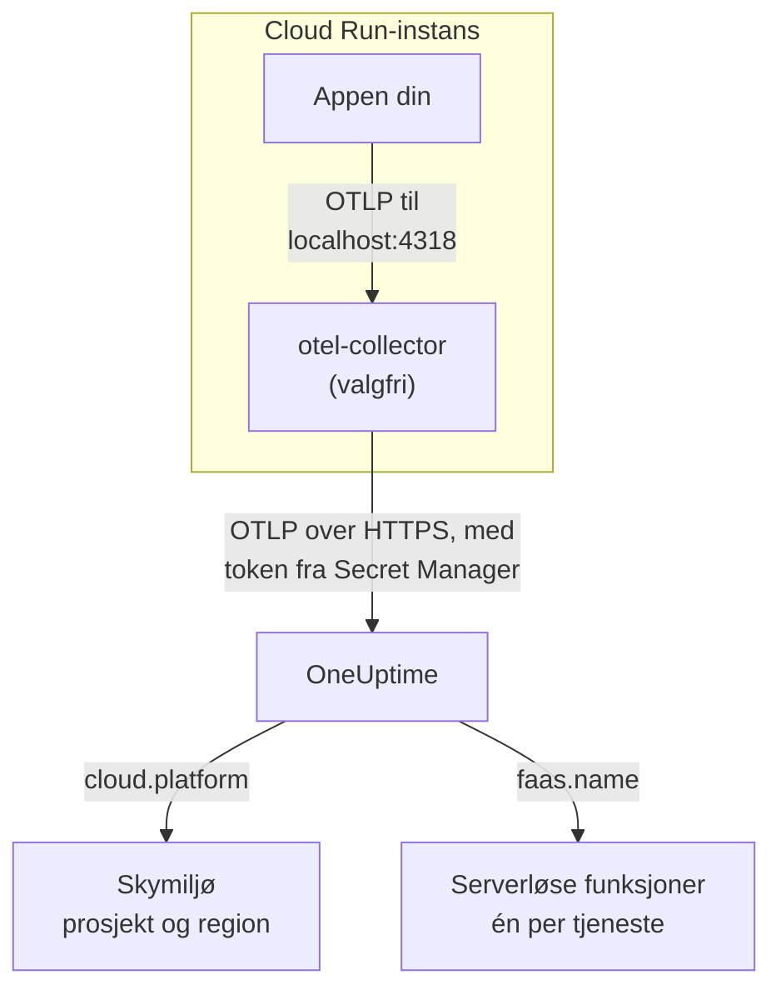

# Google Cloud Run

Send spor, logger og metrikker fra Cloud Run-tjenestene og -jobbene dine til OneUptime. Alt som rapporterer `cloud.platform=gcp_cloud_run`, havner i ett **Cloud Environment** per Google Cloud-prosjekt og region, for eksempel _GCP Cloud Run · us-central1 · my-project_, og hver tjeneste vises også under **Serverløse funksjoner**.

:::cards
- [Slik fungerer det](#slik-fungerer-det): Hva GCP-detektoren setter, og hvorfor en tjeneste vises på to steder.
- [Oppsett](#oppsett): Lagre tokenet, konfigurer tjenesten, rull ut og sjekk.
- [Tjenestens YAML med en sidecar](#tjenestens-yaml-med-en-sidecar): En komplett Cloud Run-tjeneste med en collector.
- [Feilsøking](#feilsøking): Feil med hemmeligheter, oppstartsrekkefølgen til sidecaren og manglende miljøer.
:::

## Slik fungerer det



OpenTelemetrys GCP-ressursdetektor leser metadataserveren og miljøvariablene `K_SERVICE` og `K_REVISION`, og setter:

| Attributt | Verdi på Cloud Run | Brukes til |
| ------------------ | ------------------------------ | ----------------------------------------------------------------------------------------- |
| `cloud.platform` | `gcp_cloud_run` | Arkiverer telemetrien under **Skymiljøer** |
| `cloud.account.id` | prosjekt-ID-en | En del av miljønøkkelen |
| `cloud.region` | `us-central1` | En del av miljønøkkelen |
| `faas.name` | tjenestenavnet (`K_SERVICE`) | Viser også tjenesten under **Serverløse funksjoner** |
| `faas.version` | revisjonen (`K_REVISION`) | Vises i tjenestens oversikt som serverløs funksjon; miljøet bruker den ikke |
| `faas.instance` | instans-ID-en | Gir én kjørende instans navn: én rad for hver under **Instanser** |

> [!NOTE]
> Cloud Run vises med vilje på to steder. Fordi detektoren setter `faas.name`, er hver tjeneste også en **Serverløs funksjon**, med egne kall, feilrate og varighet. **Cloud Environment** samler alle tjenestene i det prosjektet og den regionen. Ingenting lagres to ganger: den samme telemetrien arkiveres under begge.

Miljønøkkelen er `gcp_cloud_run|my-project|us-central1`.

## Før du begynner

- **En inntaksnøkkel.** Opprett en nøkkel av typen **Server** under **Prosjektinnstillinger → Telemetri og APM → Inntaksnøkler**, og kopier tokenet.
- **`gcloud`**, logget inn på prosjektet, med Secret Manager-API-et slått på: `gcloud services enable secretmanager.googleapis.com`.
- **Applikasjonen din instrumentert med en OpenTelemetry-SDK** som eksporterer OTLP.

## Velg hvordan telemetrien forlater tjenesten

| | SDK direct | Sidecar collector |
| --------------- | ---------------------------------------------------- | ---------------------------------------------------------------------- |
| Ekstra container | Ingen | `otel-collector` i tjenesten |
| Best for | Én tjeneste, og Cloud Run-jobber | Flere tjenester i ett prosjekt, eller en SDK som ikke kan kjøre en detektor |
| Har tokenet | Applikasjonen | Collectoren |
| Hemmeligheten | `oneuptime-otlp-headers`, hele headeren | `oneuptime-ingestion-token`, bare tokenet |

En jobb kjører til den er ferdig, så det er ingenting å holde en sidecar i live for: bruk SDK direct. Hvert steg nedenfor har en fane for begge; velg én, så følger hvert steg den.

## Oppsett

:::steps
### Lagre tokenet i Secret Manager

> [!IMPORTANT]
> Tokenet er en hemmelighet. Legg det i Secret Manager, og referer til det fra tjenesten som en miljøvariabel basert på en hemmelighet. En vanlig miljøvariabel er synlig for alle som kan se prosjektet, i konsollen og i `gcloud run services describe`.

:::tabs
@tab SDK direct
```bash
printf '%s' "x-oneuptime-token=YOUR_TELEMETRY_INGESTION_TOKEN" | gcloud secrets create oneuptime-otlp-headers \
  --data-file=- \
  --replication-policy=automatic

gcloud secrets add-iam-policy-binding oneuptime-otlp-headers \
  --member="serviceAccount:checkout-api@my-project.iam.gserviceaccount.com" \
  --role="roles/secretmanager.secretAccessor"
```

Cloud Run legger verdien av en hemmelighet uendret i variabelen, og `OTEL_EXPORTER_OTLP_HEADERS` trenger hele paret `name=value`, så denne hemmeligheten inneholder hele headeren.
@tab Sidecar collector
```bash
printf '%s' "YOUR_TELEMETRY_INGESTION_TOKEN" | gcloud secrets create oneuptime-ingestion-token \
  --data-file=- \
  --replication-policy=automatic

gcloud secrets add-iam-policy-binding oneuptime-ingestion-token \
  --member="serviceAccount:checkout-api@my-project.iam.gserviceaccount.com" \
  --role="roles/secretmanager.secretAccessor"
```

Collectorens konfigurasjon legger til headernavnet, så denne hemmeligheten inneholder bare tokenet.
:::

Sett tjenestens kjøretidstjenestekonto i `--member`, ikke din egen bruker. Uten `roles/secretmanager.secretAccessor` kan ikke revisjonen rulles ut, og den feiler med `Permission denied on secret`. Hvis tjenesten fortsatt kjører som standard tjenestekonto for Compute, gir du rollen til den kontoen, og vurderer å gi tjenesten en egen konto: standardkontoen deles av alt i prosjektet.

### Konfigurer tjenesten

:::tabs
@tab SDK direct
1. **Google Cloud console → Cloud Run → click the service → Edit & deploy new revision**.
2. På fanen **Containers** åpner du containeren din og går til **Variables & Secrets**. Legg til variablene nedenfor.
3. Klikk **Reference a secret**, velg `oneuptime-otlp-headers`, versjon `latest`, og gjør den tilgjengelig som miljøvariabelen `OTEL_EXPORTER_OTLP_HEADERS`.
4. På fanen **Security** sjekker du at **Service account** er kontoen du ga `roles/secretmanager.secretAccessor`.

```bash
OTEL_SERVICE_NAME=checkout-api
OTEL_EXPORTER_OTLP_ENDPOINT=https://oneuptime.com/otlp
OTEL_EXPORTER_OTLP_PROTOCOL=http/protobuf
# Secret-backed (Variables & Secrets → Reference a secret), not typed here.
OTEL_EXPORTER_OTLP_HEADERS=x-oneuptime-token=YOUR_TELEMETRY_INGESTION_TOKEN
```

Slå deretter på GCP-ressursdetektoren for språket ditt:

| Språk | Slå på GCP-detektoren |
| -------- | ------------------------------------------------------------------------------------------------------------------- |
| Node.js | `OTEL_NODE_RESOURCE_DETECTORS=env,host,os,gcp` (auto-instrumentations-node) |
| Python | `pip install opentelemetry-resourcedetector-gcp`, deretter `OTEL_EXPERIMENTAL_RESOURCE_DETECTORS=gcp_resource_detector` |
| Java | `-Dotel.resource.providers.gcp.enabled=true` |
| Go | `import "go.opentelemetry.io/contrib/detectors/gcp"`, og send `gcp.NewDetector()` til `resource.New` |
| .NET | Pakken `OpenTelemetry.Resources.Gcp`: `.ConfigureResource(r => r.AddGcpDetector())` |

Eller sett alt fra CLI-en:

```bash
gcloud run services update checkout-api --region us-central1 \
  --set-env-vars "^@^OTEL_SERVICE_NAME=checkout-api@OTEL_EXPORTER_OTLP_ENDPOINT=https://oneuptime.com/otlp@OTEL_EXPORTER_OTLP_PROTOCOL=http/protobuf@OTEL_NODE_RESOURCE_DETECTORS=env,host,os,gcp" \
  --set-secrets "OTEL_EXPORTER_OTLP_HEADERS=oneuptime-otlp-headers:latest"
```

Prefikset `^@^` får `gcloud` til å dele listen til det flagget ved `@` i stedet for `,`. Uten det deler `gcloud` `OTEL_NODE_RESOURCE_DETECTORS=env,host,os,gcp` ved hvert komma og feiler med `Bad syntax for dict arg [host]`.
@tab Sidecar collector
1. **Google Cloud console → Cloud Run → click the service → Edit & deploy new revision**.
2. På fanen **Containers** åpner du containeren din og går til **Variables & Secrets**. Legg til applikasjonsvariablene nedenfor.
3. Klikk **+ Add container**. Sett URL-en til containerimaget til `otel/opentelemetry-collector-contrib:latest`, og legg under **Container command and arguments** til argumentet `--config=env:OTEL_COLLECTOR_CONFIG`.
4. På fanen **Variables & Secrets** for den nye containeren: **Reference a secret**, `oneuptime-ingestion-token`, som miljøvariabelen `ONEUPTIME_TOKEN`. Legg til variabelen `OTEL_COLLECTOR_CONFIG` med collector-konfigurasjonen fra [Tjenestens YAML med en sidecar](#tjenestens-yaml-med-en-sidecar).
5. På collectorens fane **Settings** legger du til en **Startup probe** (HTTP, sti `/`, port `13133`), og under **Container start-up order** gjør du containeren din avhengig av `otel-collector`.
6. På fanen **Security** sjekker du at **Service account** er kontoen du ga `roles/secretmanager.secretAccessor`.

Containerne i én Cloud Run-instans deler `localhost`, så applikasjonen eksporterer til sidecaren der:

```bash
OTEL_SERVICE_NAME=checkout-api
OTEL_EXPORTER_OTLP_ENDPOINT=http://localhost:4318
OTEL_EXPORTER_OTLP_PROTOCOL=http/protobuf
```

Fra CLI-en er sidecaren tjenestens YAML nedenfor, rullet ut med `gcloud run services replace service.yaml --region us-central1`.
:::

Hvis du hoster OneUptime selv, bruker du `https://YOUR-ONEUPTIME-HOST/otlp` som endepunkt.

### Rull ut den nye revisjonen

Klikk **Deploy** i konsollen. Cloud Run starter en ny revisjon med innstillingene og sender trafikk til den når den er klar. Kommandoene med `gcloud` ruller ut en ny revisjon på egen hånd.

### Sjekk tilkoblingen

```bash
curl -i https://oneuptime.com/otlp/v1/validate \
  -H "x-oneuptime-token: YOUR_TELEMETRY_INGESTION_TOKEN"
```

`200` med `"valid": true` betyr at tokenet er godtatt. `401` betyr at det er ukjent, tilbakekalt, deaktivert eller utløpt. Send deretter én forespørsel til tjenesten, og se i collectorens logger i Cloud Logging (filtrer på containeren `otel-collector`) etter `401`, `connection refused` eller `context deadline exceeded`. Innen ett minutt vises miljøet under **Sky → All Environments** som _GCP Cloud Run · us-central1 · my-project_, og tjenesten under **Serverløse funksjoner**.
:::

## Tjenestens YAML med en sidecar

Collectoren leser hele konfigurasjonen sin fra `OTEL_COLLECTOR_CONFIG` (`--config=env:OTEL_COLLECTOR_CONFIG`), og tokenet fra hemmeligheten via `${env:ONEUPTIME_TOKEN}`. Annotasjonen `run.googleapis.com/container-dependencies` får Cloud Run til å starte collectoren først og vente på oppstartsproben dens før applikasjonen startes:

```yaml title="service.yaml"
apiVersion: serving.knative.dev/v1
kind: Service
metadata:
  name: checkout-api
spec:
  template:
    metadata:
      annotations:
        # "app" depends on "otel-collector": the collector starts first and
        # must pass its startup probe before the app container is started.
        run.googleapis.com/container-dependencies: '{"app":["otel-collector"]}'
    spec:
      serviceAccountName: checkout-api@my-project.iam.gserviceaccount.com
      containers:
        - name: app
          image: us-central1-docker.pkg.dev/my-project/apps/checkout-api:1.4.2
          ports:
            - containerPort: 8080
          env:
            - name: OTEL_SERVICE_NAME
              value: checkout-api
            - name: OTEL_EXPORTER_OTLP_ENDPOINT
              value: http://localhost:4318
            - name: OTEL_EXPORTER_OTLP_PROTOCOL
              value: http/protobuf
        - name: otel-collector
          image: otel/opentelemetry-collector-contrib:latest
          args:
            - --config=env:OTEL_COLLECTOR_CONFIG
          env:
            - name: ONEUPTIME_TOKEN
              valueFrom:
                secretKeyRef:
                  name: oneuptime-ingestion-token
                  key: latest
            - name: OTEL_COLLECTOR_CONFIG
              value: |
                receivers:
                  otlp:
                    protocols:
                      http:
                        endpoint: 0.0.0.0:4318
                      grpc:
                        endpoint: 0.0.0.0:4317
                processors:
                  # Stamps cloud.provider, cloud.platform=gcp_cloud_run,
                  # cloud.account.id, cloud.region and faas.* on everything.
                  resourcedetection:
                    detectors: [env, gcp]
                    timeout: 5s
                  batch: {}
                exporters:
                  otlphttp/oneuptime:
                    endpoint: https://oneuptime.com/otlp
                    headers:
                      x-oneuptime-token: ${env:ONEUPTIME_TOKEN}
                extensions:
                  health_check:
                    endpoint: 0.0.0.0:13133
                service:
                  extensions: [health_check]
                  pipelines:
                    traces:
                      receivers: [otlp]
                      processors: [resourcedetection, batch]
                      exporters: [otlphttp/oneuptime]
                    metrics:
                      receivers: [otlp]
                      processors: [resourcedetection, batch]
                      exporters: [otlphttp/oneuptime]
                    logs:
                      receivers: [otlp]
                      processors: [resourcedetection, batch]
                      exporters: [otlphttp/oneuptime]
          startupProbe:
            httpGet:
              path: /
              port: 13133
            periodSeconds: 2
            failureThreshold: 15
          resources:
            limits:
              cpu: 500m
              memory: 256Mi
```

Rull den ut:

```bash
gcloud run services replace service.yaml --region us-central1
```

Bare containeren som tar imot forespørsler (`app`), oppgir `ports`; en sidecar må ikke gjøre det.

## Nettverk

- **Som standard** når en Cloud Run-tjeneste internett direkte, og eksport til `oneuptime.com` trenger ingenting mer.
- **Med VPC egress: All traffic** (`--vpc-egress all-traffic`, via Direct VPC egress eller en Serverless VPC Access-connector) går utgående trafikk gjennom VPC-en din, som da trenger Cloud NAT (eller en rute til en proxy) for å nå OneUptime-verten. Med standardverdien `private-ranges-only` bruker bare private adresser VPC-en, og OneUptime nås direkte.
- **Brannmurregler for utgående trafikk** i VPC-en må tillate TCP 443 til OneUptime-verten.
- **En selvhostet OneUptime inne i VPC-en** er det motsatte tilfellet: send trafikken gjennom VPC-en (`private-ranges-only` eller `all-traffic`), så `https://YOUR-ONEUPTIME-HOST/otlp` slås opp der.

## Hva du får

- **Oversikt**: forespørsler, feilrate og p95-latens fra sporene dine.
- **Instanser**: én rad per Cloud Run-instans, navngitt etter `faas.instance`. Cloud Run viser ikke en containers ressursbruk til en sidecar, så flisene **CPU** og **Minne** forblir tomme, med mindre du selv sender metrikkene `container.cpu.utilization` og `container.memory.usage` med den samme `faas.instance`. Les flisene for forespørsler her, og overlat CPU og minne for instansene til Cloud Monitoring.
- **Logger**, **Spor** og **Målinger**, filtrert til miljøet.
- Den samme tjenesten under **Serverløse funksjoner** (etter `faas.name`) og under **Tjenester** (etter `service.name`).

## Feilsøking

:::details Revisjonen feiler med "Permission denied on secret"
Kjøretidstjenestekontoen mangler `roles/secretmanager.secretAccessor` på hemmeligheten, eller bindingen ligger på en annen hemmelighet enn den tjenesten refererer til. Kjør kommandoen `gcloud secrets add-iam-policy-binding` på nytt med kjøretidstjenestekontoen som `--member`.
:::

:::details Cloud Run avviser container-dependencies
Annotasjonen nevner en container som ikke finnes, eller collectoren har ingen oppstartsprobe, så Cloud Run kan ikke vite når den er klar.
:::

:::details Tjenesten er under Serverløse funksjoner, men det finnes ikke noe miljø
Telemetrien har ingen `cloud.platform`: GCP-detektoren er ikke slått på i SDK-en, eller `gcp` mangler i collectorens liste `detectors`.
:::

:::details Miljøet finnes, men Instanser er tom
Telemetrien har verken `faas.instance` eller `service.instance.id`. Årsaken er den samme: detektoren kjører ikke.
:::

Et miljø som aldri vises, viser **Frakoblet** eller deler seg i to, er dekket på [Feilsøking i skyen](/docs/telemetry/cloud-troubleshooting).

## Neste steg

:::cards
- [Skymiljøer](/docs/telemetry/cloud-environments): Slik identifiseres miljøer og instanser.
- [Serverløse funksjoner](/docs/telemetry/serverless-functions): Visningen per tjeneste av hver Cloud Run-tjeneste.
- [Feilsøking i skyen](/docs/telemetry/cloud-troubleshooting): Feilene alle plattformer har felles.
- [Skyressurser (IaaS og PaaS)](/docs/telemetry/cloud-resources): Cloud SQL, lastbalansererne og bøttene dine fra Cloud Monitoring.
:::
