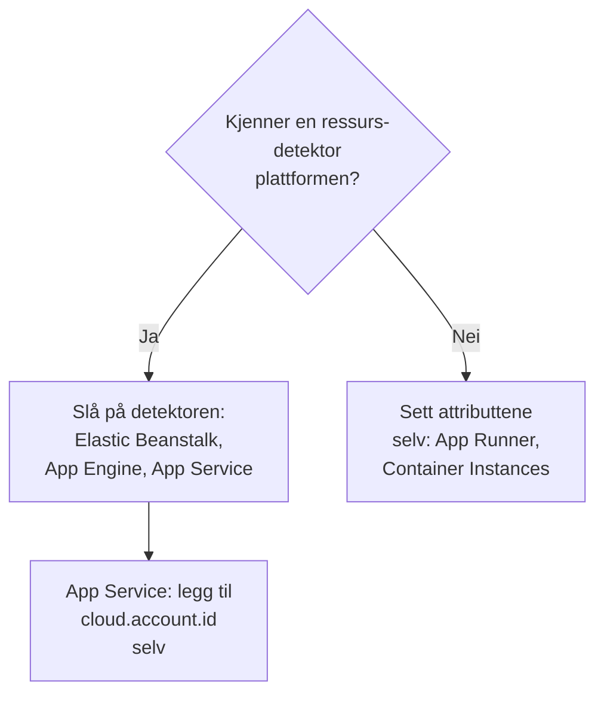

# Andre skyplattformer

Sett opp de administrerte plattformene som ikke har en egen side: AWS Elastic Beanstalk, AWS App Runner, Google App Engine, Azure App Service og Azure Container Instances. Regelen er den samme som på alle plattformer: telemetri som bærer en administrert `cloud.platform`, med `cloud.account.id` og `cloud.region`, havner i ett **Cloud Environment** per plattform, konto og region, og en instansidentitet gir hver kjørende instans en rad under **Instanser**.

:::cards
- [AWS Elastic Beanstalk](#aws-elastic-beanstalk): En collector på hver instans, med detektorene for Beanstalk og EC2.
- [AWS App Runner](#aws-app-runner): Attributtene satt for hånd, tokenet fra Secrets Manager.
- [Google App Engine](#google-app-engine): GCP-detektoren, med innstillingene i `app.yaml`.
- [Azure App Service](#azure-app-service): Azure-detektorene, en Key Vault-referanse og abonnementet for hånd.
- [Azure Container Instances](#azure-container-instances): Attributtene satt for hånd, tokenet som en sikker variabel.
:::

## Hva hver plattform trenger

Det som skiller disse plattformene, er hvem som setter attributtene `cloud.*`, og hvor innstillingene ligger i skyens konsoll:



| Plattform | `cloud.platform` | `cloud.*` fylles ut av | Instansidentitet |
| ------------------------- | --------------------------- | ------------------------------------------------------------------------------------------ | ----------------------------------------------------------- |
| AWS Elastic Beanstalk | `aws_elastic_beanstalk` | Collectorens detektorer `elastic_beanstalk` og `ec2`; `aws` i Node.js | `host.id` (fjern utrullingens `service.instance.id`) |
| AWS App Runner | `aws_app_runner` | Deg (ingen detektor) | `host.name` |
| Google App Engine | `gcp_app_engine` | Detektoren `gcp` (Collectorens og hver SDK sin) | `faas.instance` |
| Azure App Service | `azure_app_service` | Collectorens `azureappservice`, detektorene `azure` for Node.js og .NET; `cloud.account.id` av deg | `service.instance.id`, deretter `host.id` |
| Azure Container Instances | `azure_container_instances` | Deg (ingen detektor) | `host.name` |

Hver seksjon nedenfor trenger en inntaksnøkkel av typen **Server** fra **Prosjektinnstillinger → Telemetri og APM → Inntaksnøkler**, og en applikasjon som er instrumentert med en OpenTelemetry-SDK. Hvis du hoster OneUptime selv, erstatter du `https://oneuptime.com/otlp` med `https://YOUR-ONEUPTIME-HOST/otlp`.

> [!IMPORTANT]
> Tokenet er en hemmelighet på hver av disse plattformene. Hver seksjon nevner plattformens hemmelighetslager. Et token som er skrevet inn i en vanlig miljøvariabel, kan leses av alle som kan lese konfigurasjonen til appen.

## AWS Elastic Beanstalk

`cloud.platform`: `aws_elastic_beanstalk`. Beanstalk-detektoren leser `/var/elasticbeanstalk/xray/environment.conf` på instansen og setter `cloud.platform`, `service.instance.id`, `service.version` og miljønavnet. Den kjenner verken kontoen eller regionen, så kombiner den med EC2-detektoren, som gjør det, og som også setter `host.id`.

Kjør en OpenTelemetry Collector på hver instans, med denne konfigurasjonen:

```yaml title="config.yaml"
receivers:
  otlp:
    protocols:
      http:
        endpoint: 0.0.0.0:4318
      grpc:
        endpoint: 0.0.0.0:4317
processors:
  # elastic_beanstalk sets cloud.platform and service.instance.id; ec2 adds
  # cloud.account.id, cloud.region and host.id. The first detector to set an
  # attribute wins, so elastic_beanstalk comes first.
  resourcedetection:
    detectors: [env, elastic_beanstalk, ec2]
    timeout: 5s
  # The Beanstalk detector's service.instance.id is the deployment ID, shared
  # by every instance of a deployment: drop it, so that ec2's host.id names
  # each instance.
  resource:
    attributes:
      - key: service.instance.id
        action: delete
  batch: {}
exporters:
  otlphttp/oneuptime:
    endpoint: https://oneuptime.com/otlp
    headers:
      x-oneuptime-token: ${env:ONEUPTIME_TOKEN}
service:
  pipelines:
    traces:
      receivers: [otlp]
      processors: [resourcedetection, resource, batch]
      exporters: [otlphttp/oneuptime]
    metrics:
      receivers: [otlp]
      processors: [resourcedetection, resource, batch]
      exporters: [otlphttp/oneuptime]
    logs:
      receivers: [otlp]
      processors: [resourcedetection, resource, batch]
      exporters: [otlphttp/oneuptime]
```

:::steps
1. Lagre tokenet i Secrets Manager: `aws secretsmanager create-secret --name oneuptime/ingestion-token --secret-string "YOUR_TELEMETRY_INGESTION_TOKEN"`. Miljøegenskapene til Beanstalk ligger i miljøets konfigurasjon, ikke i et hemmelighetslager, så les i stedet hemmeligheten fra en plattform-hook, med instansprofilen. Instansprofilen trenger `secretsmanager:GetSecretValue` på den.
2. Installer collectoren fra et skript i `.platform/hooks/postdeploy/` (eller `.ebextensions`): pakken `otelcol-contrib`, med konfigurasjonen ovenfor og hemmeligheten i miljøet dens som `ONEUPTIME_TOKEN`.
3. **AWS Console → Elastic Beanstalk → Environments → your environment → Configuration**.
4. I kategorien **Updates, monitoring, and logging** klikker du **Edit** og blar ned til **Environment properties**. Legg til `OTEL_SERVICE_NAME`, `OTEL_EXPORTER_OTLP_ENDPOINT` satt til `http://localhost:4318`, og `OTEL_EXPORTER_OTLP_PROTOCOL` satt til `http/protobuf`.
5. Klikk **Apply**. Beanstalk starter applikasjonen på nytt med de nye egenskapene.
:::

Node.js-applikasjoner kan hoppe over collectoren: SDK-ens detektorer omfatter Beanstalk og EC2. Sett `OTEL_EXPORTER_OTLP_ENDPOINT` til `https://oneuptime.com/otlp`, `OTEL_EXPORTER_OTLP_HEADERS` til `x-oneuptime-token=YOUR_TELEMETRY_INGESTION_TOKEN` og `OTEL_NODE_RESOURCE_DETECTORS=env,host,os,aws`. Tokenet ligger da i en miljøegenskap. Sjekk ressursattributtene på et spor etterpå: hvis `cloud.platform` er `aws_ec2`, lot SDK-versjonen din EC2-detektoren vinne, og collectoren er den pålitelige veien.

**Nettverk:** instanser i et privat subnett trenger en NAT-gateway, og instansens sikkerhetsgruppe må tillate utgående trafikk på TCP 443 til OneUptime-verten.

## AWS App Runner

`cloud.platform`: `aws_app_runner`. Det finnes ingen detektor, så du setter attributtene selv. App Runner kan legge en hemmelighet fra Secrets Manager (eller SSM Parameter Store) inn i en miljøvariabel.

```bash
OTEL_SERVICE_NAME=checkout-api
OTEL_EXPORTER_OTLP_ENDPOINT=https://oneuptime.com/otlp
OTEL_EXPORTER_OTLP_PROTOCOL=http/protobuf
# From Secrets Manager: the secret holds the whole header.
OTEL_EXPORTER_OTLP_HEADERS=x-oneuptime-token=YOUR_TELEMETRY_INGESTION_TOKEN
OTEL_RESOURCE_ATTRIBUTES=cloud.provider=aws,cloud.platform=aws_app_runner,cloud.region=us-east-1,cloud.account.id=123456789012
OTEL_NODE_RESOURCE_DETECTORS=env,host,os
```

Bytt ut regionen og konto-ID-en med dine egne. Detektoren `host` leverer `host.name`, containerens vertsnavn, som er forskjellig for hver App Runner-instans, og OneUptime gir instansen navn etter det.

:::steps
1. Lagre hele headeren i Secrets Manager: `aws secretsmanager create-secret --name oneuptime/otlp-headers --secret-string "x-oneuptime-token=YOUR_TELEMETRY_INGESTION_TOKEN"`. App Runner legger hemmelighetens verdi uendret inn i variabelen.
2. **AWS Console → App Runner → Services → your service → Configuration → Configure service** (klikk **Edit** på fanen **Configuration**).
3. Under **Environment variables** klikker du **Add environment variable** for hver vanlige verdi ovenfor.
4. Legg til `OTEL_EXPORTER_OTLP_HEADERS` med **Source: Secrets Manager** og hemmelighetens ARN. Under **Security → Instance role** velger du en rolle med `secretsmanager:GetSecretValue` på hemmeligheten: instansrollen, ikke tilgangsrollen som henter imaget.
5. Klikk **Save changes**. App Runner ruller ut en ny versjon.
:::

**Nettverk:** en tjeneste uten VPC-connector når internett direkte. Med **Outgoing network traffic: Custom VPC** går utgående trafikk gjennom VPC-en din, som trenger en NAT-gateway og en utgående regel i sikkerhetsgruppen for TCP 443 til OneUptime-verten.

## Google App Engine

`cloud.platform`: `gcp_app_engine`. GCP-detektoren gjenkjenner App Engine standard og flexible fra `GAE_SERVICE`, `GAE_VERSION` og `GAE_INSTANCE` og metadataserveren. Den setter `cloud.account.id` (prosjektet), `cloud.region`, `faas.name`, `faas.version` og `faas.instance`. Som på Cloud Run får `faas.name` hver App Engine-tjeneste til også å vises under **Serverløse funksjoner**, mens miljøet samler prosjektet og regionen.

| Språk | Slå på GCP-detektoren |
| -------- | ------------------------------------------------------------------------------------------------------------------- |
| Node.js | `OTEL_NODE_RESOURCE_DETECTORS=env,host,os,gcp` |
| Python | `pip install opentelemetry-resourcedetector-gcp`, deretter `OTEL_EXPERIMENTAL_RESOURCE_DETECTORS=gcp_resource_detector` |
| Java | `-Dotel.resource.providers.gcp.enabled=true` |
| Go | `go.opentelemetry.io/contrib/detectors/gcp` → `gcp.NewDetector()` |
| .NET | `OpenTelemetry.Resources.Gcp` → `.AddGcpDetector()` |

App Engine har ingen redigering av miljøvariabler i konsollen: de ligger i `app.yaml`.

```yaml title="app.yaml"
runtime: nodejs22
env_variables:
  OTEL_SERVICE_NAME: checkout-api
  OTEL_EXPORTER_OTLP_ENDPOINT: https://oneuptime.com/otlp
  OTEL_EXPORTER_OTLP_PROTOCOL: http/protobuf
  OTEL_NODE_RESOURCE_DETECTORS: env,host,os,gcp
  # Do not commit the real value. Template it in CI, or read the secret at
  # start-up with the Secret Manager client instead.
  OTEL_EXPORTER_OTLP_HEADERS: x-oneuptime-token=YOUR_TELEMETRY_INGESTION_TOKEN
```

:::steps
1. Lagre hele headeren i Secret Manager: `printf '%s' "x-oneuptime-token=YOUR_TELEMETRY_INGESTION_TOKEN" | gcloud secrets create oneuptime-otlp-headers --data-file=-`. Gi App Engine-tjenestekontoen (`my-project@appspot.gserviceaccount.com`) `roles/secretmanager.secretAccessor` på den.
2. Legg hemmeligheten inn i `app.yaml` i utrullingspipelinen din, og behold en plassholder i den innsjekkede filen. Eller les `projects/PROJECT_ID/secrets/oneuptime-otlp-headers/versions/latest` ved oppstart, og send den til eksportørens innstilling `headers` i koden.
3. Rull ut med `gcloud app deploy`. I konsollen viser **App Engine → Versions** den nye versjonen, og **App Engine → Services** tjenesten som vises under **Serverløse funksjoner**.
:::

**Nettverk:** App Engine standard når internett direkte. Instanser i flexible-miljøet ligger i en VPC: hvis subnettet ikke har eksterne IP-er, trenger de Cloud NAT og en utgående brannmurregel for TCP 443 til OneUptime-verten.

## Azure App Service

`cloud.platform`: `azure_app_service`. Azure-detektorene for Node.js og .NET, og Collectorens detektor `azureappservice`, leser variablene `WEBSITE_*` som App Service setter. De fyller ut `cloud.platform`, `cloud.region`, `service.instance.id` (fra `WEBSITE_INSTANCE_ID`), `deployment.environment` (sporet) og `host.id`. Ingen av dem setter `cloud.account.id`: legg til abonnements-ID-en selv, ellers får miljønøkkelen et tomt kontosegment.

```bash
OTEL_SERVICE_NAME=checkout-api
OTEL_EXPORTER_OTLP_ENDPOINT=https://oneuptime.com/otlp
OTEL_EXPORTER_OTLP_PROTOCOL=http/protobuf
# The Key Vault reference, which resolves to the whole header.
OTEL_EXPORTER_OTLP_HEADERS=@Microsoft.KeyVault(SecretUri=https://my-vault.vault.azure.net/secrets/oneuptime-otlp-headers/)
OTEL_RESOURCE_ATTRIBUTES=cloud.account.id=00000000-0000-0000-0000-000000000000
# Node.js:
OTEL_NODE_RESOURCE_DETECTORS=env,host,os,azure
```

SDK-detektorene staver plattformen `azure.app_service`, med punktum; OneUptime skriver den om til `azure_app_service` når den mottas. I .NET legger du til `OpenTelemetry.Resources.Azure` og kaller `.ConfigureResource(r => r.AddAzureAppServiceDetector())`. Andre språk legger til `cloud.provider=azure,cloud.platform=azure_app_service,cloud.region=<region>` i `OTEL_RESOURCE_ATTRIBUTES`, og henter `service.instance.id` fra `WEBSITE_INSTANCE_ID` i koden.

:::steps
1. Slå på appens systemtilordnede administrerte identitet (**Settings → Identity**), og gi den **Key Vault Secrets User** på hvelvet. Lagre hele headeren, `x-oneuptime-token=YOUR_TELEMETRY_INGESTION_TOKEN`, som hemmeligheten `oneuptime-otlp-headers`.
2. **Azure portal → App Services → your app → Settings → Environment variables** (**Configuration → Application settings** i eldre portaler).
3. Legg til hver variabel ovenfor med **+ Add**. Verdien av `OTEL_EXPORTER_OTLP_HEADERS` er Key Vault-referansen.
4. Klikk **Apply**, deretter **Confirm**: appen starter på nytt med de nye innstillingene. Utrullingsspor har egne innstillinger: merk tokenet som **deployment slot setting** hvis bare ett spor skal sende telemetri.
:::

**Nettverk:** App Service når internett direkte med mindre **VNet integration** med **Route All** er slått på. Da trenger VNet-et en NAT-gateway, eller en rute til en brannmur som tillater TCP 443 til OneUptime-verten.

## Azure Container Instances

`cloud.platform`: `azure_container_instances`. Det finnes ingen detektor, så du setter attributtene selv. Miljøvariablene til en containergruppe ligger fast fra opprettelsen: å endre én betyr å opprette gruppen på nytt. Send tokenet med `--secure-environment-variables`, så `az container show` ikke returnerer det:

```bash
az container create \
  --resource-group my-rg \
  --name checkout-api \
  --image myregistry.azurecr.io/checkout-api:1.4.2 \
  --location eastus \
  --environment-variables \
    OTEL_SERVICE_NAME=checkout-api \
    OTEL_EXPORTER_OTLP_ENDPOINT=https://oneuptime.com/otlp \
    OTEL_EXPORTER_OTLP_PROTOCOL=http/protobuf \
    "OTEL_RESOURCE_ATTRIBUTES=cloud.provider=azure,cloud.platform=azure_container_instances,cloud.region=eastus,cloud.account.id=00000000-0000-0000-0000-000000000000" \
    OTEL_NODE_RESOURCE_DETECTORS=env,host,os \
  --secure-environment-variables \
    "OTEL_EXPORTER_OTLP_HEADERS=x-oneuptime-token=YOUR_TELEMETRY_INGESTION_TOKEN"
```

`host.name` fra detektoren `host`, containergruppens vertsnavn, gir instansen navn. En sidecar-collector fungerer også her, siden en containergruppe kjører flere containere som en ECS-oppgave: bruk mønsteret `detectors: [env]` pluss `OTEL_RESOURCE_ATTRIBUTES` fra [Azure Container Apps](/docs/telemetry/cloud-azure-container-apps). Det er også den som fyller flisene **CPU** og **Minne**, hvis den sender `container.cpu.utilization` og `container.memory.usage` med gruppens identitet.

:::steps
1. **Azure portal → Container Instances → + Create**. Fyll ut fanen **Basics**: ressursgruppe, navn, region og image.
2. På fanen **Advanced**, under **Environment variables**, legger du til hver variabel. For `OTEL_EXPORTER_OTLP_HEADERS` setter du **Mark as secure** til **Yes**, så portalen og API-et ikke viser verdien.
3. Klikk **Review + create**, deretter **Create**. For å endre en variabel senere sletter du gruppen og oppretter den på nytt.
:::

**Nettverk:** en containergruppe med en offentlig IP når internett direkte. En gruppe i et VNet-subnett går bare ut via VNet-ets rute: legg til en NAT-gateway, eller tillat TCP 443 til OneUptime-verten i brannmuren eller NSG-en.

## Sjekk tilkoblingen

Uansett hvilken plattform du har satt opp, sjekker du tokenet først og ser deretter etter miljøet:

```bash
curl -i https://oneuptime.com/otlp/v1/validate \
  -H "x-oneuptime-token: YOUR_TELEMETRY_INGESTION_TOKEN"
```

`200` med `"valid": true` betyr at tokenet er godtatt. `401` betyr at det er ukjent, tilbakekalt, deaktivert eller utløpt. Innen ett minutt etter det første spennet, den første loggen eller metrikken vises miljøet under **Sky → All Environments**, navngitt etter plattformen, regionen og kontoen.

## Feilsøking

:::details Beanstalk-instanser vises under Verter
EC2-detektorens `cloud.platform=aws_ec2` vant. Den første detektoren som setter et attributt, vinner, så hold `elastic_beanstalk` foran `ec2` i `detectors`. Uten en collector kan også Node.js-SDK-en foretrekke EC2-detektoren: kjør collectoren.
:::

:::details Alle Beanstalk-instanser deler én rad under Instanser
Beanstalk-detektorens `service.instance.id` er utrullings-ID-en, delt av alle instansene i en utrulling, og den leses før `host.id`. Behold prosessoren `resource` som sletter den, i hver pipeline.
:::

:::details En App Service-app får 401
Key Vault-referansen ble ikke løst opp, så App Service sendte den bokstavelige teksten `@Microsoft.KeyVault(...)` videre som header. Gi appens administrerte identitet **Key Vault Secrets User** på hvelvet, og sjekk at hemmeligheten inneholder hele headeren `x-oneuptime-token=...`.
:::

:::details Et App Service-miljø har et tomt kontosegment
Ingen av App Service-detektorene setter `cloud.account.id`. Legg abonnements-ID-en til i `OTEL_RESOURCE_ATTRIBUTES` på hver app: telemetri med og uten den havner i to miljøer.
:::

:::details En endret Container Instances-variabel har ingen effekt
Miljøvariablene til en containergruppe ligger fast fra opprettelsen. Slett gruppen, og opprett den på nytt med de nye verdiene.
:::

Se [Feilsøking i skyen](/docs/telemetry/cloud-troubleshooting) for resten, særlig et miljø som vises under **Verter**, bare under **Serverløse funksjoner** (App Engine uten GCP-detektoren), eller to ganger (`cloud.account.id` satt på noen utrullinger og ikke på andre).

## Neste steg

:::cards
- [Skymiljøer](/docs/telemetry/cloud-environments): Slik identifiseres miljøer og instanser.
- [Feilsøking i skyen](/docs/telemetry/cloud-troubleshooting): Feilene alle plattformer har felles.
- [Serverløse funksjoner](/docs/telemetry/serverless-functions): Lambda, Cloud Functions og Azure Functions.
- [Skyressurser (IaaS og PaaS)](/docs/telemetry/cloud-resources): Ressursene rundt appene dine, fra skyens egen overvåking.
:::
