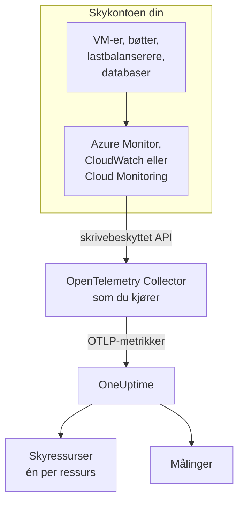
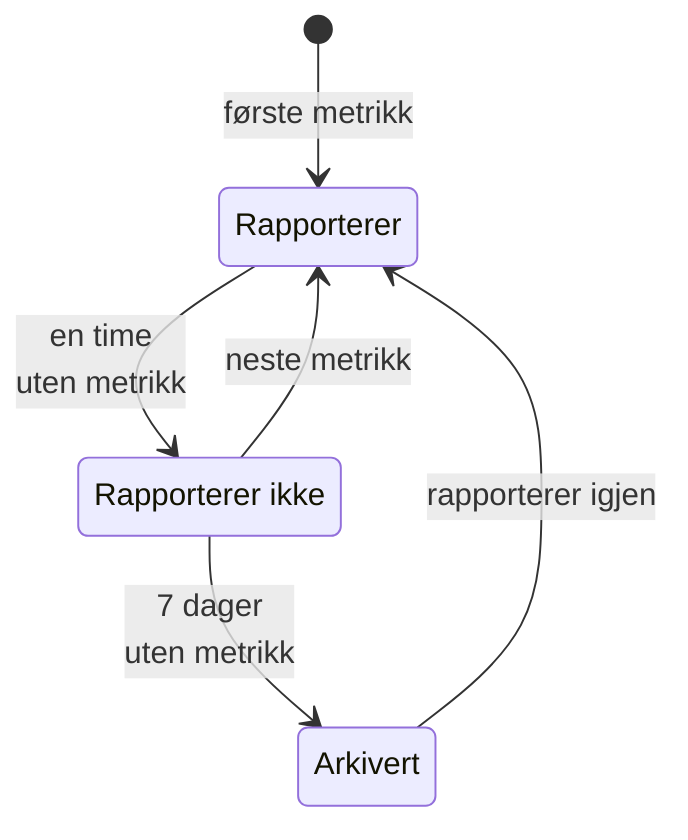

# Skyressurser (IaaS og PaaS)

**Cloud Resources** viser IaaS- og PaaS-ressursene i AWS-, Azure- og Google Cloud-kontoene dine: virtuelle maskiner, disker, lastbalanserere, bøtter, administrerte databaser, hurtigbuffere, køer, API-gatewayer og resten. Hver ressurs får sin egen side, med type, region og konto, leverandørens egen ID for den, hver metrikk leverandøren publiserer om den, og eiere og etiketter som alle andre ressurser i OneUptime. Du finner dem under **Sky → Alle ressurser**.

:::cards
- [Koble til Azure](#koble-til-azure): Les alle ressursene i et abonnement fra Azure Monitor.
- [Koble til AWS](#koble-til-aws): Poll CloudWatch, eller strøm det gjennom Amazon Data Firehose.
- [Koble til Google Cloud](#koble-til-google-cloud): Les tjenestene i et prosjekt fra Cloud Monitoring.
- [Slik identifiseres en ressurs](#slik-identifiseres-en-ressurs): Hver ressurstype OneUptime gjenkjenner, per leverandør.
:::

## Slik fungerer det



- **Leverandøren måler allerede ressursene dine.** Azure Monitor, Amazon CloudWatch og Google Cloud Monitoring publiserer metrikker om hver ressurs de kjører for deg.
- **En collector du kjører selv, leser dem.** En OpenTelemetry Collector med skrivebeskyttet tilgang til den overvåkingstjenesten eksporterer metrikkene til OneUptime. Ingenting installeres på ressursene, og OneUptime har aldri skylegitimasjonen din: det har collectoren, i ditt eget miljø.
- **Hver ressurs vises med sin første metrikk.** OneUptime ser ut fra hvert datapunkt hvilken ressurs det gjelder, og oppretter skyressursen første gang det ser den.

Skyressurser er ett av flere steder skyen din dukker opp:

| Du kjører | Hvor det vises | Hvordan |
| --- | --- | --- |
| Containere på ECS, Cloud Run, Container Apps, App Service, … | **Sky → All Environments** | Arbeidsbelastningenes egen telemetri, etter `cloud.platform`. Se [Skymiljøer](/docs/telemetry/cloud-environments) |
| Enhver IaaS- eller PaaS-ressurs leverandøren overvåker | **Sky → Alle ressurser** | Leverandørens overvåkings-API, lest av en collector: denne siden |
| Virtuelle maskiner med en OpenTelemetry Collector på | **Verter** | Vertens egne metrikker og logger. Se [OpenTelemetry-collector på verten](/docs/telemetry/host-otel-collector) |
| Køer og emner som applikasjonene dine bruker | **Queues** | Spenn, og de samme skymetrikkene. Se [Køer](/docs/telemetry/queues) |

En ressurs kan vises på mer enn ett sted. En virtuell maskin med collectoren på er en **Vert**, og plattformmetrikkene dens (CPU-kreditter, disk og nettverk slik hypervisoren ser dem) gjør den også til en **Skyressurs**. En SQS-kø er en **Queue** og en **Skyressurs**. Hver visning viser det kilden dens vet.

## Før du begynner

- **En inntaksnøkkel.** Opprett en nøkkel av typen **Server** under **Prosjektinnstillinger → Telemetri og APM → Inntaksnøkler**. Collectorene nedenfor leser den fra miljøvariabelen `ONEUPTIME_TOKEN`, aldri fra konfigurasjonsfilen sin.
- **Et sted å kjøre OpenTelemetry Collector**: distribusjonen `otelcol-contrib`, imaget `otel/opentelemetry-collector-contrib`, med utgående tilgang til skyleverandøren din og til OneUptime. En liten VM, en container eller Kubernetes-clusteret ditt holder, og én collector kan lese flere kontoer og leverandører.
- **Lesetilgang til leverandørens overvåkings-API.** Det første steget for hver leverandør nedenfor oppretter den.

> [!TIP]
> De samme stegene finnes i dashbordet, med tokenet ditt fylt ut: under **Sky → Alle ressurser** til den første ressursen kommer, og på fanen **Dokumentasjon** for hver ressurs, som åpner på ressursens egen leverandør.

Hvis du hoster OneUptime selv, erstatter du `https://oneuptime.com/otlp` med `https://YOUR-ONEUPTIME-HOST/otlp`.

## Koble til Azure

Receiveren `azure_monitor` viser ressursene i et abonnement og leser plattformmetrikkene deres hvert minutt. Uten en liste `services` leser den alle ressurstyper, så hver ressurs i abonnementet blir en skyressurs.

:::steps
### Opprett en tjenestekontohaver med Monitoring Reader

**Monitoring Reader** leser metrikker og viser ressurser, og kan ikke endre noe:

```bash
az ad sp create-for-rbac \
  --name oneuptime-cloud-collector \
  --role "Monitoring Reader" \
  --scopes /subscriptions/<SUBSCRIPTION_ID>
```

Kommandoen skriver ut en `appId` (klient-ID-en), et `password` (klienthemmeligheten) og `tenant`. Gi den samme tjenestekontohaveren rollen på flere abonnementer for å lese dem med den samme collectoren.

### Konfigurer Azure Monitor-receiveren

Lagre dette som `config.yaml`:

```yaml
extensions:
  azure_auth:
    service_principal:
      tenant_id: ${env:AZURE_TENANT_ID}
      client_id: ${env:AZURE_CLIENT_ID}
      client_secret: ${env:AZURE_CLIENT_SECRET}

receivers:
  azure_monitor:
    subscription_ids: ["${env:AZURE_SUBSCRIPTION_ID}"]
    auth:
      authenticator: azure_auth
    collection_interval: 60s
    # No `services` list: every resource type in the subscription.
    # Series Azure returns per metric and resource (default 10).
    maximum_number_of_records_per_resource: 50

processors:
  batch: {}

exporters:
  otlphttp/oneuptime:
    endpoint: https://oneuptime.com/otlp
    headers:
      x-oneuptime-token: ${env:ONEUPTIME_TOKEN}

service:
  extensions: [azure_auth]
  pipelines:
    metrics:
      receivers: [azure_monitor]
      processors: [batch]
      exporters: [otlphttp/oneuptime]
```

### Kjør Azure-collectoren

```bash
docker run -d --name oneuptime-cloud-collector --restart unless-stopped \
  -e ONEUPTIME_TOKEN=YOUR_TELEMETRY_INGESTION_TOKEN \
  -e AZURE_TENANT_ID=<TENANT> \
  -e AZURE_CLIENT_ID=<APP_ID> \
  -e AZURE_CLIENT_SECRET=<PASSWORD> \
  -e AZURE_SUBSCRIPTION_ID=<SUBSCRIPTION_ID> \
  -v "$(pwd)/config.yaml:/etc/otelcol-contrib/config.yaml" \
  otel/opentelemetry-collector-contrib:latest
```

Ressursene vises under **Sky → Alle ressurser** innen noen få minutter.
:::

Innstillinger for receiveren `azure_monitor`:

| Innstilling | Hva den gjør |
| --- | --- |
| `resource_groups`, `services`, `resource_tags` | Les mindre: en liste over ressursgrupper, over Resource Manager-typer (`Microsoft.Compute/virtualMachines`), eller over tagger en ressurs må ha |
| `metrics` | Begrenser hver ressurstype til metrikkene og aggregeringene du lister opp. Når en type er listet opp, leses bare de oppførte metrikkene for den |
| `discover_subscriptions: true` | Leser hvert abonnement tjenestekontohaveren kan se, i stedet for `subscription_ids` |
| `maximum_number_of_records_per_resource` | Hvor mange serier Azure returnerer per metrikk og ressurs (10 som standard). Øk den når en metrikk deles opp etter en dimensjon med mange verdier |
| `use_batch_api: true` | For store abonnementer. Receiveren gjør ett Resource Manager-kall per ressurs og bunke på 20 metrikker, og Resource Manager tillater rundt 12 000 lesinger i timen; batch-API-et leser opptil 50 ressurser per kall fra dataplanet til Azure Monitor, der grensen er langt høyere |
| `cache_resources` | Hvor ofte, i sekunder, receiveren viser ressursene: én gang i døgnet som standard. En ressurs som er opprettet etter at collectoren startet, kan bruke opptil et døgn på å dukke opp; start collectoren på nytt for å vise dem med en gang |

## Koble til AWS

CloudWatch-metrikker når OneUptime på én av to måter:

| | Polling | Metric Streams |
| --- | --- | --- |
| Hvordan | Collectorens receiver `aws_cloudwatch` spør CloudWatch | CloudWatch sender gjennom Amazon Data Firehose til collectorens receiver `awsfirehose` |
| Trengs på AWS-siden | Bare legitimasjon | En Firehose-strøm og en metric stream i hver region |
| Collectoren må kunne nås fra AWS | Nei | Ja, over HTTPS på port 443 |
| Forsinkelse | 10 til 20 minutter | Noen få minutter |
| Passer for | De fleste kontoer | Store kontoer |

### Polling med receiveren aws_cloudwatch

:::steps
#### La collectoren lese CloudWatch

Knytt denne policyen til rollen collectoren kjører som (en EC2-instansprofil, en ECS-oppgaverolle, en EKS-tjenestekonto), eller til en IAM-bruker du gir tilgangsnøklene til:

```json
{
  "Version": "2012-10-17",
  "Statement": [
    {
      "Effect": "Allow",
      "Action": [
        "cloudwatch:ListMetrics",
        "cloudwatch:GetMetricData",
        "sts:GetCallerIdentity"
      ],
      "Resource": "*"
    }
  ]
}
```

`sts:GetCallerIdentity` lar receiveren rapportere konto-ID-en, som ARN-en til hver ressurs trenger.

#### Konfigurer CloudWatch-receiverne

Én receiver leser ett navnerom i én region, så legg til én for hvert navnerom og hver region du vil ha. Dette eksemplet leser de vanlige; lagre det som `config.yaml`:

```yaml
receivers:
  aws_cloudwatch/ec2:
    region: ${env:AWS_REGION}
    metrics:
      collection_interval: 5m
      period: 5m
      delay: 10m
      discovery:
        filters:
          namespace: AWS/EC2
        # Metrics read per scrape, at most. Each costs 4 GetMetricData queries.
        limit: 1000
  aws_cloudwatch/ebs:
    region: ${env:AWS_REGION}
    metrics:
      collection_interval: 5m
      period: 5m
      delay: 10m
      discovery:
        filters:
          namespace: AWS/EBS
        # Metrics read per scrape, at most. Each costs 4 GetMetricData queries.
        limit: 1000
  aws_cloudwatch/applicationelb:
    region: ${env:AWS_REGION}
    metrics:
      collection_interval: 5m
      period: 5m
      delay: 10m
      discovery:
        filters:
          namespace: AWS/ApplicationELB
        # Metrics read per scrape, at most. Each costs 4 GetMetricData queries.
        limit: 1000
  aws_cloudwatch/rds:
    region: ${env:AWS_REGION}
    metrics:
      collection_interval: 5m
      period: 5m
      delay: 10m
      discovery:
        filters:
          namespace: AWS/RDS
        # Metrics read per scrape, at most. Each costs 4 GetMetricData queries.
        limit: 1000
  aws_cloudwatch/lambda:
    region: ${env:AWS_REGION}
    metrics:
      collection_interval: 5m
      period: 5m
      delay: 10m
      discovery:
        filters:
          namespace: AWS/Lambda
        # Metrics read per scrape, at most. Each costs 4 GetMetricData queries.
        limit: 1000
  aws_cloudwatch/dynamodb:
    region: ${env:AWS_REGION}
    metrics:
      collection_interval: 5m
      period: 5m
      delay: 10m
      discovery:
        filters:
          namespace: AWS/DynamoDB
        # Metrics read per scrape, at most. Each costs 4 GetMetricData queries.
        limit: 1000

processors:
  batch: {}

exporters:
  otlphttp/oneuptime:
    endpoint: https://oneuptime.com/otlp
    headers:
      x-oneuptime-token: ${env:ONEUPTIME_TOKEN}

service:
  pipelines:
    metrics:
      receivers: [aws_cloudwatch/ec2, aws_cloudwatch/ebs, aws_cloudwatch/applicationelb, aws_cloudwatch/rds, aws_cloudwatch/lambda, aws_cloudwatch/dynamodb]
      processors: [batch]
      exporters: [otlphttp/oneuptime]
```

#### Kjør CloudWatch-collectoren

```bash
docker run -d --name oneuptime-cloud-collector --restart unless-stopped \
  -e ONEUPTIME_TOKEN=YOUR_TELEMETRY_INGESTION_TOKEN \
  -e AWS_REGION=us-east-1 \
  -e AWS_ACCESS_KEY_ID=<ACCESS_KEY_ID> \
  -e AWS_SECRET_ACCESS_KEY=<SECRET_ACCESS_KEY> \
  -v "$(pwd)/config.yaml:/etc/otelcol-contrib/config.yaml" \
  otel/opentelemetry-collector-contrib:latest
```

På en EC2-instans, ECS-oppgave eller EKS-pod som har rollen, utelater du de to nøkkelvariablene.
:::

- **La `stats` stå tom.** Hver metrikk leses da som én oppsummering per periode: fire statistikker, fire spørringer med `GetMetricData`, og AWS fakturerer `GetMetricData` per forespurt metrikk. `discovery.limit` begrenser metrikkene en receiver leser per innhenting (sett den: receiverens egen standard er 100), og et lengre `collection_interval` leser dem sjeldnere.
- **Data kommer sent.** `delay` venter på at CloudWatch publiserer en periode, så datapunkter kommer 10 til 20 minutter etter tidspunktet de måler, og ressurser vises innen omtrent tjue minutter.

### Strømming med CloudWatch Metric Streams

:::steps
#### Konfigurer Firehose-receiveren

Collectoren trenger et sertifikat for adressen sin: Firehose leverer bare til `https://` på port 443. Lagre dette som `config.yaml`:

```yaml
extensions:
  awscloudwatchmetricstreams_encoding:
    format: opentelemetry1.0

receivers:
  awsfirehose:
    # Firehose delivers to HTTPS on port 443 only: expose this port as
    # 443, for example behind a load balancer.
    endpoint: 0.0.0.0:4433
    encoding: awscloudwatchmetricstreams_encoding
    access_key: ${env:FIREHOSE_ACCESS_KEY}
    tls:
      cert_file: /etc/otelcol-contrib/tls/server.crt
      key_file: /etc/otelcol-contrib/tls/server.key

processors:
  batch: {}

exporters:
  otlphttp/oneuptime:
    endpoint: https://oneuptime.com/otlp
    headers:
      x-oneuptime-token: ${env:ONEUPTIME_TOKEN}

service:
  extensions: [awscloudwatchmetricstreams_encoding]
  pipelines:
    metrics:
      receivers: [awsfirehose]
      processors: [batch]
      exporters: [otlphttp/oneuptime]
```

#### Kjør Firehose-collectoren

```bash
docker run -d --name oneuptime-cloud-collector --restart unless-stopped \
  -e ONEUPTIME_TOKEN=YOUR_TELEMETRY_INGESTION_TOKEN \
  -e FIREHOSE_ACCESS_KEY=<A_LONG_RANDOM_SECRET> \
  -p 4433:4433 \
  -v "$(pwd)/tls:/etc/otelcol-contrib/tls:ro" \
  -v "$(pwd)/config.yaml:/etc/otelcol-contrib/config.yaml" \
  otel/opentelemetry-collector-contrib:latest
```

Sertifikatet og nøkkelen til det skal ligge i `tls/`, som `server.crt` og `server.key`. Publiser port 4433 bak noe som svarer på 443, for eksempel en lastbalanserer.

#### Opprett Firehose-strømmen og metric streams

1. **Amazon Data Firehose → Create Firehose stream**: kilde **Direct PUT**, mål **HTTP Endpoint**. Endepunkt-URL-en er collectorens adresse `https://`; tilgangsnøkkelen er `FIREHOSE_ACCESS_KEY`. Velg eller opprett en S3-bøtte for mislykkede leveranser.
2. **CloudWatch → Metrics → Streams → Create metric stream**: navnerommene som skal være med (eller alle), Firehose-strømmen og utdataformatet **OpenTelemetry 1.0**.
3. Gjenta i hver region: en metric stream bærer metrikkene fra sin egen region.
:::

AWS fakturerer en metric stream per metrikkoppdatering den leverer, pluss datakostnadene til Firehose, så ta bare med navnerommene du vil ha. En strøm i formatet **JSON** (`format: json` på kodingsutvidelsen) navngir de samme ressursene, men skriver også hvert navnerom inn i `service.name`, så hvert navnerom også vises under **Tjenester**: foretrekk **OpenTelemetry 1.0**.

## Koble til Google Cloud

Receiveren `googlecloudmonitoring` leser metrikktypene som `metrics_list` nevner, for ett prosjekt.

:::steps
### Opprett en tjenestekonto med Monitoring Viewer

**Monitoring Viewer** leser metrikker, og kan ikke endre noe:

```bash
gcloud iam service-accounts create oneuptime-cloud-collector \
  --project <PROJECT_ID>

gcloud projects add-iam-policy-binding <PROJECT_ID> \
  --member "serviceAccount:oneuptime-cloud-collector@<PROJECT_ID>.iam.gserviceaccount.com" \
  --role roles/monitoring.viewer

gcloud iam service-accounts keys create key.json \
  --iam-account oneuptime-cloud-collector@<PROJECT_ID>.iam.gserviceaccount.com
```

På selve Google Cloud kjører du collectoren som denne tjenestekontoen i stedet for å opprette en nøkkel.

### Konfigurer Cloud Monitoring-receiveren

Hvert filter leser hver metrikktype fra én tjeneste. Lagre dette som `config.yaml`:

```yaml
receivers:
  googlecloudmonitoring:
    project_id: ${env:GCP_PROJECT_ID}
    collection_interval: 2m
    # Only the metric types these filters list are read.
    metrics_list:
      - metric_descriptor_filter: 'metric.type = starts_with("compute.googleapis.com/")'
      - metric_descriptor_filter: 'metric.type = starts_with("cloudsql.googleapis.com/")'
      - metric_descriptor_filter: 'metric.type = starts_with("loadbalancing.googleapis.com/")'
      - metric_descriptor_filter: 'metric.type = starts_with("storage.googleapis.com/")'
      - metric_descriptor_filter: 'metric.type = starts_with("redis.googleapis.com/")'
      - metric_descriptor_filter: 'metric.type = starts_with("run.googleapis.com/")'

processors:
  batch: {}

exporters:
  otlphttp/oneuptime:
    endpoint: https://oneuptime.com/otlp
    headers:
      x-oneuptime-token: ${env:ONEUPTIME_TOKEN}

service:
  pipelines:
    metrics:
      receivers: [googlecloudmonitoring]
      processors: [batch]
      exporters: [otlphttp/oneuptime]
```

### Kjør Google Cloud-collectoren

```bash
docker run -d --name oneuptime-cloud-collector --restart unless-stopped \
  -e ONEUPTIME_TOKEN=YOUR_TELEMETRY_INGESTION_TOKEN \
  -e GCP_PROJECT_ID=<PROJECT_ID> \
  -e GOOGLE_APPLICATION_CREDENTIALS=/etc/otelcol-contrib/key.json \
  -v "$(pwd)/key.json:/etc/otelcol-contrib/key.json:ro" \
  -v "$(pwd)/config.yaml:/etc/otelcol-contrib/config.yaml" \
  otel/opentelemetry-collector-contrib:latest
```
:::

- **Listen leses når collectoren starter:** start den på nytt etter en endring. `metric_name: compute.googleapis.com/instance/cpu/utilization` leser én type i stedet for alle typene til en tjeneste.
- **Én receiver leser ett prosjekt:** legg til én per prosjekt.
- **Lesing har en kostnad og en kvote.** Hver metrikktype er én lesing fra Cloud Monitoring-API-et per innsamlingsintervall. Å lese Google Clouds egne metrikker er gratis innenfor API-ets månedlige kvote; et lengre `collection_interval` holder et stort prosjekt innenfor den, og innenfor kvoten per minutt.

## Hold pipelinen fri for ressursdeteksjon

> [!WARNING]
> Ikke legg prosessoren `resourcedetection` til i pipelinen som leser skyovervåkingen. Den stempler collector-maskinens egen `host.name` og `os.type` på hvert datapunkt, og OneUptime arkiverer da også skyens metrikker under den maskinen i **Verter**. En collector som også overvåker sin egen vert, bør gjøre det i en egen pipeline.

## Slik identifiseres en ressurs

Hvert datapunkt fra disse receiverne navngir én ressurs, og OneUptime knytter skyressursen til den ressursens identitet, aldri til navnet, som du kan endre. Identiteten sammenlignes uten hensyn til store og små bokstaver, så en ressurs som rapporteres med to stavemåter, er én ressurs.

### Azure

Hvert datapunkt bærer Azure-ressurs-ID-en til ressursen sin (`azuremonitor.resource_id`), så hver ressurs receiveren leser, blir en skyressurs: typene nedenfor under et lesbart navn, alle andre under Resource Manager-typen sin. Ressurs-ID-en, regionen, abonnementet og ressursgruppen vises alle på ressursen.

:::details Azure-ressurstypene med et lesbart navn
| Ressurstype | Vises som | Modell |
| --- | --- | --- |
| `Microsoft.Compute/virtualMachines` | Virtual Machine | IaaS |
| `Microsoft.Compute/virtualMachineScaleSets` | Virtual Machine Scale Set | IaaS |
| `Microsoft.Compute/disks` | Managed Disk | IaaS |
| `Microsoft.Network/loadBalancers` | Load Balancer | IaaS |
| `Microsoft.Network/applicationGateways` | Application Gateway | IaaS |
| `Microsoft.Network/publicIPAddresses` | Public IP Address | IaaS |
| `Microsoft.Network/natGateways` | NAT Gateway | IaaS |
| `Microsoft.Network/virtualNetworkGateways` | Virtual Network Gateway | IaaS |
| `Microsoft.Network/expressRouteCircuits` | ExpressRoute Circuit | IaaS |
| `Microsoft.Network/azureFirewalls` | Azure Firewall | IaaS |
| `Microsoft.Network/frontdoors` | Front Door (classic) | IaaS |
| `Microsoft.Cdn/profiles` | Front Door and CDN Profile | IaaS |
| `Microsoft.Network/trafficmanagerprofiles` | Traffic Manager Profile | IaaS |
| `Microsoft.Network/networkInterfaces` | Network Interface | IaaS |
| `Microsoft.Network/virtualNetworks` | Virtual Network | IaaS |
| `Microsoft.Network/privateEndpoints` | Private Endpoint | IaaS |
| `Microsoft.Network/dnszones` | DNS Zone | IaaS |
| `Microsoft.Network/bastionHosts` | Bastion | IaaS |
| `Microsoft.Storage/storageAccounts` | Storage Account | IaaS |
| `Microsoft.RecoveryServices/vaults` | Recovery Services Vault | PaaS |
| `Microsoft.Web/sites` | App Service or Function App | PaaS |
| `Microsoft.Web/serverfarms` | App Service Plan | PaaS |
| `Microsoft.Web/staticSites` | Static Web App | PaaS |
| `Microsoft.App/containerApps` | Container App | PaaS |
| `Microsoft.App/managedEnvironments` | Container Apps Environment | PaaS |
| `Microsoft.ContainerInstance/containerGroups` | Container Instance | PaaS |
| `Microsoft.ContainerService/managedClusters` | AKS Cluster | PaaS |
| `Microsoft.ContainerRegistry/registries` | Container Registry | PaaS |
| `Microsoft.SignalRService/SignalR` | SignalR Service | PaaS |
| `Microsoft.Sql/servers/databases` | SQL Database | PaaS |
| `Microsoft.Sql/servers/elasticpools` | SQL Elastic Pool | PaaS |
| `Microsoft.Sql/managedInstances` | SQL Managed Instance | PaaS |
| `Microsoft.DBforPostgreSQL/flexibleServers` | PostgreSQL Flexible Server | PaaS |
| `Microsoft.DBforMySQL/flexibleServers` | MySQL Flexible Server | PaaS |
| `Microsoft.DocumentDB/databaseAccounts` | Cosmos DB Account | PaaS |
| `Microsoft.Cache/redis` | Azure Cache for Redis | PaaS |
| `Microsoft.Cache/redisEnterprise` | Azure Managed Redis | PaaS |
| `Microsoft.ServiceBus/namespaces` | Service Bus Namespace | PaaS |
| `Microsoft.EventHub/namespaces` | Event Hubs Namespace | PaaS |
| `Microsoft.EventGrid/topics` | Event Grid Topic | PaaS |
| `Microsoft.EventGrid/systemTopics` | Event Grid System Topic | PaaS |
| `Microsoft.EventGrid/namespaces` | Event Grid Namespace | PaaS |
| `Microsoft.ApiManagement/service` | API Management | PaaS |
| `Microsoft.Logic/workflows` | Logic App | PaaS |
| `Microsoft.DataFactory/factories` | Data Factory | PaaS |
| `Microsoft.Synapse/workspaces` | Synapse Workspace | PaaS |
| `Microsoft.Kusto/clusters` | Data Explorer Cluster | PaaS |
| `Microsoft.StreamAnalytics/streamingjobs` | Stream Analytics Job | PaaS |
| `Microsoft.CognitiveServices/accounts` | Azure AI Services or OpenAI | PaaS |
| `Microsoft.Search/searchServices` | AI Search Service | PaaS |
| `Microsoft.MachineLearningServices/workspaces` | Machine Learning Workspace | PaaS |
| `Microsoft.KeyVault/vaults` | Key Vault | PaaS |
| `Microsoft.Insights/components` | Application Insights | PaaS |
| `Microsoft.OperationalInsights/workspaces` | Log Analytics Workspace | PaaS |
| `Microsoft.Automation/automationAccounts` | Automation Account | PaaS |
| `Microsoft.Devices/IotHubs` | IoT Hub | PaaS |
:::

### AWS

En CloudWatch-metrikk navngir ressursen sin i en dimensjon som avhenger av navnerommet. Et datapunkt som bærer dimensjonene under **Identifisert av**, hører til den ressursen, sammen med kontoen og regionen; ekstra dimensjoner snevrer inn serien, ikke ressursen (seriene per målgruppe for en Application Load Balancer hører til lastbalansereren). Et datapunkt som er aggregert over noe annet (`InstanceType`, `DatabaseClass`, en total for hele kontoen), navngir ingen ressurs og oppdages ikke. Det gjør heller ikke et navnerom som ikke står på listen: metrikkene fra det kommer likevel fram til **Målinger**.

Hver ressurs vises med ARN-en sin der metrikkene navngir den fullt ut; der de ikke gjør det (ARN-en til en Auto Scaling-gruppe inneholder en UUID som ingen metrikk rapporterer), med navnerommet og dimensjonene.

:::details CloudWatch-navnerommene og dimensjonene som identifiserer en ressurs
| Navnerom | Identifisert av | Vises som | Ressurstype | Modell |
| --- | --- | --- | --- | --- |
| `AWS/EC2` | `InstanceId` | EC2 Instance | `AWS::EC2::Instance` | IaaS |
| `AWS/EC2` | `AutoScalingGroupName` (without `InstanceId`) | Auto Scaling Group | `AWS::AutoScaling::AutoScalingGroup` | IaaS |
| `AWS/AutoScaling` | `AutoScalingGroupName` | Auto Scaling Group | `AWS::AutoScaling::AutoScalingGroup` | IaaS |
| `AWS/EBS` | `VolumeId` | EBS Volume | `AWS::EC2::Volume` | IaaS |
| `AWS/ELB` | `LoadBalancerName` | Classic Load Balancer | `AWS::ElasticLoadBalancing::LoadBalancer` | IaaS |
| `AWS/ApplicationELB` | `LoadBalancer` | Elastic Load Balancer (ALB, NLB, GWLB) | `AWS::ElasticLoadBalancingV2::LoadBalancer` | IaaS |
| `AWS/NetworkELB` | `LoadBalancer` | Elastic Load Balancer (ALB, NLB, GWLB) | `AWS::ElasticLoadBalancingV2::LoadBalancer` | IaaS |
| `AWS/GatewayELB` | `LoadBalancer` | Elastic Load Balancer (ALB, NLB, GWLB) | `AWS::ElasticLoadBalancingV2::LoadBalancer` | IaaS |
| `AWS/NATGateway` | `NatGatewayId` | NAT Gateway | `AWS::EC2::NatGateway` | IaaS |
| `AWS/TransitGateway` | `TransitGateway` | Transit Gateway | `AWS::EC2::TransitGateway` | IaaS |
| `AWS/VPN` | `VpnId` | Site-to-Site VPN Connection | `AWS::EC2::VPNConnection` | IaaS |
| `AWS/DX` | `ConnectionId` | Direct Connect Connection | `AWS::DirectConnect::Connection` | IaaS |
| `AWS/CloudFront` | `DistributionId` | CloudFront Distribution | `AWS::CloudFront::Distribution` | IaaS |
| `AWS/GlobalAccelerator` | `Accelerator` (without `Listener`, `EndpointGroup`) | Global Accelerator | `AWS::GlobalAccelerator::Accelerator` | IaaS |
| `AWS/Route53` | `HealthCheckId` | Route 53 Health Check | `AWS::Route53::HealthCheck` | IaaS |
| `AWS/NetworkFirewall` | `FirewallName` | Network Firewall | `AWS::NetworkFirewall::Firewall` | IaaS |
| `AWS/WAFV2` | `WebACL` (without `Rule`, `RuleGroup`) | WAF Web ACL | `AWS::WAFv2::WebACL` | PaaS |
| `AWS/S3` | `BucketName` | S3 Bucket | `AWS::S3::Bucket` | IaaS |
| `AWS/EFS` | `FileSystemId` | EFS File System | `AWS::EFS::FileSystem` | IaaS |
| `AWS/FSx` | `FileSystemId` | FSx File System | `AWS::FSx::FileSystem` | IaaS |
| `AWS/ECS` | `ClusterName` + `ServiceName` | ECS Service | `AWS::ECS::Service` | PaaS |
| `AWS/ECS` | `ClusterName` (without `ServiceName`) | ECS Cluster | `AWS::ECS::Cluster` | PaaS |
| `AWS/AppRunner` | `ServiceName` | App Runner Service | `AWS::AppRunner::Service` | PaaS |
| `AWS/ElasticBeanstalk` | `EnvironmentName` | Elastic Beanstalk Environment | `AWS::ElasticBeanstalk::Environment` | PaaS |
| `AWS/Lambda` | `FunctionName` | Lambda Function | `AWS::Lambda::Function` | PaaS |
| `AWS/States` | `StateMachineArn` | Step Functions State Machine | `AWS::StepFunctions::StateMachine` | PaaS |
| `AWS/RDS` | `DBInstanceIdentifier` | RDS DB Instance | `AWS::RDS::DBInstance` | PaaS |
| `AWS/RDS` | `DBClusterIdentifier` (without `DBInstanceIdentifier`) | Aurora / RDS DB Cluster | `AWS::RDS::DBCluster` | PaaS |
| `AWS/DocDB` | `DBInstanceIdentifier` | DocumentDB Instance | `AWS::DocDB::DBInstance` | PaaS |
| `AWS/DocDB` | `DBClusterIdentifier` (without `DBInstanceIdentifier`) | DocumentDB Cluster | `AWS::DocDB::DBCluster` | PaaS |
| `AWS/Neptune` | `DBInstanceIdentifier` | Neptune Instance | `AWS::Neptune::DBInstance` | PaaS |
| `AWS/Neptune` | `DBClusterIdentifier` (without `DBInstanceIdentifier`) | Neptune Cluster | `AWS::Neptune::DBCluster` | PaaS |
| `AWS/DynamoDB` | `TableName` | DynamoDB Table | `AWS::DynamoDB::Table` | PaaS |
| `AWS/ElastiCache` | `CacheClusterId` | ElastiCache Cluster | `AWS::ElastiCache::CacheCluster` | PaaS |
| `AWS/ElastiCache` | `ReplicationGroupId` (without `CacheClusterId`) | ElastiCache Replication Group | `AWS::ElastiCache::ReplicationGroup` | PaaS |
| `AWS/ElastiCache` | `clusterId` (without `CacheClusterId`) | ElastiCache Serverless Cache | `AWS::ElastiCache::ServerlessCache` | PaaS |
| `AWS/MemoryDB` | `ClusterName` | MemoryDB Cluster | `AWS::MemoryDB::Cluster` | PaaS |
| `AWS/Redshift` | `ClusterIdentifier` | Redshift Cluster | `AWS::Redshift::Cluster` | PaaS |
| `AWS/ES` | `DomainName` | OpenSearch Domain | `AWS::OpenSearchService::Domain` | PaaS |
| `AWS/SQS` | `QueueName` | SQS Queue | `AWS::SQS::Queue` | PaaS |
| `AWS/SNS` | `TopicName` | SNS Topic | `AWS::SNS::Topic` | PaaS |
| `AWS/Kinesis` | `StreamName` | Kinesis Data Stream | `AWS::Kinesis::Stream` | PaaS |
| `AWS/Firehose` | `DeliveryStreamName` | Data Firehose Stream | `AWS::KinesisFirehose::DeliveryStream` | PaaS |
| `AWS/AmazonMQ` | `Broker` | Amazon MQ Broker | `AWS::AmazonMQ::Broker` | PaaS |
| `AWS/Kafka` | `Cluster Name` | MSK Cluster | `AWS::MSK::Cluster` | PaaS |
| `AWS/Events` | `RuleName` | EventBridge Rule | `AWS::Events::Rule` | PaaS |
| `AWS/ApiGateway` | `ApiName` | API Gateway REST API | `AWS::ApiGateway::RestApi` | PaaS |
| `AWS/ApiGateway` | `ApiId` (without `ApiName`) | API Gateway HTTP or WebSocket API | `AWS::ApiGatewayV2::Api` | PaaS |
| `AWS/AppSync` | `GraphQLAPIId` | AppSync GraphQL API | `AWS::AppSync::GraphQLApi` | PaaS |
| `AWS/CertificateManager` | `CertificateArn` | ACM Certificate | `AWS::CertificateManager::Certificate` | PaaS |
| `AWS/KMS` | `KeyId` | KMS Key | `AWS::KMS::Key` | PaaS |
| `AWS/Cognito` | `UserPool` | Cognito User Pool | `AWS::Cognito::UserPool` | PaaS |
| `AWS/SageMaker` | `EndpointName` | SageMaker Endpoint | `AWS::SageMaker::Endpoint` | PaaS |
| `AWS/Logs` | `LogGroupName` | CloudWatch Log Group | `AWS::Logs::LogGroup` | PaaS |
:::

### Google Cloud

Cloud Monitoring navngir den overvåkede ressursen til hver metrikk med en type og etiketter. Et datapunkt av en type nedenfor hører til den ressursen, identifisert av etikettene som står oppført; ressursens andre etiketter, og metadataetikettene, deler den aldri. Kubernetes-typer (`k8s_container`, `k8s_pod`, …) overlates til produktet [Kubernetes](/docs/telemetry/kubernetes-agent).

:::details Ressurstypene i Cloud Monitoring og etikettene som identifiserer dem
| Overvåket ressurstype | Identifisert av | Vises som | Modell |
| --- | --- | --- | --- |
| `gce_instance` | `project_id`, `zone`, `instance_id` | Compute Engine VM Instance | IaaS |
| `instance_group` | `project_id`, `location`, `instance_group_id` | Instance Group | IaaS |
| `gcs_bucket` | `project_id`, `bucket_name` | Cloud Storage Bucket | IaaS |
| `filestore_instance` | `project_id`, `location`, `instance_name` | Filestore Instance | IaaS |
| `https_lb_rule` | `project_id`, `url_map_name` | External Application Load Balancer | IaaS |
| `internal_http_lb_rule` | `project_id`, `region`, `url_map_name` | Internal Application Load Balancer | IaaS |
| `vpn_gateway` | `project_id`, `region`, `gateway_id` | Cloud VPN Gateway | IaaS |
| `nat_gateway` | `project_id`, `region`, `router_id`, `gateway_name` | Cloud NAT Gateway | IaaS |
| `gce_router` | `project_id`, `region`, `router_id` | Cloud Router | IaaS |
| `cloudsql_database` | `project_id`, `database_id` | Cloud SQL Instance | PaaS |
| `alloydb.googleapis.com/Instance` | `resource_container`, `location`, `cluster_id`, `instance_id` | AlloyDB Instance | PaaS |
| `redis_instance` | `project_id`, `region`, `instance_id` | Memorystore for Redis Instance | PaaS |
| `spanner_instance` | `project_id`, `instance_id` | Spanner Instance | PaaS |
| `bigtable_table` | `project_id`, `instance` | Bigtable Instance | PaaS |
| `bigquery_dataset` | `project_id`, `dataset_id` | BigQuery Dataset | PaaS |
| `cloud_function` | `project_id`, `region`, `function_name` | Cloud Run Function | PaaS |
| `cloud_run_revision` | `project_id`, `location`, `service_name` | Cloud Run Service | PaaS |
| `cloud_run_job` | `project_id`, `location`, `job_name` | Cloud Run Job | PaaS |
| `gae_app` | `project_id`, `module_id` | App Engine Service | PaaS |
| `pubsub_topic` | `project_id`, `topic_id` | Pub/Sub Topic | PaaS |
| `pubsub_subscription` | `project_id`, `subscription_id` | Pub/Sub Subscription | PaaS |
| `cloud_tasks_queue` | `project_id`, `location`, `queue_id` | Cloud Tasks Queue | PaaS |
| `cloud_composer_environment` | `project_id`, `location`, `environment_name` | Cloud Composer Environment | PaaS |
| `dataproc_cluster` | `project_id`, `region`, `cluster_name` | Dataproc Cluster | PaaS |
| `aiplatform.googleapis.com/Endpoint` | `resource_container`, `location`, `endpoint_id` | Vertex AI Endpoint | PaaS |
:::

### Navn

En ressurs får navnet leverandøren kaller den (`vm-prod-01`, `checkout`, `orders`). Navn er unike innenfor et prosjekt, og leverandørens er det ikke: to abonnementer har hver sin `web-01`, og en App Service-plan og appen i den heter begge `checkout`. Derfor får en ressurs med et opptatt navn navn med typen, deretter ressursgruppen eller regionen, deretter kontoen: `web-01 (Virtual Machine, rg-prod)`. Gi nytt navn til hvilken som helst ressurs på fanen **Innstillinger**: metrikker matches på identiteten, ikke på navnet.

## Status, arkivering og grenser



- **Rapporterer** betyr at leverandøren har sendt en metrikk om ressursen den siste timen; etter en time uten står det **Rapporterer ikke**. Noen ressurser er stille av natur, for eksempel et Key Vault ingen har kalt, eller en bøtte der CloudWatch publiserer lagringsmetrikkene én gang i døgnet, og de kommer tilbake med neste datapunkt.
- En ressurs som **ikke sender noen metrikk på 7 dager**, arkiveres automatisk: en instans som en Auto Scaling-gruppe har erstattet, et slettet volum, en bøtte som er borte. Den beholder etikettene, eierne og historikken sin under **Sky → Avansert → Arkivert**, og gjenopprettes av seg selv så snart den rapporterer igjen. En ressurs du arkiverer selv, forblir arkivert; en du gjenoppretter mens den er stille, blir stående i listen til den rapporterer.
- Det hjelper ikke å slette en ressurs som leverandøren fortsatt rapporterer: den oppdages på nytt fra de neste metrikkene. Arkiver den i stedet.
- Oppdagelsen slutter å opprette ressurser når et prosjekt har **5 000** levende (ikke arkiverte), og logger en advarsel; arkiverte ressurser teller ikke.

Selvhostede installasjoner kan endre dette med miljøvariabler på appen:

| Variabel | Standard | Betydning |
| --- | --- | --- |
| `CLOUD_RESOURCE_AUTO_ARCHIVE_DAYS` | `7` | Dager uten metrikk før en ressurs arkiveres (minst 1) |
| `CLOUD_RESOURCE_AUTO_CREATE_BUDGET` | `5000` | Levende ressurser et prosjekt kan ha før oppdagelsen slutter å opprette flere (`0` slår av oppdagelsen) |

## Varsler på en ressurs

:::steps
1. Åpne ressursen og fanen **Målinger**, som viser hver metrikk leverandøren rapporterer om den.
2. Åpne en metrikk for å vise den som diagram i metrikkutforskeren, allerede filtrert til ressursen.
3. Klikk **Opprett monitor fra denne visningen**: monitoren overvåker den metrikken for den ressursen.
:::

> [!IMPORTANT]
> Skyovervåking publiserer hvert tall minutter etter tidspunktet det måler: 10 til 20 minutter for CloudWatch som polles som ovenfor, noen få minutter for Azure Monitor og Cloud Monitoring. Det lagres under tidspunktet det måler. Gi en monitor over disse metrikkene et vindu som er lengre enn det (30 minutter for CloudWatch, 15 for de andre), ellers ser den ingen data og utløses aldri.

## Inventar og regler

- **Inventar:** Skyressurser vises i [Inventar](/docs/inventory/overview) som elementer av typen **Skyressurs**, med leverandørens ID som `cloud.resource.id` og typen som `cloud.resource.type`. Ressursverktøyene til AI-agenten viser dem også.
- **Regler:** **Sky → Innstillinger → Etikettregler** og **Eierregler** gjelder for dem slik de gjør for skymiljøer.

## Feilsøking

### Ingen ressurser vises

1. Sjekk tokenet: `curl -i https://oneuptime.com/otlp/v1/validate -H "x-oneuptime-token: YOUR_TELEMETRY_INGESTION_TOKEN"` må svare `200` med `"valid": true`.
2. Les loggen til collectoren (`docker logs oneuptime-cloud-collector`). En autorisasjonsfeil nevner tillatelsen som mangler: `AuthorizationFailed` (Azure: **Monitoring Reader** på abonnementet), `AccessDenied` på `cloudwatch:GetMetricData` (AWS: policyen ovenfor), `PermissionDenied` (Google Cloud: **Monitoring Viewer**).
3. Se i **Målinger** etter leverandørens metrikker (`azure_…`, `amazonaws.com/aws/…`, `compute.googleapis.com/…`). Hvis de er der, men ingen ressurs er det, navngir ikke datapunktene noen ressurs OneUptime gjenkjenner: et AWS-navnerom eller en Google Cloud-type som ikke står ovenfor, eller et datapunkt som er aggregert over noe annet enn en ressurs.
4. Vent på sene data: CloudWatch som polles som ovenfor, ligger 10 til 20 minutter etter.

### En ressurs mangler

- **Azure:** receiveren viser ressursene én gang i døgnet; start collectoren på nytt for å vise nye nå. En ressurstype uten plattformmetrikker i Azure Monitor har ingenting å rapportere.
- **AWS:** hver receiver leser ett navnerom i én region, og `discovery.limit` begrenser hvor mange metrikker den leser: øk den når en konto har flere.
- **Google Cloud:** `metrics_list` må nevne tjenesten til ressursen.
- **Alle leverandører:** et prosjekt som har nådd budsjettet, oppretter ingen nye ressurser før noen er arkivert. Se [Status, arkivering og grenser](#status-arkivering-og-grenser).

### Den samme ressursen vises to ganger

En AWS-ressurs som leses én gang med konto-ID-en og én gang uten, er to ressurser: polling-receiveren rapporterer bare kontoen når den har lov til å kalle `sts:GetCallerIdentity`. Gi hver collector den tillatelsen, og arkiver kopien uten konto.

### Skymetrikkene mine vises under en vert

Pipelinen har en prosessor `resourcedetection`. Se [Hold pipelinen fri for ressursdeteksjon](#hold-pipelinen-fri-for-ressursdeteksjon).

## Begrensninger

- **Bare metrikker.** Leverandørenes overvåkings-API-er publiserer ingen logger eller spor om en ressurs. Send dem fra arbeidsbelastningene dine med OpenTelemetry.
- **Oppdagelsen følger metrikkene.** En ressurs som leverandøren ikke publiserer metrikker om, eller som collectoren ikke leser, oppdages ikke.
- **Ingen egen innstilling for oppbevaring.** Metrikkene til en ressurs beholdes like lenge som resten av metrikkene collectoren dens sender.
- **Polling koster penger** og teller mot grensene til sky-API-ene: se notatene for hver leverandør ovenfor.

## Neste steg

:::cards
- [Skymiljøer](/docs/telemetry/cloud-environments): Containerne dine på ECS, Cloud Run og Container Apps, fra deres egen telemetri.
- [Køer](/docs/telemetry/queues): SQS, Service Bus og Pub/Sub, med de samme skymetrikkene.
- [Etikett- og eierregler](/docs/configuration/label-and-owner-rules): Sett etiketter på ressurser og tildel eiere etter hvert som de oppdages.
- [Inventar](/docs/inventory/overview): Hver vert, enhet og skyressurs i én liste.
:::
