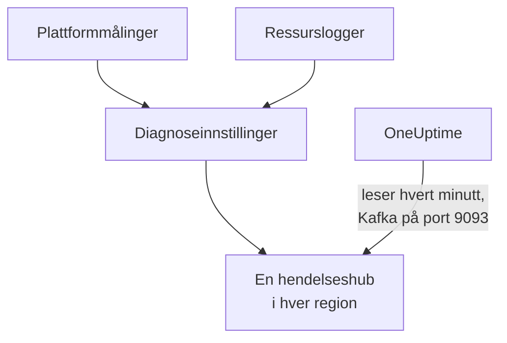

# Strøm Azure Monitor-målinger og -logger

Et tilkoblet Azure-abonnement kan strømme Azure Monitor-målingene og ressursloggene sine til OneUptime. Diagnoseinnstillinger sender dem til hendelseshuber i abonnementet ditt, og OneUptime leser hendelseshubene hvert minutt: nøkkelmålinger kommer noen minutter etter at Azure Monitor har dem, i stedet for ved tilkoblingens neste lesing, og ressurslogger kommer som OneUptime-logger, hver arkivert under ressursen den gjelder. Én kommando i Azure Cloud Shell setter det opp, og det er ingenting å kjøre.

:::cards
- [Slik fungerer det](#slik-fungerer-det): Diagnoseinnstillinger sender til en hendelseshub i hver region, og OneUptime leser dem.
- [Sett opp strømming](#sett-opp-strømming): Velg hva som skal strømmes, slå på lesing og kjør én kommando.
- [Hva som kommer](#hva-som-kommer): Målinger på ressursene de måler, og logger på ressursene de kommer fra.
- [Hva kommandoen oppretter](#hva-kommandoen-oppretter): Hver ressurs og hver tillatelse kommandoen oppretter i abonnementet ditt.
- [Stopp strømmingen](#stopp-strømmingen): Stopp lesingen, og slett deretter det kommandoen opprettet.
:::

## Slik fungerer det



- **En hendelseshub i hver region.** En diagnoseinnstilling sender bare til en hendelseshub i ressursens egen region, så kommandoen oppretter et Event Hubs-navnerom i hver region ressursene dine er i, alle i én ressursgruppe, og retter hver ressurs sin diagnoseinnstilling mot hendelseshuben i regionen.
- **OneUptime leser dem.** Azure Monitor sender bare til en hendelseshub, en lagringskonto eller et Log Analytics-arbeidsområde, aldri til en adresse hos deg: en hendelseshub som OneUptime leser, er veien der du ikke trenger å kjøre noe. OneUptime logger på som tilkoblingens egen app, som får lese de hendelseshubene og ingenting annet.
- **Lesingene overlater strømmede målinger til strømmen.** Mens strømmen leverer nøkkelmålingene til en ressurstype i en region, slutter tilkoblingens lesinger å skrive dem, så ingen datapunkter telles to ganger. Lesingene fortsetter å finne ressurser, tilstanden deres og endringene deres, og tar målingene tilbake etter 15 minutter uten en hendelse.
- **Ingenting går tapt mens OneUptime ikke kan lese.** Hendelser venter i hendelseshubene til OneUptime leser dem, så lenge hendelseshubene tar vare på dem, og OneUptime husker hvor langt den har lest hver partisjon, så den fortsetter der den slapp.

## Før du begynner

- **Et tilkoblet Azure-abonnement.** Koble det til først under **Sky → Koble til**: se [Koble til en skykonto](/docs/telemetry/cloud-accounts).
- **En prosjekteier eller administrator.** Bare de kan slå på lesing og stoppe strømmingen.
- **Azure Cloud Shell**, pålogget som **Owner** av abonnementene, eller som **Contributor** som også er **User Access Administrator**: kommandoen oppretter en ressursgruppe og en rolletildeling, og endrer diagnoseinnstillinger.
- **En vei ut til Azure, på en selvhostet OneUptime.** OneUptime leser hvert navnerom på `<namespace>.servicebus.windows.net` på port 9093, og navnerommene tar imot tilkoblinger fra internett.

## Sett opp strømming

:::steps
### Åpne strømmedialogen

Gå til **Sky → Koble til**, og velg **Strøm målinger og logger** i raden til Azure-abonnementet.

### Velg hva som skal strømmes

**Målinger** strømmer hver nøkkelmåling for hver ressurs, minutt for minutt: målingene OneUptime viser og vurderer hver ressurs etter. **Målinger og logger** legger til hver ressurs sine egne logger, hver kategori Azure fører for den, og **Logger** strømmer bare ressurslogger.

### Slå på lesing

Velg **Slå på lesing**. OneUptime ser etter hendelseshubene hvert minutt, og venter på dem til kommandoen har opprettet dem.

### Kjør kommandoen i Azure Cloud Shell

Kopier kommandoen, kjør den i Azure Cloud Shell og vent til den er ferdig. Den forteller hver region den opprettet en hendelseshub i, hvor mange ressurser som sender til dem, og hvilke ressurser den utelot, med Azures begrunnelse.

### Vent på de første hendelsene

Dialogen spør med noen sekunders mellomrom hva som har kommet. Azure begynner å sende noen minutter etter at kommandoen er ferdig; dialogen forteller da hva som kom hvorfra, og raden til tilkoblingen sier **Strømmer**.
:::

**Flere felt** inneholder resten:

| Felt | Hva det gjør |
| --- | --- |
| **Abonnementer** | Abonnementene det skal strømmes fra: først de tilkoblingen leser. Det første har hendelseshubene, og OneUptime leser dem der. Høyst 50 |
| **Sett det opp på en annen måte** | Navnene kommandoen bruker, for å sette det opp med Terraform eller portalen |

Når tilkoblingen ennå ikke har lest noe abonnement, eller flere enn 50, ber dialogen i stedet om **Abonnementer** før trinnene sine.

Når det første abonnementet ikke er det OneUptime leser hendelseshubene i, sier dialogen det: velg **Les dem der** før du kjører kommandoen.

## Hva som kommer

| Hva | Hvor det havner |
| --- | --- |
| Nøkkelmålinger | På skyressursene de måler, i de samme seriene som tilkoblingens lesinger skriver |
| Ressurslogger | I loggutforskeren, under tilkoblingens telemetritjeneste, med abonnementet, regionen og kategorien som attributter |
| Logger for en ressurs OneUptime kjenner | Også på den ressursen: siden dens i Sky får en fane **Logger** |

Strømmen bærer nøkkelmålingene tilkoblingen leser minutt for minutt. En måling den leser med grovere oppløsning, for eksempel brukt kapasitet i en lagringskonto, blir hos lesingene. En logg arkiveres under ressursen sin etter ressursens ARM-ID, som bæres som `cloud.resource_id`, og beholder kategori, operasjon, resultat og egenskaper som attributter, for eksempel `azure.category`.

Virtuelle maskiner, skaleringssett, disker, nettverksgrensesnitt, virtuelle nettverk, private endepunkter, NAT-gatewayer, DNS-soner og App Service-planer sender ingen egne ressurslogger, så sidene deres har ingen fane **Logger**. Loggene til en lagringskonto er tjenestenes, og loggene til en containerapp er miljøets.

## Hva kommandoen oppretter

Ressursgruppen heter `oneuptime-stream-` etterfulgt av de første 8 tegnene i tilkoblingens ID. Den gir ikke OneUptime tilgang til ressursene dine: tilkoblingens app får lese hendelseshubene, og ikke noe mer.

| Ressurs | Hva den får gjøre |
| --- | --- |
| En ressursgruppe, `oneuptime-stream-<suffix>`, i det første abonnementet | Har hendelseshubene, merket med tilkoblingens ID som `oneuptime-connection` |
| Et Event Hubs-navnerom i hver region, `oneuptime-<suffix>-<region>`, på Standard-nivået med 1 gjennomstrømningsenhet | Tar imot det diagnoseinnstillingene i regionen sender |
| En hendelseshub i hvert, `oneuptime`, med 2 partisjoner | Tar vare på hendelsene til OneUptime leser dem |
| Rollen **Azure Event Hubs Data Receiver** for tilkoblingens app, bare på ressursgruppen | Lar appen lese hendelseshubene, og ingenting annet |
| En diagnoseinnstilling på hver ressurs, `OneUptime-<suffix>` | Sender ressursens målinger, logger eller begge deler til hendelseshuben i regionen |

En ressurs i en global region, for eksempel Front Door, sender til hendelseshuben i den første regionen. En ressurs Azure bare fører målinger eller bare logger for, settes opp med det den har, og en som allerede har 5 diagnoseinnstillinger, det meste Azure tillater, utelates. Azure fakturerer gjennomstrømningsenheten til hvert navnerom per time, og hendelsene diagnoseinnstillingene sender.

## Stopp strømmingen

:::steps
### Stopp lesingen

Velg **Stopp strømmingen** i raden til abonnementet under **Sky → Koble til**. OneUptime slutter med en gang å lese hendelseshubene, og tilkoblingen leser alle målingene sine etter tidsplanen igjen. Det som er lest, blir værende.

### Slett det kommandoen opprettet

Hendelseshubene og diagnoseinnstillingene blir værende i Azure, og Azure fakturerer dem, til de slettes. Dialogen viser kommandoen: den sletter diagnoseinnstillingen til hver ressurs og deretter ressursgruppen, uansett hvilket abonnement den ligger i.

```bash
oneuptime_stream_stop() {
  local SUB ID N=0
  for SUB in '11111111-aaaa-4aaa-8aaa-111111111111' '22222222-bbbb-4bbb-8bbb-222222222222'; do
    while IFS= read -r ID; do
      if [ -z "$ID" ]; then continue; fi
      az monitor diagnostic-settings delete --name OneUptime-6f1c3a2e --resource "$ID" --output none 2> /dev/null &
      N=$((N + 1))
      if [ $((N % 4)) -eq 0 ]; then wait; fi
    done < <(az resource list --subscription "$SUB" --query "[].id" --output tsv)
  done
  wait
  for SUB in '11111111-aaaa-4aaa-8aaa-111111111111' '22222222-bbbb-4bbb-8bbb-222222222222'; do
    if [ "$(az group exists --subscription "$SUB" --name oneuptime-stream-6f1c3a2e 2> /dev/null)" = true ]; then
      az group delete --subscription "$SUB" --name oneuptime-stream-6f1c3a2e --yes --no-wait && echo "Deleting oneuptime-stream-6f1c3a2e in $SUB."
    fi
  done
}
oneuptime_stream_stop
```
:::

For å endre hva som strømmes, åpner du **Strøm målinger og logger** igjen, velger hva som skal strømmes og kjører den nye kommandoen: den oppdaterer det den første kjøringen opprettet, og oppretter ingenting to ganger.

## Sett det opp på en annen måte

Opprett med Terraform eller portalen det kommandoen oppretter, med disse navnene:

| Innstilling | Verdi |
| --- | --- |
| Ressursgruppe | `oneuptime-stream-<suffix>`, i abonnementet OneUptime leser hendelseshubene i |
| Event Hubs-navnerom | `oneuptime-<suffix>-<region>`, ett i hver region med en ressurs som skal strømmes |
| Hendelseshub | `oneuptime`, i hvert navnerom |
| Diagnoseinnstilling | `OneUptime-<suffix>` på hver ressurs, til hendelseshuben i regionen, med navnerommets regel `RootManageSharedAccessKey` |
| Rolle | **Azure Event Hubs Data Receiver** for tilkoblingens app, på ressursgruppen |

Slå deretter på lesing, med det abonnementet først under **Abonnementer**.

## Feilsøking

:::details Dialogen fortsetter å vente på de første hendelsene
Sjekk at kommandoen ble ferdig, og at den sa at hendelseshuben i en region er klar: `az eventhubs namespace list --resource-group oneuptime-stream-6f1c3a2e` viser navnerommene. En diagnoseinnstilling sender bare det Azure Monitor har, så en ressurs som ikke gjør noe, sender lite. En ny rolle kan bruke noen minutter på å tre i kraft: til da ser ikke lesingene hendelsene.
:::

:::details Tilkoblingen sier Strøm feiler
Dialogen og verktøytipset til raden sier hvorfor. Når appen ikke får lese hendelseshubene, kjører du kommandoen igjen: den gir appen rollen sin på nytt. Når OneUptime ikke nådde dem, sjekker du at navnerommene tar imot tilkoblinger fra internett, og at en selvhostet OneUptime får nå port 9093.
:::

:::details Kommandoen utelot ressurser
Den lister dem, hver med Azures begrunnelse. En ressurs av en type uten diagnoseinnstillinger sender ingenting, og på en som allerede har 5 diagnoseinnstillinger, må én av dem slettes først. Kjør deretter kommandoen igjen.
:::

## Neste trinn

:::cards
- [Koble til en skykonto](/docs/telemetry/cloud-accounts): Hva en tilkobling leser, og hvor ofte.
- [Strøm Google Cloud-logger](/docs/telemetry/cloud-streaming-google-cloud): Loggene til et Google Cloud-prosjekt, pushet via Pub/Sub.
- [Strøm CloudWatch-målinger og -logger](/docs/telemetry/cloud-streaming): Målingene og loggene til en AWS-konto, levert av Amazon Data Firehose.
- [Loggutforsker](/docs/telemetry/logs-explorer): Søk og filtrer i det strømmene har levert.
:::
